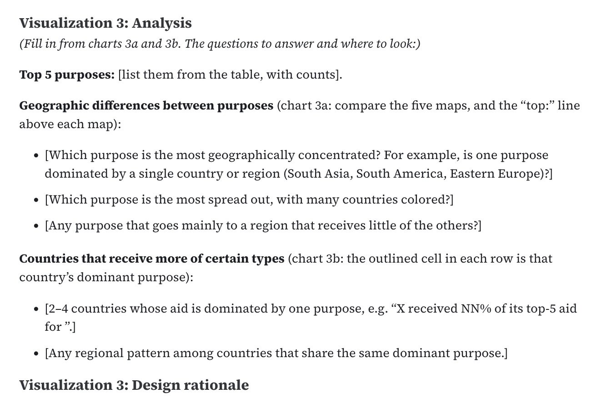

## Week 11 Lab Overview

|User Interface|Graphics Library|Notebook(s)|
|:--|:--|:--|
| <a href="https://observablehq.com" target="_blank" rel="noopener noreferrer">observablehq.com</a> | <a href="https://d3js.org/" target="_blank" rel="noopener noreferrer">D3</a> | <a href="https://observablehq.com/@rk2546/2026-infovis-cse_week-11-lab" target="_blank" rel="noopener noreferrer">Week 11 Lab Notebook</a> |

### Today's Lab Activities

Today we will be a exploring the following topics:

1. Group and Mini Projects: Reminders
2. AI Policy Reminders
3. Main Lab Activities:
    1. Re-exploring the Iris Dataset
    2. Principal Component Analysis in JavaScript
    3. K-Means Clustering in JavaScript

## Group and Mini Projects: Reminders

| **Assignment** | **Due Date** | **Details** |
|---------------|--------------|-------------|
| **Mini-Project #2** | Nov. 12 (Done) | Temporal Data Visualizations |
| **Milestone #3: First Draft** | Nov. 16 | Initial D3 implementations |
| **Mini-Project #3** | Nov. 26 | Relationships and Networks |


## Group Project Milestone #3: Deliverables

Submit a write-up alongside your Github repository (which should list either an **Observable notebook** or a **Framework project**) with:

* Brief introduction to your project
* For each question:
  - State the question
  - Show the D3 visualization
  - Describe what the visualization shows
  - Answer the question based on the visualization

---

### At this stage:

<br />

* All visualizations should be implemented in D3
* Focus on getting the basics working
* Styling/polish can come later
* Interactivity should be functional (if included)
* It's still okay to refine questions if needed

## Milestone #3: Reminders

This is your first implementation milestone.

- **We expect working D3 code for all your visualizations.** 
- Your visualizations don't need to be perfect, but they should work and show your data correctly.
    - labels might be messy
    - colors might be defaults
    - interactions might be basic  
- This is when you discover implementation challenges: 
    - "This chart type is harder than I thought..."
    - "The data is more complex than I realized..."
- We'll give you feedback on what to improve for the next draft.

---

### Please keep in mind...

<br/> 

- **Share your Github repositories with us**. Double-check if `ctsilva` and `kimryan0416` have been shared collaborative access with your groups' Github repositories. _Simply sharing a URL is insuffiicent._
- **Add AI Usage Policy**. All groups should have an accessible, detailed disclosure policy on AI usage in their project.
- **Late submissions will no longer be accepted.** If you want meaningful feedback, please submit on time; submissions made after the midnight deadline will be ignored and treated as if they were not submitted.

## Usage of AI: Reminders

<a href="https://ctsilva.github.io/2026-InfoVis-CSE/syllabus#ai-policy" target="_blank">Course AI policy:</a>

> If you use an AI to guide you in completing an assignment, you must disclose which parts were generated by the AI. Remember that you are responsible for any errors or inaccuracies in AI-generated content, and **you must be able to explain all submitted work.**

<br />

Sufficient AI disclosusres must mention explicity:

1. What model were used (Claude, ChatGPT, Qwen, Gemini)
2. Where they were used (e.g. code development, figure generation)
3. How they were used (e.g. debugging, ideation, translation)
4. Where manual work was performed (e.g. AI was just a debugging tool; most work was done manually V.S. AI did most of the work; I just supervised)

**Being honest is a virtue that is valued amongst instructors**. If your disclosure is insufficient in describing where and how AI was used, this can **reflect badly during final evaluation of your project and your participation in the class**.

## A Request: Limit AI Usage

Out of 44 students active in the class...

**42 students** reported using some AI to aid in chart generation for **Mini-Project #1**.

Code ends up generating like:

```js
svg.append("g").attr("transform", `translate(${m.left},0)`)
    .call(d3.axisLeft(y).tickValues(ticks).tickFormat(fmtTick))
    .call(g => g.selectAll(".tick line").clone().attr("x2", W - m.left - m.right - zeroGap).attr("stroke-opacity", 0.08))
    .call(g => g.append("g").attr("transform", `translate(0,${y0})`)
        .call(t => t.append("line").attr("x2", -6).attr("stroke", "currentColor"))
        .call(t => t.append("text").attr("x", -9).attr("dy", "0.32em").attr("fill", "currentColor").attr("text-anchor", "end").text("$0")))
    .call(g => g.append("text").attr("x", -m.left + 4).attr("y", m.top - 14).attr("fill", "currentColor")
        .attr("text-anchor", "start").attr("font-weight", "bold").attr("font-size", 12)
        .text("↑ Total DONATED, 1973–2013 (constant USD, log scale)"));
}
```

---

Some either forgot to prompt their AI, or failed to replace prompts with their own.




## AI Usage in Milestone #2

Students were explicitly **discouraged** from using AI to plot sketches. Despite this, we noticed:

- Some groups used AI to generate `matplotlib` code that inspired their (digital) sketches.
- Some generated digital versions, and then hand-drew them.
- Some just flat-out used genAI to create their sketches.

**Please follow instructions and adhere to our AI disclosure policy!**

## Lab Activities

|User Interface|Graphics Library|Notebook(s)|
|:--|:--|:--|
| <a href="https://observablehq.com" target="_blank" rel="noopener noreferrer">observablehq.com</a> | <a href="https://d3js.org/" target="_blank" rel="noopener noreferrer">D3</a> | <a href="https://observablehq.com/@rk2546/2026-infovis-cse_week-11-lab" target="_blank" rel="noopener noreferrer">Week 11 Lab Notebook</a> |

## Group and Mini Projects: Reminders

| **Assignment** | **Due Date** | **Details** |
|---------------|--------------|-------------|
| **Mini-Project #2** | Nov. 12 (Done) | Temporal Data Visualizations |
| **Milestone #3: First Draft** | Nov. 16 | Initial D3 implementations |
| **Mini-Project #3** | Nov. 26 | Relationships and Networks |

Don't be afraid to ask questions!