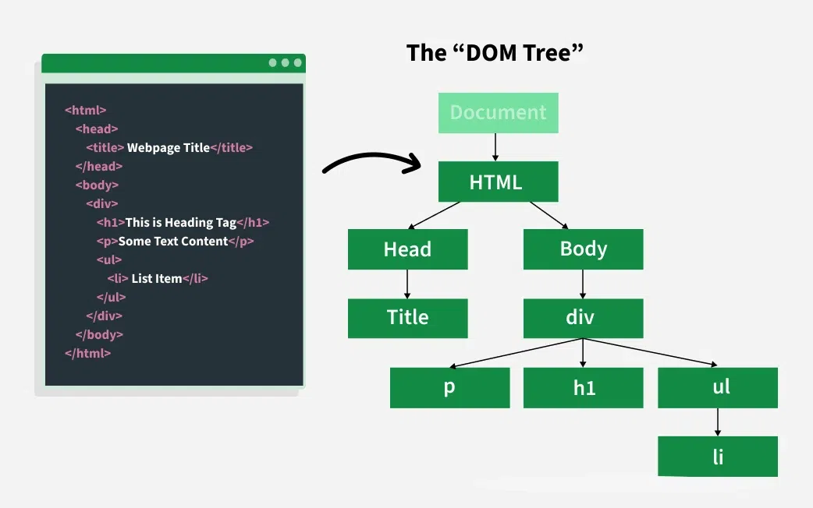
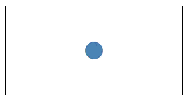
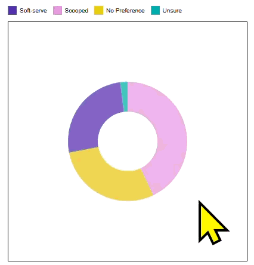
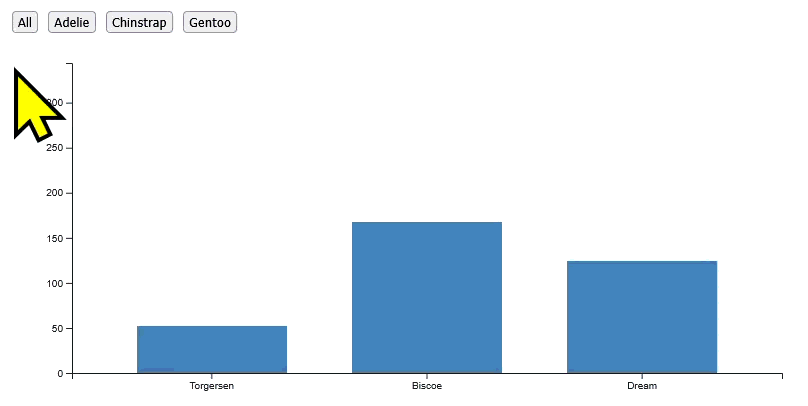

## Week 6 Lab Overview

|User Interface|Graphics Library|Notebook|
|:--|:--|:--|
|<a href="https://observablehq.com" target="_blank">observablehq.com</a>|<a href="https://d3js.org/" target="_blank">D3</a>|<a href="https://observablehq.com/@rk2546/2026-infovis-cse_week-7-lab" target="_blank">Week 7 Lab Notebook</a>|

### Today's Lab Activities

Today we will be a exploring the following topics:

1. Review: HTML DOM and Event Handling
2. Basic Example: Buttons and Observable
3. New Chart: Pie Chart
4. Mouse Interactions

## Review: DOM and Event Handling

:::{.columns}

::::{.column width="50%"}

{width="100%"}
_Image souce:_ [GeekForGeeks](https://www.geeksforgeeks.org/javascript/dom-document-object-model/)

::::

::::{.column width="50%"}

Two broad ways to manipulate the DOM:

:::::{.incremental}
- **Direct manipulation**: Users interact directly with the data in the visualizations (e.g., by clicking the bar or item). This must be implemented as part of the visualization itself and requires JS event handling.
- **Indirect manipulation**: Users interact with a separate, but linked interactive element (e.g., search field to filter). In Observable we can use the Input library for the input forms; in normal HTML5 websites, we need use form elements such as `<button>` and `<input>`.
:::::

::::

:::

## Event Handling Syntax


:::{.columns}

:::: {.column}

Using HTML and JavaScript, select any HTML elements in the DOM that **match a query**.

```html
<!-- HTML -->
<button id="example">Hello World</button>
```
<br />

```js
// JavaScript
let button = document.querySelector("button#example");
```

::::

::::{.column}

Then, attach an **event listener** that "listens" for events that happen to those elements.

```js
button.on("click", myButtonIsClicked);
```

::::

::::{.column}

Finally, set the event listener to **handle what happens when the event is triggered**.

```js
function myButtonIsClicked() {
  console.log("Hello back!");
}
```

::::

:::

<br />

By this point, you'll want to be familiar with the following concepts:

1. HTML <a href="https://www.w3schools.com/html/html_form_input_types.asp" target="_blank">input types</a> and other interactable <a href="https://www.w3schools.com/html/html_form_elements.asp" target="_blank">form elements</a> (e.g. `<button>`, `<textarea>`).
2. CSS <a href="https://www.w3schools.com/css/css_selectors.asp" target="_blank">selectors</a> such as `#id` or `.class`.
3. JavaScript <a href="https://www.w3schools.com/jsref/dom_obj_event.asp" target="_blank">event types and their functions</a>.


## Basic Input Types

|Input Type|HTML Tag|Description|
|:-|:-|:-|
|Button|`<input type="button">` or `<button>`|The classic button!|
|Checkbox|`<input type="checkbox">`|Toggle **any** from a set|
|Radio|`<input type="radio">`|Choose **only one** from a set|
|Select|`<select>` and `<option>`|Choose one or any from a set (drop-down, usually)|
|Text|`<input type="text">`|Enter freeform single-line text|

## JavaScript/TypeScript v.s. D3.js

Interactions necessitate that you have HTML elements. Usually, you'll just add these directly into your HTML code. However, more dynamic interfaces will usually generate them via JavaScript or TypeScript. You can also do the same with D3.js. 

:::{.columns}

::::{.column}

### Native Java/TypeScript

```js
// Button Element Creation
let button = document.createElement("button");
button.setAttribute("id","js_button");
button.textContent = "Button created with D3.js";

// Event Handling
button.addEventListener("click", () => {
  console.log("Hello JS/TS button!");
});

// Unique to Observable/Framework
display(button);
```

::::

::::{.column}

### D3.js:

```js
// Button Element Creation
let button = d3.create("button")
  .attr("id", "d3_button")
  .text("Button created with D3.js");

// Event Handling
button.on("click", () => {
  console.log("Hello D3.js button!");
});

// Unique to Observable/Framework
display(button.node());
```

::::

:::

<br />

_**Be careful of unique identifiers like `id`!** Above, we distinguished our buttons using different `id`'s: "js_button" and "d3_button"._


## Why? Direct DOM Manipulation!

JavaScript natively allows us to access the DOM and create, modify, or delete HTML elements. This ability usually extends to TypeScript and other libraries such as D3.js. You'll usually encounter them in the form of:

:::{.columns}

::::{.column}

### Mouse Events

- Hovering over elements
- Tooltips
- Clicks & Dragging

::::

::::{.column}

### Transitions

- Animations
- Changes over Time

::::

::::{.column}

### Indirect Manipulations

- Data Filtering
- Data Searching & Querying
- Modality-Switching

::::

:::


## Mouse Events

Mouse events are perhaps the most direct way of letting a user interact with data. We've encountered a simple example of mouse events long before: the `vl.tooltip()` element we used in Vega-Lite.

JavaScript gives us access to some core event types associated with the mouse, including:

- `mousedown` / `mouseup`: These events fire when a mouse button is pressed down or released over an element, respectively.
- `click`: Fires after both a `mousedown` and `mouseup` event occur on the same element with the main mouse button (usually the left).
- `mousemove`: Fires continuously as the mouse pointer moves over an element, providing positional information (coordinates) about the cursor.
- `mouseover`: Fires when the pointer moves over an element (or one of its children).
- `mouseout`: Fires when the pointer leaves an element.

These definitions and more are defined <a href="https://www.w3schools.com/jS/js_events_mouse.asp" target="_blank">here</a>. There are definitely some nuances you need to remember (e.g. the difference between `mouseover` v.s. `mouseenter`).


## Mouse Position Data

When we call mouse events such as `mousemove`, `event.clientX` and `event.clientY` are how we can access the mouse's position. This changes slightly using D3.js, but the overall logic is the same.

:::{.columns}

::::{.column}

### Native JavaScript 

```{js}
document.addEventListener("mousemove", function (event) {
  document.getElementById("demo").innerHTML =
  "X: " + event.clientX + " Y: " + event.clientY;
});
```

::::

::::{.column}

### D3.js

```{js}
d3.select(document).on("mousemove", function(event) {
  d3.select("#demo").text(
    "X: " + event.clientX + " Y: " + event.clientY
  );
});
```

::::

:::

---

However, **`event.clientX` and `event.clientY` refer to the _absolute_ position of the mouse on the browser window**. If we want to get the _relative_ position of the mouse with respect to its parent (or any other element on the webpage), then we need a different procedure.

<br />

:::{.columns}

::::{.column}

### Native JavaScript

```{js}
document.querySelector("#demo").addEventListener("mousemove", function(event) {
  let rect = this.getBoundingClientRect();
  let x = event.clientX - rect.left;
  let y = event.clientY - rect.top;
  // Do whatever with `x` and `y`
});
```

::::

::::{.column}

### D3.js

```{js}
d3.select("#demo").on("mousemove", function(event) {
  let [x, y] = d3.pointer(event, this);
  // Do whatever with `x` and `y`
});
```

::::

:::


## Lab Exercise #1: Making a Tooltip (5 min)

We created an SVG with a single circle populating it. We also have a <text> element also inside our SVG, but it's currently hidden using some CSS. Let's make this more exciting by trying the following:

- When the mousemove event occurs with the circle, the tooltip should:
  - no longer be styled to be hidden,
  - should move with the mouse, albeit offset by 10px both rightward and upward, and
  - should print out the position of the mouse, relative to `<svg>` element.
- When the mouseout event occurs with the circle, the tooltip should disappear using CSS styling.




## Transitions

Transitions aren't so much of an interaction as they are a visual way to communicate a _change_ in state. Transitions are very important for two reasons:

1. Improving viewers' interpretation of quantitative data, and
2. Improving viewers' engagement with the material in of itself.

There are many research papers on this topic; I recommend <a href="https://idl.uw.edu/papers/animated-transitions" target="_blank">"Animated Transitions in Statistical Data Graphics" by Jeffrey Heer, George Robertson</a> - particularly, <a href="https://vimeo.com/19278444" target="_blank">their video attached to their report</a>.

<iframe title="vimeo-player" src="https://player.vimeo.com/video/19278444?h=51587fc950" width="640" height="360" frameborder="0" referrerpolicy="strict-origin-when-cross-origin" allow="autoplay; fullscreen; picture-in-picture; clipboard-write; encrypted-media; web-share"   allowfullscreen></iframe>


## D3.js Transitions

The D3.js implementation for transitions is very easy, because a lot of animation is abstracted away using D3.js's `transition()` function. We highly recommend that you <a href="https://d3js.org/d3-transition" target="_blank">read up on documentation surrounding D3.js' transitions</a>!

```{js}
// Create our circle, append it to `svg`, and define its properties
svg.append("circle")
  .attr("cx", 150)
  .attr("cy", 100)
  .attr("r", 15)
  .attr("fill", "steelblue")
  // Handle when the mouse enters the circle
  .on("mouseenter", function() {
    d3.select(this)      // D3.js selects `this` (i.e. the circle)
      .transition()      // Declares the transition
      .duration(500)     // Sets the duration of the transition
      .attr("r", 40);    // Makes the transition aim for a radius of 40px
  })
  // Handle when the mouse leaves the circle
  .on("mouseleave", function() {
    d3.select(this)      // D3.js selects `this` (i.e. the circle)
      .transition()      // Declares the transition
      .duration(500)     // Sets the duration of the transition
      .attr("r", 15);    // Makes the transition aim for a radius of 15px
  });
```


## Lab Exercise #2: Transitions with Donut Charts (10 min)

We previously covered Pie Charts in <a href="https://observablehq.com/@rk2546/2026-infovis-cse_week-6-exercise" target="_blank">Exercise #6</a>. In this case, we're working with <a href="https://d3-graph-gallery.com/graph/donut_basic.html" target="_blank">Donut Charts</a> - a variant of Pie Charts that has an inner radius.

We initially have a donut chart depicting ice cream statistics. By default, each arc has an opacity of 75%. We want to animate this pie chart such that:

:::{.columns}

::::{.column width="50%"}

- When the mouse hovers over a donut chart arc, we should:
  - Set the inner radius to 25
  - Set the outer radius to 125
  - Set the opacity to 100%
- When the mouse moves out of a donut chart arc, we should:
  - Set the inner radius back to 50
  - Set the outer radius back to 100
  - Set the opacity back to 75%

::::

::::{.column width="50%"}



::::

:::

## Indirect Manipulations

Indirect manipulations are useful for dashboards where users may expect some kind of controls for modifying visualizations. This requires some forethought about what kind of HTML inputs you think users would like to have access to, such as search bars for filtering or buttons to modify the appearance of a chart.




## Planning Out Interactions: Dynamic v.s. Static Elements

If you're struggling, one good practice is to **separate between dynamic and static variables** - which values, scales, etc. can remain the same, and what needs to be updated whenever we select a button, type a text into a search bar, etc? 

1. Most aspects of an interactive plot - the SVG itself, the axes and their axes, and the way we are rendering data - can remain the same. What REALLY changes is **the data being rendered**.
2. If we change the data, we need to also consider anything downstream of that to also change. This means that even though the way we render the data is consistent, **we still need to perform that operation whenever we change the data.**
3. We need to create some interactable elements (e.g. buttons, checkboxes, text inputs) that have event listeners attached to them. Those event listeners must initiate the changes we mentioned above.

## An Important Change: `.join()`

So far, we've usually used `.enter().append()` to create new SVG elements for data items that were not mapped to visual elements... _at least, you should have been using this_. 

However, this no longer applies here, because we've already rendered our points, bars, lines, etc., so calling `.enter().append()` will not actually change the bars. We instead need to use `.join()`, which allows us to modify existing HTML elements that are already mapped to data.

:::{.columns}

::::{.column}

### What we did before:

```{js}
svg.selectAll(".bar")            // Search for all elements with the class "bar"
  .data(counts, d => d.island)   // Set the data to our `counts` Array;
  .enter()                       // Select all data items that do not have a ".bar" element mapped to them
    .append("rect")              // Create a rect
      .attr("class", "bar")      // Give it a class name.
      .attr("x", d => x_scale(d.island))    // Set the x and width of the rect
```

::::

::::{.column}

### What we need to do now:

```{js}
svg.selectAll(".bar")            // Search for all elements with the class "bar"
  .data(counts, d => d.island)   // Set the data to our `counts` Array;
  .join("rect")                  // Create a rect for every data item, even for those that were already created
    .attr("class", "bar")        // Give it a class name.
    .attr("x", d => x_scale(d.island))    // Set the x and width of the rect
```

::::

:::


## Lab Exercise #3: Buttons -> Transitions (10 min)

The <a href="https://github.com/allisonhorst/palmerpenguins/blob/main/inst/extdata/penguins.csv" target="_blank">Palmer Penguins Dataset</a> is a useful tool for this part because penguin statistics can be grouped in several different ways. Like we did before, we'll be creating bar charts that shows the counts of penguins per island. 

We've provided most of the legwork for rendering chart. Specifically, the buttons and SVG elements are already created, and we already have a helper function updateChart(STRING) that is called when we want to update the bars. However, we need to update this operation:

- Modify `updateChart(STRING)` to filter data based on the STRING passed to it, and then update the way the bars are rendered to account for the change.
- Map `updateChart(STRING)` to the buttons that are rendered alongside the chart.


## References

### Interactive Examples

There are a multitude of different examples of interactive visualizations out there. Here are some standout examples. Pay attention to how they code variables, track mouse events, and implement any transitions and such.

- <a href="https://observablehq.com/@mradamcox/interactive-map-mosaic" target="_blank">A button to make the visualization a full-screen interaction</a>
- <a href="https://observablehq.com/@d3/learn-d3-interaction" target="_blank">Input Events with Line Graphs, by D3</a>
- <a href="https://observablehq.com/@nyuvis/interaction" target="_blank">Mouse interactions with scatter plots, legends, and more, by Enrico Bertini's Visualization Lab</a>

### Inspirations

- <a href="https://observablehq.com/@thinkh/step-5-filter-us-cities?collection=@thinkh/build-your-first-d3-bar-chart" target="_blank">Holger Stitz's "Interactive filtering" Tutorial</a>
- <a href="https://observablehq.com/documentation/inputs/overview" target="_blank">D3's "Inputs Overview"</a>
- <a href="https://medium.com/@kj_schmidt/show-data-on-mouse-over-with-d3-js-3bf598ff8fc2" target="_blank">KJ Schmidt's "Show data on mouse-over with d3.js"</a>
- <a href="https://idl.uw.edu/papers/animated-transitions" target="_blank">Jeffrey Heer and George Robertso's "Animated Transitions in Statistical Data Graphics"</a>

## End of Lab

### Mini-Projects

No more exercises!  But we will be transitioning to **Mini-Projects**!

- Mini-projects are bi-weekly; you are given **2** weeks to complete them.
- Prompts are much more open. You are expected to **think creatively** on how to answer prompts and **provide written answers** that go beyond surface-level analysis.
- Please follow our class's <a href="https://ctsilva.github.io/2026-InfoVis-CSE/syllabus#ai-policy" target="_blank">AI Policy</a> regarding disclosing where and how you used AI, if you chose to do so.

Mini-Project #1 is due in 2 weeks, on **October 29th @ 11:59pm**

### Group Projects

- <a href="https://forms.gle/qqKF7hPGoy3hvaEc7" target="_blank">Project Group Check-in</a> - At your earliest convenience!
- Milestone #1 Submission due soon!

### Have Questions?
- Where do I ask questions?
  - Office Hours!
  - Our course Discord!
  - Email!