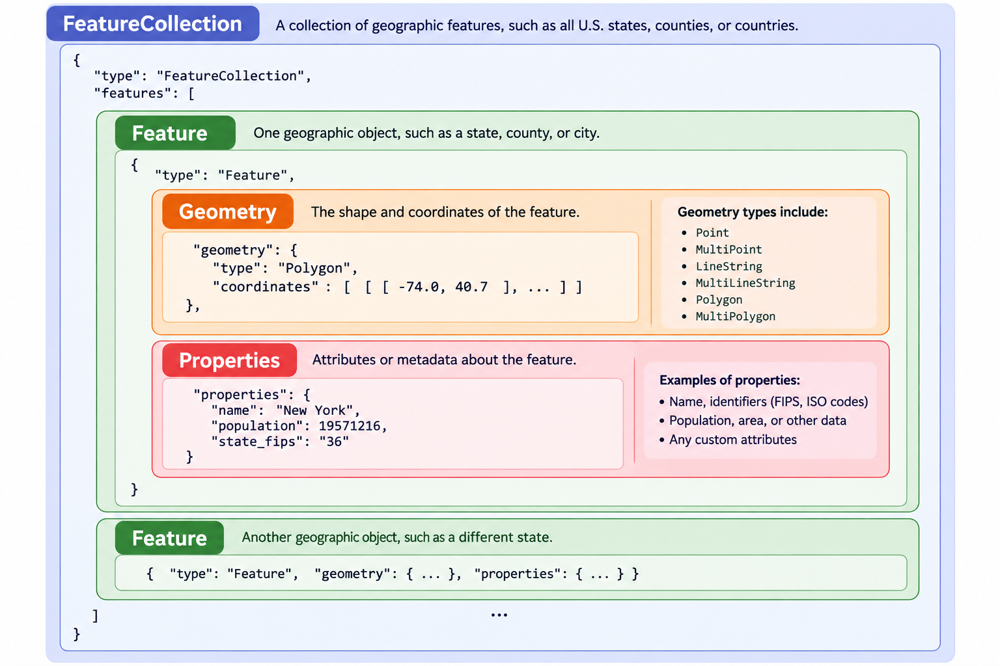
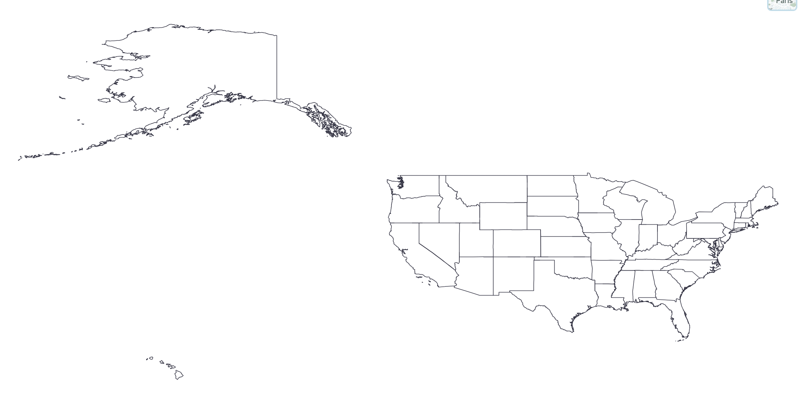
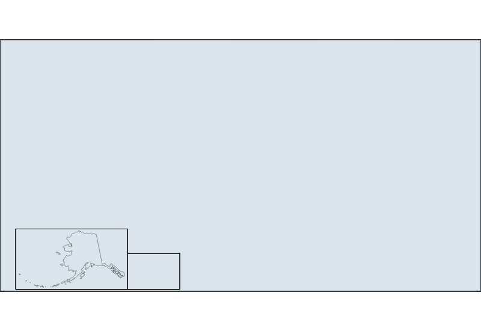
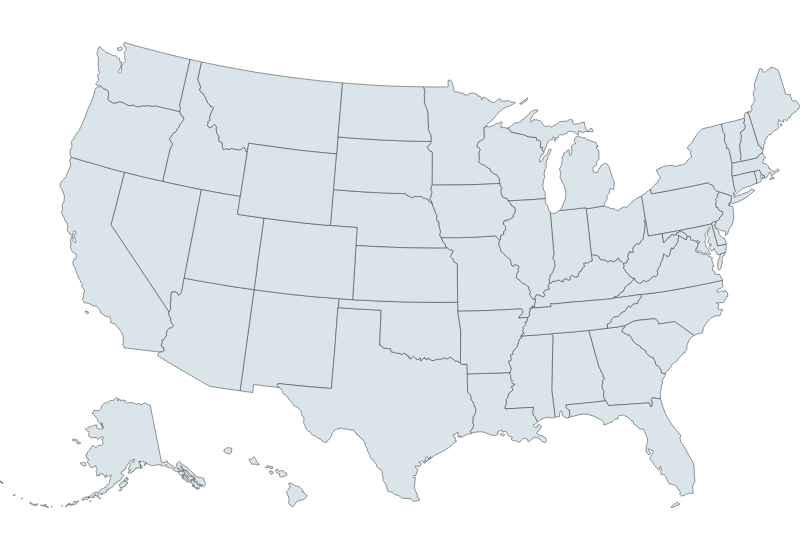

## Week 8 Lab Overview

|User Interface|Graphics Library|Notebook(s)|
|:--|:--|:--|
|<a href="https://observablehq.com" target="_blank">observablehq.com</a>|<a href="https://d3js.org/" target="_blank">D3</a>|<a href="https://observablehq.com/@rk2546/2026-infovis-cse_week-8-lab" target="_blank">Week 8 Lab Notebook</a>|

### Today's Lab Activities

Today we will be a exploring the following topics:

1. Understanding GeoJSON - What is it?
    - GeoJSON's Coordinate System
    - GeoJSON Geometry & Properties
2. Where to Find Geodata?
    - ShapeFiles to GeoJSON
3. D3.js and Maps
4. Troubleshooting GeoJSON and D3.js
5. Practice: Creating Maps of Countries


## What is GeoJSON?

### Definition

> GeoJSON is an open standard format designed for representing simple geographical features, along with their non-spatial attributes. It is based on the JSON format. - [Wikipedia](https://en.wikipedia.org/wiki/GeoJSON)

<br />

### GeoJSON Hierarchy

{fig-align="center"}


## Example GeoJSON

```json
{
  "type": "FeatureCollection",
  "features": [
    {
      "type": "Feature",
      "geometry": {
        "type": "Polygon",
        "coordinates": [
          [
            [-74.0, 40.7],
            [-73.9, 40.7],
            [-73.9, 40.8],
            [-74.0, 40.8],
            [-74.0, 40.7]
          ]
        ]
      },
      "properties": {
        "name": "Example Region",
        "population": 10000
      }
    }
  ]
}
```

- `geometry` determines where the region is and what its shape is.
- `properties` provides information about that region.

<a href="https://geojson.org/" target="_blank">GeoJSON Markup Guide</a>


## GeoJSON Coordinate System

GeoJSON follows a geographic coordinate system where the positions are usually stored as:

```{js}
[LONGITUDE, LATITUDE]
```

|Coordinate|Valid range|Meaning|
|:-|:-|:-|
|Longitude|−180° to +180°|West to East|
|Latitude|−90° to +90°|South to North|

GeoJSON follows a specific standard of long/lat coordinates called the <a href="https://en.wikipedia.org/wiki/World_Geodetic_System" target="_blank"><strong>World Geodetic System (WGS)</strong></a> - specifically, **WGS 84** (or otherwise called **EPSG:4326**). You should remember that long/lat coordinates are not pixel positions; they are degrees relative to the Prime Meridian and Equator, respectively.


## GeoJSON Geometry

There are **six (6)** fundamental geometry types, plus `GeometryCollection`:

|Geometry Type|Description|Format|
|:-|:-|:-|
|`Point`|A single coordinate point, such as a building or pin on a map|`[lon, lat]`|
|`MultiPoint`|Multiple _independent_ points|`[[lon, lat], ...]`|
|`LineString`|A connected path, like a river or road|`[[lon, lat], ...]`|
|`MultiLineString`|Several _independent_ lines|`[[[lon, lat], ...], ...]`|
|`Polygon`|One polygonal region, potentially with _holes_|`[[[lon, lat], ...], ...]`|
|`MultiPolygon`|Multiple polygonal groups, combined into a single entity|`[[[[lon, lat], ...], ...], ...]`|

---

All polygons are constructed from **one or more rings**. Each ring must begin and end **at the same coordinate**. Consider this example, which actually has two (2) rings: an exterior ring, and an interior _hole_.

```{js}
{
  type: "Polygon",
  coordinates: [
    // Exterior boundary
    [
      [0, 0],
      [10, 0],
      [10, 10],
      [0, 10],
      [0, 0]
    ],

    // Interior hole
    [
      [3, 3],
      [3, 7],
      [7, 7],
      [7, 3],
      [3, 3]
    ]
  ]
}
```

GeoJSON requires that **Exterior rings should be counterclockwise** and that **Interior holes should be clockwise**, using the <a href="https://en.wikipedia.org/wiki/Right-hand_rule" target="_blank">Right-Hand Rule (RHR)</a>.


## GeoJSON Properties

Unlike `geometry`, `properties` usually contain metadata about the geometry. For example:

```js
{
  "GID_1": "USA.1_1",
  "GID_0": "USA",
  "COUNTRY": "UnitedStates",
  "NAME_1": "Alabama",
  "TYPE_1": "State",
  "ISO_1": "US-AL"
}
```

These are properties of the state of Alabama. This particular instance gives us a lot of info, such as which country the region is a part of, what kind of region it is to begin with, and other identifiers. 

- **Properties make it easier to link datasets together**, as you can link identifiers across datasets. 
- Properties can also **hold information** (e.g. population counts for a region).


## Where can we Find Geodata?

Geodata is usually a combination of different data sources:

1. Geographic boundary data (GeoJSON, TopoJSON, etc.) is usually converted from "ShapeFiles" (`.shp`).
2. Geographic data points (e.g. points on a map) can also be encoded as GeoJSON data.
3. Data trends and time series data are usually in the typical data format (e.g. `.csv`, Excel) and need to be mapped to GeoJSON features.

You can find existing GeoJSON files in the wild, such as in <a href="https://cdn.jsdelivr.net/npm/us-atlas@3/states-10m.json" target="_blank">Vega-Lite's pre-existing US-Atlas GeoJSON</a> or . However, _you don't really have much control over the fidelity and properties of the GeoJSON itself_.

---

### Step 1: Find an appropriate ShapeFile

1. <a href="https://www.census.gov/geographies/mapping-files/time-series/geo/carto-boundary-file.html" target="_blank">US Census Cartographic Boundaries Data</a>: Geographic data of U.S. regions based on different features such as zip code divisions, census data, etc. Optimal for U.S.-focused boundary data.
2. <a href="https://gadm.org/data.html" target="_blank">https://gadm.org/data.html</a>: An open-source solution that's freely accessible for academic and non-commercial usage. Recommended to download by country.
3. <a href="https://www.naturalearthdata.com/downloads/" target="_blank">https://www.naturalearthdata.com/</a>: A sizeable repository of ShapeFiles for world regions.

### Step 2: Simplify and convert from ShapeFile to GeoJSON

- <a href="https://mapshaper.org/" target="_blank">https://mapshaper.org/</a>
- <a href="https://www.qgis.org/" target="_blank">https://www.qgis.org/</a>

### Step 3: Load, understand, and troubleshoot your GeoJSON


## Let's try Steps 1 and 2

Let's download the `.shp` data from the <a href="https://www2.census.gov/geo/tiger/GENZ2018/shp/cb_2018_us_region_5m.zip" target="_blank">US Census Cartographic Boundary Files Datasets</a>, then use <a href="https://mapshaper.org/" target="_blank">MapShaper</a> to convert it into GeoJSON

{width=100%}


## Step 3: Rendering Geomaps in D3.js

Rendering geoplots in D3.js is conceptually very similar to what we did with other non-scatter plot types such as Pie Charts and Histograms. Fundamentally, we need to:

1. Determine what kind of **projection** we want to project our points onto.
2. Create a **path generator** that maps raw points to our projection.
3. Render **paths** using our path generator.

```{js}
// Determine our plot's dimensions
const usa_width = 800;
const usa_height = 550;

// Define projection using Albers USA, our plot's dimensions, and `us_state_5m` we imported
const usa_projection = d3.geoAlbersUsa()
  .fitSize([usa_width, usa_height], us_state_5m);

// Create geographic path generator
const usa_path = d3.geoPath(usa_projection);
```


## Projection Types in D3

:::{.columns}
::::{.column width="33%"}

### Azumithal Projections (<a href="https://d3js.org/d3-geo/azimuthal" target="_blank">documentation</a>)
- `d3.geoAzimuthalEqualArea()`
- `d3.geoAzimuthalEquidistant()`
- `d3.geoOrthographic()`

::::
::::{.column width="33%"}

### Conic Projections (<a href="https://d3js.org/d3-geo/conic" target="_blank">documentation</a>)
- `d3.geoConicConformal()`
- `d3.geoConicEqualArea()`
- `d3.geoAlbers()`
  - US-centric!

::::
::::{.column width="33%"}

### Cylindrical Projections )(<a href="https://d3js.org/d3-geo/cylindrical" target="_blank">documentation</a>)
- `d3.geoMercator()`
- `d3.geoEquirectangular()`
- `d3.geoEqualEarth()`

::::
:::


## Step 3: Rendering Geomaps in D3.js

If we render our SVG as a series of paths:

:::{.columns}

::::{.column width="50%"}

```{js}
// Create SVG
const usa_svg = d3.create("svg")
  .attr("width", usa_width)
  .attr("height", usa_height);

// Render each state as a path, with a fill, stroke, and stroke-width
usa_svg.selectAll("path")
  .data(us_state_5m.features)
  .enter()
    .append("path")
      .attr("d", usa_path)
      .attr("fill", "#D9E5EA")
      .attr("stroke", "#333")
      .attr("stroke-width", 0.5);
```

::::

::::{.column width="50%"}

{fig-align="center"}

::::

:::

... **Uh oh.**


## Troubleshooting GeoJSON and D3.js

This is a common problem with D3.js and GeoJSON. Namely, **there is a discrepancy between GeoJSON's Right-Hand-Rule (RHR) convention and D3.js's spherical geometry implementation**. To prevent issues like these, we need to consider:

1. Are there any `null` geometries in our data?
2. Are the `Polygon` and `MultiPolygon` geometries in our dataset the correct winding order?

The winding direction issue is not always a _mandatory_ fix - it really depends on where you are getting the data from. It is your responsibility to **check if the GeoJSON data renders properly, and if not then fix the two likely problems above**.

---

{fig-align="center"}


## Practice: Produce 3 Graphs (15mins)

Attempt to generate the geodata of one other country <strong>other than the USA</strong>. You can use any of the references mentioned above for getting your ShapeFiles, converting them into GeoJSON, and troubleshooting their issues upon importing them.

- Try playing around with different geometries, ouside of just country borders.
- Try different projection types provided by D3

When you are done, upload a screenshot of your plot to <a href="https://drive.google.com/drive/folders/1z9Xyz-NPLKEWVf3fXKfO3jFM5A1W8LbT?usp=sharing" target="_blank">this Google Drive folder</a> with your name, NetID, and country in the filename.


## Group Projects: Proposal Feedback & Reminders

- Projects range in topics from sound profiles to railway maps to health problems - **good spread**.
- Visualization implementations **must be in D3**. Data processing is up to you (e.g. Python).
- Strongly recommend either Framework or Observable Notebooks.

| **Milestone** | **Due Date** | **Details** |
|---------------|--------------|-------------|
| ~~**Proposal**~~ | ~~Oct 20~~ | ~~Problem statement, dataset, questions~~ |
| **Data Analysis & Sketches** | Nov 3 | Data tables and visualization sketches |
| **First Draft** | Nov 17 | Initial D3 implementations |
| **Second Draft** | Dec 1 | Refined narrative and polished visualizations |
| **Final Submission** | Dec 8 | Complete project with presentation |


## Final Reminders & Checks

- **Data Analysis & Sketches** - Due Nov 3 @ 11:59pm - Data tables and visualization sketches.
- **Mini-Project #1**: Due next week (Oct. 29 @ 11:59pm)
- Questions?
    - Office Hours!
    - Discord!
    - Email!