# Welcome to the Third Dimension {background-color="#2c5f77"}

## Our Journey Through Geovisualization

::: {.columns}
::: {.column width="33%"}
### Week 8: 2D Static Maps

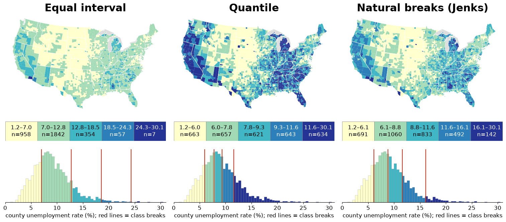{width="100%" fig-align="center"}

Projection, normalization, classing
:::

::: {.column width="33%"}
### Week 9: 2D + Time

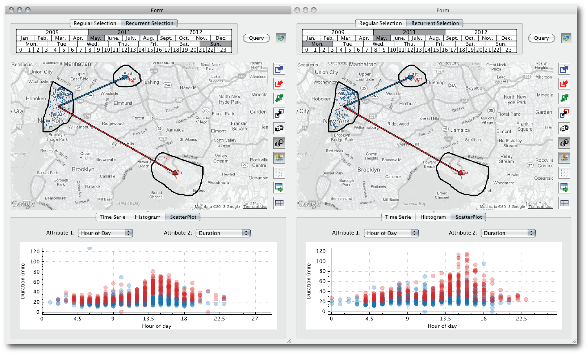{width="100%" fig-align="center"}

Urban flows, interactivity, linked views
:::

::: {.column width="33%"}
### Week 10: 3D + Simulation

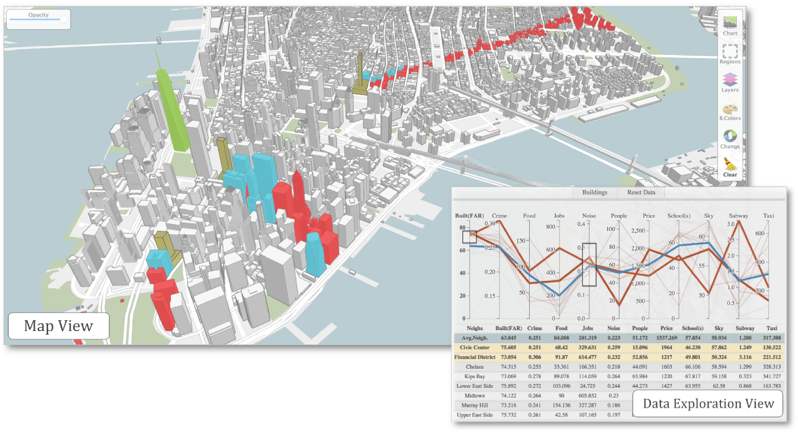{width="100%" fig-align="center"}

Built environment, form, impact analysis
:::
:::

::: {.notes}
Welcome back. Over the last two weeks we looked at geographic data in two dimensions. In Week 8 we learned the rules of static maps: choose a projection on purpose, normalize before you color, and remember that the classing scheme you pick changes the story. In Week 9 we made those maps interactive and added time, using TaxiVis to explore millions of taxi trips. Today we add the third dimension. We are looking at the built environment, the city's 3D form, and at how a planner can ask "what if we build this here?" and get an answer in real time. Today's case study, Urbane, is from the same group that built TaxiVis, so you will recognize the design vocabulary: visual queries and linked views.
:::

## Today's Focus: The Built Environment

::: {.r-fit-text}
**From flat maps to the three-dimensional form of the city**
:::

::: {.incremental}
- **Week 8**: Geography as abstract areas and boundaries
- **Week 9**: Movement and flows across 2D space
- **Week 10**: Physical structures: buildings, streets, skylines
:::

::: {.fragment}
### Today's Goal:

Explore how 3D visualization supports urban planning, architectural design, and impact simulation.
:::

::: {.notes}
The arc of the lecture. First, why 3D at all, using Kevin Lynch as the motivation. Second, the urban planning problem and why planners lack good tools. Third, a long case study, Urbane, a 3D framework linking a city model with 2D data views. Fourth, interactive impact analysis: sky exposure and landmark visibility computed on the fly. Fifth, a second paper from the same project that goes from analyzing one proposed building to exploring a catalogue of thousands of tower designs. We finish with a critical question that the authors themselves raise: when is 3D the right choice, and when is it chart junk?
:::

# Part 1: Why 3D? The Human Experience {background-color="#2c5f77"}

## Kevin Lynch's "Image of the City" (1960)

::: {.columns .smaller}
::: {.column width="50%"}
**The Fundamental Question:**

How do people mentally map a city?

::: {.fragment}
**Lynch's Answer:**

Not through abstract 2D maps, but through **five types of elements** that we experience in 3D.
:::
:::

::: {.column width="50%"}
::: {.fragment}
**The method:**

- Interviews and sketch maps from residents of Boston, Jersey City and Los Angeles
- What people remember and draw is a small set of recurring elements
- A city is *legible* when those elements are easy to identify and connect
:::
:::
:::

::: {.notes}
Why 3D? Because we experience the city in 3D. Kevin Lynch, an urban planner at MIT, studied how residents of three American cities (Boston, Jersey City and Los Angeles) mentally map where they live, by interviewing them and asking them to sketch their city. People do not remember a precise 2D map. They remember a small set of recurring elements, and Lynch called a city "legible" when those elements are easy to identify and connect into a coherent pattern. This is a visualization idea in disguise: the mental map is the user's internal visualization of the city, and good urban form supports it. The next slide lists the five elements.
:::

## Lynch's Five Elements

::: {.columns}
::: {.column width="50%"}
### 1. Paths
Streets, walkways, transit lines: channels of movement

### 2. Edges
Shorelines, walls, boundaries: linear breaks in continuity

### 3. Districts
Neighborhoods, zones: areas with common character
:::

::: {.column width="50%"}
### 4. Nodes
Plazas, intersections: focal points of activity

### 5. Landmarks
Key buildings, monuments: unique reference points

::: {.fragment}
**Most of these depend on height, mass or visibility, so they are fundamentally 3D concepts.**
:::
:::
:::

::: {.notes}
Walk through the five with Manhattan examples. Paths: Broadway, the subway lines. Edges: the Hudson and East Rivers, the High Line. Districts: the Financial District, Chelsea, Midtown, which, as we will see, is exactly how Urbane partitions the city. Nodes: Times Square, Union Square. Landmarks: the Freedom Tower, the Empire State Building. Landmarks are the clearest case for 3D: a landmark is a landmark because you can see it from far away, which is a statement about height and line of sight that a 2D footprint cannot express. Keep this in mind for the landmark-visibility measure later.
:::

## The Experiential Dimension

::: {.columns}
::: {.column width="50%"}
**2D maps show:**

- Location
- Proximity
- Area
- Connectivity (topology)

**But they miss:**

- Height and mass
- Shadows and light
- Visual prominence
- Sense of enclosure
:::

::: {.column width="50%"}
**3D visualization reveals:**

- Building heights and skylines
- Shadow patterns throughout the day
- Sight lines and viewsheds
- Spatial enclosure and openness

::: {.fragment}
These are **essential** for understanding how a city *feels* to inhabit.
:::
:::
:::

::: {.notes}
A summary of what 2D gives us and what it hides. A footprint map tells you a building exists and where, but not how tall it is, whether it blocks the sun from a park, or whether it hides the view of a landmark. Those questions drive real decisions in zoning and development, and they are the reason a 3D model is more than decoration. We will make these precise today as two impact measures, sky exposure and landmark visibility.
:::

# Part 2: The Urban Planning Challenge {background-color="#2c5f77"}

## Rapid Global Urbanization

::: {.r-fit-text}
**By 2050: about 68% of the world's population will live in cities**
:::

::: {.fragment}
### The Challenge:

Making decisions about massive new developments:

- 80-story residential towers
- Transit mega-projects
- Urban renewal districts
:::

::: {.fragment}
### The Question:

How do we know the *impact* of these developments on neighborhoods, residents, and the urban fabric?
:::

::: {.notes}
Last week we saw the United Nations figure that more than half of humanity lives in cities. The projection is that about two thirds will by 2050. That growth is accommodated by building, and every large building changes its surroundings: light, views, traffic, the character of the neighborhood. The question for visualization is how to give the people making those decisions the evidence to judge the impact before the building exists.
:::

## Current Scenario: Limited Tools

::: {.columns}
::: {.column width="40%"}
* **Decisions based on:** experience, precedent, negotiation
* **Analysis tools:** off-the-shelf design software; limited, not interactive
* **Visualization:** a few static, pre-rendered images
* **Data:** exists (city open data) but is not integrated into the design process
:::

::: {.column width="60%"}
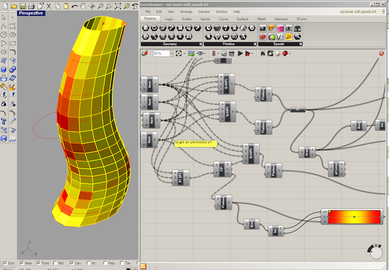{width="100%" fig-align="center"}
:::
:::

::: {.notes}
When a developer proposes a new tower, how do city planners actually know its impact on the neighborhood? As the Urbane authors put it, architects and planners typically rely on experience, precedent and data analyzed in isolation from the design. The tools in the room are off-the-shelf design packages like the parametric one shown on the right: powerful for modeling, but they require advanced coding to add user-defined analyses, they are not built for exploring a design space, and they are not connected to city data. Evaluation by clients is hard because all they see are a handful of static renderings. What if we could build a tool for data-driven, interactive decision making?
:::

## The Gap: What's Missing

::: {.columns}
::: {.column width="50%"}
### What planners and architects need:

1. **Integrated data access:** building characteristics, environmental metrics, social and economic data
2. **Interactive exploration:** query and filter dynamically, with linked views
:::

::: {.column width="50%"}
### And what they need to do with it:

3. **Impact simulation:** "what-if" scenarios with real-time feedback
4. **Decision support:** compare options and trade-offs, across several scales
:::
:::

::: {.notes}
Four requirements, which the next section turns into the design of a system. Integrated data access is the data-management problem. Interactive exploration is the linked-views idea from Week 9. Impact simulation is new: the system computes consequences, not just displays data. Decision support means the output is a comparison of options at different scales, from a single building up to a neighborhood, not one answer. Keep this list in mind: when we meet Urbane, check each requirement against what the system does.
:::

# Part 3: Case Study - Urbane {background-color="#2c5f77"}

## Urbane: A 3D Framework for Urban Planning

**A 3D framework to support data-driven decision making in urban development**

{fig-align="center"}

::: {.footer}
Ferreira, N., Lage, M., Doraiswamy, H., Vo, H., Wilson, L., Werner, H., Park, M., & Silva, C. (2015). [*Urbane: A 3D Framework to Support Data Driven Decision Making in Urban Development*](https://hvo.github.io/papers/urbane.pdf). IEEE VAST 2015.
:::

::: {.notes}
This is Urbane, built with architects at Kohn Pedersen Fox, a large New York architecture firm. Like TaxiVis it is a set of linked views, but now the primary view is a 3D model of Manhattan, the Map View, and the second view, the Data Exploration View in the lower right, is a parallel coordinates plot plus a table of neighborhood or building attributes. In this figure the green tower is the Freedom Tower, a landmark; the olive buildings are proposed new constructions; the red buildings are those whose view of the landmark would be adversely affected by them, and the blue ones are those that would gain. We will unpack all of this in the next sections.
:::

## Urbane: Three Components

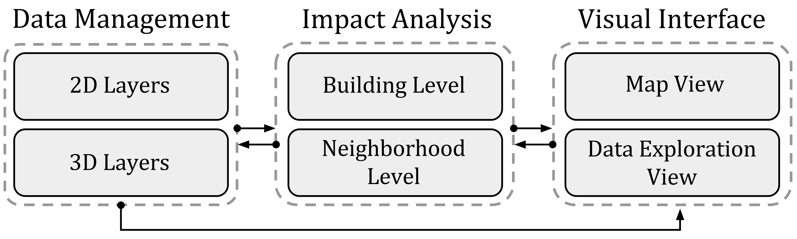{fig-align="center"}

::: {.footer}
Ferreira et al. (2015). [*Urbane*](https://hvo.github.io/papers/urbane.pdf), Fig. 2.
:::

::: {.notes}
The architecture has three parts. Data management holds 2D layers (points, lines, polygons and grids, for example crime, subway stations, neighborhoods) and 3D layers (the building meshes), and indexes them so they can be retrieved fast. Impact analysis computes how a change to the city affects its surroundings, at the building level and at the neighborhood level. The visual interface is the Map View plus the Data Exploration View, and, as the arrows show, the views are linked in both directions. Compare with the four requirements from the previous section: data access is the first box, simulation is the second, and exploration and decision support are the third.
:::

## Data Layers: 2D and 3D Together

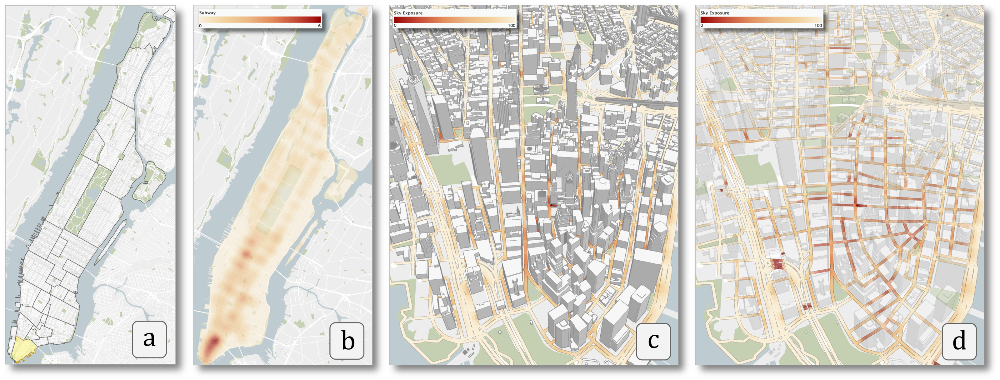{fig-align="center"}

::: {.footer}
Ferreira et al. (2015). [*Urbane*](https://hvo.github.io/papers/urbane.pdf), Fig. 4.
:::

::: {.notes}
Examples of the layers. (a) A polygon layer, here the neighborhoods of Manhattan, with the Financial District highlighted. (b) A grid layer: the density of subway stations. (c) 2D and 3D layers in one view: the sky exposure computed along the roads, plus the 3D building geometry. (d) Transparency can be adjusted so that a 2D layer is not occluded by the 3D buildings. That last point is one of the practical answers to the occlusion problem we will discuss at the end: let the user fade the 3D context when it gets in the way. The city is Manhattan throughout, not Boston, and the data comes from NYC open data and OpenStreetMap.
:::

## The Power of Linked Views in 3D

::: {.r-fit-text}
**Brushing and linking works in 3D, too!**
:::

::: {.columns .fragment}
::: {.column width="50%"}
### 3D → 2D

Select buildings or a neighborhood in the map

↓

See their attributes in the data exploration view

**Use case:** "What are the characteristics of this neighborhood?"
:::

::: {.column width="50%"}
### 2D → 3D

Brush ranges on the parallel coordinates axes

↓

See matching buildings highlighted in the 3D map

**Use case:** "Show me buildings near a park with good subway access"
:::
:::

::: {.notes}
This is the same brushing and linking idea from last week. I can select a neighborhood or a set of buildings in the 3D world and see their attributes in the parallel coordinates plot and the table. And in the other direction, I can filter in the abstract data space, by drawing boxes on the axes of the parallel coordinates plot, and the 3D model highlights exactly the buildings that satisfy the query. The paper describes it at two resolutions: neighborhood and building. You start at the neighborhood level to understand the characteristics of different parts of the city, then drill down to individual buildings to identify candidate sites.
:::

# Part 4: Linking 3D and 2D in Practice {background-color="#2c5f77"}

## Query in Data Space, See the Result in the City

**Each filter on the parallel coordinates plot updates which buildings are highlighted in the map.**

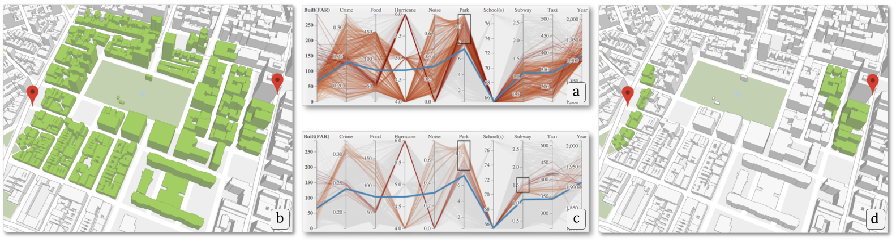{fig-align="center"}

::: {.footer}
Ferreira et al. (2015). [*Urbane*](https://hvo.github.io/papers/urbane.pdf), Fig. 5.
:::

::: {.notes}
Read the figure left to right. (a) The user first filters on the Park axis, keeping only buildings close to a park; the value on that axis is the area of park space weighted by distance. (b) The map shows in green the buildings that satisfy the constraint. (c) Then the user adds a second filter on the Subway axis, keeping the sites with a high density of subway stations nearby. (d) The remaining buildings, far fewer, are the ones satisfying both constraints. This is a visual query: the user never writes a query language expression, they draw boxes. And the answer comes back as a pattern in space, which is the part a table could never give you.
:::

## Use Case: Finding Development Sites in the Financial District

**Compare the neighborhood to the rest of Manhattan, then filter down to candidate sites.**

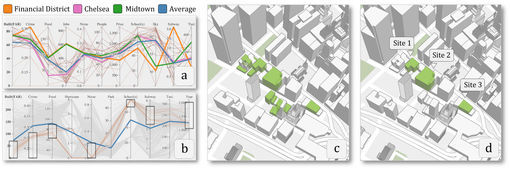{fig-align="center"}

::: {.footer}
Ferreira et al. (2015). [*Urbane*](https://hvo.github.io/papers/urbane.pdf), Fig. 6.
:::

::: {.notes}
This is the paper's use case, done with the architects. The question: where should a developer build a residential tower in the Financial District? Step one, (a): the PCP compares the Financial District (orange) with Chelsea (pink), Midtown (green) and the Manhattan average (blue). Surprising finding: the Financial District has better-than-average job density and subway access, but much lower sky exposure, which makes sense for a dense district of tall towers. This suggests new development there will be sensitive to sky exposure impact. Step two, (b) and (c): the authors filter on properties that favor a site, for example a low built FAR, meaning unused development capacity, and buildings not recently constructed. That leaves 15 candidate sites. Step three, (d): a few more filters bring it down to a small set, three sites south of the Freedom Tower, which they carry into the impact analysis. Notice the workflow moved from the neighborhood scale down to the building scale.
:::

# Part 5: Interactive Impact Analysis {background-color="#2c5f77"}

## From Visualization to Simulation

::: {.r-fit-text}
**The most powerful feature: "What-if" analysis**
:::

::: {.incremental}
- Not just *viewing* data
- But *simulating* the impact of proposed changes
- Interactively, in real time
:::

::: {.fragment}
### The Question:

**"How will a new building change its surroundings?"**
:::

::: {.notes}
So far Urbane has helped us explore the city as it is. The second half of the system is about the city as it could be. The user can replace existing buildings with a proposed design and ask what changes. This is what turns the tool from visualization into decision support.
:::

## Two Impact Measures: Landmark Visibility and Sky Exposure

::: {.columns}
::: {.column width="40%"}
* **Landmark visibility:** can a building still see a landmark, such as the Statue of Liberty or the Freedom Tower?
* **Sky exposure:** what fraction of the sky is visible from a point on the street?
* Impact = the difference between the "before" and "after" values
:::

::: {.column width="60%"}
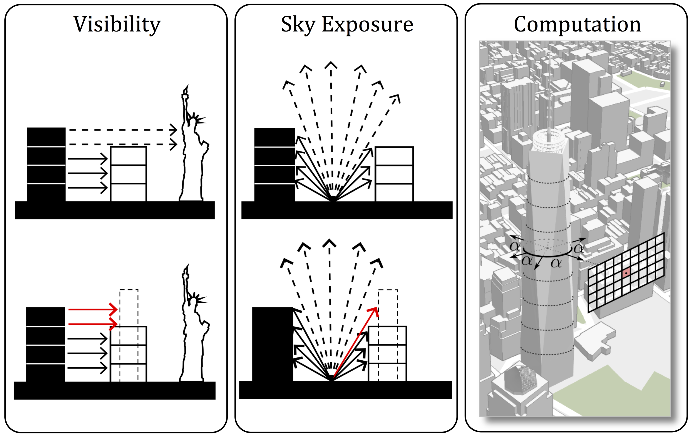{width="100%" fig-align="center"}
:::
:::

::: {.footer}
Ferreira et al. (2015). [*Urbane*](https://hvo.github.io/papers/urbane.pdf), Fig. 3.
:::

::: {.notes}
The paper picks two measures that architects and planners already care about. Landmark visibility, left panel: the white building occludes part of the landmark from the black building (top). If we swap the white building for a taller one (bottom), the red rays show the lines of sight that are now blocked. Sky exposure, middle panel: dashed rays reach the sky, solid rays are blocked. A taller building next door blocks more of them. Sky exposure is a proxy for daylight and ambient sun on a street, and city planners use it to control how much sky new buildings may take away. Right panel: how it is computed, which we get to on the next slide. Note what is not here: shadows. Shadow analysis came in a later Urbane paper; this paper is about visibility and sky exposure.
:::

## Computing Impact in Real Time

::: {.columns}
::: {.column width="50%"}
### Rasterization, not ray tracing

- Render the scene from a viewpoint into a 256 × 256 image
- Give every building a unique color
- Count pixels: how many show each building, how many show sky
- Impact = change in the counts when the geometry is replaced
:::

::: {.column width="50%"}
### Why it is fast

- The GPU does the rendering; a compute shader does the counting
- Sky exposure at 650 locations: **8.4 s on a CPU, 75 ms on a GPU** (about two orders of magnitude)
- Sky exposure computed every 10 m along every street
:::
:::

::: {.notes}
The trick is that visibility is exactly what a graphics card already computes. To measure sky exposure at a point on a street, render the scene from that point, with the camera pointed in several directions; the fraction of pixels that are sky is the sky exposure. To measure landmark visibility, place the camera at uniform heights around the landmark and render the scene, coloring each building with a unique color: the buildings that appear in the image are the ones that can see the landmark, and the pixel counts say how much. Impact is the difference in the counts before and after you change the geometry. Because this runs on the graphics pipeline, with a compute shader to do the pixel counting, the paper reports computing sky exposure at 650 locations in 75 milliseconds on a GPU, versus 8.4 seconds on a CPU. That speed is what makes it interactive: the user drops in a building and sees the answer, not a progress bar.
:::

## Urbane: Testing a Proposed Building

::: {.columns}
::: {.column width="40%"}
* The **olive** building is the proposed construction; **green** is the landmark (Freedom Tower)
* Landmark visibility: buildings in **red** lose view, **blue** gain view
* Street segments show the change in sky exposure
* The architect can swap the design and see both update
:::

::: {.column width="60%"}
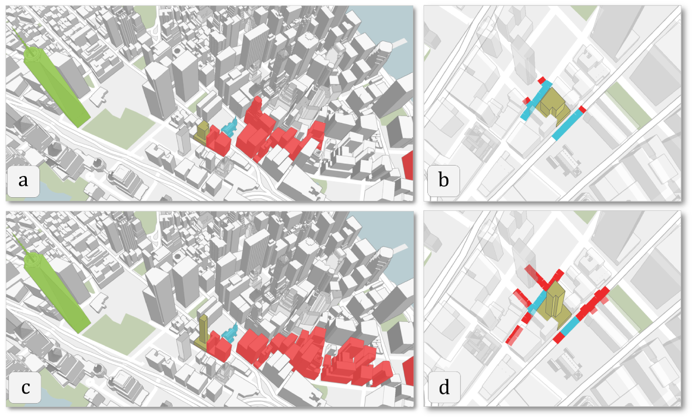{width="100%" fig-align="center"}
:::
:::

::: {.footer}
Ferreira et al. (2015). [*Urbane*](https://hvo.github.io/papers/urbane.pdf), Fig. 7.
:::

::: {.notes}
Here is what it looks like for one of the candidate sites. Top row: an 80 by 120 foot floor plate. Bottom row: a slender 65 by 65 foot plate. Left column is the 3D landmark visibility impact on the surrounding buildings; right column is the sky exposure impact on the streets nearby, red meaning less sky, blue meaning more. The point of the figure is the comparison: the two designs have visibly different footprints of impact, and the architect sees that at a glance. The paper's table backs it up: one site has the largest area and a modest impact on the neighborhood, another site is promising for high-performance retail but hurts sky exposure, and no single site is best on every measure. The tool does not give an answer; it gives the decision maker the trade-offs.
:::

## The Value of Interactive Simulation

::: {.columns}
::: {.column width="50%"}
### Traditional approach:

1. Developer provides a few static renderings
2. Planner reviews documents
3. Public hearing with limited visuals
4. Decision with incomplete information

**Iterations:** one or two
:::

::: {.column width="50%"}
### With Urbane:

1. Load the proposed design into the 3D model
2. Compute the impact instantly
3. Adjust parameters, such as the floor plate
4. Compare options, then iterate

**Iterations:** as many as time allows
:::
:::

::: {.fragment}
**More informed decisions, and stakeholders who can see the trade-offs.**
:::

::: {.notes}
Summarize the contrast. The point is not that the computer decides, it is that the cost of asking "what if?" falls from days to seconds, so more questions get asked. The architects who used it gave positive feedback, and described it as extremely fast given the amount of 2D and 3D data it displays and analyzes. They highlighted the parallel coordinates for identifying direct and indirect correlations between neighborhood data, and said being able to see the impact in 3D made the effect of a development tangible and realistic.
:::

# Part 6: Performance-Driven Design {background-color="#2c5f77"}

## Taking It Further: Explore Thousands of Designs

**Why test *one* design? Explore the whole space of designs.**

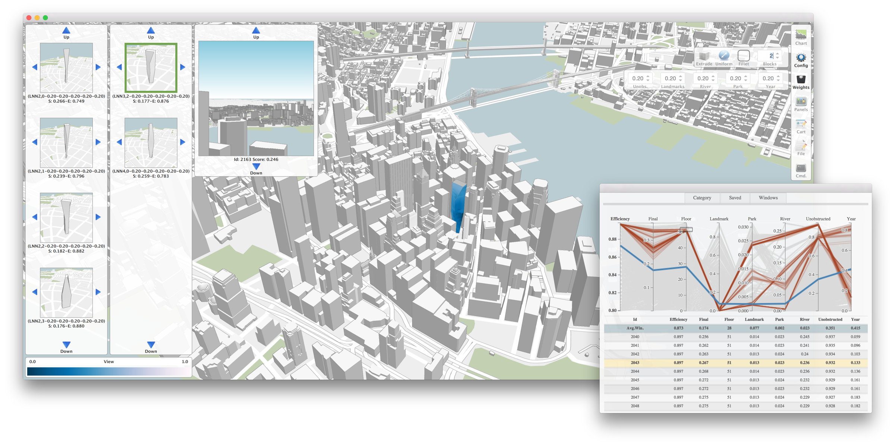{fig-align="center"}

::: {.footer}
Doraiswamy, H., Wilson, L., Werner, H., Park, M., & Silva, C. (2015). *Topology-based Catalogue Exploration Framework for Identifying View-Enhanced Tower Designs*. ACM SIGGRAPH Asia (ACM TOG 34(6)).
:::

::: {.notes}
The second paper comes out of the same collaboration with KPF, which at that point had been running for about 18 months. In Urbane, the architect proposes a design and the system tells them its impact. The next question is: instead of testing one design at a time, can the system help the architect explore a whole catalogue of designs and surface the ones that perform well? This is performance-driven design, and the performance criterion in this paper is views: how good are the views from a tower?
:::

## Why Towers, and Why Views?

::: {.columns}
::: {.column width="50%"}
### Why towers?

- Developable sites are getting smaller
- Maximize the use of the allowable building area
- The norm in dense cities

### Why views?

- Views are one of the first things people notice
- Views are limited in dense regions
- A good view adds value
:::

::: {.column width="50%"}
### The design problem:

Find tower designs that **maximize view quality** while staying practical:

- Zoning limits (FAR, maximum height)
- Minimum building efficiency
- Overlap between floor profiles
:::
:::

::: {.notes}
Towers because the average size of a developable site keeps shrinking in dense cities, so the way to use the allowed building area is to go up. Views because views add value and are scarce in dense regions. An architect designing a tower in the early stage wants to explore design variations and identify a set of good ones, subject to zoning constraints, like floor area ratio, and client constraints, like views and sunlight, and to avoid backtracking late in the process. The existing workflow is a combination of off-the-shelf software that does not support exploring a design space, so choices end up based on prior experience.
:::

## A Design Space of Tower Shapes

**A tower is generated from floor profiles and a few operations; the parameters define a design space.**

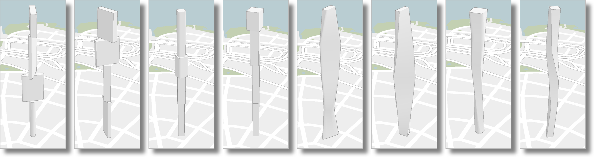{fig-align="center"}

::: {.notes}
Each tower is a loft through a few floor profiles. The parameters are things like the number of sides of each profile, the amount of rotation, the number of profiles, and operations like move, scale and fillet. Restrictions keep the designs practical: a minimum building efficiency, a limit on overlap between profiles, FAR and maximum height. Vary the parameters and you get the strips of towers in the figure, and in total hundreds of thousands of buildings. So the challenge is twofold: how do you evaluate the view from that many buildings, and how do you let a human find the interesting ones?
:::

## Quantifying View Quality

::: {.columns}
::: {.column width="40%"}
* The view along a **window** (a point and a direction) is a weighted average of several view metrics
* The weights are the user's handle: "good view" is subjective
* A **building view score** is the average over its windows
* One tower has about **10,000 windows**
:::

::: {.column width="60%"}
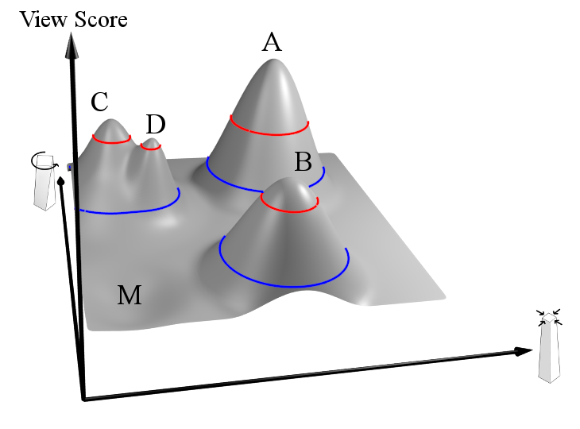{width="100%" fig-align="center"}
:::
:::

::: {.notes}
There are four categories of view quality, for instance how far you can see without obstruction. Because what counts as a good view is subjective, the system exposes the weights so the architect can tune them. A view score for a window is a weighted combination of the metrics, and the building's score is the average over all its windows. The figure on the right previews the key idea: if you take the design parameters as the axes and the view score as the height, you get a landscape, and the good designs are the peaks. The computational challenge: a single building has about 10,000 windows, and the design space has hundreds of thousands of buildings. Millions of view computations.
:::

# Part 7: Precomputation & Exploration {background-color="#2c5f77"}

## The View Index: A 4D Texture

::: {.columns}
::: {.column width="50%"}
### Precompute once

For each location (x, y, z) and viewing direction θ, store what is visible

- Grid every 10 ft in the plane, every 12 ft in height
- One direction every 6° (60 directions)
- Millions of precomputed views per site
:::

::: {.column width="50%"}
### Then look up

A view for any window is a **constant-time lookup**

- 33.3K view computations per second on a single CPU
- Over two orders of magnitude faster than exact computation
- Approximate scores track the exact ones closely
:::
:::

::: {.notes}
They solve the speed problem with preprocessing. The view index is a 4D texture: location in three dimensions plus a direction angle. For each grid location and each direction, the view is rendered once, at 130 frames per second at 256 by 256 resolution, and stored. After that, evaluating any window of any candidate building is a texture lookup rather than a rendering. The paper reports about 33 thousand view computations per second on a single CPU, more than two orders of magnitude faster than computing exactly, and shows scatterplots of approximate versus exact scores lying on the diagonal. The trade-off is the preprocessing cost and storage, one of the limitations the authors list.
:::

## Which Designs Are Interesting? Use Topology

::: {.columns}
::: {.column width="40%"}
* Sample the parameter space; each point is a tower with a view score
* Connect nearby samples (nearest-neighbor graph)
* Find the **high-persistence maxima** of the score function
* Each peak is a distinct, good design family: a catalogue
:::

::: {.column width="60%"}
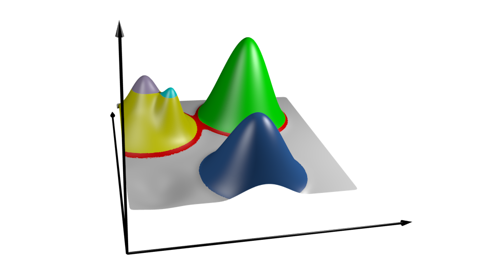{width="100%" fig-align="center"}
:::
:::

::: {.notes}
Even with fast evaluation, we do not want to hand the architect 300,000 buildings. We want a short list of distinct, good designs. The score is a high-dimensional scalar function over the parameter space. The authors sample the space, connect neighboring samples in a graph, and use topology, specifically the high-persistence maxima, to find the peaks that stand out. Persistence is what separates a real peak from noise: small bumps vanish when you smooth, tall isolated peaks do not. Each maximum is a design that is both good and different from the others, so the catalogue captures variety rather than 1,000 near-identical towers. This is a nice example of topological data analysis, which you will meet again in other courses, used for a very practical visualization goal.
:::

## Exploring the Catalogue

**A parallel coordinates view over design and view metrics lets the architect filter to the designs that matter.**

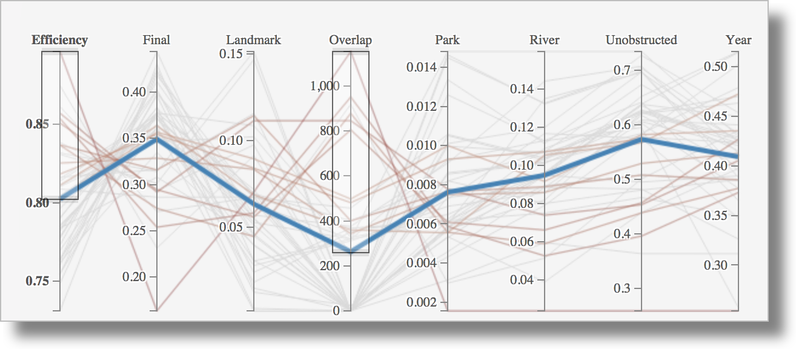{fig-align="center"}

::: {.notes}
The exploration interface should look familiar: it is a parallel coordinates plot, as in Urbane. Each line is a design, and the axes include building efficiency, landmark visibility, overlap, park and river views, and unobstructed view. The architect draws boxes on the axes to say "show me designs with high efficiency and good park views", and the linked 3D view shows what those towers look like in the city. Note that, as I said earlier, this is a PCP-based tool: if your memory of this interface is a cost versus view score scatterplot, the paper does not show one; the trade-offs are explored by brushing axes.
:::

## From Catalogue to a Building

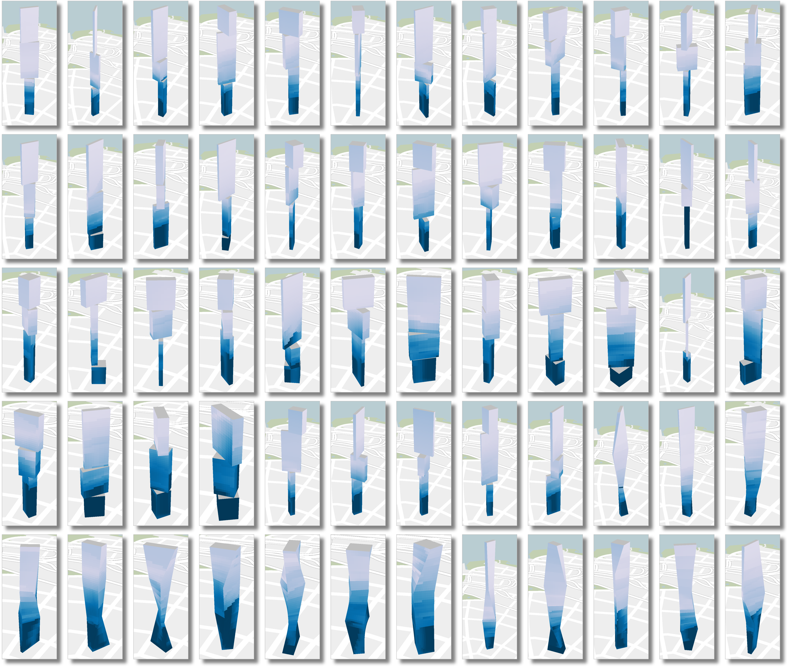{.nostretch width="55%" fig-align="center"}

::: {.notes}
The catalogue is a grid of towers, colored by view quality up the height of the building, light for good views and dark for poor ones. The architect selects one and can refine it: the next slide shows the refinement step. Because each floor has a view score, the colors also feed program decisions: put the penthouse and condos where the views are best, mechanical floors and amenities where they are not.
:::

## Refining a Design and Assigning Programs

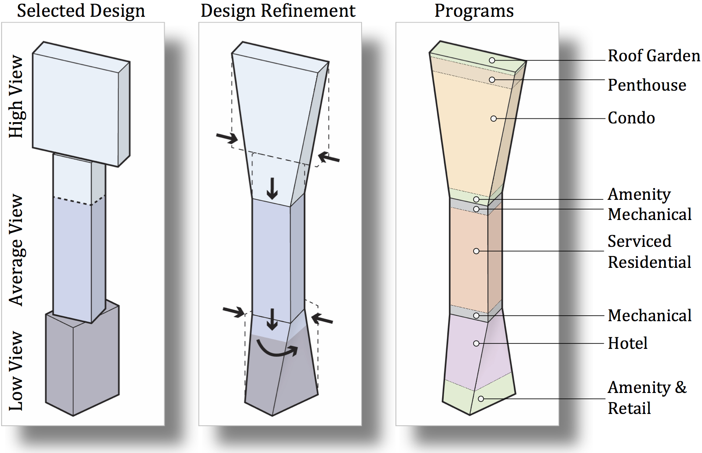{width="100%" fig-align="center"}

::: {.notes}
From left to right: a selected design with high, average and low view zones; the same design after the architect refines it, tapering and rotating the profiles; and the allocation of programs by floor. High views get the roof garden, penthouse and condos. Mid views get amenities, serviced and residential. Low views get mechanical, hotel and retail. This is the whole pipeline in one picture: generate, evaluate, explore, refine, assign. The system was deployed at KPF; the authors report positive feedback, use as a verification tool for clients, and quicker response to clients.
:::

## Performance-Driven Design: The Paradigm Shift

::: {.columns}
::: {.column width="50%"}
### Traditional design:

1. Architect sketches two or three options
2. Each is evaluated by hand
3. The client picks one
4. Refinement begins

**Exploration:** minimal
:::

::: {.column width="50%"}
### Performance-driven design:

1. Define objectives and constraints
2. Generate a large design space
3. Evaluate it automatically
4. Explore trade-offs visually
5. Select and refine

**Exploration:** comprehensive
:::
:::

::: {.fragment}
**Visualization turns an enormous search into something a person can steer.**
:::

::: {.notes}
Step back from the specifics. The paradigm shift: from a few hand-evaluated sketches to a generated, automatically evaluated space that a human explores with visual tools. The human does what humans are good at, judging, and the machine does what it is good at, enumerating and measuring. Notice that nothing here removed the architect: the weights of the view score and the final choice are still the architect's. Limitations the authors list: improving the view computation, for instance field of view and direction, the expense of the view index, and customizing views so that different parts of a building can be optimized for different views.
:::

# Part 8: Critical Reflection - When to Use 3D? {background-color="#2c5f77"}

## A Question from the Urbane Authors Themselves

**"3D? Is it the right way to go?" Same city, two representations: which question is each one good for?**

::: {.columns}
::: {.column width="50%"}
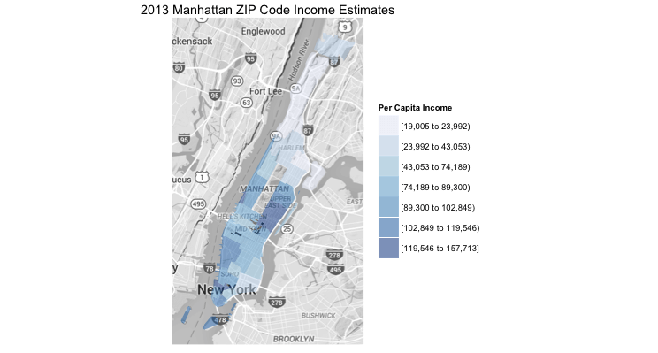{width="100%" fig-align="center"}
:::

::: {.column width="50%"}
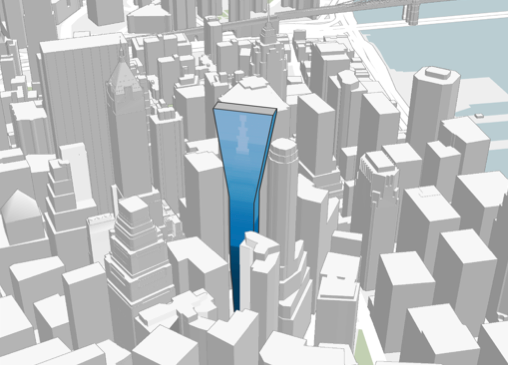{width="100%" fig-align="center"}
:::
:::

::: {.notes}
I want to take the critical question from the Urbane authors' own presentation: is 3D the right way to go? Left: a 2D choropleth of income by ZIP code in Manhattan. Right: a 3D view of a building in context. Ask the class which of these answers "which neighborhoods have the highest income?" (the choropleth, easily) and which answers "what does the view from this tower look like?" (only the 3D one). 3D looks impressive, but it is not always better. Give them two minutes, then go through the case for and against.
:::

## The Case FOR 3D

::: {.columns .smaller}
::: {.column width="50%"}
1. **Matches human experience**
   - We experience cities in 3D
   - More intuitive for non-experts
2. **Essential for certain measures**
   - Sky exposure, viewsheds, sightlines
   - Sense of enclosure
:::

::: {.column width="50%"}
3. **Public communication**
   - Stakeholders can "see" the impact
   - Supports participatory planning
4. **Reveals spatial relationships**
   - Height disparities
   - Clustering patterns
   - Neighborhood character
:::
:::

::: {.notes}
For 3D: it matches how people experience the city, which is why Lynch's elements are 3D. It is necessary for certain measures: landmark visibility and sky exposure are statements about lines of sight, which a footprint cannot hold. It communicates well with the public: a community board member can look at the 3D rendering and understand what a tower will do, without reading a chart. And it reveals the height disparities and clustering patterns that make up a neighborhood's character.
:::

## The Case AGAINST 3D

::: {.columns .smaller}
::: {.column width="50%"}
1. **Occlusion**
   - Buildings hide other buildings
   - Information loss
2. **Navigation complexity**
   - Easy to get disoriented
   - Cognitive overhead
:::

::: {.column width="50%"}
3. **Can be chart junk**
   - Adds visual complexity
   - Sometimes 2D is clearer
4. **Computational cost**
   - Rendering and interaction lag
   - Needs capable hardware
:::
:::

::: {.notes}
Against 3D: occlusion, which is the big one. A tall building hides what is behind it, and perspective distorts size, so precise comparison suffers. Navigation: it is easy to get lost, and moving a 3D camera takes cognitive effort. It can be chart junk: think of 3D bar charts, where the third dimension adds nothing and hurts accuracy. And it is computationally expensive. Notice how Urbane mitigates these: the transparency slider, the top-down 2D mode of the map, and linking to the 2D charts for precise comparison.
:::

## Guidelines: When to Use 3D

::: {.columns}
::: {.column width="50%"}
### Use 3D when:

- The question is **inherently 3D**: views, sky, shadows, height compared to neighbors
- You are analyzing **3D form**: massing, skyline, enclosure
- You need to **communicate with the public**
:::

::: {.column width="50%"}
### Use 2D when:

- The question is **statistical**: highest density, crime patterns
- You need **precise comparison**: ranking, exact values
- You want to **avoid occlusion**
- The data is **abstract or non-spatial**: networks, temporal patterns
:::
:::

::: {.notes}
A rule of thumb, not a law. If the question is about lines of sight, light or the physical form, use 3D. If it is statistical or requires precise comparison, use a 2D chart or a map. And in many real tasks, you need both, which is the next slide.
:::

## The Hybrid Approach: Link 3D and 2D

::: {.r-fit-text}
**Urbane's solution: 3D for context, 2D for precision**
:::

::: {.columns}
::: {.column width="50%"}
**3D for:**

- Spatial context
- Impact visualization
- Intuitive exploration
- Public communication
:::

::: {.column width="50%"}
**2D for:**

- Precise filtering
- Multi-dimensional queries
- Statistical overview
- Quantitative comparison
:::
:::

::: {.notes}
Urbane's answer to the question is to not choose: the map view for spatial context and impact, and the parallel coordinates for precise, multi-dimensional filtering, linked so that a selection in one updates the other. Each view covers for the weakness of the other. Occlusion in 3D is handled by selecting in 2D data space; the abstraction of a PCP is grounded by seeing the selected buildings in the city.
:::

# Part 9: Synthesis {background-color="#2c5f77"}

## From Presentation to Exploration to Simulation

::: {.columns .smaller}
::: {.column width="33%"}
### Week 8: Static presentation

- One fixed view
- The designer's perspective
- "Here is the data"

**Question:** When is spatial encoding the right choice?
:::

::: {.column width="33%"}
### Week 9: Interactive exploration

- User-driven queries
- Linked views
- "Ask your own questions"

**Question:** How do we explore massive, dynamic flows?
:::

::: {.column width="33%"}
### Week 10: Interactive simulation

- Impact prediction
- Generative design
- "Create and test scenarios"

**Question:** When is the third dimension essential?
:::
:::

::: {.notes}
The arc of the three weeks: presentation, exploration, simulation. In Week 8 the visualization designer made the choices and the reader consumed them, so the reader had to trust the designer. In Week 9 the reader became an explorer who could ask their own questions through visual queries. In Week 10 the user can also change the world and see the consequences. Each step gives the user more power, and more responsibility for understanding what the tool is doing.
:::

## Your Toolkit: Three Lenses

When approaching any geographic visualization problem, ask:

::: {.columns .smaller}
::: {.column width="33%"}
**The 2D lens (Week 8)**

- Is the projection appropriate?
- Is the data normalized?
- Are the colors and classes honest?
:::

::: {.column width="33%"}
**The temporal lens (Week 9)**

- How does the pattern change over time?
- What interactions enable exploration?
- Are spatial and temporal views linked?
:::

::: {.column width="33%"}
**The 3D lens (Week 10)**

- Is the question inherently about form?
- Does 3D add value or complexity?
- Can I simulate impact interactively?
:::
:::

::: {.notes}
A checklist to take into your mini-projects, since the second one is due Nov 19. Before you reach for a map, ask the 2D questions. If your data has a time component, ask how the pattern changes and how the views are linked. And before you reach for 3D, ask whether the question really is about form. Every visualization makes choices; make yours deliberately.
:::

## The Future of Urban Visualization

::: {.columns}
::: {.column width="50%"}
### Emerging trends:

1. **Real-time urban sensing**: live city dashboards
2. **AI-assisted design**: generative models, automated optimization
3. **Virtual and augmented reality**: on-site impact preview
4. **Participatory planning**: public-facing tools
:::

::: {.column width="50%"}
### Ongoing challenges:

1. **Scalability**: city-scale to planet-scale, in real time
2. **Accessibility**: tools for non-experts, equity in representation
3. **Validation**: are simulations accurate? uncertainty
4. **Ethics**: whose data, whose benefit, privacy
:::
:::

::: {.notes}
Where this goes. The Urbane line of work continued: the later papers add shadows and sun analysis, and more recent systems handle city-scale and, increasingly, live sensor data. The open problems are not just technical. Validation: the impact numbers look authoritative, so a wrong simulation is dangerous. Ethics: urban data is data about people; who gets to use these tools, and whose interests do the optimized designs serve?
:::

# Wrap-up {background-color="#2c5f77"}

## Today in Three Points

::: {.incremental}
1. **3D is warranted when the question is about form:** views, sky, light, height
2. **Simulation turns visualization into decision support:** "what-if" in real time
3. **Link 3D to 2D:** context and impact in the city, precision in the abstract views
:::

::: {.fragment}
### Next:

- **Lab (today):** 3D transformations, the math behind every view in a 3D map
- **Mini-project 2** (temporal visualization) is due Nov 19
- **Next week:** visualizing time-oriented data
- **Reading:** the Urbane paper (link in the syllabus)
:::

::: {.notes}
Three takeaways. Then the lab: Urbane is a 3D renderer, and the lab opens the box: how a point in a city model becomes a pixel on the screen, through transformations, homogeneous coordinates and the model, view and projection matrices. That is the math under every 3D map and under the GPU rasterization trick we discussed. Mini-project 2 is due Nov 19. Next week we go to time-oriented data.
:::

## Questions?

::: {.r-fit-text}
**Every visualization makes choices.**
:::

::: {.fragment}
Make yours **deliberately, defensibly, and ethically**.
:::
