<style>
.reveal pre { font-size: 0.72em; }
.reveal .cell-output pre { font-size: 0.9em; }
</style>

```{python}
#| include: false
import numpy as np
import matplotlib.pyplot as plt
plt.rcParams.update({"font.size": 14, "axes.titlesize": 16, "axes.labelsize": 15})
SPECIES_COLORS = ['#4477AA', '#EE6677', '#228833']
```

```{python}
#| include: false
import numpy as np
import matplotlib.pyplot as plt
from matplotlib.lines import Line2D
from sklearn.datasets import load_digits
from sklearn.decomposition import PCA
from sklearn.manifold import TSNE, LocallyLinearEmbedding, trustworthiness
from umap import UMAP

plt.rcParams.update({"font.size": 20, "axes.spines.top": False, "axes.spines.right": False})
X, y = load_digits(return_X_y=True)          # 1,797 images, 8x8 pixels = 64 features
COL = np.array(plt.get_cmap("tab10").colors)[y]

def scatter(ax, E, title=None, s=9):
    ax.scatter(E[:, 0], E[:, 1], c=COL, s=s, alpha=0.85, linewidths=0)
    ax.set_xticks([]); ax.set_yticks([])
    for sp in ax.spines.values():
        sp.set_visible(False)
    if title:
        ax.set_title(title, fontsize=24)

def digit_legend(fig, y0=0.0):
    hs = [Line2D([], [], marker="o", ls="", color=plt.get_cmap("tab10").colors[d], markersize=11, label=str(d)) for d in range(10)]
    fig.legend(handles=hs, loc="lower center", ncol=10, frameon=False, fontsize=20, handletextpad=0.2, columnspacing=1.2, bbox_to_anchor=(0.5, y0))

E = {
    "PCA": PCA(n_components=2).fit_transform(X),
    "LLE": LocallyLinearEmbedding(n_neighbors=30, n_components=2, random_state=0).fit_transform(X),
    "t-SNE": TSNE(perplexity=30, random_state=0).fit_transform(X),
    "UMAP": UMAP(n_neighbors=15, min_dist=0.1, random_state=0).fit_transform(X),
}
```

## Agenda

::: incremental
1. **What is clustering, and why does a visualization class care?**
2. **Clustering Iris:** k-means, other methods, when each fails
3. **Judging a clustering:** against labels, choosing *k*, the dendrogram
4. **Seeing a clustering:** cluster colors, clustered heatmaps, silhouette plots
5. **Pitfalls** and a checklist
6. **Dimensionality reduction:** why, PCA, t-SNE, UMAP, and how to tell whether a projection can be trusted
:::

::: {.notes}
Plan for today: clustering is the first 24 slides and about 60 minutes (25 on the idea and methods, 15 on judging a clustering, 20 on visualizing one); dimensionality reduction is the remaining slides and about 60 to 70 minutes. The slides marked SKIPPABLE in these notes can go if you run long. If you have to cut one half to protect the other, cut the t-SNE and UMAP parameter demos before cutting the section on how to judge a projection.

Why clustering in an Information Visualization course? A visualization of thousands of items fails when you can't see individual marks. Clustering is one answer: group the items, then show the groups. We've met that idea already in this course: aggregation in the taxi data, binning in maps, small multiples. What's new today is that the grouping is computed from the data rather than imposed, which means the grouping can be wrong, and the picture is how we find out.

This deck is adapted from the clustering half of the VisML course, with the machine-learning emphasis replaced by a visualization emphasis. The second half of the lecture covers dimensionality reduction (PCA, t-SNE, UMAP), taken from the same course.
:::

## Why does a visualization class care about clustering?

::: {.columns}
::: {.column width="50%"}
**Clustering as a tool for visualization**

- Too many items to draw: show groups, not points
- Ordering rows and columns of a matrix or heatmap
- Coloring a scatterplot or map by group
- Summarizing a time series or trip collection by pattern
:::

::: {.column width="50%"}
**Visualization as a tool for clustering**

- Is there structure at all?
- How many groups, and how clean are the boundaries?
- Did the algorithm find what I think it found?
- Where are the points that don't fit?
:::
:::

::: {.notes}
Two directions, and today covers both.

Left: clustering helps visualization. Examples you have seen in this course: aggregating taxi trips into origin-destination flows (Week 9), classing values on a choropleth (Week 8, which is one-dimensional clustering: equal interval, quantile and natural breaks are clustering rules). Natural breaks is literally k-means in one dimension (Jenks is the exact version).

Right: visualization helps clustering. There is no ground truth in unsupervised work, so a clustering is a claim that needs checking, and the checking is usually visual. Every slide today ends up being about one of these two directions.
:::

## Clustering

**Etienne Bernard: "... the goal of clustering is to separate a set of examples into groups called clusters"**

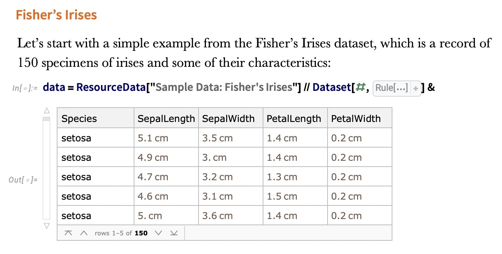{fig-align="center"}

:::: footer
Bernard, E. (2021). [*Introduction to Machine Learning*](https://www.wolfram.com/language/introduction-machine-learning/clustering/), ch. Clustering. Wolfram Media.
::::

::: {.notes}
Clustering is the canonical unsupervised task: there are no labels to fit, only the data. The definition is deliberately loose, "separate examples into groups", because what counts as a good group depends on the application. That looseness is the theme of the whole first half.

The figure is from Etienne Bernard's book, which is the required reading. It shows Fisher's Iris data: 150 specimens, four measurements each (sepal length and width, petal length and width), plus the species. Note that the species column is there. Today we'll pretend we can't see it, cluster on the measurements alone, and then use the species to grade the result. That pattern of clustering blind and then validating against held-out labels is how clustering methods are evaluated in papers.

Uses worth naming: customer segmentation, grouping documents or images, finding cell types in single-cell RNA data, and anomaly detection (points that don't fit any cluster). In urban data, you cluster trips, sensors or neighborhoods by their temporal profile to find typical patterns and outliers. That is a good template for a project: cluster something, then use visualization to check and explain what each group has in common.

Ask: has anyone run k-means on real data, and how did you choose k? Keep the answer in mind; it comes back in a few slides.
:::

## IRIS

``` python
# Code source: Gaël Varoquaux
# Modified for documentation by Jaques Grobler
# License: BSD 3 clause
#
import matplotlib.pyplot as plt

from sklearn import datasets
iris = datasets.load_iris()

_, ax = plt.subplots()
scatter = ax.scatter(iris.data[:, 2], iris.data[:, 1])
ax.set(xlabel=iris.feature_names[2], ylabel=iris.feature_names[1])
_ = ax.legend(
    scatter.legend_elements()[0], iris.target_names, loc="lower right", title="Classes"
)
```

::: {.notes}
This is the scikit-learn gallery example, lightly modified. Iris has 4 features and 3 species classes. We plot two of them: column 2, petal length, on x, and column 1, sepal width, on y. These are the same two axes Bernard uses, so our plots line up with the figures from the book on the next slides.

Point out what's missing: the scatter call has no `c=` argument, so every point gets the same color. We're deliberately looking at the data the way a clustering algorithm sees it. (The legend call is left over from the labeled version of the example; on the next slide it draws nothing useful, so the rendered plot omits it.)

`datasets.load_iris()` returns a Bunch with `.data` (150x4), `.target` (0/1/2) and `.feature_names`. The same loader pattern works for digits later.
:::

## IRIS

```{python}
#| echo: false
#| fig-align: center
from sklearn import datasets
iris = datasets.load_iris()

_, ax = plt.subplots(figsize=(16, 8.4))
ax.scatter(iris.data[:, 2], iris.data[:, 1], s=60, color="#555555", alpha=0.8)
ax.set(xlabel=iris.feature_names[2], ylabel=iris.feature_names[1])
plt.tight_layout()
plt.show()
```

::: {.notes}
This is the unlabeled view: petal length on x, sepal width on y, every point the same gray.

Ask the room: how many groups do you see? Most people say two: a tight blob on the left (petal length under 2 cm) and an elongated cloud on the right. Some say three. Take a quick show of hands, because it sets up the punchline. The honest answer from this picture alone is two. A third group, if there is one, lives inside the right-hand cloud without a visible gap.

This is a 2-D projection of 4-D data, so a gap could exist in the other two dimensions that this view hides. That is a preview of the dimensionality reduction lecture: what you can see depends on the projection you choose.
:::

## IRIS -- another look

```{python}
#| echo: false
#| fig-align: center
#| fig-width: 9
#| fig-height: 6

import seaborn as sns
import matplotlib.pyplot as plt
import pandas as pd
from sklearn import datasets

# Load iris dataset
iris = datasets.load_iris()

# Create DataFrame for easier plotting
df = pd.DataFrame({
    'Petal Length (cm)': iris.data[:, 2],
    'Sepal Width (cm)': iris.data[:, 1],
    'Species': [iris.target_names[i] for i in iris.target]
})

# Create high-quality plot with colors similar to DarkRainbow
colors = ['#4477AA', '#EE6677', '#228833']  # Professional color palette
plt.figure(figsize=(9, 6), dpi=150)
sns.scatterplot(data=df, x='Petal Length (cm)', y='Sepal Width (cm)',
                hue='Species', palette=colors, s=120, alpha=0.7,
                edgecolor='black', linewidth=0.8)
plt.grid(True, alpha=0.3, linestyle='--')
plt.legend(title='Species', frameon=True, loc='upper left', fontsize=11)
plt.xlabel('Petal Length (cm)', fontsize=12, fontweight='bold')
plt.ylabel('Sepal Width (cm)', fontsize=12, fontweight='bold')
plt.tight_layout()
plt.show()
```

::: {.notes}
Now reveal the species. Setosa (blue) is the isolated blob on the left, with all 50 points below 2 cm petal length. Versicolor (red) and virginica (green) together make up the right-hand cloud. They're ordered along petal length (versicolor shorter, virginica longer), but they meet around 4.5 to 5 cm with no gap.

This plot explains every result in the next few slides:

- Any reasonable method finds setosa perfectly.
- No method separates versicolor from virginica perfectly using geometry alone, because the species boundary isn't a density gap.
- Whether the "right" answer is 2 or 3 clusters depends on whether you're asking about geometry or botany.

Make the general point: a clustering algorithm optimizes a geometric criterion. Labels encode a different notion of similarity. When the two disagree, the algorithm isn't wrong; it's answering a different question.
:::

## IRIS -- clustering

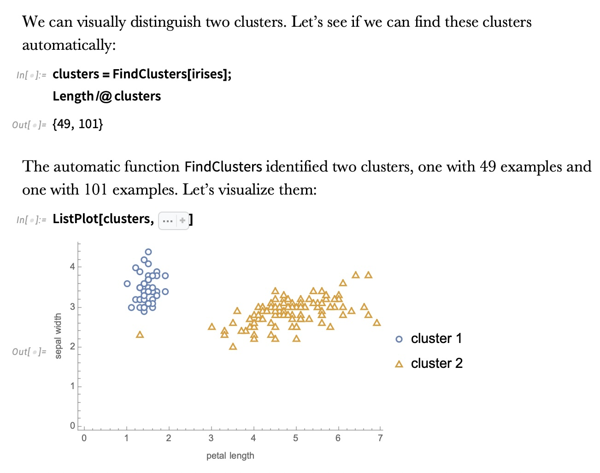{fig-align="center"}

::: {.notes}
This is Wolfram's FindClusters run fully automatically, with no number of clusters given. It returns two clusters of 49 and 101 points. So the automatic method agrees with the show of hands, not with the species count.

Why 49 and not 50: one point the method grouped with the big cluster. You can't tell which from this 2-D view, a reminder that the method works in all four dimensions. Automatic methods pick k by optimizing an internal score. We'll compute one such score, the silhouette, in a few slides and find it also prefers k=2 on these features.

The lesson: "find the clusters" is under-specified. Without telling the algorithm how many clusters you expect, or what similarity means, it falls back on the strongest geometric signal, which here is setosa vs everything else.

Transition: next slide, we tell it to find three.
:::

## IRIS -- k-means

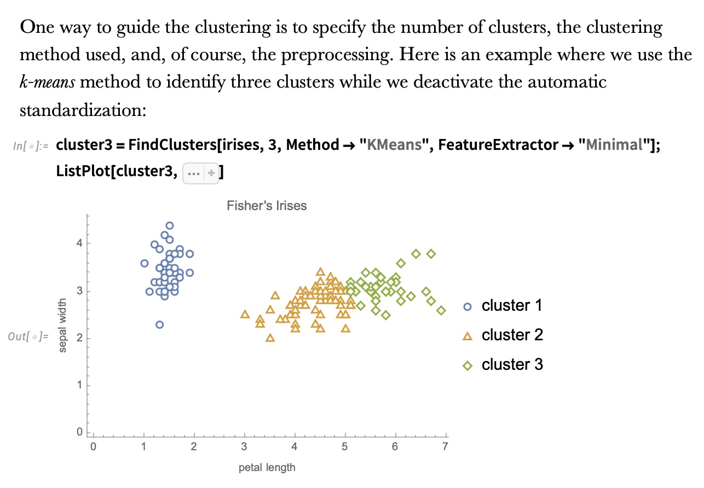{fig-align="center"}

::: {.notes}
Now we guide it with three choices, and the text above the code names them: the number of clusters (3), the method (k-means), and the preprocessing (automatic standardization turned off with FeatureExtractor -> "Minimal").

The result: setosa is still its own cluster (blue circles). The right-hand cloud gets cut into two pieces, orange triangles and green diamonds, by what's essentially a vertical line around petal length 5. That cut is k-means' signature. Each point goes to its nearest centroid, so boundaries between clusters are straight lines (the Voronoi diagram of the centroids). The cut sits roughly where the species overlap, but some of the true virginica with petal length under 5 end up in the orange cluster.

Why the preprocessing matters: k-means uses Euclidean distance, so features with larger ranges dominate. Standardizing changes the answer. On the validation slide we'll see that standardizing Iris actually makes agreement with the species worse.
:::

## K-means in four lines

1. Pick *k* starting centroids (k-means++ spreads them out)
2. Assign each point to its nearest centroid
3. Move each centroid to the mean of its assigned points
4. Repeat 2–3 until assignments stop changing

**Objective:** minimize within-cluster sum of squares $\;\sum_{c=1}^{k} \sum_{x \in C_c} \lVert x - \mu_c \rVert^2$

**Built-in assumptions:** *k* is known · clusters are convex and roughly spherical · similar sizes · feature scale is meaningful

::: {.notes}
SKIPPABLE - if running long, jump to "Wolfram Mathematica FindClusters".

This is Lloyd's algorithm. Each step can only lower the objective: assignment picks the nearest centroid, and the mean is the point that minimizes squared distance to a set. So it always converges, but only to a local minimum. That's why scikit-learn runs it several times from different starts (`n_init`) and keeps the best, and why k-means++ seeding (pick each new centroid with probability proportional to squared distance from the existing ones) matters.

Walk through the assumptions slowly, because each produces a failure you can see in a plot:

- **k is known:** you have to supply it. Choosing it is its own problem (a later slide).
- **Convex, spherical clusters:** nearest-centroid boundaries are straight lines, so k-means can't follow a curved cluster. Two moons, coming up, is the classic counterexample.
- **Similar sizes:** a large cluster next to a small one gets its edge stolen, because the boundary sits halfway between centroids.
- **Feature scale:** distance is Euclidean, so a feature measured in millimeters outvotes one measured in meters.

Cost is O(n·k·d) per iteration, which is why k-means is the default for large data.
:::

## Wolfram Mathematica FindClusters

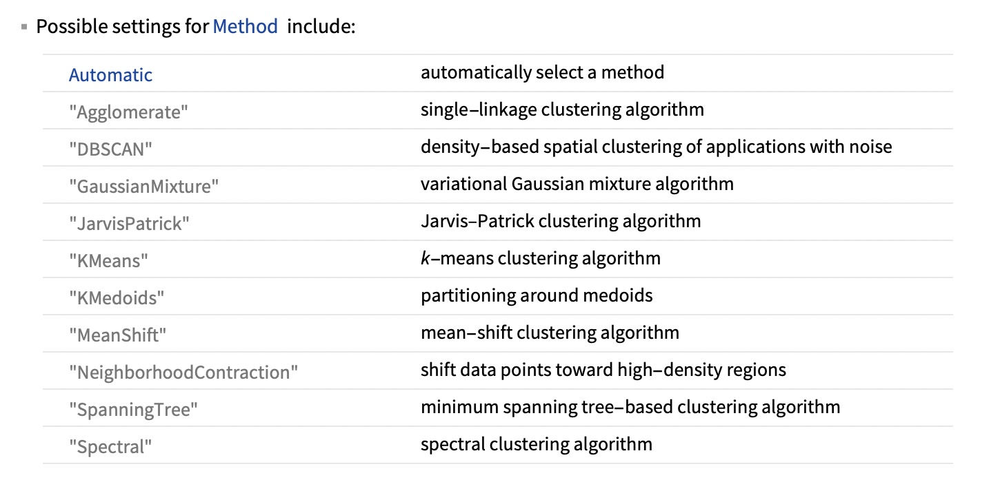{fig-align="center"}

::: {.notes}
FindClusters exposes ten methods besides Automatic. Group them by what they assume a cluster is:

- **Centroid-based:** KMeans and KMedoids. A cluster is a ball around a center. KMedoids uses actual data points as centers, so it's more robust to outliers.
- **Density-based:** DBSCAN, MeanShift and NeighborhoodContraction. A cluster is a dense region, and sparse regions separate clusters. DBSCAN also labels points in sparse regions as noise rather than forcing them into a cluster.
- **Graph or connectivity-based:** Agglomerate (single linkage), SpanningTree, JarvisPatrick and Spectral. A cluster is a set of points connected by short links. These can follow arbitrary shapes.
- **Model-based:** GaussianMixture. A cluster is a probability distribution, so points get soft memberships.

The method is the definition of a cluster. Choosing a method is choosing what "belongs together" means, which is why the next slide matters.
:::

## Wolfram Mathematica FindClusters

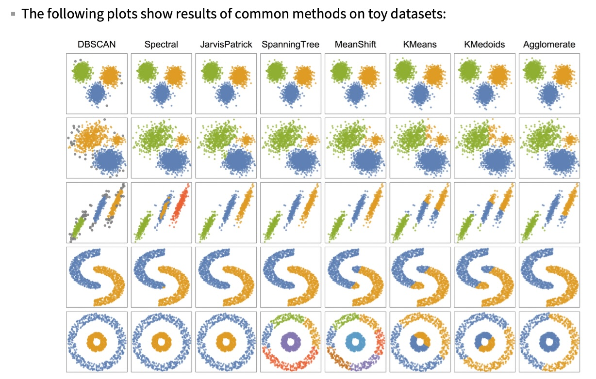{fig-align="center"}

::: {.notes}
Eight methods (columns) on five toy datasets (rows). Read it by row:

- **Row 1 (three well-separated blobs):** every method agrees. When structure is obvious, the method doesn't matter.
- **Row 2 (a sparse blob, a small dense blob, a big dense blob):** most methods get three groups. KMeans and KMedoids give the right edge of the sparse blob to the small one, because the boundary sits halfway between centers. DBSCAN does something different: one eps can't fit both densities, so it merges the sparse and small blobs and calls the fringe noise (gray).
- **Row 3 (three parallel strips):** KMeans and KMedoids slice strips across their length. Spectral splits the middle strip into four groups in total. DBSCAN finds the three strips but drops their sparse ends as noise.
- **Row 4 (two moons):** KMeans, KMedoids and MeanShift cut each moon in half. DBSCAN, Spectral, JarvisPatrick and Agglomerate follow the curves.
- **Row 5 (ring around a disk):** the hardest case. Only DBSCAN, Spectral and JarvisPatrick get it. KMeans and KMedoids cut it in half. SpanningTree and MeanShift break the outer ring into several pieces. Agglomerate (single linkage) also fails here: it splits the ring and joins half of it to the disk, presumably because a few noisy points bridge the gap. Single linkage is the method that's supposed to follow rings, which shows how fragile chaining is.

Takeaway: no column is perfect on every row. The right method depends on the shape of the structure you expect, and you usually find that out by looking at the data.
:::

## When k-means fails: shape, not count

```{python}
#| echo: false
#| fig-align: center
from sklearn.datasets import make_moons
from sklearn.cluster import KMeans, DBSCAN
from sklearn.metrics import adjusted_rand_score

M, my = make_moons(400, noise=0.06, random_state=0)
km_lab = KMeans(2, n_init=10, random_state=0).fit_predict(M)
db_lab = DBSCAN(eps=0.2, min_samples=5).fit_predict(M)

fig, axs = plt.subplots(1, 2, figsize=(17, 6.4))
for ax, lab, name in [(axs[0], km_lab, "k-means, k = 2"),
                      (axs[1], db_lab, "DBSCAN, eps = 0.2, min_samples = 5")]:
    cols = np.array(SPECIES_COLORS + ['#999999'])[np.where(lab < 0, 3, lab)]
    ax.scatter(M[:, 0], M[:, 1], c=cols, s=45)
    ax.set_title(f"{name}   (ARI vs true moons = {adjusted_rand_score(my, lab):.2f})")
    ax.set_xticks([]); ax.set_yticks([]); ax.set_aspect("equal")
plt.tight_layout()
plt.show()
```

**Right number of clusters, wrong definition of a cluster.**

::: {.notes}
SKIPPABLE - if running long, jump to "IRIS - classes".

These are live scikit-learn results on the two-moons dataset (400 points). This reproduces row 4 of the Wolfram grid, with a score attached.

Left: k-means is given the correct k=2 and still fails. It draws a straight boundary and cuts each moon in half. Its adjusted Rand index (ARI) against the true moons is 0.27, where 1 is perfect agreement and 0 is chance level.

Right: DBSCAN gets ARI 1.00. It has no k at all. It has two parameters: `eps`, the neighborhood radius, and `min_samples`, how many neighbors make a point a "core" point. Clusters are chains of core points within eps of each other, so they can bend.

DBSCAN's weakness: eps. On this data, eps of 0.15, 0.2 or 0.25 all give the perfect answer, but at 0.3 the moons touch and DBSCAN returns one cluster (ARI 0). One global eps also struggles when clusters have different densities, which is what HDBSCAN fixes.

Ask: what's the k-means equivalent of eps? (It's k. Every method has a knob that decides how many clusters you get. The question is whether the knob is meaningful for your data.)
:::

## IRIS - classes

:::: {.columns}

::: {.column width="50%"}
```{python}
#| echo: false
from sklearn import datasets
iris = datasets.load_iris()

_, ax = plt.subplots(figsize=(9.4, 7.8))
for i, name in enumerate(iris.target_names):
    m = iris.target == i
    ax.scatter(iris.data[m, 2], iris.data[m, 1], s=40, color=SPECIES_COLORS[i], label=name)
ax.set(xlabel=iris.feature_names[2], ylabel=iris.feature_names[1], title="True species")
_ = ax.legend(loc="lower right", title="Classes")
plt.tight_layout()
plt.show()
```

:::

::: {.column width="50%"}
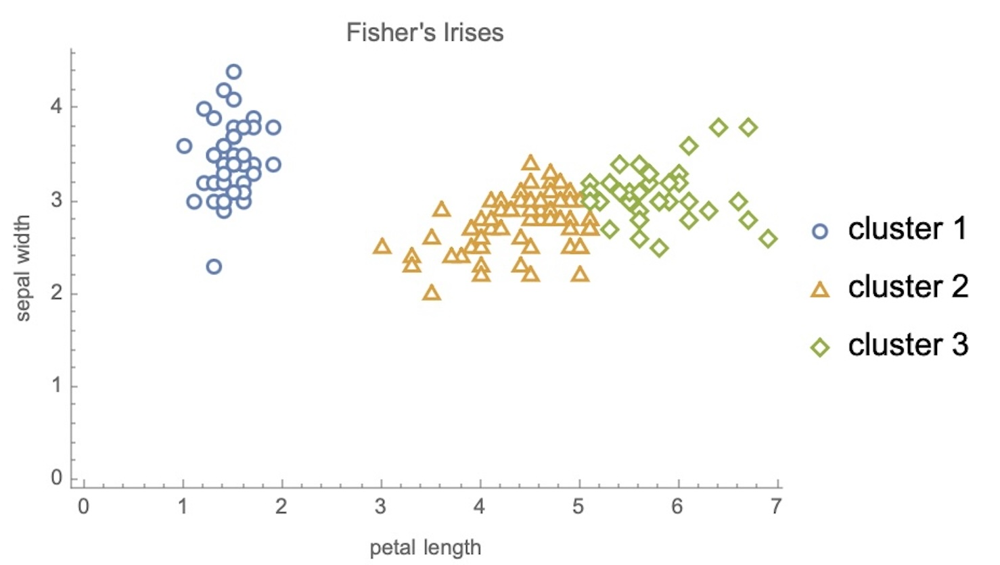{width="100%"}
:::

::::

::: {.notes}
Side by side: true species on the left (from scikit-learn, same axes), Wolfram's k-means with k=3 on the right. Point at the same regions in both:

- Setosa (blue on the left) maps exactly to cluster 1. Perfect.
- On the right, the boundary between clusters 2 and 3 is close to vertical at petal length around 5. On the left, the versicolor/virginica boundary is diagonal and interleaved. Virginica with short petals (green points left of x=5) become cluster 2.
- Cluster colors and species colors don't correspond. Cluster IDs are arbitrary, so "cluster 2" means nothing until you match it to a class. Any score comparing clusters to labels has to be invariant to relabeling (next slide).

Remember this comparison is a teaching device. In real unsupervised work there's no left panel. You only get the right one and have to decide whether to trust it.
:::

## Validating clusters against labels

```{python}
#| echo: false
#| fig-align: center
from sklearn.cluster import KMeans, AgglomerativeClustering
from sklearn.metrics import adjusted_rand_score, confusion_matrix
from sklearn.preprocessing import StandardScaler

X4, y = iris.data, iris.target
X2 = X4[:, [2, 1]]
km2 = KMeans(3, n_init=10, random_state=0).fit_predict(X2)

# order cluster columns by their majority species so the diagonal is the match
cm = confusion_matrix(y, km2)
order = np.argsort(cm.argmax(axis=0))
cm = cm[:, order]

runs = {
    "k-means, 2 features": km2,
    "k-means, all 4": KMeans(3, n_init=10, random_state=0).fit_predict(X4),
    "k-means, 4 standardized": KMeans(3, n_init=10, random_state=0).fit_predict(StandardScaler().fit_transform(X4)),
    "Ward linkage, 4": AgglomerativeClustering(3, linkage="ward").fit_predict(X4),
    "average linkage, 4": AgglomerativeClustering(3, linkage="average").fit_predict(X4),
    "single linkage, 4": AgglomerativeClustering(3, linkage="single").fit_predict(X4),
}
ari = {k: adjusted_rand_score(y, v) for k, v in runs.items()}

fig, (a, b) = plt.subplots(1, 2, figsize=(17.5, 7.6), gridspec_kw={"width_ratios": [1, 1.3]})
a.imshow(cm, cmap="Purples")
for i in range(3):
    for j in range(3):
        a.text(j, i, cm[i, j], ha="center", va="center", fontsize=20,
               color="white" if cm[i, j] > 25 else "black")
a.set_xticks(range(3), [f"cluster {j+1}" for j in range(3)])
a.set_yticks(range(3), iris.target_names)
a.set_title("k-means (k=3, 2 features) vs species")
names = list(ari)[::-1]
b.barh(names, [ari[n] for n in names], color="#57068c")
for i, n in enumerate(names):
    b.text(ari[n] + 0.01, i, f"{ari[n]:.2f}", va="center", fontsize=14)
b.set_xlim(0, 1); b.set_xlabel("Adjusted Rand Index vs species (1 = perfect, 0 = chance)")
b.set_title("Same data, six clusterings")
plt.tight_layout()
plt.show()
```

::: {.notes}
SKIPPABLE - if running long, jump to "Cluster IDs are arbitrary".

When you have labels for a sample, this is how you grade a clustering. These are live results.

Left, the confusion matrix (species x cluster, columns reordered so matches sit on the diagonal): all 50 setosa in one cluster, 48 of 50 versicolor in the next, 41 of 50 virginica in the last. So 11 of 150 points disagree, all at the versicolor/virginica border we saw.

Right, the adjusted Rand index (ARI). It asks: for every pair of points, do the clustering and the labels agree on whether the pair is together? It ignores cluster numbering and is corrected for chance, so random labels score about 0. Results:

- **k-means on 2 features:** 0.80, the best.
- **All 4 features:** 0.73, worse.
- **4 standardized features:** 0.62, worse still. More information and "proper" preprocessing both hurt.
- **Ward / average linkage:** 0.73 / 0.76.
- **Single linkage:** 0.56. It chains: two of its three clusters hold 98 and 50 points, and the third holds just 2.

Why standardizing hurts: sepal width barely differs between species but has its own spread. Standardizing gives it as much say as petal length, which is the discriminative feature. Preprocessing is a modeling decision, not a formality.

When you have no labels, use internal scores instead (silhouette, next slide). These measure compactness and separation, not truth.
:::

## How many clusters? Two criteria, two answers

```{python}
#| echo: false
#| fig-align: center
from sklearn.metrics import silhouette_score
ks = range(2, 8)
inertia, sil = [], []
for k in ks:
    m = KMeans(k, n_init=10, random_state=0).fit(X2)
    inertia.append(m.inertia_)
    sil.append(silhouette_score(X2, m.labels_))

fig, (a, b) = plt.subplots(1, 2, figsize=(17, 7.4))
a.plot(ks, inertia, "o-", color="#57068c", lw=2, ms=9)
a.axvline(3, color="#EE6677", ls="--"); a.text(3.1, max(inertia) * 0.9, "elbow: k = 3", color="#EE6677", fontsize=15)
a.set(xlabel="k", ylabel="within-cluster sum of squares", title="Elbow method")
b.plot(ks, sil, "o-", color="#57068c", lw=2, ms=9)
best = list(ks)[int(np.argmax(sil))]
b.axvline(best, color="#228833", ls="--"); b.text(best + 0.1, min(sil) + 0.02, f"max silhouette: k = {best}", color="#228833", fontsize=15)
b.set(xlabel="k", ylabel="mean silhouette", title="Silhouette")
plt.tight_layout()
plt.show()
```

**The elbow says 3, the silhouette says 2, the botanist says 3.**

::: {.notes}
SKIPPABLE - if running long, jump to "Cluster IDs are arbitrary".

Both panels use k-means on the same two Iris features, for k from 2 to 7.

**Elbow (left):** within-cluster sum of squares always falls as k grows, so you look for where the drop flattens. Here it's 86, then 41, then 27.5, then a slow decline. The bend is at k=3. The elbow is a judgment call: on many real datasets there's no clear bend.

**Silhouette (right):** for each point, compare a (mean distance to its own cluster) with b (mean distance to the nearest other cluster). The score is (b-a)/max(a,b), from -1 to 1. The average peaks at k=2 (0.74) and falls to 0.59 at k=3. Silhouette prefers k=2 because setosa vs the rest is a clean, wide gap, and splitting the right-hand cloud creates a boundary with no gap.

This is the same answer the automatic FindClusters gave (two clusters, 49 and 101). Internal criteria measure geometry, and geometrically Iris has two clusters. Three species is a fact about biology that isn't fully written in these measurements.

For your projects: report which criterion you used, and show the curve, not just the chosen k. If two reasonable criteria disagree, say so. That's a finding, not a failure.
:::

## Hierarchical clustering: the dendrogram

```{python}
#| echo: false
#| fig-align: center
from scipy.cluster.hierarchy import linkage, dendrogram
Z = linkage(X4, method="ward")
cut = (Z[-3, 2] + Z[-2, 2]) / 2   # height that leaves exactly 3 clusters

fig, ax = plt.subplots(figsize=(17.5, 7.6))
dendrogram(Z, truncate_mode="lastp", p=30, color_threshold=cut,
           above_threshold_color="#888888", leaf_font_size=12, ax=ax)
ax.axhline(cut, color="#EE6677", ls="--", lw=2)
ax.text(ax.get_xlim()[1] * 0.99, cut * 1.04, "cut here → 3 clusters", color="#EE6677",
        ha="right", fontsize=15)
ax.set(ylabel="merge distance (Ward)", title="Iris, all 4 features, Ward linkage (last 30 merges; leaf labels = points in branch)")
plt.tight_layout()
plt.show()
```

**One tree, every k: the cut height is the choice.**

::: {.notes}
SKIPPABLE - if running long, jump to "Cluster IDs are arbitrary".

Agglomerative clustering starts with every point as its own cluster and repeatedly merges the two closest clusters. The dendrogram records every merge: the height of each horizontal bar is the distance at which the merge happened. Live result, Ward linkage on all four Iris features. To keep it readable we show only the last 30 merges; a leaf label like "(12)" means 12 points collapsed into that branch.

How to read it:

- A horizontal cut gives a flat clustering. The dashed line gives 3 clusters. Cut higher and you get 2.
- **Long vertical gaps mean real structure.** The tallest gap is the last merge, setosa joining everything else. Again that's the "2 clusters" story, now visible as a height.
- The difference between "Agglomerate" in Wolfram (single linkage) and Ward is the linkage rule, meaning how cluster-to-cluster distance is defined:
  - **Single:** closest pair. It follows chains, which lets it trace the moons in the Wolfram grid but also makes it fragile: a few bridging points merged ring and disk there, and on Iris it produced a 98/50/2 split.
  - **Complete:** farthest pair.
  - **Average:** mean of all pairs.
  - **Ward:** smallest increase in within-cluster variance. Ward behaves most like k-means.

Why visualization people like dendrograms: they show structure at all scales at once instead of committing to one k. They sit on the margins of clustered heatmaps everywhere in genomics. Cost is the catch: naive agglomerative clustering is O(n²) memory, so it doesn't scale like k-means.
:::

## Cluster IDs are arbitrary: the colors mean nothing

```{python}
#| echo: false
#| fig-align: center
from sklearn.cluster import KMeans
X2 = iris.data[:, [2, 1]]
lab = KMeans(3, n_init=10, random_state=0).fit_predict(X2)
rng = np.random.default_rng(4)
perm = rng.permutation(3)
while (perm == np.arange(3)).all():
    perm = rng.permutation(3)
palA = ['#4477AA', '#EE6677', '#228833']
palB = ['#AA3377', '#CCBB44', '#66CCEE']
fig, axs = plt.subplots(1, 2, figsize=(17, 6.6))
for ax, labs, pal, t in [(axs[0], lab, palA, "run 1"), (axs[1], perm[lab], palB, "run 2: same clusters, relabeled and recolored")]:
    ax.scatter(X2[:, 0], X2[:, 1], c=np.array(pal)[labs], s=70, edgecolor="black", linewidth=0.5)
    ax.set(title=t, xlabel=iris.feature_names[2], ylabel=iris.feature_names[1])
plt.tight_layout()
plt.show()
```

**Same partition, different picture. Colors should not suggest an order or a meaning the clusters don't have.**

::: {.notes}
Both panels are the identical k-means partition. Only the label numbers, and therefore the colors, changed. Run k-means twice with different seeds and you can get this: the groups are the same but "cluster 0" is now "cluster 2".

Visualization consequences, which connect to the color lecture in Week 5:

- Use a **categorical** palette, never a sequential one. A sequential ramp on cluster IDs invents an order (cluster 2 is "more" than cluster 1) that doesn't exist.
- Keep at most about 7 colors. Past that, people can't match marks to the legend. If you have 30 clusters, color won't carry it; use small multiples, labels, or a hierarchy.
- If you compare two clusterings, or a clustering over time, match the clusters first (for example by overlap) and keep a color tied to a group, not to an ID. Otherwise the viewer sees change that isn't there.
- Don't rely on the viewer checking agreement by eye with colors that change between panels. Where possible, use a confusion matrix, which we show next.
:::

## Seeing the whole tree: clustered heatmap

```{python}
#| echo: false
#| fig-align: center
import seaborn as sns
from sklearn.preprocessing import StandardScaler
Xs = StandardScaler().fit_transform(iris.data)
sp = np.array(SPECIES_COLORS)[iris.target]
g = sns.clustermap(Xs, method="ward", cmap="RdBu_r", center=0, vmin=-3, vmax=3,
                   row_colors=sp, yticklabels=False,
                   xticklabels=["sepal length", "sepal width", "petal length", "petal width"],
                   figsize=(16, 7.6), col_cluster=False, dendrogram_ratio=(0.12, 0.0),
                   colors_ratio=0.025, cbar_pos=(0.94, 0.2, 0.012, 0.6))
g.ax_heatmap.set_ylabel("")
plt.show()
```

**Rows are flowers, columns are measurements, the tree reorders the rows. The side bar is the species, held out.**

::: {.notes}
SKIPPABLE.

This is the visualization most associated with hierarchical clustering: a heatmap whose rows are ordered by the dendrogram. Here 150 flowers by 4 measurements (z-scored per column so the color scale is comparable, diverging blue to red), rows clustered with Ward linkage. The thin bar next to the tree gives the true species, which the clustering never saw.

How to read it:

- Blocks of similar color are clusters. Setosa forms one block (low petal length and width, high sepal width), and the species bar beside it is solid blue: essentially a perfect group. Cutting the tree at three clusters, 49 of the 50 setosa land together.
- The other two blocks are where the species mix. On these standardized features, versicolor is split (27 in one cluster, 23 in the other) and 48 of the 50 virginica sit together. The bar shows red and green mixed across the boundary, the same overlap region we saw in the scatterplot. Note this differs from the 2-feature k-means result earlier, another sign that features and method both matter.
- The heatmap shows something the scatterplot can't: all four dimensions at once. The cost is that you compare colors, which is a weak visual channel (Week 4), so use it for patterns, not exact values.

Where this is used: gene-expression heatmaps, correlation matrices, user-by-item matrices. In any of them, the row order is a clustering result, so a different linkage gives a different picture. Treat the ordering as one of many valid ones; the leaves of a dendrogram can be flipped at every node without changing the tree.

Note we turned off column clustering, since four named measurements have a natural order. With hundreds of columns you'd cluster both axes.
:::

## Per-point quality: the silhouette plot

```{python}
#| echo: false
#| fig-align: center
from sklearn.metrics import silhouette_samples, silhouette_score
fig, axs = plt.subplots(1, 2, figsize=(17, 7.2))
for ax, k in zip(axs, (2, 3)):
    lb = KMeans(k, n_init=10, random_state=0).fit_predict(X2)
    s = silhouette_samples(X2, lb)
    y0 = 0
    # order clusters by mean x so colors are stable across the two panels
    order = np.argsort([X2[lb == c, 0].mean() for c in range(k)])
    for r, c in enumerate(order):
        v = np.sort(s[lb == c])
        ax.fill_betweenx(np.arange(y0, y0 + len(v)), 0, v, color=SPECIES_COLORS[r], alpha=0.85)
        ax.text(-0.04, y0 + len(v) / 2, f"{len(v)}", ha="right", va="center", fontsize=14)
        y0 += len(v) + 5
    ax.axvline(s.mean(), color="black", ls="--")
    ax.set(title=f"k = {k}   (mean silhouette {s.mean():.2f})", xlabel="silhouette of each point", yticks=[], xlim=(-0.25, 1))
plt.tight_layout()
plt.show()
```

**One bar per point, grouped by cluster. Thin or negative bars are points that may be in the wrong place.**

::: {.notes}
SKIPPABLE.

The silhouette score from the "how many clusters" slide is an average. Averages hide structure, so here's the same quantity as one horizontal bar per point, grouped by cluster, sorted within each cluster. Dashed line is the mean. Cluster sizes sit on the left of each block.

How to read it: a bar near 1 means the point is much closer to its own cluster than to the next one. Near 0 means it sits on a boundary. Negative means it's closer to another cluster, so it is probably misassigned.

Compare the panels. At k=2 both blocks are long and fairly uniform: two clean groups. At k=3 the setosa block is unchanged (mean 0.83, no point below 0.6), but the two blocks that split the right-hand cloud (57 and 43 points) have means of only about 0.47 and 0.48, and their weakest points are close to zero. No bar is actually negative here, which is itself worth saying: the points are ambiguous, not misassigned. That's the visual form of "the mean silhouette dropped from 0.74 to 0.59". The plot also tells you where the problem is: it's confined to the two clusters that share a boundary, not the whole dataset.

This is a good example of a general design move: replace a single summary number with a small display that shows its distribution. Anscombe's quartet argument, applied to a clustering metric.
:::

## Pitfalls checklist

::: {.columns}
::: {.column width="50%"}
**About the algorithm**

- Every method returns clusters, even on noise
- *k* is your choice unless the method is density-based
- Preprocessing (scaling, features) can change the answer more than the method
- Results can depend on random starts: run several, report stability
:::

::: {.column width="50%"}
**About the picture**

- A 2-D projection can hide or invent separation
- Cluster IDs and colors are arbitrary
- Show the ambiguous points, not just the centers
- Report the criterion you used to pick *k*, and show its curve
:::
:::

::: {.notes}
Use this as the summary slide and tie each bullet back to a slide.

"Every method returns clusters, even on noise": run k-means on uniform random points and you get a clean-looking partition. A colored scatterplot of that looks as convincing as the Iris one. The defense is to ask what the clusters are for, check stability across seeds and subsamples, and look at a measure like the silhouette distribution.

"Preprocessing": the Iris validation slide, where standardizing the four measurements made agreement with the species worse (ARI 0.73 to 0.62).

"A 2-D projection can hide or invent separation": the two Iris scatterplots use only two of the four measurements. Next lecture on dimensionality reduction takes this up directly, and the t-SNE warnings there (cluster sizes and distances between clusters don't mean much) are the same issue at higher stakes.

"Show the ambiguous points": the silhouette plot and the confusion matrix both do this. Color a scatterplot by cluster and the boundary points look as certain as the core ones. Encoding membership strength (for example with lower opacity, or the silhouette value) is a cheap way to keep the uncertainty visible.
:::

## Part 2: Dimensionality reduction

Clustering asked *which points belong together*.

Dimensionality reduction asks *how do we draw 64 numbers per item on a 2-D screen*, and it is the tool behind most cluster pictures you will meet.

::: {.notes}
Bridge. Everything in the clustering half used two measurements picked by hand. With real data there may be dozens or thousands of dimensions, and the usual move is to project to 2-D and then color by cluster. That projection can distort exactly what we just learned to judge, so we spend the second half on how projections work and where they mislead.

Handwritten digits replace Iris from here on: 1,797 8x8 images, so 64 dimensions per image.
:::

## Dimensionality Reduction

* Input data may have thousands or millions of dimensions!

* **Dimensionality Reduction** represents data with fewer dimensions
  - easier learning -- fewer parameters
  - visualization -- show high-dimensional data in 2D or 3D
  - discover "intrinsic dimensionality" of the data

::: {.notes}
Second half. Clustering compressed each point to one number, its cluster ID. Dimensionality reduction compresses each point to a few continuous coordinates, keeping as much of the structure as possible.

Examples of "thousands or millions of dimensions": a 256x256 grayscale image is 65,536 numbers; a bag-of-words document has one dimension per vocabulary word; a transformer's hidden state has 768 to 4,096 per token. Every embedding we'll look at later in the course needs DR before anyone can see it.

Three motivations on the slide:

- **Easier learning:** fewer inputs mean fewer parameters, less overfitting, and less trouble from the curse of dimensionality (distances concentrate in high dimensions, so "nearest" becomes less meaningful).
- **Visualization:** the reason this course cares. Screens are 2-D.
- **Intrinsic dimensionality:** how many numbers you actually need, as opposed to how many you were given. That's the next two slides.

Bridge back to clustering: people often cluster in a reduced space, or color a 2-D projection by cluster. The two tools are used together constantly.
:::

## Dimensionality Reduction

**Assumption: data lies on a lower dimensional space**

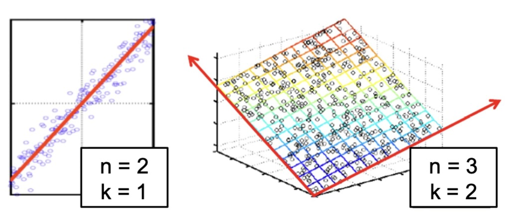{fig-align="center"}

:::: footer
Slides based on material from Prof. Yi Zhang
:::

::: {.notes}
Two cartoons of the assumption. Left: points in 2-D (n=2) that hug a line, so one coordinate (k=1), position along the line, describes them almost completely. The scatter perpendicular to the line is small. Right: points in 3-D (n=3) lying close to a tilted plane, so two coordinates (k=2) suffice.

In both cases the low-dimensional structure is flat (a line, a plane), which is exactly the case PCA handles. Notation on the figure: n is the ambient dimension and k the intrinsic one. On later slides d is the ambient dimension and n the number of points, so warn students about the switch.

The general version is the manifold hypothesis: real high-dimensional data (faces, digits, speech) concentrates near a low-dimensional surface. Faces make it intuitive. A 100x100 image has 10,000 pixels, but faces vary along far fewer factors: identity, pose, expression, lighting. Random pixel vectors almost never look like a face, so faces occupy a thin sliver of pixel space.

Ask: which of the two pictures can be "unrolled" by a projection? Both, because they're flat. The next slide is a case that isn't.
:::

## Visualizing the Manifold Hypothesis: Images of '3' Perturbed by Non-linear Operations

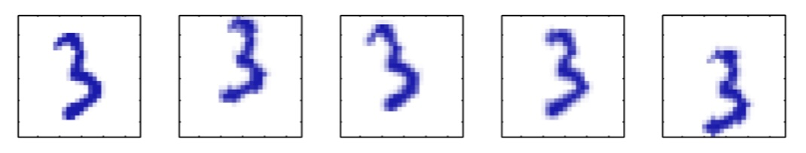{fig-align="center"}

* What operations did we perform? What's the intrinsic dimensionality?

* Here the underlying **manifold** is **non-linear**

:::: footer
Bishop, C. M. (2006). *Pattern Recognition and Machine Learning*, §12.1. Springer.
:::

::: {.notes}
This example is from Bishop, chapter 12. Bishop takes one handwritten 3 (a 64x64 image), embeds it in a larger 100x100 canvas, and varies its position and orientation at random.

Ask the two questions on the slide before answering:

1. What operations? Horizontal translation, vertical translation, and rotation. Look at the five images: the 3 moves around and tilts, but its shape doesn't change. No scaling, no deformation.
2. Intrinsic dimensionality? Three: x-shift, y-shift and angle. Each image is a point in a space with 10,000 pixel dimensions, yet the whole collection is a 3-dimensional manifold inside it. (Bishop also notes real digit data adds noise and writing-style variation, so in practice it's near a manifold, not exactly on one.)

Why non-linear: shift the 3 by one pixel and a completely different set of pixels lights up. Moving along the "translate" direction traces a curved path through pixel space, not a straight line. Averaging two shifted 3s gives a blurry double 3, not a 3 at the midpoint. That's the signature of a curved manifold: the straight line between two valid points leaves the manifold.

So linear methods like PCA can only approximate this, and we'll need methods that follow curvature, which is what t-SNE and UMAP do. (LLE, Locally Linear Embedding, is an older method of this kind; it appears later only as a comparison point. It rebuilds each point from its neighbors and keeps those weights in 2-D.)
:::

## Principal Component Analysis:  intuition

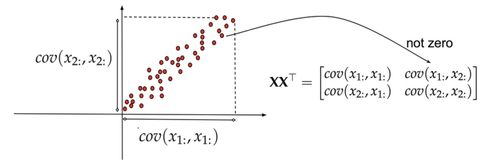{fig-align="center"}

::: {.notes}
Back to the correlated cloud, in the original axes x₁ and x₂. The dashed box marks the spread along each axis: the variances cov(x₁,x₁) and cov(x₂,x₂) are both large. On the right, the covariance matrix XXᵀ has an off-diagonal entry that the arrow labels "not zero", because the two attributes are correlated.

What that means in practice: the two attributes are redundant. Knowing x₁ tells you a lot about x₂. You're spending two numbers per point to store about one number's worth of information.

Ask: is there a choice of axes where the off-diagonal entry would be zero? The next slide answers it.
:::

## Principal Component Analysis:  intuition

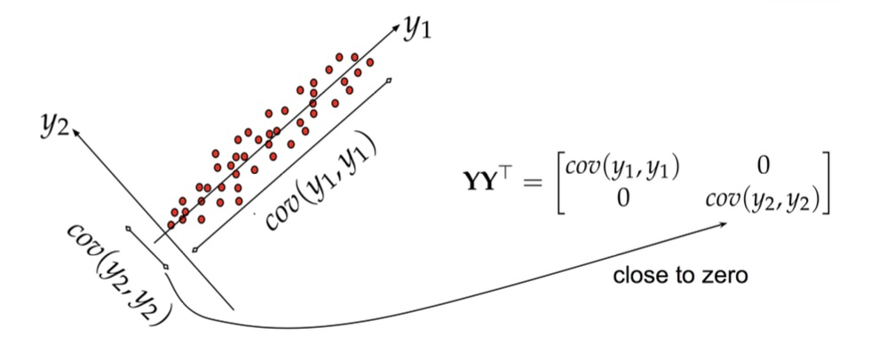{fig-align="center"}

::: {.notes}
Same points, new axes. y₁ runs along the diagonal of the cloud and y₂ is perpendicular to it. In these coordinates:

- cov(y₁,y₁) is large: most of the spread lies along y₁.
- cov(y₂,y₂) is small: points barely deviate from the line.
- The off-diagonal covariance is zero. The new covariance matrix YYᵀ is diagonal, which the slide's arrow labels "close to zero".

That's PCA in one picture: rotate the axes so the new coordinates are uncorrelated and ordered by variance. Then dimensionality reduction is just dropping y₂. You lose the small perpendicular wiggle and keep the position along the line. If that wiggle is mostly measurement noise, dropping it even helps.

What's lost, and what PCA can't do: it only rotates. If the cloud were curved, a banana instead of a cigar, no rotation would put all the variance on one axis. That's the Bishop 3s, and the reason we turn to non-linear methods next.
:::

## Principal Component Analysis

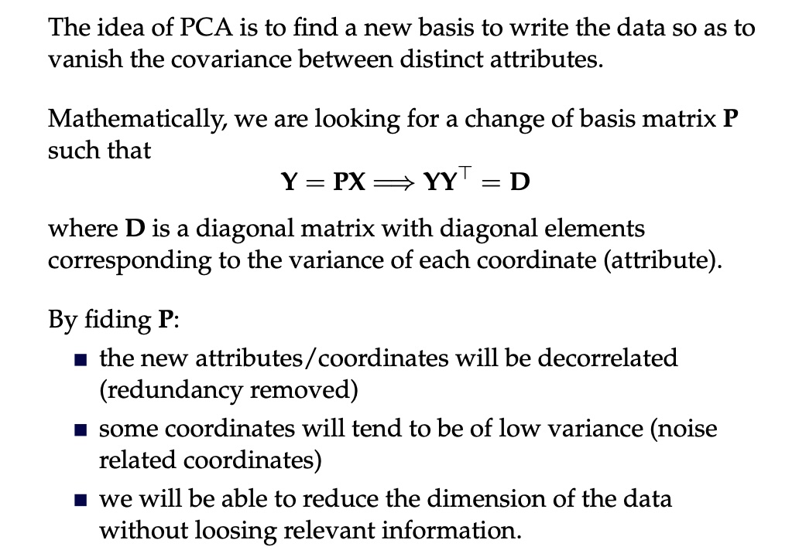{fig-align="center"}

::: {.notes}
The formal statement: find a change of basis P with Y = PX such that YYᵀ = D is diagonal.

Connect it to the spectral decomposition. Since XXᵀ = U D Uᵀ, choose P = Uᵀ. Then YYᵀ = Uᵀ XXᵀ U = Uᵀ U D Uᵀ U = D. The rows of P are the eigenvectors of the covariance matrix, which are the principal components, and the eigenvalues are the variances of the new coordinates.

The three bullets are what you get:

1. **Decorrelated coordinates:** redundancy removed.
2. **Some coordinates have low variance:** typically noise.
3. **You can drop those:** reducing dimension while keeping the relevant information.

Algorithm in practice:

1. Center X.
2. Compute the covariance, or go straight to SVD.
3. Get the eigenvectors and sort them by eigenvalue.
4. Keep the top k.
5. Project: Y_k = U_kᵀ X.

Caveat on bullet 2: "low variance = noise" is an assumption, not a theorem. A small-variance direction can be exactly the one that separates two classes. PCA is unsupervised and doesn't know.
:::

## Principal Component Analysis

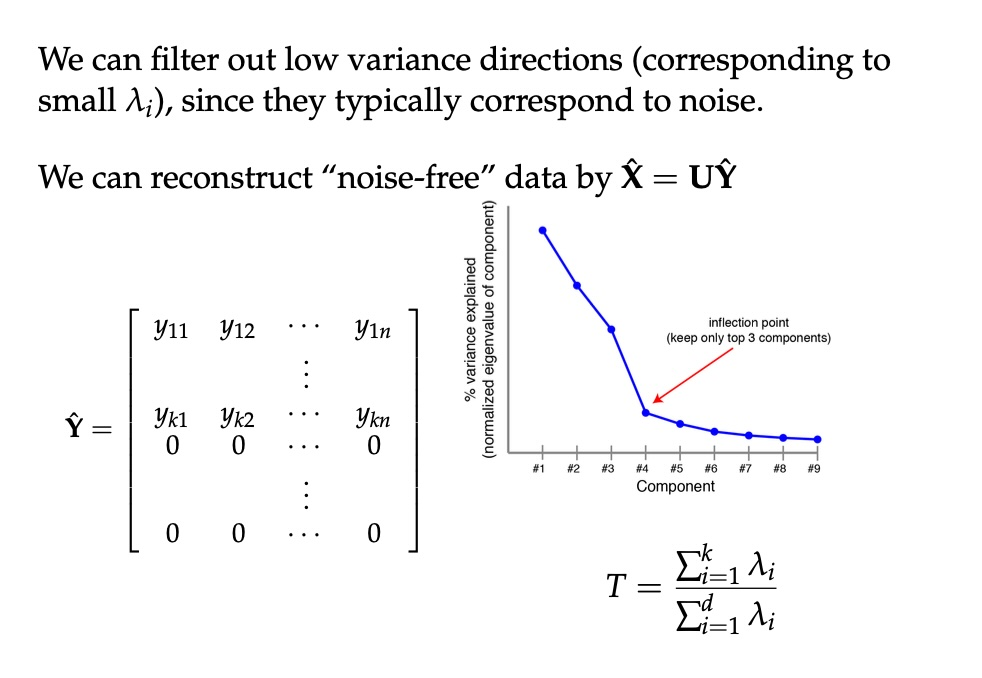{fig-align="center"}

::: {.notes}
How many components to keep? The plot is a scree plot: variance explained by each component, sorted. Look for the bend. Here it's at component 4, so keep the top 3; the rest form a flat tail of roughly equal, small eigenvalues, which is what noise looks like. (This is the same elbow logic as choosing k for k-means.)

The formula T = (sum of top-k eigenvalues) / (sum of all eigenvalues) is the fraction of variance retained. A common rule is "keep enough to reach 90 or 95%".

Real numbers for the digits dataset (computed for this lecture):

- 2 components keep only 28.5% of the variance.
- 10 keep about 74%, 20 keep about 89%, and about 30 reach 95%.

So the 2-D PCA plot coming up shows less than a third of the information. Be skeptical of any conclusion drawn from it.

Filtering: set the dropped coordinates of Ŷ to zero and map back with X̂ = UŶ. You get a denoised reconstruction. That works because noise spreads evenly over all directions while signal concentrates in a few. It's the same idea as JPEG keeping only the large coefficients.
:::

## PCA of digits

```{python}
#| echo: true
#| output-location: column
#| fig-width: 8
#| fig-height: 7
from sklearn.decomposition import PCA
pca = PCA(n_components=2)
data, labels = load_digits(return_X_y=True)
reduced_data=pca.fit_transform(data)
plt.scatter(reduced_data[:, 0], reduced_data[:, 1])
plt.show()
```

::: {.notes}
Three lines of scikit-learn. Note that this loads all ten digit classes (1,797 images), not the six used for t-SNE.

`fit_transform` centers the data, computes the top 2 components via SVD, and projects. Uncolored, as with Iris at the start: what do you see? A blob with some lobes, and a few dense fingers sticking out, but nothing as obvious as the t-SNE islands.

Reminder: these two axes keep 28.5% of the variance. You're looking at a shadow of 64-D data cast onto the plane that makes the shadow as spread out as possible.
:::

## PCA of digits

```{python}
#| echo: true
#| output-location: column
#| fig-width: 8
#| fig-height: 7
from sklearn.decomposition import PCA
pca = PCA(n_components=2)
data, labels = load_digits(return_X_y=True)
reduced_data=pca.fit_transform(data)
plt.scatter(reduced_data[:, 0], reduced_data[:, 1], c=labels, cmap="tab10", s=10)
plt.colorbar(ticks=range(10), label="digit")
plt.show()
```

::: {.notes}
Same projection, now colored by the true digit. (The only change from the 2025 version is the colormap and colorbar, so the colors can be decoded.)

What separates, using class centers I computed on this exact projection:

- **0** sits clearly at the bottom (PC2 around −21).
- **4** sits at the far right (PC1 around +22).
- **6** sits at the lower right.
- **3** and **9** lie on the left, overlapping each other.
- **1, 5 and 8** sit in the middle. 1 and 5 are among the most spread-out classes, smeared across the plot.

So "ones are easy" is not true here, despite the ink argument from earlier. Writers draw 1s with and without serifs and at different slants, which spreads them out.

Compare with the t-SNE slide: t-SNE separated every class, and PCA separates three. That's linear vs non-linear, and also 28.5% of the variance vs a method that only cares about neighbors. Both plots are "correct". They answer different questions.
:::

## SNE and t-SNE

:::: {.columns}

::: {.column width="50%"}
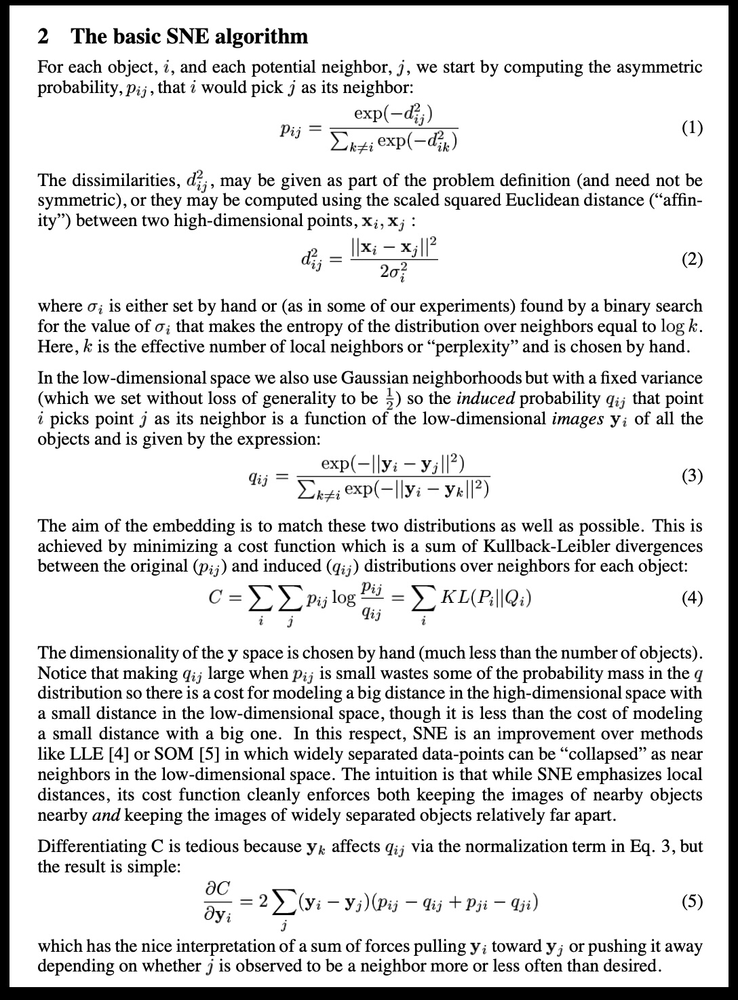{height="780"}
:::

::: {.column width="40%"}
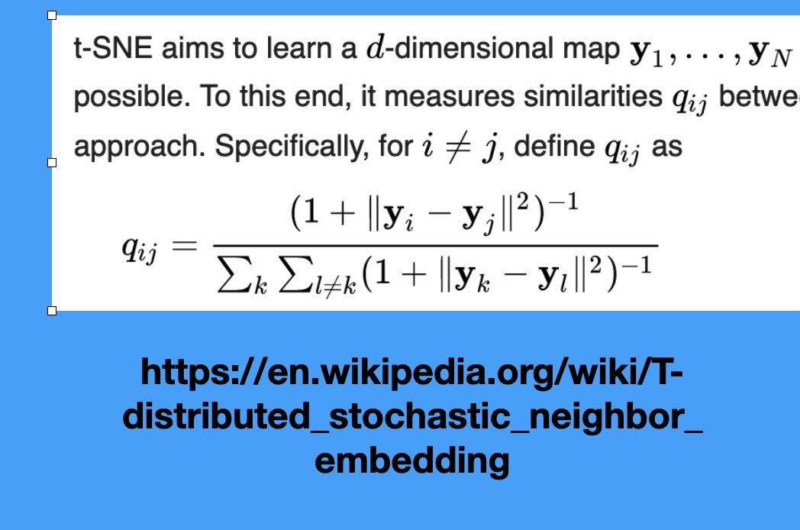
:::

::::

::: {.notes}
SNE (Stochastic Neighbor Embedding), the predecessor, defines probability distributions over the high-dimensional data, where neighbors have high probability. It then tries to replicate these probabilities in low-dimensional space. The key addition of t-SNE is using the Student's t-distribution in the low-dimensional space. This distribution has a 'heavy tail,' which means it allows points that are far apart in the low-dimensional space to still model moderately small distances in the high-dimensional space. This heavy-tail property is what creates the excellent separation between clusters compared to SNE. It prevents the "crowding problem" where all points try to squeeze into the center.
:::


<!-- ##

 -->

## t-SNE in three steps

```{python}
#| echo: false
#| fig-align: center
plt.rcParams["mathtext.fontset"] = "cm"
fig = plt.figure(figsize=(17, 8.2))
fig.add_axes([0, 0, 1, 1]).axis("off")
rows = [
    (0.95, 0.775, "1. Similarity in high-D (per point, Gaussian):",
           r"$p_{j|i}=\dfrac{\exp(-\Vert x_i-x_j\Vert^2/2\sigma_i^2)}{\sum_{k\neq i}\,\exp(-\Vert x_i-x_k\Vert^2/2\sigma_i^2)}\qquad\quad p_{ij}=\dfrac{p_{j|i}+p_{i|j}}{2N}$"),
    (0.62, 0.455, "2. Similarity in the map (heavy-tailed Student-t):",
           r"$q_{ij}=\dfrac{(1+\Vert y_i-y_j\Vert^2)^{-1}}{\sum_{k\neq l}\,(1+\Vert y_k-y_l\Vert^2)^{-1}}$"),
    (0.29, 0.13, "3. Move the map points $y_i$ until Q matches P:",
           r"$\mathrm{KL}(P\,\Vert\,Q)\;=\;\sum_{i\neq j}\,p_{ij}\,\log\dfrac{p_{ij}}{q_{ij}}$"),
]
for ly, ey, lab, eq in rows:
    fig.text(0.01, ly, lab, fontsize=26, color="#57068c", va="center", weight="bold")
    fig.text(0.05, ey, eq, fontsize=34, va="center")
```

::: {.notes}
SKIPPABLE - if running long, jump to 'Wattenberg, Viégas, and Johnson, 2016'.

These are the equations behind the two screenshots on the SNE and t-SNE slide. SNE used Gaussians in both spaces (the first screenshot); t-SNE replaces the Gaussian on the map side with a Student-t distribution with one degree of freedom (the second screenshot, the q_ij formula).

Step 1: for each point i, a Gaussian over its neighbors. The width sigma_i is found by binary search so that every point's neighborhood has the same perplexity, where perplexity is 2 to the power of the entropy of that distribution, the 'effective number of neighbors'. Dense regions therefore get small sigma and sparse regions large sigma, which is the root of the 'cluster sizes mean nothing' lesson. P is then symmetrized: p_ij = (p_j|i + p_i|j) / 2N.

Step 2: similarities between the map points y, with the heavy-tailed kernel (next slide).

Step 3: minimize the KL divergence by gradient descent on the y's. KL is asymmetric. Placing true neighbors far apart in the map (p large, q small) costs a lot; placing non-neighbors close together (p small, q large) costs little. So t-SNE is mostly about keeping neighbors together and says little about how far apart non-neighbors end up, which is why distances between clusters are not trustworthy. The gradient has the same shape as the force-directed layout in the video: each map point is pulled toward its neighbors and pushed away from the rest.
:::

## Why a heavy tail? The crowding problem

:::: {.columns}

::: {.column width="38%"}
* In high dimensions a point can have many neighbors that are all about equally far from it. In 2-D there is not room for them
* With a Gaussian in the map (SNE), moderately distant pairs look very dissimilar, so the optimizer pulls everything into one crowded blob
* The Student-t tail decays polynomially: pairs at moderate distance can sit far apart in the map at almost no cost, which opens gaps between clusters
:::

::: {.column width="62%"}
```{python}
#| echo: false
#| fig-align: center
d = np.linspace(0, 6, 400)
gauss, student = np.exp(-d**2), 1 / (1 + d**2)
fig, (a, b) = plt.subplots(1, 2, figsize=(11.5, 6.4))
for ax in (a, b):
    ax.plot(d, gauss, lw=4, color="#6d6d6d", label="Gaussian  exp(-d²)")
    ax.plot(d, student, lw=4, color="#8900e1", label="Student-t  1/(1+d²)")
    ax.set_xlabel("distance in the map, d")
a.set_ylabel("similarity (unnormalised)")
a.legend(frameon=False, fontsize=19)
a.set_title("linear scale", fontsize=22)
b.set_yscale("log"); b.set_ylim(1e-12, 2)
b.set_title("log scale: the tail", fontsize=22)
plt.tight_layout()
```

*Illustrative kernels: Gaussian vs Student-t (1 degree of freedom), both scaled to 1 at distance 0.*
:::

::::

::: {.notes}
SKIPPABLE - if running long, jump to 'Wattenberg, Viégas, and Johnson, 2016'.

Why does t-SNE use a Student-t kernel in the map? The crowding problem: in 10 or 50 dimensions a point can have many neighbors at about the same distance, but a 2-D map has far less room around a point. If we model map similarities with a Gaussian, any pair that ends up moderately far apart gets a vanishing similarity, which the cost punishes, so the optimizer squeezes everything together.

The right panel is the log-scale view of the two kernels: by distance 5 the Gaussian is more than ten orders of magnitude below the Student-t. Because the t-distribution's tail is so much heavier, moderately dissimilar points can be placed far apart for free. This is what produces the well-separated clusters, and also why gaps between clusters mean little.
:::

## Wattenberg, Viégas, and Johnson, 2016

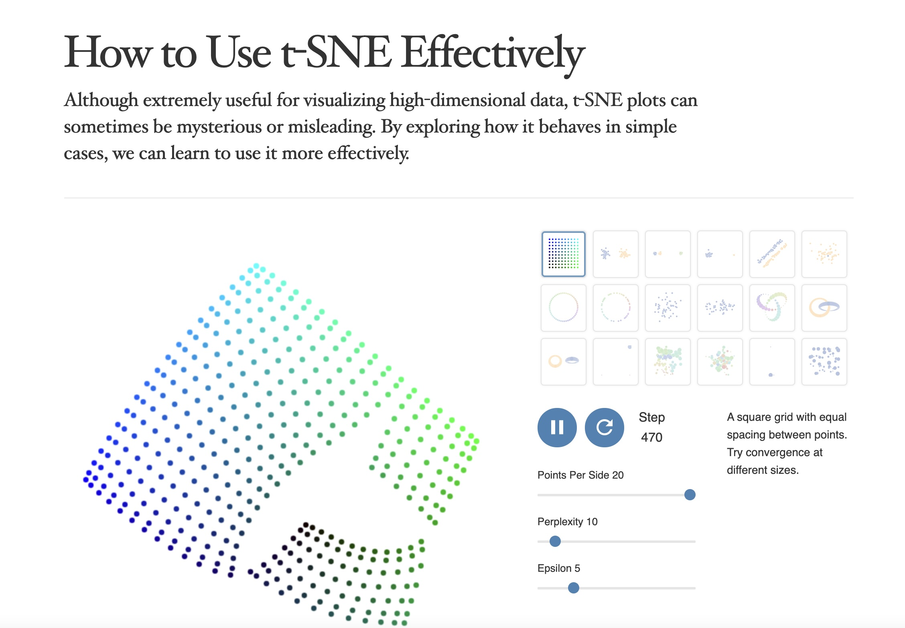

https://distill.pub/2016/misread-tsne/

::: {.notes}
This article, 'How to Use t-SNE Effectively,' is essential reading. It represents a pivot point in the visualization community, moving from simply celebrating t-SNE's results to critically analyzing its pitfalls. The authors demonstrate, using controlled experiments, which visual properties are meaningful and which are not. The main takeaway is that t-SNE is a visualization tool, not a clustering tool—its output must be treated as a suggestion of structure, not a definitive map of reality. This paper should be required reading for anyone using t-SNE in their work.
:::

## t-SNE

* Wattenberg et al writes "A popular method for exploring high-dimensional data is something called t-SNE... it has an almost magical ability to create compelling two-dimensonal “maps” from data with hundreds or even thousands of dimensions. Although impressive, these images can be tempting to misread."

* Wattenberg: "The algorithm is **non-linear** and adapts to the underlying data, performing **different transformations on different regions**. Those differences can be a major source of confusion."

* Watternberg: "A second feature of t-SNE is a tuneable parameter, **“perplexity,”** which says (loosely) how to balance attention between local and global aspects of your data. The parameter is, in a sense, a guess about the number of close neighbors each point has. The perplexity value has a complex effect on the resulting pictures."

::: {.notes}
This is THE critical article to read before using t-SNE. Wattenberg, Viégas, and Johnson from Google Brain systematically explore how t-SNE can be misread. Key point #1: t-SNE is non-linear and does different transformations in different regions - you can't directly compare distances. Key point #2: perplexity is crucial - it's roughly the number of close neighbors each point should have. Too low and you get disconnected clusters, too high and everything merges. We'll see concrete examples next.
:::

## t-SNE

* "Those hyperparameters really matter"

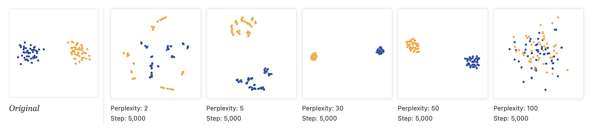

* "The image for perplexity 100, with merged clusters, illustrates a pitfall: for the algorithm to operate properly, the perplexity really should be smaller than the number of points."

::: {.notes}
The toy data in Wattenberg et al. is two Gaussian clusters of 50 points each, 100 points in all (the 'Original' panel on the left). The other five panels are t-SNE at perplexity 2, 5, 30, 50 and 100, each run for 5,000 steps.

At perplexity 2 and 5 each cluster shatters into small clumps and strings: with so few neighbors t-SNE only sees micro-structure, and it invents sub-clusters that are not in the data. At 30 and 50 we get two clean, compact clusters. At 100 the perplexity equals the number of points, and the two clusters dissolve into one mixed cloud, which is the pitfall quoted on the slide: perplexity must be smaller than the number of points.

Lesson: never trust a single t-SNE plot. Typical values are 5 to 50, and you should try several. The next slide runs the same experiment on a real dataset.
:::

## Try it: perplexity on 1,797 digits

```{python}
#| echo: false
#| fig-align: center
perps = [5, 30, 100, 500]
fig, axs = plt.subplots(1, 4, figsize=(17, 5.2))
for ax, p in zip(axs, perps):
    scatter(ax, TSNE(perplexity=p, random_state=0).fit_transform(X), f"perplexity {p}")
digit_legend(fig, -0.02)
plt.tight_layout(rect=[0, 0.07, 1, 1])
```

* Same data and seed; only the perplexity changes
* At 5 the groups are loose and fragmented; 30 and 100 give ten clear groups; at 500 (more than a quarter of the dataset) they press into each other
* *Which* groups end up next to each other changes from panel to panel

::: {.notes}
SKIPPABLE - if running long, jump to 'Wattenberg, Viégas, and Johnson, 2016'.

This is the perplexity experiment from the article on a real dataset: the 1,797 handwritten digits that ship with scikit-learn (8 by 8 pixel images, 64 features), colored by digit. This is the same dataset the lab uses.

Perplexity 5: ten groups, but loose, with small islands. 30 and 100: clean, compact groups. 500: the groups are still distinguishable but crowd each other and the middle of the map gets mixed. Ask the class: which of these would you show in a paper, and what would you want to say about how you chose it? Point out that the neighbors of each group differ between panels, so the layout of the groups is not a finding.
:::

## t-SNE

* "Each of the plots above was made with 5,000 iterations with a learning rate (often called “epsilon”) of 10, and had reached a point of stability by step 5,000. How much of a difference do those values make?"

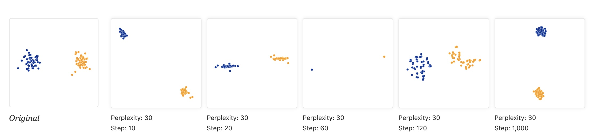

::: {.notes}
Same two-cluster data, perplexity fixed at 30 in every panel; only the number of optimization steps changes: 10, 20, 60, 120 and 1,000.

The intermediate pictures are not 'less converged versions of the answer', they are different-looking artifacts: at step 10 the clusters are separated; at 20 each is squashed into a line; at 60 each has collapsed to almost a single point; at 120 they have re-expanded into ragged shapes; only by step 1,000 do we get two compact clusters. Shapes at intermediate steps come from the optimizer, not the data.

Lesson: run until the picture stops changing. In scikit-learn the defaults are max_iter=1000 and learning_rate='auto'; the 5,000-step runs in the other figures are the article's choice, not a default.
:::

## t-SNE

* "Cluster sizes in a t-SNE plot mean nothing"

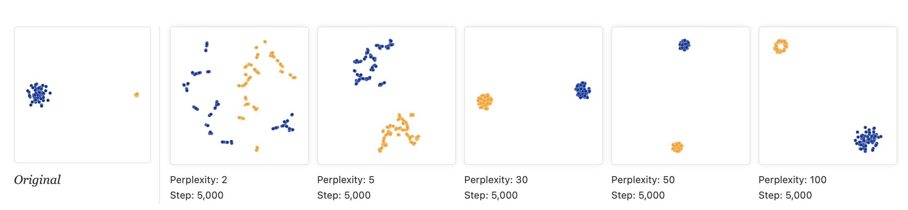

* "Size refers to spatial extent/area, not the number of points in the cluster."

* "The t-SNE algorithm adapts its notion of "distance" to regional density variations in the data set. As a result, it naturally expands dense clusters, and contracts sparse ones, evening out cluster sizes."

::: {.notes}
The reason t-SNE expands dense clusters and contracts sparse ones is due to its cost function, specifically the use of the heavy-tailed t-distribution, which is designed to resolve points within a cluster clearly. If a cluster is naturally dense, t-SNE must push points further apart in the low-dimensional embedding to satisfy the local probability distribution, effectively equalizing the density of the clusters in 2D space. Therefore, the area or size of a cluster in a t-SNE plot is not proportional to the cluster's density or variance in the original space. This is a feature, not a bug - it ensures all clusters are visible, but it means you can't compare cluster sizes visually.

Look at the 'Original' panel: the blue cluster is much more spread out than the tight orange one. At perplexity 30 and 50 t-SNE draws the two clusters at about the same size, which is the point of the slide: it expands dense regions and contracts sparse ones. At perplexity 100 the orange cluster is even drawn as a ring.
:::

## t-SNE

* "Distances between clusters might not mean anything"

* "The next diagrams show three Gaussians of 50 points each, one pair being 5 times as far apart as another pair."

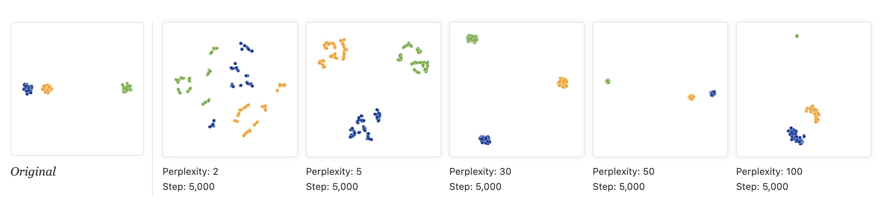

::: {.notes}
Original data: three clusters, where the blue and orange clusters are close together and the green one is far away. Then t-SNE at perplexity 2, 5, 30, 50 and 100 (5,000 steps each).

At 2 and 5 every cluster fragments. At perplexity 30 the three clusters end up at roughly the corners of a triangle: the near pair is no longer near, and the far cluster is no longer far. At 50 and 100 the original arrangement is roughly recovered (orange and blue close, green far), but at 50 the green cluster has shrunk to a speck.

So the gaps between clusters depend on the perplexity, and at the commonly used values they can be wrong. Do not read 'these two clusters are related because they are close'. The next-but-one slide repeats this with the same perplexity and different random starts.
:::

## Try it: same perplexity, different random start

```{python}
#| echo: false
#| fig-align: center
fig, axs = plt.subplots(1, 3, figsize=(17, 5.8))
for ax, seed in zip(axs, [0, 1, 2]):
    scatter(ax, TSNE(perplexity=30, init="random", random_state=seed).fit_transform(X), f"random_state = {seed}")
digit_legend(fig, -0.02)
plt.tight_layout(rect=[0, 0.07, 1, 1])
```

* Same data, same perplexity (30), random initialization; only the seed changes
* The same ten groups appear each time, but the arrangement changes
* Digit 0 (blue) sits at the bottom, the top left, and the far right

::: {.notes}
SKIPPABLE - if running long, jump to 'Topomap (Doraiswamy et al)'.

Same experiment as the 'distances between clusters' slide, but now we vary only the random seed. We use init='random' to make the effect visible; scikit-learn's default is PCA initialization, which makes runs much more repeatable. The ten groups are always found, but the position of each group relative to the others is not stable: in the three panels the blue 0s are at the bottom, top left and far right.

Ask: if you only had one of these three plots, which relationships would you be tempted to read into it? None of the between-group distances should be reported as a finding.
:::

## t-SNE

* "Random noise doesn’t always look random."

* "The next diagrams show genuinely random data, 500 points drawn from a unit Gaussian distribution in 100 dimensions. The left image is a projection onto the first two coordinates."

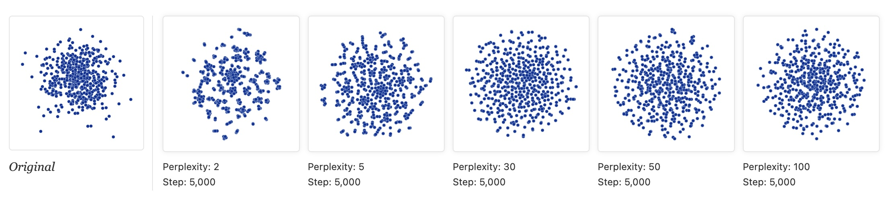

::: {.notes}
The data is 500 points from a unit Gaussian in 100 dimensions: pure noise, no clusters. The 'Original' panel is the projection onto the first two coordinates, a Gaussian cloud denser in the middle. Then t-SNE at perplexity 2, 5, 30, 50 and 100.

At perplexity 2 and 5 t-SNE produces clumps, gaps and filaments, i.e. apparent clusters, from noise. At 30 the output is close to a uniform disk (the dense center has been flattened: density information is lost). At 50 and 100 there is still some faint swirl structure.

Lesson: apparent clusters at low perplexity may be noise. Compare against a linear baseline and run several perplexities before believing structure.
:::

## t-SNE

* "For topology, you may need more than one plot"

* "The plots below show two groups of 75 points in 50 dimensional space. Both are sampled from symmetric Gaussian distributions centered at the origin, but one is 50 times more tightly dispersed than the other. The “small” distribution is in effect contained in the large one."

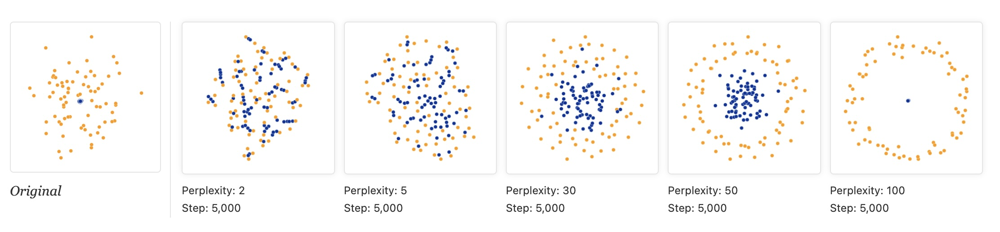

::: {.notes}
Two Gaussians of 75 points each in 50 dimensions. Both are centered at the origin, but the blue one is 50 times tighter, so it sits inside the orange one.

Perplexity 2 and 5: the two groups are mixed together, there is no containment. At 30 the blue points concentrate in the middle but are still intermingled with orange. At 50 we finally get the right picture: a blue core inside an orange ring. At 100 the blue cluster collapses to a single dot inside a circle of orange.

So the topology (one group inside another) shows up only for a middle range of perplexities, and even then the sizes are not to scale. One plot can mislead; you may need several. Topomap, next, tries to guarantee some of this.
:::

## Topomap (Doraiswamy et al)

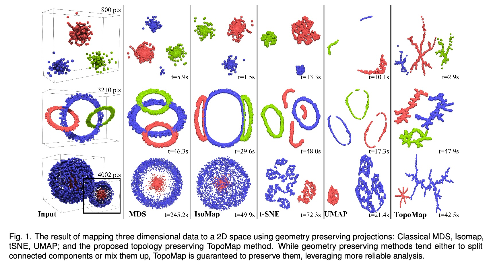

* Topomap preserves the 0-dimensional persistence diagram of the Rips filtration of the high-dimensional data.

::: {.notes}
The figure is Fig. 1 of the TopoMap paper. Three 3-D datasets, top to bottom: three separated clusters (800 points), three interlinked rings (3,210 points), and a small cluster nested inside a large spherical shell (4,002 points). Columns: the input, then MDS, Isomap, t-SNE, UMAP and TopoMap in 2-D, with run times.

The paper's point: geometry-preserving methods either split a connected component (t-SNE and UMAP break the rings into several pieces) or mix components up (MDS and Isomap stack the rings on top of each other). TopoMap is built from the 0-dimensional persistence of the Rips filtration, i.e. how connected components merge as the scale grows, and it preserves that exactly, so each component stays in one piece and components that are separate stay separate.

What you give up: it preserves components, not loops or holes (the rings come out as branching blobs), and the layouts look like trees. Run times in the figure are comparable to t-SNE and UMAP (for example 2.9 s vs 13.3 s for t-SNE on the first dataset, 47.9 s vs 48.0 s on the rings), so it is not obviously slower.
:::

## Understanding UMAP (Coenen & Pearce)

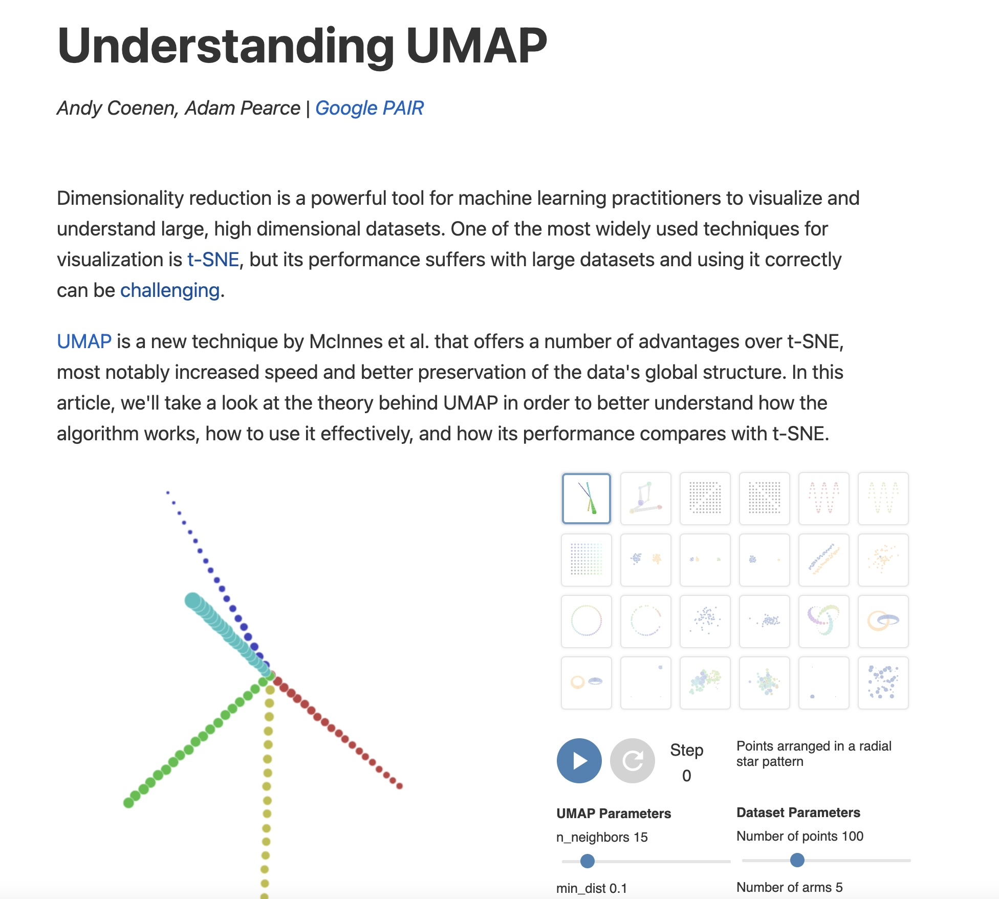

https://pair-code.github.io/understanding-umap/

::: {.notes}
We transition now to UMAP (Uniform Manifold Approximation and Projection). UMAP has rapidly replaced t-SNE as the go-to default for many visualization tasks. It shares the same philosophy as t-SNE—preserving local neighborhood structure—but it is built on a more rigorous theoretical foundation derived from Riemannian geometry and algebraic topology. This foundation is why UMAP is typically faster, scales better, and is often cited as better at preserving global data structure. This interactive article from Google's PAIR team is THE best resource for understanding UMAP, with interactive visualizations showing exactly how the algorithm works.
:::

## UMAP

* Coenen and Pearce: "UMAP is fast, scaling well in terms of both dataset size and dimensionality. ... UMAP can project the 784-dimensional, 70,000-point MNIST dataset in less than 3 minutes, compared to 45 minutes for scikit-learn's t-SNE implementation. Additionally, UMAP tends to better preserve the global structure of the data." 

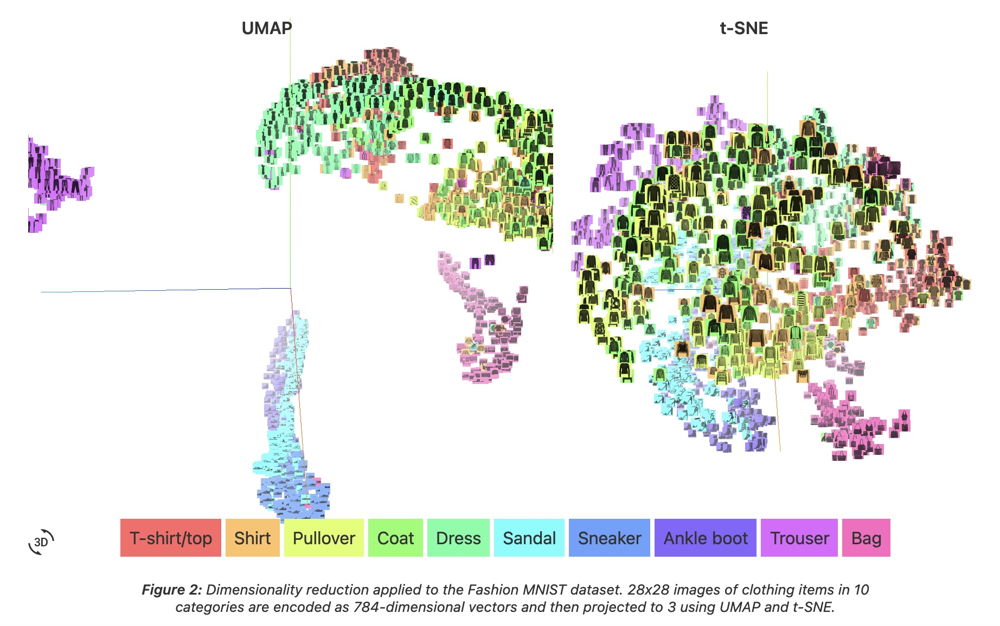

::: {.notes}
The figure is from Coenen and Pearce's 'Understanding UMAP'. It is Fashion-MNIST, not digits: 28 by 28 images of clothing in 10 categories, encoded as 784-dimensional vectors and projected to 3-D with UMAP (left) and t-SNE (right).

Both methods put footwear (sandal, sneaker, ankle boot) in one region away from the garments, and both separate trousers and bags. In the UMAP view the groups are separated by visible gaps; in the t-SNE view the upper-body garments (T-shirt, shirt, pullover, coat) form one continuous mass.

The speed numbers quoted on the slide (under 3 minutes vs 45 minutes for 70,000 MNIST points) are from the same article and are order-of-magnitude. At our scale the difference reverses: in the 1,797-point digits demos on the following slides, t-SNE takes about 2 s and UMAP about 5 s (including numba compilation). UMAP's speed advantage appears as the dataset grows.
:::

## UMAP

* "UMAP, at its core, works very similarly to t-SNE - both use graph layout algorithms to arrange data in low-dimensional space."

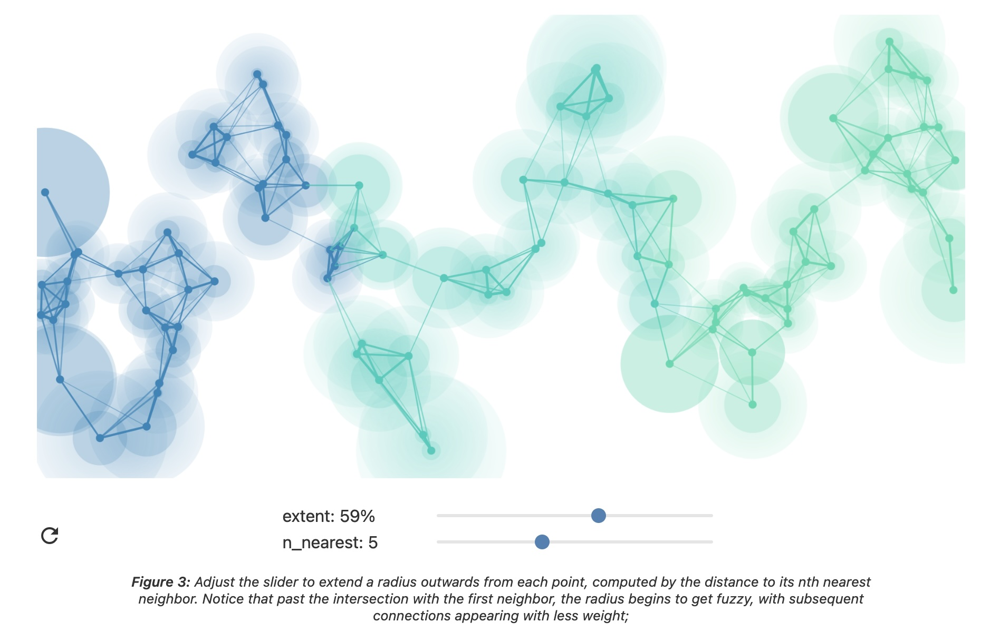

::: {.notes}
How UMAP works: it builds a "fuzzy topological representation" of the high-dimensional data. Essentially, it creates a weighted graph where edges represent neighborhood relationships, but the weights are "fuzzy" (probabilistic) rather than binary. Then it tries to find a similar graph structure in low dimensions. The theoretical foundation involves category theory and Riemannian geometry - much more sophisticated than t-SNE's probability distributions. But practically, you can think of it like force-directed graph layout with better math.
:::

## UMAP parameters

* **n_neighbors** - the number of approximate nearest neighbors used to construct the initial high-dimensional graph.

* **min_dist** - the minimum distance between points in low-dimensional space.

::: {.notes}
The two core UMAP parameters, n_neighbors and min_dist, allow precise control over the resulting visualization. n_neighbors dictates the local/global balance (high value = more global view, lower value = more local focus). min_dist acts as a repulsion force, ensuring a minimum separation between points. These two parameters are typically tuned together to find an embedding that maximizes the visualization of the data's inherent structure. Unlike t-SNE's perplexity which can dramatically change results, UMAP parameters tend to be more stable and intuitive.
:::

## UMAP parameters

* **n_neighbors** - the number of approximate nearest neighbors used to construct the initial high-dimensional graph. 

* **min_dist** - the minimum distance between points in low-dimensional space.

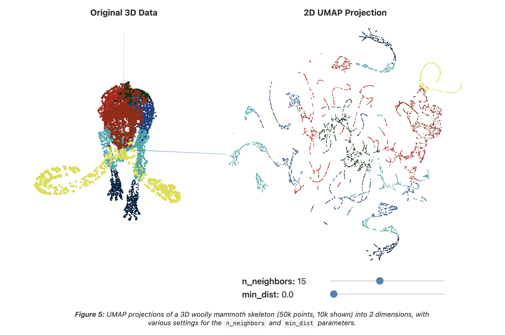

::: {.notes}
The data is a 3-D woolly mammoth skeleton (50,000 points, 10,000 shown), colored by body part on the left; the right panel is its 2-D UMAP projection with n_neighbors=15 and min_dist=0.0.

With min_dist=0 points may sit right on top of each other. The projection breaks into thin strands and small fragments: local connectivity is clearly drawn, but the global shape, the mammoth, is hard to recognize. This setting is good for tight clusters and bad for seeing individual points.
:::

## UMAP parameters

* **n_neighbors** - the number of approximate nearest neighbors used to construct the initial high-dimensional graph. 

* **min_dist** - the minimum distance between points in low-dimensional space.

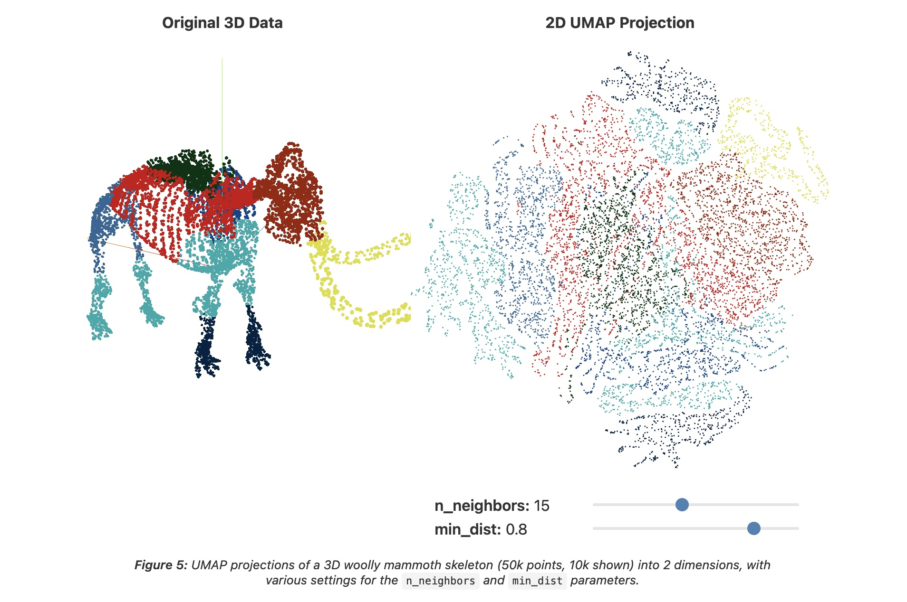

::: {.notes}
Same mammoth and the same n_neighbors=15, but now min_dist=0.8. Points are forced apart, and the picture becomes one filled blob in which the body-part colors form patches. It is easier to see individual points and there is less overplotting, but the fine strand structure from the previous slide is gone.

Neither setting recovers the mammoth's shape. Typical advice: smaller min_dist (0 to 0.1) when you care about clusters, larger (0.5 and up) when you want to see the points. UMAP is fast enough that trying several is practical.
:::

## Try it: UMAP n_neighbors × min_dist

```{python}
#| echo: false
#| fig-align: center
nn_vals, md_vals = [5, 15, 50], [0.0, 0.5]
fig, axs = plt.subplots(2, 3, figsize=(17, 8.0))
for i, md in enumerate(md_vals):
    for j, nn in enumerate(nn_vals):
        scatter(axs[i, j], UMAP(n_neighbors=nn, min_dist=md, random_state=0).fit_transform(X), f"n_neighbors={nn}, min_dist={md}", s=7)
digit_legend(fig, -0.01)
plt.tight_layout(rect=[0, 0.05, 1, 1])
```

* Rows: min_dist 0.0 vs 0.5. Columns: n_neighbors 5, 15, 50. min_dist changes how tightly points pack; n_neighbors changes how the groups are laid out relative to each other

::: {.notes}
SKIPPABLE - if running long, jump to 'PCA, t-SNE or UMAP: which one when?'.

The same digits, now with UMAP. Top row min_dist 0.0: tight, small blobs. Bottom row min_dist 0.5: the same groups, but spread out so individual points are visible. Columns are n_neighbors 5, 15 and 50: the groups are the same, but their placement relative to each other changes, for example where digit 0 (blue) lands. Compared with the perplexity sweep, the groups themselves look more stable across these settings, though the arrangement still moves.

UMAP took a few seconds per panel here (including numba compilation on the first call), which is why trying several settings is practical.
:::

## UMAP

* "However, it's important to note that, because UMAP and t-SNE both necessarily warp the high-dimensional shape of the data when projecting to lower dimensions, **any given axis or distance in lower dimensions still isn’t directly interpretable in the way of techniques such as PCA.**"

* Suggested reading: https://pair-code.github.io/understanding-umap/supplement.html
   - "Most dimensionality reduction algorithms fit into either one of two broad categories: Matrix factorization (such as PCA) or Graph layout (such as t-SNE)."
   - "At its core, UMAP is a graph layout algorithm, very similar to t-SNE, but with a number of key theoretical underpinnings that give the algorithm a more solid footing."

## UMAP

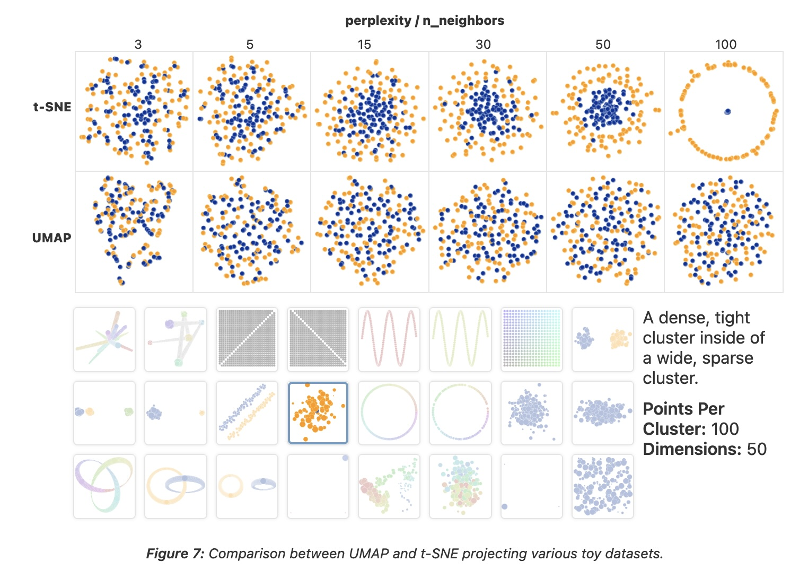

::: {.notes}
This figure from Coenen and Pearce uses one toy dataset, a dense, tight cluster inside a wide, sparse one (100 points per cluster, 50 dimensions), and varies t-SNE's perplexity (top row) and UMAP's n_neighbors (bottom row) over 3, 5, 15, 30, 50 and 100.

t-SNE: at 3 and 5 the two groups are mixed; at 15 and 30 the small one concentrates in the middle; at 50 there is a clear core inside a ring; at 100 the core collapses to a dot inside a circle. UMAP: whatever n_neighbors we choose, the two groups stay mixed; the containment that t-SNE finds at perplexity 50 never appears.

So UMAP's output is more stable across parameters here, but stable is not the same as right. The practical conclusion is not 'always use UMAP'. UMAP is a sensible first try on large data because it is fast, but run both when the structure matters.
:::

## PCA, t-SNE or UMAP: which one when?

| | PCA | t-SNE | UMAP |
|---|---|---|---|
| **Kind** | linear | non-linear, neighbor graph + KL divergence | non-linear, fuzzy neighbor graph |
| **Keeps** | global variance | local neighborhoods | local neighborhoods, some coarse layout |
| **Axes and distances mean something?** | yes: axes are directions in the data | no: sizes and gaps are artifacts | no: gaps are not reliable |
| **Knobs** | number of components | perplexity, steps, learning rate | n_neighbors, min_dist |
| **Repeatable?** | yes | depends on initialization and seed | depends on seed |
| **New points** | `transform` | refit | `transform` |
| **Reach for it to** | get a first look, denoise, preprocess | see local cluster structure on small and medium data | see structure on larger data, reuse the mapping |

::: {.notes}
SKIPPABLE - if running long, jump to 'Is this projection any good?'.

A summary, not a ranking. PCA is the only one whose axes you can interpret and the only one that is trivially repeatable, so it is the baseline you should always look at first.

Be careful with the claim that UMAP preserves global structure better than t-SNE. It is often repeated, but Kobak and Linderman (Nature Biotechnology, 2021) showed that most of the difference comes from initialization: with PCA initialization, t-SNE preserves global layout about as well. In scikit-learn, t-SNE already defaults to PCA initialization.

On new points: UMAP can embed new data with transform; scikit-learn's TSNE has no transform, so new points need a refit. On speed: PCA takes a hundredth of a second on the digits, t-SNE about 2 s and UMAP about 5 s (including compilation); UMAP's advantage shows up at larger N.
:::

## Is this projection any good?

* Score a projection by checking whether **neighborhoods survive**: for each point, compare its *k* nearest neighbors in the original space with its *k* nearest neighbors in the map
* **Trustworthiness**: are the neighbors in the map *real* neighbors? It penalizes **false neighbors**: points that look close in the map but were far apart in the data
* **Continuity**: were the real neighbors *kept*? It penalizes **tears**: points that were close in the data but ended up far apart in the map
* Both run from 0 to 1 (1 is perfect). In scikit-learn: `trustworthiness(X, X_map, n_neighbors=k)`; continuity is the same function with the two spaces swapped
* Both are **local**: they say nothing about the distances between clusters

T(k) = 1 − 2 / (N·k·(2N − 3k − 1)) · Σ<sub>i</sub> Σ<sub>j ∈ U<sub>i</sub></sub> (r(i,j) − k)

<span style="font-size:70%">U<sub>i</sub> = false neighbors of *i* (in its map neighborhood, not in its data neighborhood); r(i,j) = rank of *j* among *i*'s neighbors in the original space</span>

::: {.notes}
SKIPPABLE - if running long, jump to 'Before you trust a projection'.

So far we judged t-SNE and UMAP by eye. Here is a way to put a number on it. Both measures, due to Venna and Kaski, look at each point's k nearest neighbors.

Trustworthiness asks: of the points that are among this point's k nearest neighbors in the map, how many were really nearby in the original space? The ones that were not are false neighbors, and they are penalized by how far down the original ranking they were (the r(i,j) minus k term). Continuity is the mirror image: of the points that were among its k nearest neighbors in the data, how many did we keep in the map? Ones that got torn away are penalized.

Both are local, so they cannot detect a wrong picture of how clusters relate to each other. That limitation matters for t-SNE, and the next two slides show it.
:::

## Four projections of the digits, scored

```{python}
#| echo: false
#| fig-align: center
K = 15
trust = {n: trustworthiness(X, e, n_neighbors=K) for n, e in E.items()}
cont = {n: trustworthiness(e, X, n_neighbors=K) for n, e in E.items()}
fig = plt.figure(figsize=(17, 8.2))
gs = fig.add_gridspec(2, 4, height_ratios=[1.25, 1])
for j, (n, e) in enumerate(E.items()):
    scatter(fig.add_subplot(gs[0, j]), e, n, s=7)
ax = fig.add_subplot(gs[1, :])
w, xs = 0.36, np.arange(len(E))
b1 = ax.bar(xs - w/2, list(trust.values()), w, color="#57068c", label=f"trustworthiness (k={K})")
b2 = ax.bar(xs + w/2, list(cont.values()), w, color="#b9a3d1", label=f"continuity (k={K})")
for bars in (b1, b2):
    for r in bars:
        ax.text(r.get_x() + r.get_width()/2, r.get_height() + 0.01, f"{r.get_height():.2f}", ha="center", fontsize=18)
ax.set_xticks(xs); ax.set_xticklabels(list(E)); ax.set_ylim(0, 1.45); ax.set_yticks([0, 0.5, 1.0])
ax.legend(frameon=False, ncol=2, loc="upper center", fontsize=19)
plt.tight_layout()
```

::: {.notes}
SKIPPABLE - if running long, jump to 'Before you trust a projection'.

The same 1,797 digits, projected four ways, with trustworthiness and continuity at k=15 under each. PCA: trustworthiness 0.83, continuity 0.95. It keeps almost all true neighbors but also brings in many false ones (different digits overlap in the middle). LLE with n_neighbors=30: 0.68 and 0.83, the worst of the four; it collapses most points near one spot. t-SNE: 0.99 and 0.98. UMAP: 0.99 and 0.98.

Caveats to say out loud: these are single runs with one setting each (LLE in particular might do better with other neighbors), the metric is computed at one k, and both scores say the local neighborhoods are good, not that the picture is a faithful map. The numbers on the bars are computed when the deck is rendered.
:::

## But the score barely moves with perplexity

```{python}
#| echo: false
#| fig-align: center
perps = [5, 15, 30, 50, 100, 200, 500]
T, C = [], []
for p in perps:
    e = TSNE(perplexity=p, random_state=0).fit_transform(X)
    T.append(trustworthiness(X, e, n_neighbors=15)); C.append(trustworthiness(e, X, n_neighbors=15))
fig, ax = plt.subplots(figsize=(17, 6.6))
ax.plot(perps, T, "o-", lw=4, ms=12, color="#57068c", label="t-SNE trustworthiness (k=15)")
ax.plot(perps, C, "s-", lw=4, ms=12, color="#b9a3d1", label="t-SNE continuity (k=15)")
for name in ("PCA", "LLE"):
    v = trustworthiness(X, E[name], n_neighbors=15)
    ax.axhline(v, ls="--", lw=2.5, color="#6d6d6d")
    ax.text(500, v + 0.02, f"{name} trustworthiness = {v:.2f}", ha="right", va="bottom", fontsize=19, color="#4a4a4a")
ax.set_xscale("log"); ax.set_xticks(perps); ax.set_xticklabels(perps)
ax.set_ylim(0.0, 1.05); ax.set_xlabel("t-SNE perplexity"); ax.legend(frameon=False, loc="center right", bbox_to_anchor=(1.0, 0.42))
plt.tight_layout()
```

* Perplexity 5 to 500 stays between 0.98 and 0.99, although the maps on the earlier slides look quite different. The metric separates **methods** (dashed lines: PCA, LLE) but is too coarse to pick a **perplexity**, and it cannot see cluster sizes or the gaps between clusters

::: {.notes}
SKIPPABLE - if running long, jump to 'Before you trust a projection'.

A deliberately uncomfortable result. We ran t-SNE at seven perplexities, 5 to 500, on the digits, and scored each. The curves are almost flat: trustworthiness between 0.98 and 0.99 and continuity between 0.98 and 0.99 (the dashed lines show how much lower PCA and LLE are for comparison).

So the metric is useful for ruling out a bad method, such as LLE here, but it does not tell you which t-SNE picture to show. The earlier slides show that those pictures differ in what a viewer would read from them: fragments, cluster sizes, which groups are neighbors. Quality metrics complement looking at the picture and varying parameters; they do not replace either.
:::

## Before you trust a projection

1. **Vary the settings**: several perplexities (5 to 100) or n_neighbors (5 to 50), and at least two seeds. Keep only what is stable
2. **Do not read** cluster size, cluster density, or the distance between clusters
3. **Compare with a baseline**: PCA, and a noise dataset of the same size. Do the "clusters" appear there too?
4. **Score it**: trustworthiness and continuity; if you have labels, how well do they predict from the map (for example k-NN accuracy)?
5. **Report it**: method, parameters, seed and preprocessing, in the caption
6. **Use it to ask questions** of the original data, not as evidence on its own

::: {.notes}
SKIPPABLE - if running long, jump to 'What about user interaction?'.

A checklist to take away, and something you can apply directly in your projects. If your project includes any embedding plot (of images, text, or a model's hidden activations), expect to be asked in the final presentation which of these you did.
:::

## What about user interaction?

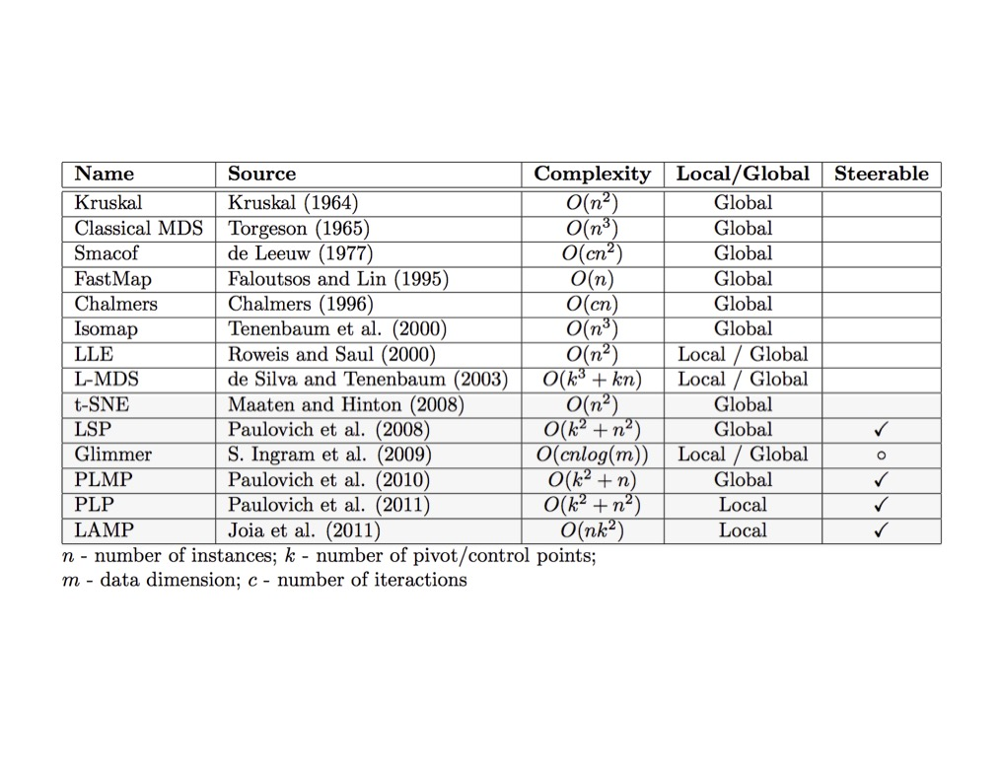

::: {.notes}
This slide is a table from the visualization literature, not a system. It lists projection algorithms from Kruskal (1964) to LAMP (2011) with their time complexity, whether they mainly preserve local or global structure, and whether they are 'steerable', meaning that a user can influence the layout, typically by placing control points. The check marks are LSP, PLMP, PLP and LAMP (Paulovich et al. and Joia et al.); Glimmer has a partial mark.

The table predates the popularity of t-SNE and UMAP in visualization work, and it labels t-SNE as 'Global'. After today's slides you should be cautious about that: what t-SNE preserves best is local neighborhoods. The next slide explains what steerable means.
:::

## Steering a projection

* **Steerable** methods (the check marks in the table: LSP, PLMP, PLP, LAMP) let the user influence the layout instead of accepting one static map
* A common recipe: pick a small set of **control points**, place them where you want them in 2-D, and position the remaining points relative to them
* Interactions follow from that: drag a point, group points, change a parameter and see the map update
* Questions to ask of any interactive projection in a project: **what can the user change, and what stays fixed?**

::: {.notes}
SKIPPABLE - if running long, jump to 'Recommended reading'.

What 'steerable' means in the table on the previous slide. In control-point methods such as LSP and LAMP the layout of a small subset is placed first, by the user or by a slower algorithm, and the rest of the points are positioned from the control points quickly, which is fast enough to be interactive. Interaction with t-SNE or UMAP usually means changing a parameter and recomputing the whole layout, which is slower.

For your projects: if your system shows a projection, be explicit about which parts the user can influence.
:::


## Recommended reading

* **Clustering:** Bernard, [*Introduction to Machine Learning* — Clustering](https://www.wolfram.com/language/introduction-machine-learning/clustering/) (Wolfram), and the scikit-learn page [Comparing different clustering algorithms on toy datasets](https://scikit-learn.org/stable/auto_examples/cluster/plot_cluster_comparison.html)

* **Projections, required:** Wattenberg, Viégas & Johnson, [*How to Use t-SNE Effectively*](https://distill.pub/2016/misread-tsne/) (Distill, 2016)

* Coenen & Pearce, [*Understanding UMAP*](https://pair-code.github.io/understanding-umap/)

::: {.notes}
Two readings, one per half. The Wolfram chapter is short and interactive; read the parts on choosing the number of clusters and on preprocessing, since those are the places today where the answer changed. The Distill article is the one to read before using t-SNE for anything: it shows, with interactive examples, the pitfalls from the t-SNE slides.

The scikit-learn page is the Python counterpart of the FindClusters grid shown in the first half, and the quickest way to try several clustering methods on your own data.
:::
