# Introduction

Based on materials by Enrico Bertini

::: notes
**LECTURE TIMING GUIDANCE (150 min total)**

This is a PACKED lecture with lots of content. Suggested timing:

**Core Material (90-100 min):** MUST COVER
- Intro + Temporal Data Fundamentals (15 min): Types, structures, aggregation
- Line Charts + Aspect Ratio + Banking to 45° (20 min): Cleveland's research
- Multiple Lines + Spaghetti Plots + Solutions (15 min): Critical problem
- Small Multiples transition to Interaction (20 min): Zoom, brushing & linking
- Area Charts + Baseline Bias (10 min): Another critical limitation
- Event Data + Gantt Charts (10 min): Practical techniques

**Important but Optional (30-40 min):** COVER IF TIME PERMITS
- Heat Maps + WSJ Vaccine Example (15 min): Famous example, worth showing
- Calendar Visualizations (10 min): Students will use these
- Radial Layout Warnings (5 min): Important cautionary note

**Advanced/Optional (20-30 min):** READING ASSIGNMENT IF SHORT ON TIME
- Spiral Plots (5 min)
- Horizon Charts (15 min): Complex technique, needs slow walkthrough
- Sparklines (5 min)
- Alternative Encodings (5 min)

**Strategy if running short:**
1. Skip Spiral Plots entirely
2. Show Horizon Charts as "further reading"
3. Make sure to cover Banking to 45°, Spaghetti Plots, Baseline Bias (core perceptual issues)
:::

## Why Does Time Matter?

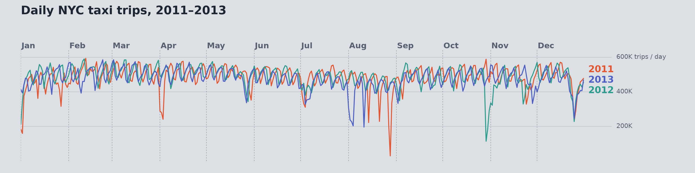{.nostretch width="90%" fig-align="center" fig-alt="Daily NYC taxi trips in 2011, 2012, and 2013 aligned by calendar date, showing recurring weekly fluctuations and occasional sharp drops."}

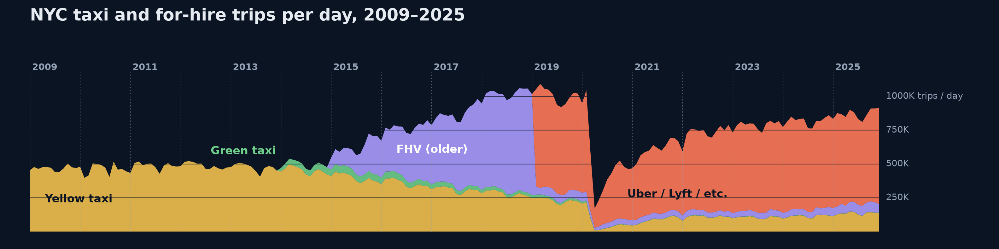{.nostretch width="90%" fig-align="center" fig-alt="NYC taxi and for-hire trips from 2009 to 2025, showing changes in the mix of services and a steep drop in 2020 followed by a recovery."}

::: notes
SKIPPABLE opener (new for 2026, shared with the VisML deck).

- Ask what a single average of daily trips would hide.
- Top: three years aligned by calendar date. The weekly rhythm repeats and a few days drop sharply (holidays, storms). That is a cyclic structure plus events.
- Bottom: zoomed out to 2009-2025, the mix of services shifts (yellow, green, then for-hire vehicles such as Uber and Lyft) and there is the sharp drop in 2020. That is a sequential structure.
- Careful reading: the purple-to-orange switch in 2019 is mostly a reporting change (the TLC began publishing high-volume for-hire trips, i.e. Uber/Lyft, as their own category in Feb 2019), not a jump in service. A good example of a data-definition change showing up as a pattern in time.
- Callback to Week 9 (TaxiVis): the same taxi data, now read only along time.
- Transition: "Both charts are the same kind of data. What makes data temporal?"
:::

## What is Temporal Data?

**Definition**: Data in which values depend on time and time is explicitly recorded.

In other words: we track **when** things happened or **what values were** at specific points in time

::: notes
- This is a fundamental concept - time is not just an attribute, it's THE organizing dimension
- **START WITH THIS QUESTION**: "What datasets have you used or seen that have time in them?"
  - Get 3-4 student examples on the board
  - For each example, ask: "How is time recorded? What's the granularity?"
- Emphasize that temporal data requires explicit time recording - not just "ordered" data
- Common misconception: Students often think any sequential data is temporal (e.g., ranking lists)
- Key distinction: Temporal data has meaningful time stamps/intervals, not just ordering
:::

## Example: Temporal Dataset Structure

**The DATE and TIME columns make each collision record temporal data.**

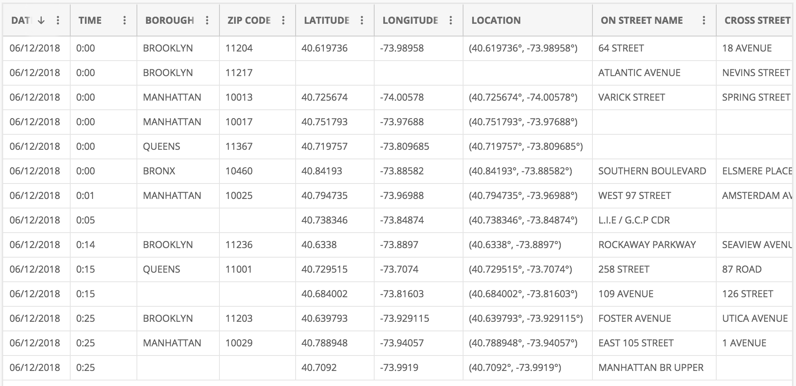{fig-align="center"}

::: notes
- Each row is one **incident/event** at a specific location and time, so we can ask when, where, and how often
- These are NYC motor vehicle collision records (NYC Open Data): borough, ZIP, lat/long, street names. The first header reads DAT only because the column is truncated in the screenshot
- **PHYSICALLY POINT** to the DAT and TIME columns on screen with mouse/pointer
  - "See these columns? This is what makes this temporal data - explicit timestamps"
  - Make sure image is zoomed/large enough for back row to see
- Note the other attributes (location, type) that we might want to analyze over time
- Questions to pose: "What patterns might we want to find? Daily patterns? Seasonal? Hot spots over time?"
  - Wait for answers - students might suggest: "crime by hour of day", "seasonal trends", "geographic patterns over time"
- This is event data (discrete occurrences) rather than continuous measurements
:::

## Application Domains

- Business
- Natural Phenomena
- Behaviors/Movement
- Traffic/Mobility
- Medical/Healthcare
- Finance

::: notes
- Temporal data is EVERYWHERE - this is one of the most common data types
- Ask students to give specific examples for each domain:
  - Business: Sales trends, customer activity, website traffic
  - Natural Phenomena: Weather, earthquakes, climate change
  - Behaviors/Movement: GPS tracks, social media activity, eye tracking
  - Traffic/Mobility: Vehicle flow, public transit usage, flight patterns
  - Medical: Patient vitals, disease progression, treatment outcomes
  - Finance: Stock prices, trading volume, economic indicators
- Emphasize: Different domains have different temporal characteristics (irregular vs regular sampling, event-based vs continuous)
:::

## Type 1: Event Data

**Time + Object (Attributes)**

"Something happened at time T"

Examples: Tweet, Email, Alarm

::: notes
- CRITICAL distinction: Event data represents discrete occurrences at points in time
- Events often have irregular timing - they happen when they happen (not sampled at regular intervals)
- Each event is an object with attributes (who, what, where, why)
- Examples to emphasize:
  - Tweet: timestamp + user + text + location
  - Email: sent time + sender + recipient + subject
  - Alarm: trigger time + sensor + type + severity
- Key visualization challenge: How do we show when events occurred and their attributes?
- Often visualized as dots, marks, or bars on a timeline
:::

## Type 2: Measurement Data

**Time + Measure(s)**

"This is the value at time T"

Examples: Temperature, revenue, stock value

::: notes
- **EXPLICIT CONTRAST WITH TYPE 1**: "Remember Event Data? Tweet, Email, Alarm - something just *happened*. Measurement data is different - we're recording a *value* at each time point."
- Measurement data: Continuous or regularly sampled values over time
- Unlike events (which happen irregularly), measurements are typically taken at regular intervals
- Each measurement records one or more quantitative values at a timestamp
- **Side-by-side comparison to emphasize**:
  - Event: "Email sent at 3:42 PM" (binary - it happened)
  - Measurement: "Temperature was 72°F at 3:42 PM" (quantitative value)
- Examples to discuss:
  - Temperature: Recorded every hour → time series of temperature values
  - Revenue: Daily sales figures → continuous tracking of performance
  - Stock value: Price sampled every second during trading hours
- Key difference from events: We care about the VALUE at each time point, not just that something occurred
- Primary visualization: Line charts, area charts - showing how values change over time
- This is what most people think of as "time series data"
:::

## Temporal Information Components

**Time = Position + Interval + Granularity**

- **Position**: When did it occur? (specific timestamp)
- **Interval**: For how long? (duration)
- **Granularity**: At what scale? (seconds, hours, days, years)

**Example**: A meeting starts at 2:00 PM (position), lasts 90 minutes (interval), measured in minutes (granularity)

::: notes
- These three components help us fully characterize temporal data
- **Position (When)**: The anchor point in time - can be absolute (Jan 1, 2025, 3:00 PM) or relative (3 hours ago)
- **Interval (Duration)**: How long something lasted - critical for event data with duration (meetings, system outages, sessions)
  - Point events have duration ≈ 0
  - Interval events have meaningful duration
- **Granularity (Scale)**: The resolution at which we're measuring/recording time
  - Affects what patterns we can see (hourly data can't show minute-level patterns)
  - Choice of granularity is a design decision - finer = more detail but more data
- Example: "Meeting from 2:00-3:30 PM" has position (2:00 PM), interval (90 min), granularity (minutes)
- These components influence visualization choices
:::

## Time Structures

Three key structures for temporal data:

1. **Sequential** - Linear progression over time
2. **Cyclic** - Repeating patterns (daily, weekly, seasonal)
3. **Hierarchical** - Nested time resolutions (year/month/day)

**Key insight**: Most real temporal data has ALL THREE structures simultaneously!

::: notes
- These are the three fundamental ways time can be structured in data
- **Sequential**: Time flows in one direction - useful for showing trends, growth, changes
  - Example: Company revenue from 2015-2025
- **Cyclic**: Patterns repeat on a regular basis - reveals rhythms and regularities
  - Example: Traffic by hour of day, sales by day of week, temperature by season
  - Natural cycles: daily, weekly, monthly, yearly
- **Hierarchical**: Multiple nested time scales - enables drill-down and multi-resolution analysis
  - Example: Years contain quarters contain months contain weeks contain days
- **EMPHASIZE THIS POINT**: "Most real temporal data has ALL THREE structures simultaneously!"
  - Example: Website traffic has sequential trends (growing over years), cyclic patterns (weekday vs weekend), and hierarchical structure (hour/day/week/month)
  - You choose which structure to visualize based on your question
- Visualization choice depends on which structure you want to emphasize
:::

## Sequential and Cyclic Patterns

::: {.columns}
::: {.column width="50%"}
**Sequential**

(Jan 1, … , Dec 31)
:::

::: {.column width="50%"}
**Cyclic**

(S, M, T, W, T, F, S)
:::
:::

## Hierarchical Time Resolutions

**Multiple Resolutions**

- Years
- Months
- Weeks
- Days
- Hours

## Linking Data Types to Time Structures

::: {.columns}
::: {.column width="50%"}
**Event Data**

Time + Object (Attributes)

- Sequential: Transaction logs over years
- Cyclic: User logins by day of week
- Hierarchical: System alerts by hour/day/month
:::

::: {.column width="50%"}
**Measurement Data**

Time + Measure(s)

- Sequential: Stock prices over time (line charts)
- Cyclic: Temperature patterns by season
- Hierarchical: Revenue by year/quarter/month
:::
:::

**Key Insight**: Data type + time structure → visualization choice

::: notes
- **NOW we can synthesize**: You've seen Event vs Measurement AND Sequential/Cyclic/Hierarchical
- This slide connects the two fundamental concepts: data types AND time structures
- Both event and measurement data can have sequential, cyclic, or hierarchical patterns
- The combination determines the best visualization approach
- Sequential structure → line charts, area charts (show progression)
- Cyclic structure → radial layouts, calendars (emphasize repetition)
- Hierarchical structure → multi-scale views, drill-down interactions
- Ask students: "If you have daily website traffic, what structures might you see?" (Answer: Sequential trend over months, cyclic pattern by day of week, hierarchical hour/day/week)
:::

## Aggregation Trade-offs

::: {.columns}
::: {.column width="50%"}
**Benefits of Aggregation**

- Reduces noise
- Shows overall trends
- Manageable data size
- Clearer patterns

*Example*: Daily → Monthly averages reveals seasonal trends
:::

::: {.column width="50%"}
**Risks of Aggregation**

- Masks short-term events
- Loses extreme values
- Can hide critical peaks
- **Simpson's Paradox**

*Example*: A 1-hour server outage disappears in monthly view
:::
:::

**Design principle**: Choose granularity based on the questions you need to answer

**Warning**: This is Simpson's Paradox for temporal data - aggregation can completely reverse or hide patterns!

::: notes
- **CRITICAL SLIDE** - This is Simpson's paradox for temporal data!
- Aggregation is necessary (can't show raw data at finest granularity) BUT dangerous
- Benefits are obvious - reduced noise, clearer trends, manageable visualization
- But risks are severe - can completely hide important events
- **Real example to share**: Netflix outage for 1 hour affects millions, but disappears in daily/weekly aggregates
- **Another example**: Daily COVID cases show spikes, but monthly averages smooth them out - which matters for policy?
- The "right" aggregation depends on your analytical question:
  - Looking for long-term trends? → Aggregate more
  - Looking for anomalies/outliers? → Aggregate less
- Best practice: Provide interactive controls to change aggregation level
- Mention multi-resolution techniques (coming later): horizon charts, overview+detail
:::

## Example: Sales Over Time - Sequential View

**Sequential: "How did our sales change over the years?"**

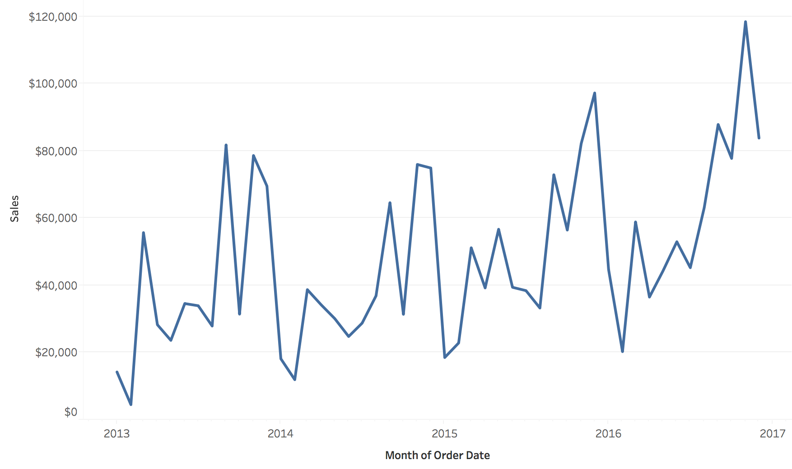{fig-align="center"}

## Example: Sales Over Time - Cyclic View

**Cyclic: "How does the number of orders change by day of the week?"**

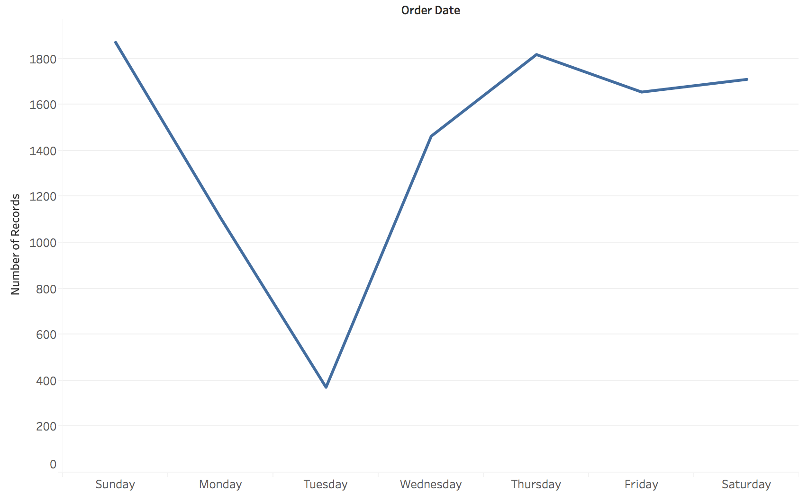{fig-align="center"}

## Hierarchical Structure and Resolution

Combining multiple time resolutions in one view

## Time Resolution: Sequential Views

**The same sales by week (top) and by month (bottom): granularity changes what you see.**

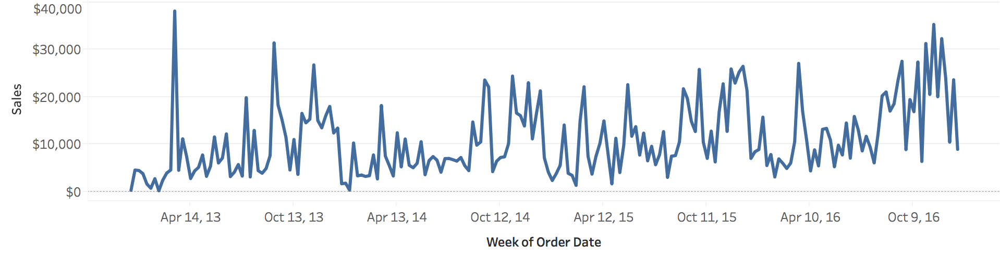{.nostretch width="80%" fig-align="center"}

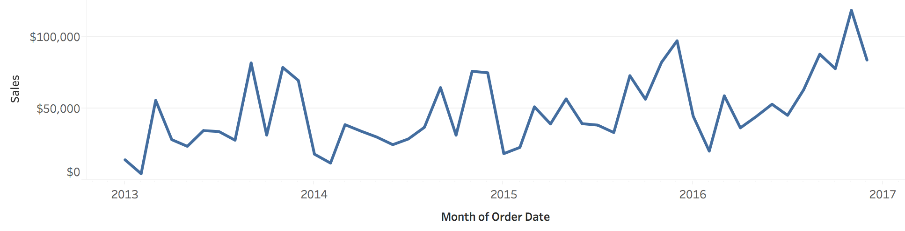{.nostretch width="80%" fig-align="center"}

## Time Resolution: Cyclic Views

**The same orders folded by month of year (top) and by day of week (bottom).**

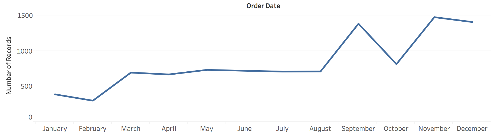{.nostretch width="75%" fig-align="center"}

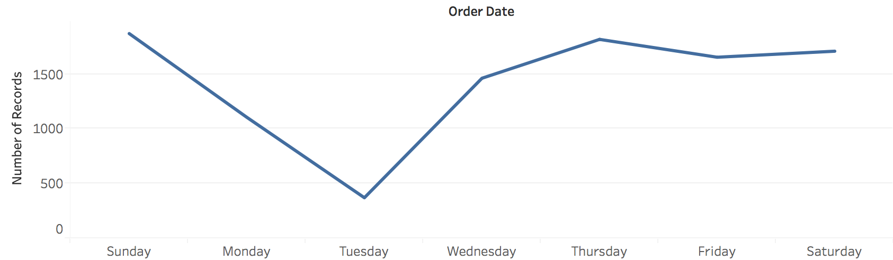{.nostretch width="75%" fig-align="center"}

## Example: Nesting Cyclic (Day) within Sequential (Year)

**One line per year (2013-2016) across the days of the week: a cyclic view nested in a sequential one.**

{fig-align="center"}

## Example: Nested Time Patterns (Monthly)

**Sales by month of the year, one line per year (2013-2016).**

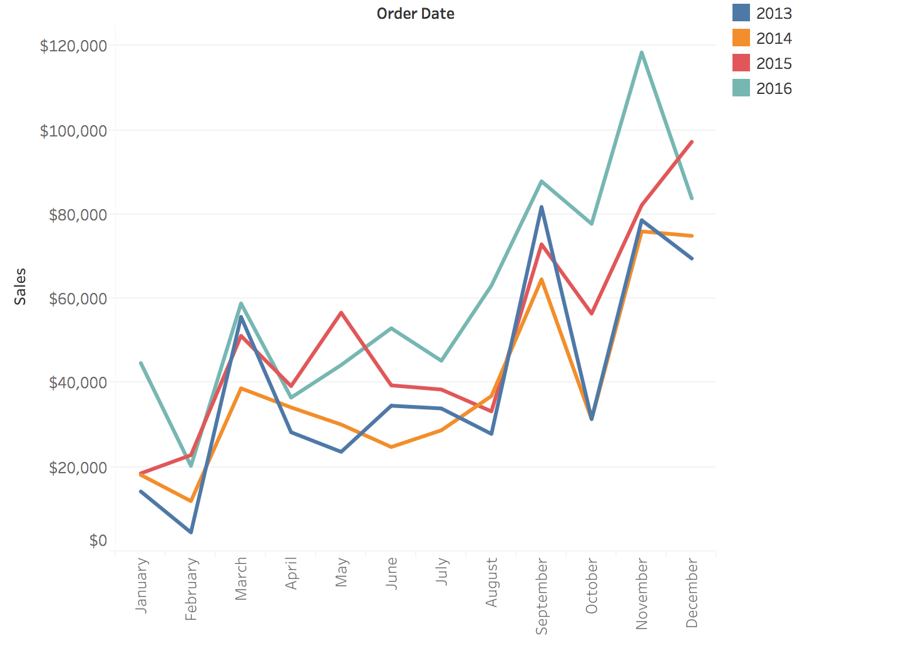{fig-align="center"}

# Visualization Methods

Line charts, area charts, and their variations

## Line Charts: Time + Quantity

**The fundamental temporal chart: position encodes both time (x) and value (y).**

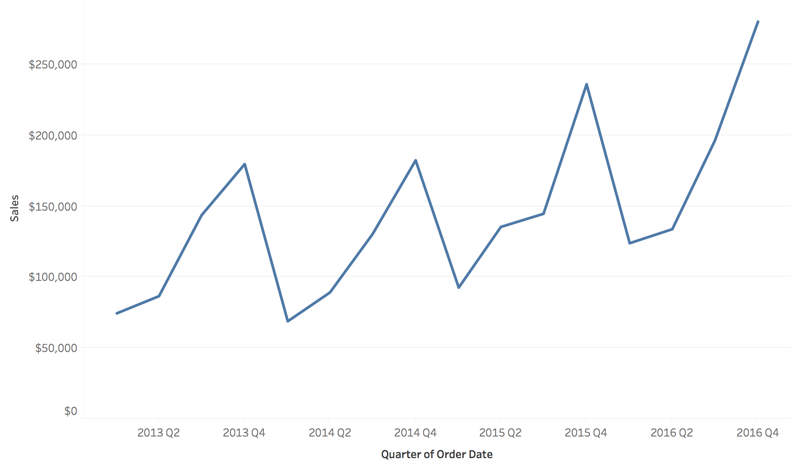{fig-align="center"}

# Aspect Ratio

How chart dimensions affect perception

**Definition**: Aspect Ratio = Width / Height

## Impact on Trend Visibility

**The same data at three aspect ratios: the trend looks steeper or flatter.**

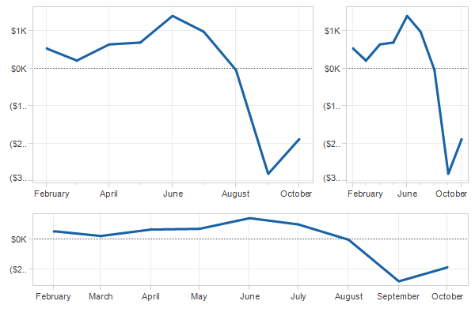{fig-align="center"}

## Perceptual Principle: Slope Judgment

**Key finding**: Humans judge slopes most accurately at 45°

- Too shallow (<< 45°): Hard to distinguish small differences
- Too steep (>> 45°): Also difficult to compare
- **Optimal: ~45°** - Maximum perceptual sensitivity

This principle guides aspect ratio selection

::: notes
- **Fundamental perceptual principle** from Cleveland & McGill's research
- Our visual system is optimized for judging slopes near 45 degrees
- Demo: Show how very flat lines (<10°) make it hard to see if trend is up or down
- Demo: Show how very steep lines (>80°) also make comparison difficult
- This isn't arbitrary - it's based on empirical perceptual experiments
- Practical implication: Don't just use default aspect ratios from your plotting library!
- The aspect ratio is a design parameter that affects what viewers perceive
- Ask: "Which stock would you invest in based on this chart?" - then show same data with different aspect ratio revealing different impression
:::

## Banking to 45°

:::: {.columns}
::: {.column width="40%"}
**Method**: set the aspect ratio so that the average slope of the line segments is 45°

- Makes trends perceptually salient and comparable
- Cleveland, McGill & McGill introduced it in this 1988 JASA paper (a required reading this week)
:::
::: {.column width="60%"}
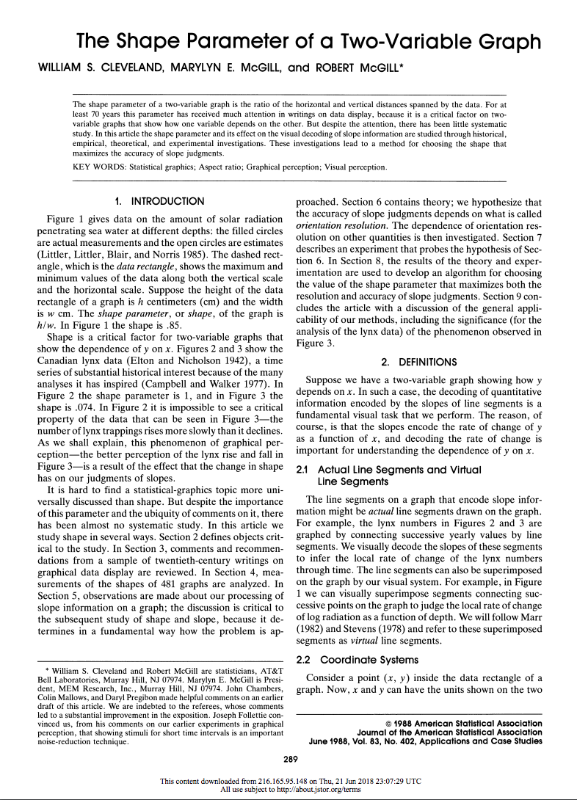{height="760" fig-align="center"}
:::
::::

:::footer
Cleveland, W. S., McGill, M. E., & McGill, R. (1988). [*The shape parameter of a two-variable graph*](https://doi.org/10.1080/01621459.1988.10478613). JASA.
:::

## Example: Banking to 45° Comparison

:::: {.columns}
::: {.column width="40%"}
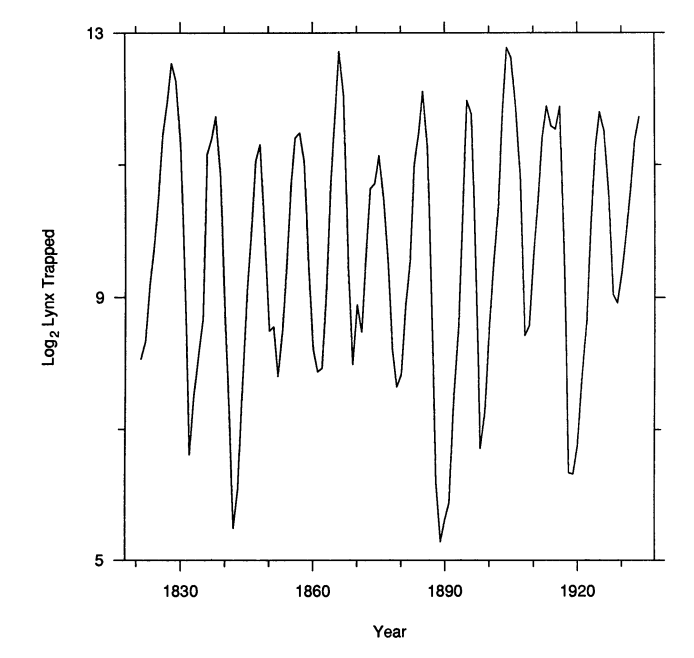{height="700" fig-align="center"}
:::
::: {.column width="60%"}
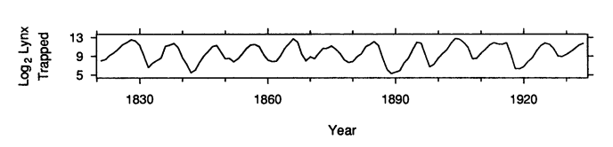{width="100%" fig-align="center"}
:::
::::

**Canadian lynx trappings: a square frame (left) vs. banked to 45° (right). Which shows the shape of each cycle?**

::: notes
- Same series twice (log2 lynx trapped per year, Cleveland's classic example).
- In the square frame every cycle is a near-vertical spike; you cannot judge how each cycle rises and falls.
- Banked to 45°, the plot becomes very wide and short, and the shape of each cycle becomes something you can compare. The wide, short result is the point, not a layout mistake.
- The paper's first page is on the previous slide.
:::

## Best Practice

**Rule of thumb**: Always test different aspect ratios to see which one best conveys your message

## Multiple Line Charts: Adding Categories

**Color encodes the category: three customer segments over time.**

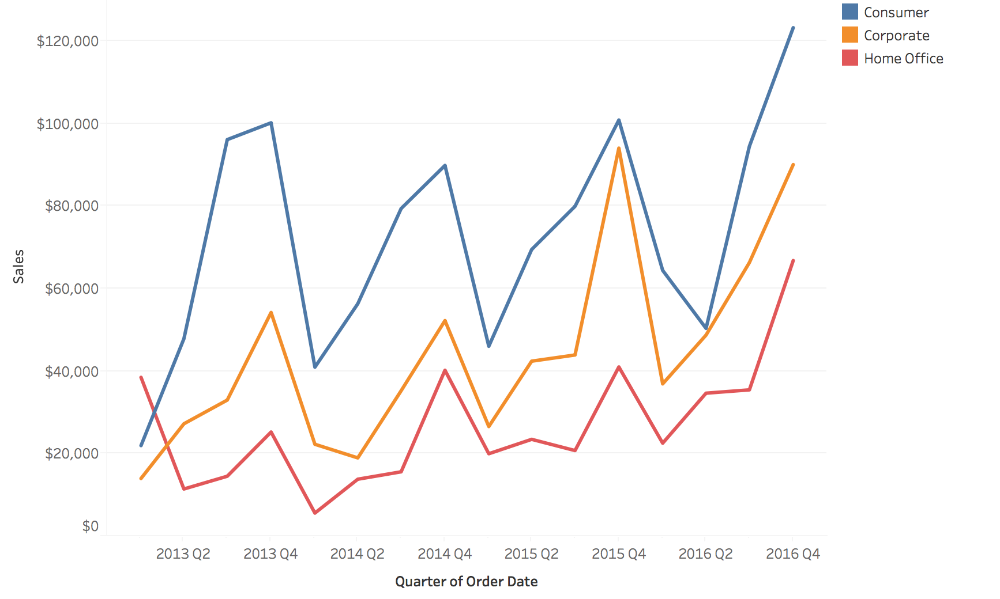{fig-align="center"}

## The "Spaghetti Plot" Problem

**It does not scale: 17 sub-categories in one chart.**

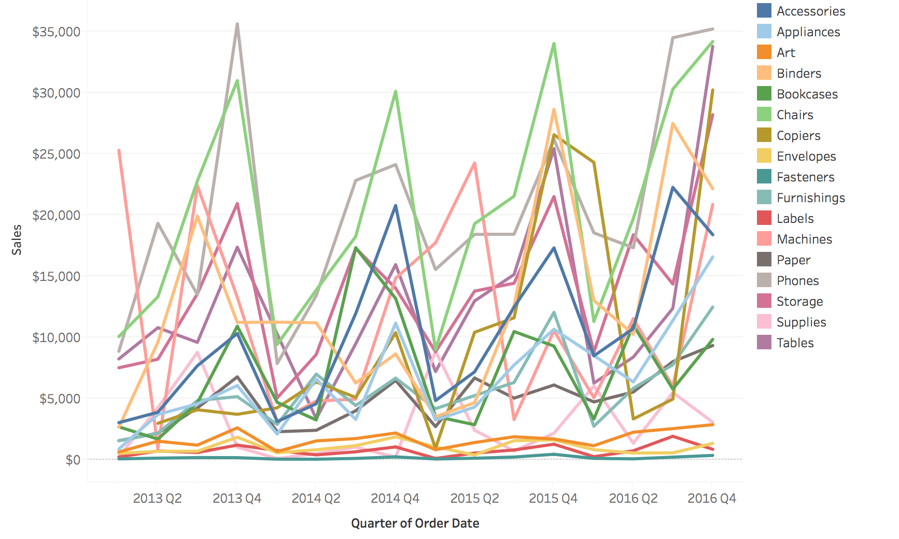{fig-align="center"}

::: notes
- Classic problem in temporal visualization - too many lines creates visual chaos
- With 50+ lines, you can't distinguish individual series
- Lines occlude each other - can't see what's underneath
- Colors become indistinguishable - limited palette
- Called "spaghetti plot" because it looks like tangled pasta!
- Ask students: "Have you seen plots like this? What questions CAN you answer? What can't you answer?"
- Can answer: Overall envelope, outliers, general trend
- Cannot answer: Specific values for individual series, comparisons between specific pairs
- This motivates the solutions on next slides: grouping, filtering, highlighting, small multiples
- Real-world example: Stock market with hundreds of stocks - spaghetti plot is useless
:::

## Solutions for Multiple Lines

Possible solutions:

1. Grouping
2. Filtering/Focus
3. Highlighting

## Comparison: Grouping, Filtering, Highlighting

:::: {.columns}
::: {.column width="50%"}
**Original: 17 sub-categories**

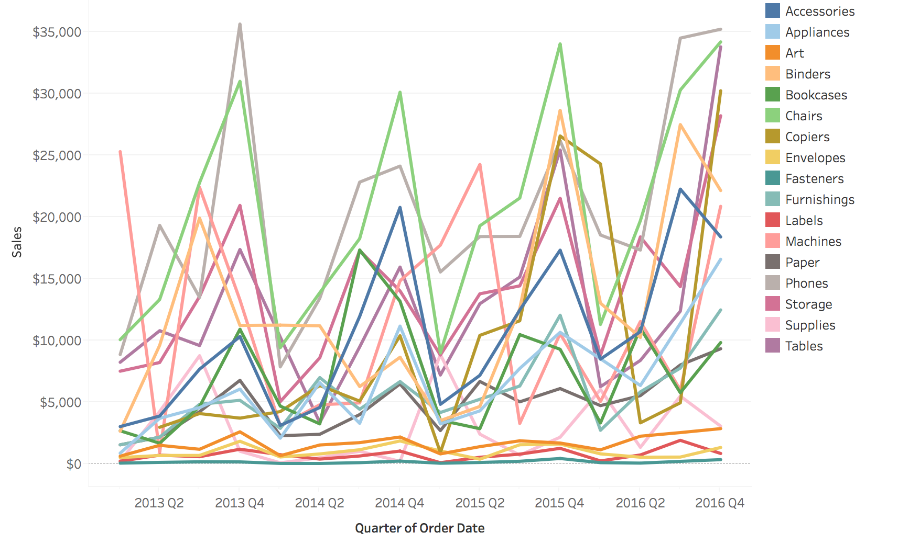{height="330" fig-align="center"}

**Filtering: keep 3 sub-categories**

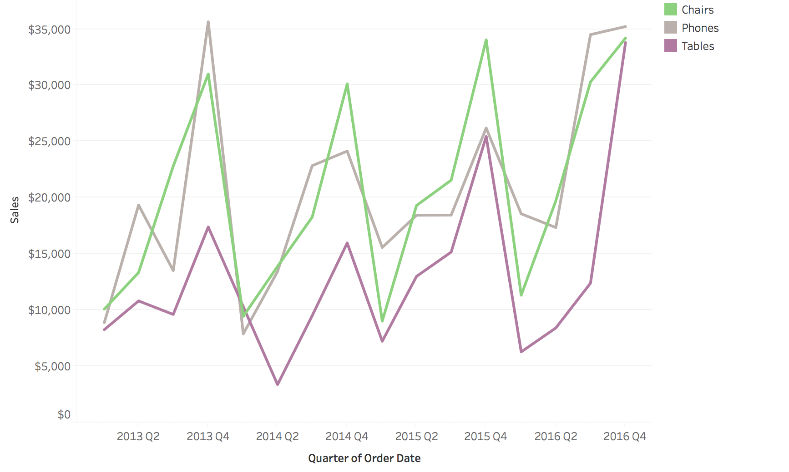{height="330" fig-align="center"}
:::
::: {.column width="50%"}
**Grouping: roll up to 3 categories**

{height="330" fig-align="center"}

**Highlighting: 3 in color, the rest faded**

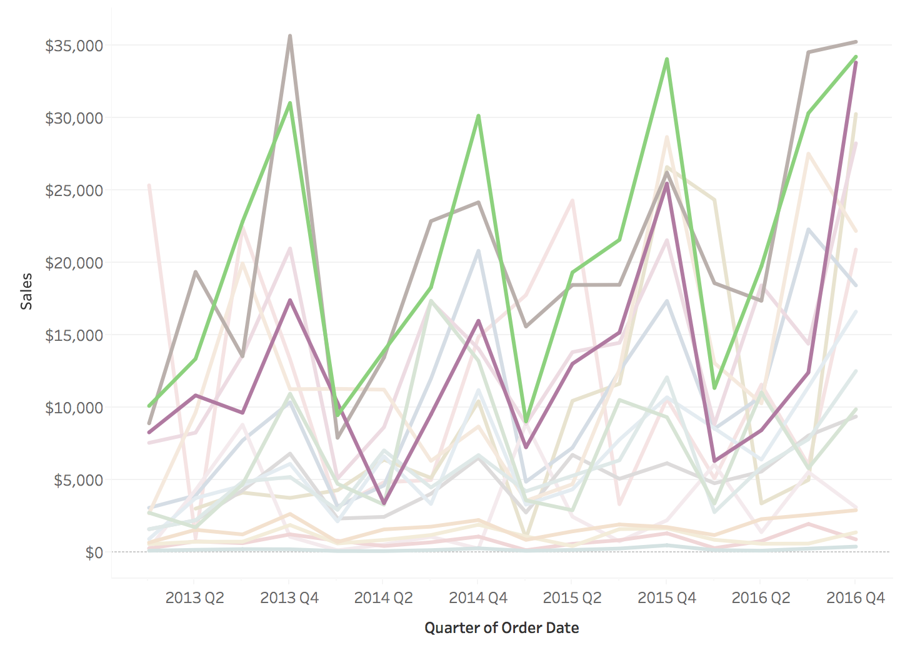{height="330" fig-align="center"}
:::
::::

## Small Multiples

Small Multiple Line Charts and Area Charts

::: notes
- Small multiples = static solution to spaghetti plots
- But note: Filtering and Highlighting are often INTERACTIVE techniques
- This leads us to the next major topic: Interaction
- **Transition**: "We've seen static solutions - but in practice, filtering and highlighting are interactive. Let's talk about interaction techniques for temporal data..."
:::

## Example: Small Multiple Line Charts

**One panel per sub-category on a shared y-axis: each series is readable and comparable.**

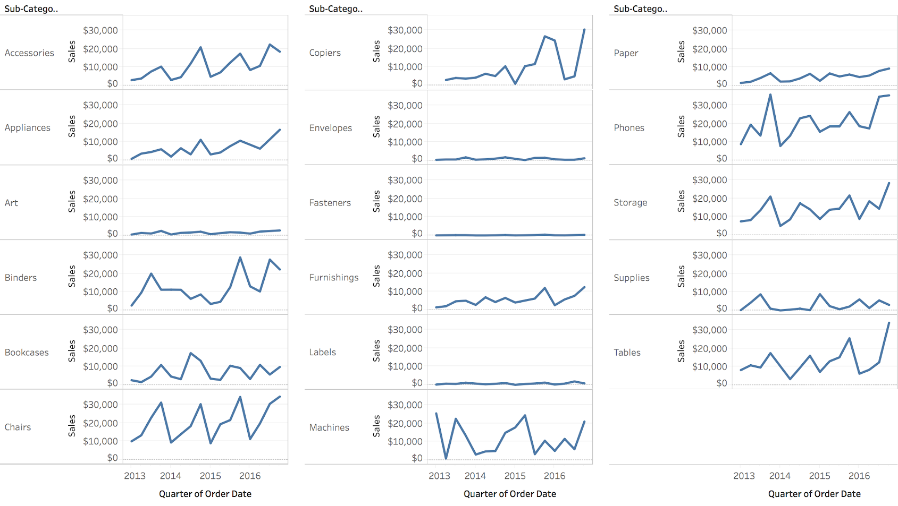{fig-align="center"}

## Example: Small Multiple Area Charts

**The same panels as areas: filled area emphasizes magnitude.**

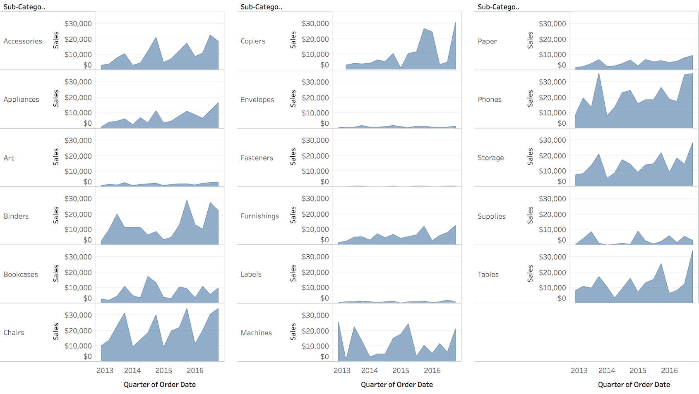{fig-align="center"}

## Stacked Area Charts: Total and Parts

**Stacked areas show the total and how it splits across four regions.**

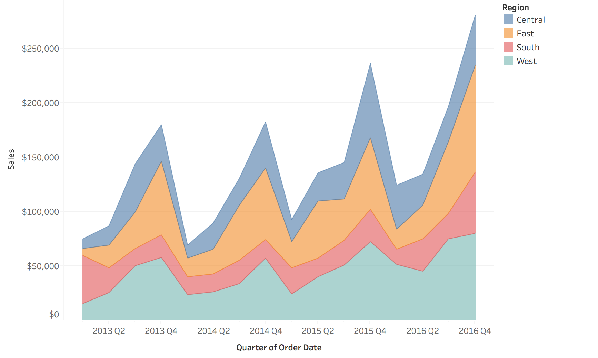{fig-align="center"}

## Stacked Area Charts: Limitations

**"Baseline bias": only the bottom layer sits on a common baseline.**

:::: {.columns}
::: {.column width="50%"}
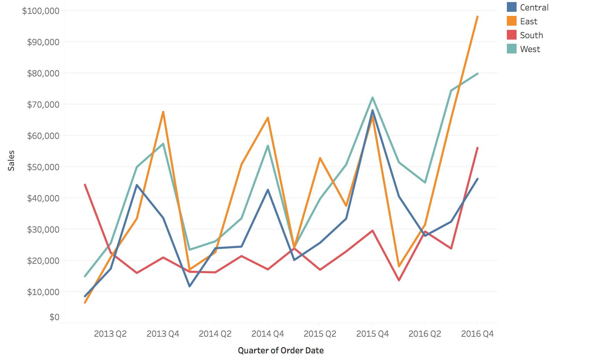{width="100%"}
:::
::: {.column width="50%"}
{width="100%"}
:::
::::

**The same four regions as lines (left) and stacked (right). Try reading East's trend on the right.**

::: notes
- Problem: temporal trends for upper layers are hard to interpret because they don't share a common baseline
- In this figure East is orange, West (teal) is the bottom layer
- **IMPORTANT PERCEPTUAL LIMITATION** - students often misuse stacked area charts
- The bottom layer (touching x-axis) is easy to read - it has a stable baseline
- But upper layers "float" on changing baselines - very hard to judge their values or trends
- **INTERACTIVE DEMO**: Point to an upper layer (e.g., green category) and ask:
  - "Did this category increase or decrease between these two time points?"
  - "Can anyone tell me the actual value for this category in Q3?"
  - Students will struggle - this proves the baseline bias!
  - Then show: Only the bottom layer can be read accurately
- The total height is easy to read, but individual layer trends are ambiguous
- Example: If bottom layer increases sharply, upper layers appear to go up even if their actual values are flat
- When to use: When you care about total AND composition, and bottom layer is most important
- When NOT to use: When you need to compare trends across all categories
- Better alternatives: Small multiples (separate charts), normalized stacked (next slide), or just don't stack
- Real example: COVID dashboards with stacked areas - very misleading for comparing different variants
:::

## Normalized Stacked Area Charts

**Normalized to 100%: composition only, the total is gone.**

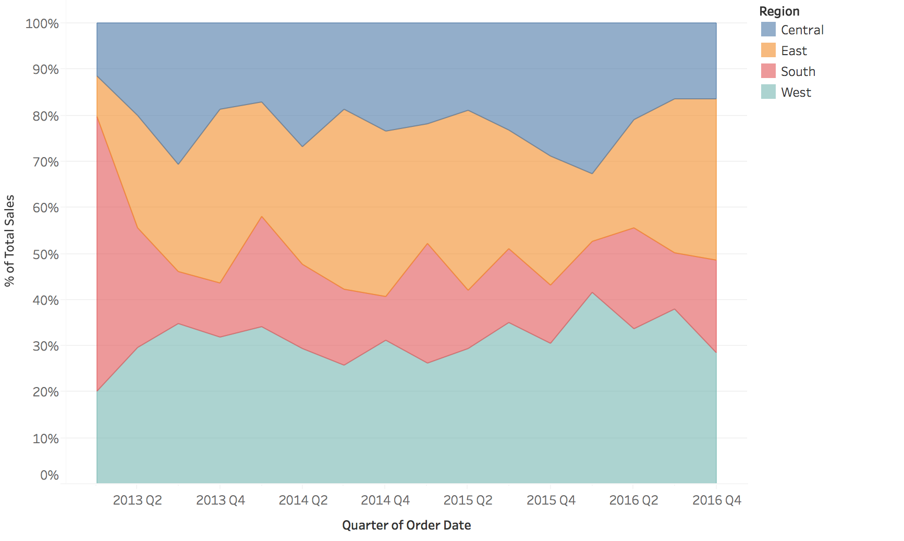{fig-align="center"}

# Interaction Techniques

Critical for exploring temporal data

## Why Interaction Matters for Temporal Data

**Challenge**: Time series data is often too large or complex to understand in a single static view

**Solution**: Interactive techniques allow users to:

- Navigate through time (zoom, pan)
- Focus on specific patterns or events
- Link multiple views for comparison
- Dynamically adjust aggregation levels

## Zoom and Pan

**Purpose**: Navigate dense sequential time series

::: {.columns}
::: {.column width="50%"}
**Semantic Zoom**

- Change level of detail
- Hourly → Daily → Monthly
- Preserve context
:::

::: {.column width="50%"}
**Geometric Zoom**

- Magnify visual space
- See more detail
- Focus + context techniques
:::
:::

**Example**: Stock chart with overview + detail panes

::: notes
- Two fundamentally different types of zoom - students often confuse these!
- **LINK BACK**: "Remember our Aggregation Trade-offs slide? Semantic zoom is interactive aggregation!"
- **Semantic Zoom** = change aggregation level (connect back to earlier aggregation slide)
  - Zoom out: Hourly → Daily (aggregate 24 hours into 1 point)
  - Zoom in: Daily → Hourly (show finer resolution)
  - Data actually changes - different level of detail
  - **This lets you explore different aggregation levels interactively** rather than committing to one upfront
  - Example: Google Maps showing cities vs streets vs buildings
- **Geometric Zoom** = magnify the view (like a magnifying glass)
  - Same data points, just bigger
  - Doesn't change aggregation, just visual scale
  - Example: Zoom into a region of a line chart to see fluctuations better
- Best practice: Combine both - overview + detail where overview provides context
- Example to show: Stock charts with small overview at bottom + zoomed detail above
- Interaction: Brushing in overview selects region shown in detail
:::

## Filtering and Brushing

**Filtering**: Show/hide data based on criteria

- Time range selection
- Category filtering (e.g., show only certain products)
- Threshold filtering (e.g., values > X)

**Brushing**: Select data in one view, highlight in others

- **Temporal brushing**: Select time range, see corresponding events
- **Linked views**: Brush on map → highlight in timeline

## Brushing & Linking Example

::: {.columns}
::: {.column width="50%"}
**View 1**: Geographic map

User brushes (selects) a region
:::

::: {.column width="50%"}
**View 2**: Time series

Corresponding temporal data highlights automatically
:::
:::

**Power**: Discover spatio-temporal patterns (e.g., "Sales peak in Region A during Q4")

::: notes
- **LIVE DEMO OPPORTUNITY**: If you have a prepared D3 example, Tableau dashboard, or Observable notebook, SHOW THIS LIVE
  - Static images can't convey the interactivity
  - Seeing the linking happen in real-time is 100x more impactful
  - Even a simple example (brush a time range, see map update) will make this memorable
- If no live demo available: At minimum, verbally walk through the interaction
  - "Imagine I click and drag on the map to select this region..."
  - "...instantly, the time series highlights just those data points"
  - "Now I can see: this region has a spike every December"
- This is the payoff of brushing & linking - cross-view pattern discovery
:::

## Dynamic Aggregation

**Interactive granularity control**

Users adjust time resolution on-the-fly:

- Slider: "Show me data aggregated by: Hour / Day / Week / Month"
- Drill-down: Click on a month → see daily breakdown
- Roll-up: Aggregate noisy hourly data to daily averages

**Advanced**: Time-series bagging, dynamic binning for very long series

## Time Warping and Distortion

**Fisheye/distortion**:

- Focus region shows detail
- Context regions compressed
- Maintains overview while examining specifics

**Time-warping**:

- Align periodic patterns despite phase shifts
- Dynamic time warping (DTW) for comparing similar patterns
- Useful for comparing multiple time series with lag

## Best Practices for Interaction Design

1. **Provide overview first**: Show full temporal extent
2. **Progressive disclosure**: Start simple, reveal detail on demand
3. **Maintain context**: Always show where you are in time
4. **Link multiple views**: Connect temporal, spatial, and categorical views
5. **Smooth transitions**: Animate changes to maintain mental model
6. **Direct manipulation**: Let users interact with the visualization itself

# Event Data Visualization

Visualizing discrete events and durations

## Types of Event Data

**Timestamp + Event Properties**

- Incidents
- Activity Logs
- Messages (Emails, Chats, etc.)

## Example: Dot Plot for Events

**Rows = cities, x = ship date; dot size encodes a count (legend 1-52).**

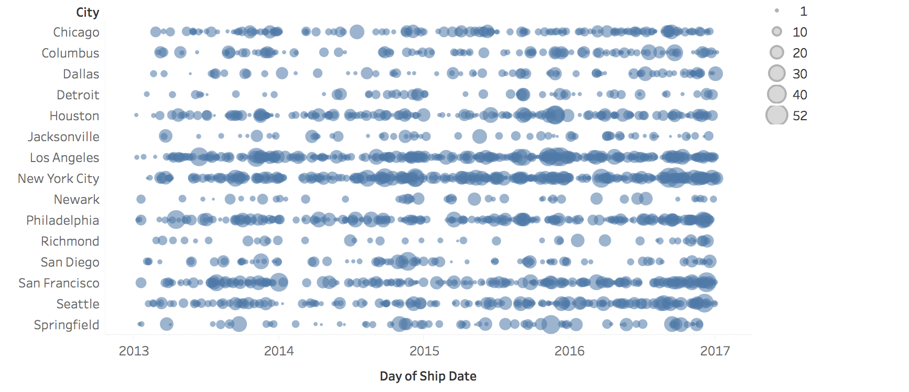{fig-align="center"}

## Example: Proportional Symbols plus Color

**The same dots colored by ship mode: size and color carry two event attributes.**

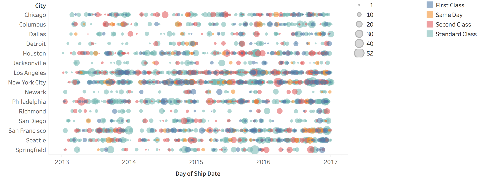{fig-align="center"}

## Events with Duration

How do you visualize events that have duration?

## Gantt Charts

**Horizontal bars show each event's start, duration, and end.**

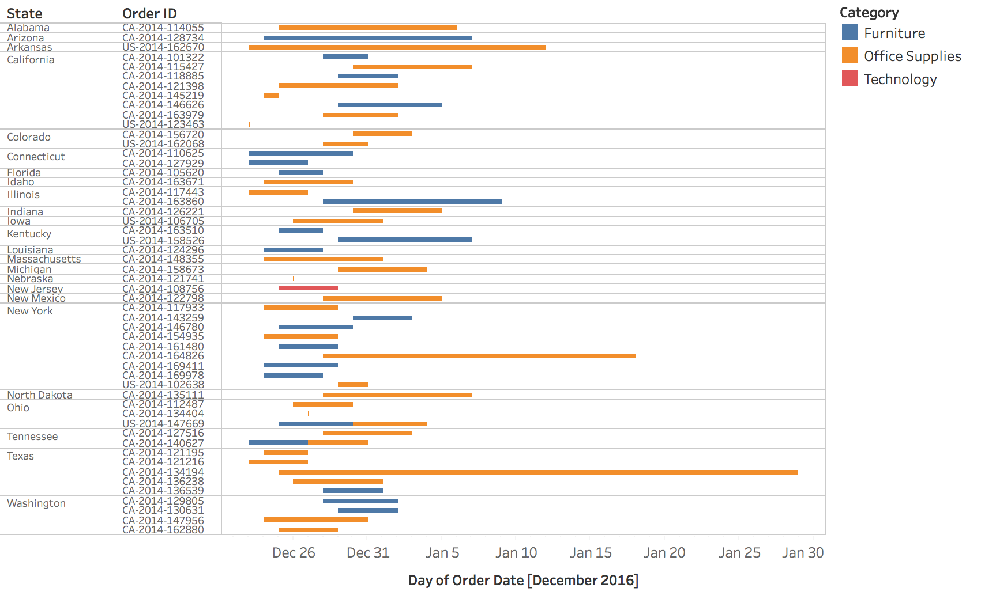{fig-align="center"}

::: notes
- **CONNECT BACK TO EVENT DATA**: "Remember our Event Data definition? Events with duration? Gantt charts are THE classic visualization for this."
- **Origin story**: Named after Henry Gantt (1910s) - originally invented for project management
  - Shows tasks, dependencies, timelines
  - Still dominates project management software (MS Project, Asana, Jira, etc.)
- **Modern applications** have expanded far beyond projects:
  - Server/system activity monitoring (next slides)
  - Resource allocation (people, machines, rooms)
  - Manufacturing schedules
  - Any scenario with concurrent activities over time
- Key visual features:
  - Time on x-axis
  - Tasks/resources on y-axis
  - Bars show start, duration, end
  - Can show dependencies with arrows
:::

## Example: Gantt Chart

:::: {.columns}
::: {.column width="40%"}
**The lifespan of an evening news anchor**

- One row per anchor, grouped by network (NBC, CBS, ABC), since 1948
- A line from start to end shows each tenure
- The annotation calls out the longest run: Jennings, 27 years
:::
::: {.column width="60%"}
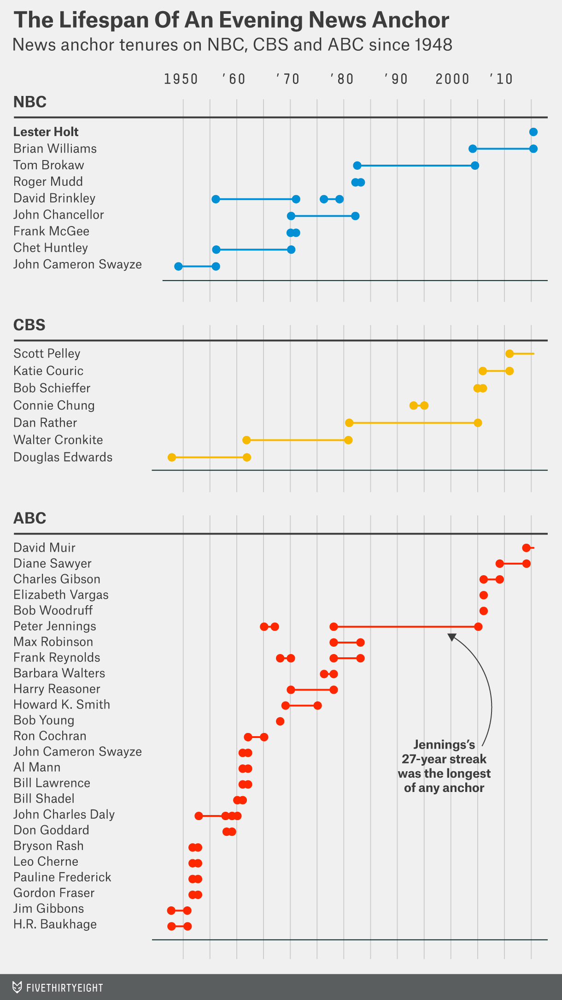{height="760" fig-align="center"}
:::
::::

## Example: System Activity Monitoring

**Tape mounts per drive over a day and a half: concurrent activity at a glance.**

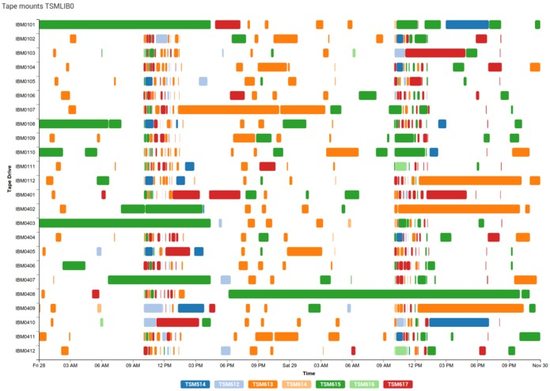{fig-align="center"}

# Alternative Visualizations

Heat maps and real-world examples

## Heat Maps for Temporal Data

:::: {.columns}
::: {.column width="40%"}
**Matrix representation**: one axis is time, the other is categories, color shows the value

- Think of it as a table with colored cells
- Here: sub-category × day of month, color = sales
- Compact; shows patterns along both axes
:::
::: {.column width="60%"}
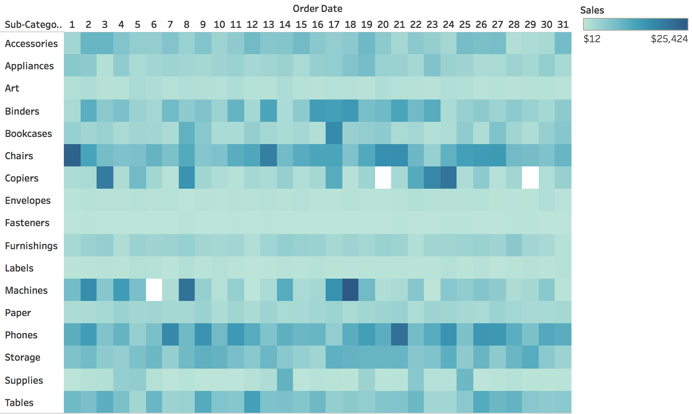{width="100%" fig-align="center"}
:::
::::

::: notes
- **Explicit mapping**: Heat map = fancy table
  - One axis: time units (here, day of month across the top)
  - Other axis: categories (here, product sub-categories as rows)
  - Cell color: The value at that time/category combination
- This is a 2D visualization of 3D data (time × category × value)
- Students often confuse heat maps with other color-based visualizations
- Key advantage: Can see patterns across BOTH dimensions simultaneously
  - Temporal patterns (when are values high?)
  - Categorical patterns (which categories have high values?)
  - Interactions (does Category A peak at different times than Category B?)
:::

## Example: WSJ Vaccine Impact Visualization

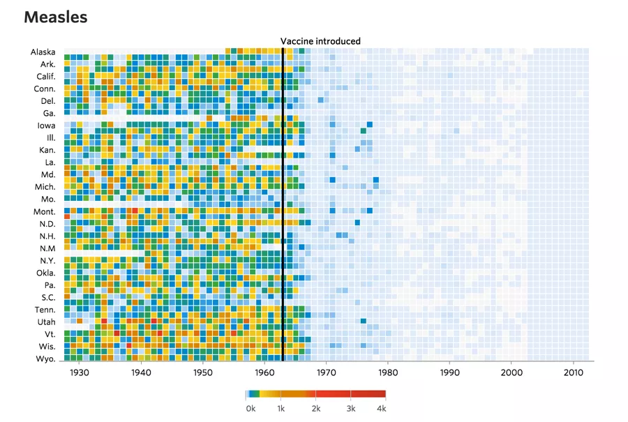{fig-align="center"}

:::footer
DeBold, T., & Friedman, D. (2015). [*Battling Infectious Diseases in the 20th Century: The Impact of Vaccines*](https://graphics.wsj.com/infectious-diseases-and-vaccines/). The Wall Street Journal.
:::

::: notes
- **FAMOUS EXAMPLE** - one of the most impactful data visualizations of 2015
- Shows measles cases by state (rows) over decades (columns)
- Color: incidence (WSJ reported cases per 100,000 people), running from pale blue (near zero) through green and yellow to red; it is a rainbow scale, a good hook back to the color lecture
- **The dramatic pattern**: Clear vertical line when vaccine was introduced - cases drop to nearly zero
- Powerfully communicates vaccine effectiveness without words
- Design choices worth noting:
  - States are listed alphabetically (Alaska at the top), not sorted by burden
  - Color scale emphasizes the contrast (before/after)
  - Vertical line marks vaccine introduction
- Impact: Widely shared during vaccine debates, changed minds
- Ask: "What does this visualization communicate that a line chart couldn't?"
- Answer: Spatial patterns (which states), temporal patterns (when), and magnitude (how many) simultaneously
- This is heat maps at their best - revealing multidimensional patterns at a glance
:::

## Measles Today: New U.S. Cases by Week, 2025-2026

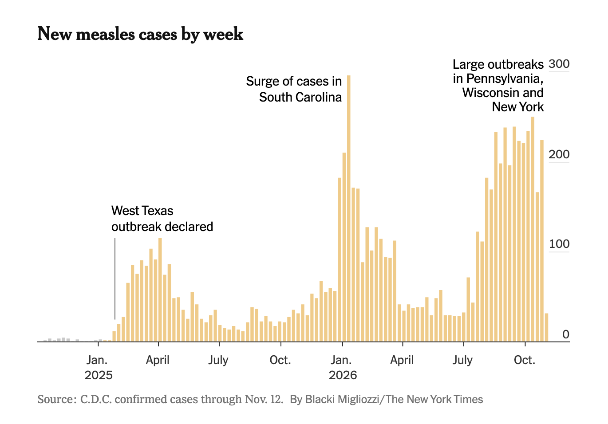{.nostretch height="820" fig-align="center"}

:::footer
Migliozzi, B. (2026). New measles cases by week. *The New York Times*. Data: CDC confirmed cases through Nov. 12, 2026.
:::

::: notes
SKIPPABLE (new for 2026) - if running long, jump to 'Example: FT European Football Visualization'.

- **Purpose:** bring the WSJ story up to the present, and contrast a single national series with the state-by-year heat map.
- **Walk through:** each bar is one week of confirmed U.S. cases, from late 2024 to mid-November 2026. Point to the three annotations: the West Texas outbreak declared in early 2025, the surge in South Carolina around January 2026 (the tallest week, near 300 cases), and the large outbreaks in Pennsylvania, Wisconsin and New York from late summer 2026 onward.
- **Design contrast:** the heat map compares annual rates across states; this bar chart shows *when* outbreaks happened, nationally, and uses annotations to name the states.
- **Ask:** the last bar is much lower than the weeks before it. Real drop, or a week whose cases have not all been confirmed and reported yet? The most recent points of a live chart are often incomplete.
- **Transition:** "Where do those outbreaks show up on the long state-by-year chart?"
:::

## Measles in the United States, 1928-2026

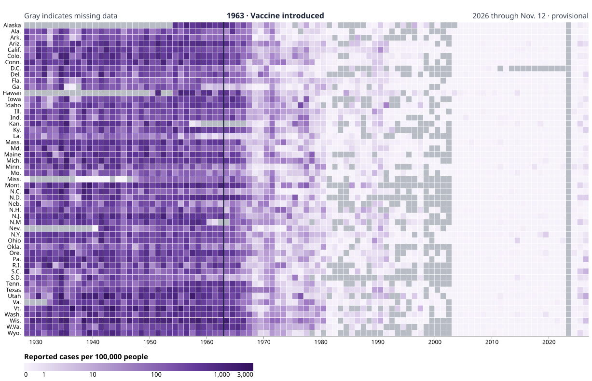{.nostretch height="790" fig-align="center" fig-alt="Heatmap of reported measles cases per 100,000 people across the 50 states and D.C. from 1928 through November 12, 2026. Rates generally fall after the 1963 vaccine introduction, with increases in some states in 2025 and 2026. Gray indicates missing data, including 2023."}

:::footer
[WSJ, 1928-2012](https://graphics.wsj.com/infectious-diseases-and-vaccines/), [Our World in Data, 2013-2022](https://ourworldindata.org/grapher/reported-measles-case-rate-by-state-in-the-united-states), [CDC, 2024-2026](https://www.cdc.gov/measles/data-research/), and [U.S. Census Bureau](https://www.census.gov/data/datasets/time-series/demo/popest/2020s-state-total.html).
:::

::: notes
SKIPPABLE (new for 2026).

- **Purpose:** put the recent outbreaks on the same state-by-year scale as the WSJ chart.
- **Walk through:** each row is a state or D.C., each column a year. Purple intensity encodes reported cases per 100,000 people on a symmetric log scale; gray cells are missing. Point to the 1963 vaccine marker, then the much paler region after it, then the recent cells in 2025-2026.
- **Compare with the WSJ version (design discussion):** a single-hue sequential scale instead of the rainbow, and a log scale so low recent rates are still distinguishable from zero while the historical range still fits. Ask which reads more honestly, and what the log scale costs (differences look smaller than they are).
- **Emphasize:** the chart shows timing and association, not a causal estimate.
- **Source detail:** the 2023 column is missing because the sources lack comparable state-year totals for that year. Recent CDC counts are for U.S. residents assigned to a reporting jurisdiction; New York City is combined with New York State. 2026 uses provisional counts through November 12, divided by 2025 Census population estimates.
:::

## Variation: Size Instead of Color

**The sub-category × day-of-month grid again, with square size encoding sales.**

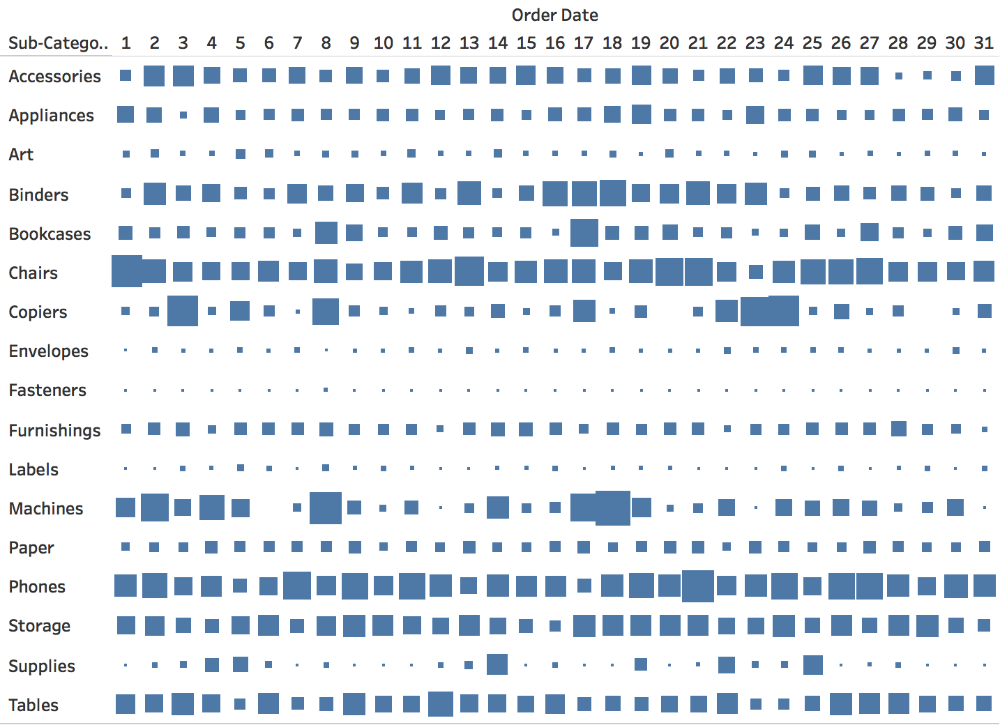{fig-align="center"}

## Example: FT European Football Visualization

:::: {.columns}
::: {.column width="40%"}
**How to read it:**

- **x**: player's age
- **Rows**: one player each
- **Length**: career span
- **Color**: non-penalty goalscoring rate (darker = higher)
- **Square size**: share of minutes played
:::
::: {.column width="60%"}
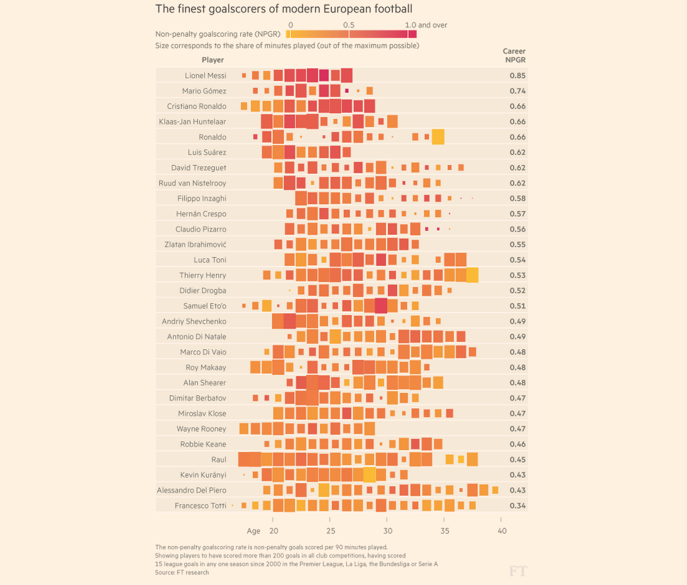{height="760" fig-align="center"}
:::
::::

::: notes
- Goals over careers: the heat map shows performance across age and seasons
- Dense but information-rich: career trajectories and productivity over time in one view
:::

# Periodic Patterns

Calendars, radial layouts, and spirals

::: notes
**OPTIONAL SECTION** - If running short on time, you can skip spirals and cover calendars quickly (10 min)
- Calendars are most practical for students
- Radial layout warnings are important (5 min)
- Spirals are interesting but not essential
:::

## Understanding Periodicity

Often the focus is on investigating and presenting periodical patterns:

- Yearly, seasonal, monthly
- Weekly, daily, hourly

## Alternative Approaches

**One line per year across the week: what else could show this periodic pattern?**

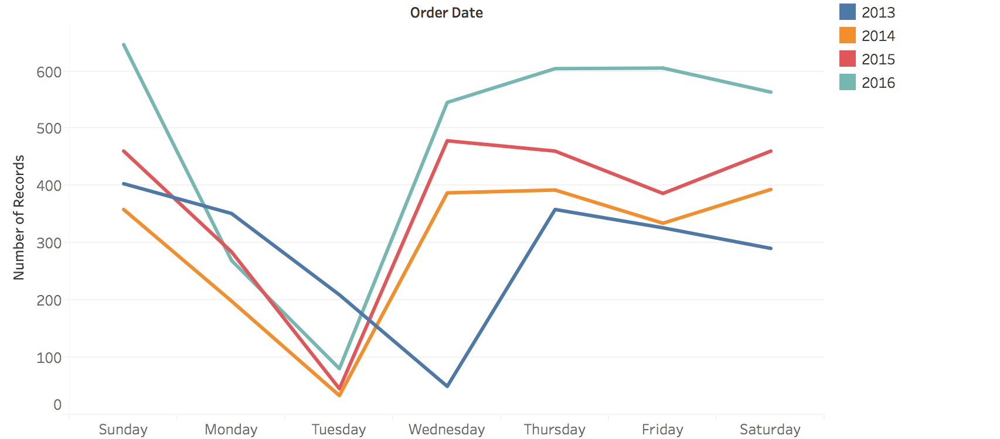{fig-align="center"}

## Calendar-Based Visualizations

:::: {.columns}
::: {.column width="40%"}
**Key difference from heat maps**: time is laid out by day-of-week and month

- **Heat maps**: linear time progression
- **Calendar views**: explicit cyclic layout (7-day weeks, 12 months)
- Better for weekly and seasonal patterns
- Here: Divvy bike-share rides per day, 2014-2017
:::
::: {.column width="60%"}
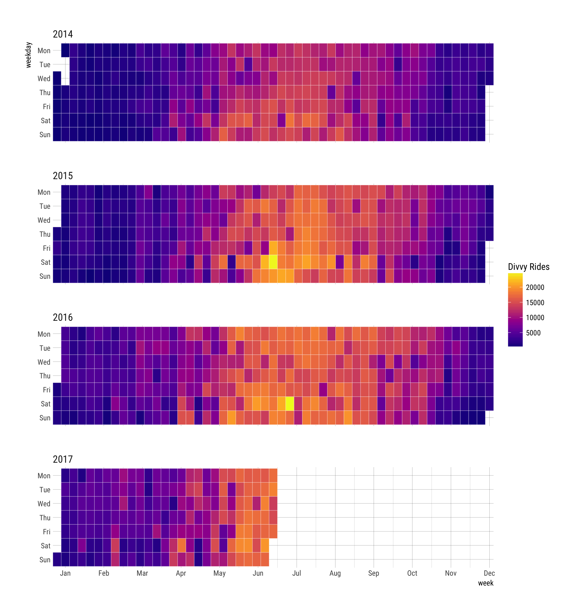{height="760" fig-align="center"}
:::
::::

::: notes
- Calendar views leverage our familiarity with calendar structure
- Key insight: Days of the week align vertically - easy to spot weekly patterns
- Example: Website traffic calendar - weekend days align vertically, immediately see weekend dip
- Difference from heat maps:
  - Heat maps: continuous time, arbitrary row breaks
  - Calendars: structured by weeks/months, meaningful breaks
- When to use calendars:
  - Data with strong weekly patterns (work/weekend differences)
  - Data people think about in calendar terms (appointments, events, habits)
- Limitations:
  - Only works for day-level or finer granularity
  - Months have different lengths - creates visual gaps
  - Not good for long time spans (multiple years gets unwieldy)
- Real examples: GitHub contribution calendar, fitness tracking apps, habit trackers
- Ask: "What apps use calendar views? Why does it work for them?"
:::

## Calendar Variations

:::: {.columns}
::: {.column width="50%"}
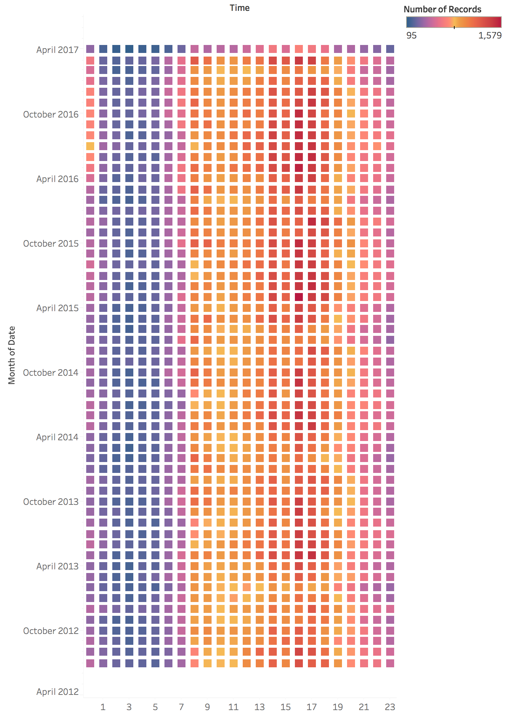{height="760" fig-align="center"}
:::
::: {.column width="50%"}
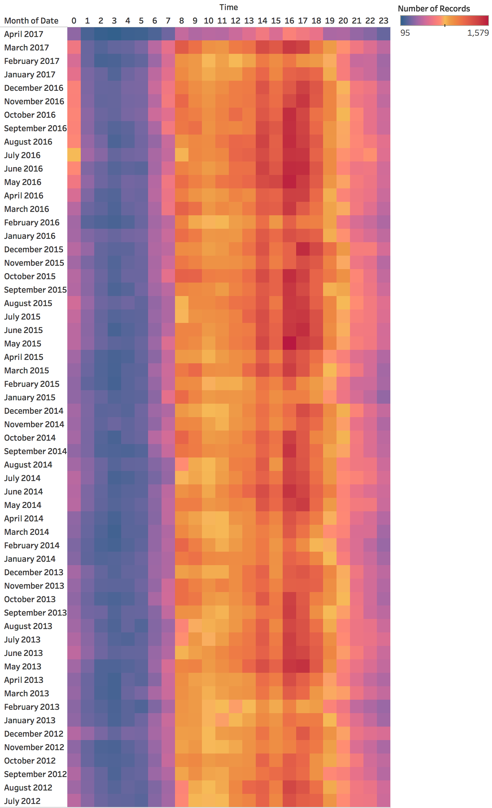{height="760" fig-align="center"}
:::
::::

**Month × hour of day, two ways: a grid of marks (left) and a continuous heat map (right).**

## Radial Layouts for Periodic Data

Periodic phenomena are cyclical. Radial layouts can reduce temporal discontinuities

## Spiral Plots

:::: {.columns}
::: {.column width="40%"}
**Key insight**: spirals show cycles and progression at the same time

- **Cycles**: the same phase of each period sits at the same angle
- **Progression**: each turn moves outward in time
- Weber et al.: the same periodic series as a line (left) and a spiral (right)
:::
::: {.column width="60%"}
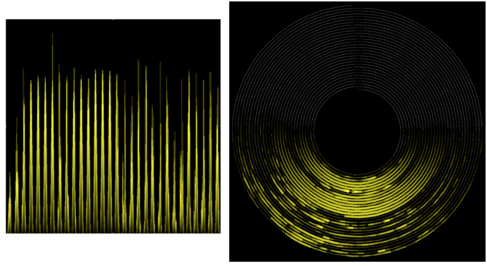{width="100%" fig-align="center"}
:::
::::

:::footer
Weber, M., Alexa, M., & Müller, W. (2001). [*Visualizing time-series on spirals*](https://doi.org/10.1109/INFVIS.2001.963273). IEEE InfoVis.
:::

::: notes
- **The brilliance of spirals**: They encode TWO temporal structures at once
  - **Cyclic structure**: Each complete rotation = one cycle (year, month, day)
  - **Sequential structure**: As you spiral outward = progression through time
- Temperature example (next slide):
  - Angle = month of year (seasonal cycle)
  - Radius = temperature anomaly, NOT year; color = year (purple 1850s to yellow 2010s)
  - So Hawkins' spiral is a radial line chart with one loop per year rather than a Weber spiral: outward = warmer
- The climate spiral makes the warming vivid: later (yellow) loops sit further out
- Trade-off: Harder to read precise values (radial layout limitations)
- Use when: The dual encoding (cycle + trend) is more important than precision
:::

## Spiral Example: Temperature Data

:::: {.columns}
::: {.column width="40%"}
- **Angle**: month of the year
- **Radius**: temperature anomaly vs. 1850-1900 (red rings at 1.5 °C and 2.0 °C)
- **Color**: year, purple (1850) to yellow (2016)
- Later loops sit further out: warming
:::
::: {.column width="60%"}
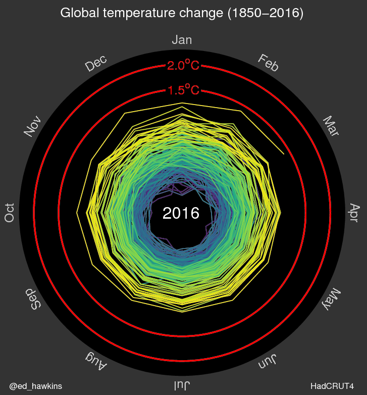{height="760" fig-align="center"}
:::
::::

:::footer
Hawkins, E. (2016). [*Climate spirals*](https://www.climate-lab-book.ac.uk/spirals/). Climate Lab Book. Data: HadCRUT4.
:::

## Climate Spiral Visualization

:::: {.columns}
::: {.column width="40%"}
**The animated version** draws one loop per year, month by month, from 1850 to 2017

- This still is its first frame, before any data is drawn
- [Play the animation](https://www.climate-lab-book.ac.uk/spirals/) to watch the loops push toward the 1.5 °C ring
:::
::: {.column width="60%"}
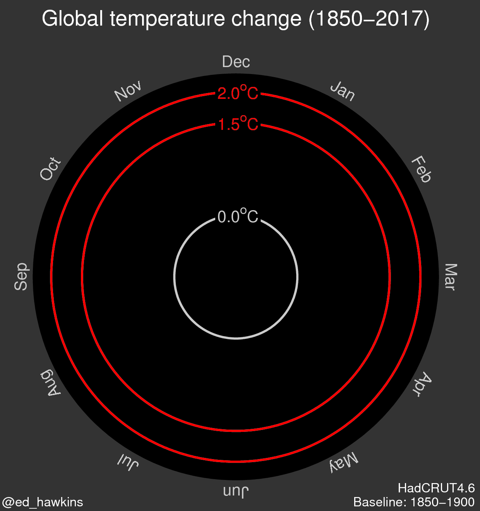{height="760" fig-align="center"}
:::
::::

## Caution: Radial Layout Limitations

**Use circular layouts with care!**

**Research finding**: Humans are significantly slower and less accurate at judging radial distances and angles compared to linear position

Comparing values radially is harder than in Cartesian space - use only when cyclical nature is essential

::: notes
- **CRITICAL WARNING** - radial layouts look cool but are perceptually problematic
- Research shows 2-3x slower and less accurate judgments in radial vs linear layouts
- Why are they harder?
  - Angles are harder to judge than horizontal/vertical distances
  - Outer rings have more space than inner rings (same value, different visual area)
  - Hard to compare values at different angles
- When ARE they appropriate? When emphasizing cyclical nature is more important than precise reading
  - Example: 24-hour clock pattern - circular makes sense conceptually
  - Example: Climate spiral - the spiraling metaphor communicates urgency
- But for most analytical tasks: stick to linear layouts!
- Ask: "When have you seen radial visualizations in the wild? Were they effective?"
- Common misuse: Corporate dashboards with radial charts just because they look fancy
:::

## Comparison: Linear vs Radial

:::: {.columns}
::: {.column width="50%"}
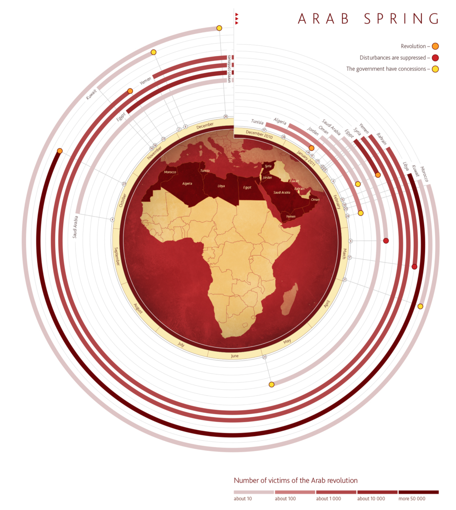{height="720" fig-align="center"}
:::
::: {.column width="50%"}
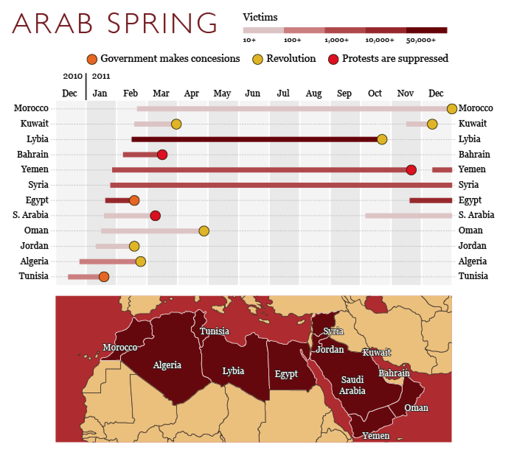{height="720" fig-align="center"}
:::
::::

**Arab Spring timeline, radial (left) vs. linear (right): which makes durations easier to compare?**

# Scalable Visualizations

Horizon charts and sparklines for dense temporal data

::: notes
**ADVANCED/OPTIONAL SECTION** - This can be assigned as reading if short on time
- Horizon charts are complex and need 15 min to walk through properly
- Sparklines are quick (5 min) and useful, show if you can
- If pressed for time: Show the horizon chart concept but assign the step-by-step as reading
- Students don't NEED to build horizon charts, but should know they exist
:::

## Horizon Charts

**Maximum density in minimal height: dozens of time series compared at once.**

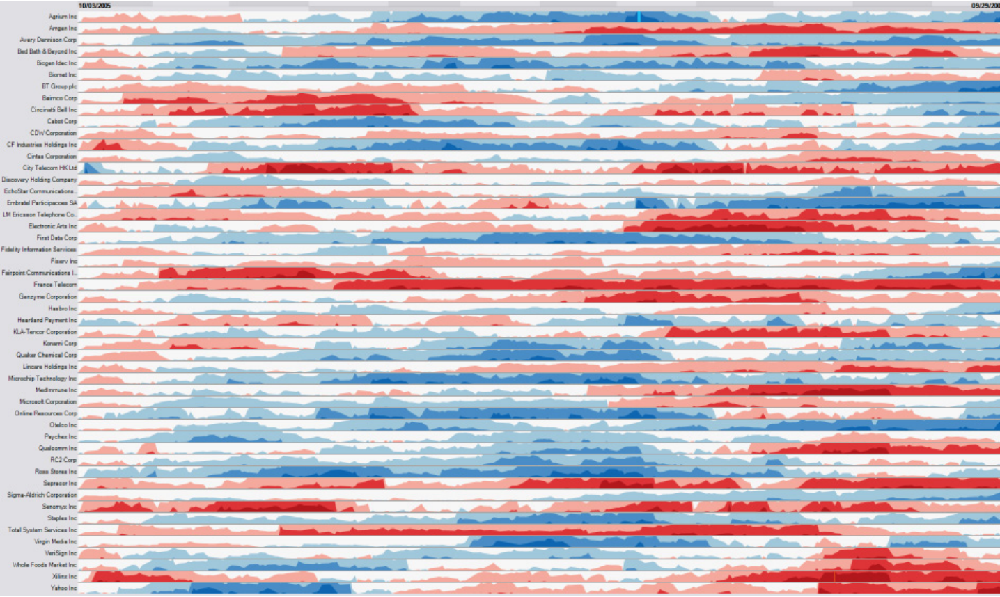{fig-align="center"}

:::footer
Heer, J., Kong, N., & Agrawala, M. (2009). [*Sizing the horizon: The effects of chart size and layering on the graphical perception of time series visualizations*](https://doi.org/10.1145/1518701.1518897). CHI.
:::

::: notes
- **Advanced technique** - horizon charts solve a specific problem: showing MANY time series compactly
- Problem: Line charts need vertical space - can only show ~10 series before running out of screen space
- Horizon charts compress vertical space by 2-4x while maintaining readability
- Used in: Server monitoring dashboards, financial data with hundreds of stocks, climate data arrays
- Key innovation: Trade vertical space for color intensity
- **CRITICAL**: This looks like "magic" unless you understand the construction
- **Next slides walk through step-by-step**: This is NOT optional - you MUST show the construction process
  - Without understanding HOW it's built, students will just see a confusing colored chart
  - The 4-step process (area → bands → flip → collapse) demystifies it
  - Heer et al.'s paper/video has excellent animations of this - reference them
- Takes practice to read - not intuitive at first glance
- Heer et al.'s CHI paper showed horizon charts can be as accurate as line charts but in 1/4 the space
- Real-world example: Cubism.js library for real-time dashboards
- When to use: When you have >20 time series and need to see them all simultaneously
:::

## Why Not Line Charts? Same Series, Same Height

**The same series as plain line charts at this height: almost flat, nothing to read.**

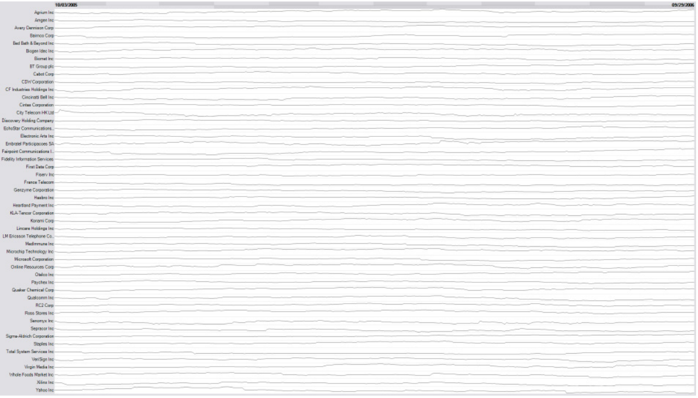{fig-align="center"}

## How Horizon Charts Work: Step 1

**Start with a standard area chart.**

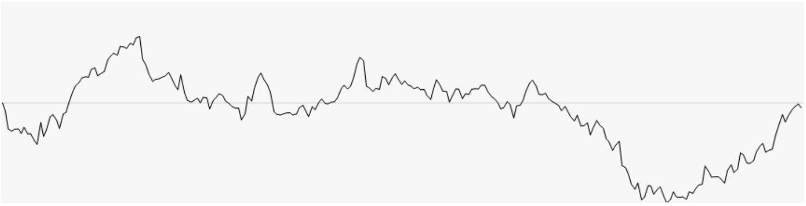{fig-align="center"}

::: notes
- **SLOW DOWN**: Take your time with these construction slides
- Step 1 is familiar - just a normal area chart
- "This is what we know - a regular area chart. Now watch what happens..."
- Make sure students understand this baseline before moving forward
:::

## Step 2: Discretizing into Bands

**Divide values into equal-height bands (e.g., 0-1, 1-2, 2-3).**

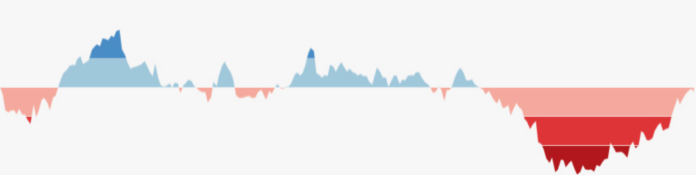{fig-align="center"}

::: notes
- **Key transformation #1**: Chop the area into horizontal slices
- "We're dividing the chart into bands of equal height"
- Point to each band: "0-1 gets one color, 1-2 gets another, 2-3 gets a darker shade"
- This is like creating a color scale for elevation on a topographic map
- Make sure students see: Same data, just segmented into layers
:::

## Step 3: Flipping Negative Values

**Mirror negative values above the baseline, told apart by hue.**

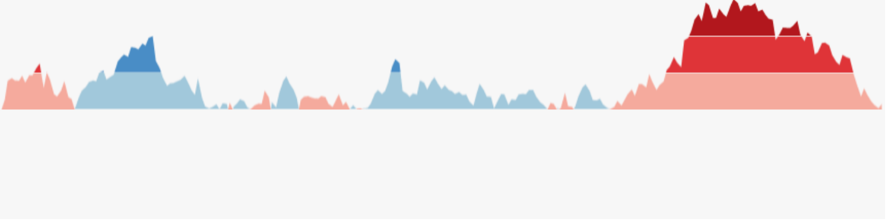{fig-align="center"}

::: notes
- **Key transformation #2**: Handle negative values
- "Notice negative values? We flip them UP above the baseline"
- Use different color (or saturation) to distinguish positive from negative
- In this figure blue = positive, red = negative
- Why flip? Because next step collapses everything - we need both directions in same vertical space
:::

## Step 4: Collapsing Bands

**Overlay the bands in one strip (left to right): darker = larger magnitude.**

:::: {.columns}
::: {.column width="50%"}
{width="100%"}
:::
::: {.column width="50%"}
{width="100%"}
:::
::::

::: notes
- **THE MAGIC STEP**: Now we collapse all the bands into the same vertical space
- "All those layers we created? We stack them on top of each other"
- **This is the key insight**: Height → Color intensity
  - Band 1 (0-1): Light color
  - Band 2 (1-2): Medium color (stacked on top, shows darker)
  - Band 3 (2-3): Dark color (all three stacked)
- The result: Same temporal patterns, but 1/3 the height
- "Look at the before and after - same pattern, compressed vertically"
- This is why color intensity = magnitude in horizon charts
:::

## Final Result: Horizon Chart

**A compact view that keeps temporal patterns in minimal height.**

{fig-align="center"}

::: notes
- **Recap the transformation**: "We went from area chart → banded → flipped → collapsed"
- Now students should understand WHY darker colors = higher values
- "Without understanding the construction, this just looks like random colored bands"
- "But now you know: it's a compressed area chart where height became color intensity"
- Practical reading tip: Darker/more saturated = higher magnitude
- Point out: You can still see the temporal patterns (peaks and valleys), just compressed
- **Reference Heer's work**: "The original CHI paper and video show this animation - highly recommended"
:::

## Sparklines

:::: {.columns}
::: {.column width="55%"}
> "Small, intense, word-sized graphics with typographic resolution. Sparklines can be placed anywhere that words or numbers can be: in sentences, maps, graphics, tables."
>
> — Edward Tufte
:::
::: {.column width="45%"}
{height="760" fig-align="center"}
:::
::::

::: notes
- **Edward Tufte's concept** - minimal, inline visualizations
- Philosophy: Data should be integrated into text, not separated
- Key characteristics:
  - No axes, no labels, no gridlines - just the trend
  - Fits inline with text (same height as text line)
  - Shows pattern at a glance, not precise values
  - "Data-intense, design-simple, word-sized"
- When to use: Tables, dashboards, reports where you want to show trend alongside numbers
- Example: Stock table showing current price + sparkline of last 30 days
- Not for: Detailed analysis, precise reading, standalone charts
- Implementation: Easy in modern tools (Excel, Tableau, D3, etc.)
- Ask students: "Where have you seen sparklines? What made them effective?"
- Common examples: Google Finance, Twitter analytics, GitHub contribution graphs
:::

:::footer
Tufte, E. R. (2006). [*Beautiful Evidence*](http://www.edwardtufte.com/bboard/q-and-a-fetch-msg?msg_id=0001OR). Graphics Press.
:::

## Sparklines in Context

**In a table (top) and a dashboard summary (bottom): the data becomes part of the text.**

{.nostretch width="50%" fig-align="center"}

{.nostretch width="90%" fig-align="center"}

## Sparkline Examples

:::: {.columns}
::: {.column width="40%"}
{height="700" fig-align="center"}
:::
::: {.column width="60%"}
{width="100%" fig-align="center"}
:::
::::

**On a watch face (left) and in Tufte's mutual-fund table (right).**

# Alternative Encodings

Beyond position: animation, color, and trajectories

## When Position is Already Used

All methods so far use **space** to represent time.

What if position is already taken (e.g., maps)?

## Three Alternative Encodings

::: {.columns}
::: {.column width="33%"}
**Animation**

Show changes over time through motion
:::

::: {.column width="33%"}
**Color**

Use color/saturation to encode time
:::

::: {.column width="33%"}
**Trajectories**

Draw paths showing movement
:::
:::

## Caution: Animation Limitations

While animation can be effective, it has significant drawbacks:

**Cognitive Limitations:**

- Limits working memory - hard to remember previous frames
- Difficult to compare non-adjacent time points
- Requires replay to catch missed details

**Best Practices:**

- Provide playback controls (pause, rewind, speed)
- Keep animations short (< 10 seconds)
- Combine with static "key frames"
- Consider small multiples instead of animation

# Summary

## Key Topics Covered

1. Structure of temporal data (linear, cyclic, hierarchical)
1. Line charts and variations (area charts, small multiples)
1. Heat maps/grids, calendars, circular layouts
1. Event data (dot/bubble charts, gantt)
1. Scalable visualizations: horizon, sparklines

## Key Takeaways

**Design guidelines:**

- Consider time structure (sequential, cyclic, hierarchical)
- Be cautious with stacked designs (hard to read upper layers)
- Test different aspect ratios for line charts
- Use circular layouts carefully (harder to compare values)
- Choose the right technique for the data density

## Key References (1/2)

::: {style="font-size: 0.7em;"}
- Taxonomy of timeline visualizations
- The TimeViz Browser
- Visualizing time-oriented data—A systematic view
- Visualizing pedestrian data
- Cloudlines visualization method for event data
- Banking to 45 degrees explained
- Banking to 45 degrees: Aspect ratios for time series plots
- The Shape Parameter of a Two-Variable Graph (original paper on banking to 45 degrees)
- An Empirical Model of Slope Ratio Comparisons (follow-up work on banking to 45 degrees)
- Quantitative Displays for Combining Time-Series and Part-to-Whole Relationships
- Stacked area chart vs. Line chart – The great debate
- The Fine Line In a Gray Area: When to Use Line vs Area Charts
- Climate spirals (great example of use of spirals)
- Enhanced interactive spiral display
- Spirals for periodic data
- Interactive Visualization of Serial Periodic Data
- Visualizing Time-Series on Spirals
- Explanation of Horizon charts
- User study on effectiveness of Horizon Charts
:::

## Key References (2/2)

::: {style="font-size: 0.7em;"}
- Visualizing Time with the Double-Time Bar Chart | Doug McCune
- Visualizing Cyclical Time – Hour of Day Charts | Doug McCune
- Visual analytics techniques for time series data
- On the Benefits and Drawbacks of Radial Diagrams | SpringerLink
- Visualizing Time with the Infinity Hour Chart | Doug McCune
:::

## Next Class: Friday, December 4

**No class on November 27 (Thanksgiving).** Week 13: Visualizing Network Data

- Node-link diagrams, force-directed layouts, adjacency matrices
- Trees: treemaps, sunbursts, dendrograms; edge bundling

**Required readings:**

- Holten (2006). [*Hierarchical Edge Bundles*](http://www.aviz.fr/wiki/uploads/Teaching2014/bundles_infovis.pdf). IEEE InfoVis.
- Bruls, Huizing & van Wijk (2000). [*Squarified Treemaps*](https://courses.cs.washington.edu/courses/cse512/25sp/uwnetid/readings/trees/Bruls_SquarifiedTreemaps.pdf).

**Mini-project 3** (network visualization): due date as announced in lab.

## Thank You!
