# Part 1: The "Why" of Interaction {background-color="#2c5f77"}

::: {.notes}
Welcome everyone. Today, we're diving into one of the most exciting aspects of information visualization: interactivity. So far, we've mostly treated visualizations as static images, like Minard's map or Florence Nightingale's charts. These are masterpieces, no doubt, but they are presentations. Today, we'll learn how to turn a presentation into a conversation, a dialogue with data.

Timing: the five parts below add up to about 90 minutes (15 / 20 / 35 / 15 / 5), which leaves room for questions and for the lab that follows. If you are behind at the halfway mark, the two SKIPPABLE slides are the first things to cut.

A quick way to set up the theme: ask the room for the last time they changed a chart to answer a question the chart's author never anticipated (re-sorting a table, zooming a map, toggling a legend entry). Almost everyone has done it, which makes the point that interaction is not a feature on top of visualization but part of how people actually use it.
:::

## Beyond Static Pictures

::: {.columns}
::: {.column width="38%"}
**So far, we've treated visualizations as static images.**

- They are powerful...
- But they only answer the questions the designer thought to ask

**Interaction changes this:**

- Turns visualization from a **presentation** into an **exploration tool**
- Enables a **dialogue with data**
:::

::: {.column width="62%"}
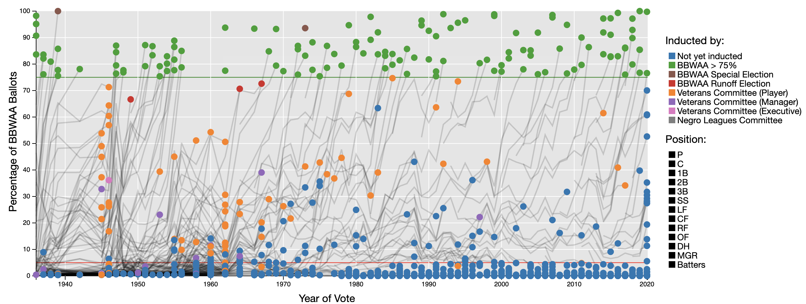{width="100%" fig-align="center"}

::: {.fragment}
**Question:** What questions can you answer? What questions *can't* you answer without touching it?
:::
:::
:::

::: {.notes}
A static picture, no matter how well designed, can only answer the questions the designer thought to ask. But what about your questions? What happens when you want to dig deeper, challenge an assumption, or explore a tangent? That's where interaction comes in. It transforms the visualization from a monologue into an exploration tool, allowing you to ask your own questions directly.

Use the question on the slide: let students answer out loud before you reveal anything. Typical answers to 'what can't you answer without touching it?' are: what is this exact value, what happens if I drop the outlier, how does this compare with last year, which of these points is the one I care about. Each of those maps onto one of the interaction dynamics we cover later (details-on-demand, filter, derive, select), so come back to this list in the summary.

The contrast with Minard and Nightingale is not a criticism: those were designed for one message, and their authors made the choices for the reader. An interactive view hands some of those choices to the reader, which is powerful but also moves work onto them. That cost is what the next slide is about.
:::

## Bridging the Gulfs

::: {.columns}
::: {.column width="40%"}
**Key HCI Concept:** Donald Norman's Gulfs

**Gulf of Execution**

- "How do I make the visualization do what I want?"
- User's challenge to specify intent to the system

**Gulf of Evaluation**

- "What did the visualization just do?"
- "What does this view mean?"
- User's challenge to understand system response
:::

::: {.column width="60%"}
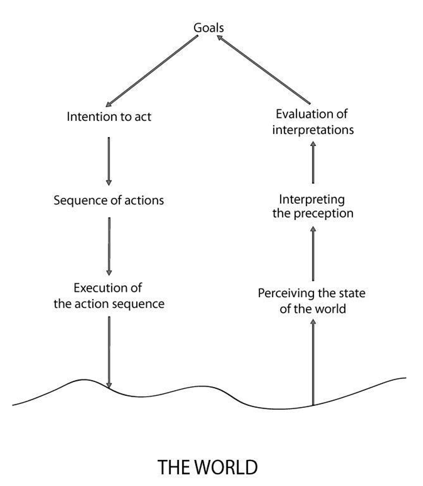{height="720" fig-align="center"}
:::
:::

::: {.fragment}
**Good interaction design bridges these gulfs** - making the tool feel like an extension of your thought process.
:::

::: {.notes}
To understand why interaction is so critical, let's borrow a core concept from Human-Computer Interaction: Don Norman's 'Gulfs'. The Gulf of Execution is that gap between your thought—'I want to see sales from only the West region'—and figuring out how to make the computer do it. The Gulf of Evaluation is the challenge of understanding what the computer shows you in return. Great interaction design builds a bridge over these gulfs. It makes the tool feel like an extension of your own mind.

Norman's gulfs come from his work on usability and are usually taught through everyday objects (a stove whose knobs do not match the burners). Map them onto visualization concretely. Gulf of Execution: I know I want only the West region, but is it a dropdown, a legend click, a brush, or a text query, and can I find it? Gulf of Evaluation: I clicked, the chart changed, but did it filter, re-scale, or re-sort, and is what I see now still comparable to what I saw before?

Two failure examples worth naming. A wide execution gulf: a powerful filter hidden behind a right-click menu that nobody discovers. A wide evaluation gulf: a chart that rescales its axis after a filter without any cue, so bars look the same height while the values changed by a factor of ten. Both are interaction design failures, not visual encoding failures.

The practical rules that narrow the gulfs: make controls visible near what they affect, give immediate feedback (under about 100 ms feels direct), and make changes legible with animation or a persistent reference. Direct manipulation, where you act on the marks themselves, is the strongest way to close the execution gulf.
:::

## The Information Visualization Pipeline

**Interaction isn't one thing** - it's a set of manipulations at different stages:

:::: {.columns}
::: {.column width="33%"}
1. **Manipulating Data**
   - Filtering, deriving new fields
:::
::: {.column width="34%"}
2. **Manipulating Visual Mapping**
   - Swapping axes, changing color scales
:::
::: {.column width="33%"}
3. **Manipulating the View**
   - Panning, zooming, rotating
:::
::::

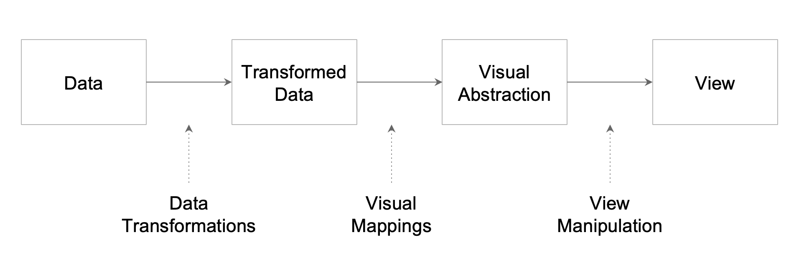{.nostretch width="80%" fig-align="center"}

::: {.notes}
So where does interaction fit in? It can happen at any stage of the visualization pipeline. We can manipulate the raw Data itself, for example, by filtering out everything but a specific year. We can manipulate the Visual Mapping, like changing a bar chart to a line chart. Or we can manipulate the View, which is the simplest form—just panning and zooming around, like on a map. We'll see examples of all three.

This slide is the organizing idea for Part 3, so it is worth a minute. Think of the pipeline as raw data, then data transformations, then visual mapping, then view transformations, then what the user sees. The reference model comes from Card, Mackinlay and Shneiderman (it is in the Further Reading list), and interaction is the user reaching back into any of those stages from the end of the pipeline.

Match each stage to what is coming. Data: Filter, Derive. Visual mapping: Visualize, and in a broader sense Sort. View: Navigate, Select, Coordinate, Organize. The Process and Provenance group (Record, Annotate, Share, Guide) sits around the whole pipeline instead of inside it, because it is about the analysis session, not any one stage. An easy test for students: given an interaction, ask which stage of the pipeline it changes. If the answer is the data, it will be slow to respond at scale; if it is the view, it should be nearly instant.

That latency point matters later: manipulating the view can usually respond in milliseconds, while manipulating the data may need a query, so system design and interaction design are tied together.
:::

## Lecture Objectives & Outline

**Learning Objectives:**

1. Understand why interaction is essential for data exploration
2. Master foundational frameworks (Shneiderman's Mantra, Task Taxonomy)
3. Apply the 12 interactive dynamics from Heer & Shneiderman
4. Analyze current research in reusable interaction design

**Today's Outline:**

- Part 1: The "Why" of Interaction (15 min)
- Part 2: Foundational Frameworks (20 min)
- Part 3: A Taxonomy of Interactive Dynamics (35 min)
- Part 4: Advanced Topic & Case Study (15 min)
- Part 5: Conclusion & Discussion (5 min)

::: {.notes}
Here's our plan for today. We'll start with the foundational principles that got the field started. Then, we'll spend the bulk of our time on a comprehensive taxonomy that gives us a shared language for all types of interaction. Finally, we'll look at where the field is heading with a case study from very recent research. By the end, you'll have a robust framework for both analyzing and designing interactive visualizations.

Point at the learning objectives and say what the assessment angle is: they should be able to look at any interactive tool, name which of the 12 dynamics it supports, and notice which ones it lacks. That is also the skill the interactive visualization exercise and the mini-project will test.

The timings are a guide, not a contract. Part 3 is the longest on purpose, since the taxonomy is the core of the lecture. Parts 4 and 5 can compress if needed.
:::

# Part 2: Foundational Frameworks {background-color="#2c5f77"}

::: {.notes}
Before the 12-part taxonomy, two foundations. First Shneiderman's 1996 mantra and its seven tasks, which started the 'tasks, not just charts' way of thinking about visualization. Then Heer and Shneiderman's 2012 taxonomy, which updates it for modern analysis tools. About 20 minutes for both.
:::

## The Visual Information Seeking Mantra

::: {.columns}
::: {.column width="50%"}
**Ben Shneiderman (1996)**

*"The Eyes Have It: A Task by Data Type Taxonomy for Information Visualizations"*

A foundational moment for interactive visualization design.
:::

::: {.column width="50%"}
::: {.r-fit-text}
**"Overview first,**

**zoom and filter,**

**then details-on-demand"**
:::
:::
:::

::: {.incremental}
- **Overview:** Most valuable first step - provides context, shows big picture
- **Zoom and Filter:** Core of exploration - focus on what's interesting, remove what's not
- **Details-on-demand:** Get raw numbers and underlying attributes for specific items
:::

:::footer
Shneiderman, B. (1996). [*The Eyes Have It: A Task by Data Type Taxonomy for Information Visualizations*](../refs/Shneiderman_1996_The_Eyes_Have_It.pdf). IEEE Symposium on Visual Languages. [doi:10.1109/VL.1996.545307](https://doi.org/10.1109/VL.1996.545307)
:::

::: {.notes}
This mantra has endured for nearly 30 years because it captures the essence of visual exploration. You can't start by looking at details - you'll get lost. You need the overview to orient yourself, to see where the interesting patterns are. Then you drill down, filter out noise, and finally examine the specifics.

Some context for why this paper matters. In 1996 most visualization work was about how to draw one particular kind of data. Shneiderman's contribution was to organize the field around what a user wants to do (tasks) crossed with what kind of data they have. The paper lists seven data types (1-D linear, 2-D map, 3-D world, temporal, multi-dimensional, tree, network) and seven tasks, and the mantra is a compact summary of the first four tasks. We will see the full seven on a slide shortly.

Two things to stress. First, the mantra is a heuristic for designing the first screen: if your opening view is already a detail view, the user has no map. If your opening view is an overview with no way to drill down, the user is stuck. Second, it is a guideline, not a law. Shneiderman himself notes that it needs adjusting for very large datasets, where a complete overview may not be possible and you may need aggregation or sampling first. Ask: what would 'overview first' mean for a billion-row table? (Answer: a density plot or aggregate summary, not a scatterplot of every point.)

For reference during Q&A: the mantra appears early in the paper as a one-line statement; the long version is a table of tasks against data types. The paper is linked in the footer.
:::

## Mantra in Action: FilmFinder

::: {.columns}
::: {.column width="40%"}
::: {.fragment fragment-index=1}
**Overview**

- All films shown as dots
- Full view of the database
- Color-coded by genre
:::

::: {.fragment fragment-index=2}
**Zoom and Filter**

- Dynamic query sliders (year, rating, length)
- **Real-time visual feedback**
- Immediate filtering on the display
:::

::: {.fragment fragment-index=3}
**Details-on-demand**

- Click on a film
- Full details appear (title, actors, director)
:::
:::

::: {.column width="60%"}
::: {.r-stack}
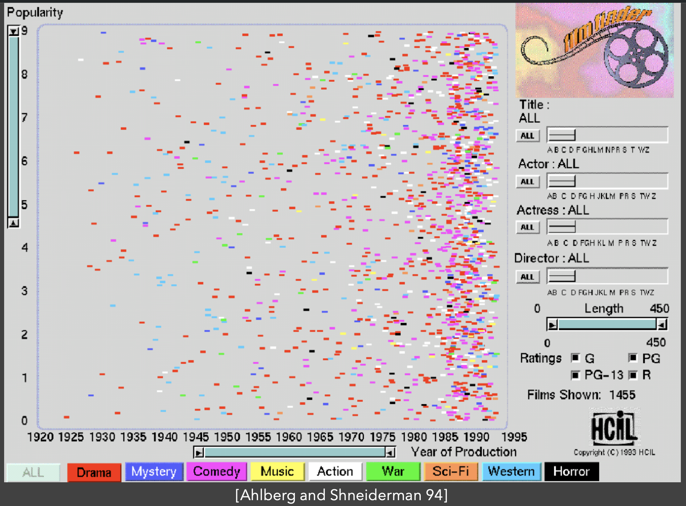{.fragment fragment-index=1 fig-align="center" width="100%"}

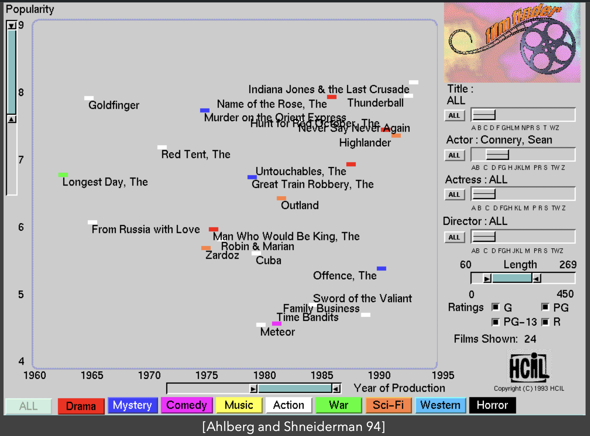{.fragment fragment-index=2 fig-align="center" width="100%"}

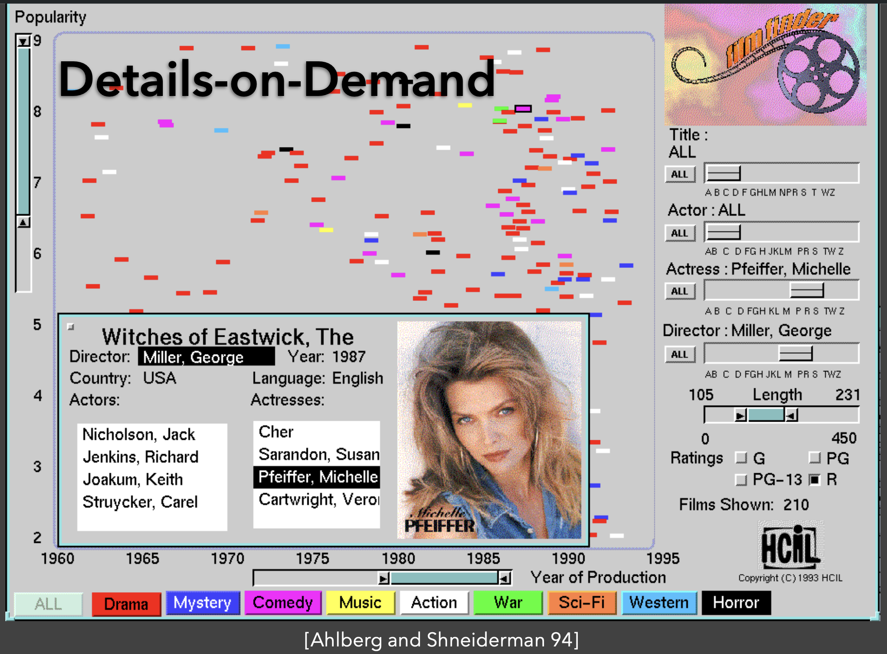{.fragment fragment-index=3 fig-align="center" width="100%"}
:::
:::
:::

::: {.fragment fragment-index=4}
**Key Innovation:** Dynamic queries - immediate visual feedback as you adjust sliders.
:::

:::footer
Shneiderman, B. (1996). [*The Eyes Have It: A Task by Data Type Taxonomy for Information Visualizations*](../refs/Shneiderman_1996_The_Eyes_Have_It.pdf). IEEE Symposium on Visual Languages. [doi:10.1109/VL.1996.545307](https://doi.org/10.1109/VL.1996.545307)
:::

::: {.notes}
This is the FilmFinder from 1994. It might look dated, but I want you to appreciate how revolutionary this was. Before this, if you wanted to query a movie database, you'd probably have to ask a specialist to write an SQL query. You'd wait, get back a long table of text, and have to start over if it wasn't what you wanted. Here, for the first time, you could just move a slider for 'year' or 'rating' and watch the films on screen update instantly. It made data exploration feel fluid, immediate, and even fun. This is the mantra in action: you get the overview of all films, you zoom and filter with sliders, and you click for details-on-demand.

Some background if students ask. FilmFinder (Ahlberg and Shneiderman, CHI 1994) pairs two ideas: a starfield display, where each item is a point on a two-dimensional plot with selectable attributes, and dynamic query filters, the sliders and buttons along the sides. 'Tight coupling' is the key phrase in the paper's title: dragging a slider changes the display continuously, with no 'submit' step. Dynamic queries themselves came from Ahlberg, Williamson and Shneiderman in 1992.

Walk the three reveals in order and say the mantra word at each one. First reveal: overview, every film is on screen. Second: zoom and filter, narrow a slider range and watch the dots disappear in real time. Third: details-on-demand, click one dot and the title, cast and director show up. The learning point is the feedback loop: because each slider drag gives an answer in a fraction of a second, users can ask dozens of what-if questions in a minute, which changes how people explore. A form that returns a results page after each query gives them perhaps two or three.

If you want a modern comparison, mention that every faceted-search sidebar on a shopping site is a descendant of this idea, usually with the overview removed.
:::

## Evolving the Mantra: Shneiderman's 7 Tasks

::: {.columns}
::: {.column width="50%"}
**From the same 1996 paper:**

A fuller "Task by Data Type Taxonomy"

**The Original 4:**

1. **Overview** - Get big picture
2. **Zoom** - Focus on items of interest
3. **Filter** - Remove uninteresting items
4. **Details-on-demand** - Get info on specific items
:::

::: {.column width="50%"}
**Three New Tasks:**

5. **Relate** - View relationships between items
   - *Example: See all books by same author*

6. **History** - Keep trail of actions
   - *Support undo, replay, progressive refinement*

7. **Extract** - Save subset of data
   - *Export in desired format*
:::
:::

::: {.fragment}
This shows a move towards a more **comprehensive understanding** of the analysis process.
:::

::: {.notes}
The mantra is only the first four tasks of the 1996 paper. The same paper adds three more: Relate (see relationships between items), History (keep a trail of actions, which supports undo and replay) and Extract (save a subset). Notice that History is exactly what Heer and Shneiderman later expand into the Record, Annotate, Share group.

A useful way to read the full list: the first four are about looking (overview, zoom, filter, details), Relate is about connecting items, and History and Extract are about the process of analysis. Together they already imply that visualization is a workflow, not a picture. The 2012 taxonomy takes that idea and builds a whole category around it.

Examples to make Relate concrete: in a library catalog, select a book and see all books by the same author; in a network, click a node and highlight its neighbors. Extract is the 'I found something, now let me take it with me' task: export the filtered rows, save the view, copy the chart. Ask students which of the seven their favorite tool does worst; Extract and History are usually the answer.

One caution for later: the seven tasks mix levels. Overview and zoom are about the view, filter is about the data, history and extract are about the session. The 2012 taxonomy cleans this up by sorting tasks into three categories, which is the next slide.
:::

:::footer
Shneiderman, B. (1996). [*The Eyes Have It: A Task by Data Type Taxonomy for Information Visualizations*](../refs/Shneiderman_1996_The_Eyes_Have_It.pdf). IEEE Symposium on Visual Languages. [doi:10.1109/VL.1996.545307](https://doi.org/10.1109/VL.1996.545307)
:::

## A Modern Framework

**Jeffrey Heer & Ben Shneiderman (2012)**

*"Interactive Dynamics for Visual Analysis"*

::: {.columns}
::: {.column width="50%"}
**Three High-Level Categories:**

1. **Data & View Specification**
   - *Controlling what you see*

2. **View Manipulation**
   - *Controlling how you see it*

3. **Process & Provenance**
   - *Supporting the analysis process itself*
:::

::: {.column width="50%"}
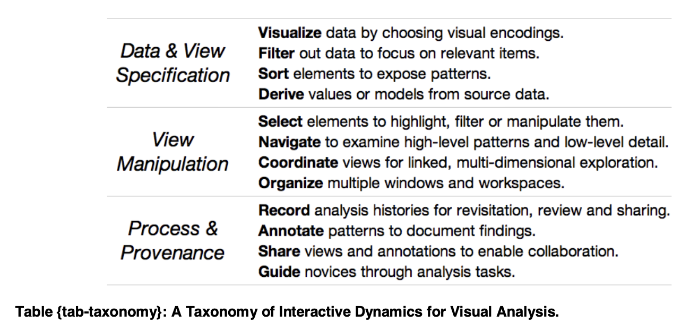{fig-align="center"}
:::
:::

::: {.fragment}
**12 specific interaction techniques** - our focus for the rest of the lecture.
:::

::: {.notes}
The table on the right is the taxonomy from the 2012 paper: three categories and twelve tasks. Read the first column top to bottom: Data and View Specification (Visualize, Filter, Sort, Derive), View Manipulation (Select, Navigate, Coordinate, Organize), Process and Provenance (Record, Annotate, Share, Guide). We take them one at a time.

Why a new taxonomy when we have the 1996 one? The 2012 paper is aimed at the tools people use now. It builds on earlier work (Shneiderman 1996, and Yi et al. 2007, which proposes seven categories: select, explore, reconfigure, encode, abstract/elaborate, filter, connect) and adds the Process and Provenance group, reflecting that modern analysis is iterative, collaborative and long-running. Yi et al. is in the Further Reading list if students want a second taxonomy to compare with.

A mnemonic for the three categories: what you see (Data and View Specification), how you look at it (View Manipulation), and how you keep track of and communicate what you did (Process and Provenance). Each category has four dynamics, so the full list is easy to hold in your head: 4 + 4 + 4.

Tell students that this slide is the one to photograph. For the next 35 minutes, every slide is one cell of this table, and the same twelve words will be the vocabulary for the exercises, the mini-project, and for critiquing any interactive system they see. Where possible I use examples from our own group's work (Urbane, TaxiVis, VisTrails) because I know the design decisions behind them.
:::

:::footer
Heer, J. & Shneiderman, B. (2012). [*Interactive Dynamics for Visual Analysis*](../refs/Heer_Shneiderman_2012_Interactive_Dynamics_Visual_Analysis.pdf). ACM Queue, 10(2). [doi:10.1145/2133416.2146416](https://doi.org/10.1145/2133416.2146416)
:::

# Part 3: A Taxonomy of Interactive Dynamics {background-color="#2c5f77"}

::: {.notes}
This is the core of the lecture. For each of the 12 dynamics I will give a definition, a concrete example you have used, and a figure from a real system. Keep an eye on two things as we go: which stage of the pipeline the dynamic acts on, and what feedback the user needs to know it worked.
:::

## Category 1: Data & View Specification

**Controlling *what* you see**

::: {.notes}
First category: the dynamics that decide what is on the screen at all. Four of them: Visualize, Filter, Sort, Derive. They mostly change the data or the visual mapping, so in terms of the pipeline they act on the left side. About eight minutes for all four.
:::

## 1. Visualize

::: {.columns}
::: {.column width="40%"}
**Choosing visual encodings**

- The most fundamental step
- Mapping data to visual properties
- Creating the initial representation

**Example: Building in Tableau**

::: {.incremental}
- Start with data
- Drag dimensions/measures to shelves
- Assign variables to axes
- Choose mark types and encodings
:::
:::

::: {.column width="60%"}
::: {.r-stack}
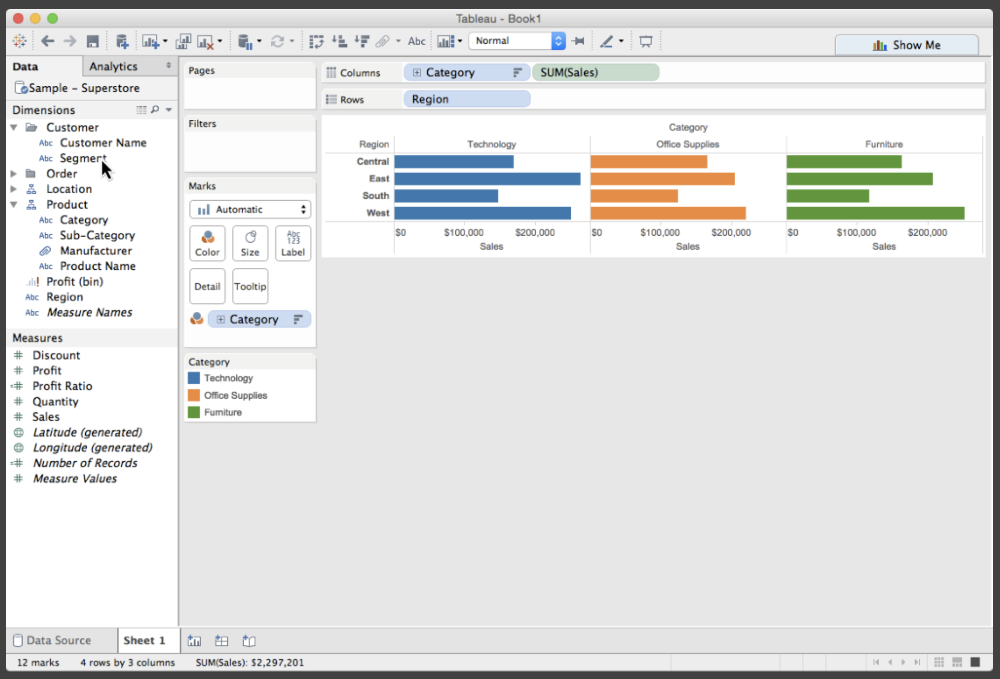{.fragment fig-align="center" width="100%"}

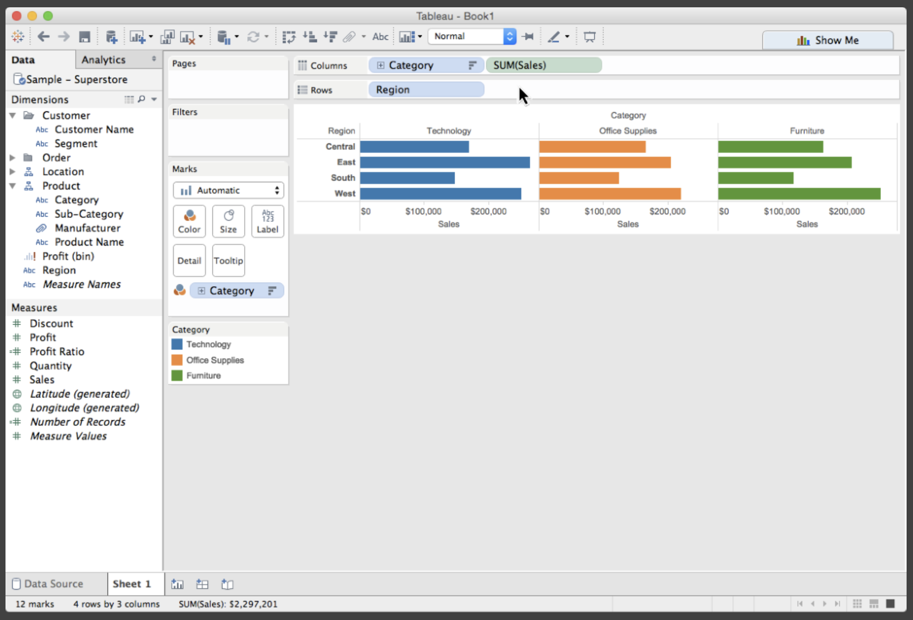{.fragment fig-align="center" width="100%"}

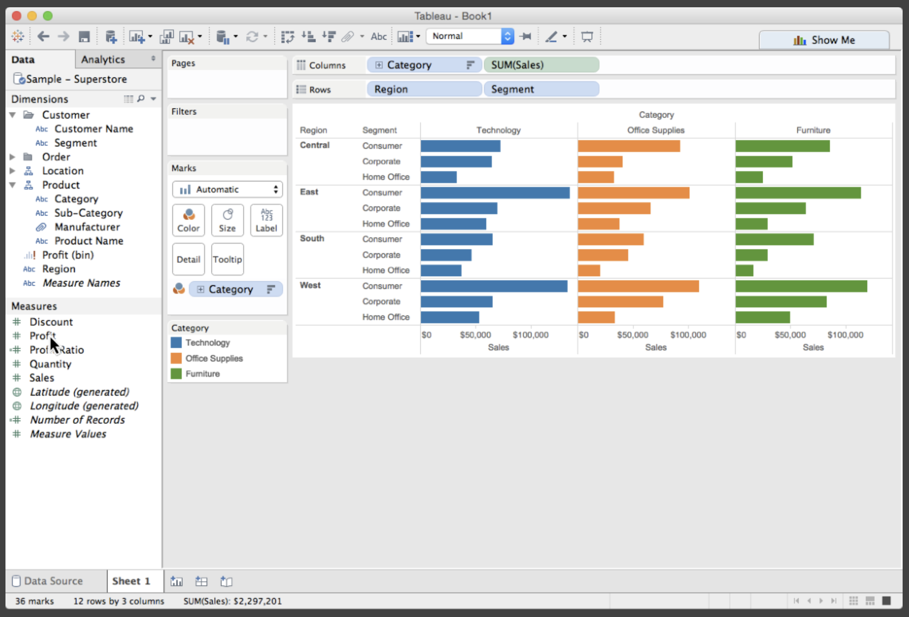{.fragment fig-align="center" width="100%"}

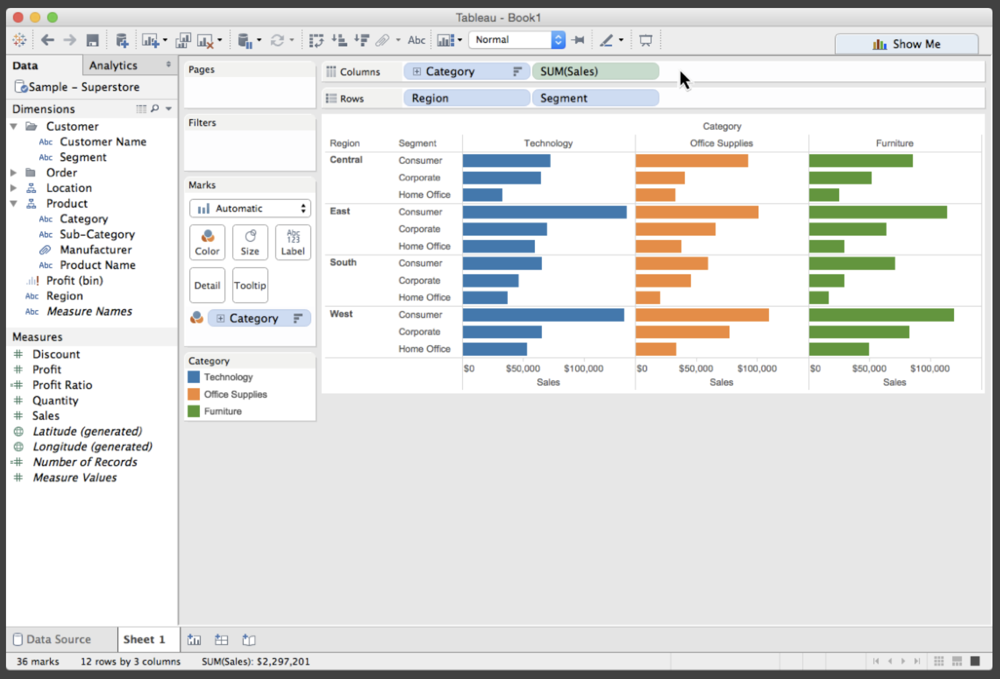{.fragment fig-align="center" width="100%"}

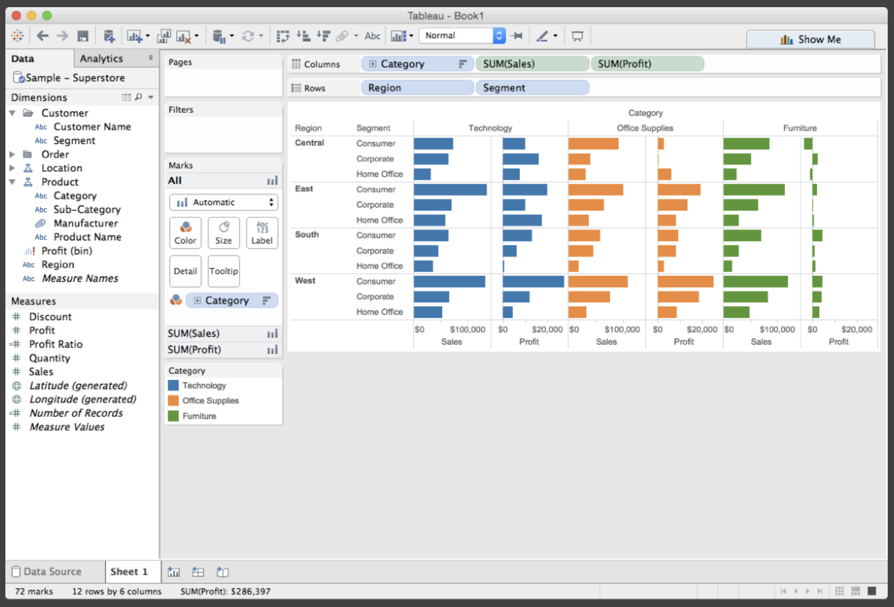{.fragment fig-align="center" width="100%"}
:::
:::
:::

::: {.notes}
This is where you decide: "I want a scatterplot with GDP on the x-axis and life expectancy on the y-axis, with color encoding region." It's the transition from data to visual form. Walk through each step showing how Tableau builds the visualization progressively - starting with the data, then adding dimensions and measures, and finally refining the visual encoding. Every tool handles this differently, but the core concept is the same.

The five fragments are a Tableau session: empty canvas, drag a field to a shelf, mark types, add a second field, final chart. Say aloud which shelf each field goes to. If a student asks why this counts as interaction and not just chart-making: because in Tableau the specification is the interaction. Changing an encoding is a one-gesture operation with immediate feedback, which is what makes it exploratory instead of a program you have to re-run.

Tableau is built on a formal visual specification (VizQL, from Stolte, Tang and Hanrahan), in the tradition of Mackinlay's APT and Wilkinson's grammar of graphics. The point to land: a good Visualize interaction lets users change encodings without caring about the specification underneath.

A common mistake for students: picking the encoding once and never revisiting it. Encourage them to try three different encodings of the same data before settling.
:::

## 2. Filter

:::: {.columns}
::: {.column width="50%"}
**Reducing the data set based on conditions**

- Remove items that don't meet criteria
- Focus on subset of interest
- Can be applied at data or view level
:::
::: {.column width="50%"}
**Example:**

- Dynamic query widgets
- Sliders for continuous values
- Check boxes for categories
- Real-time visual feedback
:::
::::

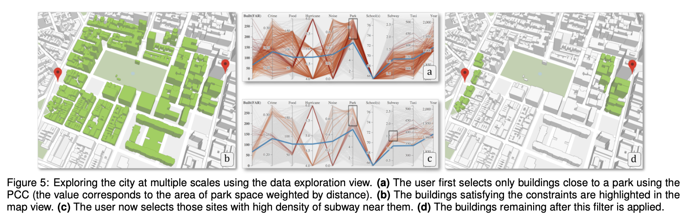{.nostretch width="80%" fig-align="center"}

::: {.notes}
Filtering is about reducing the data to what's relevant. You do this all day, every day. Quick poll: what's a filter you've used today? On Amazon, filtering by 'Prime' and '4 stars & up'? On Netflix, filtering by 'Comedy'? It's the same principle. You're removing the noise to focus on the signal. The key distinction is between filtering at the data level (the data is actually removed before visualization) versus filtering at the view level (data is still there, just not shown).

Why that distinction matters, with one example each. Data-level filter: a SQL WHERE clause or a Tableau data-source filter. The excluded rows are gone, so summaries (totals, averages, color scale domains) are recomputed on the remaining data. View-level filter: hiding marks in the chart while the data stays loaded. Axes may or may not rescale, and aggregates may or may not change. Mixing the two up is a classic source of wrong conclusions, e.g. an average that still includes rows you thought you filtered out.

Good practice: always show what is currently filtered (a visible chip or count like 'showing 312 of 4,870'), so the user is never surprised by a missing record. That is the Gulf of Evaluation again.

The figure is Urbane, our own system for urban planning and design. Use the figure to point at the filter widgets: they are the same kind of dynamic query we saw in FilmFinder, with the view updating as you adjust them. A related design question to raise: should a filtered-out item vanish, or fade to gray? Vanishing gives focus; fading preserves context and position, and the right answer depends on whether the user needs to compare with what was removed.
:::

## 3. Sort

::: {.columns}
::: {.column width="35%"}
**Ordering the data**

- Exposes rankings
- Reveals patterns
- Makes comparisons easier

**Example:**

- Clicking column header in table
- Sorting bars by value
- Ordering timeline by magnitude
- Reordering categorical axes
:::

::: {.column width="65%"}
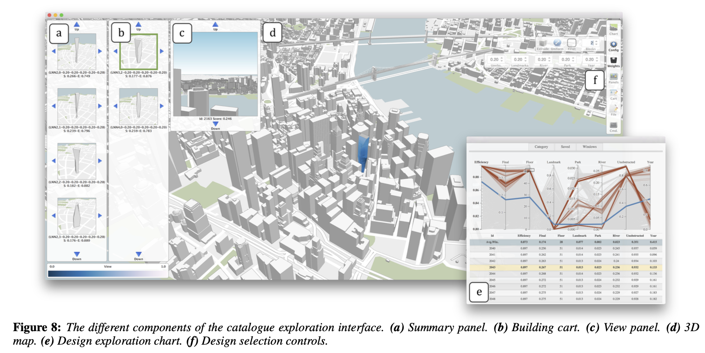{fig-align="center" width="100%"}
:::
:::

::: {.notes}
Sorting is about imposing order. It's one of the simplest, yet most powerful, interactions. When you land on a product page, what's the first thing you sort by? Price low-to-high? Average customer rating? That single click instantly helps you find patterns and priorities in the data. A sorted list immediately answers "what's the biggest?" or "what's the trend?"

Extra points to make. First, sort order is a visual encoding: in a bar chart with a nominal axis, alphabetical order is almost never the best choice, because position along the axis carries no meaning. Sorting by value gives the reader the ranking for free and makes the shape of the distribution obvious. Second, the user should be able to override the designer's default: click a header to sort, click again to reverse. Third, sort can mislead when the sort key hides another dimension, so show the key you sorted by.

A quick exercise if time: show a bar chart of countries in alphabetical order and ask what is the third-largest. Then sort it and ask again.

The figure is the catalogue exploration interface from Urbane, our own work on urban design. Panel (e) lists candidate building designs with their scores in a table next to a parallel-coordinates plot: ranking the candidates is what lets the planner go from hundreds of designs to a handful worth looking at in 3D (panels a-c).
:::

## 4. Derive

::: {.columns}
::: {.column width="35%"}
**Creating new data from existing data**

- Compute new fields
- Transform variables
- Aggregate or summarize

**Examples:**

- Profit per sale = profit ÷ sales
- Year-over-year change
- Moving averages
- Binning continuous variables
- String manipulations
:::

::: {.column width="65%"}
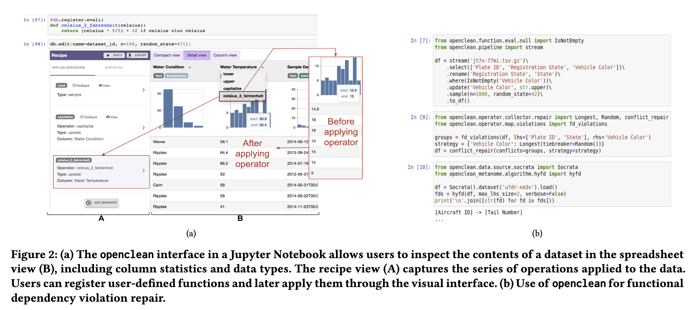{fig-align="center" width="100%"}
:::
:::

::: {.notes}
This is where analysis happens. You're not just viewing the data; you're transforming it to answer new questions. Modern BI tools make this easy with calculated fields, but the concept applies anywhere you're doing data transformation within a visualization tool.

Walk through the examples on the slide in terms of what question each lets you ask. Ratios (profit per sale) normalize away size effects, so a big store does not look best just because it is big. Year-over-year change and moving averages turn raw values into trend signals, with the moving average smoothing noise at the cost of lag. Binning turns a continuous variable into categories, which lets you build a histogram or color legend, but the bin boundaries are a design choice that can change the story, so make them adjustable.

The figure comes from a data-cleaning and profiling workflow, where derived columns are created and checked interactively. Point out that Derive is where interaction meets data preparation: the line between 'wrangling' and 'visualizing' blurs when the transformation is part of the exploration. The important design question is transparency: can the user see how a derived field was computed, and change it? An invisible derived field is a source of silent errors.
:::

## Category 2: View Manipulation

**Controlling *how* you see it**

::: {.notes}
Second category: the data and mapping are fixed, and the user changes how they look at them. Select, Navigate, Coordinate, Organize. These act on the right side of the pipeline and are usually the ones that must respond fastest. Coordinate (brushing and linking) is the one to spend the most time on.
:::

## 5. Select

::: {.columns}
::: {.column width="40%"}
**Marking items as having special interest**

- Prerequisite for many other actions
- Can be single or multiple items
- Visual feedback is crucial

**Interaction Patterns:**

- **Hover** - Temporary highlight
- **Click** - Single item selection
- **Lasso/Brush** - Group selection
- **Shift-click** - Add to selection
:::

::: {.column width="60%"}
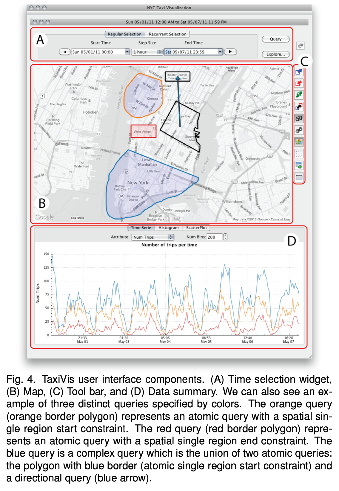{fig-align="center" height="760"}
:::
:::

::: {.notes}
Selection is foundational. Once you've selected items, you can delete them, annotate them, filter to show only them, or - most powerfully - see how they appear in other views. This is the first step in the "brushing and linking" interaction we'll discuss next.

Go through the patterns from lightest to heaviest. Hover is temporary and cheap, good for previews and tooltips. Click is a deliberate single selection that persists. Lasso or brush selects a group by area, which is how you select hundreds of items at once. Shift-click and ctrl-click extend or toggle the selection. Ask: how would you do any of these on a phone? The answer (long-press, tap targets, no hover) is a reminder that selection patterns depend on the input device, so a design that relies on hover will fail on touch screens.

The visual feedback requirement on the slide is the heart of Select: the selected items need to stand out immediately (color, outline, size) and the unselected should recede. Without it, the user cannot tell whether the click registered.

The figure is TaxiVis, our system for exploring New York City taxi trips. Select there means drawing regions on the map (origin and destination) and the trips matching both are what the other views then show. A good illustration of Select as a prerequisite: the selection by itself shows nothing new; it only matters because everything downstream (filtering, timeline, statistics) acts on it.
:::

## 6. Navigate

::: {.columns}
::: {.column width="35%"}
**Changing the viewpoint**

*The "zoom" in Shneiderman's mantra*

**Three primary operations:**

- **Pan** - Moving camera side-to-side
- **Zoom** - Increasing/decreasing magnification
- **Rotate** - For 3D views

::: {.fragment}
**Key distinction:** Geometric vs. Semantic Zoom

- *Geometric:* Just magnification
- *Semantic:* Level of detail changes
:::
:::

::: {.column width="65%"}
::: {.r-stack}
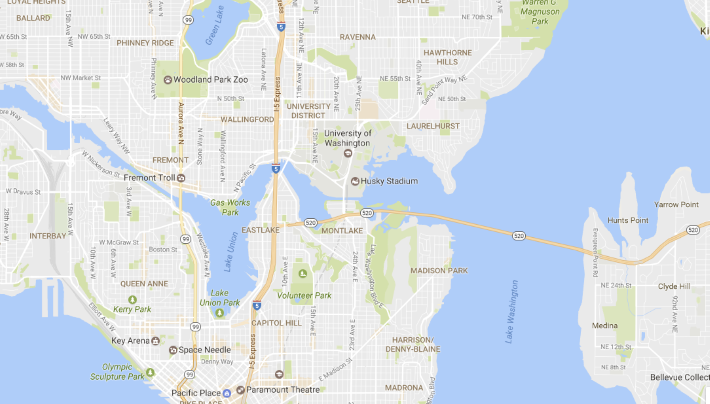{.fragment fig-align="center" width="100%"}

{.fragment fig-align="center" width="100%"}
:::
:::
:::

::: {.notes}
Navigation is what makes large datasets tractable. You can show an overview of a million points, then zoom in to see detail. Semantic zoom is particularly interesting: in Google Maps, zooming in doesn't just make things bigger, it reveals new information.

The two images are the same Seattle map at two zoom levels (click to reveal the second). In the zoomed-out view you see neighborhoods and major roads; zoomed in on the University of Washington you get building and library names, parking areas, and local street names. Nothing was just magnified: different labels and features appear at each scale. That is semantic zoom.

Contrast the two kinds explicitly. Geometric zoom is pure scaling: a screenshot made bigger, where text gets pixelated and nothing new appears. Semantic zoom changes what is drawn: labels, symbols and detail levels are chosen for the scale. Maps are the canonical example, and the idea goes back to systems like Pad and Pad++ (Perlin and Fox, 1993). Ask for another example: Google Earth, a file system tree that expands, a chart that goes from yearly bars to monthly bars to daily values as you zoom the time axis.

Three practical points. Pan and zoom need to feel continuous: abrupt jumps cause the user to lose their place (animated transitions help, which is why maps animate). Overview+detail (a small minimap showing where you are) helps people stay oriented, which ties back to the mantra's overview. And zoom range is a design decision: define the minimum and maximum so users cannot get lost in empty space.

If someone asks about focus+context techniques such as fisheye lenses: those distort space to show detail and context at once, an alternative to zoom, but they are outside today's scope.
:::

## 7. Coordinate

::: {.columns}
::: {.column width="35%"}
**Linking multiple views**

*This is critical!*

**Actions in one view are reflected in others**

**Brushing and Linking:**

1. Select items in one view (e.g., scatterplot)
2. They are instantly highlighted in all other views (e.g., map, bar chart)
3. Enables multi-perspective exploration

**Why powerful?** Each view shows different aspects of the same data.
:::

::: {.column width="65%"}
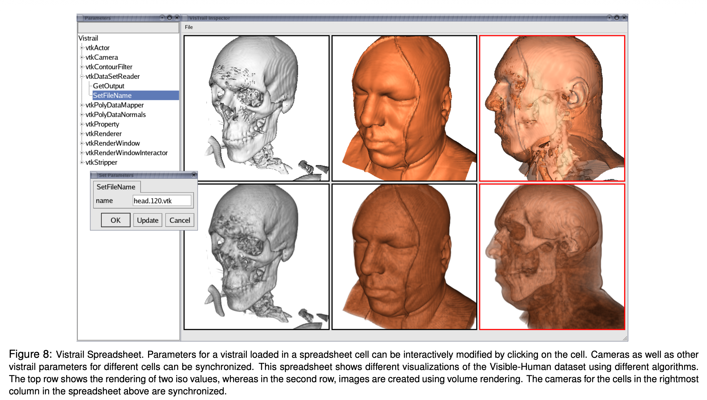{fig-align="center" height="440"}

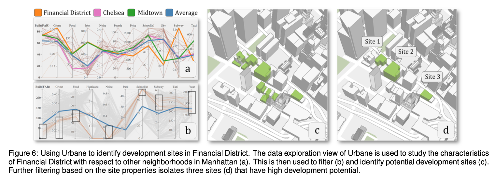{fig-align="center" height="270"}
:::
:::

::: {.notes}
Coordination is a critical concept, and it's what makes dashboards so powerful: linking multiple views so that an action in one is reflected in the others. The best-known form is brushing and linking: select items in one view and they are highlighted in the others.

Both figures show it. Top: the VisTrails spreadsheet, six renderings of the same Visible Human head with different algorithms; the cameras in the right-hand column are synchronized, so rotating one rotates the other. Bottom: Urbane. Brushing ranges on the parallel-coordinates axes (b) selects neighborhoods or sites, and the matching buildings light up in green on the 3D map (c, d). The views are talking to each other, which is how you discover multi-dimensional patterns.

Brushing and linking goes back at least to Becker and Cleveland (1987), who brushed a scatterplot matrix so a selection in one panel was highlighted in all the others. The idea is simple and has not been improved on much: use one shared selection across several views, each showing a different aspect of the same items.

Why it works cognitively: each view alone supports a few kinds of questions (scatterplot: correlation; map: location; histogram: distribution). Linking lets you ask a compound question without a query language: 'which points that are high in X and low in Y are where on the map?'. That is what makes it multi-dimensional exploration.

Design questions to raise. What is the linked response: highlight, filter, or both? How do you show the selection consistently across views (the same highlight color everywhere)? What about performance: with a million items, a brush must still update the others within a fraction of a second, or the link is lost. And the dashboard pitfall: linking too many views makes it hard to tell what caused a change. Three to five linked views is typically about the limit.

Coordination also covers synchronizing navigation, not just selection, which is the VisTrails camera example: rotate one 3D view and the other views follow so you can compare them from the same viewpoint.
:::

## 8. Organize

::: {.columns}
::: {.column width="35%"}
**Arranging the workspace**

- Resizing windows
- Reordering views in a dashboard
- Creating custom layouts
- Collapsing/expanding panels

**Goal:** Optimize screen real estate for the current task
:::

::: {.column width="65%"}
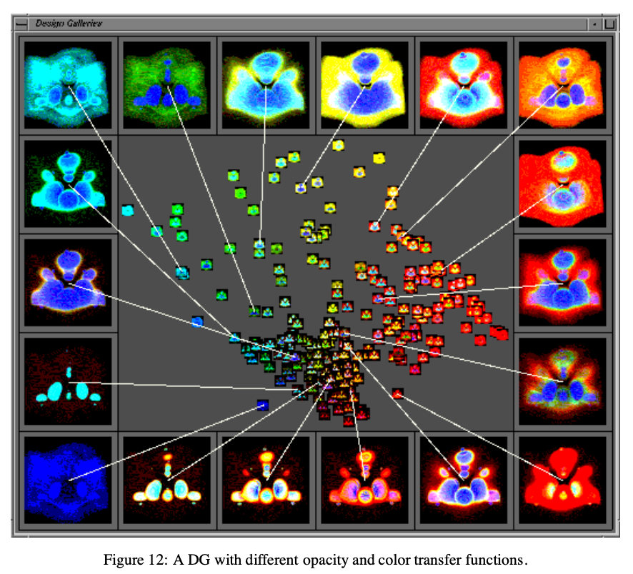{fig-align="center" height="440"}

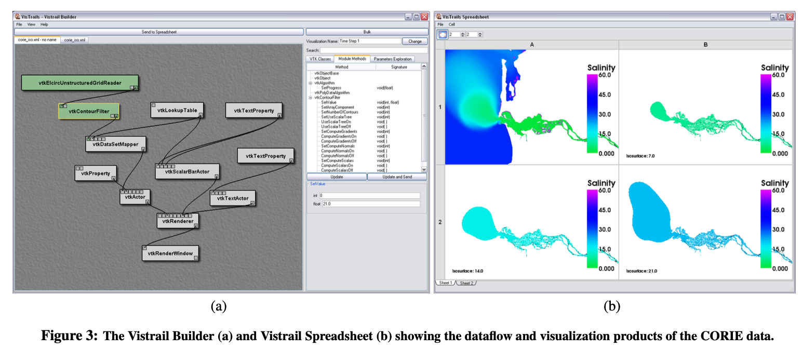{fig-align="center" height="290"}
:::
:::

::: {.notes}
This seems mundane, but it's essential for real analysis work. Different tasks need different layouts: side by side when comparing, one maximized when it is primary. Good tools make this easy to adjust on the fly.

The top figure is the Design Gallery: a large central view of many thumbnails arranged by similarity, with a few chosen examples pulled out to larger tiles around the edge and connected by lines. The bottom figure is the VisTrails workspace: the pipeline builder on the left and a spreadsheet of results on the right, each window arranged for its own job.

Organize is the dynamic students tend to dismiss, so give it a real example. A data scientist comparing three models wants three views side by side at the same scale; the same person writing up the result wants one view maximized. Good tools support both without the user spending a minute on window management. In dashboards, this includes drag-to-reorder, resizing panels, collapsing sections, and saving layouts.

The Design Gallery figure shows a different sense of organizing: arranging items in space by similarity so you can see the whole variety at once and then pull out chosen ones. Here the layout itself is the interaction, so you organize the content, not the windows. The VisTrails spreadsheet is organizing views in a grid so that many results can be compared at once.

The general principle: screen space is the scarcest resource in visualization. Organize interactions let the user reallocate it as their task changes, instead of the designer fixing one compromise layout.
:::

## Category 3: Process & Provenance

**Supporting the analysis process itself**

::: {.notes}
Third category, and the one that is most often missing from tools. Record, Annotate, Share, Guide are about the analysis session: remembering it, marking it, passing it on, and turning it into a story. Ask the room which of these their favorite tool supports well. My guess is that Share will be the most common answer and Record the rarest.
:::

## 9. Record

::: {.columns}
::: {.column width="35%"}
**Capturing the history of interaction**

**Why?**

- Support undo
- Enable replay
- Show analysis path
- Facilitate review

**Examples:**

- History panel (like Photoshop)
- Action log
- Version control for visualizations
- Movie generation from interactions
:::

::: {.column width="65%"}
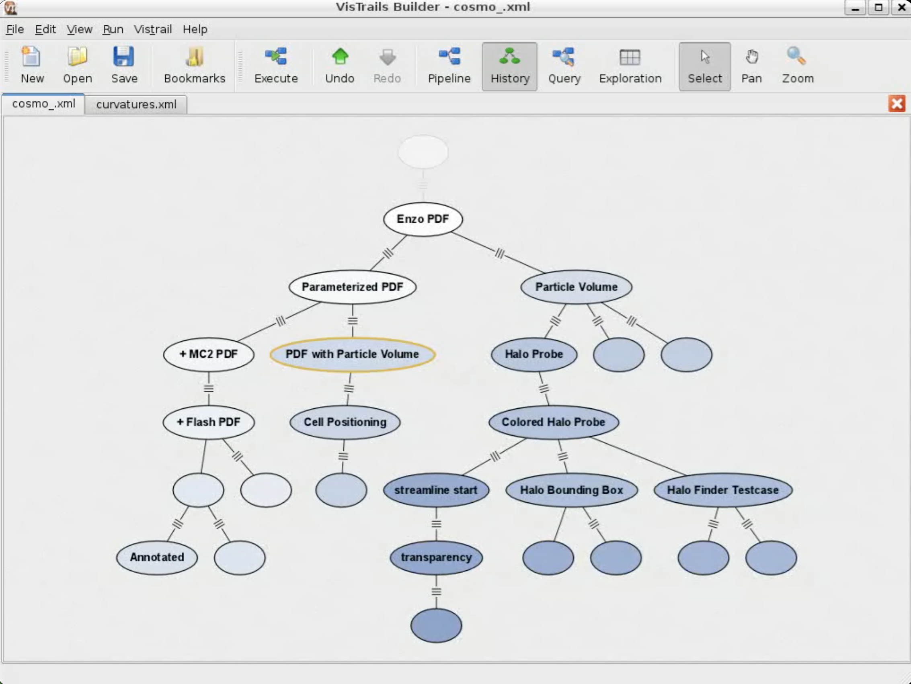{fig-align="center" height="400"}

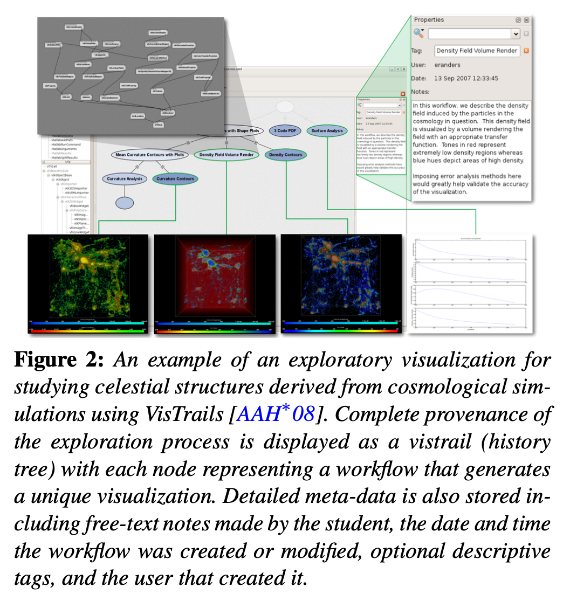{fig-align="center" height="400"}
:::
:::

::: {.notes}
Think about your last serious data analysis session. You probably took 20 different paths, most of which were dead ends. Recording history means you can backtrack without starting over. It also creates a record of your analytical process, which is crucial for reproducibility.

Both figures are VisTrails history trees. In the top one every node is a version of the workflow, and each edge is a change made to get from one version to the next (the 'Annotated' node is one the user tagged). The bottom one, from a survey of provenance in visualization, shows the same idea linked to its outputs: select a node and you see the visualization it generated, plus the notes, tags, date and user stored with it.

Two vocabulary points. Provenance means the recorded history of how a result was produced: data, steps, parameters, who and when. A version tree like VisTrails' is a branching history, so going back and trying something else does not destroy the earlier path. This is stronger than linear undo, which throws away the branch you left.

Why it matters for science: a figure in a paper that cannot be regenerated is a claim without evidence. With recorded provenance you can re-run, audit, or modify any step. In VisTrails the workflow itself is the record, so reproducibility is a side effect of using the tool and not an extra task.

Tie back to students' own work: ask whether they could reproduce their last exercise from scratch a month from now. A notebook with a clear run order is a form of Record; a screenshot is not. Ask students to think about what their own tool of choice records automatically, and what it silently loses.
:::

## Record: VisTrails Movie Generation

<video width="80%" controls autoplay loop>
  <source src="figs/interaction/VisTrailsForParaView_Large-1.mp4" type="video/mp4">
  Your browser does not support the video tag.
</video>

**VisTrails for ParaView:** Recorded interactions can be replayed to generate movies of the analysis process.

::: {.notes}
This video demonstrates how VisTrails records all interactions and can replay them to automatically generate movies showing the entire analysis workflow. This is invaluable for creating presentations, tutorials, and documenting scientific processes.

Let the video play without narration for ten or fifteen seconds and ask the room to describe what they are seeing, then explain: this is a recorded analysis session being replayed, with the system re-executing each recorded step to produce the frames. Because the record is a structured sequence of operations and not a screen capture, it can be replayed with different data, parameters, or camera paths.

This is the payoff of treating history as a first-class object. Once the sequence is stored you can do more than undo: replay, summarize, branch, compare two analyses, or teach from them. If the video does not play from the file on the projector, skip it and say the above over the previous slide's figures. Keep it to about a minute; it is not on the critical path.
:::

## 10. Annotate

::: {.columns}
::: {.column width="35%"}
**Adding notes to views**

**Why?**

- Capture insights as they occur
- Communicate findings to others
- Mark important features
- Ask questions for later

**Examples:**

- Drawing arrows on a chart
- Adding text boxes
- Highlighting regions
- Tagging interesting points
:::

::: {.column width="65%"}
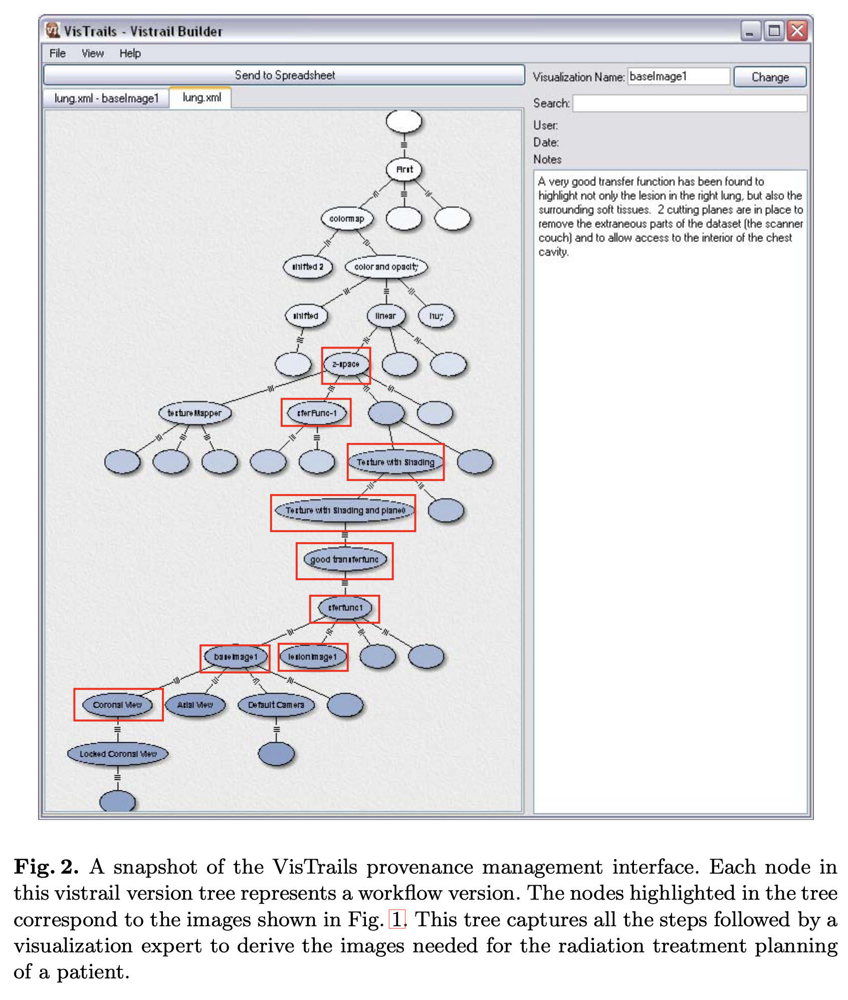{fig-align="center" height="760"}
:::
:::

::: {.notes}
Annotation is the bridge between analysis and communication. When you spot something interesting, you want to mark it immediately before you forget. These annotations then become the building blocks of your final presentation or report. VisTrails allows annotations directly on workflow nodes and visualizations.

Make the distinction between two kinds of annotation. Graphical annotation lives on the view: an arrow, a circle around an outlier, a label on a point. Textual or metadata annotation lives on the analysis: a note on a step saying why this parameter was chosen, a tag like 'dead end', a comment for a collaborator. Both matter. The first helps communicate a finding; the second preserves the reasoning, which is exactly the part that is lost most often.

A design question: does the annotation stay attached when the data or the view changes? An arrow drawn on pixels is lost when the user zooms; an annotation anchored to a data item (this data point, this time range) follows the data. Good annotation tools anchor to data.

Annotation is also the place where the lecture's two worlds meet: analysis (private, exploratory) and communication (public, curated). Many journalists' charts are just an exploratory view plus carefully chosen annotations.
:::

## 11. Share

::: {.columns}
::: {.column width="35%"}
**Sharing views and analysis sessions**

**Why?**

- Enable collaboration
- Disseminate findings
- Get feedback
- Support team analysis

**Examples:**

- Shareable links to interactive dashboards
- Embedded visualizations
- Exporting views with interaction intact
- Collaborative workspaces
:::

::: {.column width="65%"}
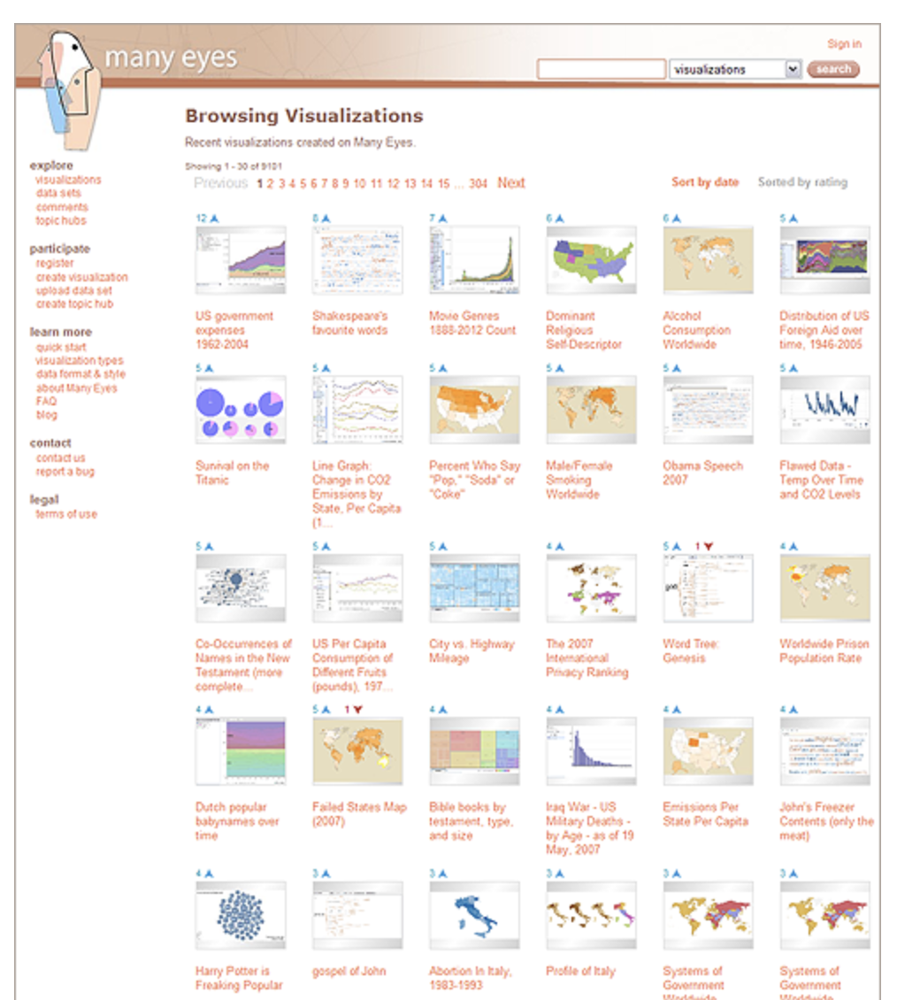{fig-align="center" height="760"}
:::
:::

::: {.notes}
Modern visualization is inherently collaborative. You're rarely analyzing data in isolation. You need to share what you've found, ideally preserving the interactivity so others can explore further. This is a huge shift from the static-chart-in-PowerPoint era. ManyEyes was an early example of a social visualization platform that enabled sharing and collaborative exploration.

ManyEyes was launched by IBM Research (Viégas, Wattenberg and colleagues, 2007). Anyone could upload a dataset, pick one of a set of visualization types, and publish the result, and other people could comment on it, start discussions around specific views, or make their own visualization of the same data. It showed that people would discuss data in public when the visualization was the object of conversation. The service was later shut down, but its ideas survive in sites like Observable and Tableau Public, which are good examples to mention.

What counts as Share is a spectrum. Lowest level: send a screenshot (loses interaction and data). Middle: send a link that restores the view state (filters, selection, zoom). Highest: a live shared workspace where several people see each other's changes. Ask which one students use most; it is usually the screenshot, and that is a failure of the tools, not of the students.

Two practical issues to raise. Sharing a view usually means sharing data, so access control and privacy matter. And a shared link should be stable: if the underlying data or tool version changes, does the link still show what you saw?
:::

## 12. Guide

::: {.columns}
::: {.column width="35%"}
**Leading an audience through a story**

**Examples:**

- **Scrollytelling websites**
  - New York Times interactive articles
  - Animated, progressive revelation

- **Guided tutorials**
  - Step-by-step walkthroughs
  - Tooltips and contextual help
  - Progressive disclosure of features

**Balance:** Author-driven narrative ↔ Reader-driven exploration
:::

::: {.column width="65%"}
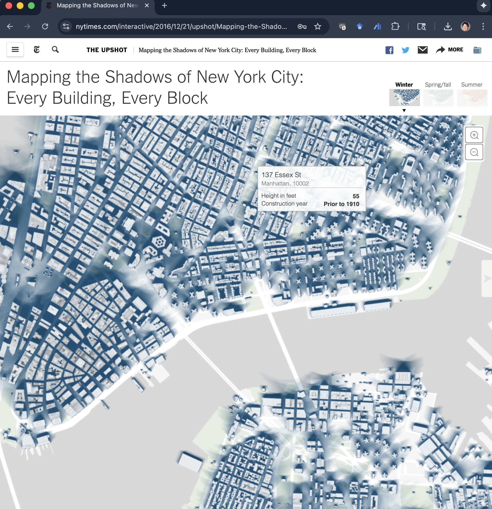{fig-align="center" height="700"}

[NYT: Mapping the Shadows of New York City](https://www.nytimes.com/interactive/2016/12/21/upshot/Mapping-the-Shadows-of-New-York-City.html){.center}
:::
:::

::: {.notes}
The Guide dynamic is about turning an exploration into an explanation. Instead of letting the user explore freely, you take them by the hand and lead them through a pre-defined path to tell a story. This is the technique behind 'scrollytelling'. Think of the best interactive articles from The New York Times or The Pudding. As you scroll, the visualizations animate and change to support the narrative. It's a powerful way to communicate specific findings. This is about finding the sweet spot between a static presentation (full author control) and a completely open exploration tool (full reader control).

The framing here comes from Segel and Heer's work on narrative visualization (2010), which describes design patterns along an author-driven to reader-driven spectrum. Their 'martini glass' structure is the common one: a narrow, author-controlled stem that walks the reader through the main story, and then a wide bowl where the reader can explore freely. Scrollytelling often follows this shape.

The NYT Upshot piece on the slide, 'Mapping the Shadows of New York City', is a good example: the story is about how building shadows fall across the city, told step by step as you scroll. It is worth opening in a browser if you have time and showing the scroll-driven transitions live. The link is on the slide.

Relate this to the rest of the taxonomy: Guide uses the other dynamics (navigate, filter, annotate) on the reader's behalf, according to a script. The skill is deciding which ones to automate and which to leave to the reader. Too much automation and the reader feels trapped; too little and they get lost. This is also where the Gulf of Execution is smallest, since scrolling is the only control.
:::

## Name that dynamic

{fig-align="center" height="520"}

**Which of the 12 dynamics do you see in this analysis of the Financial District?**

::: {.incremental}
- (a) Neighborhoods compared on parallel axes: **Visualize** and **Select**
- (b) Boxes drawn on the axes: **Filter** (brushing ranges)
- (c) Matching buildings lit in green on the map: **Coordinate** (linked views)
- (d) Labels "Site 1-3": **Annotate**
:::

::: {.notes}
SKIPPABLE - if running long, jump to 'The Challenge of Reusable Interactions'.

Two minutes in pairs, then reveal. The reading follows the figure caption: (a) the data exploration view compares the Financial District with other neighborhoods; (b) ranges are brushed on the axes to filter; (c) the buildings that satisfy the constraints are highlighted on the map; (d) further filtering isolates three sites. Students will disagree about whether (b) is Select or Filter: it is both, since brushing a range selects items and the filter removes the rest. That is a good point to make: the 12 dynamics overlap in practice and are a vocabulary, not a set of exclusive boxes.

Suggested flow, about five minutes: ask the pairs to write down the dynamics they see before showing the reveal, then go through (a) to (d) one by one. Expect a few more answers than are on the slide, e.g. Navigate (the map is a 3D view that can be rotated), Organize (several panels arranged together), Derive (the neighborhood scores are computed). Accept those as long as the student can point at the evidence; the exercise is about developing the habit of naming dynamics, not matching a key.

If the room is quiet, ask them to find the one dynamic that is not in the figure at all. Record, Share and Guide are not visible in a single static screenshot, because they depend on time and on people. That itself is a useful observation about what screenshots cannot show.
:::

# Part 4: Advanced Topic & Case Study {background-color="#2c5f77"}

::: {.notes}
We have a vocabulary for interaction. Now look at how hard it is to build it. This part is a case study from recent research, so it is a bit more technical; the goal is for students to see how a research idea connects to the taxonomy, not to learn the Libra API.
:::

## The Challenge of Reusable Interactions

::: {.columns}
::: {.column width="50%"}
**We have amazing libraries for reusing visualizations:**

- D3.js
- Vega/Vega-Lite
- Plotly
- Observable Plot

**But reusing interactions is incredibly hard.**
:::

::: {.column width="50%"}
**The Problem:**

Every developer ends up rewriting the same logic for:

- Selection
- Brushing and linking
- Zooming and panning
- Tooltips
- Filtering
:::
:::

::: {.fragment}
**Result:** A chasm between novel interaction research and what's available in practical tools.
:::

::: {.notes}
This is a real pain point in the field. We have declarative grammars for specifying visualizations - you can create complex charts with just a few lines of JSON. But for interactions, you're still writing imperative event handlers and managing state. It's tedious, error-prone, and not reusable across projects.

Make the comparison concrete. In Vega-Lite, a stacked bar chart is a handful of lines of JSON, and the library works out the scales and axes. Adding brushing across two charts is possible with Vega-Lite's selection abstraction, but anything outside the supported patterns (a custom lasso, a gesture that triggers a clustering algorithm, a multi-step undo) goes back to hand-written event handlers, shared state, and bookkeeping.

Why that is a research problem and not just an inconvenience: the interactions that get built are the ones that are cheap to build. New ideas from the research literature stay in prototypes because nobody can afford to re-implement them. Ask students who have written D3 code: how many lines of their last project were about the chart, and how many about event handling and state?

This motivates Libra: if there is a grammar of graphics for what to draw, is there an equivalent for what happens when the user does something?
:::

## Case Study: The Libra Interaction Model

**Zhao et al., CHI 2025**

:::: {.columns}
::: {.column width="50%"}
**The Goal:**

- Separate interaction logic from visualization rendering
- Create a "grammar of interaction"
- Just like we have a "grammar of graphics"
:::
::: {.column width="50%"}
**The Core Idea:**

Break interactions down into reusable components:

- **Instruments:** Basic user inputs (Hover, Click, Drag)
- **Services:** Data operations (Filter, Select, Transform)
:::
::::

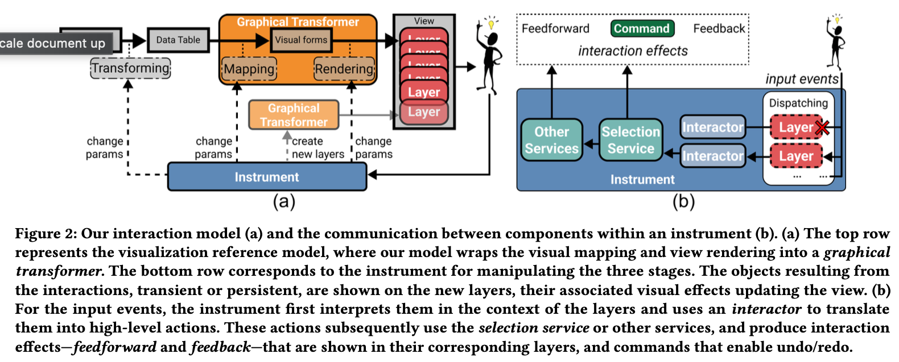{.nostretch width="60%" fig-align="center"}

:::footer
Zhao, Y. et al. (2025). [*Libra: An Interaction Model for Data Visualization*](../refs/Zhao_2025_Libra_Composable_Interactions.pdf). CHI '25. [doi:10.1145/3706598.3713769](https://doi.org/10.1145/3706598.3713769)
:::

::: {.notes}
Libra's key insight is that most interactions can be decomposed into a small set of reusable parts. In the paper's model, an instrument is the mediator between the user and the objects in the view: it receives input events, an interactor translates them into high-level actions, and those actions call services (selection, filtering, k-means, and so on) that manage data and produce feedback in separate layers. The slide's one-line version, instruments are inputs and services are data operations, is a simplification of that. It's like building with LEGO blocks instead of carving each piece from scratch.

Spend a minute on the layering so students do not leave with only 'instruments and services'. As I read the paper, the path is: user input events go to an instrument; the instrument's interactor translates them into higher-level actions (for example, a drag becomes 'select this region'); the actions call services such as selection, filtering, or k-means; and services update the data and produce feedback that is drawn in separate layers on top of the visualization. Layers matter because they keep highlights, brushes and tooltips from tangling with the base chart.

Two features from the paper that students may ask about. Instruments can be composed and shared, so a new interaction reuses existing parts. And because every action goes through a common mechanism, features like undo and redo (which appear in the paper's keywords) can be provided for all interactions at once, instead of each being written separately. That is the same Record dynamic as before, now provided as infrastructure.

Caveat: this is a research prototype (Libra.js) from a CHI 2025 paper, not a production library. The value for this class is the way of thinking.
:::

## Libra in Action (3 min)

<video width="80%" controls>
  <source src="figs/interaction/libra-demo.mp4" type="video/mp4">
  Your browser does not support the video tag.
</video>

**Libra.js:** the authors' overview video, from the [project website](https://ideas-laboratory.github.io/libra-js/).

:::footer
Zhao, Y. et al. (2025). [*Libra: An Interaction Model for Data Visualization*](../refs/Zhao_2025_Libra_Composable_Interactions.pdf). CHI '25. [doi:10.1145/3706598.3713769](https://doi.org/10.1145/3706598.3713769)
:::

::: {.notes}
SKIPPABLE - if running long, jump to 'Libra Example: Building Interactions'. The video is 3 minutes 36 seconds, so budget about four minutes with the setup.

This is the authors' own overview video from the project website, copied locally (and compressed) so it plays without a network connection. Before pressing play, tell students what to watch for: which interactions are built by combining existing parts, and which of the 12 dynamics each one corresponds to (Select, Filter, Navigate, Coordinate, Derive). Pause once or twice to name the dynamic out loud. Afterwards, the next slide shows how a few of these were assembled step by step.

If the video does not play on the projector, the live demos are on the project website: https://ideas-laboratory.github.io/libra-js/
:::

## Libra Example: Building Interactions

:::: {.columns}
::: {.column width="40%"}
::: {.incremental}
- **Step 1 (Fig 1d):** Simple `HoverInstrument` shows tooltip with digit image
- **Step 2 (Fig 1e):** Add `ClickInstrument` + `SelectionService` to highlight clicked points
- **Step 3 (Fig 1f):** Add `DragInstrument` + `KMeansService` for complex cluster analysis
- **Result:** Complex interaction built by combining simple, reusable parts
:::
:::
::: {.column width="60%"}
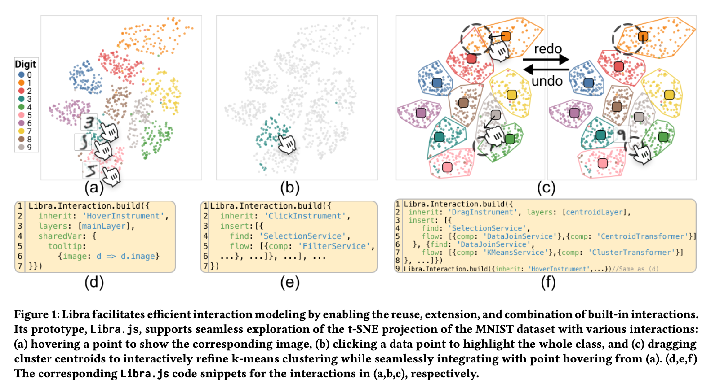{width="100%" fig-align="center"}
:::
::::

:::footer
Zhao, Y. et al. (2025). [*Libra: An Interaction Model for Data Visualization*](../refs/Zhao_2025_Libra_Composable_Interactions.pdf). CHI '25. [doi:10.1145/3706598.3713769](https://doi.org/10.1145/3706598.3713769)
:::

::: {.notes}
This brings us to the cutting edge. We've just learned this great 12-part taxonomy. The problem is, in the real world, developers have to code these interactions from scratch every single time. The Libra project asks: can we create a 'grammar of interaction' just like we have a 'grammar of graphics'?

Look at their example. They start with a simple HoverInstrument. Then, they compose it with a ClickInstrument that uses a SelectionService—that's a direct implementation of the Select dynamic we just discussed. Finally, they add a DragInstrument which uses a KMeansService—a powerful way to implement the Derive dynamic, creating new cluster information on the fly. By breaking interactions into reusable blocks, they're making it easier for everyone to build sophisticated, novel interactive systems. This is how research builds on the foundational concepts we've learned today.

The figure is Figure 1 of the paper: a t-SNE projection of MNIST digits. Per the caption, panels (a), (b) and (c) are the three interactions (hover a point to show its image, click a point to highlight its whole class, drag cluster centroids to refine k-means while hover still works), and panels (d), (e), (f) are the matching Libra.js code snippets. The slide's 'Fig 1d/e/f' labels therefore point at the code, so when you say 'step 1' point at both the picture and the snippet. Notice how few lines each step adds.

Connect each step to the taxonomy so students see that the framework is a tool for analysis. Hover with a tooltip showing the digit image is details-on-demand. Click with a selection service is Select, and highlighting is its visual feedback. Dragging centroids with k-means is a Derive: it computes new cluster assignments on the fly from what the user moves. And since the interactions are layered on each other, the final view also Coordinates, because selection and clustering are shared across the instruments.

A discussion question: what dynamic from our list would be hardest to express in this model? Candidates are Share and Guide, which involve people and time, not only a single user's input events.
:::

## Why This Matters

**A model like Libra could lead to:**

::: {.incremental}
- **More rapid prototyping** of novel interactions
  - Test ideas quickly without reimplementing basics

- **More consistency** for users across different tools
  - Click means click, drag means drag, everywhere

- **A richer ecosystem** of shared interactive components
  - GitHub for interaction patterns
  - Mix and match from community libraries
:::

::: {.fragment}
**The future:** Interaction design as composition, not programming.
:::

::: {.notes}
We're at an inflection point. Just as D3 and Vega transformed how we build visualizations, models like Libra could transform how we build interactions. Imagine a world where adding brushing-and-linking to your dashboard is as easy as adding a scatterplot. That's the promise.

Be honest about the limits so this does not sound like a sales pitch. A composition model does not remove design work: you still have to decide which interactions a task needs, and bad compositions are still bad. Standardized interactions could also make tools feel alike and discourage experimentation. And abstractions have a cost: any model has things it cannot express, and the cases it misses are often the interesting ones.

But the history is encouraging. SQL, the grammar of graphics, and D3's data join all hid complexity behind a good abstraction and made a lot more people productive. A good question for the room: what would be the 'SQL for interaction'? If you want a prompt for the mini-project: think about which interactions your own project needs that you would like to get for free.
:::

# Part 5: Conclusion & Discussion {background-color="#2c5f77"}

::: {.notes}
Wrap-up. Five minutes: recap, reading, what is next.
:::

## Summary & Key Takeaways

**Foundational Frameworks:**

::: {.columns}
::: {.column width="50%"}
**Shneiderman's Mantra**

*A timeless design heuristic*

"Overview first, zoom and filter, then details-on-demand"

✓ Start with context

✓ Enable focused exploration

✓ Provide details when needed
:::

::: {.column width="50%"}
**Heer & Shneiderman's Taxonomy**

*A comprehensive vocabulary*

- **Data & View Specification:** Visualize, Filter, Sort, Derive
- **View Manipulation:** Select, Navigate, Coordinate, Organize
- **Process & Provenance:** Record, Annotate, Share, Guide
:::
:::

::: {.fragment}
**Central Theme:** Interaction enables a true **dialogue with data**, moving beyond passive viewing to active exploration.

::: {.notes}
Return to the questions from the opening slide and check whether the room can now name the dynamic behind each one. Then recap in one sentence per piece. The mantra is the heuristic for the first screen. The 2012 taxonomy is the vocabulary for everything after it: what you see, how you look at it, and how you keep track of and share what you did. The Libra case study shows that this vocabulary is also a target for tool-building.

Leave them with a self-check: pick an interactive visualization you use regularly, list the dynamics it supports and the ones it lacks, and ask whether a missing one is hurting you. That is the same skill the interactive visualization exercise asks of them.
:::
:::

## Further Reading

**Foundational Papers:**

- Shneiderman, B. (1996). [*The Eyes Have It: A Task by Data Type Taxonomy*](../refs/Shneiderman_1996_The_Eyes_Have_It.pdf). IEEE Symposium on Visual Languages.
- Card, Mackinlay & Shneiderman (1999). [*Readings in Information Visualization: Using Vision to Think*](../refs/Card_Mackinlay_Shneiderman_1999_Using_Vision_to_Think_Chapter1.pdf).

**Interaction Theory & Practice:**

- Heer, J. & Shneiderman, B. (2012). [*Interactive Dynamics for Visual Analysis*](../refs/Heer_Shneiderman_2012_Interactive_Dynamics_Visual_Analysis.pdf). ACM Queue, 10(2). [doi:10.1145/2133416.2146416](https://doi.org/10.1145/2133416.2146416)
- Yi, J. S. et al. (2007). [*Toward a Deeper Understanding of the Role of Interaction*](../refs/Yi_2007_Toward_Deeper_Understanding_Interaction.pdf). IEEE TVCG.
- Pike, W. A. et al. (2009). [*The Science of Interaction*](../refs/Pike_2009_Science_of_Interaction.pdf). Information Visualization.

**Recent Research:**

- Zhao, Y. et al. (2025). [*Libra: An Interaction Model for Data Visualization*](../refs/Zhao_2025_Libra_Composable_Interactions.pdf). CHI '25. [doi:10.1145/3706598.3713769](https://doi.org/10.1145/3706598.3713769)

::: {.notes}
No need to present this slide in detail. If you point at one item, make it Heer and Shneiderman 2012: it is short, readable, and is the source of the taxonomy. Yi et al. 2007 is the best second taxonomy to compare with, since it organizes interaction by user intent (select, explore, reconfigure, encode, abstract/elaborate, filter, connect). Pike et al. 2009 is a broader look at the science of interaction. All of these are in the course refs folder.
:::

## Next Week (Oct 23): Geographic and Urban Visualization I

:::: {.columns}
::: {.column width="50%"}
### Topics:

- Map projections and their trade-offs
- Geographic data formats (GeoJSON, TopoJSON, Shapefiles)
- Choropleth and point maps

### Due:

- **Exercise 7** - Interactive visualization design and implementation (**Oct 22**)
- **Mini-project 1 begins** - geographic visualization (due Nov 5)
- Teams formed by **Oct 16** (today)
:::
::: {.column width="50%"}
### Required reading:

- [GeoLinter: A Linting Framework for Choropleth Maps](https://arxiv.org/pdf/2310.13707) - Lei, Fan, MacEachren & Maciejewski, IEEE TVCG 2023
- [Research Challenges in Geovisualization](https://www.researchgate.net/publication/313573280_Research_challenges_in_geovisualization_Cartography_Geograph) - MacEachren & Kraak, 2001
:::
::::

::: {.notes}
SKIPPABLE - if running long, jump to 'Questions?'.

Next Friday is the first geographic session: map projections, data formats and choropleth design, with the D3 geo lab. Two dates to repeat: Exercise 7 (the interactive visualization from today's lab) is due Thursday Oct 22, and Mini-project 1 starts next week. Teams are due today, Oct 16: use Discord #project-teams if you are still looking for a group.
:::

## Questions?

## {}

::: {.r-fit-text}
Thank you!
:::
