# Foundations of Geovisualization {background-color="#2c5f77"}

## The 2D Map

::: {.notes}
Welcome. Today starts a three-part arc: the 2D map today, urban flows, time and interactivity next week, then 3D city models and simulation. Before the complex systems we *must* understand the fundamentals. We focus on the most common and, as we'll see, the most *misused* form of geographic visualization: the 2D static map. The goal is to learn to read and make these maps *critically*. Mini-project 1 begins today and builds on this, so the four pitfalls in Part 5 are the ones to take with you.
:::

# Part 1: The Power of Spatial Analysis {background-color="#2c5f77"}

## John Snow's 1854 Cholera Map

::: {.columns}
::: {.column width="50%"}
**What is a map for?**

- Analysis
- Communication

**Snow's Innovation:**

- He didn't just plot data
- He used spatial relationships to solve a problem
- Deaths clustered around the Broad Street pump
- Had the handle removed → outbreak stopped
:::

::: {.column width="50%"}
{fig-align="center" width="100%"}
:::
:::

::: {.notes}
This is the foundational story of geovisualization. In 1854, cholera was a mystery; the dominant theory was bad air. Snow plotted the deaths (the black bars, stacked at each address) on a map of Soho and saw they clustered around the Broad Street pump. He took this to the local board, and the pump handle was removed. This is the "why" of what we do: he didn't just make a picture, he used the spatial relationship between deaths and pumps to form a hypothesis and persuade people to act. Honest footnote: the outbreak was already declining when the handle came off, so the map's real contribution was the evidence and the argument, not a dramatic overnight cure. Question to ask the room: what would this map have looked like if he had plotted raw counts per block with no pumps? (Plant the seed for normalization and context later.)
:::

## Historical Milestones in Cartography

::: {.columns}
::: {.column width="50%"}
### Ptolemy's Geographica (c. 150 AD)

- Foundation of modern cartography
- Latitude and longitude coordinate system
- Over 2000 years of influence

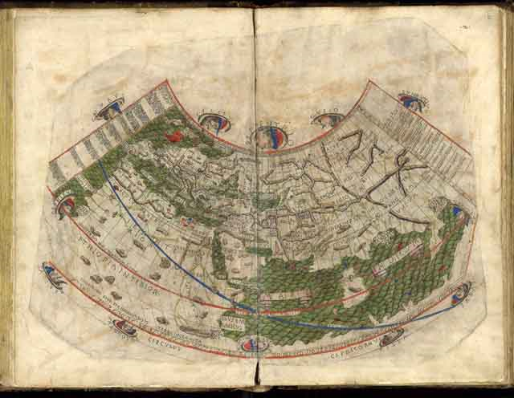{fig-align="center"}
:::

::: {.column width="50%"}
### Minard's Flow Map (1869)

- Multiple variables in one visualization:
  - Troop size (width)
  - Temperature (bottom scale)
  - Location (geography)
  - Direction (color: tan = advance, black = retreat)

{fig-align="center"}
:::
:::

::: {.notes}
Maps are not new. Ptolemy's Geographia, around 150 AD, systematized the idea of locating places by latitude and longitude; the maps we show are later reconstructions from his coordinate tables. On the right is one of the most famous visualizations ever, by Charles Joseph Minard (1869). It shows the destruction of Napoleon's army in Russia. The wide tan band is the advance toward Moscow, its width the number of men; the thin black band is the retreat, shrinking to almost nothing, with the temperature line underneath explaining some of the final losses. Six variables on one 2D page: this is a brilliant *flow map*, and we'll come back to flow maps in a moment and again next week.
:::

# Part 2: When to Use a Map? {background-color="#2c5f77"}

## The Critical Question

::: {.r-fit-text}
**"Not all geographical data should be on a map."**
:::

::: {.fragment}
### When is the bar chart better?

- For **ranking** and **lookup** tasks
- "Which city has the highest sales?"
- "What are the top 5 cities?"
:::

::: {.fragment}
### When is the map better?

- For finding **spatial patterns**
- For identifying **clusters**
- For understanding **geographic relationships**
- "Are sales clustered along the Front Range?"
:::

::: {.notes}
This is the *most important* question to ask every time. Just because you have spatial data (like states) doesn't mean you *must* use a map. A map spends your two strongest visual channels, x and y position, on geography, so nothing else can use them. Ask: is the user's question about *where* or about *how much*? Let the room answer the two example questions before you reveal the bullets. This is Ericson's argument in the optional reading, "When Maps Shouldn't Be Maps".
:::

## Map vs. Bar Chart: The Same Data

::: {.columns}
::: {.column width="50%"}
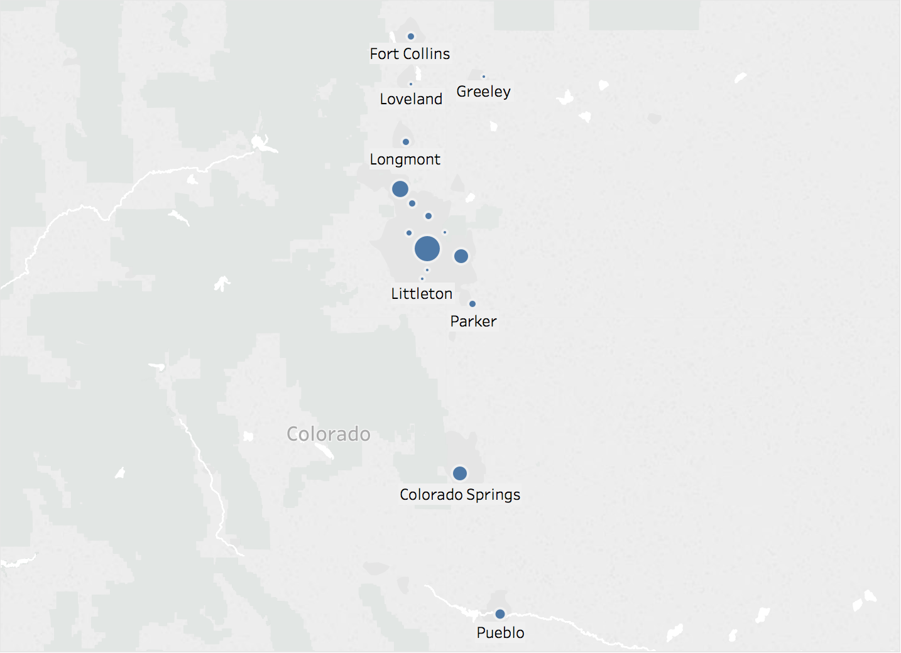{fig-align="center"}

**Better for:** Spatial patterns, regional clustering
:::

::: {.column width="50%"}
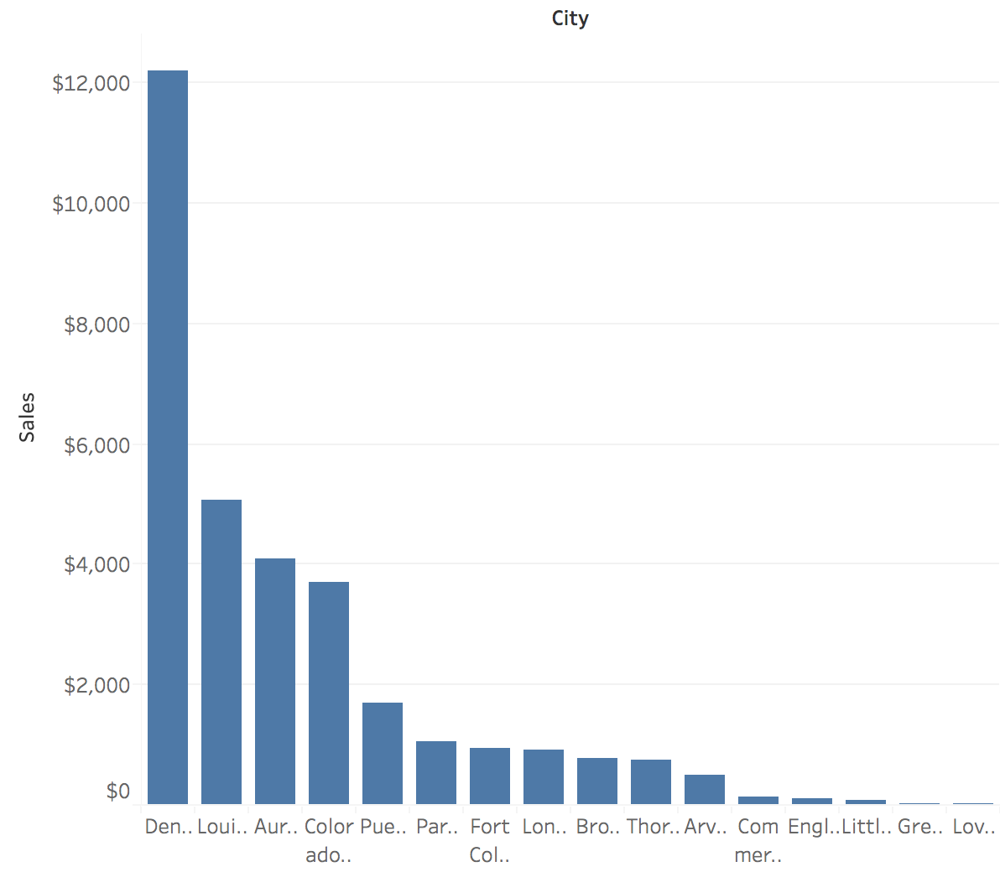{fig-align="center"}

**Better for:** Ranking, exact value lookup
:::
:::

::: {.notes}
Same data (sales by Colorado city), two charts. If the question is "Which city has the highest sales?" or "What are the top 5 cities?", the sorted bar chart wins by a wide margin: you can read exact values and rank instantly. If the question is "Are sales clustered? Is there a pattern along the Front Range?", the map is the only one of the two that shows it, because the bar chart threw location away. Neither is "better" in general; each answers a different question. Also point out the cost on the map side: values are encoded in small symbols that are hard to compare, and places packed close together (the Denver area) overlap, while the bar chart gives every city the same space.
:::

# Part 3: The Fundamental Problem {background-color="#2c5f77"}

## Projections: Mapping 3D to 2D

::: {.columns}
::: {.column width="50%"}
**The Challenge:**

- Earth is a 3D sphere
- Screens and paper are 2D planes
- You **cannot** flatten a sphere without distortion

::: {.fragment}
**You must choose what to distort:**

- Shape
- Area
- Distance
:::
:::

::: {.column width="50%"}
{fig-align="center" height="600"}
:::
:::

::: {.r-fit-text .fragment}
**Any 2D map is a lie. The question is: what kind of lie?**
:::

::: {.notes}
This is the fundamental challenge of all cartography. The Earth is a sphere (well, an oblate spheroid). A screen or piece of paper is flat. Any 2D map *is a lie*. It's a distorted view of reality. The question is, what *kind* of "lie" (distortion) are you choosing, and is it appropriate for your task?
:::

## Projection Types: What They Preserve

::: {.columns}
::: {.column width="33%"}
### Conformal
*Preserves shape & angles*

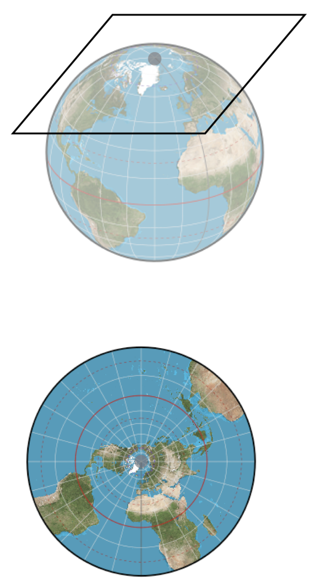{fig-align="center" height="600"}

**Use:** Navigation (constant compass bearing)
:::

::: {.column width="33%"}
### Equal-Area
*Preserves relative area*

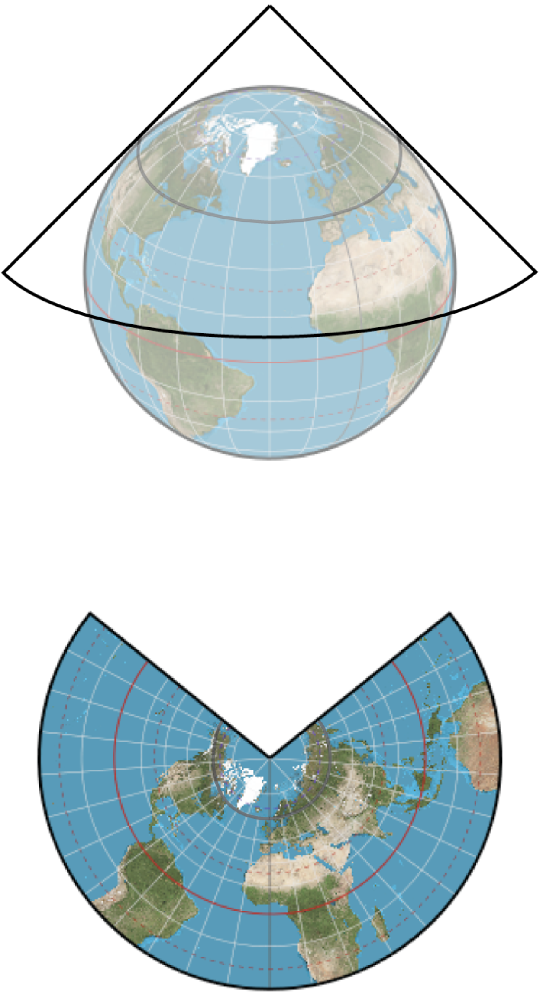{fig-align="center" height="600"}

**Use:** Thematic maps (choropleths)
:::

::: {.column width="33%"}
### Equidistant
*Preserves distance from center*

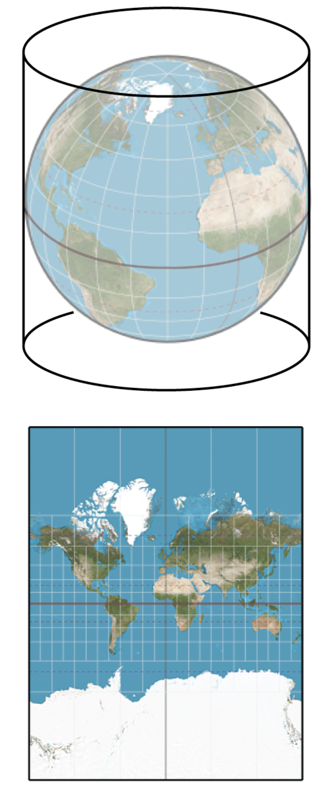{fig-align="center" height="600"}

**Use:** Distance calculations
:::
:::

::: {.notes}
These are the three main categories of projections, each preserving different properties. Conformal projections preserve shape and angles, which is why Mercator was great for sailing. Equal-area projections preserve relative sizes, which is critical for thematic maps. Equidistant projections preserve distances, but only from the center point (or along certain lines), not between arbitrary pairs of places. No projection preserves everything: a flat map cannot be both conformal and equal-area. Choose by task: navigation, thematic shading, or distance from a hub (airline range maps are the classic azimuthal equidistant use).
:::

## Tissot's Indicatrix: Visualizing Distortion

::: {.columns}
::: {.column width="50%"}
### Mercator (Conformal)

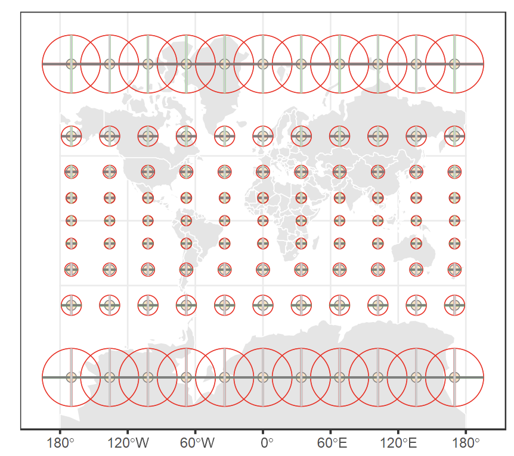{fig-align="center" height="500"}

- Circles remain circles (shape preserved)
- But circles get **huge** near poles (area distorted)
:::

::: {.column width="50%"}
### Equal-Area

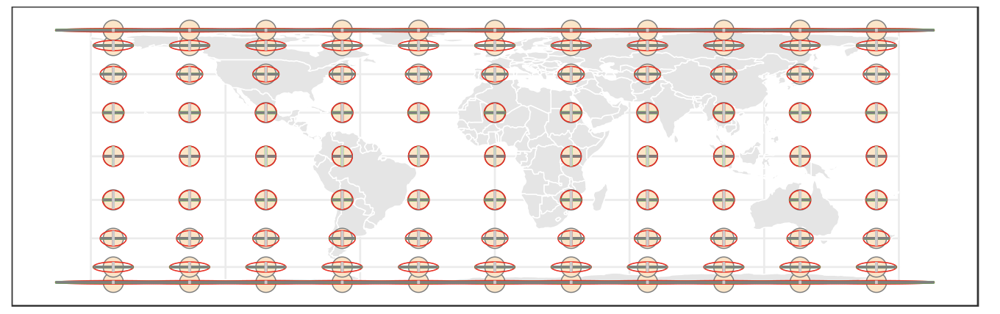{fig-align="center" width="100%"}

- Circles become ellipses (shape distorted)
- But all have **same area** (area preserved)
:::
:::

:::footer
Interactive Tissot tool: [mgimond.github.io/tissot](https://mgimond.github.io/tissot/)
:::

::: {.notes}
Tissot's indicatrix is the standard way to *see* distortion: place identical tiny circles all over the globe and watch what the projection does to them. On the left, Mercator: every circle stays a circle, so local shape and angles are preserved, which is why a straight line is a constant compass bearing and it was great for sailing. But the circles balloon toward the poles, which is the area distortion. On the right, an equal-area projection: all circles have the same area, but they are squashed into ellipses, so shapes distort, especially near the edges. Same tool, opposite trade-off. Optionally open the interactive tool linked in the footer.
:::

## Projection Hall of Shame/Fame

::: {.columns}
::: {.column width="50%"}
### Mercator: The Infamous Example

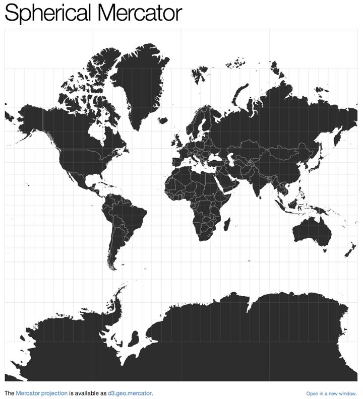{fig-align="center" height="440"}

**The Problem:** Greenland looks bigger than Africa

**Reality:** Africa is **14× larger** than Greenland
:::

::: {.column width="50%"}
### Albers Equal-Area: The Fix

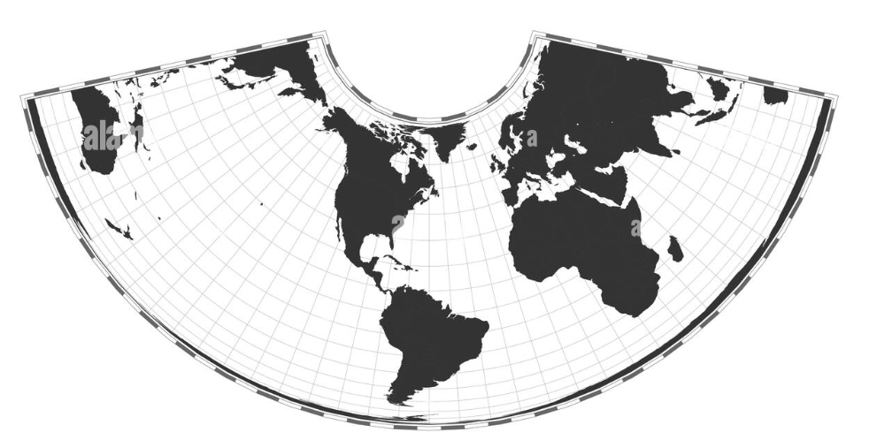{fig-align="center"}

**The Solution:** Use equal-area for thematic maps
:::
:::

::: {.r-fit-text .fragment}
**Rule: If you shade areas, you MUST use an equal-area projection.**
:::

::: {.notes}
This is the classic, infamous example. On the Mercator projection, Greenland looks massive, larger than Africa. In reality, Africa is 14 times larger than Greenland. This is fine for sailing, but if you shade countries by "GDP per capita" on a Mercator map, you are visually lying: high-latitude countries get far more ink than their size warrants. **If you are shading areas, use an equal-area projection.** For US maps, Albers is the standard choice, and it is what the D3 lab uses (d3.geoAlbersUsa).
:::

## The True Size of Countries

<iframe width="1600" height="900" src="https://www.youtube.com/embed/kIID5FDi2JQ" title="The True Size Of ..." frameborder="0" allow="accelerometer; autoplay; clipboard-write; encrypted-media; gyroscope; picture-in-picture" allowfullscreen style="display: block; margin: 0 auto;"></iframe>

::: {.notes}
This video demonstrates an interactive tool that lets you drag countries around on the Mercator projection and watch them change size as they move to different latitudes. It's a powerful demonstration of how dramatically the Mercator projection distorts area. Watch how Greenland shrinks when you drag it toward the equator, or how a country grows as you drag it north. If the embed misbehaves in class, thetruesize.com does the same thing live. This is why choosing the right projection for your task is so critical.
:::

## Understanding Mercator Distortion

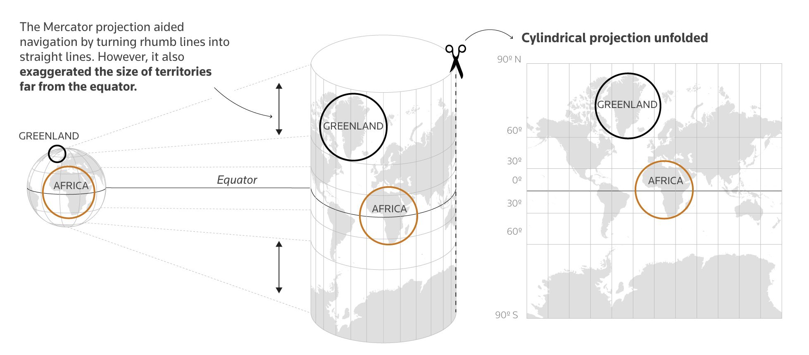{fig-align="center" width="90%"}

:::footer
Source: [Reuters Graphics - The True Size of Africa](https://www.reuters.com/graphics/AFRICA-MAP/lgpdaqrdyvo/)
:::

::: {.notes}
This beautiful diagram from Reuters shows exactly how the Mercator projection works and why it distorts size. Left: the globe, with Africa and Greenland at their true relative sizes. Middle: the globe wrapped in a cylinder, with the stretching getting worse toward the poles (the arrows). Right: the cylinder cut and unfolded, with Greenland now about the size of Africa. Greenland is stretched enormously because it is far from the equator, while Africa straddles it and stays closer to true scale. This is not a flaw for navigation, since Mercator turns rhumb lines into straight lines, which is what it was designed for. It becomes a problem when we reuse it for data visualization.
:::

# Part 4: Taxonomy of Thematic Maps {background-color="#2c5f77"}

## Type 1: Choropleth Map

::: {.columns}
::: {.column width="60%"}
{fig-align="center"}
:::

::: {.column width="40%"}
**Definition:**

Regions are shaded based on a value

**Use Cases:**

- Categorical data (winner/loser)
- Rates and percentages
- Density measures

**Good for:** Seeing broad regional patterns
:::
:::

::: {.notes}
This is a **choropleth**. Each state is shaded by *who won*. This is good for seeing broad regional patterns. The NYT is a master of this type of visualization. Note that this is a *categorical* choropleth—it shows categories (red vs blue, winner vs loser). The pitfalls in Part 5 apply primarily to *quantitative* choropleths, where you shade by a numerical value or rate. Those are far more common and much easier to get wrong. Caveat to mention: even this categorical map has the land-area problem, which Pitfall 4 returns to.
:::

## Type 2: Proportional Symbol Map

::: {.columns}
::: {.column width="60%"}
{fig-align="center"}
:::

::: {.column width="40%"}
**Definition:**

Symbols (e.g., circles) are scaled based on a value

**Use Cases:**

- Absolute quantities
- Magnitude comparisons
- Population distributions

**Good for:** Showing *where* the values are, not just the land area
:::
:::

::: {.notes}
This is a **proportional symbol map**. Each circle is scaled by the *size of the lead*. This is a very different story—it shows *where* the votes are, not just *land area*. Pay close attention to this technique. We'll see it again later as a powerful solution to one of the major pitfalls of choropleth maps.
:::

## Type 3: Cartogram

::: {.columns}
::: {.column width="60%"}
{fig-align="center"}
:::

::: {.column width="40%"}
**Definition:**

Geometry (area) is distorted to represent a quantity

**Use Cases:**

- Population-based metrics
- Electoral votes
- Economic measures

**Good for:** De-emphasizing misleading land area
:::
:::

::: {.notes}
This is a **cartogram**. This is a brilliant solution to the election map problem. It *abandons* true geography and instead sizes each state by its electoral votes. Like the proportional symbol map we just saw, this technique will reappear later when we discuss how to fix misleading choropleths.
:::

## Type 4: Flow Map

::: {.columns}
::: {.column width="60%"}
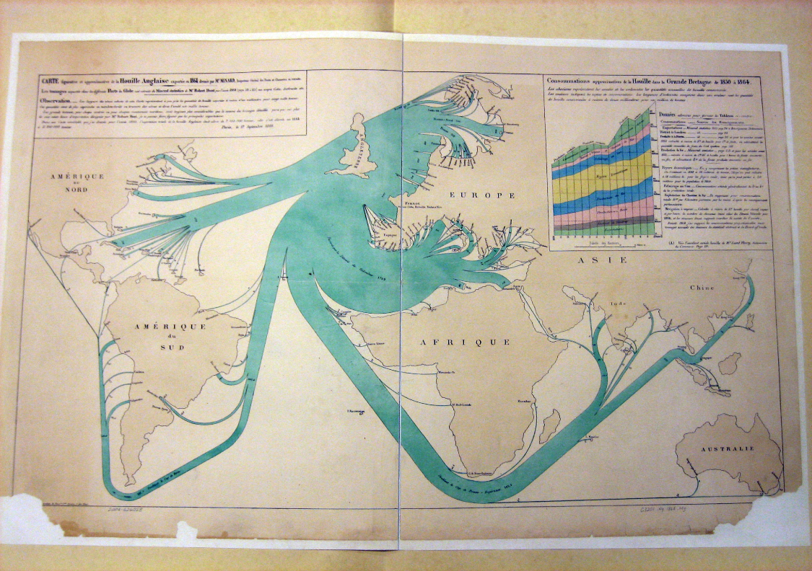{fig-align="center"}
:::

::: {.column width="40%"}
**Definition:**

Shows movement or connections between regions

**Use Cases:**

- Trade routes
- Migration patterns
- Transportation networks

**Visual encoding:** Line width ∝ quantity flowing
:::
:::

::: {.notes}
This is a **flow map** by Minard again, showing British coal exports in 1864. Line width is proportional to the tonnage along each route, so the eye reads volume and direction at once. Flow maps get messy as the number of origins and destinations grows (edge clutter), a problem we'll deal with directly next week when we look at urban flows such as taxi and bike trips.
:::

# Part 5: Four Critical Pitfalls {background-color="#2c5f77"}

::: {.notes}
We're going to spend the next stretch on how *not* to lie with maps. Most of the "bad" maps you see are choropleths that fall into one of these four traps.
:::

## Choropleth Maps: Handle with Care

::: {.r-fit-text}
Choropleth maps are the most **common** and most **misused** type of map.
:::

### Four Major Pitfalls:

::: {.incremental}
1. **Normalization** (Base Rate Bias)
2. **Classification** (Binning)
3. **Color**
4. **Geography** (MAUP)
:::

::: {.fragment}
::: {.r-fit-text}
⚠️ Avoid these traps to create honest visualizations ⚠️
:::
:::

::: {.notes}
Four traps, one per section: normalization, classification, color, geography. These are exactly the kinds of problems the required reading, GeoLinter (Lei et al., TVCG 2023), tries to detect automatically in choropleth maps, so it is a good lens for the reading discussion. Correll and Heer's Bayesian surprise maps (optional reading) are a more advanced answer to the normalization and small-population problem.
:::

# Pitfall 1: Normalization {background-color="#c23b22"}

## The Base Rate Bias Problem

::: {.r-fit-text}
**NEVER USE RAW COUNTS ON A CHOROPLETH MAP**
:::

::: {.fragment}
A map of "Total Crimes" is just a map of "Total People"
:::

::: {.fragment}
### You MUST normalize your data:

- **Per Capita** (e.g., crimes per 1,000 people)
- **Density** (e.g., crimes per square mile)
- **Rate** (e.g., unemployment rate, percentage)
:::

::: {.notes}
The classic base-rate trap: a map of total crimes, total sales or total flu cases mostly reproduces where people live. Choose the denominator to match the question: per capita for risk to a person, per area for density, a rate or percentage when the quantity is already a proportion. Caveat for the discussion: rates for small populations are noisy (a county of 200 people can top the list on one event), which is what Bayesian smoothing addresses.
:::

## Projection Distortion: An Example

::: {.columns}
::: {.column width="50%"}
### Equirectangular

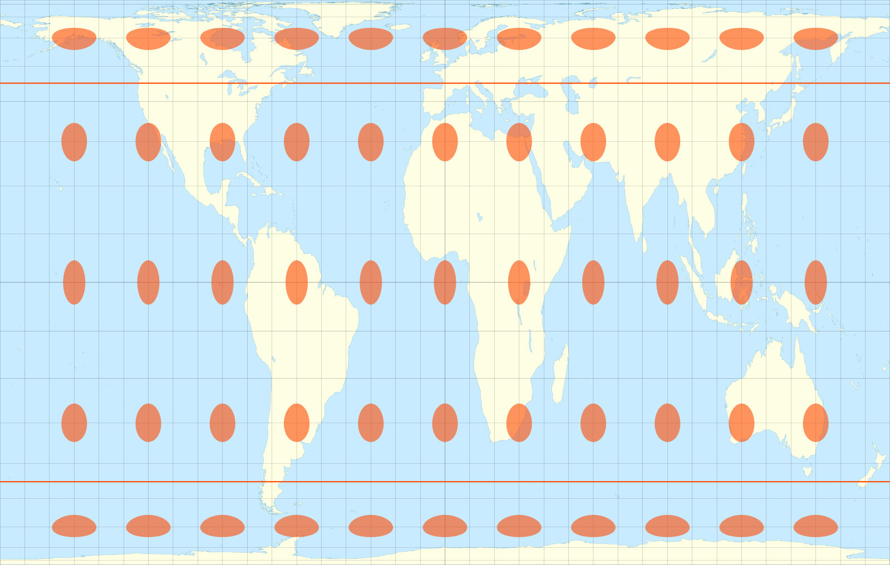{fig-align="center" width="100%"}

**What we see:** Evenly spaced, but circles stretch into ellipses
:::

::: {.column width="50%"}
### Mercator

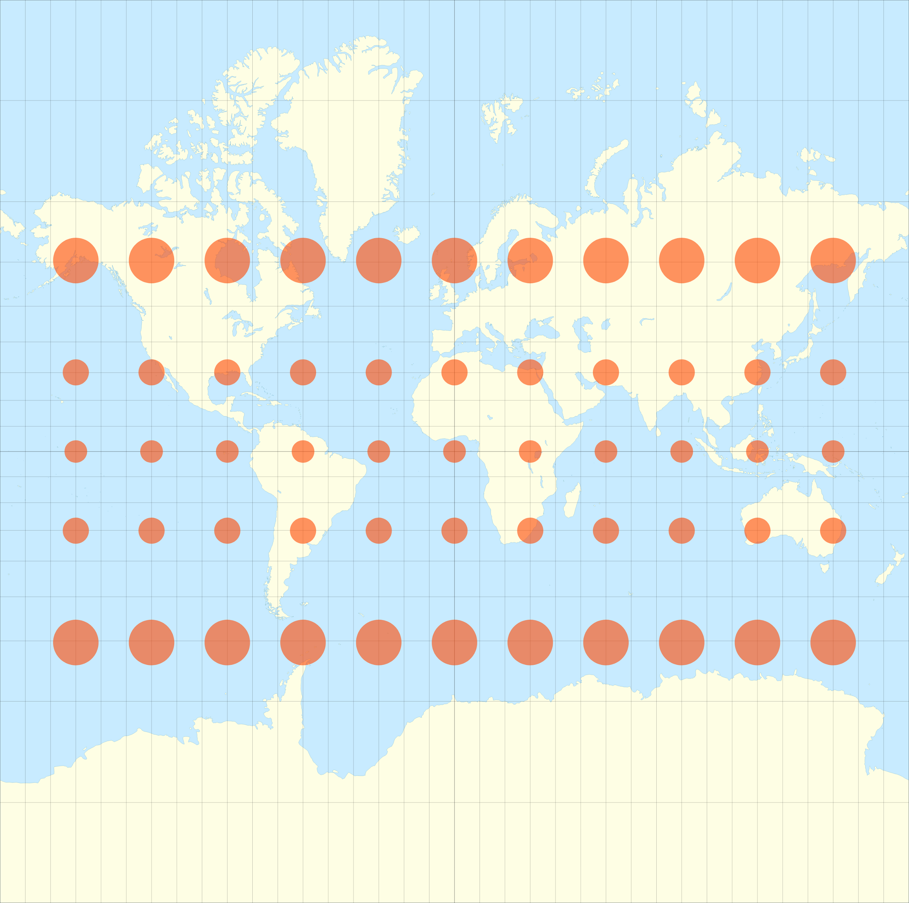{fig-align="center" height="480"}

**What we see:** Same circles, sizes vary dramatically by latitude
:::
:::

::: {.r-fit-text .fragment}
**The same principle applies to data: you must normalize to avoid misleading comparisons.**
:::

::: {.notes}
Be upfront that this slide is an *analogy*, not the same problem. Both maps place identical circles (identical on the globe) on a regular grid. Left: an equirectangular projection keeps the grid even but stretches the circles sideways into ellipses. Right: on Mercator the circles stay round but look vastly different in size: huge near the poles, small at the equator. The point carried over to data: the raw picture reflects something other than what you care about (here, the projection; with raw counts, population), and you have to correct for it, via an equal-area projection in one case and normalization in the other. Don't conflate the two fixes: projection choice is about geometry, normalization is about the data.
:::

# Pitfall 2: Classification (Binning) {background-color="#c23b22"}

## How You Map Values to Color Changes the Story

::: {.columns}
::: {.column width="40%"}
**Same data, same gradient. Only the color stops move.**

- **Min / Max:** color is linear in the value. Honest about size, but skewed data look uniformly pale; only outliers stand out

- **Median, quartiles, deciles:** stops pinned at percentiles. Contrast goes to the crowded 4–8% middle; the map shows **rank**, and outliers disappear

*Continuous scales, not bins. Classing is next.*
:::

::: {.column width="60%"}
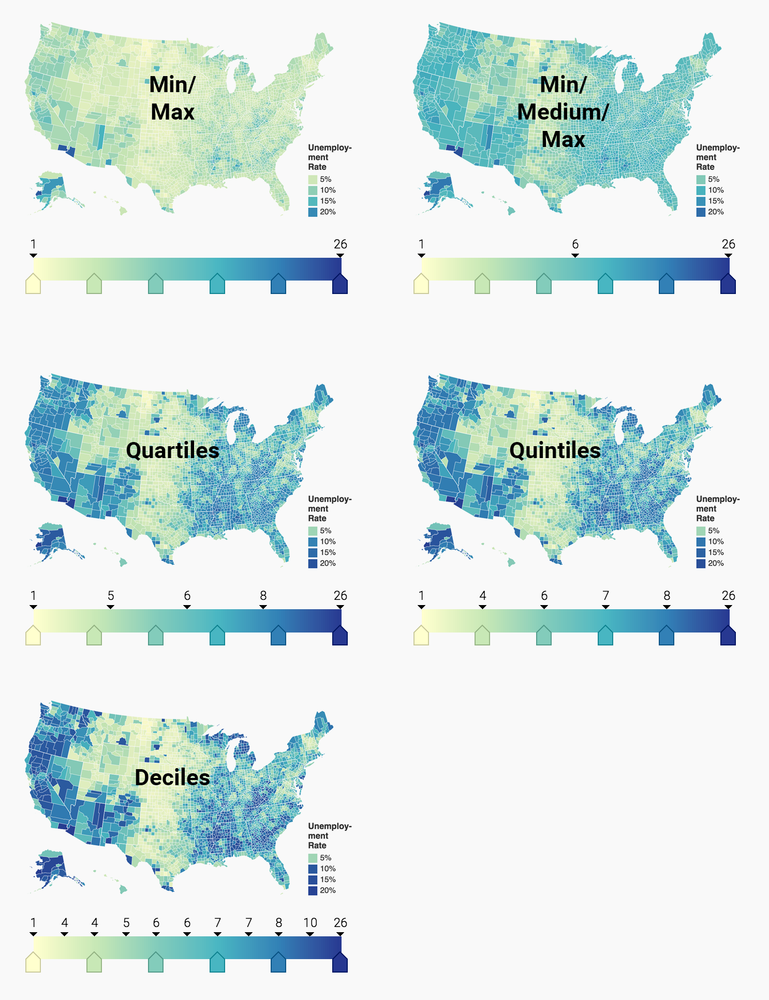{fig-align="center" height="780"}
:::
:::

:::footer
After Muth, L. C. (2022). [How to choose an interpolation for your color scale](https://www.datawrapper.de/blog/interpolation-for-color-scales-and-maps). Datawrapper Blog.
:::

::: {.notes}
Be precise about what this figure is, because the title used to say "bin" and it isn't binning. All five maps use the same continuous yellow-to-blue gradient on the same county unemployment data. Nothing is cut into classes. The only thing that changes is which data value is pinned to which point on the gradient.

How to read a panel: the black triangles above each color bar are the stops, the data values pinned there. The data run from about 1% to 26%, and the median county is about 6%.

- **Min/Max** pins only the ends, so color is linear in the value. Because the data are right-skewed, the median county (6%) sits only a fifth of the way along the ramp. So most of the country is pale, and only the real outliers stand out: the Arizona border, parts of Alaska.
- **Min/"Medium"/Max** (the label means median) pins 6% to the middle color. Half the counties are on each side of the middle hue, and the map turns teal.
- **Quartiles, quintiles and deciles** pin more stops at percentiles. In the deciles bar, ten stops are packed into 4-10% and a single segment covers 10-26%. A county at 8%, two points above the median, is already dark blue and looks almost the same as one at 26%.

So the progression doesn't "reveal" structure for free. It spends the color contrast on small differences in the crowded middle, and the picture shifts from showing how high unemployment is to showing each county's rank. That's why the West Coast and the Southeast seem to light up.

Point at the small legends (5/10/15/20%): the color for 10% changes from pale to dark blue across the panels. Same number, different color, which is the whole lesson in one detail.

Muth's verdict in the Datawrapper article: min/max is "the most honest one because it shows the values on a linear scale and draws immediate attention to the outliers". Percentile stops make differences look "stark in areas where they're actually not stark at all", and the choice is a compromise between truthfulness and usefulness. (The figure is in the style of that article. Its numbers, median 6% and max 26%, don't match the article's 2016 data, so treat the image source as unverified.)

Ask the room: which panel would you show to argue there's an unemployment crisis, and which to argue there isn't?
:::

## BirdVis: The Same Problem, Over Time

**One color range can't serve both dates: 0–0.7 shows May, 0–0.1 shows September.**

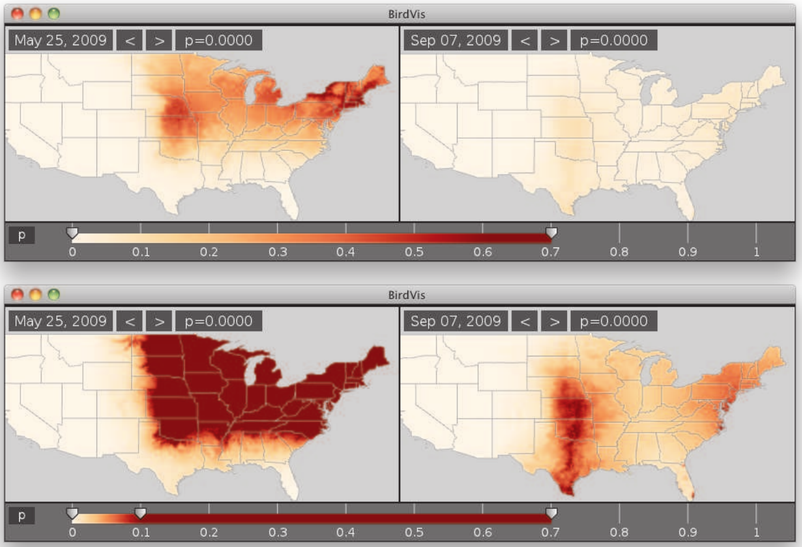{.nostretch height="760" fig-alt="BirdVis occurrence probability for the Baltimore Oriole, May 25 and Sep 7, 2009, under two colormap settings" fig-align="center"}

:::footer
Ferreira et al. (2011). [*BirdVis*](../refs/Ferreira_2011_BirdVis.pdf), IEEE TVCG 17(12), Fig. 3. [doi:10.1109/TVCG.2011.176](https://doi.org/10.1109/TVCG.2011.176)
:::

::: {.notes}
SKIPPABLE - if running long, jump to "Classing: Same Data, Same Colors, Three Breaks".

This is Figure 3 of our BirdVis paper (TVCG 2011), the same stop-placement problem as the previous slide, from the point of view of building a tool. The maps show eBird/STEM model predictions of occurrence probability for the Baltimore Oriole on two dates.

- **Top row:** one sequential colormap from 0 to 0.7. May 25 (breeding season, high probabilities) looks great, with the Northeast and the Plains clearly dark. September 7 (migration, much lower probabilities) is almost blank, because every value is near the pale end.
- **Bottom row:** the same colormap with an extra handle at 0.1, so everything above 0.1 is saturated dark red. September now shows the migration corridor down the Plains to the Texas coast. But May is a solid dark-red block, with all its internal structure lost.

The cause, as the paper explains: during migration fewer birds are reported, so predicted probabilities are much lower than in the breeding season. A single fixed color range throughout the year either washes out one season or saturates the other. The paper notes you *could* design one hand-tuned multi-hue colormap that works for both dates, but it's less intuitive and doesn't generalize to other sub-ranges.

The design answer was interactivity: the colormap widget under the maps is both the legend and a controller, and scientists drag handles, including intermediate ones, to move the stops. That's the same knob as the Datawrapper stops, handed to the analyst.

The lesson for honesty: when stops are adjustable, the legend has to stay visible and truthful. The bottom-row bar shows exactly where the saturation starts.
:::

## Classing: Same Data, Same Colors, Three Breaks

**Five classes each. Only the break values change.**

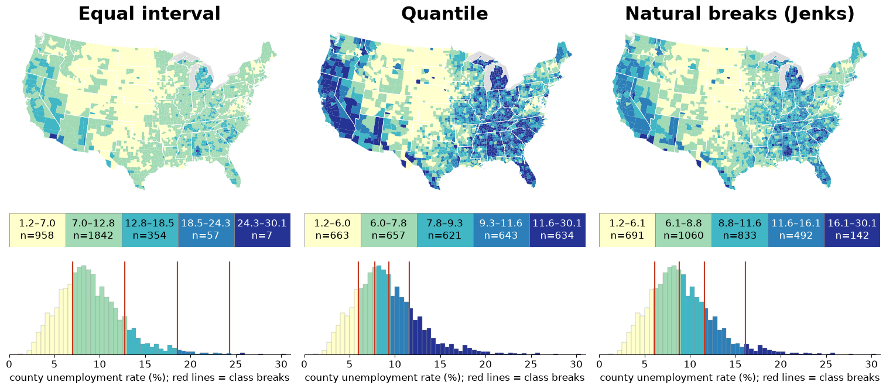{.nostretch height="740" fig-alt="County unemployment rate (≈2009, BLS LAUS) classed three ways; histograms show where each method puts its breaks" fig-align="center"}

:::footer
Data: BLS LAUS county rates (≈2009) via [vega-datasets](https://github.com/vega/vega-datasets); breaks by [mapclassify](https://pysal.org/mapclassify/)
:::

::: {.notes}
SKIPPABLE - if running long, jump to "Classification Methods Compared".

This is the classed (binned) counterpart to the color-stop figure. It uses real data: county unemployment rates from the BLS LAUS program, roughly 2009 levels (3,218 counties, median 8.5%, range 1.2% to 30.1%, right-skewed). Same five ColorBrewer colors in every panel. Under each map, the histogram of all counties is colored by class, and the red lines are that method's breaks. Gray counties have no data. Maps show the lower 48 in an equal-area projection; the breaks use all counties.

- **Equal interval** (breaks every 5.8 points: 7.0, 12.8, 18.5, 24.3): 2,800 of 3,218 counties (87%) fall in the two lightest classes, and the darkest class holds just 7 counties. The map is calm and honest about magnitude, but nearly all the variation sits inside one color.
- **Quantile** (breaks 6.0, 7.8, 9.3, 11.6): about 640 counties per class, so the map uses every color equally and looks dramatic. Look at the class widths, though: the middle class spans only 1.5 points (7.8-9.3), while the top class spans 18.5 points (11.6-30.1). A county at 12% and one at 30% get the same color.
- **Natural breaks (Jenks, computed as Fisher's exact optimum)** (6.1, 8.8, 11.6, 16.1): breaks are placed to minimize within-class variance, so it lands between the two. 142 counties are in the top class.

Jenks is the one method the earlier color-stop figure didn't show. On smooth, unimodal data like this there are no real "natural" gaps, so its breaks are an optimization result, not a discovery. That's the pitfall in the table on the next slide.

Figure generated by `slides/code/week8-classed-maps.py` (downloads its data from vega-datasets 2.8.0).

Same question as before: which map would a campaign use to say unemployment is everywhere, and which to say it's a few isolated places? All three are "correct".
:::

## Classification Methods Compared

| Method | Best For | Pitfall |
|--------|----------|---------|
| **Equal Interval** | Evenly distributed data | Dominated by outliers |
| **Quantile** | Ranking & comparison | Hides natural clustering |
| **Natural Breaks** | Data with natural groups | Can be arbitrary with uniform data |
| **Manual** | Expert knowledge | Subjective, hard to defend |

::: {.fragment}
::: {.callout-important}
## Key Takeaway
There is no single "right" method, but you must be **aware** of your choice and able to **defend** it.
:::
:::

::: {.notes}
Use the table as a reference, not something to read aloud. Practical advice: if the data are skewed, quantile or natural breaks; if you need to compare several maps side by side, use the same fixed breaks on all of them; always show the legend with the actual break values; and when in doubt, try several methods and check whether the story changes. If it does, say so.
:::

# Pitfall 3: Color {background-color="#c23b22"}

## Stop Using Rainbow Color Scales

::: {.columns}
::: {.column width="34%"}
### ❌ BAD: Rainbow

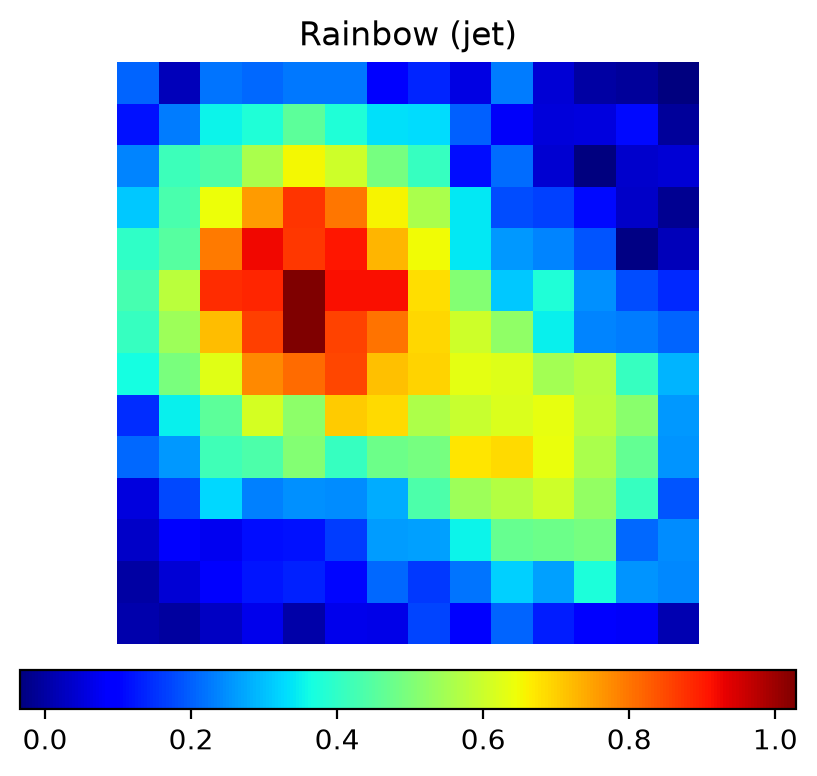{fig-align="center" height="400"}

- Not perceptually uniform
- No intuitive order (is yellow > green?)
- Creates false boundaries
- Misleading visual jumps
:::

::: {.column width="33%"}
### ✓ GOOD: Sequential

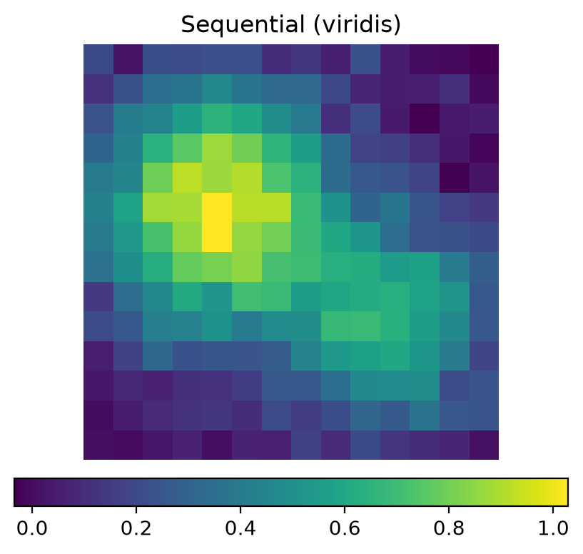{fig-align="center" height="400"}
:::

::: {.column width="33%"}
### ✓ GOOD: Diverging

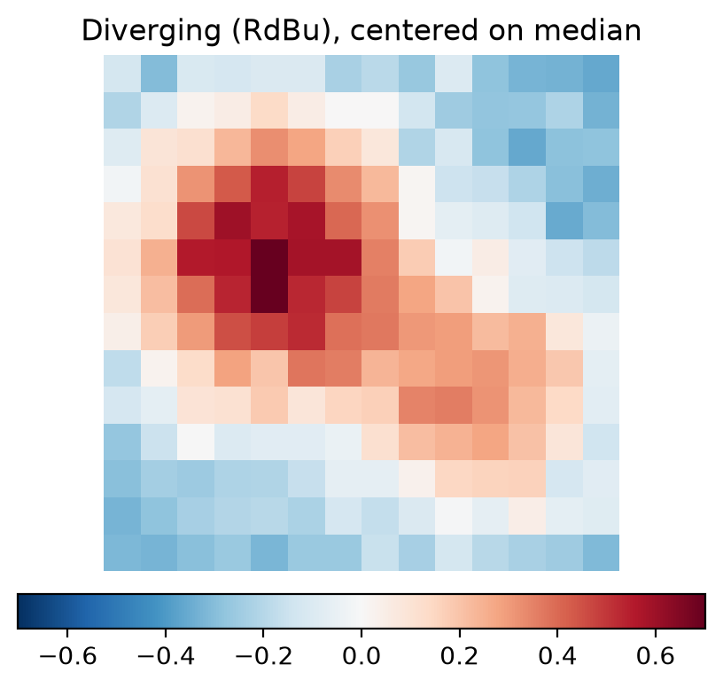{fig-align="center" height="400"}
:::
:::

::: {.notes}
All three maps here use the same synthetic data; only the color scale changes (illustration, not a real dataset). Rainbows are bad for data because they aren't perceptually ordered: is yellow "more" or "less" than green? Brightness goes up and down along the scale, so equal data steps look unequal, and sharp hue changes create apparent boundaries in smooth data. Rainbow scales are also a problem for people with color vision deficiency. On the right, viridis is perceptually uniform and works in grayscale, and the diverging scale is centered on the median so that above and below read as two directions. Connect back to the color lecture from Week 5.
:::

## Real Data: What the Rainbow Hides

**Same county unemployment data, three scales. Bottom row: lightness only.**

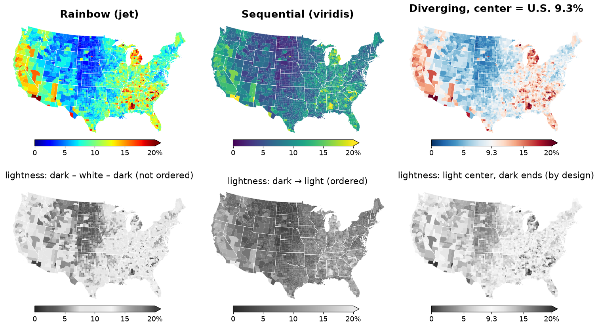{.nostretch height="760" fig-alt="County unemployment rate (≈2009) in rainbow (jet), viridis and a diverging scale centered on the 2009 U.S. rate; bottom row keeps only each map's lightness (CIE L*)" fig-align="center"}

:::footer
Borland & Taylor (2007). [Rainbow color map (still) considered harmful](https://doi.org/10.1109/MCG.2007.323435). IEEE CG&A. Data: BLS LAUS (≈2009)
:::

::: {.notes}
SKIPPABLE - if running long, jump to "Choose the Right Color Scale".

The previous slide used synthetic data. This one uses real data: the same county unemployment rates as the classing slide (BLS, about 2009 levels; 3,218 counties, median 8.5%). All three maps share one range, 0-20% (38 counties above 20% get the top color). The bottom row is the same three maps with hue removed, keeping only CIE L* lightness. That's roughly what a grayscale printout keeps, and lightness is the channel the eye actually uses to read "more vs less".

Read the rainbow column top to bottom:

- **In color, it looks informative and dramatic.** But notice the sharp yellow band and the cyan-to-green transition in the Southeast and Midwest. They look like regional boundaries, yet the data change smoothly there. Those edges come from the colormap, not the data.
- **In lightness, it falls apart.** Jet's lightness rises to almost white at 12.8% and falls again. So North Dakota (median county 3.3%, the lowest in the country) is dark, and the worst-hit counties above 15-20% are also dark. Meanwhile Michigan, at the center of the 2009 auto-industry collapse with a median county at 13.7%, comes out nearly white, the "calmest" state on the map. 28% of all counties sit in the 10-15% band that jet renders near white.

Viridis (middle) is less flashy in color, but its lightness runs steadily from dark to light, so the gray version tells the same story as the color one.

The diverging map (right) answers a different question: above or below the 2009 national rate of 9.3%? Red is above, blue below. Its lightness is light in the middle and dark at both ends by design, so in gray you lose the direction. That's acceptable for a diverging scale as long as hue carries the sign, but it's another reason to use diverging scales only when the midpoint means something, as the next slide says.

Research backs this up. Borland & Taylor (2007) is the classic argument against rainbow colormaps. Liu & Heer's CHI 2018 study "Somewhere Over the Rainbow" measured it: rainbow colormaps did poorly when people judged value differences, and perceptually ordered schemes like viridis did well.

Figure generated by `slides/code/week8-colormap-maps.py`.

Ask the room: on the rainbow map, which state looks worst? Most people say California or the Southeast, because red and orange draw the eye. Then show Michigan in the lightness row.
:::

## Choose the Right Color Scale

::: {.columns}
::: {.column width="50%"}
### Sequential (Light → Dark)

For data from **low to high** with no meaningful middle:

- Population density
- Income levels
- Temperature (0-100°F)

**Examples:** Viridis, Blues, YlOrRd
:::

::: {.column width="50%"}
### Diverging (Color A → Neutral → Color B)

For data with a **meaningful midpoint**:

- Above/below average
- Gain/loss
- Pro/con

**Examples:** RdBu (Red-White-Blue), BrBG, PiYG
:::
:::

::: {.fragment}
::: {.callout-tip}
## Use ColorBrewer
[colorbrewer2.org](https://colorbrewer2.org) provides perceptually-uniform, colorblind-safe palettes
:::
:::

::: {.notes}
Match the scale to the data: sequential when values run low to high, diverging only when there is a meaningful midpoint, and put the midpoint where it means something (zero, the national average) rather than the data median. Avoid diverging scales for plain counts or rates with no natural center. ColorBrewer lets you filter for colorblind-safe palettes, and D3 ships many of the same schemes in d3-scale-chromatic. A quick check: does the map still work printed in grayscale?
:::

# Pitfall 4: Geography (MAUP) {background-color="#c23b22"}

## The Modifiable Areal Unit Problem

::: {.r-fit-text}
**Large, sparse regions visually dominate small, dense regions**
:::

::: {.columns}
::: {.column width="50%"}
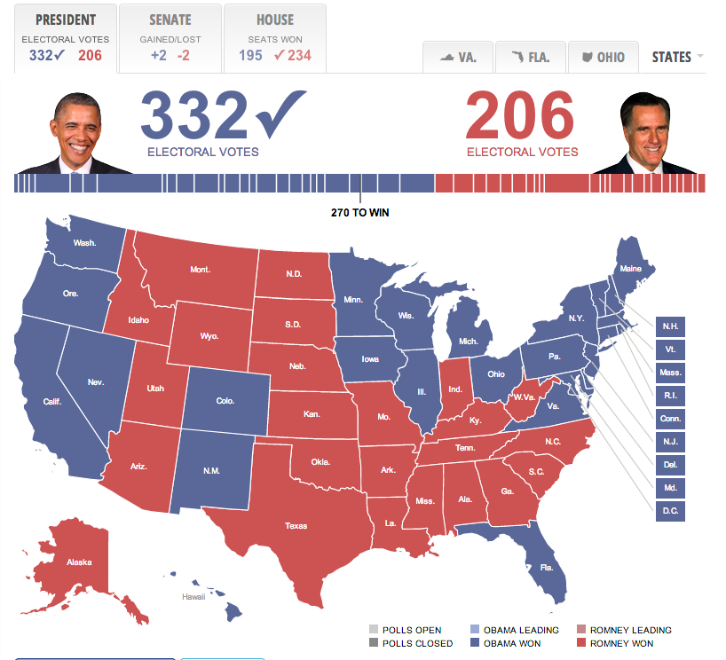{fig-align="center"}
:::

::: {.column width="50%"}
**The Problem:**

- Your eyes are drawn to **area**, not **value**
- Rural counties: few people, huge land area
- Urban counties: millions of people, tiny area
- This map shows **land area** colored by votes, not **votes**
:::
:::

::: {.notes}
This is the fundamental *problem with geography itself*. Our eyes are drawn to *area*, not *value*. This map of the 2016 election is famously misleading. It looks "all red." Why? Because Republican-leaning counties, while sparsely populated, take up a *ton* of land area. The tiny, dense, blue urban counties are almost invisible but contain millions more people. This map isn't a map of *votes*; it's a map of *land area* colored by votes. Terminology note: strictly, the Modifiable Areal Unit Problem (MAUP) is the related finding that patterns change when you change the boundaries or the level of aggregation (counties vs states, or how districts are drawn, as in gerrymandering). What this slide shows is the area-dominance problem, but both come from the same root: the geographic units are arbitrary relative to the phenomenon, and visual weight follows area, not people. Ask which version of the map would change if the county lines moved.
:::

## Solutions to the Geography Problem

::: {.columns}
::: {.column width="33%"}
### ❌ Misleading

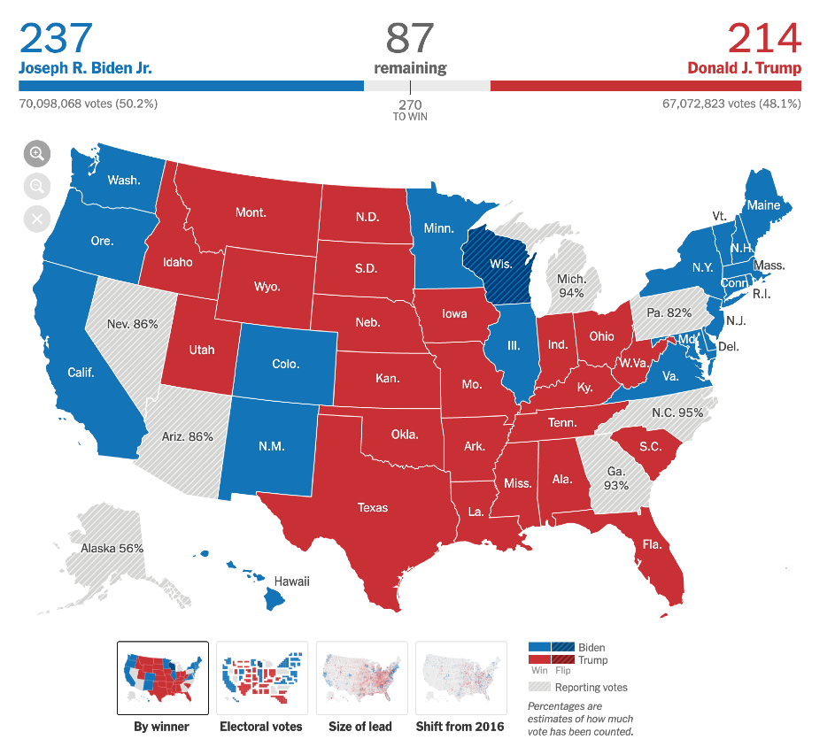{fig-align="center"}

Land area dominates
:::

::: {.column width="33%"}
### ✓ Solution 1: Symbols

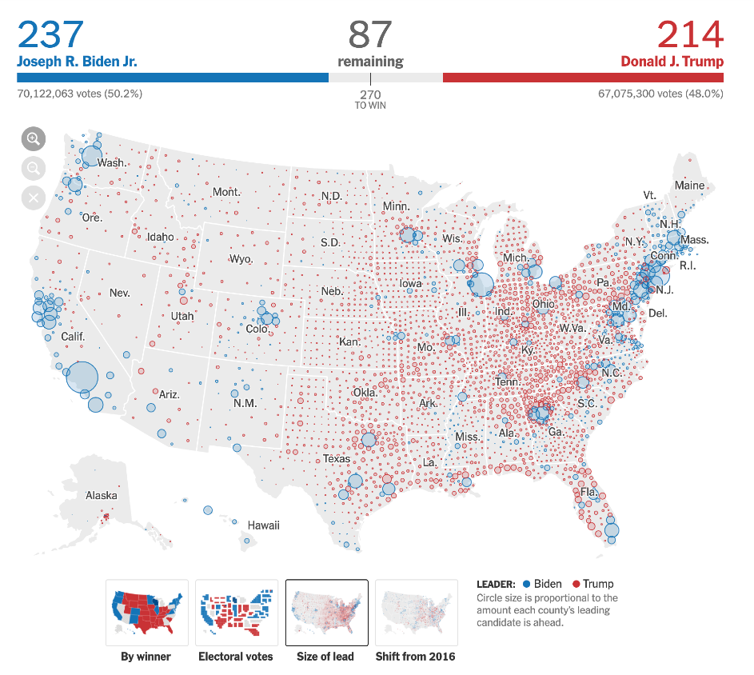{fig-align="center"}

Shows where votes are
:::

::: {.column width="33%"}
### ✓ Solution 2: Cartogram

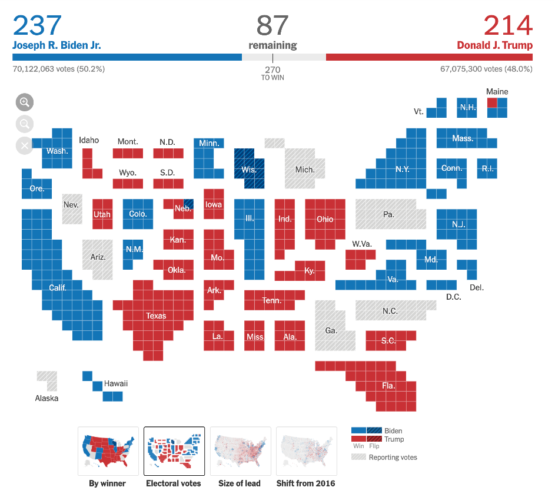{fig-align="center"}

Distorts geography by value
:::
:::

::: {.notes}
How do we *honestly* show the election data? The NYT has great solutions. The symbol map shows *where* the votes are and *how big* the leads are, ignoring the land area. The cartogram *distorts* the geography to make each state's size proportional to its actual power (its electoral votes). Both of these are arguably more "truthful" representations of the election than the standard map. Be fair about the costs: symbol maps overplot in dense regions, and cartograms distort shapes so much that places become hard to find, so they work best when readers already know the geography. There is no free lunch.
:::

## Uniform Cells Instead of Counties: Uber's H3

**Replace arbitrary regions with a grid of equal hexagons: count events per cell.**

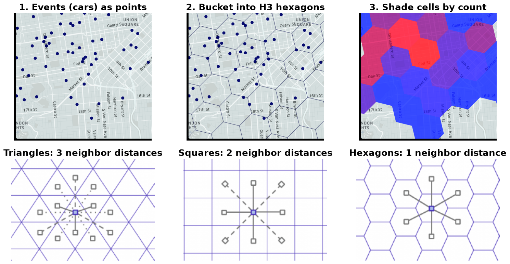{.nostretch height="740" fig-alt="From Uber's H3 post: points bucketed into hexagons and shaded by count; neighbor distances for triangle, square and hexagon grids" fig-align="center"}

:::footer
Figures from Brodsky, I. (2018). [H3: Uber's Hexagonal Hierarchical Spatial Index](https://www.uber.com/us/en/blog/h3/). Uber Engineering Blog. Library: [h3geo.org](https://h3geo.org)
:::

::: {.notes}
SKIPPABLE - if running long, jump to "Part 6: Beyond Geographic Accuracy".

One more answer to the geography problem, the one industry actually uses. Instead of counties, ZIP codes or districts, which vary wildly in size and shape and were drawn for unrelated reasons, cover the map with a grid of equal cells and count events per cell. Then a big cell can't dominate just by being big.

Top row, the workflow from Uber's post (San Francisco): cars as points, the H3 hexagon grid laid over them, then each cell shaded by its count. Uber computes surge pricing exactly this way, by measuring supply and demand in hexagons across each city.

Bottom row, why hexagons rather than squares or triangles. On a triangle grid a cell has neighbors at three different distances, and on a square grid two (edge neighbors vs diagonal neighbors). On a hexagon grid all six neighbors are the same distance from the center. That makes smoothing, "everything within k rings", and movement between cells much simpler. The post also argues that hexagons reduce the error when moving people are snapped to cells.

A few facts worth saying:

- H3 covers the whole globe by projecting from the faces of an icosahedron.
- There are 16 resolutions; each finer one has cells with one seventh the area.
- A pure hexagon tiling of a sphere is impossible, so there are exactly 12 pentagons, placed in the ocean.
- Children are only approximately contained in their parent cell.

Why it belongs under the geography pitfall: it removes the area-dominance problem from the election map. But it doesn't remove the choice of unit size, which is the next slide.
:::

## Same Crashes, Three Cell Sizes

**Change the cell size and the "worst" place moves.**

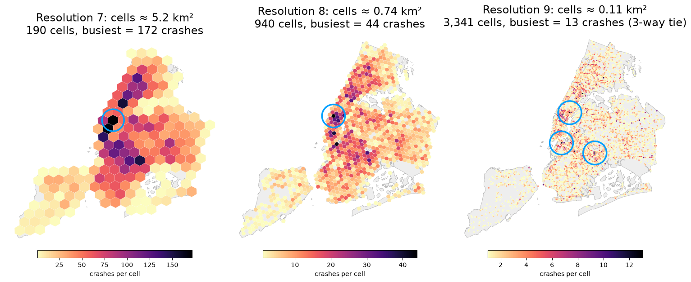{.nostretch height="700" fig-alt="NYC motor-vehicle crashes in September 2025 counted in H3 cells at resolutions 7, 8 and 9; circles mark the busiest cell(s)" fig-align="center"}

:::footer
Data: NYC Open Data, Motor Vehicle Collisions – Crashes (Sept 2025, 7,289 with coordinates); cells via [H3](https://h3geo.org)
:::

::: {.notes}
SKIPPABLE - if running long, jump to "Part 6: Beyond Geographic Accuracy".

This is the real modifiable areal unit problem, which the election slide only gestured at. Same data in all three panels: every crash with coordinates reported in NYC in September 2025 (7,289 crashes, NYC Open Data). Same H3 grid system. Only the resolution changes, each step making cells about seven times smaller. Each panel has its own color scale, because counts per cell aren't comparable across sizes. Blue circles mark the busiest cell(s).

- **Resolution 7** (cells about 5 km², 190 cells): the busiest cell, 172 crashes, is a block of Midtown Manhattan. The story is "Midtown and central Brooklyn".
- **Resolution 8** (about 0.74 km², 940 cells): the busiest cell moves to the west side, around Port Authority (W 42nd St & 9th Ave), with 44 crashes.
- **Resolution 9** (about 0.11 km², 3,341 cells): there's no single worst place. Three cells tie at 13 crashes: the East Side near the Queensboro Bridge approach, Downtown Brooklyn near Tillary St and the Flatbush Ave Extension, and East New York near Atlantic Ave. And 1,536 cells (46%) contain exactly one crash, so the map is dominated by noise.

That's the scale effect of the MAUP: aggregation level changes the answer to "where is it worst?". Too coarse and you average away the specific intersections. Too fine and counts become so small that chance decides the ranking (the small-numbers problem from Pitfall 1). There's also a zoning effect: shift the grid without changing its size and cells split and merge differently.

Practical advice for the mini-project: pick the resolution for the question (a borough-level decision needs coarse cells, a street-safety intervention fine ones), say which you chose, and check that your conclusion survives one level up and one level down. Uber's own post makes the same move: they analyze at several resolutions and use H3's hierarchy to go between them.

Bridge to next week: urban flows are the same problem in motion. Trips are counted from origin cell to destination cell, and the cell size shapes the flow map just as much.

Figure generated by `slides/code/week8-h3-figures.py`.
:::

# Part 6: Beyond Geographic Accuracy {background-color="#2c5f77"}

## Sometimes, the Best Map Abandons Geography

::: {.columns}
::: {.column width="50%"}
### Beck's London Tube Diagram (1933)

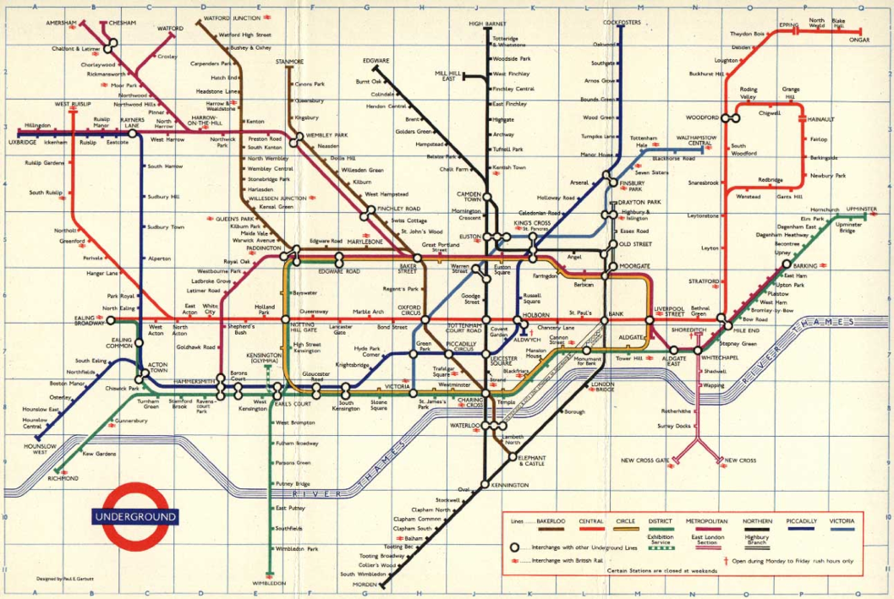{fig-align="center"}
:::

::: {.column width="50%"}
**Geographically "wrong" but topologically "right"**

**What Beck realized:**

- For subway riders, exact geographic paths don't matter
- What matters: sequence of stops and where to transfer

**His innovations:**

- Straightened lines
- Regularized angles (45° or 90°)
- Even spacing between stations
- Prioritized **topology** over **geography**
:::
:::

::: {.notes}
This closes the lecture and bridges to next week. It is one of the most famous and successful visualizations ever made, and it is deliberately *wrong* geographically. Harry Beck, a draughtsman at the Underground, realized that for a rider the *exact* geographic path doesn't matter; what matters is the *sequence of stops* and *where to transfer*. He straightened the lines, restricted angles to 45° and 90°, and spaced the stations evenly. He prioritized *topological* accuracy over *geographic* accuracy, a lesson that applies whenever the task is routing rather than measuring. It also cuts both ways: it is why people famously misjudge walking distances between stations. This is a classic *urban* visualization, which is where we pick up next time.
:::

## Bridge to Next Lecture: Urban Visualization

::: {.incremental}
- Today: **Geographic maps** (accurate spatial representation)
- Next week: **Urban visualizations** (prioritize usability and patterns)
- Week 10: **3D city models & simulation** (linking 3D form with 2D data views)
:::

::: {.fragment}
The tube map is our bridge: it shows that **sometimes the most effective visualization deliberately distorts reality** to better serve the user's task.
:::

::: {.notes}
Quick orientation: today the map as a static, accurate artifact; next week urban data with flows, time and interactivity (brushing and linking at scale); the week after, 3D city models and simulation. The tube map is the hinge: today's rules (equal-area, normalize, honest bins) are about being faithful to geography, while next week the question becomes what to distort or abstract so that people can do their task.
:::

# Summary & Key Takeaways {background-color="#2c5f77"}

## Five Critical Lessons

::: {.incremental}
1. **Use a map only when the spatial question matters**
   - Bar charts are better for ranking and lookup

2. **Projections always distort—choose wisely**
   - Equal-area for choropleths (if you shade areas)

3. **NEVER use raw counts on choropleths**
   - Always normalize: per capita, density, or rate

4. **Choose classification and colors carefully**
   - Binning method changes the story
   - Sequential vs. diverging scales

5. **Geography itself can mislead (MAUP)**
   - Consider symbols, cartograms, or other encodings
:::

## Be a Critical Consumer

::: {.columns}
::: {.column width="50%"}
**When you see a map, ask:**

- What's the projection?
- Is it normalized?
- What's the classification method?
- What's the color scale?
- Is land area misleading the message?
:::

::: {.column width="50%"}
**When you make a map, remember:**

- Is a map the right choice?
- Have I used equal-area projection?
- Have I normalized my data?
- Are my bins defensible?
- Are my colors perceptually uniform?
:::
:::

::: {.fragment}
::: {.r-fit-text}
**Next Time:** Urban Visualization: Flows, Time & Interactivity
:::
:::

::: {.notes}
So, to recap: be skeptical. When you see a map, ask these questions. What's the projection? Is it normalized? What's the binning? What's the color scale? Next time, we apply these fundamentals to the complex, dynamic world of urban data, where flows, time and interactivity become essential. Remind them that Mini-project 1 (geographic visualization) starts today and is due Nov 5, and that the lab today is on plotting and troubleshooting GeoJSON with D3. Questions?
:::

# Further Reading {background-color="#2c5f77"}

## Essential Resources

### Choropleth Map Best Practices
- [**Datawrapper Guide to Choropleth Maps**](https://www.datawrapper.de/blog/choroplethmaps)
  - Comprehensive guide to creating effective choropleth maps
  - Covers normalization, classification, and color choices
  - Practical examples and common pitfalls

### When Not to Use Maps
- [**When Maps Shouldn't Be Maps**](https://www.ericson.net/content/2011/10/when-maps-shouldnt-be-maps/) by Matthew Ericson (NYT)
  - Critical discussion of map vs. alternative visualizations
  - Real-world examples from data journalism
  - Decision framework for choosing visualization types

### Interactive Tools
- [Tissot's Indicatrix Explorer](https://mgimond.github.io/tissot/) - Interactive projection distortion
- [The True Size Of...](https://thetruesize.com/) - Drag countries to see size changes

# Acknowledgments {background-color="#2c5f77"}

## Course Materials

This lecture was developed using materials from:

- **Prof. Enrico Bertini** (NYU Tandon)
  - Visualizing Geographical Data lecture slides
  - Information Visualization course materials

- **Prof. Jeff Heer** (University of Washington)
  - CSE512: Data Visualization course
  - Maps and Cartography lecture materials

::: {.notes}
Special thanks to Professors Bertini and Heer for their excellent foundational materials on geovisualization, which served as the basis for this lecture.
:::

# SUPPLEMENTAL MATERIAL {background-color="#4a5568"}

## Implementation & Tooling

::: {.notes}
The following slides are optional supplemental material on data formats, classification methods, and practical coding examples, bridging the concepts to implementation. Skip them in class unless time allows or students ask; the lab covers the D3 side.
:::

# Part 7: When to Use a Map? {background-color="#2c5f77"}

## The Fundamental Question

::: {.r-fit-text}
**Not all geographical data needs a map.**
:::

::: {.fragment}
### The Trade-off

Maps use the `x` and `y` spatial dimensions to encode **geography**.

This means `x` and `y` **cannot** be used to encode other data variables (unlike a bar chart or scatterplot).
:::

::: {.fragment}
**So when is a map the right choice?**
:::

::: {.notes}
This is the most fundamental question in geovisualization. Just because your data has geographic attributes doesn't mean you must use a map. Remember: maps lock up your two most powerful visual channels—position x and position y—for geography alone.
:::

## When to Use a Map: Decision Framework

::: {.columns}
::: {.column width="50%"}
### ✓ Good Use: Spatial Questions

::: {.incremental}
- "How are these phenomena **clustered**?"
- "What is **near** this location?"
- "How does this value change **continuously** over a region?"
- "Where is the **path** from A to B?"
- "What are the **boundaries** between regions?"
:::

**Use a map when:** The spatial relationship is the question.
:::

::: {.column width="50%"}
### ✗ Bad Use: Aggregate Comparisons

::: {.incremental}
- "Which state has the **highest** value?"
- "What are the **top 5** regions?"
- "How do these **rank**?"
:::

**Use a bar chart when:** You need precise comparisons or rankings.

**Why?** Maps introduce **area bias**—Montana looks more "important" than Rhode Island simply due to land area.
:::
:::

::: {.notes}
Ask yourself: Is the user trying to understand WHERE something happens, or HOW MUCH? If it's purely "how much," a sorted bar chart will almost always be clearer and more honest than a map.
:::

# Part 8: Geographic Data Formats {background-color="#2c5f77"}

## GeoJSON: The Web Standard

**GeoJSON** is the *lingua franca* of web mapping.

::: {.incremental}
- It's a JSON format that describes geographic features
- Human-readable and machine-parsable
- Supported by nearly all modern mapping libraries
:::

::: {.fragment}
### Key Components

- `FeatureCollection`: A list of all features
- `Feature`: A single geographic "thing" (park, city, road)
- `geometry`: The shape (`Point`, `LineString`, `Polygon`)
- `properties`: Non-spatial data (name, population, ID)
:::

::: {.notes}
GeoJSON has become the de facto standard for web mapping because it's simple, readable, and works seamlessly with JavaScript. You'll see it everywhere in modern geovisualization.
:::

## GeoJSON Structure: Example

```{.json code-line-numbers="|2|5|9-12|18-24|30-37"}
{
  "type": "FeatureCollection",
  "features": [
    {
      "type": "Feature",
      "properties": {
        "name": "NYU Bobst Library",
        "type": "Library"
      },
      "geometry": {
        "type": "Point",
        "coordinates": [-73.997421, 40.729454]
      }
    },
    {
      "type": "Feature",
      "properties": { "name": "W 4th Street", "type": "Street" },
      "geometry": {
        "type": "LineString",
        "coordinates": [
          [-74.000277, 40.731868],
          [-73.997873, 40.731557]
        ]
      }
    },
    {
      "type": "Feature",
      "properties": { "name": "Washington Square Park" },
      "geometry": {
        "type": "Polygon",
        "coordinates": [
          [
            [-73.999, 40.732], [-73.996, 40.732],
            [-73.996, 40.730], [-73.999, 40.730],
            [-73.999, 40.732]
          ]
        ]
      }
    }
  ]
}
```

::: {.notes}
Notice the three geometry types here: Point for a location, LineString for a path or street, and Polygon for an area. Each feature has properties that store the actual data you want to visualize.
:::

## TopoJSON: Optimized Geography

**TopoJSON** is an optimized version of GeoJSON.

::: {.columns}
::: {.column width="50%"}
### Key Advantages

- **Compressed**: Much smaller file sizes
- **Topology-aware**: Stores shared boundaries only once
- **Better for web**: Faster downloads and parsing

### The Insight

Instead of storing the border between Colorado and Utah **twice**, TopoJSON stores the arc **once** and notes it's shared by both states.
:::

::: {.column width="50%"}
### When to Use

- Large geographic datasets (countries, states)
- Web applications (file size matters)
- When features share boundaries

### Tools

- **MapShaper**: Convert, simplify, and edit
- **topojson-client**: Convert back to GeoJSON
:::
:::

::: {.notes}
TopoJSON can reduce file sizes by 80% or more for datasets like US state boundaries. The trade-off is that you need to convert it back to GeoJSON before most libraries can use it, but this is trivial with tools like topojson-client.
:::

# Part 9: Data Classification Methods {background-color="#2c5f77"}

## The Binning Problem

For **choropleth maps**, how you "bin" your data into color classes can **completely change the story**.

::: {.fragment}
{fig-align="center" height="620"}
:::

::: {.fragment}
::: {.r-fit-text}
**Same data. Different bins. Different conclusions.**
:::
:::

::: {.notes}
This is one of the most critical decisions you'll make when creating a choropleth map, yet it's often done automatically by software with no thought. The figure is the same one from the Classification pitfall in Part 5: county unemployment (about 2009), five colors, and breaks from equal interval, quantile and Jenks. If Part 5 ran long and you skipped it there, this is the place to walk through it. Equal interval puts 87% of counties in the two lightest classes; quantile gives every class about 640 counties, but its top class spans 11.6-30.1%; Jenks lands in between. Use the histograms to show where each method draws its lines. Then the next slide defines the three methods.
:::

## Classification Methods Compared

### Equal Interval
Divides the **range** into equal-sized steps (e.g., 0-10, 10-20, 20-30).

- ✓ Easy to understand and explain
- ✗ **Problem:** Outliers can skew all data into one or two bins

### Quantile (Equal Count)
Puts the **same number** of data points in each bin.

- ✓ Good for showing relative **ranking**
- ✗ **Problem:** Can be misleading if values are naturally clustered

### Jenks Natural Breaks
Finds "natural" clusters/gaps in the data using statistical optimization.

- ✓ Often the most **honest** default
- ✗ **Problem:** Can be arbitrary if data is uniformly distributed

::: {.notes}
There is no single "right" method. Equal Interval is good for data with a meaningful zero and regular intervals (like temperature). Quantile is good for highly skewed data where you want to emphasize differences. Jenks tries to find natural groupings and is a good starting point for most cases.
:::

## Choosing Your Classification

| Method | Best For | Watch Out For |
|--------|----------|---------------|
| **Equal Interval** | Evenly distributed data; meaningful intervals | Outliers dominating the map |
| **Quantile** | Ranking; highly skewed data | Hiding natural clustering; arbitrary bin edges |
| **Jenks Natural Breaks** | Data with natural groups/gaps | Uniform data; hard to explain to audience |
| **Manual** | Expert knowledge; specific breakpoints | Subjectivity; cherry-picking |

::: {.callout-important}
## Key Takeaway
Always **justify** your choice. Show the data distribution (histogram) and explain why your classification makes sense for your story.
:::

# Part 10: Practical Implementation with Leaflet.js {background-color="#2c5f77"}

## Leaflet.js: Simple Web Mapping

**Leaflet** is a lightweight, open-source JavaScript library for interactive maps.

::: {.incremental}
- **Simple API**: Easy to learn, powerful results
- **Tile-based**: Handles the "slippy map" (zoom, pan) automatically
- **Extensible**: Plugins for everything from clustering to heat maps
- **Perfect for**: Adding interactive maps to web applications
:::

::: {.fragment}
**Let's build a simple example using our NYU GeoJSON data.**
:::

::: {.notes}
Leaflet is probably the most popular web mapping library for good reason—it's simple, well-documented, and "just works." We're going to walk through a minimal example that you can adapt for your own projects.
:::

## Leaflet: HTML Setup

```{.html code-line-numbers="|2-3|6-8|11-13"}
<!-- 1. Include Leaflet CSS & JS from a CDN -->
<link rel="stylesheet"
      href="https://unpkg.com/leaflet@1.9.4/dist/leaflet.css"/>
<script src="https://unpkg.com/leaflet@1.9.4/dist/leaflet.js"></script>

<!-- 2. Style the map container to fill the screen -->
<style>
    #map { height: 100vh; }
</style>

<!-- 3. Create the map div -->
<body>
    <div id="map"></div>
</body>
```

::: {.notes}
That's it for the HTML. Three simple steps: include the library, style your container, and create a div. The library will take care of the rest.
:::

## Leaflet: Initialize the Map

```{.javascript code-line-numbers="|2|5-8"}
// 1. Initialize the map and set view [lat, long], zoom
const map = L.map('map').setView([40.7308, -73.9973], 14);

// 2. Add a tile layer (the base map)
L.tileLayer('https://{s}.tile.openstreetmap.org/{z}/{x}/{y}.png', {
    attribution: '&copy; OpenStreetMap contributors',
    maxZoom: 19
}).addTo(map);
```

::: {.notes}
Line 2 creates the map object and centers it on NYU's campus at zoom level 14. Lines 5-8 add the base map tiles from OpenStreetMap. These tiles are the actual street map imagery you see.
:::

## Leaflet: Add GeoJSON Data

```{.javascript code-line-numbers="|2|5-14|16-22"}
// 3. Define our GeoJSON data
const myGeoJSON = { /* ... from example.geojson ... */ };

// 4. Add GeoJSON layer to the map
L.geoJSON(myGeoJSON, {
    // For each feature, bind a popup with its name
    onEachFeature: function (feature, layer) {
        if (feature.properties && feature.properties.name) {
            let popup = '<h4>' + feature.properties.name + '</h4>';
            popup += '<p>' + feature.properties.description + '</p>';
            layer.bindPopup(popup);
        }
    }
}).addTo(map);

// Points, lines, and polygons are automatically styled
// Click any feature to see its popup
// Pan and zoom the map to explore
```

::: {.notes}
The magic happens here. L.geoJSON takes our GeoJSON data and automatically renders it—points become markers, lines become paths, polygons become shapes. We're using onEachFeature to bind a popup to each feature so users can click to see details.
:::

## Live Demo

::: {.r-fit-text}
**Let's see it in action!**
:::

Open: `examples/leaflet_example.html`

::: {.incremental}
- Base map tiles loading
- Pan and zoom controls
- GeoJSON features rendered:
  - **Point**: NYU Bobst Library (red circle)
  - **LineString**: W 4th Street (blue line)
  - **Polygon**: Washington Square Park (green area)
- Click any feature to see its popup
:::

::: {.notes}
Instructor should open the HTML file in a browser now. Show: (1) the base tiles, (2) pan/zoom, (3) the three geometry types rendered, (4) click a feature to show popup. Emphasize how little code this took—maybe 30 lines total.
:::
