# From Static Maps to Dynamic Urban Systems {background-color="#2c5f77"}

## The Yellow Blob Problem

::: {.columns}
::: {.column width="40%"}
**What happens when we apply static techniques to massive urban datasets?**

::: {.fragment}
This is **one week** of NYC taxi trips (about 3.5 million) drawn as points on a map.
:::

::: {.fragment}
**What can you learn from this?**

Nothing. It's a "yellow blob."
:::
:::

::: {.column width="60%"}
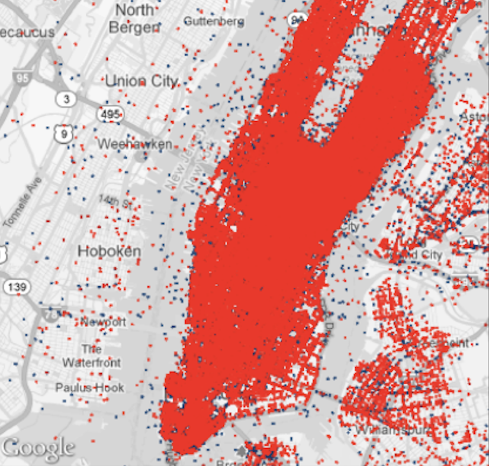{fig-align="center" height="760"}
:::
:::

::: {.notes}
Welcome back. Last time, we learned the rules of static 2D maps. Today we dive into *urban* data. This is what happens when you apply a static technique, drawing every trip as a point, to a massive dataset: it is only one week of taxi trips, about 3.5 million of the more than 540 million in the full data set, and every pixel in Manhattan is already covered. Pickups are blue and dropoffs are red, but you cannot tell. What can you learn from this? Nothing. It's a "yellow blob" (a red one here). The problem isn't the data, it's the *lack of interactivity*. Today is about moving from static pictures to *exploratory tools*.
:::

## Today's Goal

::: {.r-fit-text}
Learn to visualize urban **dynamics**—movement and time—using interactive, linked views
:::

::: {.incremental}
- **Challenge:** Urban data is massive, dense, and dynamic
- **Solution:** Turn visualization into an exploration tool
- **Case Study:** TaxiVis—a system for exploring NYC taxi flows
:::

::: {.fragment}
We'll learn how to move from this "yellow blob" to meaningful insights about urban mobility patterns.
:::

::: {.notes}
Set expectations for the day. The arc is: the problem (urban data is big, dense and dynamic), the approach (visual queries plus linked views that let a domain expert ask their own questions), and then a long case study, TaxiVis, that shows the approach working on real New York City data. The case study has four stories: social inequality in taxi service, transportation hubs, time patterns such as Memorial Day, and Hurricane Sandy. Everything we do with taxis transfers to bikes, 311 calls, transit and other urban data, so treat TaxiVis as a worked example of a design process rather than a taxi tool.
:::

---

# Part 1: The Urban Context {background-color="#2c5f77"}

## Why This Matters

::: {.columns}
::: {.column width="50%"}
### The Urban Challenge:

- Over 50% of world's population in cities
- **+2.5 billion more by 2050**
- Cities = centers of innovation
- But also: sprawl, pollution, inequality

::: {.fragment}
**How do we make better decisions about urban development?**
:::
:::

::: {.column width="50%"}
### The Data Opportunity:

::: {.incremental}
- We can now collect, store, and **open** massive urban datasets
- Benefits:
  - **Government:** Operations & planning
  - **Science:** Discovery
  - **Residents:** Participation
  - **Industry:** Innovation
:::
:::
:::

::: {.notes}
Before the how, the why. More than half of the world's population now lives in cities, and the United Nations projects roughly 2.5 billion more urban residents by 2050. Cities are centers of innovation, but also of sprawl, pollution and inequality, so better decisions about urban development matter. The trend toward open data means we can now collect, store and publish massive urban datasets, and the benefits are different for each group on the right: governments get better operations and planning, scientists get discovery, residents get participation, and industry gets innovation. The catch, and the reason for this lecture, is that this data is large and complex enough that traditional analysis tools struggle with it.
:::

## What Makes Urban Data Unique?

::: {.columns}
::: {.column width="50%"}
### Three Interacting Components:

1. **Residents** - People and their behavior
2. **Infrastructure** - Physical systems and policies
3. **Environment** - Natural and built surroundings

::: {.fragment}
To understand a city, we must explore how these interact over **space** and **time**.
:::
:::

::: {.column width="50%"}
### Four Key Characteristics:

::: {.incremental}
1. **Scale**
   - Human-level to metro-level
   - Millions of individual events

2. **Density**
   - Massive overplotting
   - Traditional techniques fail

3. **Complexity**
   - Interconnected systems
   - Transit, traffic, social networks

4. **Dynamism**
   - Cities defined by time & movement
   - Static snapshots miss the essence
:::
:::
:::

::: {.notes}
Urban data is not just big data; it has particular structure. To understand a city you have to look at three interacting components, residents, infrastructure and environment, and how they affect each other over space and time. On the right are four characteristics that make that hard. Scale: from individual people to the whole metro area, with millions of events. Density: so many points that overplotting hides everything, which is exactly the yellow blob we saw at the start. Complexity: transit, traffic and social networks are interconnected. Dynamism: a city is defined by movement and time, so any single static snapshot misses the essence. Ask the class which of the four they think is hardest for a visualization to handle.
:::

## Hägerstrand's Space-Time Cube (1970)

::: {.columns}
::: {.column width="40%"}
**The Classic Framework for Movement Analysis**

- X, Y dimensions: Geographic space
- Z dimension: Time
- Each person's life: a line through the cube

::: {.fragment}
**The Urban Challenge:**

Understanding *millions* of these paths, all interacting simultaneously
:::
:::

::: {.column width="60%"}
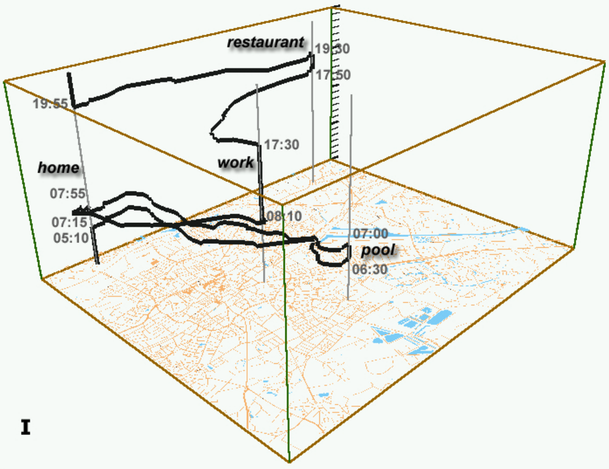{fig-align="center" width="100%"}
:::
:::


::: {.notes}
The classic framework for movement is Hägerstrand's space-time cube from the 1970s: the floor is geographic space, the vertical axis is time. The figure shows one person's day as a single path: at the pool around 06:30-07:00, home, then work around 08:10 until 17:30, the restaurant from about 17:50 to 19:30, and home again at 19:55. Flat stretches are people staying put; steep stretches are moving. Your life is one line in this cube. Urban visualization is about millions of these lines interacting, which is why a single static 2D map fails.
:::

---

# Part 2: Why Traditional Analysis Fails {background-color="#2c5f77"}

## The Old Workflow (Confirmatory Data Analysis)

::: {.columns}
::: {.column width="60%"}
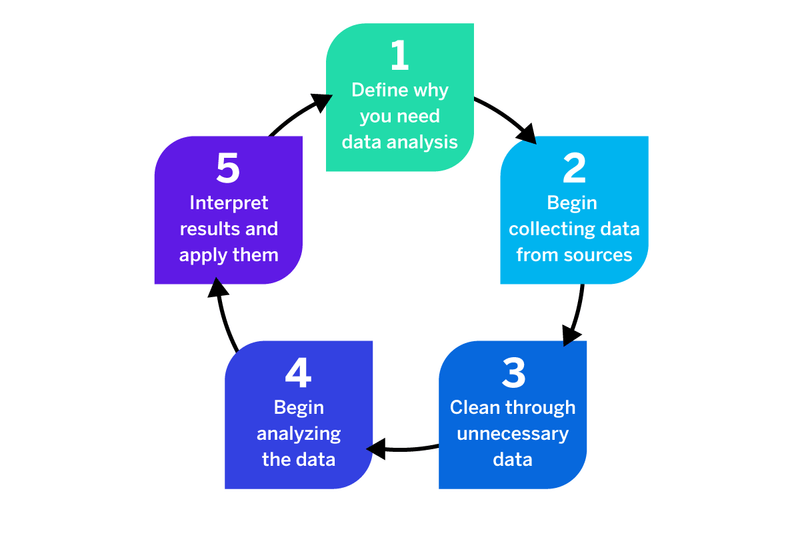{fig-align="center" width="100%"}
:::

::: {.column width="40%"}
### The Loop:

1. Define why you need the analysis
2. Collect data from sources
3. Clean away unnecessary data
4. Analyze the data
5. Interpret the results and apply them

::: {.fragment}
Every new question is **another trip around the loop**.
:::
:::
:::

::: {.notes}
This is the traditional workflow, drawn here as a generic five-step cycle. A domain expert (say, a traffic engineer) has a hypothesis and hands it to a data scientist, who selects data, runs analyses in SQL, R or Python, and returns plots and tables. The expert inspects them and the loop repeats. It is confirmatory: you decide the question first and test it. Notice that every follow-up question ("what about Saturdays?") is a whole new trip around the loop.
:::

## The Problems with Traditional Workflows

::: {.incremental}
❌ **Cognitive overload** - Generates overwhelming numbers of plots/tables

❌ **Batch-oriented** - No exploration, just predetermined queries

❌ **Distances experts from data** - Requires intermediary (data scientist)

❌ **Cannot scale** - Modern data volumes overwhelm traditional tools

❌ **Result:** The "yellow blob" problem
:::

::: {.fragment}
::: {.r-fit-text}
**Even simple questions require generating dozens of individual plots, each manually programmed**
:::
:::

::: {.notes}
This is how urban data analysis has traditionally worked—and why it doesn't work anymore. Even simple questions require generating dozens of individual plots, each manually programmed. The lack of interactivity means you can't follow up on interesting patterns. Domain experts who understand cities are separated from the data by data scientists. This process simply cannot scale to hundreds of millions of trips.
:::

## The Problem with Current Tools

::: {.columns}
::: {.column width="50%"}
### Current practice for domain experts:

- Load small slices into R, MATLAB, Stata, ArcGIS, Excel
- Write SQL queries or code to analyze subsets
- Generate individual plots manually
- Repeat for each new question

::: {.fragment}
**This is tedious, slow, and limiting**
:::
:::

::: {.column width="50%"}
### Why this fails:

❌ Tools can't handle 170M trips

❌ Requires programming/database expertise

❌ Time-consuming and frustrating

❌ Distances experts from the data

❌ Hard to explore, compare, or follow up on patterns
:::
:::

::: {.notes}
This is what the researchers found when they interviewed domain experts. The common tools, R, MATLAB, Stata, ArcGIS and Excel, cannot handle the full data set, so experts first select small slices and load those, which is tedious and time consuming. Even then they must write SQL or code, and in ArcGIS that means constructing SQL-like queries, which is out of reach for scientists without database training. They generate individual plots by hand and repeat the whole process for each new question. The consequence on the right is that experts end up distanced from their own data, and it is hard to explore, compare or follow up on a pattern that looks interesting.
:::

---

# Part 3: The Need for Interactivity {background-color="#2c5f77"}

## The Paradigm Shift

::: {.columns}
::: {.column width="50%"}
### Static Visualization

**Role:** Presentation

- Answers questions the designer anticipated
- Fixed perspective
- One-way communication

::: {.fragment}
**Limitation:** Cannot handle hundreds of millions of data points
:::
:::

::: {.column width="50%"}
### Interactive Visualization

**Role:** Exploration

- Enables users to ask their own questions
- Dynamic perspectives
- **"Dialogue with data"**

::: {.fragment}
**Power:** Query and filter to reveal patterns
:::
:::
:::

::: {.notes}
Contrast the two roles of visualization. A static picture is a presentation: the designer already decided what matters. An interactive visualization is an instrument: the user chooses the questions. The limitation on the left is the point of today: no static figure can show hundreds of millions of points. Keep this contrast in mind for the rest of the term, including the Libra and gulfs-of-execution material from Week 7.
:::

## The Visual Information Seeking Mantra

::: {.r-fit-text}
**"Overview first, Zoom and Filter, then Details-on-Demand"**
:::

::: {.fragment}
— Ben Shneiderman (1996)
:::

::: {.columns .fragment}
::: {.column width="33%"}
### 1. Overview

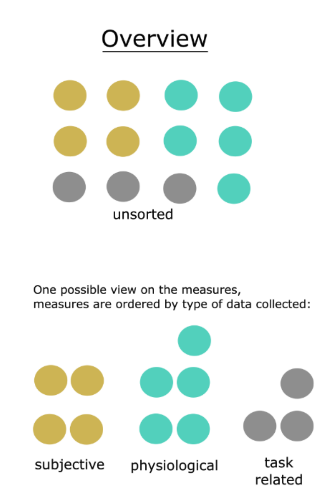{fig-align="center" height="480"}

Start with the big picture (even if it's a "yellow blob")
:::

::: {.column width="33%"}
### 2. Zoom & Filter

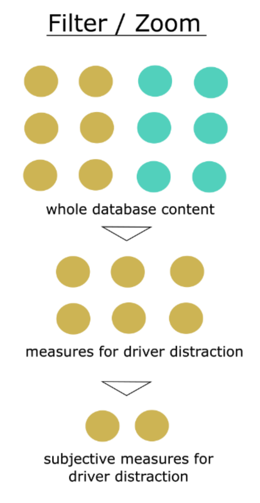{fig-align="center" height="480"}

Focus on items of interest
:::

::: {.column width="33%"}
### 3. Details-on-Demand

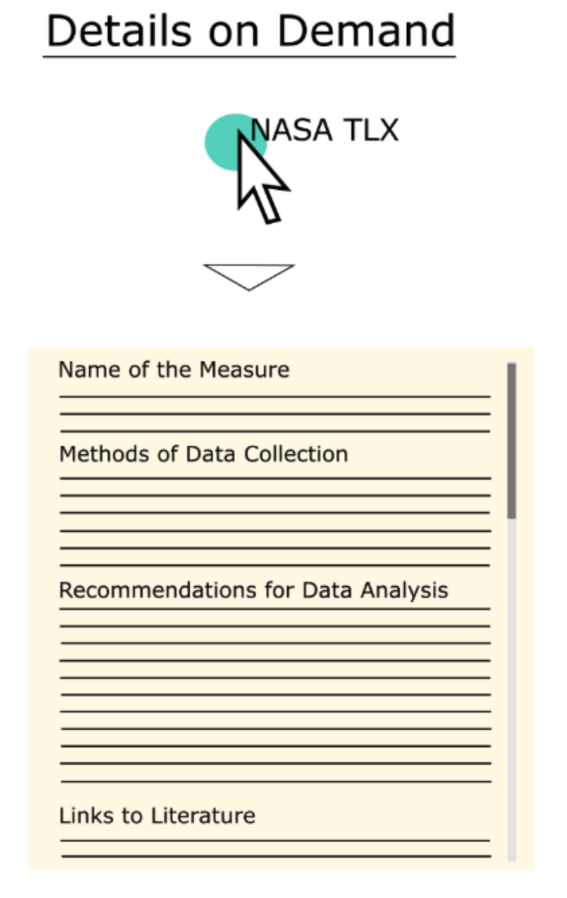{fig-align="center" height="480"}

Get specifics when needed
:::
:::

::: {.footer}
Illustrations from a catalogue of driver-distraction measures (not TaxiVis); Shneiderman, B. (1996). [*The Eyes Have It*](../refs/Shneiderman_1996_The_Eyes_Have_It.pdf). IEEE Symposium on Visual Languages.
:::

::: {.notes}
The three pictures come from a different domain, a catalogue of measures used in driver-distraction research, but they show the mantra cleanly: an overview of everything (first unsorted, then grouped by type), a filter that narrows the whole database to the measures you care about, and details on demand when you pick one item (here NASA TLX). In TaxiVis the same three steps look like this: the citywide map and time series is the overview, drawing regions and setting the time window is the filter, and the scatter plots and per-trip attributes are the details. The "yellow blob" is not useless, it is just the first step.
:::

## Why Interactivity Matters

::: {.incremental}
1. **Performance is critical**
   - Even **500ms latency** significantly reduces exploration, observations, and hypothesis generation
   - Sub-second response enables iterative analysis

2. **Perception over cognition**
   - Well-designed systems let you **see** patterns rather than calculate them
   - Visual queries are faster than SQL

3. **Empowers domain experts**
   - No programming required
   - Direct manipulation of visualizations
   - Experts can explore data themselves
:::

::: {.fragment}
Research shows that even a half-second delay dramatically impacts analysis quality.
:::

::: {.notes}
Two facts to land. First, latency matters: even a half-second delay measurably reduces how much people explore and how many hypotheses they form (Liu and Heer's work on latency in exploratory analysis is the standard reference). Second, a visual query uses perception instead of cognition: you see the pattern instead of computing it. That is why TaxiVis needed a custom index, which we get to in Part 10.
:::

---

# Part 4: Enter TaxiVis {background-color="#2c5f77"}

## The NYC Taxi Dataset

::: {.columns}
::: {.column width="50%"}
### The Data:

- **13,000 taxis**
- **500,000 trips/day**
- **170 million trips/year**

### Each trip includes:

- Pickup/dropoff locations & times
- Distance traveled
- Fare amount
- Tip amount
:::

::: {.column width="50%"}
### What can taxi data tell us?

::: {.incremental}
- Economic activity and human behavior
- Mobility patterns across the city
- Response to major events (hurricanes, holidays)
- Social inequalities in service
:::

::: {.fragment}
**Challenge:** How do we make sense of this data?
:::
:::
:::

::: {.notes}
Quick scale check, from the paper: about 13,000 taxis carry over a million passengers a day, making roughly 500,000 trips, over 170 million a year. The data, provided by the NYC Taxi and Limousine Commission, covers all medallion trips in 2009, 2011 and 2012: about 120 GB of CSV and over 540 million trips. Each record has pickup and dropoff time and place, distance, fare, tip and toll, plus anonymized taxi and driver ids. Note what is not recorded: the trajectory. Only the start and end of each trip are known, so this is origin-destination data. The right-hand list is why it matters beyond taxis: taxis are sensors of city life. Ask the class what they would want to know before showing the tool.
:::

## Taxi Patterns and Anomalies

**One dataset shows weekly rhythm, holiday dips, storms and street events.**

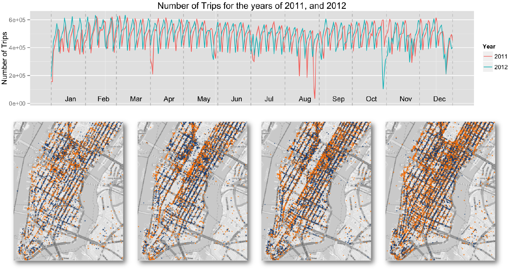{fig-align="center"}

::: {.notes}
Top: daily trip counts for 2011 (red) and 2012 (teal), from the paper. The strong weekly sawtooth is the regular pattern, and the two years are nearly identical; there are substantial drops on Thanksgiving, Christmas and New Year's Eve. The big downward spikes are anomalies: Hurricane Irene in August 2011 and Hurricane Sandy in October 2012. Bottom: four map snapshots of taxi density in Manhattan from 7 AM to 11 AM on May 1, 2011. From 8 to 10 AM taxis disappear along 6th Avenue, from Midtown to Downtown, and at 10 AM they reappear: the streets were closed for the Five Boro Bike Tour. A taxi data set is a sensor for city life, and this is too complex for a one-off script.
:::

---

# Part 5: Design Requirements {background-color="#2c5f77"}

## What We Need (From Domain Experts)

::: {.columns}
::: {.column width="50%"}
### Query Needs:

::: {.incremental}
1. **Understand dynamics**
   - "How do patterns vary over space and time?"

2. **Explore events**
   - "What happened during Hurricane Sandy?"

3. **Compare regions**
   - "Midtown vs. Harlem taxi frequency?"

4. **Study movement**
   - "Where do people go from JFK?"
:::
:::

::: {.column width="50%"}
### System Requirements:

::: {.incremental}
- **Interactive** - Sub-second response times
- **Expressive** - Support complex spatio-temporal queries
- **Usable** - No SQL or programming required
- **Scalable** - Handle all 170M trips, not samples
- **Comparative** - Easy to compare regions and time periods
:::
:::
:::

::: {.notes}
These requirements came from interviews with five NYU researchers, two traffic engineers and three economists. Their questions fall into four groups: understand the dynamics of the city over space and time, explore particular events such as a hurricane, compare regions, and study movement, for example where people go from an airport. The system requirements follow from those needs. It has to be interactive with sub-second response, expressive enough for complex spatio-temporal queries, usable by people with no computer science training, scalable to the whole data set rather than samples, and good at comparison. Note the tension: simple enough for non-programmers, yet expressive enough for real analysis. That tension is the design challenge for the rest of the lecture.
:::

---

# Part 6: The Visual Query Model {background-color="#2c5f77"}

## Core Idea: Direct Manipulation

::: {.r-fit-text}
**Let users query data through direct manipulation of visualizations**
:::

::: {.columns .fragment}
::: {.column width="33%"}
### Spatial

**Where?**

- Pickup regions
- Dropoff regions
- Draw polygons on map
:::

::: {.column width="33%"}
### Temporal

**When?**

- Time ranges
- Recurrence patterns
- Day of week
:::

::: {.column width="33%"}
### Attribute

**What?**

- Fare amount
- Distance
- Trip duration
:::
:::

::: {.fragment}
Instead of writing `SELECT * FROM trips WHERE...`, you **draw on a map**
:::

::: {.notes}
The core idea of the visual query model is that users query the data by directly manipulating visualizations. There are three kinds of constraint. Spatial: where, using pickup or dropoff regions drawn as polygons on the map. Temporal: when, using time ranges, recurring patterns and days of the week. Attribute: what, using ranges of fare, distance or trip duration. Instead of writing SELECT ... WHERE, you draw on the map and set a time window. The next slide shows how a query is represented on screen, and the slides after that show the actual interface. Remind students of Shneiderman's direct manipulation and of the gulfs of execution and evaluation from Week 7: a visual query shortens both.
:::

## Visual Representation of Queries

::: {.columns .smaller}
::: {.column width="50%"}
### A query is a set of colored constraints

- **Polygon** on the map = a spatial constraint (start or end region)
- **Arrow** between regions = a directional constraint (origin → destination)
- **Time widget** = a temporal constraint
- **Attribute ranges** = fare, distance, duration
:::

::: {.column width="50%"}
### Color ties it together

- Each query has its **own color**
- That color tags the query's line in every chart
- A query can be a **union** of simpler ones, for example a polygon plus an arrow
- To compare, put several queries in the same view
:::
:::

::: {.notes}
Here is the vocabulary before we see the screen. A query is built out of colored constraints: a polygon on the map says "trips that start (or end) here", an arrow says "trips that go from here to there", the time widget says "during this window", and attribute ranges say "with this fare or duration". Each query gets a color, and that color follows the query into every chart. On the next slide you will see three queries at once: orange is a start-region query, red is an end-region query, and blue is a union of a start polygon and an arrow.
:::

---

# Part 7: TaxiVis Interface {background-color="#2c5f77"}

## The Complete System

::: {.columns}
::: {.column width="40%"}
- **A. Time widget:** start, end, step size; regular or recurrent selection
- **B. Map:** draw polygons and arrows
- **C. Tool bar:** pickups / dropoffs / both, arrows, group, export, attribute exploration
- **D. Data summary:** time series, histogram or scatter plot, one line per query
:::

::: {.column width="60%"}
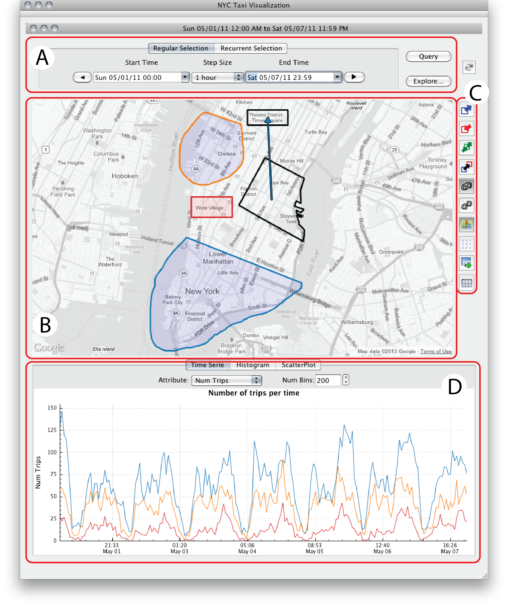{height="760" fig-align="center"}
:::
:::

::: {.footer}
Ferreira, N., Poco, J., Vo, H. T., Freire, J., & Silva, C. T. (2013). Visual exploration of big spatio-temporal urban data: A study of New York City taxi trips. IEEE TVCG. [doi:10.1109/TVCG.2013.226](https://doi.org/10.1109/TVCG.2013.226)
:::

::: {.notes}
This is our main case study. It looks busy, but it is four simple parts linked together: (A) the time selection widget, (B) the map, (C) the tool bar, and (D) the data summary below. The tool bar lets you choose whether queries use pickups, dropoffs or both, create directional queries (arrows), group and ungroup regions, export results as CSV, and open the attribute view. The figure shows three queries at once. The orange polygon is a start-region query, the red polygon is an end-region query, and the blue query is the union of the blue start polygon and a directional query (the blue arrow). Each query's color reappears as a line in the chart at the bottom. The magic is not in any one component, it is in how they are connected.
:::

---

# Part 8: Visual Queries in Action {background-color="#2c5f77"}

## Example: Airport Comparison

**"How do trips from Manhattan to JFK and LaGuardia differ on a Sunday vs. a Monday?"**

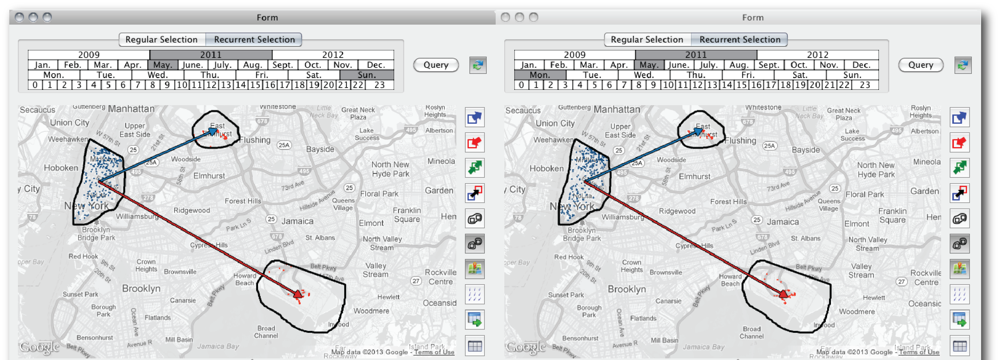{fig-align="center"}

::: {.notes}
This is Figure 1 of the paper. The visual query: draw one polygon in Manhattan (the start region), then two airport polygons, and connect them with arrows, a blue arrow to LaGuardia and a red arrow to JFK. Then set the time: the left window uses Recurrent Selection to pick Sundays in May 2011, the right window picks Mondays. The two windows are identical except for the day of the week. Writing this in SQL means two joins and a day-of-week filter per airport. The paper's caption describes the plot colors by the arrows; on the figure the red arrow ends at the JFK polygon and the red dots are the longer trips, so I read red as JFK.
:::

## The Results & Discovery

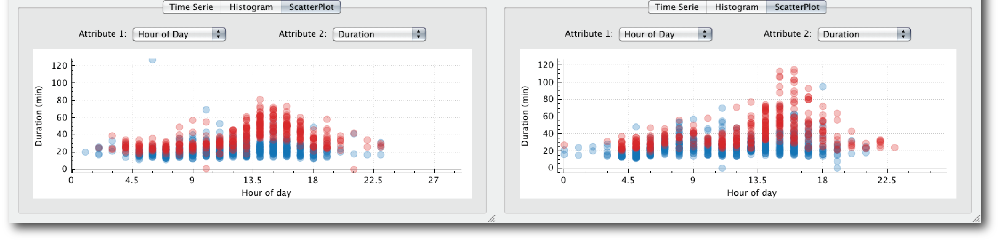{.nostretch fig-align="center" width="90%"}

::: {.incremental}
- Each dot is a trip: hour of day vs. duration, colored like the arrows (red = JFK, blue = LGA)
- **Discovery:** Monday afternoon trips to JFK are much longer, with the longest reaching about 110 minutes vs. about 80 on Sunday
- **Implication:** an economic disincentive for drivers to accept airport trips
:::

::: {.notes}
Read the plot: x is hour of day, y is trip duration in minutes. Red dots (JFK) climb through the afternoon on both days, but on the Monday the cloud is taller and wider around 3 to 5 PM, with the longest trips around 110 minutes against about 80 on the Sunday. That is rush hour: a driver who takes a fare to JFK at that time may be stuck for an hour or more, which is an economic reason drivers prefer not to take airport trips then. We will see the same pattern again in the transportation hub case study.
:::

---

# Part 9: Query Expressiveness {background-color="#2c5f77"}

## Peuquet's Triad Framework

::: {.r-fit-text}
**All three fundamental spatio-temporal query types:**
:::

::: {.columns}
::: {.column width="33%"}
### when + where → what

"What taxis were in Midtown at rush hour?"
:::

::: {.column width="33%"}
### when + what → where

"Where were high-fare trips on New Year's Eve?"
:::

::: {.column width="33%"}
### where + what → when

"When do trips to airports peak?"
:::
:::

::: {.fragment}
### Plus: Query Composition

- Queries can be **refined, combined, compared**
- Results can be visualized multiple ways
- Supports both atomic queries and complex queries (unions)
:::

::: {.notes}
This slide is about expressiveness: can the model ask every kind of spatio-temporal question? Peuquet's typology says there are three fundamental query classes, built from the triad of when, where and what. Given when and where, what was there: which taxis were in Midtown at rush hour. Given when and what, where: where were the high-fare trips on New Year's Eve. Given where and what, when: when do trips to airports peak. The paper shows the visual query model supports all three. The second half of the slide is composition: queries can be refined, combined and compared, and results can be shown in several visual forms, so the model covers both simple atomic queries and complex unions of them. It is more than a pretty interface; it is expressive enough to ask questions that would be difficult even for a database expert.
:::

---

# Part 10: Making It Interactive {background-color="#2c5f77"}

## The Performance Challenge

::: {.columns}
::: {.column width="50%"}
### The Problem:

- 170M trips = traditional databases too slow
- **PostgreSQL:** 24 seconds for 100k-trip query
- **SQLite:** 85 seconds for same query
- **Goal:** Sub-second response
:::

::: {.column width="50%"}
### The TaxiVis Solution:

::: {.incremental}
- Custom **k-d tree index**
  - 30GB vs. 200GB for PostgreSQL
  - Build time: 28 min vs. 13 hours
- **Query time:**
  - 2 seconds for 100k trips
  - 0.2s for 1k trips
- Adaptive level-of-detail rendering
- Smart heat maps and aggregation
:::
:::
:::

::: {.notes}
This is critical: without interactive performance the visual model does not work. You cannot explore if you are waiting 30 seconds for every query. The numbers are Table 1 of the paper: for a query returning about 100,000 trips, SQLite took 85 s and PostgreSQL 24 s against 2 s for the custom index; for about 1,000 trips, 8 s, 3 s and 0.2 s. The custom k-d tree index needs 30 GB and builds in 28 minutes for three years of data; PostgreSQL used 200 GB and 13 hours, and SQLite took 52 hours just to index a single year. Complex queries such as recurrent time selections could take minutes in the databases.
:::

---

# Part 11: Visualization Techniques {background-color="#2c5f77"}

## The "Yellow Blob" Rendering Problem

::: {.columns}
::: {.column width="40%"}
### The Challenge:

- 500,000 trips/day as a point cloud = complete clutter
- Can't see patterns, just noise
- Traditional scatter plots fail at this scale

**We need multiple visualization strategies**
:::

::: {.column width="60%"}
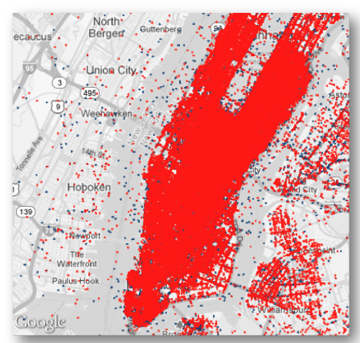{fig-align="center" height="760"}
:::
:::

::: {.notes}
Remember our opening slide? This is what happens when you draw all the points naively: Manhattan is a solid red mass, and the only structure you can see is where the points spill over into Queens and Brooklyn. Every pixel is covered, so you learn almost nothing. This is the fundamental big-data rendering problem. The next three slides give three answers: sample smartly, aggregate into a density, and aggregate by region.
:::

## Solution 1: Adaptive Level of Detail (LOD)

::: {.columns}
::: {.column width="40%"}
### Strategy: Render only what you can see

- Sort points along a **Z-order curve**, build a binary tree
- The first *n* elements are a hierarchical subsample of size *n*
- *n* scales with the zoom level

**Result:** a readable sample at every zoom level
:::

::: {.column width="60%"}
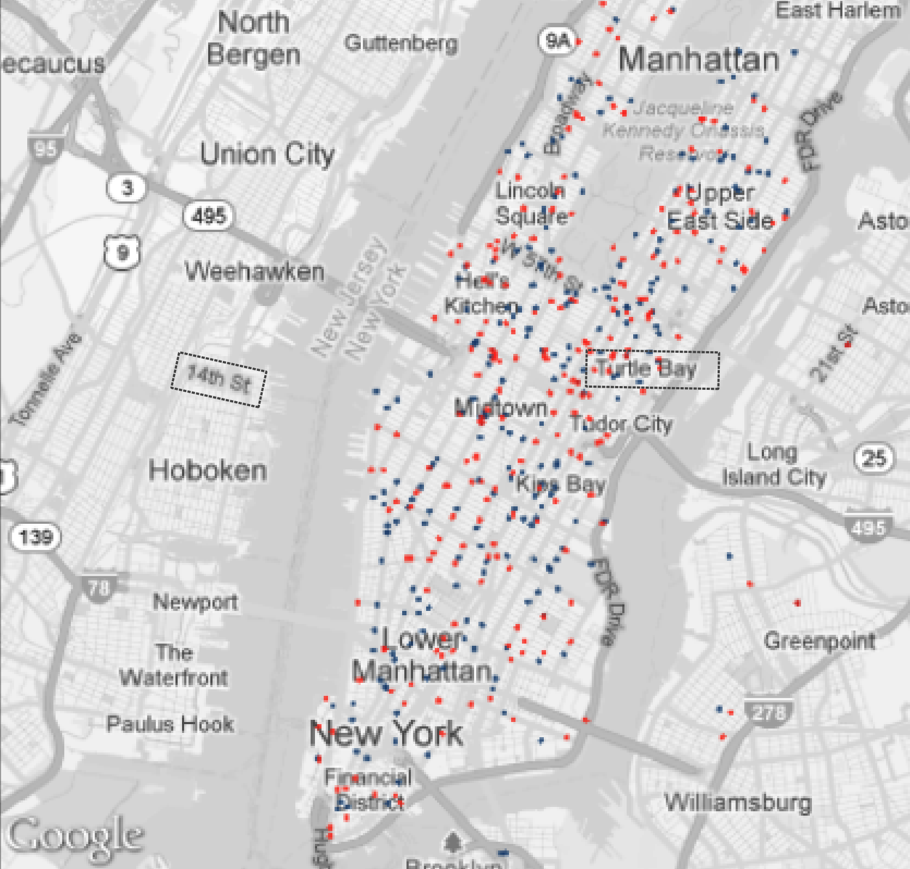{fig-align="center" height="760"}
:::
:::

::: {.notes}
Level of detail: draw only as many points as the screen can show. The key word is hierarchical: the points are sorted along a Z-order (space-filling) curve so that any prefix of the list is a spatially even sample, not a random one. As you zoom in, n grows and more detail appears; zoomed out you get a representative sample. Compare with the previous slide: same trips, now readable. The dotted boxes are placeholders for labels the renderer is avoiding.
:::

## Solution 2: Heat Maps and Neighborhood Maps

::: {.columns}
::: {.column width="50%"}
### Continuous Heat Maps

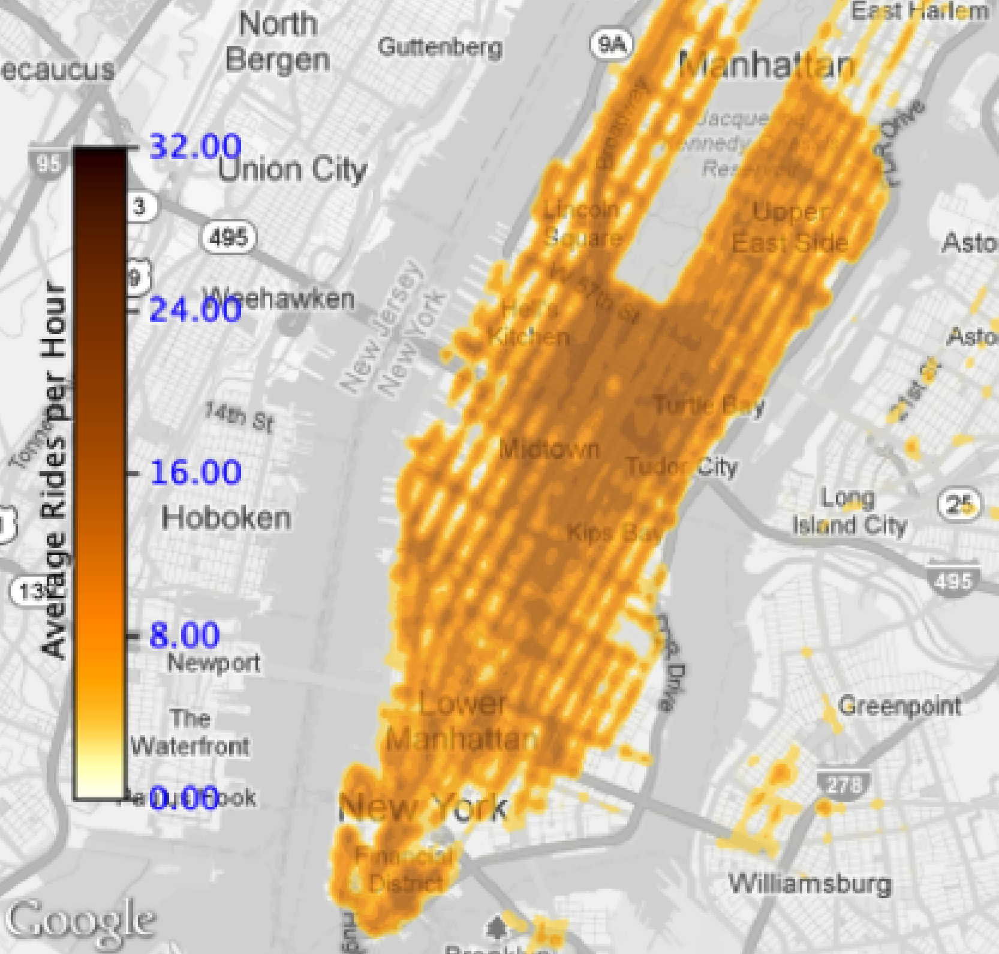{fig-align="center" height="480"}

- Pixel-based density, darker = more activity
- Shows the overall distribution
:::

::: {.column width="50%"}
### Neighborhood Maps

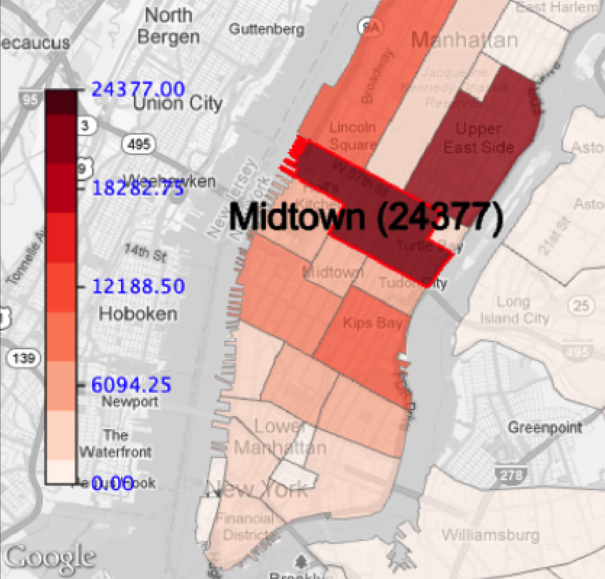{fig-align="center" height="480"}

- Aggregate by meaningful regions
- Select a region to read its exact count
:::
:::

::: {.fragment}
**When to use:** heat maps for overview and patterns, LOD for individual trips, neighborhood maps for comparing defined regions
:::

::: {.notes}
Two more ways to avoid the blob by aggregating. The heat map on the left is a continuous density: darker means more average rides per hour (the legend runs from 0 to 32). It shows the shape of activity but not which neighborhood. The map on the right aggregates by region, a choropleth: here the selected Midtown region shows 24,377 trips. This is exactly the classing and MAUP territory from last week: the answer depends on where the boundaries are drawn.
:::

## Solution 3: Multiple Coordinated Views

::: {.columns}
::: {.column width="40%"}
### The Comparison Problem:

- "How do Sundays differ from Mondays?"
- "JFK vs. LGA patterns?"
- "This year vs. last year?"

### Solution:

- Side-by-side views
- Each view = one query (color-coded)
- Synchronized spatial extent
- Linked plots and summaries
- Interactive refinement
:::

::: {.column width="60%"}
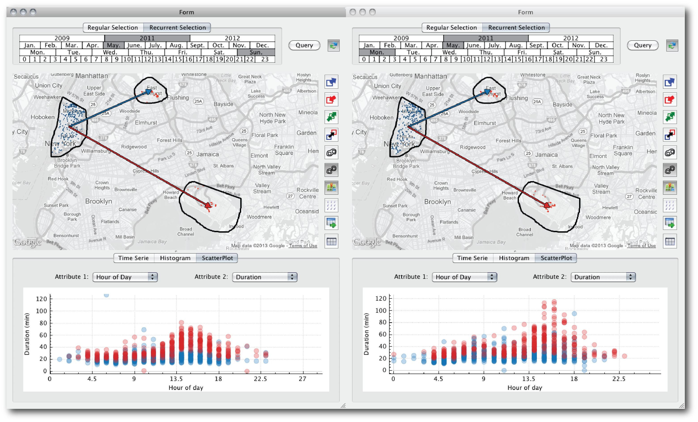{fig-align="center" width="100%"}
:::
:::


::: {.notes}
This is where the visual query model really shines: you are not just looking at data, you are comparing queries side by side. The figure is the Sunday versus Monday airport comparison again: two windows, each one query, synchronized in structure so differences are visible at a glance. Each view is one query, color-coded, and the plots link back to the map. Doing this with a general-purpose tool means building two separate charts by hand.
:::

---

# Part 12: Linked Views & Brushing {background-color="#2c5f77"}

## Core Concept: Brushing and Linking

::: {.r-fit-text}
**Actions in one view are reflected in all other views**
:::

::: {.fragment}
This creates a "dialogue" where you can ask questions by interacting with any visualization component, and all views update to answer your question.
:::

::: {.fragment}
### Example: Spatial Selection → Temporal Pattern

"What is the temporal pattern for trips from JFK Airport?"
:::

::: {.notes}
Define the two words precisely. Brushing is the act of selecting something in one view, for example dragging a region on the map. Linking is the system propagating that selection so every other view shows the same subset. The result is a dialogue: you ask a question by interacting with any visualization component, and all the views update to answer it. The example is spatial to temporal: select the area around JFK and every time chart redraws to show only the temporal pattern of JFK trips. This is the interaction idea underneath the whole TaxiVis interface, and it is also the idea behind the coordinated views you will build in this week's lab with D3.
:::

## Linked Views in Action: Regions on the Map, Lines in the Chart

:::: {.columns}
::: {.column width="50%"}
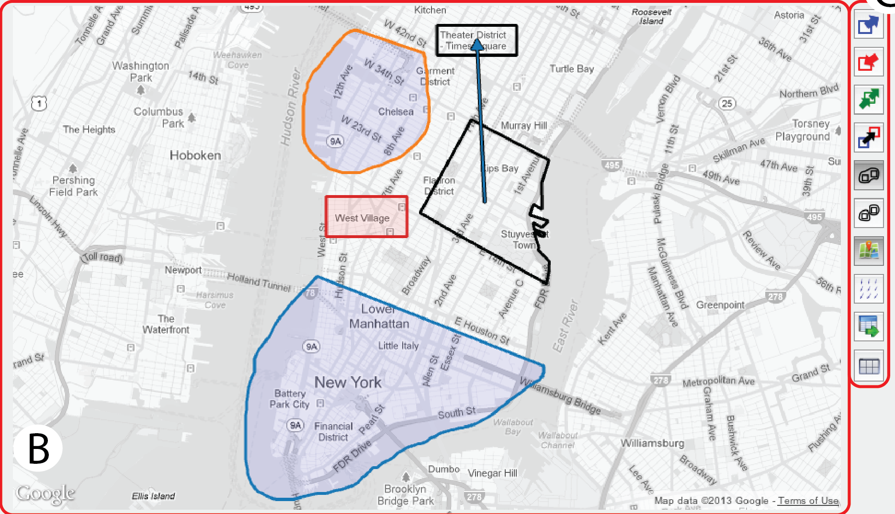{width="100%" fig-align="center"}
:::
::: {.column width="50%"}
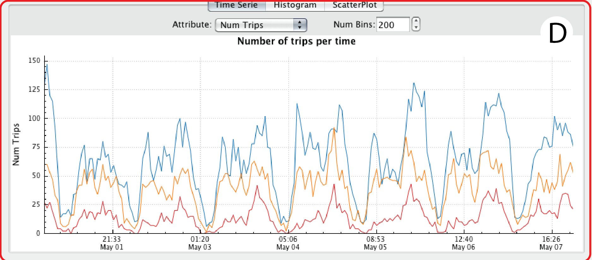{width="100%" fig-align="center"}
:::
::::

**Draw regions on the map and the chart answers: one line per query, matched by color.**

::: {.notes}
Walk through it as a single action. Before drawing anything, the chart shows one line for the whole city. Now I draw regions on the map: the orange region, the red region, and the blue union of a polygon and an arrow. The chart immediately shows three lines in the same three colors. The weekly rhythm is the same in all of them, but the heights differ: the blue query has the most trips, the red the fewest. I performed one visual query, and every view updated. That is what we mean by linked views.
:::

## The Power of Bidirectional Linking

::: {.r-fit-text}
**The linking works in both directions**
:::

::: {.incremental}
- **Spatial → Temporal:** Select a region → see temporal patterns
- **Temporal → Spatial:** Set a time window → the map shows only those trips
:::

::: {.fragment}
This bidirectional dialogue enables exploratory analysis that would be impossible with static visualizations.
:::

::: {.notes}
Linking works in both directions, which is what makes it feel like a dialogue. Spatial to temporal: select a region on the map and the charts show its time series; you saw this on the previous slide with the colored regions and lines. Temporal to spatial: set a time window in the time widget and the map shows only the trips in that window; the next section develops this. Either direction can start the question and the other view answers it. That bidirectional dialogue is what enables exploratory analysis, and it would be impossible with a static visualization, where the only way to ask a new question is to build a new figure.
:::

---

# Part 13: Temporal Queries {background-color="#2c5f77"}

## Temporal Slicing: Time → Space

:::: {.columns}
::: {.column width="40%"}
### The Question:

"Where are the trips in this hour of the day?"

### The Interaction:

1. Set start time, end time and step size in the time widget
2. The map redraws with *only* the trips in that window
3. Step forward or back one step at a time

{width="100%"}
:::

::: {.column width="60%"}
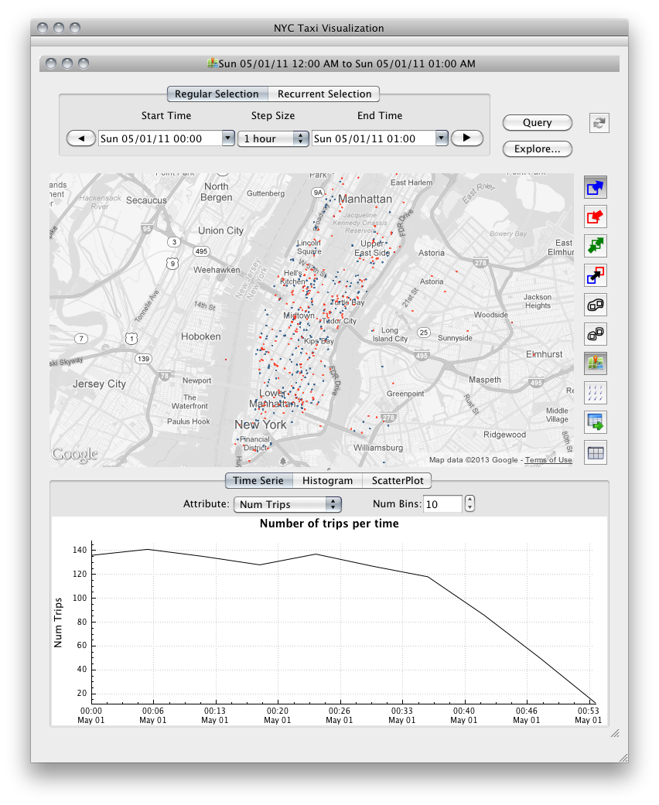{height="760" fig-align="center"}
:::
::::

::: {.notes}
This is the reverse query. Now the time window is what I control. The widget on the left is set to start Sunday May 1 at midnight, step size one hour, end 1 AM, and the window on the right shows exactly that: only the trips from that hour as dots on the map, and the number of trips per time bin below. The arrows on either side step the window forward or back by one step. Time becomes a handle on the spatial pattern, the dialogue between the spatial and temporal views.
:::

## Advanced Temporal Queries: Recurrent Selection

**Select recurring time periods: a pattern, not a single time slice.**

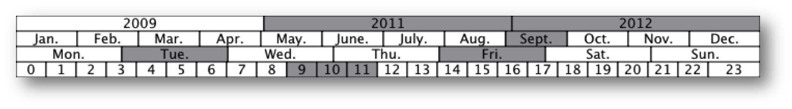{.nostretch fig-align="center" width="90%"}

::: {.fragment}
Shaded here: September of 2011 and 2012, Tuesdays and Fridays, 9-11 AM. Other examples: all Mondays 8-10 AM, every Saturday night, weekday rush hours only.
:::

::: {.fragment}
This reveals **periodic behavior**: the heartbeat of the city.
:::

::: {.notes}
A single time slice is not enough when you care about patterns. Recurrent selection lets me shade the years, months, days of the week and hours that I want, and the system takes the union of every matching slice. In the figure the shaded cells are the years 2011 and 2012, September, Tuesday and Friday, and the hours 9, 10 and 11. Writing that selection by hand would be a long list of dates. This lets us find and compare weekly, daily or hourly periodic behavior.
:::

---

# Part 15: Origin-Destination Queries {background-color="#2c5f77"}

## The Most Powerful Query: Flows

::: {.r-fit-text}
**Asking about movement between specific locations**
:::

::: {.columns .fragment}
::: {.column width="50%"}
### Traditional Approach:

```sql
SELECT * FROM trips
WHERE origin = 'JFK'
AND destination = 'LGA'
AND time BETWEEN '8:00' AND '10:00'
```

Complex, requires knowing SQL and field names
:::

::: {.column width="50%"}
### TaxiVis Approach:

**Draw an arrow**

Simple, visual, intuitive
:::
:::

::: {.fragment}
This is what we mean by **"visual query"**—you draw your question, the system answers. You have already seen it: the blue and red arrows in the airport query.
:::

::: {.notes}
Origin-destination queries ask about movement between two specific places. In SQL you need to know the field names and write the geography as coordinates. In TaxiVis you draw a polygon at the origin, a polygon at the destination, and an arrow between them. You already saw this in the airport comparison: Midtown to LaGuardia (blue arrow) and Midtown to JFK (red arrow).
:::

## Visual Queries: Why They Matter

::: {.incremental}
1. **Lower cognitive load**
   - No need to remember field names or syntax
   - Direct manipulation of the data representation

2. **Immediate feedback**
   - See results instantly as you interact
   - Iterate quickly through hypotheses

3. **Support exploration**
   - Encourages "what if" questions
   - Makes serendipitous discovery possible

4. **Democratize analysis**
   - Analysts without SQL/programming skills can explore
   - Domain experts can directly investigate questions
:::

::: {.fragment}
**The visualization *is* the interface.**
:::

::: {.notes}
Four reasons visual queries matter. Lower cognitive load: no field names or syntax to remember, just manipulate the representation of the data. Immediate feedback: you see the result as you interact, so you can iterate quickly through hypotheses. Support for exploration: cheap what-if questions encourage serendipitous discovery. Democratization: analysts without SQL or programming skills, and the domain experts who understand the city best, can investigate their own questions. The last line is the slogan to remember: the visualization is the interface. You might ask the class which of the four they think matters most to a traffic engineer.
:::

---

# Part 16: Case Study 1 - Social Inequality {background-color="#2c5f77"}

## Question: "Are some neighborhoods underserved by taxis?"

::: {.columns}
::: {.column width="50%"}
### The Analysis:

- Compare taxi activity across four areas: Harlem (with East Harlem), Upper East Side, Midtown, and Downtown (the Villages)
- Pickups and dropoffs over one week in May 2011
:::

::: {.column width="50%"}
### Keep in Mind:

- These are **counts, not rates**
- Regions differ in size and population
- What would you normalize by?
:::
:::

::: {.notes}
This is the first case study from the paper (Fig. 8). The domain question: are some neighborhoods underserved by taxis? In TaxiVis you select regions at different granularities, and here the paper uses grouping: Harlem and East Harlem together (blue), the East, West and Greenwich Village together (green), plus Midtown (orange) and the Upper East Side (red), over the first week of May 2011. Before we see the result, plant the caveat: these are raw counts for regions of different size and population, so a fair comparison would need to normalize. Ask the class what they would divide by.
:::

## The Discovery: Over 10x Difference

:::: {.columns}
::: {.column width="50%"}
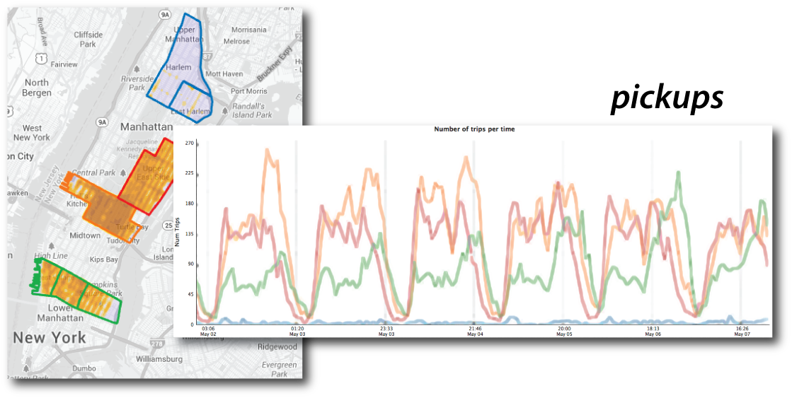{width="100%" fig-align="center"}
:::
::: {.column width="50%"}
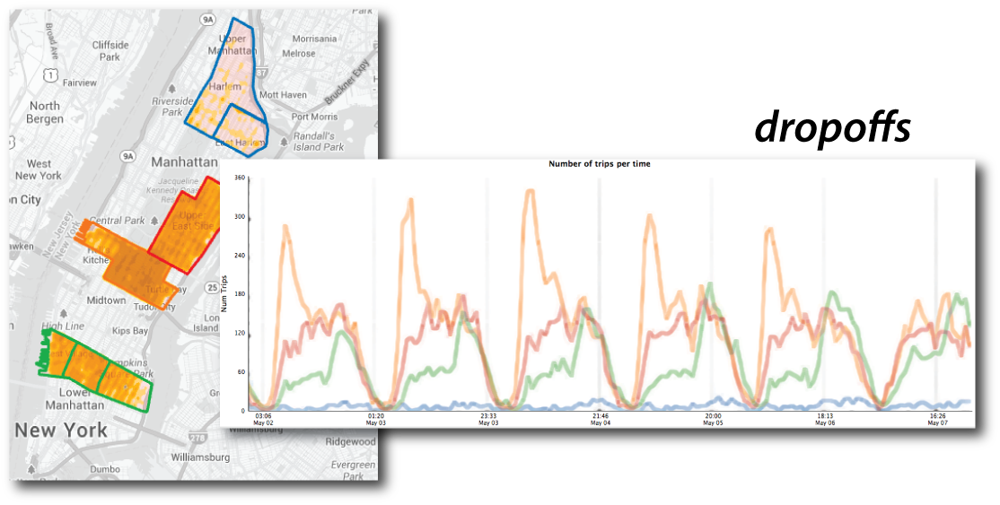{width="100%" fig-align="center"}
:::
::::

**Harlem (blue) sits more than an order of magnitude below Midtown, in pickups and in dropoffs.**

::: {.notes}
Left is pickups, right is dropoffs, for the same four areas and the same week (May 1-7, 2011): Harlem is blue, the Upper East Side red, Midtown orange, Downtown green. Read off the charts, Midtown peaks at roughly 260 pickups per time bin and 340 dropoffs, while Harlem's blue line stays around 10 to 20. The paper's words: there is over one order of magnitude difference in the number of trips to and from Harlem compared to more affluent neighborhoods, and the heat map shows that while people take taxis to Harlem, there are barely any pickups there. Residents had long complained about the lack of taxi service, and the plot supports them. Elsewhere in the same figure: Midtown dominates weekdays, and on the weekend activity shifts Downtown, with a big Friday-evening pickup peak. Be careful with the interpretation: the regions differ in size, so the data alone does not settle how large the gap really is.
:::

## Follow-Up Investigation

### The exploration followed a natural path:

::: {.incremental}
1. **Initial pattern:** Harlem has far fewer taxi trips
2. **Hypothesis:** Is this an economic issue?
3. **Investigation 1:** "Are tips different in Harlem?"
   - **Discovery:** Tips per trip are *higher* (and noisy: few trips)
4. **Investigation 2:** "Is fare per mile different?"
   - **Discovery:** Consistently **lower** fare per mile
5. **Insight:** Less economic incentive for taxis to be in Harlem; the higher tips may be a way to reward drivers who go
:::

::: {.notes}
Notice how the exploration followed a natural path: overview, pattern, hypothesis, investigation. This is exploratory data analysis in action, and each step was one or two clicks. The paper reports one surprising fact: tips per trip originating in Harlem are higher than in the other neighborhoods. Further analysis showed that fare per mile is lower for Harlem, so there is less economic incentive for taxis to be in that area, and the paper suggests the higher tips may be a way to reward the drivers who do go. The next slide shows the two charts; be honest that the tips line is spiky because there are so few trips in each time bin.
:::

## Follow-Up Investigation: The Two Charts

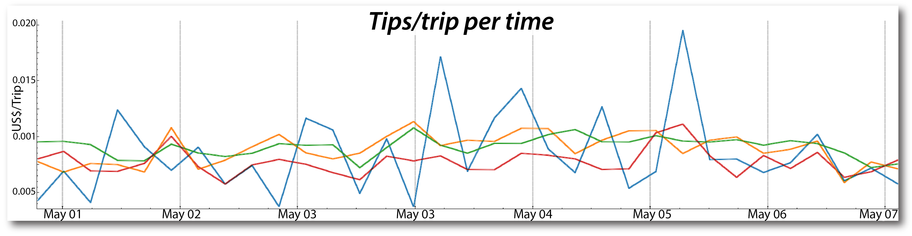{.nostretch fig-align="center" width="72%"}

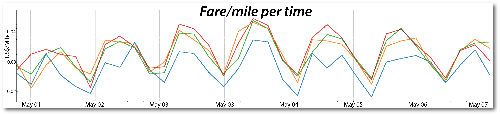{.nostretch fig-align="center" width="72%"}

**Blue = Harlem. Tips per trip run higher but noisily (few trips); fare per mile is lower.**

::: {.notes}
Same four colors as before, blue is Harlem; these are trips originating in each area, May 1-7, 2011 (the paper's Fig. 9). Top: tips per trip. The Harlem line has the biggest spikes, which is the paper's finding that tips are higher, but it also dips below the others: with so few trips per bin a handful of tips moves the line, so treat it as suggestive. Bottom: fare per mile, where Harlem is below the other three areas at almost every point, with the usual daily rhythm. That is the stronger signal for the incentive argument. The y-axis tick labels on the tips chart are garbled in the screenshot (they run 0.005, 0.001, 0.015), so do not read absolute values off it.
:::

---

# Part 17: Case Study 2 - Transportation Hubs {background-color="#2c5f77"}

## Question: "How do people move through NYC's transportation infrastructure?"

::: {.columns}
::: {.column width="50%"}
### The Setup:

- Compare JFK, LGA, Penn Station, Grand Central
- Use grouping to combine regions
- Examine pickup patterns over one week
:::

::: {.column width="50%"}
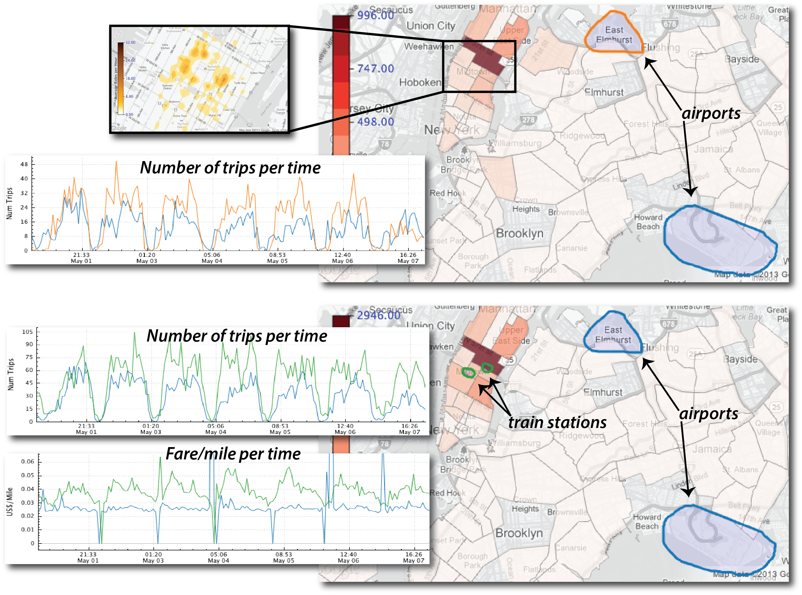{fig-align="center" width="100%"}
:::
:::

::: {.notes}
The second case study asks how people use the city's transportation hubs. The figure has two stacked screenshots. Top: JFK (blue polygon) and LaGuardia (orange polygon), with a trips-per-time chart. Bottom: the two airports grouped into one blue query, compared with two train-station regions in Midtown (green), with trips per time and fare per mile. Grouping regions into one query is the composition idea from Part 9.
:::

## Key Findings

::: {.incremental}
1. **More pickups at LGA than JFK** on most days

2. **Train stations >> airports** for pickups

3. **Weekday pattern:** train-station pickups roughly constant Mon-Thu, falling Friday to a low on Saturday
   - Reflects commuter behavior

4. **Rush hour problem:** airport trips take much longer around 3-5 PM; fare per mile is higher within Manhattan
   - Economic incentive to avoid airport trips
   - Refusing rides is illegal, but a common practice for JFK
:::

::: {.notes}
All of this is from Section 6.2 of the paper. In the top chart of the previous figure the orange LaGuardia line sits above the blue JFK line on most days; in the bottom chart the green train-station line is well above the blue airport line. The train-station pickups stay roughly constant Monday through Thursday, start to decrease on Friday and hit a low on Saturday, which reflects commuters who come to the city during the week but not on weekends. The choropleth at the top of the figure shows that most people going from the airports go to Midtown, followed by the Upper West Side. Fare per mile is higher within Manhattan, which gives taxis an incentive to avoid airport trips; the paper notes that refusing a ride is illegal but a common practice when the destination is JFK, and that the problem is worst in weekday rush hour, when trips take much longer (the Sunday vs. Monday result). A single button switches between pickups and dropoffs.
:::

---

# Part 18: Case Study 3 - Temporal Exploration {background-color="#2c5f77"}

## Time-Space Exploration

::: {.columns}
::: {.column width="50%"}
### Feature:

- Select multiple time slices automatically
- Compare the same time across days, weeks or months
- Each slice gets its own map and its own colored line

:::
::: {.column width="50%"}
### Example: Memorial Day Analysis

- All Mondays in May 2011 and May 2012
- Nine maps, nine lines
:::
:::

::: {.notes}
This is recurrent selection plus multiple views. Setting it up by hand would be tedious: "give me May 2, 9, 16, 23, 30 in 2011 and May 7, 14, 21, 28 in 2012." Instead I say "all Mondays in May" and the system generates a map and a colored line for each of the nine Mondays. The next slide shows what comes out.
:::

## Discovery: Memorial Day Pattern

**Maps for each Monday (a) and one line per Monday (b): two lines stand apart.**

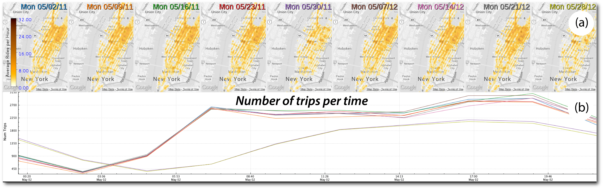{fig-align="center"}

::: {.incremental}
- **Discovery:** Memorial Day (May 30, 2011 and May 28, 2012) has significantly fewer trips than the other Mondays
- **Implication:** Fleet size could be reduced on holidays to save costs
:::

::: {.notes}
Panel (a) is one map per Monday, labeled and colored; panel (b) overlays the nine lines. Seven of the lines are bunched together, rising to about 2,500-3,000 trips by evening. The two that stay far lower, around 2,000 in the evening, are the purple 5/30/11 and olive 5/28/12 lines, which are the Mondays of Memorial Day. Interestingly, they start higher around midnight, the tail of a holiday weekend, then fall behind once the workday would normally begin. The implication: fleet planning could treat holidays differently.
:::

---

# Part 19: Case Study 4 - Hurricane Sandy {background-color="#2c5f77"}

## Question: "How did Hurricane Sandy affect NYC?"

::: {.columns}
::: {.column width="50%"}
### The Analysis:

- One week of taxi activity
- Sunday before through Saturday after
- Heat maps for each day
- Compare spatial patterns
:::

::: {.column width="50%"}
### The Timeline:

- **Sunday (before):** Normal activity
- **Monday (hurricane hits):** Virtually no taxis citywide
- **Tuesday-Friday:** Activity returns everywhere **EXCEPT Lower Manhattan**
- **Saturday:** Finally returns to normal
:::
:::

::: {.notes}
The last case study asks how a major event changed taxi activity. The setup is one week of data, from the Sunday before the storm through the Saturday after, with a heat map for each day, so we can compare spatial patterns day by day. This uses the time space exploration feature from the Memorial Day example: one map per time slice, color coded. The timeline on the right is the story the next slide shows: normal on Sunday, almost no taxis anywhere on Monday when the hurricane landed, a return to normal on the following days everywhere except Lower Manhattan, and a final return to normal on Saturday. Ask the class what they expect to see before revealing the figure.
:::

## The Story the Data Tells

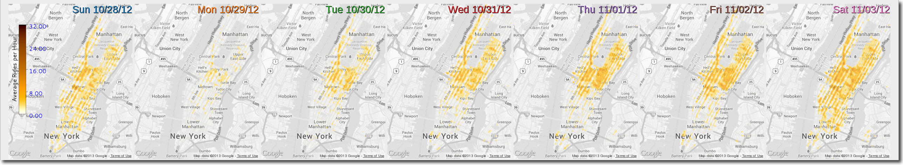{.nostretch fig-align="center" width="95%"}

::: {.fragment}
**Why?** Lower Manhattan had a **multi-day power outage**. You can see it on the map.
:::

::: {.notes}
Seven daily heat maps, left to right: Sunday 10/28 is normal; Monday 10/29, the day the storm landed, is almost empty everywhere in Manhattan; from Tuesday, life starts to get back to normal in most regions, but the southern tip of the island stays pale: the paper says there were virtually no taxis in Lower Manhattan for five days. The reason is a major power outage there, which was only restored on Saturday. A heat map can show a blackout through the absence of taxis.
:::

## Comparison to Hurricane Irene

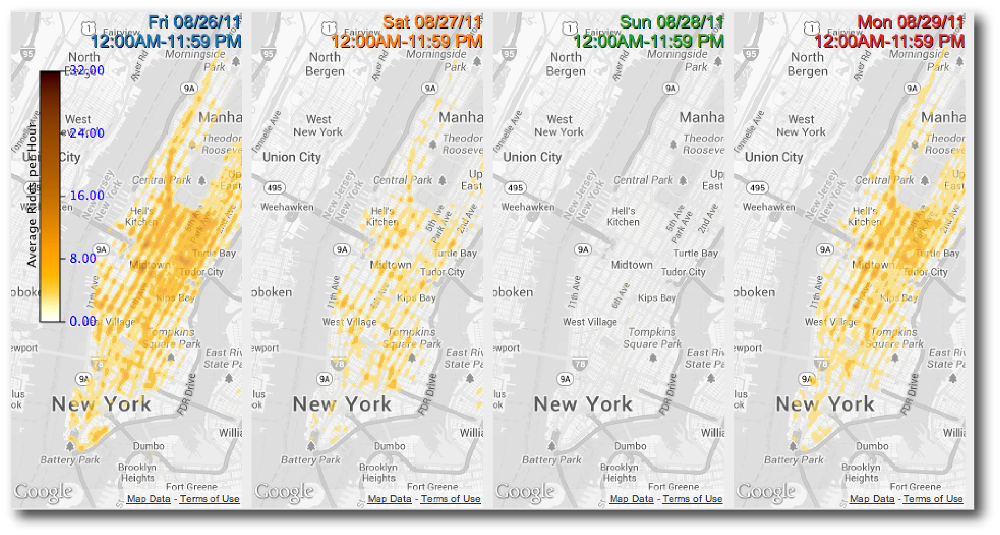{.nostretch fig-align="center" width="65%"}

::: {.incremental}
- Shorter disruption but more complete
- Only **1,076 trips** on the hurricane day (vs. an average of about 500,000)
- Faster recovery
:::

::: {.notes}
Compare with Irene in August 2011: Friday is normal, Saturday is thinner, Sunday (the day Irene hit) is nearly blank, and Monday is already back to near normal. Irene was shorter but more complete: only about a thousand trips that day against a daily average around 500,000, then fast recovery. Sandy was a longer disruption with an uneven recovery because of the outage.
:::

---

# Part 20: What We Learned {background-color="#2c5f77"}

## Design Insights from Building TaxiVis

::: {.incremental}
1. **Visual queries work**
   - Early users found it usable without SQL or programming
   - No SQL, no programming required

2. **Performance is non-negotiable**
   - Sub-second response enables exploration
   - Adaptive rendering essential for large results

3. **Multiple views are essential**
   - Comparison is core to analysis
   - Side-by-side queries, synchronized views
   - Linked plots and maps

4. **Query composition is powerful**
   - Build complex queries from simple ones
   - Grouping, refinement, generalization
:::

::: {.notes}
Four design lessons from building the system. Visual queries work: early users could pose complex queries without SQL or programming. Performance is non-negotiable: sub-second response is what makes exploration possible, and adaptive rendering is essential when results are large. Multiple views are essential because comparison is the core of analysis: side-by-side queries, synchronized views, linked plots and maps. Query composition is powerful: build complex queries out of simple ones through grouping, refinement and generalization. These lessons are not specific to taxis, and they are a good checklist to apply to your own Mini-Project 2.
:::

---

# Part 21: Real-World Impact {background-color="#2c5f77"}

## Who's Using TaxiVis?

::: {.columns}
::: {.column width="50%"}
### Users:

- Designed from interviews with 5 NYU researchers: 2 traffic engineers and 3 economists
- Deployed to a few domain scientists at NYU
- Data provided by the NYC Taxi & Limousine Commission
- Feedback "very positive"; larger usability study planned
:::

::: {.column width="50%"}
### What They've Learned:

- Social inequalities in taxi service (Harlem)
- Economic incentives affecting driver behavior
- Impact of major events on city mobility
- Transportation hub usage patterns
:::
:::

::: {.fragment}
### Beyond Taxis:

- Model applies to other origin-destination data
- Generalizes to other spatio-temporal datasets
- Principles useful for any urban data exploration
:::

::: {.notes}
Be precise about the evidence. The paper reports interviews with five researchers from NYU (two traffic engineers, three economists) to derive the requirements, then deployment to a few domain scientists at NYU with very positive feedback; a larger usability study was listed as future work. The data came from the NYC Taxi and Limousine Commission. The case studies show what the experts learned: social inequality in taxi service, economic incentives for drivers, effects of major events, and transportation hub usage. The model generalizes to other origin-destination data.
:::

---

# Part 22: Key Takeaways {background-color="#2c5f77"}

## The Big Ideas

::: {.incremental}
1. **Urban data is fundamentally spatio-temporal**
   - Space, time, and attributes all matter
   - Need to explore interactions, not just individual dimensions

2. **Static visualization is not enough**
   - Interactivity transforms presentation into exploration
   - "Dialogue with data" through visual queries

3. **Design for domain experts, not data scientists**
   - Visual operations instead of code
   - Direct manipulation over programming
   - But don't sacrifice expressiveness

4. **Performance enables exploration**
   - Sub-second response changes how people think
   - Specialized systems beat general solutions
   - Trade generality for interactivity
:::

::: {.notes}
Four big ideas to take away. One: urban data is fundamentally spatio-temporal, so space, time and attributes all matter, and you need to explore their interactions rather than each dimension alone. Two: static visualization is not enough; interactivity turns presentation into exploration, a dialogue with data through visual queries. Three: design for domain experts, not data scientists, with visual operations and direct manipulation instead of code, but without sacrificing expressiveness. Four: performance enables exploration; sub-second response changes how people think, which sometimes means trading generality for interactivity with a specialized system. Pause here and ask whether anyone disagrees with any of the four.
:::

---

# Part 23: From TaxiVis to Urban Analytics {background-color="#2c5f77"}

## The Broader Vision

::: {.columns}
::: {.column width="50%"}
### TaxiVis is One Example

Other urban data:

- Bikeshare systems
- 311 service calls
- Building permits
- Transit ridership
- Crime reports
- Traffic sensors

**Same challenges:** Scale, complexity, spatio-temporal nature
:::

::: {.column width="50%"}
### The Visual Analytics Framework

1. **Visualization:** Multiple representations and query models
2. **Data Analysis:** Topology, ML, pattern detection
3. **Data Management:** Specialized indices, GPU acceleration
:::
:::

::: {.notes}
TaxiVis is one example. Bikeshare, 311 service calls, building permits, transit ridership, crime reports and traffic sensors all share the same challenges of scale, complexity and spatio-temporal structure. A system for them needs three layers working together. Visualization: multiple representations and a query model. Data analysis: topology, machine learning and pattern detection. Data management: specialized indices and GPU acceleration. TaxiVis shows the first and the last working together; the paper itself lists bikeshare data as the next data source to add. If a student's mini-project uses urban data, this slide is the checklist: which of the three layers does your project need?
:::

## Moving to 3D

::: {.r-fit-text}
**Cities are vertical, not just horizontal**
:::

::: {.incremental}
- Shadow analysis
- Views and sight lines
- Sky exposure
- Building massing
:::

::: {.fragment}
### Next Lecture:

We'll extend these ideas to **3D urban visualization** and the **Urbane** framework

Same principles apply: **interactive, visual, scalable**
:::

::: {.notes}
Cities are vertical, not just horizontal. Everything today treated the city as a flat map with time, 2D plus time. Next week, Friday Nov 6, we go to 3D urban visualization and the Urbane framework: shadow analysis, views and sight lines, sky exposure and building massing. The same principles apply: the visualization should be interactive, visual and scalable, and the audience is again a domain expert, here an architect or planner. Ask the class what questions about a city can only be answered in 3D; shadows on a park and the view from an apartment window are good starting examples.
:::

---

# Summary {background-color="#2c5f77"}

## The Visual Analytics Pipeline for Urban Data

### What We've Covered Today:

::: {.columns}
::: {.column width="50%"}
**The Problem:**

- Urban data is big, complex, spatio-temporal
- Traditional tools don't scale
- Confirmation vs. exploration gap
:::

::: {.column width="50%"}
**The Solution:**

- Visual query models for direct manipulation
- Interactive performance through specialized systems
- Multiple visualizations for different questions
- Comparison through coordinated views
:::
:::

::: {.fragment}
**The Result:**

- Domain experts can explore without programming
- Discoveries about social inequality, economics, events
- Real impact on city operations and policy
:::

::: {.notes}
Summary slide, in three parts. The problem: urban data is big, complex and spatio-temporal, traditional tools do not scale, and there is a gap between confirmatory analysis, where you already know the question, and exploration, where you do not. The solution: visual query models for direct manipulation, interactive performance through specialized systems, multiple visualizations for different questions, and comparison through coordinated views. The result: domain experts can explore without programming, with real discoveries about social inequality, driver economics and the effects of events. If you are short on time, this is the one slide to make sure you say out loud before the exercise.
:::

## Try It Yourself - Exploration Exercise

::: {.r-fit-text}
**If you had access to TaxiVis, what would you explore?**
:::

Think about:

::: {.incremental}
- A neighborhood you're curious about
- A time pattern (weekday vs. weekend, holidays, events)
- A comparison (this year vs. last year, two locations)
- A hypothesis about urban behavior
:::

::: {.fragment}
**Discussion:**

- What question would you ask?
- What spatial regions would you select?
- What time slices would you compare?
- What would you expect to find?
:::

::: {.notes}
Give the class two minutes to think in pairs, then collect two or three answers. Prompt with the four bullets: a neighborhood they are curious about, a time pattern such as weekday versus weekend or a holiday, a comparison such as this year versus last year or two locations, or a hypothesis about urban behavior. Push on specifics: which regions would you select, which time slices would you compare, what would you expect to find, and what would convince you that you were wrong? This is also warm-up practice for Mini-Project 2, which starts today, so encourage students to keep their idea.
:::

## Optional: Build Your Own with Autark

::: {.columns .smaller}
::: {.column width="50%"}
### Autark (autark.js): urban visual analytics in the browser

- Website: [autarkjs.org](https://autarkjs.org/) (MIT license)
- Install: `npm install @urban-toolkit/autk`
- **Serverless**: load, process and visualize geospatial data entirely client-side
- **autk-db:** geospatial queries on OpenStreetMap, GeoJSON, GeoTIFF and CSV
- **autk-map:** 2D and 3D maps rendered with WebGPU
- **autk-plot:** interactive D3 charts **linked to the map**
- **autk-compute:** custom analysis on GeoJSON
:::

::: {.column width="50%"}
### How it connects to today

- Map + linked charts = the **brushing and linking** idea, now something you can build
- The gallery already has **linked views**, and GPU analyses (sky exposure, visibility, view score) that preview next week's **3D** class
- Start with the [Observable tutorial](https://observablehq.com/@autarkjs/-/collection/urban-computing-with-autark) or the [gallery](https://autarkjs.org/gallery/)
- Optional; a good fit if your mini-project uses urban data
- Maps and GPU analyses need **WebGPU**: Chrome or Edge 113+, Safari 26+, Firefox 141+
:::
:::

::: {.notes}
Optional pointer, not class time. Autark, or autark.js, is the group's new framework for prototyping urban visual analytics systems that run entirely in the browser, with no backend or tile server. It is organized as modules: autk-db runs geospatial queries in the browser on OpenStreetMap, GeoJSON, GeoTIFF and CSV data; autk-map renders 2D and 3D maps with WebGPU; autk-plot makes interactive D3 charts that link to the map, which is exactly the coordinated-views idea from today; and autk-compute runs custom analyses on GeoJSON. It installs from npm as @urban-toolkit/autk, it is MIT licensed, and the site has a guide, an API reference, a gallery, and an Observable tutorial collection. It was developed at UFF, NYU and the University of Illinois Chicago. A Python version, pyautark, is listed as coming soon. Position it as a way to build the kind of tool we studied today, and as a preview of the 3D material next week: its gallery includes linked views, scatterplots and parallel coordinates, and GPU analyses such as sky exposure, visibility and view score, which are the kind of impact analysis Urbane does. autk-map and autk-compute need WebGPU (Chrome or Edge 113 and later, Safari 26, Firefox 141); autk-db and autk-plot work in any modern browser. I have not been able to open the Observable tutorial collection (it blocks automated access), so look through it yourself before recommending a specific notebook.
:::

## Optional: Try TaxiVis Yourself

::: {.columns .smaller}
::: {.column width="50%"}
### The revamped TaxiVis is open source

- Repository: [github.com/vida-nyu/taxivis](https://github.com/vida-nyu/taxivis)
- A **desktop application** (C++, Qt 6, OpenGL), not a web page
- Build from source with CMake; instructions for macOS (Homebrew) and Ubuntu are in the README
- Same ideas as today: draw regions and arrows on the map, set time windows, linked time series, histograms, scatter plots and heat maps
:::

::: {.column width="50%"}
### What to expect

- A small **sample of 10,000 trips** is bundled, enough to check the build
- To explore for real, you prepare a month of NYC TLC trip data (about 14-15 million trips) with the README's pipeline
- Entirely optional, and it takes some setup time
- The screenshots in today's lecture are from the 2013 version, so the new interface will look different
:::
:::

::: {.notes}
This is an optional pointer, not something to spend class time on. TaxiVis has been revamped and is now open source in the VIDA group's repository. It is a native desktop application written in C++ with Qt 6 and OpenGL, so there is no hosted demo: students who want to try it have to build it with CMake, following the README for macOS or Ubuntu. The repository bundles a small sample of 10,000 trips that is only good for checking the build; real exploration needs a month of NYC Taxi and Limousine Commission data, about 14 to 15 million trips, run through the README's three-step preprocessing pipeline. The features match what we covered today: map selection with polygons and arrows, time and attribute exploration, time series, histograms, scatter plots, heat maps and CSV export. Be clear that it is for curious students and could take an evening of setup, and that the figures in today's slides come from the original 2013 system. I have not run the new version myself, so if a student hits build problems, point them to the repository issues.
:::

## This Week

- **Mini-Project 2 begins:** Temporal visualization (due Nov 19)
- **Exercise 9:** Urban data exploration and visual queries (due Nov 5)
- **Reading:** Ferreira et al. (2013), [Visual Exploration of Big Spatio-Temporal Urban Data](https://ieeexplore.ieee.org/document/6634127/), IEEE TVCG
- **Lab:** building interactive spatio-temporal visualizations in D3
- **Optional:** try the revamped [TaxiVis](https://github.com/vida-nyu/taxivis) (build from source)
- **Optional:** explore [Autark](https://autarkjs.org/), our browser-based urban analytics toolkit

::: {.notes}
Assignments for this week. Mini-Project 2 begins today: temporal visualization, due Nov 19. Exercise 9, urban data exploration and visual queries, is due Nov 5, and Mini-Project 1 is also due Nov 5. The required reading is the TaxiVis paper by Ferreira, Poco, Vo, Freire and Silva from IEEE TVCG 2013, which is the source of nearly every figure in today's lecture, so students can follow along in the paper. The lab, run by the TA, covers D3 time scales, linked views and brushing, which are the tools for the temporal mini-project.
:::

## Questions?

::: {.r-fit-text}
Next week: **3D & Immersive Urban Visualization**
:::

::: {.fragment}
### Preview:

- Urbane framework for 3D urban planning
- Interactive impact analysis (shadows, views, sky exposure)
- Performance-driven architectural design
- When to use 3D (and when not to)
:::


::: {.notes}
So we have solved the yellow blob. By adding interactivity and linked views we turned a useless picture into an exploratory tool. But this is all still 2D: we looked at the city as a flat map. What about the 3D form of the city, the buildings, the streets and the skyline? That is next week, Nov 6. Remind the class about this week's assignments before they leave.
:::
