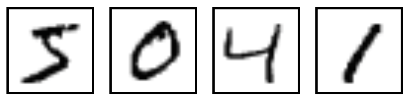
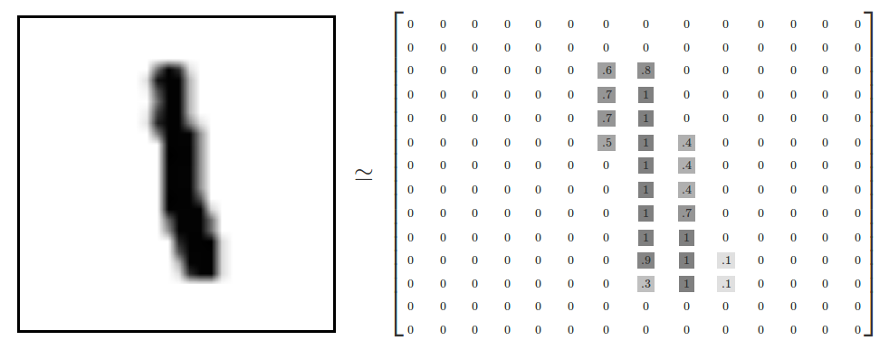
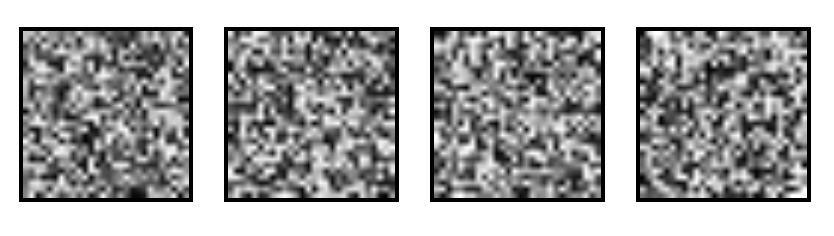
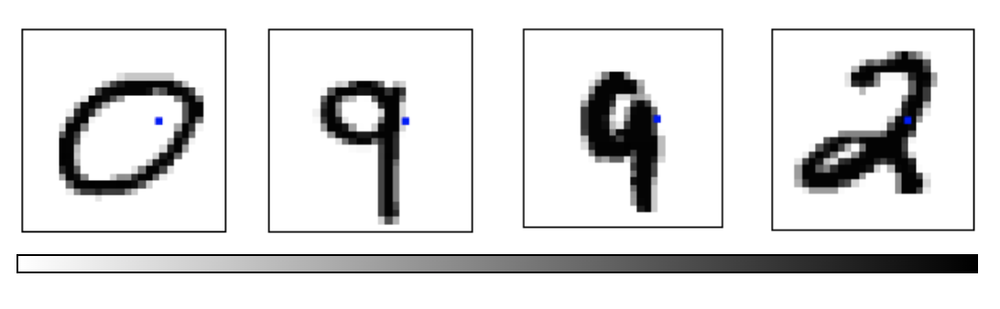
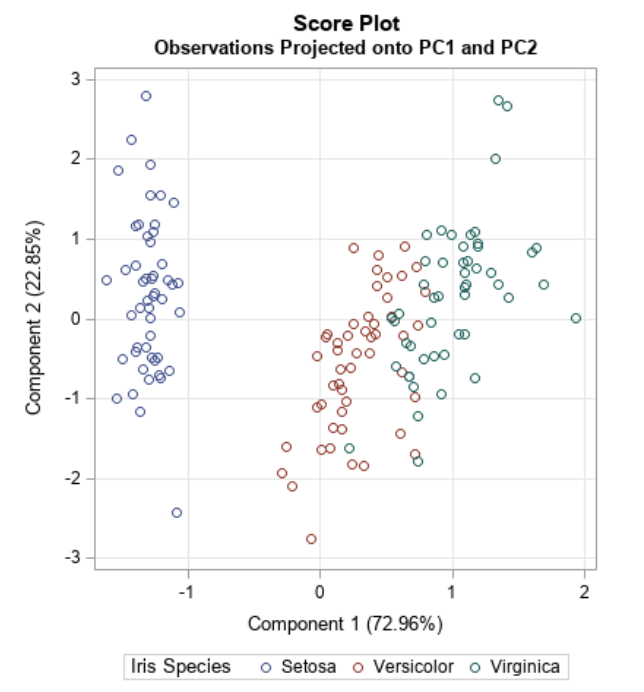
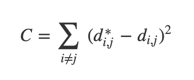
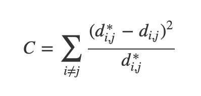
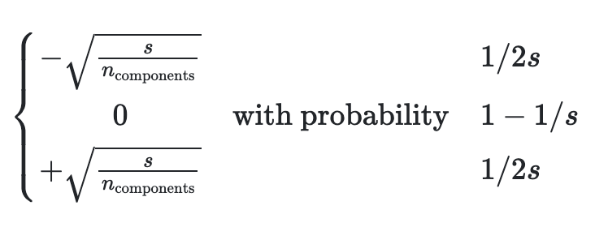
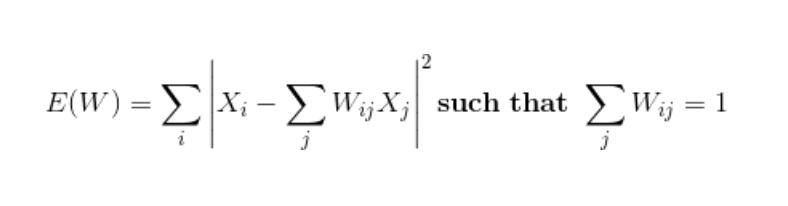
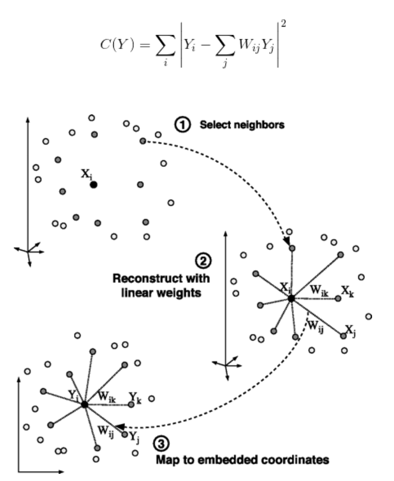

## Lab Overview

* Today: Clustering and Dimensionality Reduction
* Various methods of projecting data into low-dimensional space
* Next week: Deep Learning Visualization

::: {.notes}
Today we'll explore how to visualize high-dimensional data by projecting it into lower dimensions. We'll apply various dimensionality reduction techniques to the MNIST dataset and compare their effectiveness.
:::

## Plan for tonight (50 minutes)

| | Minutes |
|---|---|
| Setup and PCA recap | 5 |
| [LLE](#lab-lle) | 8 |
| [t-SNE](#lab-tsne) | 10 |
| [UMAP](#lab-umap) | 7 |
| [Exercises](#lab-ex1): perplexity, noise, scoring | 15 |
| [Proposal questions](#lab-qa) | 5 |

* MDS, Sammon's mapping and random projection are [backup slides](#lab-mds): skip them unless there is time
* Each link jumps straight to that section

::: {.notes}
SKIPPABLE - this is the schedule for the session; the links jump to each section.

The deck has about 40 slides plus the exercises, which is too much for 50 minutes if every method gets equal time. PCA was covered in the lecture and the first half of the deck is a recap, so aim to be at LLE by about the 5 minute mark. The optimization-based methods (MDS, Sammon's mapping, sparse random projection) are the backup block; there is a 'Choose your path' slide after the PCA slides that jumps over them.

The exercises are the part that matters most: they reproduce, on a dataset students can run, the pitfalls from the required reading. If time runs short, cut UMAP down to the single result slide, not the exercises.

Project proposals are due today, so the last five minutes are for questions about them.
:::

## Dimensionality Reduction

* Various methods of projecting data into a low-dimensional space while preserving the clusters from the high-dimensional space
    * Principal Component Analysis (PCA)
    * Multidimensional Scaling (MDS)
    * Sparse Random Projection
    * Locally Linear Embedding
    * t-Distributed Stochastic Neighbor Embedding (t-SNE)
    * Uniform Manifold Approximation and Projection (UMAP) 

::: {.notes}
These methods help us understand complex high-dimensional data by creating meaningful 2D or 3D visualizations. Each technique has different strengths in preserving either local neighborhood structure or global geometric relationships.
:::

## MNIST Dataset

* Dataset of 28x28 pixel images of handwritten digits



::: footer
Ref: @Olah_2014
:::


::: {.notes}
MNIST contains 70,000 images of handwritten digits from 0-9. Each 28x28 pixel grayscale image will serve as our test case for dimensionality reduction techniques.
:::

## MNIST Dataset

<ul >
<li style="font-size:25px";>Every MNIST image can be thought of as a 28x28 array of numbers describing how dark each pixel is:
</li>
</ul>

<ul >
<li style="font-size:25px";>We can flatten each array into a 28 * 28 = 784 dimensional vector, where each component of the vector is a value between zero and one describing the intensity of the pixel
</li>
<li style="font-size:25px";>We can think of MNIST as a collection of 784-dimensional vectors
</li>
</ul>

::: footer
Ref: @Olah_2014
:::

::: {.notes}
Each image is represented as a matrix of pixel intensities from 0 to 1. By flattening this matrix, we transform each image into a single 784-dimensional vector.
:::

## MNIST Dataset

* But not all vectors in this 784-dimensional space are MNIST digits! Typical points in this space are very different 
* To get a sense of what a typical point looks like, we can randomly pick a few random 28x28 images – each pixel is randomly black, white or some shade of gray. These random points look like noise:



::: footer
Ref: @Olah_2014
:::

::: {.notes}
Random 784-dimensional vectors produce noise, not digits. This demonstrates that meaningful digit images occupy only a tiny, structured subset of the possible 784-dimensional space.
:::

## MNIST Dataset

<ul >
<li style="font-size:30px";>28x28 images that look like MNIST digits are very rare - they make up a very small subspace of 784-dimensional space 
<ul>
<li style="font-size:25px";>With some slightly harder arguments, we can see that they occupy a lower (than 748) dimensional subspace</li>
</ul>
</li>
<li style="font-size:30px";>Many theories about lower-dimensional structure of MNIST (and similar data)
  <ul>
    <li style="font-size:25px";>Manifold hypothesis (popular among ML researchers): MNIST is a low dimensional manifold curving through its high-dimensional embedding space</li>
    <li style="font-size:25px";>Another hypothesis (rooted in topological data analysis) is that data like MNIST consists of blobs with tentacle-like protrusions sticking out into the surrounding space</li>
    <li style="font-size:25px";>But no one actually knows for sure!</li>
   </ul>
</li>
</ul>

::: footer
Ref: @Olah_2014
:::

::: {.notes}
MNIST digits likely exist on a lower-dimensional manifold within the 784-dimensional space. While several theories attempt to explain this structure, the true geometric nature remains an open question.
:::

## MNIST Cube

<ul>
  <li style="font-size:30px";>Imagine the MNIST data points as points suspended in a 784-dimensional cube
  <ul>
    <li style="font-size:25px";>Each dimension of the cube corresponds to a particular pixel</li>
    <li style="font-size:25px";>The data points range from zero to one according to pixel intensity</li>
    <li style="font-size:25px";>On one side of the dimension, there are images where that pixel is white. On the other side of the dimension, there are images where it is black. In between, there are images where it is gray.</li>
   </ul>
</li>
<li style="font-size:30px";>What does this cube look like if we look at a particular two-dimensional face? Let's look at Olah's visualizations.
</li>
</ul>



::: footer
Ref: @Olah_2014
:::

::: {.notes}
Visualizing MNIST as points in a 784-dimensional hypercube helps us understand the challenge. Each dimension represents one pixel, and digit images occupy specific regions based on their visual patterns.
:::

## MNIST Cube

* What qualities would the ‘perfect’ visualization of MNIST have? What should our goal be?
* What is the best way to cluster MNIST data?
* We can try what we learned last week...

::: footer
Ref: @Olah_2014
:::

::: {.notes}
We want visualizations that preserve meaningful relationships between digits while separating distinct classes. Let's apply the clustering techniques from last week to see how well they work.
:::

## Principal Component Analysis Recap

:::: {.columns}

::: {.column width="40%"}

<ul >
<li style="font-size:30px";>Dimensionality reduction technique that allows us to find clusters of similar data points based on many features (which we boil down to two “principal components” PC1 and PC2)</li>
<li style="font-size:30px";>PC1 and PC2 represent the directions in the data space with the highest and second-highest variances, respectively
  <ul>
    <li style="font-size:25px";>Way to bring out strong patterns from large and complex datasets</li>
   </ul>
</li>
</ul>
  
:::

::: {.column width="60%"}


:::

::::

::: footer
Ref: @Team_2018a
:::

::: {.notes}
PCA finds the directions of maximum variance in high-dimensional data. By projecting onto the top principal components, we can visualize complex datasets while retaining the most important information.
:::

## PCA on MNIST

Import libraries:

``` {python}
import numpy as np
import matplotlib.pyplot as plt
import sklearn
from sklearn.datasets import load_digits
from sklearn.decomposition import TruncatedSVD
from sklearn.discriminant_analysis import LinearDiscriminantAnalysis
from sklearn.ensemble import RandomTreesEmbedding
from sklearn.manifold import (Isomap, LocallyLinearEmbedding, MDS, SpectralEmbedding, TSNE)
from sklearn.neighbors import NeighborhoodComponentsAnalysis
from sklearn.pipeline import make_pipeline
from sklearn.random_projection import SparseRandomProjection
from sklearn.decomposition import PCA
import plotly.graph_objects as go
from umap import UMAP
```

::: {.notes}
We'll use scikit-learn for dimensionality reduction algorithms and plotly for interactive 3D visualizations. These tools provide efficient implementations of all the methods we'll explore today.
:::

## PCA on MNIST 

Define helper functions for visualizing clusters in 2D and 3D:

``` {python}
# Authors: Gael Varoquaux
# License: BSD 3 clause (C) INRIA 2014
def plot_clustering(X_red, labels, title=None):
    x_min, x_max = np.min(X_red, axis=0), np.max(X_red, axis=0)
    X_red = (X_red - x_min) / (x_max - x_min)

    plt.figure(figsize=(6, 6))
    for digit in digits.target_names:
        plt.scatter(
            *X_red[y == digit].T,
            marker=f"${digit}$",
            s=50,
            # c=plt.cm.nipy_spectral(labels[y == digit] / 10),
            alpha=0.5,
        )

    plt.xticks([])
    plt.yticks([])
    if title is not None:
        plt.title(title, size=17)
    plt.axis("off")
    plt.tight_layout(rect=[0, 0.03, 1, 0.95])
```

::: {.notes}
This helper function creates a 2D scatter plot where each digit is displayed as its numeric character. This makes it easy to visually assess how well the dimensionality reduction separates different digit classes.
:::

## PCA on MNIST 

Define helper functions for visualizing clusters in 2D and 3D:

``` {python}
def plot_3d_clustering(X_red, labels, title=None):
    component0 = X_red[:, 0]
    component1 = X_red[:, 1]
    component2 = X_red[:, 2]
    indices =  list(range(X_red.shape[0]))
    labels = list (map(lambda x: "label:" + str(y[x]) + ", id:" + str(x),indices))

    fig = go.Figure(data=[go.Scatter3d(
        x=component0,
        y=component1,
        z=component2,
        mode='markers',
        marker=dict(
            size=10,
            color=y,                # set color to an array/list of desired values
            colorscale='Rainbow',   # choose a colorscale
            opacity=1,
            line_width=1,
        ),
        text = labels

    )])
# tight layout
    fig.update_layout(margin=dict(l=50,r=50,b=50,t=50),width=520,height=520)
    fig.layout.template = 'plotly_dark'

    fig.show()
```

::: {.notes}
The 3D visualization uses color-coding and interactive rotation to explore cluster structure. Hovering over points reveals both the true digit label and data point index.
:::

## Heads-up: which dataset is this?

* The slides say "MNIST" for the idea, but the code uses scikit-learn's small **digits** dataset
* Same task, much smaller: **8 × 8** pixel images, so **64 features** instead of 784
* We keep digits 0-5 only: **1,083 images**. Runs in seconds in class
* Everything works the same on full MNIST (28 × 28, 784 features, 70,000 images), just slower

::: {.notes}
SKIPPABLE - jump to the next slide, the one that loads the data.

A transparency point: the explanatory slides (from Olah's article) show 28 by 28 MNIST images, but load_digits is the 8 by 8 UCI digits set that ships with scikit-learn. We use it so that t-SNE, MDS and LLE finish in seconds on a laptop. With n_class=6 we keep digits 0 to 5, which is 1,083 images.

Expect the pictures to look somewhat different from the MNIST pictures in the blog post: fewer points and lower resolution.
:::

## PCA on MNIST

Load the MNIST dataset:
``` {python}
digits = load_digits(n_class=6)
X, y = digits.data, digits.target
n_samples, n_features = X.shape
n_neighbors = 30

print("Samples: " + str(n_samples))
print("Features: " + str(n_features))
```


::: {.notes}
We're loading a subset with 6 digit classes for clearer visualization. With 1,083 samples and 64 features each, this gives us a manageable dataset to explore.
:::

## PCA on MNIST 

Peform PCA:

``` {python}
pca = PCA(n_components=2)
pca.fit(X)
X_trans = pca.transform(X)
print("Singular values: " + str(pca.singular_values_))
```

::: {.notes}
We fit PCA to reduce from 64 dimensions down to 2. The singular values indicate how much variance each principal component explains in the original data.
:::

## PCA on MNIST 

<ul style="font-size:25px";>
We see that we are able to reasonbly cluster the data by digit using PCA:
</ul>

``` {python}
plt.scatter(X_trans[:,0],X_trans[:,1])
```

::: {.notes}
This basic scatter plot shows the data projected onto the first two principal components. We can already see some clustering structure emerging, though the digit classes aren't labeled yet.
:::

## PCA on MNIST 

<ul style="font-size:25px";>
We see that we are able to reasonbly cluster the data by digit using PCA:
</ul>

``` {python}
plot_clustering(X_trans, "", "PCA")
```

::: {.notes}
With digit labels displayed, we see PCA achieves reasonable separation between some classes. However, there's still significant overlap, particularly between visually similar digits.
:::

## PCA on MNIST 

<ul style="font-size:25px";>
We can also visualize this in 3D:
</ul>

``` {python}
pca_3d = PCA(n_components=3)
X_trans_3d = pca_3d.fit_transform(X)
plot_3d_clustering(X_trans_3d, "", "PCA")
```
::: {.notes}
Adding a third principal component provides additional separation between clusters. The interactive 3D view lets us explore the data from different angles to better understand the cluster structure.
:::

## Choose your path

* [**Backup block**: MDS, Sammon's mapping and sparse random projection](#lab-mds): optimization-based and random methods
* [**Skip ahead**: LLE, t-SNE and UMAP](#lab-lle): the methods we compare in the exercises

::: {.notes}
SKIPPABLE - this slide is itself the skip control.

If more than about 5 minutes have gone by, take the second link. MDS, Sammon's mapping and random projection are a useful contrast (global vs local, and cheap vs expensive) but the exercises need only LLE, t-SNE and UMAP. The backup block runs from here to the LLE slide; after it, continue in order.
:::

## Optimization-Based Dimensionality Reduction {#lab-mds}

<ul >
<li style="font-size:30px";>What if the distances between points in our visualization were the same as the distances between points in the original space?
<ul>
    <li style="font-size:25px";>This captures the global geometry of the data</li>
   </ul>
</li>
<li style="font-size:30px";>In this case, we say that for any two MNIST data points, x<sub>i</sub> and x<sub>j</sub>, there are two notions of distance between them: 
  <ul>
    <li style="font-size:25px";>d<sup>*</sup><sub>i,j</sub> denotes the distance between x<sub>i</sub> and x<sub>j</sub> in the original space</li>
    <li style="font-size:25px";>d<sub>i,j</sub> denotes the distance between x<sub>i</sub> and x<sub>j</sub> in our visualization.</li>
   </ul>
</li>
<li style="font-size:30px">Now we can define a cost:</li>
</ul>



::: footer
Ref: @Olah_2014
:::

::: {.notes}
Instead of maximizing variance, we can optimize to preserve distances between points. This cost function penalizes differences between original high-dimensional distances and visualization distances.
:::

## Multidimensional Scaling (MDS)


* If these distances are similar, the cost is low (and vice versa). So a cost of zero is optimal (though we can never actually reach this)
* We can solve this as an optimization problem - we start with a random point and apply gradient descent 
* This is called multidimensional scaling (MDS) 

::: footer
Ref: @Olah_2014
:::

::: {.notes}
MDS uses gradient descent to minimize the distance preservation cost function. Starting from random positions, it iteratively adjusts point locations to match original distances as closely as possible.
:::

## MDS on MNIST

``` {python}
mds = MDS(n_components=2, n_init=1, max_iter=120, n_jobs=1)
X_mds = mds.fit_transform(X)
plot_clustering(X_mds, "", "MDS")
```
::: {.notes}
MDS tries to preserve all pairwise distances. On this data its 2-D picture is about as good as PCA's, not clearly better: one digit separates, the others overlap (k-NN accuracy in the map is about 0.8 for both). It is also much slower than PCA because it works with all pairs of points.
:::

## MDS on MNIST

``` {python}
mds_3d = MDS(n_components=3, n_init=1, max_iter=120, n_jobs=1)
mds_3d.fit(X)
X_mds_3d = mds_3d.fit_transform(X)
plot_3d_clustering(X_mds_3d, "", "MDS")
```

::: {.notes}
The 3D MDS embedding provides clearer separation between some digit classes. However, MDS can be computationally expensive for large datasets since it must consider all pairwise distances.
:::

## Sammon's Mapping

<ul >
<li style="font-size:30px";>There are many variations of MDS
  <ul>
    <li style="font-size:25px";>Common theme is to use a cost function that emphasizes local structure as more important to maintain than global structure</li>
    <li style="font-size:25px";>One version of this is Sammon's Mapping, which uses the cost function:</li>
   </ul>
</li>
</ul>

<ul >
<li style="font-size:30px";>In Sammon’s mapping, we try harder to preserve the distances between nearby points than between those which are far apart. If two points are twice as close in the original space as two others, it is twice as important to maintain the distance between them.</li>
</ul>

::: footer
Ref: @Olah_2014
:::

::: {.notes}
Sammon's Mapping modifies MDS to emphasize preserving local structure over global structure. By dividing by original distances, it prioritizes maintaining relationships between nearby points.
:::

## Sparse Random Projection

<ul >
<li style="font-size:30px";>Reduces the dimensionality by projecting the original input space using a sparse random matrix
  <ul>
    <li style="font-size:25px";>Alternative to dense Gaussian random projection matrix - guarantees similar embedding quality while being much more memory efficient and allowing faster computation of the projected data</li>
   </ul>
</li>
<li style="font-size:30px";>If we define s = 1 / density, the elements of the random matrix are drawn from</li>
</ul>
{width=50%}
<ul style="font-size:25px"> where n<sub>components</sub> is the size of the projected subspace. 
<li style="font-size:30px";>By default the density of nonzero elements is set to the minimum density as recommended by Ping Li et al: 1 / <SQRT>(n<sub>features</sub>)</SQRT></li>
</ul>

::: footer
Ref: @scikit
:::

::: {.notes}
This method projects data through a sparse random matrix, providing computational efficiency. The sparsity reduces memory requirements while theoretical guarantees ensure the projection preserves distances with high probability.
:::

## Sparse Random Projection on MNIST 

``` {python}
srp=SparseRandomProjection(n_components=2, random_state=42)
X_srp=srp.fit_transform(X)
plot_clustering(X_srp, "", "Sparse Random Projection")
```

::: {.notes}
Sparse random projection is very cheap, but on this data it keeps little of the class structure: in 2-D most digits sit on top of each other (a k-NN classifier on the map gets about 0.4 accuracy, against about 0.8 for PCA). Random projections are best used to reduce a very large number of dimensions before another method, not as a final 2-D picture.
:::

## Sparse Random Projection on MNIST 

``` {python}
srp_3d=SparseRandomProjection(n_components=3, random_state=42)
X_srp_3d=srp_3d.fit(X)
X_srp_3d=srp_3d.fit_transform(X)
plot_3d_clustering(X_srp_3d, "", "Sparse Random Projection")
```

::: {.notes}
A third random dimension helps a little (k-NN accuracy about 0.6) but the digits still overlap heavily. It is the fastest method here, and the weakest picture. Note that the 3-D plots need a browser with WebGL.
:::

## Locally Linear Embedding {#lab-lle}

* First we find the k-nearest neighbors of each data point
  * One advantage of the LLE algorithm is that there is only one parameter to tune (K). If K is chosen to be too small or too large, it will not be able to accomodate the geometry of the original data. Here, for each data point that we have we compute the K nearest neighbours.
* Next, we approximate each data vector as a weighted linear combination of its k-nearest neighbors to construct new points. We try to minimize the cost function, where j’th nearest neighbour for point X<sub>i</sub>.

{width=50%}

::: footer
Ref: @Mihir_2024
:::

::: {.notes}
LLE assumes the manifold is locally linear, approximating each point as a weighted combination of neighbors. The key parameter K determines neighborhood size and must balance local geometry preservation.
:::

## Locally Linear Embedding

* Finally, it computes the weights that best reconstruct the vectors from its neighbors, then produce the low-dimensional vectors best reconstructed by these weights. 
  * In other words, we define the new vector space Y such that we minimize the cost for Y as the new points:

::: footer
Ref: @Mihir_2024
:::

::: {.notes}
After computing weights that reconstruct each point from its neighbors, LLE finds a low-dimensional embedding that preserves these reconstruction relationships. This maintains local neighborhood structure in the visualization.
:::

## Locally Linear Embedding



::: footer
Ref: @Mihir_2024
:::

::: {.notes}
The algorithm preserves local geometric relationships while unfolding the global manifold structure. Points that were neighbors in high dimensions remain neighbors in the low-dimensional embedding.
:::

## LLE on MNIST

``` {python}
lle=LocallyLinearEmbedding(n_neighbors=5, n_components=2, method="standard")
X_lle=lle.fit(X)
X_lle=lle.fit_transform(X)
plot_clustering(X_lle, "", "LLE")
```
::: {.notes}
With n_neighbors=5 this plot looks almost empty: a few outlying points stretch the axes (the helper function rescales to the min-max range), so nearly all the points sit in a tiny spot. The structure is there but cannot be seen at this scale. This is a real property of LLE and the one-parameter sensitivity on the previous slides: the next slide zooms in and compares with n_neighbors=30.
:::

## LLE: the one parameter matters

```{python}
#| echo: true
#| output-location: column
fig, axs = plt.subplots(1, 2, figsize=(9, 4.5))
for ax, k in zip(axs, [5, 30]):
    e = LocallyLinearEmbedding(
        n_neighbors=k, n_components=2).fit_transform(X)
    lo, hi = np.percentile(e, [2, 98], axis=0)  # skip outliers
    ax.scatter(e[:, 0], e[:, 1], c=plt.cm.tab10(y), s=6)
    ax.set_xlim(lo[0], hi[0]); ax.set_ylim(lo[1], hi[1])
    ax.set_title(f"LLE, n_neighbors={k}"); ax.axis("off")
plt.tight_layout()
```

* With 5 neighbors the embedding is almost one-dimensional; with 30 it spreads out, but most digits overlap
* Compare with t-SNE and UMAP below

::: {.notes}
SKIPPABLE - go to 't-Distributed Stochastic Neighbor Embedding (t-SNE)'.

The previous slide looked nearly empty: with n_neighbors=5 a few outlying points stretch the axes (the helper rescales to the min-max range), so almost all the points sit in a tiny spot. This slide zooms in on the central 96 percent of the points. With 5 neighbors the embedding is close to a line; with 30 it fills the plane, but only digit 0 (blue) separates cleanly and digit 4 (purple) partly; the other digits overlap heavily. That is the one-parameter sensitivity mentioned two slides back: K too small or too large and LLE cannot follow the geometry. The takeaway is not that LLE is broken, but that on this data it needs tuning and gives a weaker picture than t-SNE or UMAP.
:::

## LLE on MNIST

``` {python}
lle_3d=LocallyLinearEmbedding(n_neighbors=n_neighbors, n_components=3, method="standard")
X_lle_3d=lle_3d.fit(X)
X_lle_3d=lle_3d.fit_transform(X)
plot_3d_clustering(X_lle_3d, "", "LLE")
```
::: {.notes}
With n_neighbors=30 the 3-D view separates some digits better than the 30-neighbor 2-D embedding on the earlier slide (k-NN accuracy about 0.8 against 0.7), but several classes still overlap, and it is clearly less clean than t-SNE or UMAP below. Needs a browser with WebGL.
:::

## t-Distributed Stochastic Neighbor Embedding (t-SNE) {#lab-tsne}

* Very popular for deep learning
* Tries to optimize for preserving the topology of the data
* For every point, t-SNE constructs a notion of which other points are its ‘neighbors,’ trying to make all points have the same number of neighbors. Then it tries to embed them so that those points all have the same number of neighbors.

::: footer
Ref: @Olah_2014
:::

::: {.notes}
t-SNE has become extremely popular for visualizing deep learning embeddings. It constructs probability distributions over neighbors and optimizes the low-dimensional embedding to match these distributions.
:::

## t-SNE



::: footer
Ref: @Starmer_2017a
:::

::: {.notes}
t-SNE has become extremely popular for visualizing deep learning embeddings. It constructs probability distributions over neighbors and optimizes the low-dimensional embedding to match these distributions.
:::

## t-SNE on MNIST

``` {python}
tsne = sklearn.manifold.TSNE()
X_tsne = tsne.fit_transform(X)
plot_clustering(X_tsne, "", "T-SNE")
```
::: {.notes}
t-SNE typically produces very clean, well-separated clusters for MNIST. The distinct digit groups emerge naturally from the algorithm's focus on preserving local neighborhood topology.
:::

## t-SNE on MNIST

``` {python}
tsne_3d = sklearn.manifold.TSNE(3)
X_tsne_3d = tsne_3d.fit_transform(X)
plot_3d_clustering(X_tsne_3d, "", "T-SNE")
```

::: {.notes}
Even in 3D, t-SNE creates visually striking cluster separation. However, remember that hyperparameters like perplexity strongly influence the results and must be tuned carefully.
:::

## Using t-SNE Effectively
* t-SNE plots are popular and can be useful, but only if you avoid common misreadings
  * Beware of hyperparameter values
  * Remember cluster sizes in a t-SNE plot mean nothing
  * Know that distances BETWEEN clusters may not mean anything either
  * Random noise doesn't always look random
  * You may need multiple plots for topology
* See @Wattenberg_Viégas_Johnson_2016 for more details

::: footer
Ref: @Wattenberg_Viégas_Johnson_2016
:::

::: {.notes}
While t-SNE plots are visually appealing, they can be misleading if misinterpreted. Cluster sizes and inter-cluster distances don't necessarily reflect true relationships in the original high-dimensional space.
:::

## Uniform Manifold Approximation and Projection (UMAP) {#lab-umap}

* Similar to t-SNE, but with some advantages:
  * Increased speed 
  * Better preservation of the data's global structure

::: footer
Ref: @Coenen_Pearce
:::

::: {.notes}
UMAP has emerged as a strong alternative to t-SNE with faster runtime and better global structure preservation. It's becoming increasingly popular in single-cell genomics and other fields.
:::

## Uniform Manifold Approximation and Projection (UMAP)
<ul >
<li style="font-size:30px";>UMAP constructs a high dimensional graph representation of the data then optimizes a low-dimensional graph to be as structurally similar as possible
  <ul>
    <li style="font-size:25px";>Starts with "fuzzy simplicial complex," a representation of a weighted graph with edge weights representing the likelihood that two points are connected.</li>
    <li style="font-size:25px";>To determine connectedness, UMAP extends a radius outwards from each point, connecting points when those radii overlap.</li>
    <li style="font-size:25px";>Choice of radius matters! Too small = small, isolated clusters. Too large = everything is connected. UMAP overcomes this challenge by choosing a radius locally, based on the distance to each point's n<sup>th</sup> nearest neighbor.</li>
    <li style="font-size:25px";>The graph is made "fuzzy" by decreasing the likelihood of connection as the radius grows</li>
    <li style="font-size:25px";>By stipulating that each point must be connected to at least its closest neighbor, UMAP ensures that local structure is preserved in balance with global structure</li>
   </ul>
</li>
</ul>

::: footer
Ref: @Coenen_Pearce
:::

::: {.notes}
UMAP builds a fuzzy topological representation using local connectivity radii. By ensuring each point connects to its nearest neighbor, it balances local and global structure preservation.
:::

## UMAP on MNIST

``` {python}
ump=UMAP()
ump.fit(X)
X_umap=ump.fit_transform(X)
plot_clustering(X_umap, "not used", "UMAP")
```

::: {.notes}
UMAP creates clean cluster separation similar to t-SNE but runs significantly faster on large datasets. The visualization often better preserves relationships between clusters compared to t-SNE.
:::

## Exercise 1: perplexity {#lab-ex1}

```{python}
#| echo: true
#| output-location: column
fig, axs = plt.subplots(2, 2, figsize=(6, 6))
for ax, perp in zip(axs.ravel(), [2, 10, 50, 300]):
    emb = TSNE(perplexity=perp, random_state=0).fit_transform(X)
    ax.scatter(emb[:, 0], emb[:, 1], c=plt.cm.tab10(y), s=8)
    ax.set_title(f"perplexity = {perp}"); ax.axis("off")
plt.tight_layout()
```

*Discuss in pairs (2 min):*

* Which perplexity would you show in a paper? Why?
* What goes wrong at 2? At 300?
* Change `random_state`: what changes, what does not?

::: {.notes}
SKIPPABLE - if short on time, go to the 'Exercise 3' slide.

This is the perplexity experiment from the Distill article, on the lab dataset. Run it, then let pairs discuss. What the run shows: at perplexity 2 the groups blur into one round cloud, because each point only attends to a couple of neighbors; at 10 the groups are visible but some are split into pieces; at 50 there are six clean groups (one still in two pieces); at 300, more than a quarter of the 1,083 points, the groups press against each other. Changing random_state keeps the groups but moves them around, so the positions of groups relative to each other are not a finding. See the lecture slides 'Try it: perplexity on 1,797 digits' and 'same perplexity, different random start'.
:::

## Exercise 2: is it real? {#lab-ex2}

```{python}
#| echo: true
#| output-location: column
rng = np.random.default_rng(0)
noise = rng.normal(size=(500, 64))   # no structure
embs = {"PCA": PCA(2).fit_transform(noise)}
for p in [2, 5, 30]:
    embs[f"t-SNE, perplexity {p}"] = TSNE(
        perplexity=p, random_state=0).fit_transform(noise)
fig, axs = plt.subplots(2, 2, figsize=(6, 6))
for ax, (name, e) in zip(axs.ravel(), embs.items()):
    ax.scatter(e[:, 0], e[:, 1], s=8)
    ax.set_title(name); ax.axis("off")
plt.tight_layout()
```

*Discuss:*

* The data is pure random noise. Do you see clusters?
* Which setting would have fooled you? What did every t-SNE panel lose?

::: {.notes}
SKIPPABLE - if short on time, go to the 'Exercise 3' slide.

500 random 64-dimensional Gaussian points: there is nothing to find. PCA shows one round cloud that is denser in the middle, as it should. t-SNE at perplexity 2 shows small clumps and gaps, which look like tiny clusters; at 5 the effect is weak; from 30 up it is a nearly uniform disk with no clusters. Two lessons. First, a low perplexity can invent clusters, so structure is not evidence until it survives a change of settings and a comparison with a noise baseline. Second, even when there are no false clusters, every t-SNE panel has flattened the dense center that PCA shows: t-SNE does not preserve density. Compare the lecture slide on random noise from the Wattenberg et al. article.
:::

## Exercise 3: score the projections {#lab-ex3}

```{python}
#| echo: true
#| output-location: column
from sklearn.manifold import trustworthiness
embs = {
    "PCA": PCA(2).fit_transform(X),
    "LLE": LocallyLinearEmbedding(
        n_neighbors=30, random_state=0).fit_transform(X),
    "t-SNE": TSNE(random_state=0).fit_transform(X),
    "UMAP": UMAP(random_state=0).fit_transform(X),
}
for name, e in embs.items():
    t = trustworthiness(X, e, n_neighbors=15)
    c = trustworthiness(e, X, n_neighbors=15)
    print(f"{name:6s} trust {t:.2f}  continuity {c:.2f}")
```

*Discuss:*

* Which method scores best? Does the ranking match what you saw in the plots?
* Trustworthiness and continuity are *local*. What can they not tell you?

::: {.notes}
SKIPPABLE - if short on time, go to the 'Takeaways' slide.

Trustworthiness asks whether the 15 nearest neighbors of each point in the map were really near in the original 64-dimensional data; continuity is the same with the two spaces swapped. They were introduced in the lecture (slides 'Is this projection any good?' and 'Four projections of the digits, scored').

Expect t-SNE and UMAP to score highest, PCA lower, and LLE lowest on this data (the numbers shown in the output are the ones to read out; they vary slightly with the version of scikit-learn and umap-learn). The follow-up question is the important one: a high score says local neighborhoods are preserved; it does not say that distances between clusters or cluster sizes mean anything, which the exercises above showed they do not.
:::

## Takeaways

* PCA first: it is the baseline, and its axes mean something
* t-SNE and UMAP show **local** structure well; their **gaps, sizes and positions** are not findings
* Always vary the settings (perplexity, n_neighbors, seed) and keep what is stable
* Compare against a noise baseline and score the result (trustworthiness, continuity)
* Report the method, parameters and seed whenever you show a projection

*Required reading:* [How to Use t-SNE Effectively](https://distill.pub/2016/misread-tsne/) (Wattenberg, Viégas, Johnson, 2016)

::: {.notes}
SKIPPABLE - go straight to the proposal questions.

Closing summary: the same checklist as the lecture slide 'Before you trust a projection'. If your project shows an embedding plot, expect to be asked about these in the final presentation.
:::

## Project proposal questions {#lab-qa}

* **Due today (Oct 20):** 4-page proposal. It is also the approval step: we reply with approve, approve with changes, or rescope
* A good proposal names **a key paper, data you can actually get, and how you will evaluate** the result
* Be concrete: not "improve the visualization" but *what* you will build and *how* you will measure it
* Ask now, or: Bhavya (here, on lab nights) · Claudio (office hours Fridays 1:30-2:30 PM, 370 Jay Street, Room 1153) · Pari

::: {.notes}
SKIPPABLE - end of the session.

Use any remaining time for questions about the proposal; the project discussion deck has the full guidelines. Next week: Deep Learning Visualization, with readings from Prince's Understanding Deep Learning (Chapters 2-4).
:::

## References (Good for Further Reading)
