## Lab Overview

* Today: **look inside language models** with three hands-on tools
* Work in pairs. For every experiment: **predict first, then run, then explain any surprise**
* Embeddings, then attention, then a perturbation-based explanation (LIME)
* Last week: dimensionality reduction. Next week: topological data analysis

::: {.notes}
Tonight's lab is hands-on. It follows the lecture's visualization-for-NLP section and reuses tools from earlier weeks: the projections from last week's lab, and the model-agnostic explanation idea from the black-box lab in Week 5.

Every experiment uses the same loop as the deep learning lab: say a prediction out loud, run it, and explain what surprised you. The prediction is what makes the visualization informative: a view you did not predict is a view that taught you something.

The chart question answering and chart-to-text slides that used to make up this lab are still in the deck as a backup block at the end. They are good project inspiration, but they are a survey, not an exercise.
:::

## Plan for tonight (50 minutes) {#lab-plan}

| | Minutes |
|---|---|
| Set-up and framing | 3 |
| [Part 1: word embeddings](#lab-embed) in the Embedding Projector | 14 |
| [Part 2: attention](#lab-attn) in Transformer Explainer | 15 |
| [Part 3: LIME](#lab-lime) on a text classifier (Colab) | 13 |
| [Debrief and proposal feedback](#lab-debrief) | 5 |

* Experiments marked **optional** are the first to cut
* Chart QA and chart-to-text are a [backup block](#lab-backup) at the end: skip them tonight

::: {.notes}
SKIPPABLE - this is the schedule; the links jump to each part.

Parts 1 and 2 need nothing but a browser. Part 3 needs a Google account for Colab, so ask students to open the notebook at the start of Part 2 so that it has time to load and install the lime package.

If time is short, cut Experiment 3 (custom axes) and Experiment 6 (comparing heads), and keep every debrief question. The debrief is where the three parts connect, and it ties to the project proposals.

Project proposal feedback is available, so the last few minutes are for groups to look it over; that slide is at the end of the debrief block.
:::

## Three Ways to Look at an NLP Model

:::: {.columns .smaller}
::: {.column width="33%"}
**Representations**

*What does the model think is similar?*

Embedding Projector

Project word vectors, read neighbors
:::
::: {.column width="33%"}
**Internals**

*Where does the model look?*

Transformer Explainer

Read attention maps head by head
:::
::: {.column width="33%"}
**Behavior**

*Which words changed the answer?*

LIME

Perturb the input, watch the output
:::
::::

**Each view answers a different question. None of them is the full story.**

::: {.notes}
SKIPPABLE - framing for the three parts.

From the lecture: general text visualization and embedding projections show representations; BertViz, SANVis, Dodrio and AttentionViz show internals (attention); iSEA and the model-agnostic tools treat the model as a black box and study behavior. Tonight we take one hands-on tool from each family.

The closing line is the point of the evening: attention is internal state, not a justification; a projection is a distortion of the vectors; and LIME is a local approximation. Students should leave knowing what each view can and cannot claim.
:::

## Part 1: Word Embeddings {#lab-embed}

**Tool:** Embedding Projector (browser) &nbsp;·&nbsp; **Time:** about 14 minutes

*What does the model think is similar?*

## Embedding Projector: Set-up

Open <https://projector.tensorflow.org/>

* In the dataset menu (top left), choose **Word2Vec 10K**: 10,000 words, each a 200-dimensional vector
* The bottom-left tabs choose the projection: **UMAP**, **T-SNE**, **PCA**, **Custom**
* Type a word in the **Search** box (right panel) and click a result: its **nearest neighbors** are listed, with distances
* Drag to rotate the 3-D view. Click a point to select it. **Isolate** keeps only the selected points

**Find:** the same word in PCA and in t-SNE. Does it land in the same neighborhood?

::: footer
Smilkov, D., et al. (2016). [*Embedding Projector: Interactive Visualization and Interpretation of Embeddings*](https://arxiv.org/abs/1611.05469). NIPS Workshop on Interpretable ML.
:::

::: {.notes}
Open the site and check the exact menu names the day before: this is a third-party tool and its interface can change. The dataset dropdown has several Word2Vec and image datasets (we use Word2Vec 10K), and the projection tabs are UMAP, T-SNE, PCA and Custom. If the site is down, fall back to the PCA/t-SNE/UMAP slides from last week's lab and to the lecture's embedding examples.

These are Word2Vec vectors trained on a large news corpus, so each word type has exactly one vector regardless of context. That matters for the next experiment, and again in Part 2, where the representation depends on the sentence.

The 200 dimensions are projected to 2 or 3 for display; the neighbor list in the right panel is computed in the original space, not in the picture. That difference is the whole point of Experiment 2.
:::

## Experiment 1: Who Are the Neighbors?

**Predict:** what are the nearest neighbors of **bank**? Of **apple**? Of **python**?

1. Search each word and read the nearest-neighbor list in the right panel
2. For each: does the list reflect *one* meaning of the word, or *all* of them?
3. Try three words of your own. Find one whose neighbors surprise you

**Connect to lecture:** a static embedding assigns one vector per word type, so a word with several senses gets one blended position.

::: {.notes}
Expected result: one sense dominates, usually the one most frequent in the training corpus. For "bank" that is most likely the financial sense, with river banks hardly visible; for "apple" and "python" the neighbors may lean toward the company and the language respectively, depending on the corpus. Results depend on the dataset, so students should report what they saw rather than guess a correct answer. Try this yourself before class and put one example on the board.

The point: the vector is an average over all contexts the word appeared in, weighted by frequency. That is the limitation that contextual models (BERT, GPT) address, and it is what Part 2 lets students see: the same word gets different representations in different sentences.

Good student words: any polysemous word ("mouse", "crane", "java", "cell", "spring"), names that are also common words, and slang.
:::

## Experiment 2: Same Vectors, Three Pictures

**Predict:** pick a word and note its 10 nearest neighbors. Will the same neighbors be close together in **PCA**? In **t-SNE**? In **UMAP**?

1. Select the word. Note which neighbors from the list you can see near it in each tab
2. Click **Isolate 101 points** (the word and its neighbors), then run t-SNE again. Change the **perplexity** (5, then 50)
3. Which projection keeps the most neighbors nearby? Which one shows the *largest* gaps between clusters, and can you trust those gaps?

**Connect to last week:** crowding, perplexity, and what each method preserves.

::: {.notes}
Expected result: PCA keeps only the directions of largest variance, so many true neighbors are far away in 2-D, and unrelated words can sit on top of each other. t-SNE and UMAP keep most neighbors close, but the distances between clusters are not meaningful. With the isolated set, a low perplexity breaks the neighborhood into small fragments, and a high perplexity gives one blob; this is the flat-with-perplexity lesson from the Week 7 lecture.

The takeaway to say out loud: the neighbor list is computed in the 200-D space; the picture is a lossy summary of it. When the picture and the list disagree, trust the list. This is the same discipline as the trustworthiness and continuity scores from last week, applied to text.

If the Isolate button is labeled differently, the idea is to restrict the view to the selected neighborhood and re-run the projection on just those points.
:::

## Experiment 3 (optional): A Custom Axis

**Predict:** if you define an axis from *he* to *she*, where do **doctor**, **nurse**, **engineer** and **teacher** fall?

1. Open the **Custom** tab. Set *Left* to a search pattern such as `he` and *Right* to `she` (try `man` and `woman` too)
2. Read where occupations and other words land between the two ends
3. Try another axis of your own (for example `rich` to `poor`, or `good` to `bad`)

**Discuss:** what is the embedding learning from the data? Is that what you want from a tool you deploy?

::: footer
Bolukbasi, T., et al. (2016). [*Man is to Computer Programmer as Woman is to Homemaker? Debiasing Word Embeddings*](https://arxiv.org/abs/1607.06520). NeurIPS.
:::

::: {.notes}
OPTIONAL - cut this if the first two experiments ran long.

The Custom tab projects every point onto a line between two directions defined by the words you type (matching points are averaged to define each end). It is a way to ask a question of the embedding space directly, instead of reading whatever the generic projection gives.

Expected result: occupations that are stereotypically gendered tend to fall toward the stereotyped end, because the news corpus the vectors were trained on reflects those associations. The exact positions depend on the dataset, so do not promise any particular word. The finding is documented in Bolukbasi et al. (2016).

Discussion: the model did not invent this; it summarized text. A visualization is what made the bias visible, which is a good example of vis as an audit tool. This is also a good bridge to the fairness lecture later in the term.
:::

## Part 2: Attention {#lab-attn}

**Tool:** Transformer Explainer (browser) &nbsp;·&nbsp; **Time:** about 15 minutes

*Where does the model look?*

## Transformer Explainer: Set-up

Open <https://poloclub.github.io/transformer-explainer/>

* A small GPT-2 model runs **live in your browser**
* Type your own text, or pick an example, then press **Generate**
* The diagram flows left to right: **embedding → transformer block (attention, MLP) → next-token probabilities**
* Click the **attention** block to expand it. **Temperature** (and top-k / top-p) control the sampling

**Find:** where do the token embeddings go, and where do the attention heads sit?

::: footer
Cho, A., et al. (2024). [*Transformer Explainer: Interactive Learning of Text-Generative Models*](https://poloclub.github.io/transformer-explainer/). Georgia Tech Polo Club.
:::

::: {.notes}
Also open the Colab notebook for Part 3 now (link on the LIME slides) so that the install finishes while students work.

Transformer Explainer is a third-party browser tool from Georgia Tech's Polo Club (the group behind CNN Explainer from the deep learning lab). It runs a GPT-2 small model client-side, so it needs a modern browser with some memory, and it can be slow on old laptops. Check the interface the day before: the layout and control names may have changed. If it does not load for someone, have them pair up.

GPT-2 small is a decoder-only model: it predicts the next token and attends only to earlier tokens. That causal structure shows up directly in the attention pictures below, and it is the 'masked' MatMul on the scaled dot-product attention slide in the lecture.

Backup if the site is down: BertViz in a Colab notebook (see Further Exploration) shows the same attention arcs for BERT.
:::

## Experiment 4: Next-Token Probabilities

**Predict:** type `Data visualization helps people` and look at the output distribution. What happens to it when you set the **temperature** to 0.2? To 2.0?

1. Generate with the default temperature. Which words get the most probability?
2. Lower the temperature, generate again. Then raise it
3. Which setting gives the same answer every time? Which gives surprising ones?

**Connect to lecture:** the model is a function from a token sequence to a probability distribution. Everything we visualize is a window onto how it computes that distribution.

::: {.notes}
Expected result: a low temperature sharpens the distribution toward the single most likely token, so the output is nearly deterministic; a high temperature flattens it, so rarer tokens are sampled and the text drifts. Temperature divides the logits before the softmax. This is the same softmax that appears in the attention slide, applied at the output.

If students ask about top-k and top-p: they truncate the distribution to the k most likely tokens or to the smallest set whose probability adds up to p, then sample from what remains.

The point is to establish that there is a distribution at the end, so that when we look at attention next, we remember it is an intermediate step and not the answer.
:::

## Experiment 5: Read an Attention Map

**Predict:** attention maps are tokens × tokens. Which half of the matrix will be **empty** for this model?

1. Type a sentence of 8-10 tokens, for example: `The animal didn't cross the street because it was too tired`
2. Expand the **attention** block and look at one head
3. Hover over a token. Where does its attention go?

**Connect to lecture:** the lower-triangular shape is the mask in scaled dot-product attention. A token may only look at earlier tokens.

::: {.notes}
Expected result: the upper triangle is empty (or zero) because GPT-2 is causal: when predicting the next token, each position may attend only to itself and earlier positions. In the lecture this is the mask step in the scaled dot-product attention figure.

Many heads put a lot of weight on the first token, which students often read as 'the model cares about the first word'. It is more often a default place to park attention when a head has nothing useful to do; do not over-interpret it.

The example sentence is the classic pronoun-resolution case: what does 'it' refer to? Students may look for a head where 'it' attends to 'animal' or 'street'. Some will find something suggestive and some will not, and a small model is not guaranteed to resolve it. Both outcomes are fine; Experiment 6 and the next slide use that ambiguity.
:::

## Experiment 6 (optional): Heads Are Not Interchangeable

**Predict:** do all heads in a layer look alike?

1. Step through several heads in the same layer. Sketch what each one attends to
2. Find a head that mostly looks at the **previous token**, and one that spreads attention widely
3. Change one word in the sentence (`tired` → `wide`). Which heads change, and which do not?

**Discuss:** with layers × heads maps per sentence, how would you decide which ones to look at? (SANVis aggregated, Dodrio ranked, AttentionViz projected.)

::: {.notes}
OPTIONAL - cut this if time is short.

Expected result: different heads show different patterns: some mostly attend to the immediately preceding token, some to the first token, some are diffuse, and a few look more selective. Do not promise that students will find a clean 'syntax head' in GPT-2 small in a few minutes. The aim is to see that heads differ, and that the number of maps makes looking at every one impractical.

The word swap (tired vs wide) is a minimal pair: the pronoun's referent flips in meaning, but a small causal model's attention may barely change. That sets up the next slide.

Link back to the lecture: SANVis aggregates heads with attention piling, Dodrio ranks heads by importance and compares them with the dependency parse, and AttentionViz embeds all the queries and keys into a single projection. All three are answers to this 'too many heads' problem.
:::

## Does Attention Explain the Prediction?

:::: {.columns}
::: {.column width="50%"}
**Attention is not explanation.**
Attention weights often do not agree with other importance measures, and very different weights can give the same prediction.
:::
::: {.column width="50%"}
**Attention is not *not* explanation.**
It depends on what you mean by "explanation". Under some definitions and tests, attention is informative.
:::
::::

**A highlighted token tells you where the model looked, not whether the answer would change without it.**

Next: a test that *changes the input* and watches the output.

::: footer
Jain, S., & Wallace, B. C. (2019). [*Attention is not Explanation*](https://arxiv.org/abs/1902.10186). NAACL. 
Wiegreffe, S., & Pinter, Y. (2019). [*Attention is not not Explanation*](https://arxiv.org/abs/1908.04626). EMNLP.
:::

::: {.notes}
SKIPPABLE - a short discussion slide, one minute.

Two papers disagree in their titles. Jain and Wallace showed, for text classifiers, that attention weights often do not correlate with gradient-based importance and that one can construct very different attention distributions that give the same prediction. Wiegreffe and Pinter replied that this depends on what 'explanation' means and how the experiment is set up, and that under other tests attention does carry information.

Do not resolve this for the students; the lesson is how to read a visualization carefully. An attention map is a fact about the model's internal computation. Whether it is an *explanation* for the output is a separate claim that needs evidence. One way to gather that evidence is to perturb the input and check what the output does, which is exactly what LIME does in Part 3.
:::

## Part 3: LIME on a Text Classifier {#lab-lime}

**Tool:** Google Colab notebook &nbsp;·&nbsp; **Time:** about 13 minutes

*Which words changed the answer?*

## LIME: Perturb, Query, Fit

:::: {.columns}
::: {.column width="40%"}
1. **Perturb:** remove random words from the text
2. **Query:** ask the model for its prediction on each variant
3. **Fit:** a small linear model on the variants. Its weights are the explanation

*Treats the model as a black box. Explains one prediction at a time.*
:::
::: {.column width="60%"}
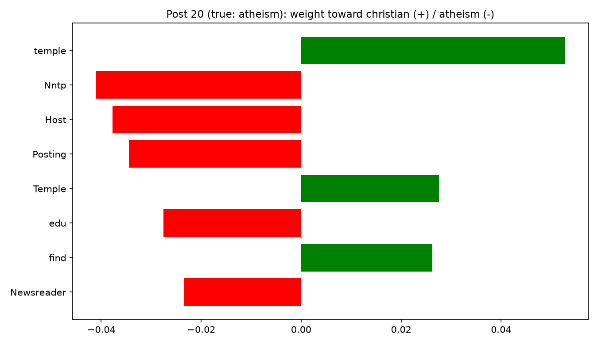{width="100%" fig-align="center"}
:::
::::

::: footer
Ribeiro, M. T., Singh, S., & Guestrin, C. (2016). [*"Why Should I Trust You?": Explaining the Predictions of Any Classifier*](https://arxiv.org/abs/1602.04938). KDD.
:::

::: {.notes}
The figure is real output from the notebook students will run: one post from the alt.atheism / soc.religion.christian task, explained with the raw-headers model. Positive bars push toward 'christian' and negative bars push toward 'atheism'. This post is truly an atheism post and the model gets it right, but look at the words doing the work: 'Nntp', 'Host', 'Posting', 'edu' and 'Newsreader' are email and news-server header fields, not arguments about religion. The model learned something about the posting software, not about the topic.

How LIME works: it makes many copies of the text with random words deleted, asks the model to classify each copy, and fits a weighted linear model on the presence or absence of words. The words with the largest weights in that simple model are the ones shown. The explanation is only valid locally, near this one text.

This slide is the answer to the notebook's first exercise, so show it AFTER students have found their own example, or hide it until the debrief. If the class is quick, show it right away to make the point and move to the 'take the shortcut away' experiment.

The model is model-agnostic: LIME needs only a function from text to class probabilities. Linking back: this is the same black-box explanation idea as the Week 5 lab, here on text instead of images or tabular data.
:::

## Set-up: Open the Notebook

Open the Colab notebook:

<https://colab.research.google.com/github/ctsilva/ctsilva.github.io/blob/main/2026-VisML-CDS/labs/nlp-vis/lime_text.ipynb>

* **File → Save a copy in Drive**, then run the cells from the top (first cell installs `lime`)
* The model is a TF-IDF + logistic regression classifier for two newsgroups: `alt.atheism` vs `soc.religion.christian`
* The model gets about **90 percent** test accuracy. LIME will tell us *why*

**Predict:** is a 90 percent accurate model for the right reasons?

::: {.notes}
The notebook is lime_text.ipynb in this folder; the Colab link only works once the notebook has been pushed to the main branch of the repository, so test it before class. If anyone cannot use Colab, they can read along with a neighbor, or run the notebook locally (it needs scikit-learn and lime).

The dataset is 20 Newsgroups, a classic benchmark that sklearn downloads on first use (a few seconds). We picked the two-class religion subset because the same dataset is the standard LIME demonstration and it has a well-known shortcut: the raw posts contain email headers and signatures, which identify the newsgroup without any understanding of the text.

A simple model is deliberately chosen. A linear model could also be read directly from its coefficients, and the last section of the notebook compares those with LIME's local weights.
:::

## Exercise 1: Right Answer, Wrong Reason

1. Run section 2 on the default post. Read the highlighted words
2. Run the loop that prints the top words for five posts
3. Find a post where the model is **correct** but a top word has **nothing to do with religion**. Record the post number, the word, and its weight

**Discuss with your partner:** if you only had accuracy, would you have found this?

::: {.notes}
Expected result: header and routing words like Host, Posting, NNTP, edu, Newsreader, and author names or institution domains show up as large weights even when the post is classified correctly. Students often find this surprising because accuracy is about 90 percent.

Reading the colors: in the notebook, the explanation is for the christian class. Positive weight (orange) pushes toward christian; negative weight (blue) pushes toward atheism. Remind students of the sign convention if they ask. In this dataset the raw atheism posts often have header words with negative weight (toward atheism), because those header fields happen to correlate with the atheism group's posters and servers.

Walk around and look at their screens: students who find a post with a name like a person's name as the top word have found the same phenomenon.
:::

## Exercise 2: Take the Shortcut Away

**Predict:** reload the data with headers, footers and quotes **removed**. Will test accuracy go **up**, **down**, or **stay the same**?

1. Run section 4 and compare the accuracy with section 1
2. Explain the *same* post again with the cleaned model. How do the highlighted words change?
3. Which model would you rather deploy? Which one looks better on a leaderboard?

**Connect to lecture:** the explanation exposed a shortcut that a single accuracy number hid.

::: {.notes}
Expected result: accuracy drops (about 90 percent to about 76 percent in our run). Once the header fields are gone, the model has to use the text that people wrote, and the highlighted words move toward topical words like 'god', 'christian', 'faith', 'atheism'.

Which one to deploy: the lower-accuracy model is the more honest estimate of how the model will do on text that does not come with the same headers. The higher number came partly from information the model should not be using. This is a case of data leakage and of a shortcut feature, and it is the kind of problem the iSEA tool from the lecture helps to find at scale.

If students ask why the cleaned model's explanation for the same post is not a clean win either: it may be low-confidence, and LIME's weights also change a little between runs (see the discussion questions). That is itself a finding.
:::

## Exercise 3 (optional): Probe It Yourself

1. Write your own short text and run section 5. Try one that mixes both topics, and one that mentions neither
2. Read the prediction and the highlighted words. Does the model say something confident about a text with no signal?
3. Run section 6 to compare LIME's local weights with the model's global top words

**Discuss:** how would you *show* these explanations to a non-technical user? What would you change in the visualization?

::: {.notes}
OPTIONAL - cut this if time is short; it overlaps with the debrief.

A classifier forced to choose between two classes will always give an answer, even for text it should not be classifying. Students who type an off-topic sentence often see a confident-looking prediction driven by a couple of ordinary words. That is a limitation of the model (and of LIME, which explains the model, not the world), and it is a good reason to show uncertainty in the interface.

Section 6 compares LIME with the model's own coefficients. For a linear model these are the global truth, so agreement is expected for common words; LIME's value is greater for models with no coefficients to read.

The last question connects to the course: the notebook's colored text is itself a visualization design. Could a bar chart, a small multiples view, or an interactive view be better? That is a project-level question.
:::

## Debrief {#lab-debrief}

* Which prediction did you get **wrong**? What did the visualization show that you did not expect?
* Part 1 showed *representations*, Part 2 *internals*, Part 3 *behavior*. Which one would you trust to decide whether a model is **safe to deploy**? Why?
* What can each tool **not** show? (A projection distorts distances; attention may not explain; LIME is local and can vary from run to run.)
* Which of these would help **your project**?

::: {.notes}
This is the connecting slide. Let two or three pairs answer out loud.

Possible answers to the trust question: none of them alone. The projection helps find structure but distorts distances; attention shows where the model looked but is not a justification; LIME tests behavior but only locally. In practice combine them with held-out evaluation on realistic data. The shortcut found in Part 3 is the strongest argument: the model had 90 percent accuracy and was still looking at the wrong thing.

Lead into the project: groups that use text or a language model can pick one of these tools directly; groups with other data can ask which question (representation, internals, behavior) their model would need answered.
:::

## Project Proposal Feedback 

* For the remainder of the lab, please look over the feedback on your project proposals with your group members
    * Any questions? Concerns? Any progress you want feedback on? Feel free to ask now

::: {.notes}
Use whatever time is left. Circulate and ask each group which of tonight's three questions (what does the model consider similar, where does it look, which inputs changed the answer) applies to their project.
:::

## Further Exploration

* [Embedding Projector](https://projector.tensorflow.org/) and [Transformer Explainer](https://poloclub.github.io/transformer-explainer/)
* [BertViz](https://github.com/jessevig/bertviz): attention arcs and head views for BERT, GPT-2 and others, in a Colab notebook
* [LIME](https://github.com/marcotcr/lime) and the [SHAP](https://github.com/shap/shap) library for text
* The [NLP4Vis tutorial](https://nlp4vis.github.io/) behind the backup slides
* Next week (Nov 10): Topological Data Analysis

## Backup: NLP + Vis Applications {#lab-backup}

Chart question answering, chart-to-text, and open challenges. **Not needed tonight.**

## NLP + Vis Applications
* These slides are adapted from a half-day tutorial at the 2023 EMNLP Conference by Shafiq Joty (Salesforce AI Research and Nanyang Technological University), Enamul Hoque (York University), and Jesse Vig (Salesforce AI Research)
* You can find their full tutorial slides [here](https://nlp4vis.github.io/)

::: {.notes}
BACKUP - these survey slides were the whole lab in earlier versions. They are not needed tonight; use them for project ideas or if a tool is down.

The tutorial is a good map of the field: natural language as an input to visualization systems, and natural language as an output of them.
:::

## What Can NLP + Vis Be Used For?
* Visual text analytics
* Natural language interfaces for visualizations
* Text generations for visualizations
* Automatic visual story generation
* Visualization retrieval and recommendation 
* Etc.

::: {.notes}
BACKUP. Tonight's tools fall in the first bullet: visual text analytics, applied to models. The rest are applications where language is part of the interface or the output.
:::

## What Can NLP + Vis Be Used For?
* We will first divide these applications into two categories:
    * Natural language as **input**
    * Natural language as **output**

::: {.notes}
BACKUP. Input: the user speaks or types a question and the system answers with a chart or an answer. Output: the system writes text about a chart, such as a caption or a summary.
:::

## NL as Input: ChartQA

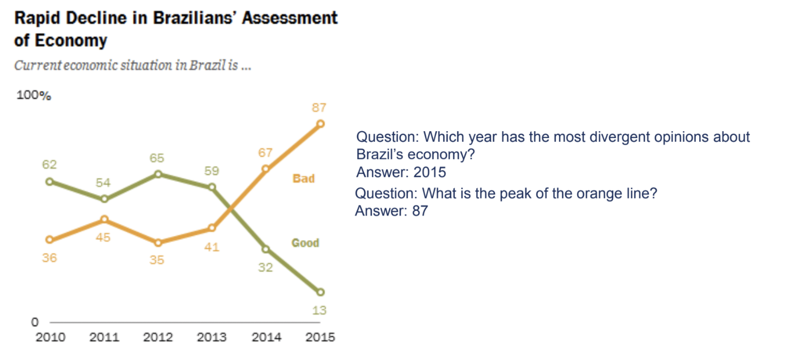{fig-align="center"}

::: footer
Ref: @masry-etal-2022-chartqa
:::

::: {.notes}
BACKUP. ChartQA is a question answering benchmark where the input is a chart image plus a question, and the model must answer, often by reading values and doing arithmetic or comparison. Contrast with text-only QA: the model has to see the chart first.
:::

## ChartQA Dataset

**9.6K human-written and 23.1K machine-generated questions over real-world charts.**

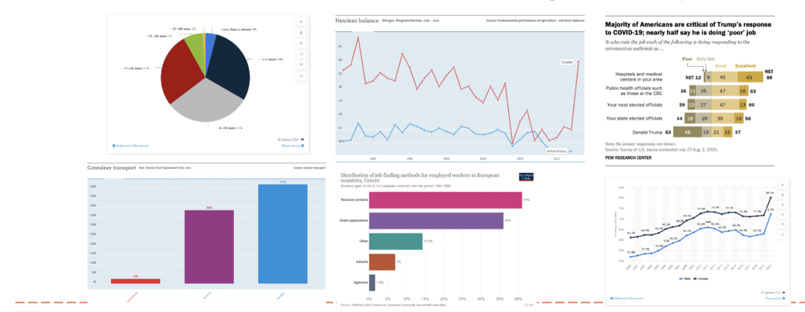{fig-align="center"}

::: footer
Ref: @masry-etal-2022-chartqa
:::

::: {.notes}
BACKUP. The charts were crawled from several online sources. Human-written questions tend to ask for visual and logical reasoning (for example comparing bars, or referring to a color), while machine-generated ones are more template-like. That difference is visible in the evaluation on the next slides.
:::

## ChartQA Approach

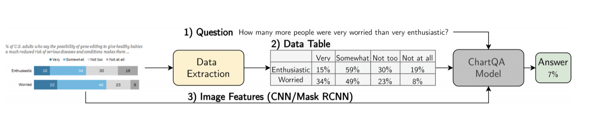{fig-align="center"}

::: footer
Ref: @masry-etal-2022-chartqa
:::

::: {.notes}
BACKUP. The pipeline extracts the data table from the chart image and combines it with the question; the evaluated models include table-based transformers (such as VisionTaPas, next slide). Read the figure left to right: chart image, extracted structure, question, answer.
:::

## ChartQA Evaluation

**VisionTaPas is the strongest model, but accuracy drops on the human-written questions.**

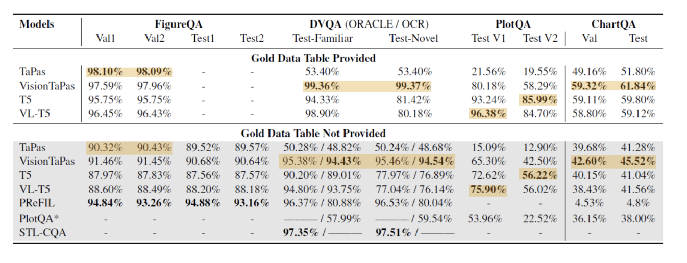{fig-align="center"}

::: {.notes}
BACKUP. VisionTaPas achieves the best performance reported. Accuracy is lower on the authors' dataset than on earlier datasets, mainly because of the human-written visual and logical reasoning questions.
:::

## OpenAI’s Study of GPT-4 on ChartQA Benchmark

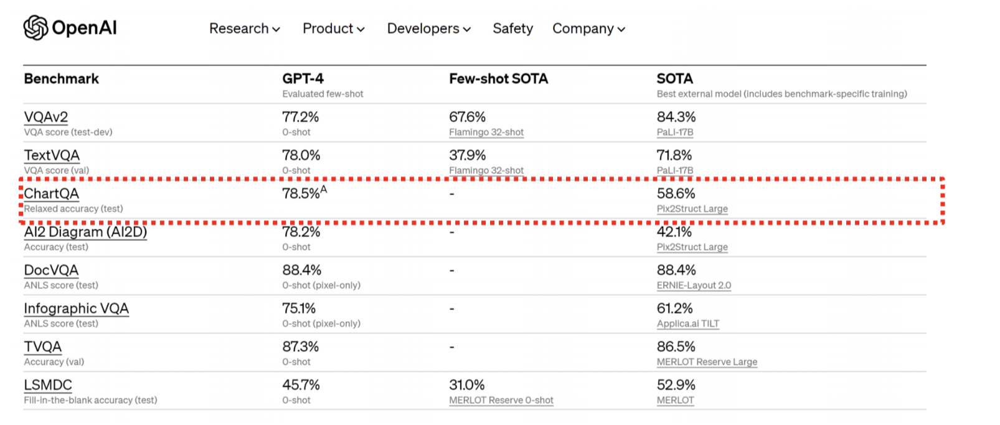{fig-align="center"}

::: footer
Ref: https://openai.com/research/gpt-4
:::

::: {.notes}
BACKUP. The slide shows a general-purpose multimodal model evaluated on the benchmark. The point for us: a benchmark built for task-specific models became a test for general-purpose models, and the field moved quickly.
:::

## NL as Input: Multimodal Inputs for Visualizations

:::: {.columns}
::: {.column width="40%"}
* Ambiguity widgets: Eviza (Setlur et al., 2016)
* Allows users to rectify queries
:::
::: {.column width="60%"}
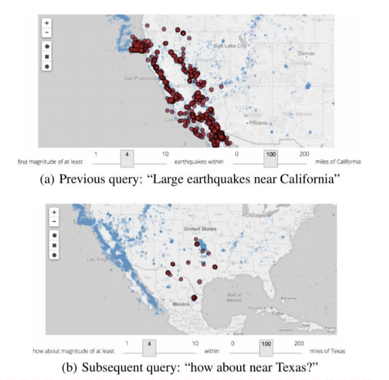{height="760" fig-align="center"}
:::
::::

::: {.notes}
BACKUP. Natural language is ambiguous, so Eviza shows ambiguity widgets: when part of the query could be interpreted in more than one way, the user can adjust it with a small control instead of rephrasing. The figure shows a map query, 'large earthquakes near California' in (a), then a follow-up, 'how about near Texas?' in (b).
:::

## NL as Input: Multimodal Inputs for Visualizations

**Query completion through text and interactive vis: Sneak Pique (Setlur et al., 2020).**

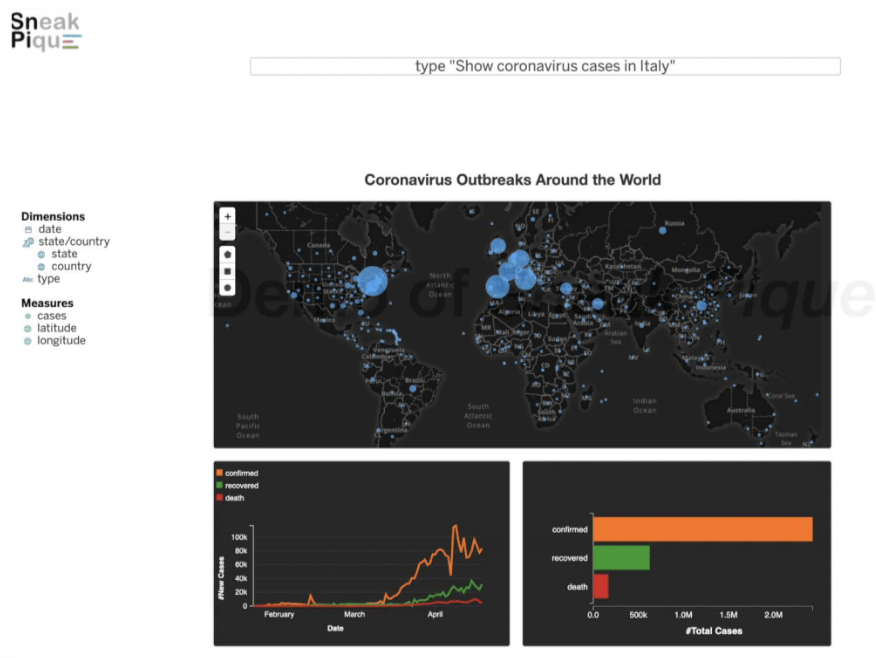{fig-align="center"}

::: footer
Ref: @10.1145/3379337.3415813
:::

::: {.notes}
BACKUP. Sneak Pique combines typing with interactive visual cues: while the user types a query (here 'show coronavirus cases in Italy' over a world map), the system suggests completions in context so the user can pick one. The idea is to help users discover what they can ask.
:::

## NL as Output: Chart-to-Text

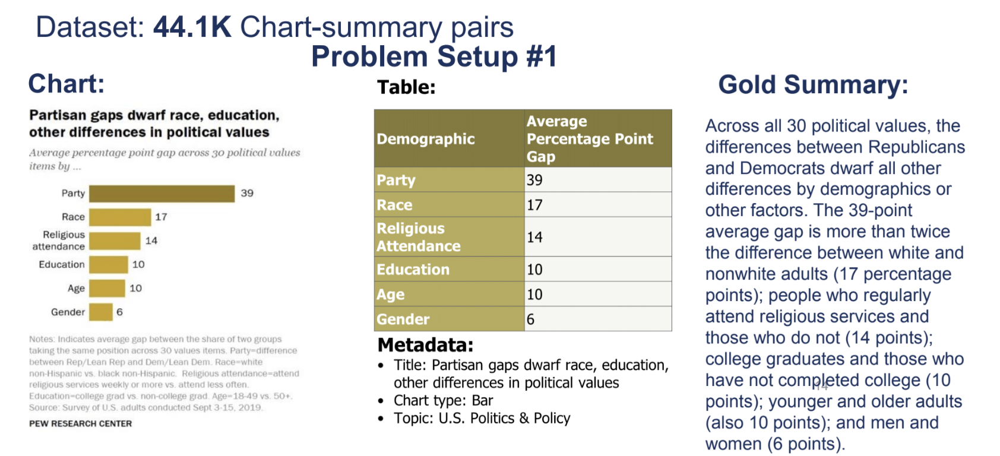{fig-align="center"}

::: footer
Ref: @kantharaj-etal-2022-chart
:::

::: {.notes}
BACKUP. Chart-to-text generates a natural-language summary of a chart. This is Problem Setup 1: the inputs are the chart, its data table, and metadata (title, chart type, topic), and the target is the gold summary on the right. It is a form of captioning, but it should describe data, trends and comparisons, not just the picture. It is also an accessibility tool, which returns at the end of the deck.
:::

## NL as Output: Chart-to-Text

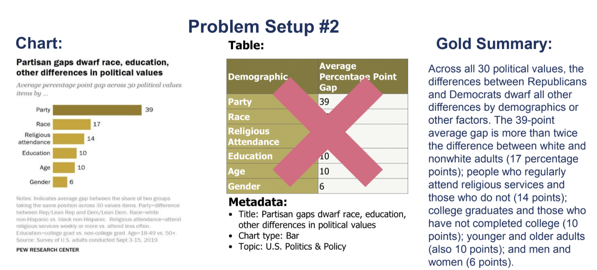{fig-align="center"}

::: footer
Ref: @kantharaj-etal-2022-chart
:::

::: {.notes}
BACKUP. The same Chart-to-Text work. The slide before is Problem Setup 1: a chart, its data table and metadata, and a gold summary. This one is Problem Setup 2, where the data table is not available (the red cross), so the model must work from the chart image alone. The dataset has 44.1K chart-summary pairs.
:::

## Chart-to-Text Example Models

**Fine-tune BART or T5 on the authors' datasets, with two different input setups.**

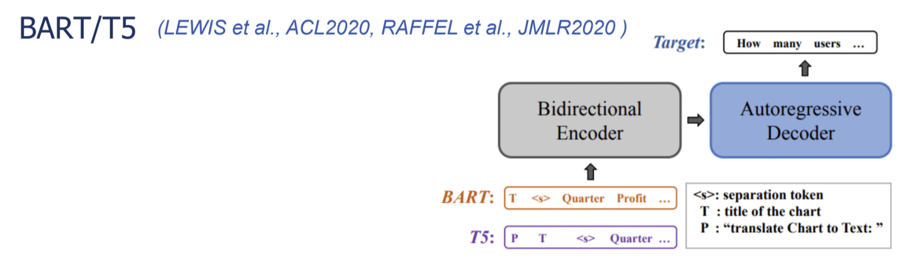{fig-align="center"}

::: footer
Ref: @kantharaj-etal-2022-chart
:::

::: {.notes}
BACKUP. Setup 1 linearizes the chart's data table into a text sequence and feeds that to the model. Setup 2 uses the text recovered from the chart image by OCR (titles, labels, numbers). T5 is told what to do with a prefix: "translate Chart to Text: ". These are full fine-tuning, which is much more expensive than prompting a general-purpose model.
:::

## Chart-to-Text Sample Output

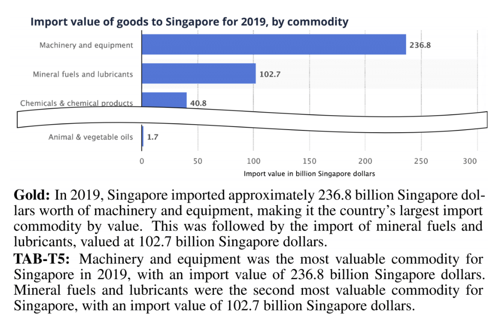{fig-align="center"}

::: footer
Ref: @kantharaj-etal-2022-chart
:::

::: {.notes}
BACKUP. A chart of Singapore's imports by commodity, with the gold summary and the output of TAB-T5 (the table-input model) below it. Ask students to compare the two and to check the model's claims against the bars. Fluent text can still be wrong or incomplete, which leads to the open challenges at the end.
:::

## VisText

**12.4K charts with generated and crowd-sourced captions, plus a scene graph for each chart.**

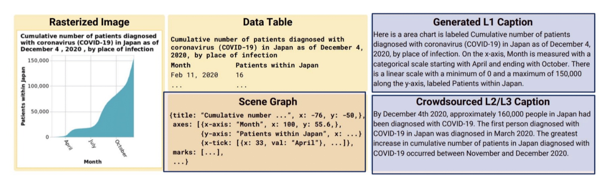{fig-align="center"}

::: footer
Ref: @tang-etal-2023-vistext
:::

::: {.notes}
BACKUP. VisText adds a hierarchical scene graph of the chart's visual elements (axes, marks, labels) as a model input, in addition to the image and the data. The captions describe different levels of content, from the chart's construction to trends and statistics.
:::

## VisText Sample Output

**The model identifies the upward trend, but repeats the claim twice.**

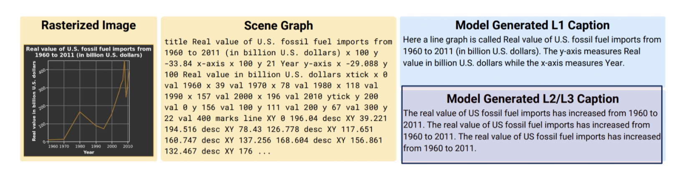{fig-align="center"}

::: footer
Ref: @tang-etal-2023-vistext
:::

::: {.notes}
BACKUP. A good illustration of a typical failure mode that is not a factual error: the output is correct but redundant. Compare with the hallucination examples in the open challenges.
:::

## NL as Output: Open-Ended Question Answering with Charts

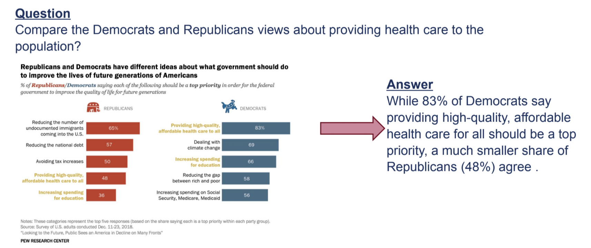{fig-align="center"}

::: footer
Ref: @kantharaj-etal-2022-opencqa
:::

::: {.notes}
BACKUP. OpenCQA moves from short factual answers to open-ended, explanatory ones. The example asks to compare Democrats and Republicans on providing health care to the population, and the answer is a sentence that reads the relevant bars and compares them. These answers are closer to what an analyst would write, and much harder to evaluate automatically.
:::

## Combining Language and Visualizations as Output

:::: {.columns}
::: {.column width="40%"}
* Roles of natural language
  * Generating an explanatory answer
  * Explaining the answer
:::
::: {.column width="60%"}
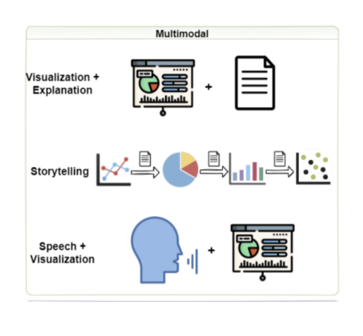{height="760" fig-align="center"}
:::
::::

::: {.notes}
BACKUP. The figure shows three ways language and visualization combine: visualization plus an explanation, a story told as a sequence of charts with text between them, and speech together with a visualization.
:::

## Combining Language and Visualizations as Output

**An example of combining text and vis as a multimodal output.**

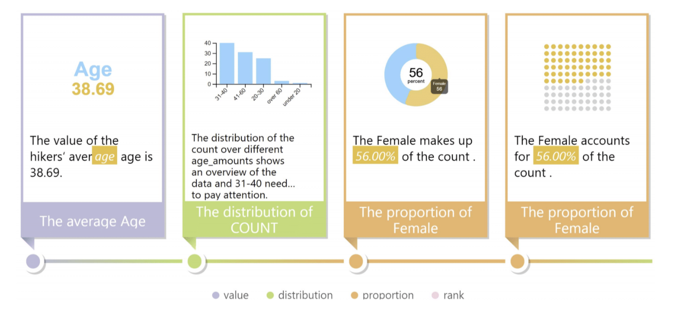{fig-align="center"}

::: footer
Ref: @DBLP:journals/corr/abs-2010-09975
:::

::: {.notes}
BACKUP. A data story built from a sequence of facts, each with a small chart and a one-line text: the average age, the distribution of the count, the proportion of female, and so on, labeled by fact type (value, distribution, proportion, rank). This is from Calliope (Shi et al., 2020), which generates a visual story from a spreadsheet. Each step pairs a chart with a sentence that says what it shows.
:::

## Combining Language and Visualizations as Output

**DataShot (Yun et al., 2019): automatic generation of fact sheets from tables.**

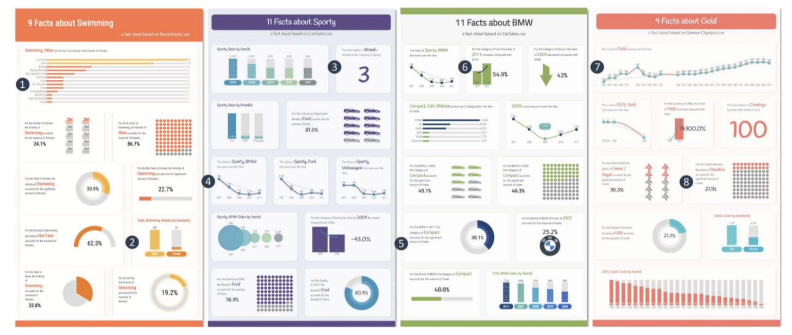{fig-align="center"}

::: footer
Ref: @Wang2020DataShotAG
:::

::: {.notes}
BACKUP. DataShot turns a table into a fact sheet: it finds interesting facts, picks a chart for each, and writes a short text for it. An example of automatic visual story generation.
:::

## Conversational QA With Visualization

**Evizeon (Hoque et al., TVCG 2017): follow-up questions that keep context.**

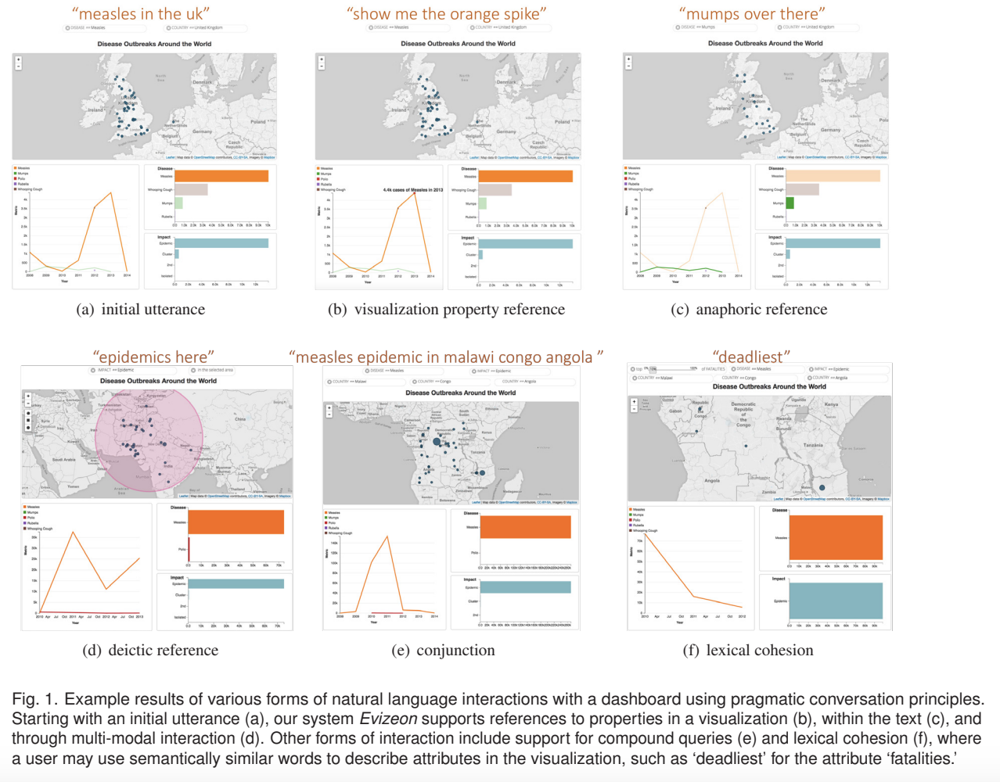{fig-align="center"}

::: {.notes}
BACKUP. Evizeon is a dashboard with a map and a line chart that the user drives with typed or spoken language. The figure's panels show different kinds of reference: an initial utterance ('measles in the UK'), a reference to a visualization property ('show me the orange spike'), an anaphoric reference ('mumps over there'), a deictic reference, a conjunction, and a lexical cohesion. Each follow-up is only meaningful because the system remembers the context of the earlier ones; that memory is what makes the interaction conversational.
:::

## Open Challenges: Natural Language Interfaces

* Design of natural language interfaces
    * Must consider richness and ambiguities of natural language
    * Complex reasoning required to predict the answer
    * Computer vision challenges for automatic understanding of image charts
    * Inherently interdisciplinary (HCI, ML, NLP, InfoVis, Computer Vision)

::: {.notes}
BACKUP. The next few slides show concrete examples of each challenge.
:::

## Open Challenges: Datasets

* Dataset creation
    * Need for large-scale, real-world benchmark datasets
    * Most existing datasets lack realism
    * For many problem setups, there is no benchmark

::: {.notes}
BACKUP. Models are only as good as the data and benchmarks that train and judge them, and chart datasets are small compared with text or natural-image datasets.
:::

## Open Challenges: Language Generation

* Challenges with natural language generation
    * Hallucinations
    * Factual errors
    * Perceptual and reasoning aspects
    * Computer Vision Challenges

::: {.notes}
BACKUP. The next slides show a few of these failures.
:::

## Open Challenges: A Factual Error

:::: {.columns}
::: {.column width="40%"}
* The model attaches the top value to the wrong entity
* It describes a "Brazilian singer" that does not appear in the chart
:::
::: {.column width="60%"}
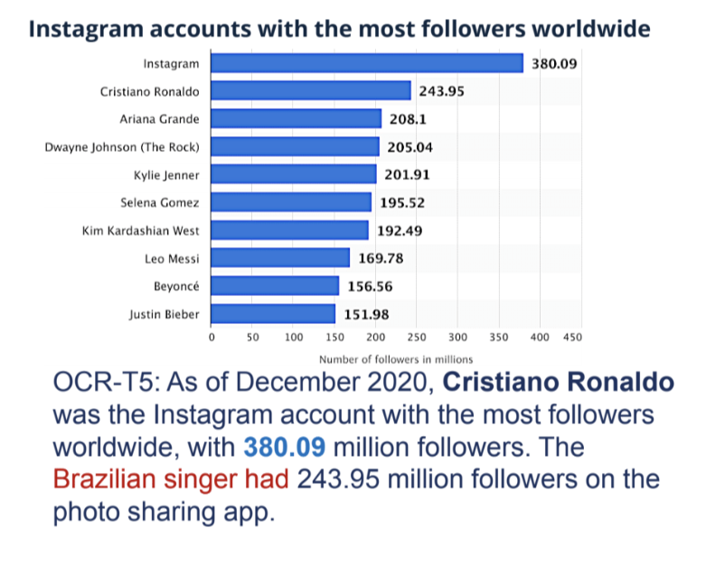{height="760" fig-align="center"}
:::
::::

::: {.notes}
BACKUP. The chart is Instagram accounts with the most followers. The generated text, from an OCR-T5 model, says Cristiano Ronaldo had 380.09 million followers; in the chart that value belongs to the Instagram account itself, and Ronaldo's is the 243.95 that appears in the next sentence. It also calls someone a 'Brazilian singer', which is not in the data. The text is fluent, so the errors are easy to miss without checking against the chart.
:::

## Open Challenges: A Fluent but Unreliable Summary

**A confident paragraph with many specific numbers. Check a few against the chart.**

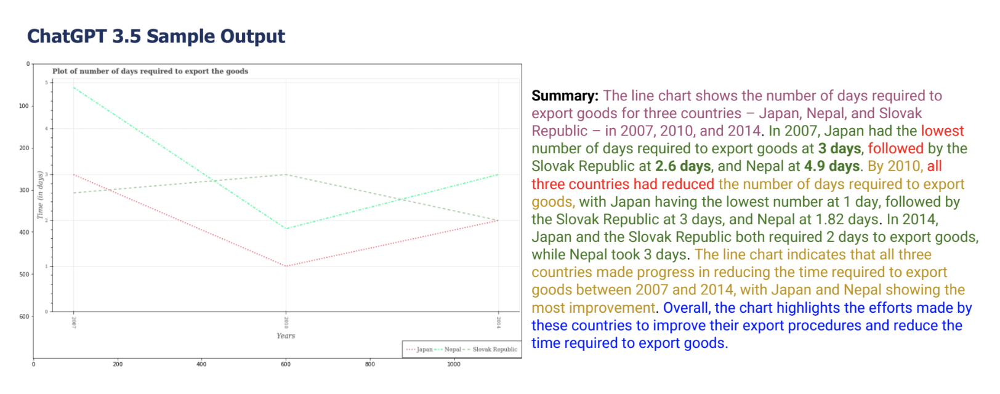{fig-align="center"}

::: {.notes}
BACKUP. Output from ChatGPT 3.5 for a line chart of days required to export goods for Japan, Nepal and the Slovak Republic, 2007-2014. The text is organized and sounds authoritative. Ask students to pick two claims and verify them against the lines; the more specific the numbers, the more they need to be checked. Note that the chart itself has an odd axis layout, which also makes reading it harder.
:::

## Open Challenges: Visual and Logical Reasoning

**Questions that need arithmetic or a reference to color.**

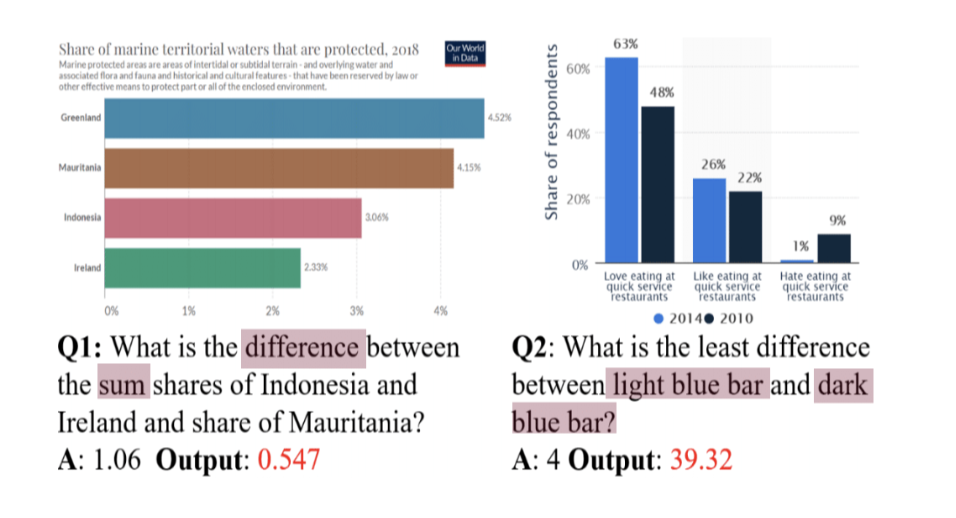{fig-align="center"}

::: footer
Ref: @masry-etal-2022-chartqa
:::

::: {.notes}
BACKUP. Two failures. Question 1 asks for the difference between a sum of two bars and a third bar, needing three values read correctly and combined; the model's output (0.547) is far from the answer (1.06). Question 2 refers to bars by color ('light blue bar', 'dark blue bar'), so the model has to connect a color in the question to the legend; the answer is 4 and the output is 39.32.
:::

## Open Challenges: Chart Data Extraction

**Boxes mark the chart elements a detector found. Some labels were missed.**

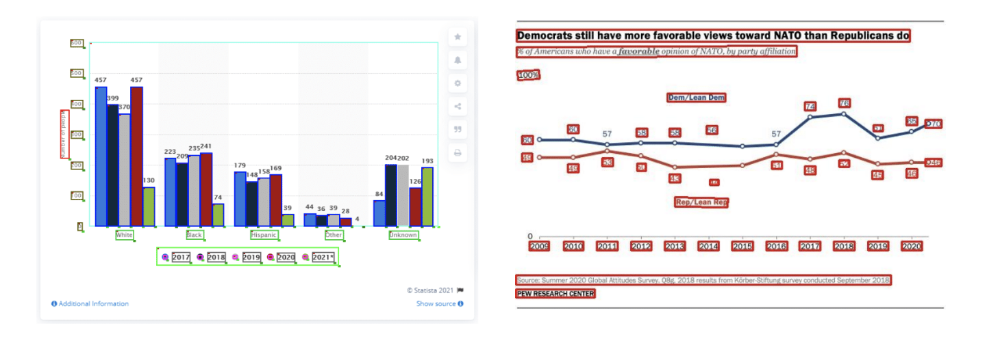{fig-align="center"}

::: footer
Ref: @masry-etal-2022-chartqa
:::

::: {.notes}
BACKUP. For image charts the system must first recover the structure: text, axis labels, legend entries, marks. The boxes show detected elements. Errors here propagate to everything downstream; in the line chart on the right, a few data labels are not boxed. This is why chart question answering is harder than question answering over a clean table.
:::

## Open Challenges: Data Stories

**How can we effectively combine text and visualization in data stories?**

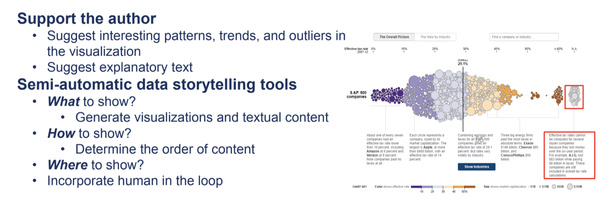{fig-align="center"}

::: {.notes}
BACKUP. The left side lists the goals: support the author by suggesting patterns and explanatory text, and build semi-automatic storytelling tools that decide what to show, how to show it (the order of content), and where to show it, with a human in the loop. The right side is a New York Times chart on effective tax rates, with annotations placed next to the data that they describe; the red boxes mark the annotation text.
:::

## Open Challenges: Accessibility

:::: {.columns}
::: {.column width="40%"}
* NLP for visualization accessibility
* A voice interface answers questions about a chart, and follow-ups
:::
::: {.column width="60%"}
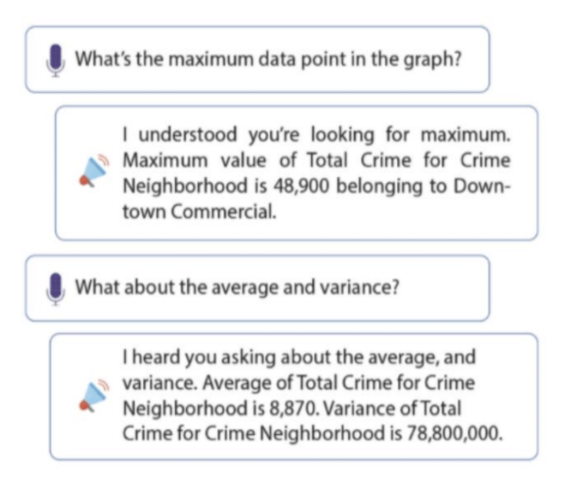{height="760" fig-align="center"}
:::
::::

::: footer
Ref: @10.1145/3491102.3517431
:::

::: {.notes}
BACKUP. A voice exchange from VoxLens (Sharif et al., 2022), an interactive plug-in that makes online charts accessible to screen-reader users. The user asks for the maximum data point and the system gives the value and the category; the follow-up asks for the average and variance. A chart that can only be read visually is not accessible, and natural language is one way to open it up.
:::

## Open Challenges: Accessibility

**A chart with a generated description, a length slider, and narration.**

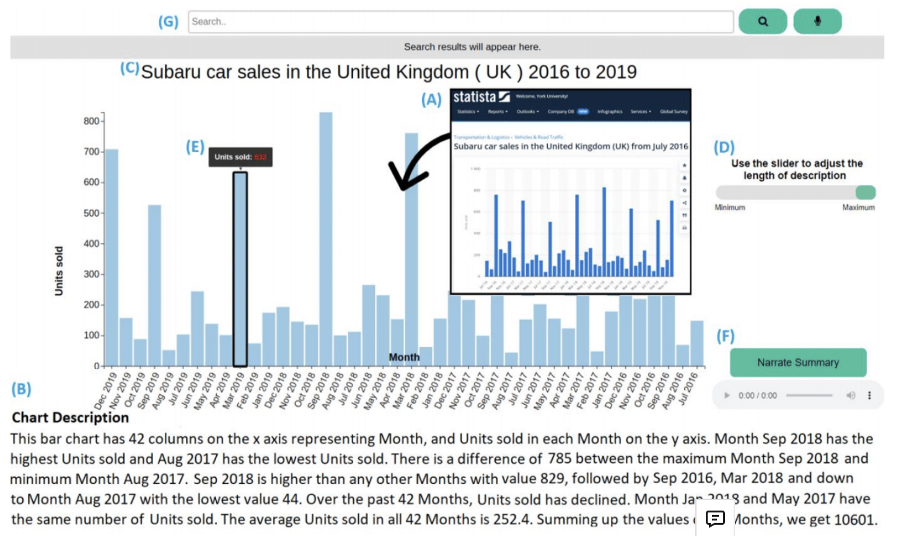{fig-align="center"}

::: footer
Ref: @Alam_et_al
:::

::: {.notes}
BACKUP. An interface from SeeChart (Alam et al., 2023) for a chart of UK car sales. It shows the chart, a generated description (number of columns, highest and lowest values, difference, average), a slider that adjusts the length of the description, a narrate button for audio, and a search box. The design lets the user choose how much detail they get, which matters for screen-reader users.
:::

## References

