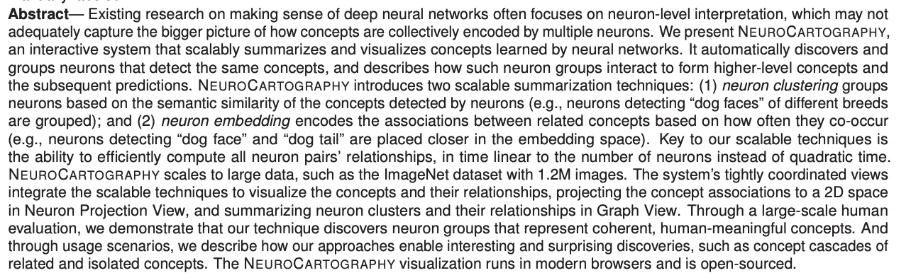
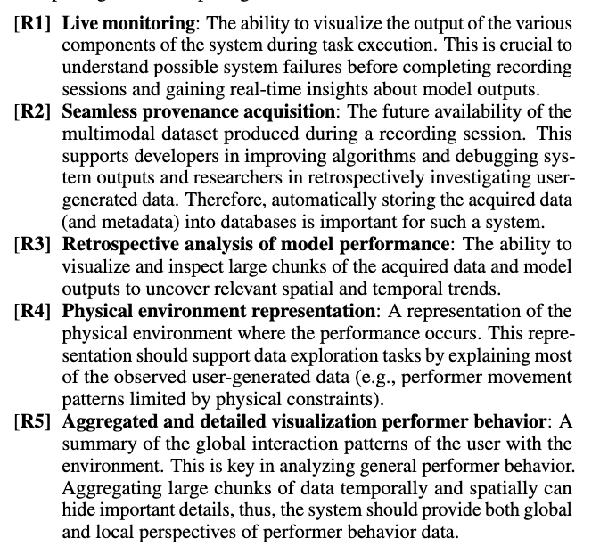
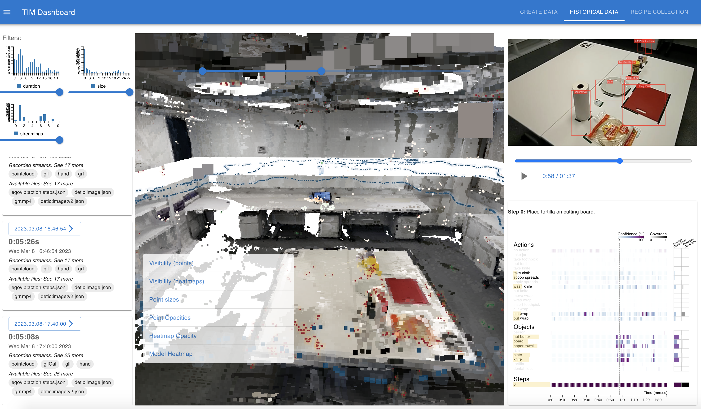
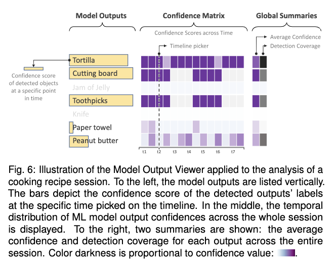
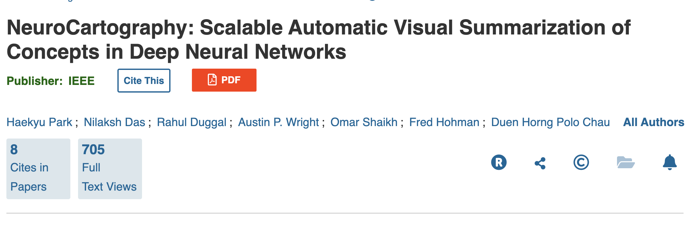
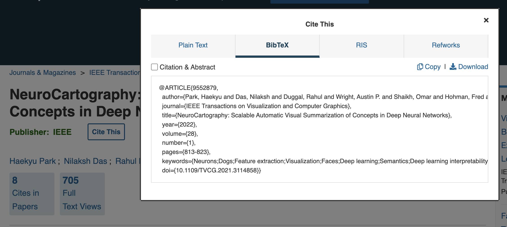
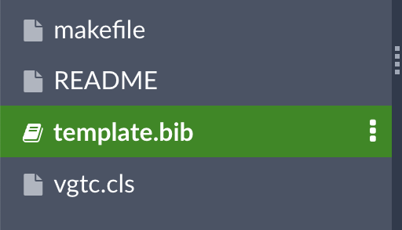
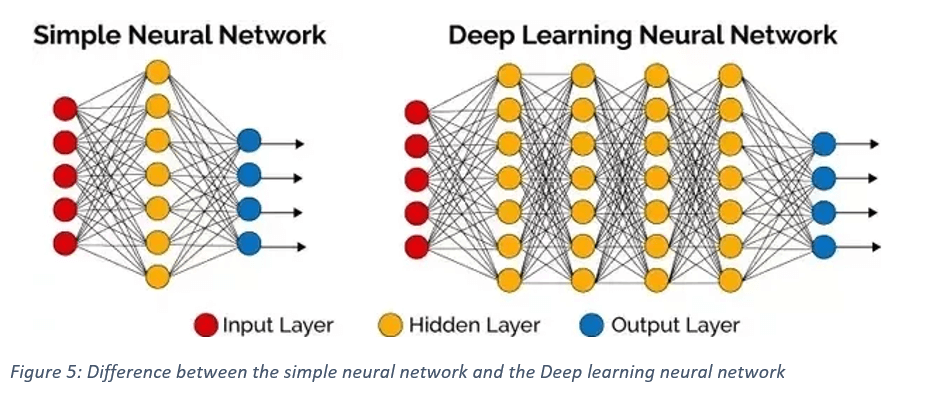

## Lab Overview

* Today: how to write the research paper for your final project
* Your **project update** (1 page) is due **Nov 3**; the **final paper** (8 pages) is due **Dec 14**
* We will go section by section, then figures, then citations

::: {.notes}
Frame the session: this is practical writing guidance for the project. The project update due next week is a good first chance to apply it. The final paper is the main written deliverable of the course.
:::

## Plan for This Session

| Part | Slides | Status |
|---|---|---|
| [Why and how: the paper as an argument](#why-papers) | 3 | core |
| [The sections, abstract to conclusion](#paper-sections) | 15 | core |
| [Figures](#figures) | 3 | core |
| [Citations with BibTeX](#bibtex) | 4 | optional (read on your own) |
| [Deep learning visualization tools](#dl-tools) | 5 | optional |

**About 25 minutes for the core parts.** Skip the optional parts if short on time; the slides stay available afterwards.

::: {.notes}
If time is tight, the core is the argument framing, the abstract, intro vs related works vs background, design goals and evaluation, and the figure comparison. BibTeX and the tools tail are reference material.
:::

# Why and How {#why-papers}

## Why Do We Care?

* Communicating your ideas clearly to a specific audience is a necessary skill in **any** profession, not just academia
* ML moves fast: papers are where the new insights are, and knowing their structure makes that information easier to find and use
* For your final project, you will present your work **in the form of a research paper**

::: {.notes}
Keep this short. The point is that the paper format is a tool, and that students who learn to read papers quickly also write them better.
:::

## A Paper Is a Persuasive Essay

:::: {.columns .smaller}
::: {.column width="50%"}
**The argument**

* Science looks like objective truth, but it is a process of logical reasoning
* A good paper presents evidence that convinces the reader of a conclusion: the "story" of the paper
* You are not just describing what you did. You are **arguing why it matters and why it is sound**
:::
::: {.column width="50%"}
**The audience**

* Assume general CS expertise and knowledge of the subfield (e.g. data visualization)
* Do **not** assume expertise in your specific topic or application
* In this class: write for **visualization and ML experts**
:::
::::

::: {.notes}
Ask: who is the reader? Then: what do they need to believe by the end? Everything in the paper should serve that.
:::

## Typical Sections of a Research Paper

:::: {.columns}
::: {.column width="50%"}
1. Abstract
2. Introduction
3. Related Works
4. Background / Design Goals / Data Description
5. Methods
6. Evaluation
7. Conclusion / Limitations / Future Work
8. Acknowledgements
9. References
:::
::: {.column width="50%"}
<div style="background: #e3f2fd; padding: 25px; border-radius: 8px; margin-top: 30px;">
Intro, related works and background can **seem redundant**.

Each serves a different purpose, even where the information overlaps.
</div>
:::
::::

# Paper Sections {#paper-sections}

## Each Section Answers a Different Question

| Section | The question it answers |
|---|---|
| Abstract | What did you do, why, and what did you find? |
| Introduction | What problem, why does it matter, and how do you attack it? |
| Related Works | What have others tried, and what did we learn from it? |
| Background | What does the reader need to understand *your* work? |
| Methods | What did you build, and why this way? |
| Evaluation | How do you know it worked? |
| Conclusion | What does it mean, what are the limits, what is next? |

::: {.notes}
This is the skeleton of the next fifteen minutes. If students remember only one table from the session, it should be this one.
:::

## The Abstract {#abstract}

**The first impression of your paper: an overview of every section in around 250 words.**

::: {.smaller}
| Part | What it answers |
|:--------|:----------------------------------|
| **Motivation** | Why do we care? Importance, difficulty, and impact if successful |
| **Problem statement** | What problem, and what scope (general or specific)? Avoid jargon |
| **Approach** | How did you go about it? What did you control, ignore, or measure? |
| **Results** | What is the answer? Give numbers; avoid "very", "small", "significant" |
| **Conclusions** | What are the implications? General, or specific to one case? |
:::

::: footer
Adapted from [this guide](https://users.ece.cmu.edu/~koopman/essays/abstract.html), which gives more detail.
:::

::: {.notes}
Previously this was five separate slides that revealed one part at a time; it is one table now so students can photograph it. Go down the rows once, then move to the example and have them find each part.
:::

## Example Abstract

**Can you find the motivation, problem, approach, results and conclusions?**

{fig-align="center"}

::: footer
[*NeuroCartography: Scalable Automatic Visual Summarization of Concepts in Deep Neural Networks*](https://ieeexplore.ieee.org/stamp/stamp.jsp?tp=&arnumber=9552879)
:::

::: {.notes}
Give them a minute to mark it up with a neighbor. Suggested answer: motivation and problem are the first two sentences (existing work focuses on neuron-level interpretation and misses how concepts are encoded collectively). Approach: the system itself, with neuron clustering and neuron embedding. Results: scalability to ImageNet (1.2M images), a large-scale human evaluation, and usage scenarios. Conclusions: the discoveries it enables, such as concept cascades, plus the open-source release. Note that the numbers appear in the results, as the table asks.
:::

## Intro vs Related Works vs Background

| Section | Its job |
|---|---|
| **Introduction** | What problem are you solving, why does it matter, and how are you solving it? |
| **Related Works** | How have others tried to solve it? What have we learned from those works? |
| **Background** | The context needed to understand the work **you** did: your data and design goals. **Not** a description of related work |

Proposals often conflate these three. Keeping them apart is the biggest structural upgrade you can make.

::: {.notes}
This is the point that most improves the proposals. Related works looks backward at the field; background supports understanding of your own work.
:::

## The Introduction Section

:::: {.columns .smaller}
::: {.column width="50%"}
**What it contains**

* The motivation behind your project
* A brief account of why past work is insufficient
* An overview of your methods and your contributions
:::
::: {.column width="50%"}
**Do**

* Really sell the issue: convince the reader the problem is important

**Don't**

* Delve into details of related works. Citations backing up general statements are fine
:::
::::

## What Are Contributions?

* The **tangible products** of the work: a tool, insights in the form of case studies, expert feedback
* Often written as a bulleted list at the end of the Introduction

::: {.notes}
Contributions are what you want a reader to be able to cite you for. Be specific and checkable.
:::

## The Related Works Section

* Situates your work in the context of the existing literature
* **Synthesizes** several papers into each salient point the reader needs before they can understand your work
* **Not** a list of recaps of other papers!

## Related Works: Bad vs Good Structure

:::: {.columns .smaller}
::: {.column width="50%"}
**Bad: one paper per paragraph**

We use the dataset by Author et al. [1], which *[rest of paragraph recaps the dataset paper]*.

Smith et al. [2] present a visualization tool for multi-object tracking... *[rest of paragraph describes this one paper]*.

Zhu et al. [3] also present a visualization tool for multi-object tracking... *[rest of paragraph describes this one paper]*.
:::
::: {.column width="50%"}
**Good: one idea per paragraph**

Previous works have tackled multi-object tracking (MoT) in several ways. Some have attempted Approach A [1, 2]. Others have built on this with Approach B [3, 4, 5]. These works gave promising results, but some shortcomings left questions unanswered.

Several challenging aspects of MoT have both inhibited and inspired previous studies. Scenes with many objects involve motion, and objects may become occluded. Previous works addressed this by doing X and Y [6, 7]. However, this is still insufficient because...
:::
::::

**Structure paragraphs around approaches or challenges, not single papers.**

::: {.notes}
Many groups wrote the bad version in their proposals. That is normal, and it is why we discuss it: the expectations are now clear and the final paper can improve. The good version is deliberately generic; yours should be more specific. The test: could you reorder the paragraphs by idea? If each paragraph is one paper, you cannot.
:::

## The Background Section

* The context needed to understand the work **you** did, not related works
* Usually a description of your **data** and your **design goals**; other papers may describe earlier work by the same authors

## Describing Your Data: Related Works or Background?

:::: {.columns .smaller}
::: {.column width="50%"}
**Goes in Related Works**

The premise of the dataset paper and the lessons learned from it.

*"High-resolution multimodal data collected in urban settings is difficult to collect and therefore not abundant. One example is the StreetAware dataset [1], which..."*
:::
::: {.column width="50%"}
**Goes in Background**

A literal description of the data.

*"The dataset contains 120 videos in mp4 format, etc."*
:::
::::

::: {.notes}
This answers the common question: isn't describing my data a description of related work? The dataset paper's premise and lessons are related work. The facts about the data you actually use are background.
:::

## What Are Design Goals?

:::: {.columns}
::: {.column width="40%"}
A list of:

* What you hope to **enable your users to do**
* The **types of insights** you hope to provide

This is **not** a description of your contributions or the specific features of your visualizations.
:::
::: {.column width="60%"}
{height="760" fig-align="center"}
:::
::::

::: {.notes}
The example is from a published system paper. Notice that each requirement states a capability the user needs (live monitoring, retrospective analysis) rather than a feature of the interface.
:::

## The Methods Section

:::: {.columns .smaller}
::: {.column width="50%"}
**Explain your work, and argue for it**

* Still part of the persuasive argument
* Justify **why** you did what you did as you explain it
* The justification can cite other works
:::
::: {.column width="50%"}
**Connect to your design goals**

* Each aspect of your final product (visualizations, tool, system) should address **at least one** design goal
:::
::::

## The Evaluation Section

* How do you know the approach in Methods **worked**?
* Quantitative metrics or qualitative analysis
* Case studies can go here or in their own section before it
* Other papers add expert feedback here (not required for this class)

## What Is a Case Study?

* Walks the reader through an example of using your approach to gain valuable insights
* Typically used to show the value of a tool or system, and/or to justify design decisions

**Example:** see Section 6.2 of [this paper](https://ieeexplore.ieee.org/document/10305427)

## The Conclusion Section

* Recap the contributions and why they are important
* Limitations
* Future work

# Figures {#figures}

## Figures

:::: {.columns .smaller}
::: {.column width="50%"}
**Why they matter**

* Often the **first impression** of your paper
* Should stand alone as a complete thought
* The body text can repeat a figure's content, but you should not need it to understand the figure
:::
::: {.column width="50%"}
**Common types**

* Teaser
* System architecture
* Explaining a specific component
* Walking the reader through a case study
:::
::::

## Figure Design

* **No plain screenshots.** Annotations should guide the reader through what they are looking at
* Be mindful of text size
* It should be clear that some thought went into the design

## Bad vs Good Figure Design

:::: {.columns}
::: {.column width="50%"}
{width="100%"}
:::
::: {.column width="50%"}
{width="100%"}
:::
::::

**Left: a plain screenshot ("The interface of our tool."). Right: an annotated figure that explains itself.**

::: {.notes}
Ask what the left figure asks the reader to do (decode an unfamiliar interface unaided) and what the right figure does for them (labels the parts, explains the encoding, and gives a legend and a caption that tells the story). The right-hand figure also carries its own caption.
:::

# Citations with BibTeX {#bibtex}

## BibTeX: Find the Entry

**Most papers have a "cite this" button with BibTeX as a format option.**

{fig-align="center"}

::: {.notes}
BibTeX is the easiest way to format both your bibliography and your in-text citations. This section is reference material; students can follow it on their own with the template.
:::

## BibTeX: Find the Entry (continued)

{fig-align="center"}

## BibTeX: Add It to Your .bib File

:::: {.columns}
::: {.column width="40%"}
Paste the entry into **template.bib**, in the template provided for the paper.
:::
::: {.column width="60%"}
{width="80%" fig-align="center"}
:::
::::

## BibTeX: Cite and Generate the Bibliography

:::: {.columns}
::: {.column width="50%"}
**In-text citation:** pass `\cite` the key, the first part of the BibTeX entry

```tex
\cite{9552879}
```
:::
::: {.column width="50%"}
**Bibliography:** pass `\bibliography` the name of your `.bib` file

```tex
\bibliography{template}

\end{document}
```
:::
::::

# Deep Learning Visualization Tools (Optional) {#dl-tools}

## Visualizing Deep Learning

* Earlier tonight you used [TensorFlow Playground](https://playground.tensorflow.org/#activation=tanh&batchSize=10&dataset=circle&regDataset=reg-plane&learningRate=0.03&regularizationRate=0&noise=0&networkShape=4,2&seed=0.43147&showTestData=false&discretize=false&percTrainData=50&x=true&y=true&xTimesY=false&xSquared=false&ySquared=false&cosX=false&sinX=false&cosY=false&sinY=false&collectStats=false&problem=classification&initZero=false&hideText=false) and [CNN Explainer](https://poloclub.github.io/cnn-explainer/): two visual tools for exploring the inner workings of neural networks
* There are many more tools like these, for many types of models

## Deep Neural Networks (DNNs)

**Deep neural networks stack more than one hidden layer.**

{fig-align="center"}

::: {.notes}
They are loosely inspired by how the brain processes information, though the analogy should not be pushed.
:::

## NeuroCartography

* *Scalable Automatic Visual Summarization of Concepts in Deep Neural Networks*
* The tool is available [here](https://poloclub.github.io/neuro-cartography/)
* The paper is available [here](https://ieeexplore.ieee.org/stamp/stamp.jsp?tp=&arnumber=9552879)

## Other Tools to Explore

:::: {.columns .smaller}
::: {.column width="50%"}
* [ActiVis](https://minsuk.com/research/activis/): visual exploration of industry-scale deep neural network models
* [Dodrio](https://poloclub.github.io/dodrio/): visual exploration of transformer models
* [GAN Lab](https://poloclub.github.io/ganlab/): the inner workings of generative adversarial networks
:::
::: {.column width="50%"}
* [Visual Auditor](https://visual-auditor.surge.sh/): identifying and understanding biases in ML models
* [Bluff](https://poloclub.github.io/bluff/): understanding adversarial attacks on neural networks
* [Diffusion Explainer](https://poloclub.github.io/diffusion-explainer/): how stable diffusion turns text prompts into images
:::
::::

## Further Reading

* The [CNN Explainer paper](https://arxiv.org/pdf/2004.15004.pdf)
* Zeiler and Fergus, [*Visualizing and Understanding Convolutional Networks*](https://link.springer.com/content/pdf/10.1007/978-3-319-10590-1_53.pdf)
* [ShapeShop](https://fredhohman.com/papers/shapeshop): Towards Understanding Deep Learning Representations via Interactive Experimentation

## Remember

* Your paper is a **persuasive argument** that your solution to the challenge you present is a reasonable one
* Think of each section and figure as a new facet of the evidence for that argument

**Next:** project update (1 page) due **Nov 3**; final paper (8 pages) due **Dec 14**.
