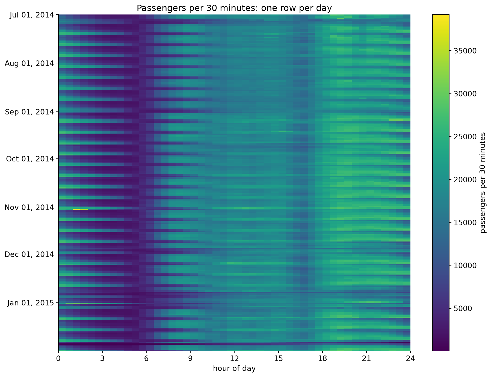
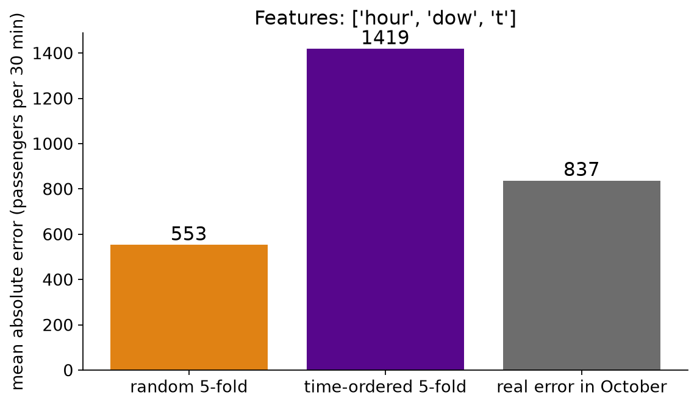
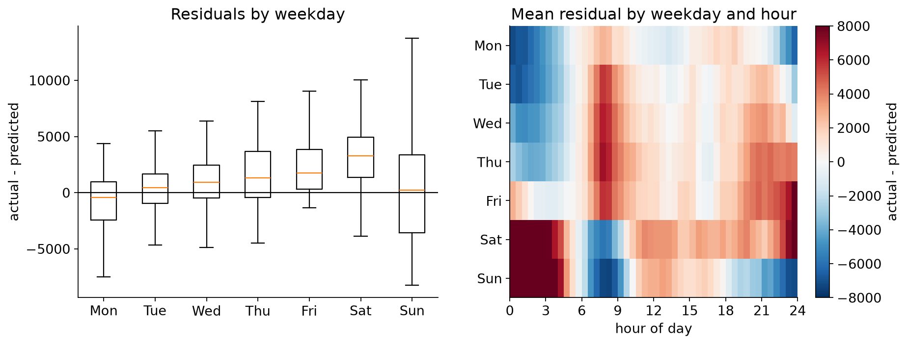
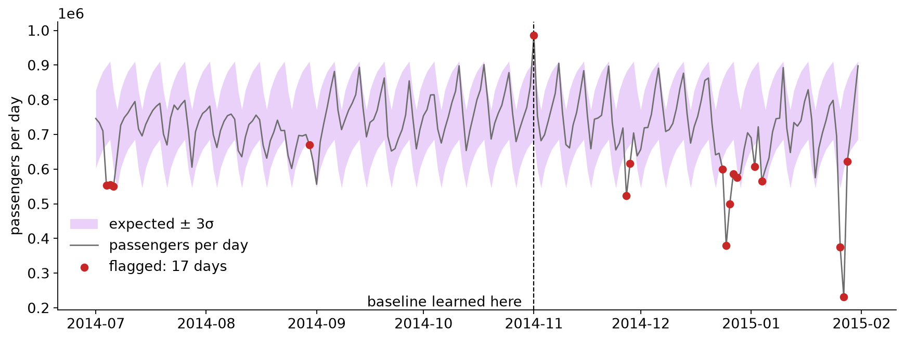
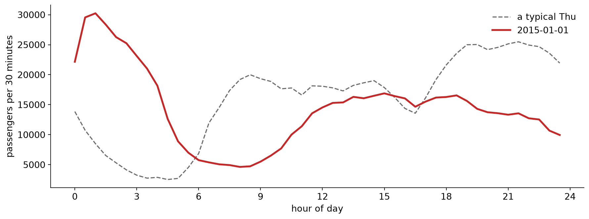

## Lab Overview

* Today: apply tonight's lecture to **a real series**, the number of NYC taxi passengers every 30 minutes for seven months
* One Colab notebook, six short experiments. Work in pairs
* For every experiment: **predict first, then run, then explain any surprise**
* Three parts: see the series, evaluate a forecaster, find anomalies

::: {.notes}
Same loop as the deep learning and NLP labs: say a prediction out loud, run the cell, explain what surprised you.

The lecture used synthetic data so that the ground truth was known. Tonight the data is real, and it has surprises that nobody planted: holidays, a blizzard, and one spike that looks like a data artifact.

The slides titled 'What you should see' hold the expected output. Show each one only after pairs have run the experiment, or use it if Colab is slow for someone.
:::

## Plan for tonight (50 minutes)

| | Minutes |
|---|---|
| Open the notebook, load the data | 3 |
| [Part 1: see the series](#lab-see) (Experiments 1-2) | 14 |
| [Part 2: evaluate a forecaster](#lab-eval) (Experiments 3-4) | 13 |
| [Part 3: find anomalies](#lab-anom) (Experiments 5-6) | 13 |
| [Debrief and project check-in](#lab-debrief) | 7 |

Experiment 4 is optional if we run short.

::: {.notes}
If time is short, cut Experiment 4 (residuals) and keep Experiment 6, which has the best surprise in the lab.

Keep the debrief. Final presentations start in two weeks (Dec 1), so the last minutes are also for groups to raise project questions.
:::

## Set-up

**Notebook:** [time_series.ipynb on Colab](https://colab.research.google.com/github/ctsilva/ctsilva.github.io/blob/main/2026-VisML-CDS/labs/time-series/time_series.ipynb)

* Needs a Google account. Nothing to install: pandas, matplotlib and scikit-learn are already in Colab
* Run the first code cell. It downloads the data and should print **10,320 rows**
* **The data:** NYC taxi passengers per 30-minute interval, July 1, 2014 to January 31, 2015, from the [Numenta Anomaly Benchmark](https://github.com/numenta/NAB) (built from NYC Taxi and Limousine Commission trip records)
* **The unit is passengers, not trips**: the benchmark [describes the values](https://github.com/numenta/NAB/blob/master/data/README.md) as the total number of taxi passengers in each 30-minute bucket

::: {.notes}
The first cell reads a 265 KB CSV from the Numenta Anomaly Benchmark repository on GitHub, so it needs a network connection.

The benchmark's documentation says the values are passenger counts, and the size of the numbers agrees: 600,000 to 900,000 a day is more than the number of taxi trips New York had in 2014, and about right for trips times passengers per trip. So we say passengers throughout, not rides or trips.

Columns after loading: timestamp, passengers, date, hour (0 to 23.5 in half-hour steps), dow (0 is Monday) and t (days since July 1).

If someone cannot use Colab, the notebook also runs locally with pandas, matplotlib and scikit-learn.
:::

## Part 1: See the Series {#lab-see}

**Experiments 1 and 2** &nbsp;·&nbsp; about 14 minutes

*The same 10,320 numbers as a line, as daily totals, and as a heat map.*

## Experiment 1: One Line, Two Resolutions

**Predict:** the first chart draws all 10,320 half-hour values as one line. What will you be able to read from it?

1. Run the full-resolution line chart. What can you actually see?
2. Before running the daily totals: **write down two dates** between July and January that you expect to be unusual for taxis in New York
3. Run the daily totals. Were your dates right?
4. Change `START` in the one-week chart. What does a normal week look like?

**Connect to lecture:** aggregation is a design decision. Each bin size shows some things and hides others.

::: {.notes}
Expected: the full-resolution line is a solid purple band from about 2,000 to 27,000 passengers. You can see one tall spike near November 1 (39,197, the maximum) and a dip to almost zero in late January. You cannot see the weekly pattern.

Daily totals (215 points): a clear weekly rhythm between roughly 600,000 and 900,000 passengers per day, and obvious low days: early July, late November, a deep drop around Christmas, and the lowest point of all in late January.

One week: weekdays have a morning shoulder and an evening peak around 7 pm. Friday and Saturday nights run late: Saturday's highest half hour is 11:30 pm, and Sunday's is midnight, which is still Saturday night.

Common student predictions for unusual dates: Thanksgiving, Christmas, New Year's Eve, July 4. Keep their list for Experiment 5.
:::

## Experiment 2: The Whole Series as a Heat Map

**Predict:** one row per day, one column per half hour, color for passengers. What will a weekend look like? What will a snowstorm look like?

1. Run the heat map. Nothing is aggregated: every value is on screen
2. A bright band at the left edge comes back every seven rows. What is it?
3. Find **at least three rows that break the pattern** and estimate their dates
4. Run the average-week chart. Which weekday has the latest peak?

**Connect to lecture:** heat maps put time on both axes here, so the cyclic structure (hour of day) and the sequential structure (date) are visible together.

::: {.notes}
Give pairs a few minutes before showing the next slide.

The repeating bright band at the left edge is Friday night and Saturday night running past midnight: columns 0 to 4 am are bright on Saturday and Sunday rows and dark on weekday rows.

Rows that break the pattern: the bottom of the chart has a row that is almost entirely dark (January 27, the blizzard); there is a dark stretch around December 25; rows in early July are dimmer than their neighbors; and one very bright short dash sits near November 1 at about 1 am. That dash comes back in Experiment 6.
:::

## What You Should See: the Heat Map

:::: {.columns}
::: {.column width="40%"}
* **Every seventh row** is bright from midnight to 4 am: weekend nights
* **Dark band at 3 to 5 am**, every day
* **Late January:** one row almost entirely dark
* **Late December:** several dim rows in a row
* **Near November 1:** one very bright dash around 1 am
:::
::: {.column width="60%"}
{height="760" fig-align="center"}
:::
::::

::: {.notes}
Show after pairs have looked for themselves.

Ask which view found the unusual days fastest. Most people say the daily totals for the big drops, and the heat map for anything that depends on time of day. The bright dash near November 1 is invisible in the daily totals as a single event: the daily chart only shows that November 1 was a high day.

The dark row near the bottom is January 27, 2015. At 3 am that day there were 8 passengers in half an hour in the whole city.
:::

## Part 2: Evaluate a Forecaster {#lab-eval}

**Experiments 3 and 4** &nbsp;·&nbsp; about 13 minutes

*Train on July to September. How good will the model be in October?*

## Experiment 3: Random Split vs. Time-Ordered Split

**Predict:** the model gets hour of day, weekday and a **time index** (days since July 1). Which estimate will be closest to its real error in October: random 5-fold or time-ordered 5-fold? Will the random estimate be too high or too low?

1. Run the cell with `USE_TIME_INDEX = True`. Compare the three bars
2. Set `USE_TIME_INDEX = False` and run again. What happened to the gap?
3. Which of the two models would you deploy? Which model does each evaluation prefer?
4. Run the per-fold cell. Which fold drives the time-ordered average?

**Connect to lecture:** a random split asks the model to interpolate between neighbors. Forecasting is extrapolation.

::: {.notes}
Give pairs time to run both settings before showing the next slide.

The first surprise is in step 2. The time index is what creates the gap between the random estimate and October. Removing it makes the model much worse on the random split and slightly better on the time-ordered one.

The second surprise is in step 3, and it goes against the prediction most pairs make. With the time index, the random estimate (553) is closer to the October error (837) than the time-ordered one (1,419). And the time-ordered split prefers the model without the index, which is the worse model in October. Do not smooth this over. Step 4 and the slide after the expected output explain it.
:::

## What You Should See: Three Estimates of One Error

:::: {.columns}
::: {.column width="42%"}
Mean absolute error, in passengers per 30 minutes:

| Features | Random | Time-ordered | Real October |
|---|---|---|---|
| hour, weekday, **time index** | 553 | 1,419 | 837 |
| hour, weekday | 1,127 | 1,248 | 1,239 |

* With the time index, random 5-fold says 553. The real error is about **50% higher**
* Without it, the three numbers nearly agree
:::
::: {.column width="58%"}
{width="100%" fig-align="center"}

**Time-ordered 5-fold prefers the wrong model:** 1,248 beats 1,419, but in October 837 beats 1,239.
:::
::::

::: {.notes}
With the time index: random 5-fold reports 553, the real October error is 837, and the time-ordered estimate is 1,419. Random is too optimistic; time-ordered is too pessimistic here, partly because its early folds train on only a few weeks.

Without the time index: 1,127, 1,248 and 1,239. The estimates agree with each other and with reality.

Why: with a time index the trees can learn the level of each individual week. On a random split every test row has neighbors from the same week in the training set, so that knowledge transfers. October has no neighbors in the training set.

Notice also that the model with the time index is the better one in October, 837 against 1,239. So the lesson is about the evaluation, not about the feature: random cross-validation overstated how good it is by a wide margin.

The time-ordered estimate has its own failure here. It overstates the error by about 70% (1,419 against 837), and it ranks the two models in the wrong order: 1,248 against 1,419 says drop the time index, while in October the index cuts the error by about a third. The next slide shows why.
:::

## Time-Ordered Is Plausible, Not Automatically Accurate {#lab-folds}

:::: {.columns}
::: {.column width="50%"}
Time-ordered 5-fold, model **with** the time index:

| Fold | Trained&nbsp;on | Tested&nbsp;on | MAE |
|---|---|---|---|
| 1 | 15&nbsp;days | Jul&nbsp;16&nbsp;to&nbsp;Jul&nbsp;31 | 1,457 |
| 2 | 31&nbsp;days | Jul&nbsp;31&nbsp;to&nbsp;Aug&nbsp;15 | 708 |
| 3 | 46&nbsp;days | Aug&nbsp;16&nbsp;to&nbsp;Aug&nbsp;31 | 834 |
| 4 | 61&nbsp;days | Aug&nbsp;31&nbsp;to&nbsp;Sep&nbsp;15 | **3,039** |
| 5 | 77&nbsp;days | Sep&nbsp;15&nbsp;to&nbsp;Sep&nbsp;30 | 1,058 |
| **Deployed** | **92&nbsp;days** | **Oct&nbsp;1&nbsp;to&nbsp;Oct&nbsp;31** | **837** |
:::
::: {.column width="50%"}
* The average, 1,419, is **mostly fold 4**. The other four folds average about 1,000
* **Fold 1 trains on 15 days**; the deployed model trains on 92
* **Each fold predicts 15 days**; the deployed model predicts 31

**Respecting time makes an evaluation plausible. It does not guarantee an accurate estimate, or the right ranking of two models.**

Make the rehearsal look like the deployment: enough training history, the same horizon, and the error **per fold**.
:::
::::

::: {.notes}
SKIPPABLE - if running long, jump to Experiment 4. But if pairs noticed that the time-ordered estimate was the worse of the two, use this slide to answer them.

The table is the output of the per-fold cell in the notebook, plus the October row.

Fold 4 is tested on August 31 to September 15. That window contains Labor Day, and it is when the city comes back from the late-August lull: the average daily total goes from about 683,000 in the second half of August to about 753,000 in the first half of September, roughly 10% up. A tree model with a time index holds the last level it saw, so it carries late August forward. That is consistent with the error of 3,039, though we have not isolated the cause. The model without the index also has its worst fold there (1,839), but by much less; its five folds are 1,468, 742, 923, 1,839 and 1,266.

So one 15-day window decides both the size of the time-ordered estimate and which model it prefers. This is the reason the lecture said to show the error per fold and not only the mean.

Two more mismatches with deployment. Fold 1 trains on 15 days, about two weeks of history, where the real model gets 92. And every fold predicts 15 days ahead, where the real task is a 31-day month.

The statement in bold is the takeaway. A time-ordered split never trains on the future, so it is the only kind of split that could happen in practice. That makes it necessary. It does not make its number right. What to do about it: set a minimum training length so no fold is starved, make each test window as long as the deployment horizon, report the spread across folds, and remember that three months of data cannot tell you anything about a yearly cycle.

The random split is still not the answer: its 553 was closer to 837 only because two errors of opposite sign happened to be different sizes. It rewards a model for interpolating between neighbors, which deployment never asks for.
:::

## Experiment 4: What Did the Model Miss? (optional)

**Predict:** a model that only knows the **hour of day**. What will its October residuals look like by weekday?

1. Run the cell. Left: residuals grouped by weekday. Right: mean residual by weekday and hour
2. Where is the model too low (red), and too high (blue)?
3. What feature would fix it? Would the MAE alone have told you?

**Connect to lecture:** plot residuals against the cyclic structure. Structure in the residuals is something the model missed.

::: {.notes}
Optional: the first thing to cut if time is short. The next slide has the expected output.
:::

## What You Should See: Residuals With Structure

**Too low on weekend nights, too high on weekend mornings: the model does not know what day it is.**

{fig-align="center"}

::: {.notes}
Left: residuals by weekday. The medians climb from slightly below zero on Monday to clearly above zero on Saturday, and Sunday has by far the widest spread.

Right: mean residual by weekday and hour. Saturday and Sunday from midnight to about 4 am are deep red: the model, which knows only the hour, predicts a quiet night and gets weekend nightlife. Weekend mornings from about 6 to 9 am are blue: it predicts a commute that does not happen. Weekday mornings around 8 am are red for the same reason in reverse.

The fix is a weekday feature, or better, an hour-by-weekday interaction, which the tree model learns once it has both.
:::

## Part 3: Find Anomalies {#lab-anom}

**Experiments 5 and 6** &nbsp;·&nbsp; about 13 minutes

*Expected value, a band around it, and a threshold you have to choose.*

## Experiment 5: A Detector on Daily Totals

**Predict:** expected passengers = the median for that weekday (learned from July to October). Flag a day when it is more than `K` robust standard deviations away. With `K = 3`, how many of the 215 days get flagged?

1. Run the cell with `K = 3`. Are your two dates from Experiment 1 in the list?
2. Run the next two cells. The first checks **one date for each of the five events** the benchmark names; the second checks the benchmark's **anomaly windows**, which span several days each
3. Try `K = 2`, `4` and `5`. How many days would you want to be alerted for?
4. Some flagged days are **before November**, inside the data the baseline was learned from. What happened on those days?

**Connect to lecture:** the threshold is a trade-off, and neighboring alarms are often one event.

::: {.notes}
Expected counts: K = 2 flags 40 days, K = 3 flags 17, K = 4 flags 12, K = 5 flags 9.

At K = 3 the flagged days outside the baseline period are: November 1; November 27 and 28 (Thanksgiving and the day after); December 24 to 28; January 2 and 4; January 26 to 28 (the blizzard).

Inside the baseline period: July 4, 5 and 6 (the holiday weekend) and August 30 (the Saturday of Labor Day weekend). Good discussion point: the 'normal' data used to define normal contained anomalies. The median and the robust standard deviation are what keep four odd days from distorting the baseline.

Seventeen flagged days are really about six events. Runs of alarms are the rule with temporal data.
:::

## What You Should See: Flags and Known Events

**All five benchmark windows contain a flagged day at K = 3. January 1 itself, at −2.1σ, is not flagged; January 2 is.**

{fig-align="center"}

::: {.notes}
Distance from the expected value, in robust standard deviations: Saturday November 1 (marathon weekend) +5.0; Thanksgiving −6.6; Christmas −10.4; New Year's Day −2.1; blizzard on January 27 −12.9. K = 3 flags 17 days in all, about six events, and four of those days are inside the baseline period.

Checked date by date, four of our five chosen dates are flagged at K = 3 and January 1 is not. But the benchmark does not label dates. It labels windows of four to five days: October 30 to November 3, November 25 to 29, December 23 to 27, December 29 to January 3, and January 24 to 29. Every one of the five windows contains at least one flagged day. For New Year the flag is January 2, at −4.7σ. So the detector did not miss the New Year event; the daily total for January 1 failed to show how unusual that day was.

Three different scores, and the notebook's window cell shows all three. Point level: 17 days flagged, 11 inside a window and 6 outside (July 4, 5 and 6, August 30, December 28, January 4). Event level: 5 of 5 windows detected. Delay: the first flag comes 1 to 4 days after each window opens, and New Year is the slowest at 4 days. A detector can look good on one of these and poor on another, so say which one you are reporting.

The six flags outside the windows are false alarms by the benchmark's labels, yet July 4 and Labor Day weekend are real holidays. Labels are also a design decision.

The blizzard is the largest: 232,058 passengers against an expected 714,714, almost 13 robust standard deviations below a normal Tuesday.

November 1 is the only flagged day that is above the band.

January 1 is not flagged: its total is only 2.1 standard deviations below a normal Thursday. To flag that day with this detector you would have to lower K to 2, which flags 40 days. That is the trade-off slide from the lecture on real data. Experiment 6 shows why the daily total hides what happened that day.
:::

## Experiment 6: What the Daily Total Hides

**Predict:** New Year's Day has a nearly normal daily total. What does it look like half hour by half hour?

1. Run the cell with `DAY = "2015-01-01"`
2. Then try `"2014-11-02"`. The largest value in the whole series is on that night. **What do you think happened at 2 am on November 2, 2014**, and what evidence would confirm it?
3. Try `"2015-01-27"`

**Connect to lecture:** a contextual anomaly. Every value is in range; it is the time of day that is wrong.

::: {.notes}
Give pairs time on step 2 before showing the next slide. Someone usually proposes the clock change. Treat it as a hypothesis: ask what evidence would confirm it, and whether this file can provide that evidence.
:::

## What You Should See: New Year's Day

**A busy night and a quiet day nearly cancel in the daily total.**

{fig-align="center"}

::: {.notes}
New Year's Day against a typical Thursday: from 1 am to 5 am there are three to seven times the usual count, with a peak of about 30,000 per half hour at 1 am. Then the morning commute never happens (around 8 am the count is about a fifth of normal) and the rest of the day runs below normal. The excess at night and the deficit by day nearly cancel, which is why the daily total looked ordinary.

November 2, 2014: the 1:00 am and 1:30 am bins hold 39,197 and 35,212 passengers, about 1.7 times a normal Sunday at that hour, and the highest values in the series. Daylight saving time ended that night: clocks went back from 2 am to 1 am, so the local hour from 1 to 2 happened twice. Our hypothesis is that both passes were added into the same two local-time bins.

What supports it: only those two bins are high. Midnight and 12:30 are at 0.98 and 0.94 of a typical Sunday, 1:00 and 1:30 jump to 1.70 and 1.64, and from 2:00 on the counts drop to 0.6 to 0.7. The file also has exactly one row per local half hour that night, with no repeated timestamp, which is what a double count would produce.

What it does not establish: the file is an aggregate, and nothing in it records how the buckets were built. A busy night would also raise the counts, and this was the Saturday night of Halloween weekend, before the NYC Marathon on Sunday, which is the cause the benchmark names for this window. To confirm the clock-change explanation we would need the benchmark's aggregation code, or the trip-level records with unambiguous timestamps (UTC, or local time with an offset) to recount that hour. Say this to the class as a strong hypothesis, not as a fact.

January 27: counts fall to single digits per half hour around 3 to 4 am during the blizzard travel ban, and the whole day reaches about a third of normal.

Takeaway: an anomaly detector finds things that are unusual in the data. Deciding whether one is an event, a holiday or a clock change takes a person, a chart, and usually a second source of evidence.
:::

## Debrief {#lab-debrief}

* Which view showed you the unusual days fastest: the line, the daily totals, or the heat map?
* January 1's daily total looked ordinary, although the day was not. What does that say about choosing the **bin size** for a monitoring chart?
* The random split made the model look much better than it was, and the time-ordered split preferred the wrong model. **Where in your own project could either happen?**
* The biggest spike in the data lines up with a clock change. What would confirm that? On a live system, how would you find out whether an alarm is an event or an artifact?

**Project check-in:** final presentations are **Dec 1 and Dec 8**. Use the remaining time for questions about your project.

::: {.notes}
The third question is the one that matters most for the projects: any group whose data has timestamps should say in the final report how the data was split in time.

On the last question, useful answers include: annotate known calendar events on the chart, keep timestamps in UTC as well as local time, and always let the reader drill from an alarm to the raw data behind it.

Use whatever time is left for project questions. Final presentations are in two weeks and the final report is due December 14.
:::

## Further Exploration

* Going further in the notebook: use the Part 2 model as the "expected" value and run the detector on half-hour data. Does it find the marathon?
* [Numenta Anomaly Benchmark](https://github.com/numenta/NAB): more labeled real-world series
* Hyndman & Athanasopoulos, [*Forecasting: Principles and Practice*](https://otexts.com/fpp3/) (3rd ed.), free online
* scikit-learn: [`TimeSeriesSplit`](https://scikit-learn.org/stable/modules/generated/sklearn.model_selection.TimeSeriesSplit.html)
* Next week (Nov 24): Interpretable ML and Fairness
