<style>
.reveal pre { font-size: 0.72em; }
.reveal .cell-output pre { font-size: 0.9em; }
</style>

```{python}
#| include: false
import numpy as np
import matplotlib.pyplot as plt
plt.rcParams.update({"font.size": 14, "axes.titlesize": 16, "axes.labelsize": 15})
SPECIES_COLORS = ['#4477AA', '#EE6677', '#228833']
```

## Agenda

::: incremental
1. **Clustering**
   - Introduction to unsupervised learning
   - K-means clustering on IRIS dataset
   - DBSCAN and other clustering methods
   - Choosing *k*, dendrograms, and validating clusters

2. **Dimensionality Reduction**
   - The manifold hypothesis and intrinsic dimensionality
   - Principal Component Analysis (PCA)
   - Eigenvectors, eigenvalues, and covariance matrices
   - Singular Value Decomposition (SVD)
   - Local Linear Embedding (LLE)
   - Preview: Non-linear Manifold Learning (t-SNE, UMAP)
:::

::: {.notes}
Tonight's lecture block has two parts: this deck, then the project discussion. There's no default project this year; every group proposes its own, and the proposal is due next Tuesday, Oct 20. Protect the project time. Suggested budget: clustering about 30 minutes, dimensionality reduction about 45, project discussion about 35 (including questions), with 10 minutes in reserve. The time freed by dropping the default-project deck is enough to keep most of the SKIPPABLE slides.

This deck has 46 slides. Six are marked SKIPPABLE in these notes: k-means steps, two moons, validation, choosing k, the dendrogram, and six projections. If you're running long, skip them and nothing downstream breaks.

The thread connecting the two halves: both clustering and dimensionality reduction look for structure without labels. Clustering asks which points belong together. Dimensionality reduction asks how many numbers you really need to describe a point. In a visualization course we care because neither has a ground truth to check against, so the picture is often the only way to judge whether the answer makes sense.

We use Iris for clustering (150 flowers, 4 measurements, 3 species) and handwritten digits for dimensionality reduction (8x8 images, so 64 dimensions). The math for PCA comes from Luis Gustavo Nonato's slides. Next week covers t-SNE and UMAP in depth.
:::

<!-- Examples and materials from... -->

## Clustering

**Etienne Bernard: "... the goal of clustering is to separate a set of examples into groups called clusters"**

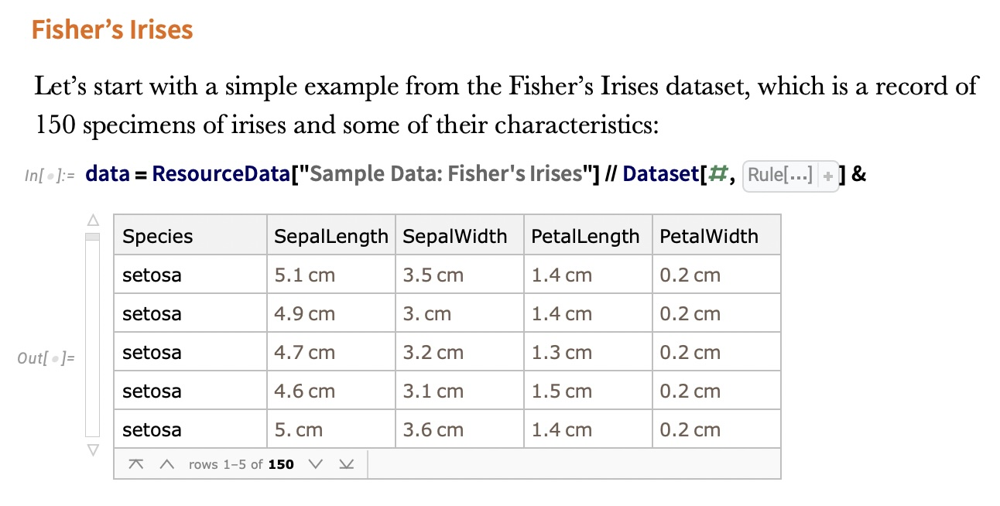{fig-align="center"}

:::: footer
Bernard, E. (2021). [*Introduction to Machine Learning*](https://www.wolfram.com/language/introduction-machine-learning/clustering/), ch. Clustering. Wolfram Media.
::::

::: {.notes}
Clustering is the canonical unsupervised task: there are no labels to fit, only the data. The definition is deliberately loose, "separate examples into groups", because what counts as a good group depends on the application. That looseness is the theme of the whole first half.

The figure is from Etienne Bernard's book, which is tonight's required reading. It shows Fisher's Iris data: 150 specimens, four measurements each (sepal length and width, petal length and width), plus the species. Note that the species column is there. Tonight we'll pretend we can't see it, cluster on the measurements alone, and then use the species to grade the result. That pattern of clustering blind and then validating against held-out labels is how clustering methods are evaluated in papers.

Uses worth naming: customer segmentation, grouping documents or images, finding cell types in single-cell RNA data, and anomaly detection (points that don't fit any cluster). In ML model analysis, which is our course focus, you cluster a model's errors or embeddings to find failure modes. That's a good template for a final project: pick a model, cluster its mistakes, and visualize what each cluster has in common.

Ask: has anyone run k-means on real data, and how did you choose k? Keep the answer in mind; it comes back in a few slides.
:::

## IRIS

``` python
# Code source: Gaël Varoquaux
# Modified for documentation by Jaques Grobler
# License: BSD 3 clause
#
import matplotlib.pyplot as plt

from sklearn import datasets
iris = datasets.load_iris()

_, ax = plt.subplots()
scatter = ax.scatter(iris.data[:, 2], iris.data[:, 1])
ax.set(xlabel=iris.feature_names[2], ylabel=iris.feature_names[1])
_ = ax.legend(
    scatter.legend_elements()[0], iris.target_names, loc="lower right", title="Classes"
)
```

::: {.notes}
This is the scikit-learn gallery example, lightly modified. Iris has 4 features and 3 species classes. We plot two of them: column 2, petal length, on x, and column 1, sepal width, on y. These are the same two axes Bernard uses, so our plots line up with the figures from the book on the next slides.

Point out what's missing: the scatter call has no `c=` argument, so every point gets the same color. We're deliberately looking at the data the way a clustering algorithm sees it. (The legend call is left over from the labeled version of the example; on the next slide it draws nothing useful, so the rendered plot omits it.)

`datasets.load_iris()` returns a Bunch with `.data` (150x4), `.target` (0/1/2) and `.feature_names`. The same loader pattern works for digits later.
:::

## IRIS

```{python}
#| echo: false
#| fig-align: center
from sklearn import datasets
iris = datasets.load_iris()

_, ax = plt.subplots(figsize=(16, 8.4))
ax.scatter(iris.data[:, 2], iris.data[:, 1], s=60, color="#555555", alpha=0.8)
ax.set(xlabel=iris.feature_names[2], ylabel=iris.feature_names[1])
plt.tight_layout()
plt.show()
```

::: {.notes}
This is the unlabeled view: petal length on x, sepal width on y, every point the same gray.

Ask the room: how many groups do you see? Most people say two: a tight blob on the left (petal length under 2 cm) and an elongated cloud on the right. Some say three. Take a quick show of hands, because it sets up the punchline. The honest answer from this picture alone is two. A third group, if there is one, lives inside the right-hand cloud without a visible gap.

This is a 2-D projection of 4-D data, so a gap could exist in the other two dimensions that this view hides. That's a preview of the dimensionality reduction half: what you can see depends on the projection you choose.
:::

## IRIS -- another look

```{python}
#| echo: false
#| fig-align: center
#| fig-width: 9
#| fig-height: 6

import seaborn as sns
import matplotlib.pyplot as plt
import pandas as pd
from sklearn import datasets

# Load iris dataset
iris = datasets.load_iris()

# Create DataFrame for easier plotting
df = pd.DataFrame({
    'Petal Length (cm)': iris.data[:, 2],
    'Sepal Width (cm)': iris.data[:, 1],
    'Species': [iris.target_names[i] for i in iris.target]
})

# Create high-quality plot with colors similar to DarkRainbow
colors = ['#4477AA', '#EE6677', '#228833']  # Professional color palette
plt.figure(figsize=(9, 6), dpi=150)
sns.scatterplot(data=df, x='Petal Length (cm)', y='Sepal Width (cm)',
                hue='Species', palette=colors, s=120, alpha=0.7,
                edgecolor='black', linewidth=0.8)
plt.grid(True, alpha=0.3, linestyle='--')
plt.legend(title='Species', frameon=True, loc='upper left', fontsize=11)
plt.xlabel('Petal Length (cm)', fontsize=12, fontweight='bold')
plt.ylabel('Sepal Width (cm)', fontsize=12, fontweight='bold')
plt.tight_layout()
plt.show()
```

::: {.notes}
Now reveal the species. Setosa (blue) is the isolated blob on the left, with all 50 points below 2 cm petal length. Versicolor (red) and virginica (green) together make up the right-hand cloud. They're ordered along petal length (versicolor shorter, virginica longer), but they meet around 4.5 to 5 cm with no gap.

This plot explains every result in the next ten minutes:

- Any reasonable method finds setosa perfectly.
- No method separates versicolor from virginica perfectly using geometry alone, because the species boundary isn't a density gap.
- Whether the "right" answer is 2 or 3 clusters depends on whether you're asking about geometry or botany.

Make the general point: a clustering algorithm optimizes a geometric criterion. Labels encode a different notion of similarity. When the two disagree, the algorithm isn't wrong; it's answering a different question.
:::

## IRIS -- clustering

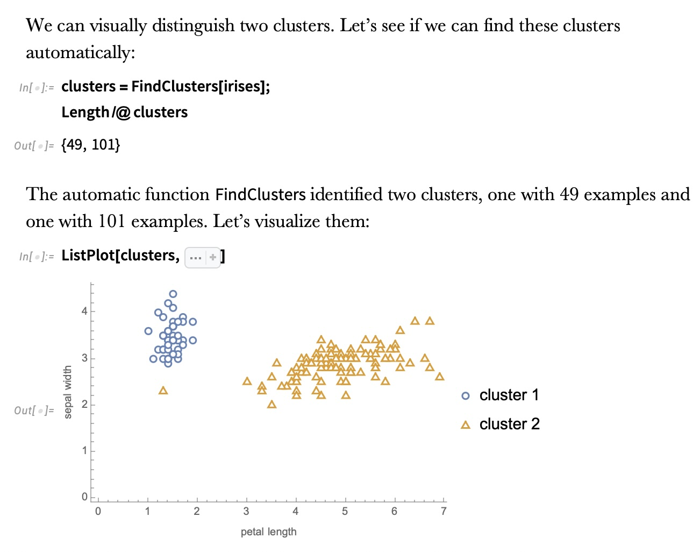{fig-align="center"}

::: {.notes}
This is Wolfram's FindClusters run fully automatically, with no number of clusters given. It returns two clusters of 49 and 101 points. So the automatic method agrees with the show of hands, not with the species count.

Why 49 and not 50: one point the method grouped with the big cluster. You can't tell which from this 2-D view, a reminder that the method works in all four dimensions. Automatic methods pick k by optimizing an internal score. We'll compute one such score, the silhouette, in a few slides and find it also prefers k=2 on these features.

The lesson: "find the clusters" is under-specified. Without telling the algorithm how many clusters you expect, or what similarity means, it falls back on the strongest geometric signal, which here is setosa vs everything else.

Transition: next slide, we tell it to find three.
:::

## IRIS -- k-means

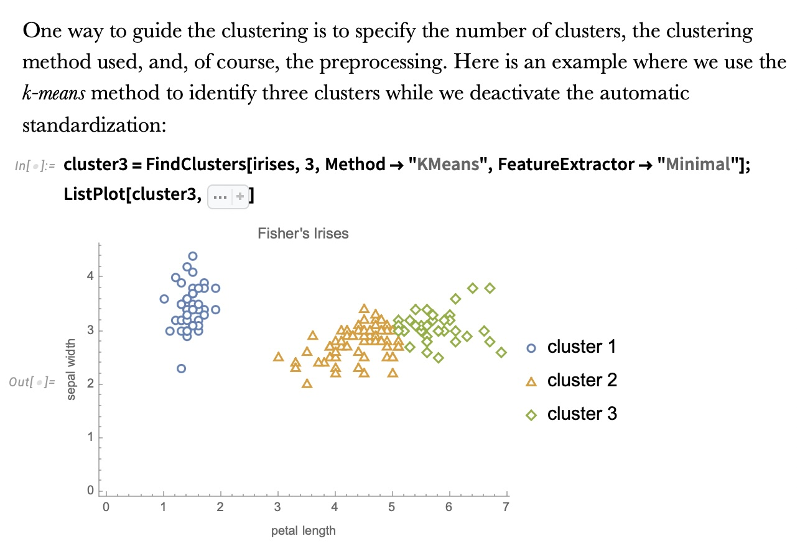{fig-align="center"}

::: {.notes}
Now we guide it with three choices, and the text above the code names them: the number of clusters (3), the method (k-means), and the preprocessing (automatic standardization turned off with FeatureExtractor -> "Minimal").

The result: setosa is still its own cluster (blue circles). The right-hand cloud gets cut into two pieces, orange triangles and green diamonds, by what's essentially a vertical line around petal length 5. That cut is k-means' signature. Each point goes to its nearest centroid, so boundaries between clusters are straight lines (the Voronoi diagram of the centroids). The cut sits roughly where the species overlap, but some of the true virginica with petal length under 5 end up in the orange cluster.

Why the preprocessing matters: k-means uses Euclidean distance, so features with larger ranges dominate. Standardizing changes the answer. On the validation slide we'll see that standardizing Iris actually makes agreement with the species worse.
:::

## K-means in four lines

1. Pick *k* starting centroids (k-means++ spreads them out)
2. Assign each point to its nearest centroid
3. Move each centroid to the mean of its assigned points
4. Repeat 2–3 until assignments stop changing

**Objective:** minimize within-cluster sum of squares $\;\sum_{c=1}^{k} \sum_{x \in C_c} \lVert x - \mu_c \rVert^2$

**Built-in assumptions:** *k* is known · clusters are convex and roughly spherical · similar sizes · feature scale is meaningful

::: {.notes}
SKIPPABLE - if running long, jump to "Wolfram Mathematica FindClusters".

This is Lloyd's algorithm. Each step can only lower the objective: assignment picks the nearest centroid, and the mean is the point that minimizes squared distance to a set. So it always converges, but only to a local minimum. That's why scikit-learn runs it several times from different starts (`n_init`) and keeps the best, and why k-means++ seeding (pick each new centroid with probability proportional to squared distance from the existing ones) matters.

Walk through the assumptions slowly, because each produces a failure you can see in a plot:

- **k is known:** you have to supply it. Choosing it is its own problem (a later slide).
- **Convex, spherical clusters:** nearest-centroid boundaries are straight lines, so k-means can't follow a curved cluster. Two moons, coming up, is the classic counterexample.
- **Similar sizes:** a large cluster next to a small one gets its edge stolen, because the boundary sits halfway between centroids.
- **Feature scale:** distance is Euclidean, so a feature measured in millimeters outvotes one measured in meters.

Cost is O(n·k·d) per iteration, which is why k-means is the default for large data.
:::

## Wolfram Mathematica FindClusters

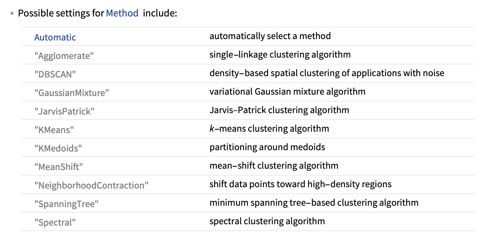{fig-align="center"}

::: {.notes}
FindClusters exposes ten methods besides Automatic. Group them by what they assume a cluster is:

- **Centroid-based:** KMeans and KMedoids. A cluster is a ball around a center. KMedoids uses actual data points as centers, so it's more robust to outliers.
- **Density-based:** DBSCAN, MeanShift and NeighborhoodContraction. A cluster is a dense region, and sparse regions separate clusters. DBSCAN also labels points in sparse regions as noise rather than forcing them into a cluster.
- **Graph or connectivity-based:** Agglomerate (single linkage), SpanningTree, JarvisPatrick and Spectral. A cluster is a set of points connected by short links. These can follow arbitrary shapes.
- **Model-based:** GaussianMixture. A cluster is a probability distribution, so points get soft memberships.

The method is the definition of a cluster. Choosing a method is choosing what "belongs together" means, which is why the next slide matters.
:::

## Wolfram Mathematica FindClusters

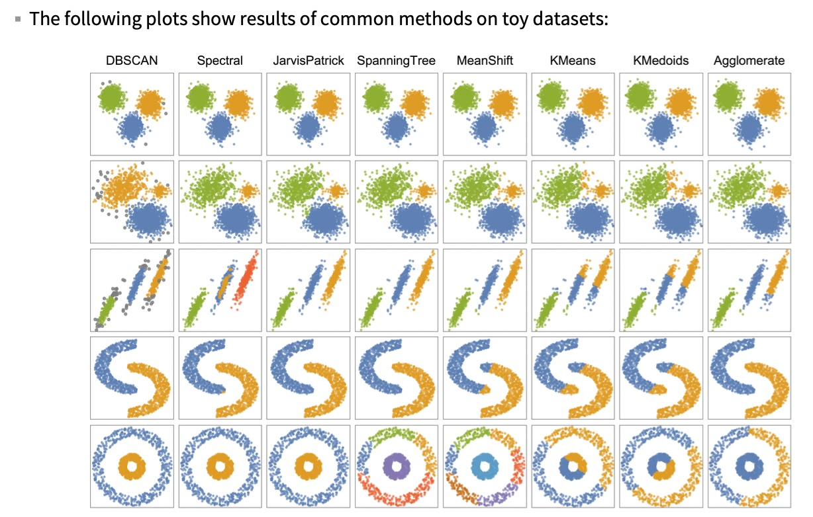{fig-align="center"}

::: {.notes}
Eight methods (columns) on five toy datasets (rows). Read it by row:

- **Row 1 (three well-separated blobs):** every method agrees. When structure is obvious, the method doesn't matter.
- **Row 2 (a sparse blob, a small dense blob, a big dense blob):** most methods get three groups. KMeans and KMedoids give the right edge of the sparse blob to the small one, because the boundary sits halfway between centers. DBSCAN does something different: one eps can't fit both densities, so it merges the sparse and small blobs and calls the fringe noise (gray).
- **Row 3 (three parallel strips):** KMeans and KMedoids slice strips across their length. Spectral splits the middle strip into four groups in total. DBSCAN finds the three strips but drops their sparse ends as noise.
- **Row 4 (two moons):** KMeans, KMedoids and MeanShift cut each moon in half. DBSCAN, Spectral, JarvisPatrick and Agglomerate follow the curves.
- **Row 5 (ring around a disk):** the hardest case. Only DBSCAN, Spectral and JarvisPatrick get it. KMeans and KMedoids cut it in half. SpanningTree and MeanShift break the outer ring into several pieces. Agglomerate (single linkage) also fails here: it splits the ring and joins half of it to the disk, presumably because a few noisy points bridge the gap. Single linkage is the method that's supposed to follow rings, which shows how fragile chaining is.

Takeaway: no column is perfect on every row. The right method depends on the shape of the structure you expect, and you usually find that out by looking at the data.
:::

## When k-means fails: shape, not count

```{python}
#| echo: false
#| fig-align: center
from sklearn.datasets import make_moons
from sklearn.cluster import KMeans, DBSCAN
from sklearn.metrics import adjusted_rand_score

M, my = make_moons(400, noise=0.06, random_state=0)
km_lab = KMeans(2, n_init=10, random_state=0).fit_predict(M)
db_lab = DBSCAN(eps=0.2, min_samples=5).fit_predict(M)

fig, axs = plt.subplots(1, 2, figsize=(17, 6.4))
for ax, lab, name in [(axs[0], km_lab, "k-means, k = 2"),
                      (axs[1], db_lab, "DBSCAN, eps = 0.2, min_samples = 5")]:
    cols = np.array(SPECIES_COLORS + ['#999999'])[np.where(lab < 0, 3, lab)]
    ax.scatter(M[:, 0], M[:, 1], c=cols, s=45)
    ax.set_title(f"{name}   (ARI vs true moons = {adjusted_rand_score(my, lab):.2f})")
    ax.set_xticks([]); ax.set_yticks([]); ax.set_aspect("equal")
plt.tight_layout()
plt.show()
```

**Right number of clusters, wrong definition of a cluster.**

::: {.notes}
SKIPPABLE - if running long, jump to "IRIS - classes".

These are live scikit-learn results on the two-moons dataset (400 points). This reproduces row 4 of the Wolfram grid, with a score attached.

Left: k-means is given the correct k=2 and still fails. It draws a straight boundary and cuts each moon in half. Its adjusted Rand index (ARI) against the true moons is 0.27, where 1 is perfect agreement and 0 is chance level.

Right: DBSCAN gets ARI 1.00. It has no k at all. It has two parameters: `eps`, the neighborhood radius, and `min_samples`, how many neighbors make a point a "core" point. Clusters are chains of core points within eps of each other, so they can bend.

DBSCAN's weakness: eps. On this data, eps of 0.15, 0.2 or 0.25 all give the perfect answer, but at 0.3 the moons touch and DBSCAN returns one cluster (ARI 0). One global eps also struggles when clusters have different densities, which is what HDBSCAN fixes.

Ask: what's the k-means equivalent of eps? (It's k. Every method has a knob that decides how many clusters you get. The question is whether the knob is meaningful for your data.)
:::

## IRIS - classes

:::: {.columns}

::: {.column width="50%"}
```{python}
#| echo: false
from sklearn import datasets
iris = datasets.load_iris()

_, ax = plt.subplots(figsize=(9.4, 7.8))
for i, name in enumerate(iris.target_names):
    m = iris.target == i
    ax.scatter(iris.data[m, 2], iris.data[m, 1], s=40, color=SPECIES_COLORS[i], label=name)
ax.set(xlabel=iris.feature_names[2], ylabel=iris.feature_names[1], title="True species")
_ = ax.legend(loc="lower right", title="Classes")
plt.tight_layout()
plt.show()
```

:::

::: {.column width="50%"}
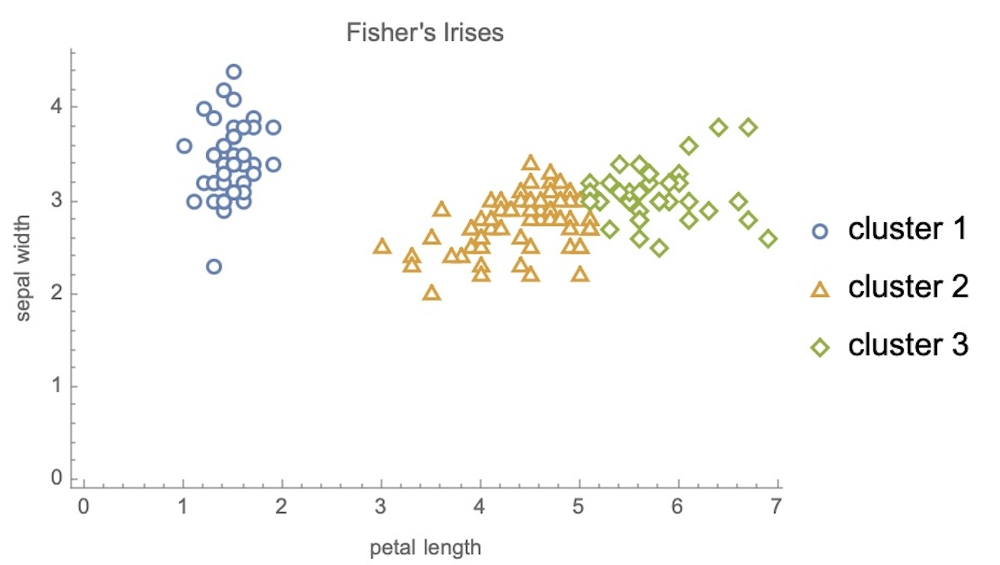{width="100%"}
:::

::::

::: {.notes}
Side by side: true species on the left (from scikit-learn, same axes), Wolfram's k-means with k=3 on the right. Point at the same regions in both:

- Setosa (blue on the left) maps exactly to cluster 1. Perfect.
- On the right, the boundary between clusters 2 and 3 is close to vertical at petal length around 5. On the left, the versicolor/virginica boundary is diagonal and interleaved. Virginica with short petals (green points left of x=5) become cluster 2.
- Cluster colors and species colors don't correspond. Cluster IDs are arbitrary, so "cluster 2" means nothing until you match it to a class. Any score comparing clusters to labels has to be invariant to relabeling (next slide).

Remember this comparison is a teaching device. In real unsupervised work there's no left panel. You only get the right one and have to decide whether to trust it.
:::

## Validating clusters against labels

```{python}
#| echo: false
#| fig-align: center
from sklearn.cluster import KMeans, AgglomerativeClustering
from sklearn.metrics import adjusted_rand_score, confusion_matrix
from sklearn.preprocessing import StandardScaler

X4, y = iris.data, iris.target
X2 = X4[:, [2, 1]]
km2 = KMeans(3, n_init=10, random_state=0).fit_predict(X2)

# order cluster columns by their majority species so the diagonal is the match
cm = confusion_matrix(y, km2)
order = np.argsort(cm.argmax(axis=0))
cm = cm[:, order]

runs = {
    "k-means, 2 features": km2,
    "k-means, all 4": KMeans(3, n_init=10, random_state=0).fit_predict(X4),
    "k-means, 4 standardized": KMeans(3, n_init=10, random_state=0).fit_predict(StandardScaler().fit_transform(X4)),
    "Ward linkage, 4": AgglomerativeClustering(3, linkage="ward").fit_predict(X4),
    "average linkage, 4": AgglomerativeClustering(3, linkage="average").fit_predict(X4),
    "single linkage, 4": AgglomerativeClustering(3, linkage="single").fit_predict(X4),
}
ari = {k: adjusted_rand_score(y, v) for k, v in runs.items()}

fig, (a, b) = plt.subplots(1, 2, figsize=(17.5, 7.6), gridspec_kw={"width_ratios": [1, 1.3]})
a.imshow(cm, cmap="Purples")
for i in range(3):
    for j in range(3):
        a.text(j, i, cm[i, j], ha="center", va="center", fontsize=20,
               color="white" if cm[i, j] > 25 else "black")
a.set_xticks(range(3), [f"cluster {j+1}" for j in range(3)])
a.set_yticks(range(3), iris.target_names)
a.set_title("k-means (k=3, 2 features) vs species")
names = list(ari)[::-1]
b.barh(names, [ari[n] for n in names], color="#57068c")
for i, n in enumerate(names):
    b.text(ari[n] + 0.01, i, f"{ari[n]:.2f}", va="center", fontsize=14)
b.set_xlim(0, 1); b.set_xlabel("Adjusted Rand Index vs species (1 = perfect, 0 = chance)")
b.set_title("Same data, six clusterings")
plt.tight_layout()
plt.show()
```

::: {.notes}
SKIPPABLE - if running long, jump to "Recommended reading".

When you have labels for a sample, this is how you grade a clustering. These are live results.

Left, the confusion matrix (species x cluster, columns reordered so matches sit on the diagonal): all 50 setosa in one cluster, 48 of 50 versicolor in the next, 41 of 50 virginica in the last. So 11 of 150 points disagree, all at the versicolor/virginica border we saw.

Right, the adjusted Rand index (ARI). It asks: for every pair of points, do the clustering and the labels agree on whether the pair is together? It ignores cluster numbering and is corrected for chance, so random labels score about 0. Results:

- **k-means on 2 features:** 0.80, the best.
- **All 4 features:** 0.73, worse.
- **4 standardized features:** 0.62, worse still. More information and "proper" preprocessing both hurt.
- **Ward / average linkage:** 0.73 / 0.76.
- **Single linkage:** 0.56. It chains: two of its three clusters hold 98 and 50 points, and the third holds just 2.

Why standardizing hurts: sepal width barely differs between species but has its own spread. Standardizing gives it as much say as petal length, which is the discriminative feature. Preprocessing is a modeling decision, not a formality.

When you have no labels, use internal scores instead (silhouette, next slide). These measure compactness and separation, not truth.
:::

## How many clusters? Two criteria, two answers

```{python}
#| echo: false
#| fig-align: center
from sklearn.metrics import silhouette_score
ks = range(2, 8)
inertia, sil = [], []
for k in ks:
    m = KMeans(k, n_init=10, random_state=0).fit(X2)
    inertia.append(m.inertia_)
    sil.append(silhouette_score(X2, m.labels_))

fig, (a, b) = plt.subplots(1, 2, figsize=(17, 7.4))
a.plot(ks, inertia, "o-", color="#57068c", lw=2, ms=9)
a.axvline(3, color="#EE6677", ls="--"); a.text(3.1, max(inertia) * 0.9, "elbow: k = 3", color="#EE6677", fontsize=15)
a.set(xlabel="k", ylabel="within-cluster sum of squares", title="Elbow method")
b.plot(ks, sil, "o-", color="#57068c", lw=2, ms=9)
best = list(ks)[int(np.argmax(sil))]
b.axvline(best, color="#228833", ls="--"); b.text(best + 0.1, min(sil) + 0.02, f"max silhouette: k = {best}", color="#228833", fontsize=15)
b.set(xlabel="k", ylabel="mean silhouette", title="Silhouette")
plt.tight_layout()
plt.show()
```

**The elbow says 3, the silhouette says 2, the botanist says 3.**

::: {.notes}
SKIPPABLE - if running long, jump to "Recommended reading".

Both panels use k-means on the same two Iris features, for k from 2 to 7.

**Elbow (left):** within-cluster sum of squares always falls as k grows, so you look for where the drop flattens. Here it's 86, then 41, then 27.5, then a slow decline. The bend is at k=3. The elbow is a judgment call: on many real datasets there's no clear bend.

**Silhouette (right):** for each point, compare a (mean distance to its own cluster) with b (mean distance to the nearest other cluster). The score is (b-a)/max(a,b), from -1 to 1. The average peaks at k=2 (0.74) and falls to 0.59 at k=3. Silhouette prefers k=2 because setosa vs the rest is a clean, wide gap, and splitting the right-hand cloud creates a boundary with no gap.

This is the same answer the automatic FindClusters gave (two clusters, 49 and 101). Internal criteria measure geometry, and geometrically Iris has two clusters. Three species is a fact about biology that isn't fully written in these measurements.

For your projects: report which criterion you used, and show the curve, not just the chosen k. If two reasonable criteria disagree, say so. That's a finding, not a failure.
:::

## Hierarchical clustering: the dendrogram

```{python}
#| echo: false
#| fig-align: center
from scipy.cluster.hierarchy import linkage, dendrogram
Z = linkage(X4, method="ward")
cut = (Z[-3, 2] + Z[-2, 2]) / 2   # height that leaves exactly 3 clusters

fig, ax = plt.subplots(figsize=(17.5, 7.6))
dendrogram(Z, truncate_mode="lastp", p=30, color_threshold=cut,
           above_threshold_color="#888888", leaf_font_size=12, ax=ax)
ax.axhline(cut, color="#EE6677", ls="--", lw=2)
ax.text(ax.get_xlim()[1] * 0.99, cut * 1.04, "cut here → 3 clusters", color="#EE6677",
        ha="right", fontsize=15)
ax.set(ylabel="merge distance (Ward)", title="Iris, all 4 features, Ward linkage (last 30 merges; leaf labels = points in branch)")
plt.tight_layout()
plt.show()
```

**One tree, every k: the cut height is the choice.**

::: {.notes}
SKIPPABLE - if running long, jump to "Recommended reading".

Agglomerative clustering starts with every point as its own cluster and repeatedly merges the two closest clusters. The dendrogram records every merge: the height of each horizontal bar is the distance at which the merge happened. Live result, Ward linkage on all four Iris features. To keep it readable we show only the last 30 merges; a leaf label like "(12)" means 12 points collapsed into that branch.

How to read it:

- A horizontal cut gives a flat clustering. The dashed line gives 3 clusters. Cut higher and you get 2.
- **Long vertical gaps mean real structure.** The tallest gap is the last merge, setosa joining everything else. Again that's the "2 clusters" story, now visible as a height.
- The difference between "Agglomerate" in Wolfram (single linkage) and Ward is the linkage rule, meaning how cluster-to-cluster distance is defined:
  - **Single:** closest pair. It follows chains, which lets it trace the moons in the Wolfram grid but also makes it fragile: a few bridging points merged ring and disk there, and on Iris it produced a 98/50/2 split.
  - **Complete:** farthest pair.
  - **Average:** mean of all pairs.
  - **Ward:** smallest increase in within-cluster variance. Ward behaves most like k-means.

Why visualization people like dendrograms: they show structure at all scales at once instead of committing to one k. They sit on the margins of clustered heatmaps everywhere in genomics. Cost is the catch: naive agglomerative clustering is O(n²) memory, so it doesn't scale like k-means.
:::

## Recommended reading

* **Required:** Bernard, [*Introduction to Machine Learning* — Clustering](https://www.wolfram.com/language/introduction-machine-learning/clustering/) (Wolfram)

* [Cluster analysis](https://en.wikipedia.org/wiki/Cluster_analysis) (Wikipedia)

* [k-means clustering](https://en.wikipedia.org/wiki/K-means_clustering) (Wikipedia)

* [DBSCAN](https://en.wikipedia.org/wiki/DBSCAN) (Wikipedia)

::: {.notes}
The Wolfram chapter is required and is where the Iris and FindClusters figures came from. It's short and interactive. Students should read the parts on choosing the number of clusters and on preprocessing, because those are exactly the two places tonight where the answer changed.

The Wikipedia articles are the reference layer: cluster analysis for the taxonomy of methods (centroid, density, connectivity, distribution), k-means for Lloyd's algorithm and k-means++, and DBSCAN for core, border and noise points. For anyone using clustering in a project, also skim the scikit-learn "Comparing different clustering algorithms" gallery page, which is the Python equivalent of the Wolfram grid.

Transition: this ends clustering. If you're behind schedule, this is a natural point to check the clock before starting dimensionality reduction.
:::

## Dimensionality Reduction

* Input data may have thousands or millions of dimensions!

* **Dimensionality Reduction** represents data with fewer dimensions
  - easier learning -- fewer parameters
  - visualization -- show high-dimensional data in 2D or 3D
  - discover "intrinsic dimensionality" of the data

::: {.notes}
Second half. Clustering compressed each point to one number, its cluster ID. Dimensionality reduction compresses each point to a few continuous coordinates, keeping as much of the structure as possible.

Examples of "thousands or millions of dimensions": a 256x256 grayscale image is 65,536 numbers; a bag-of-words document has one dimension per vocabulary word; a transformer's hidden state has 768 to 4,096 per token. Every embedding we'll look at later in the course needs DR before anyone can see it.

Three motivations on the slide:

- **Easier learning:** fewer inputs mean fewer parameters, less overfitting, and less trouble from the curse of dimensionality (distances concentrate in high dimensions, so "nearest" becomes less meaningful).
- **Visualization:** the reason this course cares. Screens are 2-D.
- **Intrinsic dimensionality:** how many numbers you actually need, as opposed to how many you were given. That's the next two slides.

Bridge back to clustering: people often cluster in a reduced space, or color a 2-D projection by cluster. The two tools are used together constantly.
:::

## Dimensionality Reduction

**Assumption: data lies on a lower dimensional space**

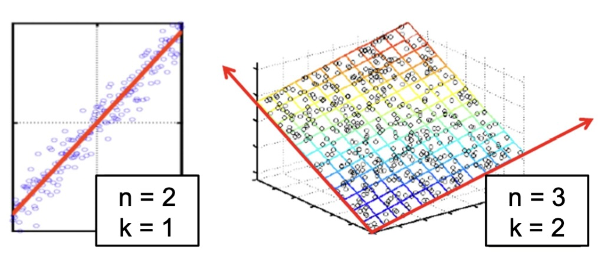{fig-align="center"}

:::: footer
Slides based on material from Prof. Yi Zhang
:::

::: {.notes}
Two cartoons of the assumption. Left: points in 2-D (n=2) that hug a line, so one coordinate (k=1), position along the line, describes them almost completely. The scatter perpendicular to the line is small. Right: points in 3-D (n=3) lying close to a tilted plane, so two coordinates (k=2) suffice.

In both cases the low-dimensional structure is flat (a line, a plane), which is exactly the case PCA handles. Notation on the figure: n is the ambient dimension and k the intrinsic one. On later slides d is the ambient dimension and n the number of points, so warn students about the switch.

The general version is the manifold hypothesis: real high-dimensional data (faces, digits, speech) concentrates near a low-dimensional surface. Faces make it intuitive. A 100x100 image has 10,000 pixels, but faces vary along far fewer factors: identity, pose, expression, lighting. Random pixel vectors almost never look like a face, so faces occupy a thin sliver of pixel space.

Ask: which of the two pictures can be "unrolled" by a projection? Both, because they're flat. The next slide is a case that isn't.
:::

## Visualizing the Manifold Hypothesis: Images of '3' Perturbed by Non-linear Operations

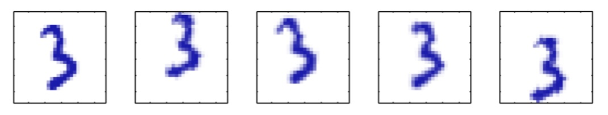{fig-align="center"}

* What operations did we perform? What's the intrinsic dimensionality?

* Here the underlying **manifold** is **non-linear**

:::: footer
Bishop, C. M. (2006). *Pattern Recognition and Machine Learning*, §12.1. Springer.
:::

::: {.notes}
This example is from Bishop, chapter 12. Bishop takes one handwritten 3 (a 64x64 image), embeds it in a larger 100x100 canvas, and varies its position and orientation at random.

Ask the two questions on the slide before answering:

1. What operations? Horizontal translation, vertical translation, and rotation. Look at the five images: the 3 moves around and tilts, but its shape doesn't change. No scaling, no deformation.
2. Intrinsic dimensionality? Three: x-shift, y-shift and angle. Each image is a point in a space with 10,000 pixel dimensions, yet the whole collection is a 3-dimensional manifold inside it. (Bishop also notes real digit data adds noise and writing-style variation, so in practice it's near a manifold, not exactly on one.)

Why non-linear: shift the 3 by one pixel and a completely different set of pixels lights up. Moving along the "translate" direction traces a curved path through pixel space, not a straight line. Averaging two shifted 3s gives a blurry double 3, not a 3 at the midpoint. That's the signature of a curved manifold: the straight line between two valid points leaves the manifold.

So linear methods like PCA can only approximate this, and we'll need methods that follow curvature: LLE today, t-SNE and UMAP next week.
:::

## Digits

``` python
from sklearn.datasets import load_digits

digits = load_digits(n_class=6)
X, y = digits.data, digits.target
```

::: {.notes}
Our DR playground is scikit-learn's digits: small 8x8 grayscale images of handwritten digits, pixel values 0 to 16. Flattened, each image is a 64-dimensional vector. That's high enough that you can't plot it, and small enough that every method runs in seconds in class.

`n_class=6` keeps only digits 0 to 5, which gives 1,083 images and a cleaner picture with fewer colors. Later, the PCA slides load all ten classes (1,797 images); point that out when you get there.

`X` is 1083x64 (one row per image); `y` holds the digit labels, which we'll use only to color plots, never to fit them.
:::

## Digits - 0

```{python}
#| echo: true
#| output-location: column
from sklearn.datasets import load_digits

digits = load_digits(n_class=6)
digits.images[0]
```

::: {.notes}
The first image as its raw 8x8 array. Have students find the shape: the zeros form a border and a hole in the middle, and the large values (13 to 16) trace a ring. It's a 0.

This is the key mental step: the algorithm never sees the picture, only these 64 numbers in a row. Two images are "close" if these vectors are close in Euclidean distance. That's a crude notion of visual similarity. Shift this 0 by one pixel and the vector changes a lot, which is exactly the Bishop point from two slides ago.
:::

## Digits - 1

```{python}
#| echo: true
#| output-location: column
from sklearn.datasets import load_digits

digits = load_digits(n_class=6)
digits.images[1]
```

::: {.notes}
The second image is a 1: the large values form a vertical stroke down columns 3 to 5, with zeros everywhere else.

Compare it with the 0. A 1 has far fewer nonzero pixels, so its vector has a much smaller norm. That's a hint that a linear method might separate some digits on ink quantity alone. Ask students to predict which digits will be easy to separate in a 2-D projection, and check their guesses on the PCA slide.
:::

## Digits

```{python}
#| echo: true
#| output-location: column
from sklearn.datasets import load_digits

digits = load_digits(n_class=6)
X, y = digits.data, digits.target
n_samples, n_features = X.shape
n_neighbors = 30

import matplotlib.pyplot as plt

fig, axs = plt.subplots(nrows=10, ncols=10, figsize=(8, 8))
for idx, ax in enumerate(axs.ravel()):
    ax.imshow(X[idx].reshape((8, 8)), cmap=plt.cm.binary)
    ax.axis("off")
_ = fig.suptitle("A selection from the 64-dimensional digits dataset", fontsize=16)
```

::: {.notes}
The first 100 images, reshaped back to 8x8 for display. At this resolution there's a lot of variation within each class: slanted and upright 1s, open and closed 4s, 5s that look like 3s.

The goal for every method that follows: map these 1,083 points to 2-D so that images that look alike land near each other. What we'll check in each embedding: do the six classes separate? Do confusable pairs (1 and 4, 3 and 5) sit next to each other? Does the layout between clusters mean anything?

`n_neighbors = 30` is set here for the neighborhood-based methods later (Isomap, LLE). They build a nearest-neighbor graph in 64-D first.
:::

## Digits: t-SNE embedding

```{python}
#| echo: false
#| fig-align: center

import numpy as np
from matplotlib import offsetbox

from sklearn.preprocessing import MinMaxScaler

def plot_embedding(X, title, ax=None):
    if ax is None:
        _, ax = plt.subplots(figsize=(16, 8.6))
    X = MinMaxScaler().fit_transform(X)

    for digit in digits.target_names:
        ax.scatter(
            *X[y == digit].T,
            marker=f"${digit}$",
            s=60,
            color=plt.cm.Dark2(digit),
            alpha=0.425,
            zorder=2,
        )
    shown_images = np.array([[1.0, 1.0]])  # just something big
    for i in range(X.shape[0]):
        # plot every digit on the embedding
        # show an annotation box for a group of digits
        dist = np.sum((X[i] - shown_images) ** 2, 1)
        if np.min(dist) < 4e-3:
            # don't show points that are too close
            continue
        shown_images = np.concatenate([shown_images, [X[i]]], axis=0)
        imagebox = offsetbox.AnnotationBbox(
            offsetbox.OffsetImage(digits.images[i], cmap=plt.cm.gray_r), X[i]
        )
        imagebox.set(zorder=1)
        ax.add_artist(imagebox)

    ax.set_title(title)
    ax.axis("off")

from sklearn.manifold import TSNE
from time import time

start_time = time()
tsne_proj = TSNE(
    n_components=2,
    max_iter=500,
    n_iter_without_progress=150,
    random_state=0,
).fit_transform(X)
plot_embedding(tsne_proj, f"t-SNE embedding (time {time() - start_time:.1f}s)")
plt.show()
```

::: {.notes}
A preview of where we're headed: t-SNE applied to the 64-D digits, 1,083 points, in about a second. Each colored glyph is one image plotted as its digit label. The gray thumbnails are a sample of the actual images, drawn wherever there's room, so you can check that neighbors really look alike.

What to point out:

- The six classes form six well-separated islands with almost no mixing, even though t-SNE never saw the labels. The labels are only used for color.
- Within an island, thumbnails change gradually (slant, thickness). Local neighborhoods are meaningful.
- Between islands, distances and positions are not reliable. t-SNE preserves local neighbors, not global geometry, so "0 is far from 5" means little. This is the most common misreading of t-SNE plots and the main topic of next week's Distill reading.

Compare it mentally with PCA on the same kind of data in a few slides. Hold that comparison in mind through the linear algebra.
:::

## Same digits, six projections

```{python}
#| echo: false
#| fig-align: center
import warnings
from sklearn.decomposition import PCA
from sklearn.random_projection import SparseRandomProjection
from sklearn.manifold import MDS, Isomap, LocallyLinearEmbedding

six = {
    "PCA (linear)": PCA(n_components=2),
    "Random projection (linear)": SparseRandomProjection(n_components=2, random_state=42),
    "MDS (distances)": MDS(n_components=2, n_init=1, max_iter=120, random_state=0),
    "Isomap (geodesic distances)": Isomap(n_neighbors=n_neighbors, n_components=2),
    "LLE (local linear weights)": LocallyLinearEmbedding(n_neighbors=n_neighbors, n_components=2, method="standard", random_state=0),
}
fig, axs = plt.subplots(2, 3, figsize=(18, 9.2))
with warnings.catch_warnings():
    warnings.simplefilter("ignore")
    projs = {name: t.fit_transform(X) for name, t in six.items()}
projs["t-SNE (local neighbors)"] = tsne_proj
for ax, (name, P) in zip(axs.ravel(), projs.items()):
    for digit in np.unique(y):
        ax.scatter(*P[y == digit].T, s=10, color=plt.cm.Dark2(digit), label=str(digit))
    ax.set_title(name); ax.set_xticks([]); ax.set_yticks([])
axs[0, 0].legend(markerscale=3, ncol=6, loc="upper center", bbox_to_anchor=(0.5, -0.02), fontsize=11, frameon=False)
plt.tight_layout()
plt.show()
```

::: {.notes}
SKIPPABLE - if running long, jump to "Principal Component Analysis".

These are the same 1,083 digits run through six methods live, colored by digit (colors match the previous slide). The original 2025 code computed thirteen embeddings and plotted one; this shows the comparison it was built for.

Read left to right, top to bottom, roughly from "linear" to "local":

- **PCA:** the best linear 2-D view. 0 (teal, bottom) and 4 (green, right) pull apart. 2 and 3 overlap on the left, 1 (orange) runs along the top, and 5 (yellow) sits in the middle of everything.
- **Random projection:** a random linear map. It's the baseline and clearly worse than PCA. The lattice pattern comes from the integer pixel values being multiplied by sparse ±1 weights. It's still not useless, because random projections to *enough* dimensions approximately preserve distances (Johnson–Lindenstrauss); 2 is far too few.
- **MDS:** tries to keep all pairwise distances. Similar global look to PCA.
- **Isomap:** keeps distances measured along the neighbor graph (geodesics), not straight through space. Classes start to separate.
- **LLE:** keeps each point's local reconstruction weights (the method we derive at the end of today). Here it largely fails: the 0s shoot out along one long thin arm, the 4s trail off below, and the other four classes pile on top of each other. That's a known LLE failure mode. The embedding comes from the bottom eigenvectors, which can latch onto one strongly separated component, and the result depends heavily on n_neighbors and regularization. Keep this in mind for the clean face-grid result at the end.
- **t-SNE:** the cleanest separation.

The general rule: the more a method focuses on local neighborhoods, the better it separates clusters, and the less you can trust large-scale distances. Choosing a method means choosing what to preserve, just like choosing a clustering method meant choosing what a cluster is.
:::

## Principal Component Analysis

::: incremental
-   PCA is directly related to the eigenvectors and eigenvalues of covariance matrices.
-   Lets so make a quick review of eigenvectors, eigenvalues, and covariance matrices.
:::

:::: footer
Slides based on material from Prof. Luis Gustavo Nonato
:::

::: {.notes}
Now the workhorse. PCA is linear: it finds a rotation of the coordinate system and then drops axes. It can't unfold a curved manifold like t-SNE can, but it has properties nothing else has:

- **Deterministic:** no random seed, same answer every run.
- **Fast:** one SVD.
- **Invertible:** you can map back to the original space and reconstruct.
- **Interpretable axes:** each component is a weighted combination of original features, and you can inspect the weights.
- **Honest variance accounting:** it tells you exactly how much variance each axis keeps.

That's why it's the default first look at any dataset, and why t-SNE and UMAP usually initialize from it.

Roadmap for the next ten slides, from Nonato's lectures:

1. Eigenvectors and the spectral decomposition of symmetric matrices.
2. The covariance matrix, which is symmetric.
3. PCA as diagonalizing the covariance.
4. Using the eigenvalues to decide how many components to keep.

If the room has a strong linear algebra background, move quickly through the next two slides.
:::

## Eigenvectors and Eigenvalues

Given a $d \times d$ matrix $A$, a pair $(\lambda, u)$ that satisfies

$A u = \lambda u$

is called eigenvalue $\lambda$ and corresponding eigenvector $u$ of $A$.

::: {.notes}
An eigenvector is a direction that the matrix doesn't rotate: multiplying by A only stretches or shrinks it, by the factor lambda. Draw it on the board. Most vectors change direction under A; eigenvectors are the special axes along which A acts like simple scaling.

Eigenvectors are only defined up to scale (if u works, so does 2u or -u), so we normalize them to unit length. This is also why PCA axes can flip sign between runs or libraries. Students who compare their PCA plot with a classmate's and see it mirrored should know that's expected and harmless.

Preview of why this matters: for the covariance matrix, the eigenvectors will be the principal directions of the data cloud, and each eigenvalue will be the variance along its direction.
:::

## Symmetric Matrices

:::: {.columns}
::: {.column width="38%"}
- $\lambda \in \mathbb{R}$ and $u \in \mathbb{R}^d$ (no complex numbers involved)
- The eigenvectors are orthogonal
:::
::: {.column width="62%"}
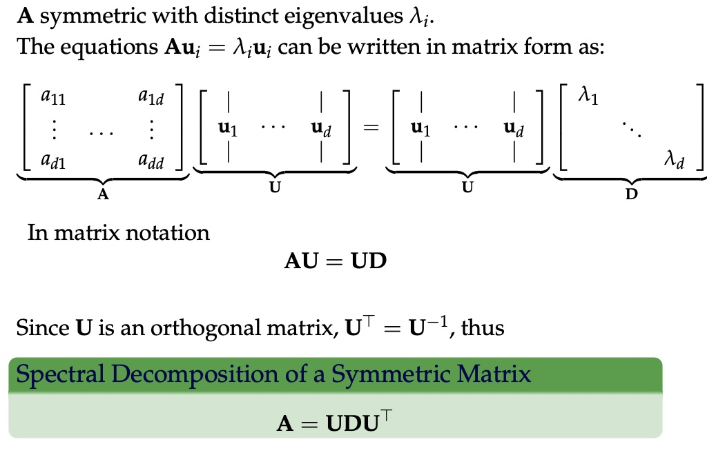{width="100%" fig-align="center"}
:::
::::

::: {.notes}
For a general matrix, eigenvalues can be complex and eigenvectors needn't be perpendicular. Symmetric matrices (A = Aᵀ) are the well-behaved case: real eigenvalues and orthogonal eigenvectors (the spectral theorem). Covariance matrices are always symmetric, so PCA gets this for free.

Walk the derivation on the right:

1. Stack the d equations A uᵢ = λᵢ uᵢ side by side. A times the matrix U of eigenvector columns equals U times the diagonal matrix D of eigenvalues: AU = UD.
2. Because the columns of U are orthonormal, Uᵀ = U⁻¹.
3. Multiply both sides on the right by Uᵀ to get A = U D Uᵀ, the spectral decomposition.

How to read it: any symmetric matrix is "rotate into the eigenbasis (Uᵀ), scale each axis by its eigenvalue (D), rotate back (U)". Keep this picture, because PCA is the decomposition applied to the covariance matrix, and SVD is its generalization to non-square matrices.
:::

## Covariance Matrix

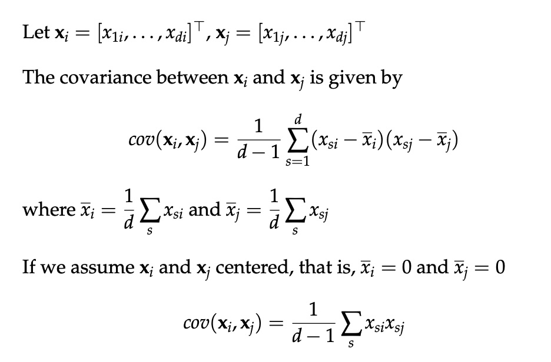{fig-align="center"}

::: {.notes}
Start with covariance between two variables. Watch Nonato's notation on this slide: xᵢ and xⱼ are two attributes (two rows of the data matrix), each holding d observations, and s runs over the observations. The formula is the familiar one: average the product of deviations from each attribute's mean, dividing by d−1 for an unbiased estimate.

The last line is the important simplification. If we center the data first (subtract each attribute's mean), covariance is just a scaled dot product of the two attribute vectors. That's why every PCA implementation centers first, and why forgetting to center is a classic bug: without centering, the first "principal component" just points at the mean.

Sign intuition: positive when the two attributes tend to be above their means together, negative when one is high while the other is low, near zero when there's no linear relationship. Note "linear": a perfect circle has zero covariance between x and y.
:::

## Covariance Matrix

:::: {.columns}

::: {.column width="50%"}
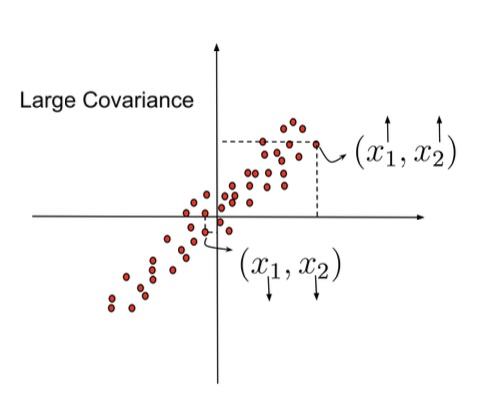{width="100%"}
:::

::: {.column width="50%"}
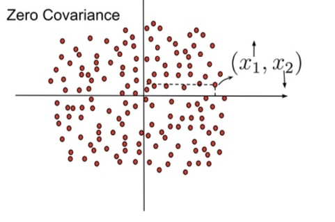{width="100%"}
:::

::::

::: {.notes}
Geometric intuition for the sign of each product term in the sum.

Left, large covariance: the points lie along a rising diagonal. A point in the upper-right quadrant has both coordinates above the mean (both arrows up), so its product is positive. A point in the lower-left has both below (both arrows down), so its product is also positive. Almost every point contributes a positive term, so the sum is large.

Right, zero covariance: the cloud is round. The highlighted point has x₁ above the mean and x₂ below (one arrow up, one down), so its product is negative, and another point in the opposite quadrant cancels it. Positive and negative products balance, and the sum is near zero.

PCA's job, previewed: given a cloud like the left one, find the rotation that makes it look like the right one in its covariance (no correlation between the new axes), but with the variance concentrated in the first axis.
:::

## Covariance Matrix

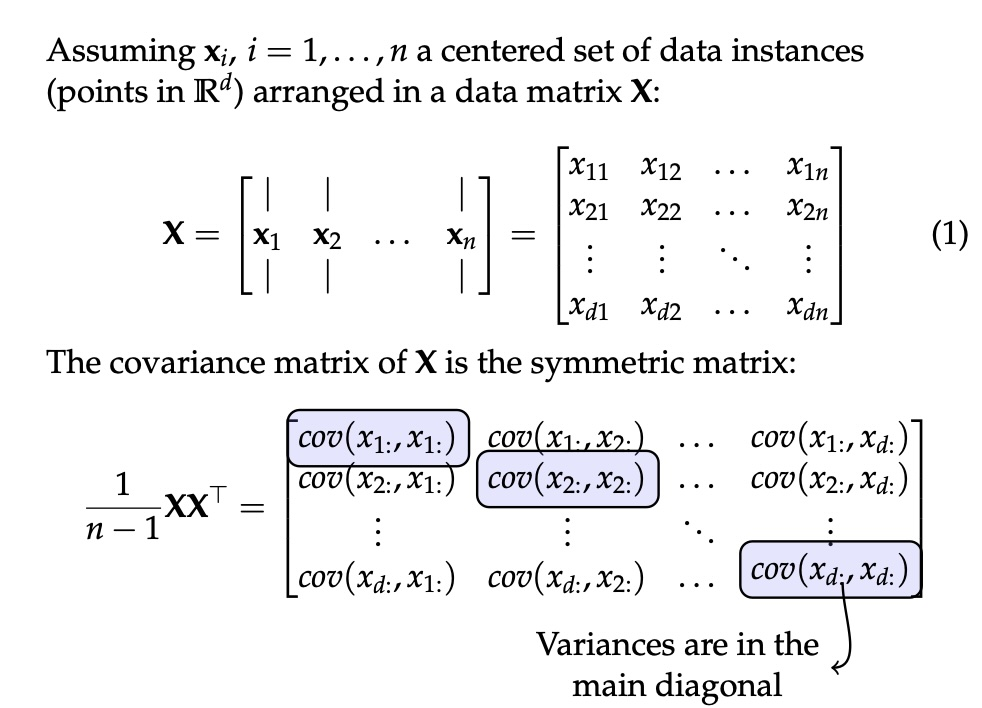{fig-align="center"}

::: {.notes}
Now all attributes at once. The convention here: X is d x n, with each column xᵢ one centered data point in R^d. Warn students that scikit-learn uses the transpose (n x d, rows are points). Whenever a formula looks off by a transpose, this is why.

With centered data, the full covariance matrix is (1/(n−1)) X Xᵀ, a d x d symmetric matrix:

- The diagonal entry (k,k) is the variance of attribute k (the highlighted boxes).
- The off-diagonal entry (k,l) is the covariance between attributes k and l.

Because it's symmetric, everything from the previous slides applies: real eigenvalues, orthogonal eigenvectors, and a spectral decomposition.

For digits, d = 64, so this is a 64x64 matrix. Each entry says how two pixels co-vary across the 1,797 images. Neighboring pixels in a stroke covary strongly, and border pixels are almost always 0 with near-zero variance. That's redundancy PCA can remove.
:::

## Principal Component Analysis:  intuition

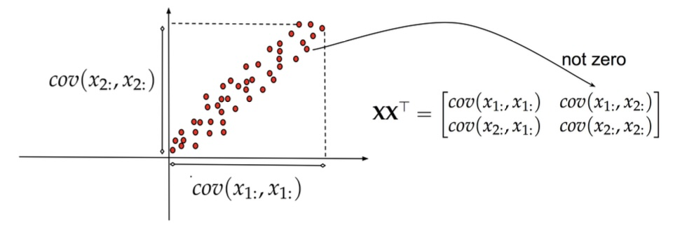{fig-align="center"}

::: {.notes}
Back to the correlated cloud, in the original axes x₁ and x₂. The dashed box marks the spread along each axis: the variances cov(x₁,x₁) and cov(x₂,x₂) are both large. On the right, the covariance matrix XXᵀ has an off-diagonal entry that the arrow labels "not zero", because the two attributes are correlated.

What that means in practice: the two attributes are redundant. Knowing x₁ tells you a lot about x₂. You're spending two numbers per point to store about one number's worth of information.

Ask: is there a choice of axes where the off-diagonal entry would be zero? The next slide answers it.
:::

## Principal Component Analysis:  intuition

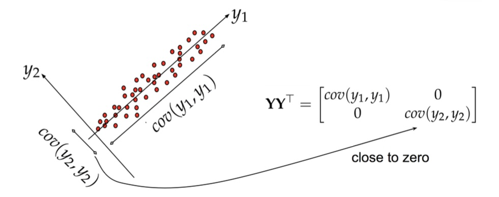{fig-align="center"}

::: {.notes}
Same points, new axes. y₁ runs along the diagonal of the cloud and y₂ is perpendicular to it. In these coordinates:

- cov(y₁,y₁) is large: most of the spread lies along y₁.
- cov(y₂,y₂) is small: points barely deviate from the line.
- The off-diagonal covariance is zero. The new covariance matrix YYᵀ is diagonal, which the slide's arrow labels "close to zero".

That's PCA in one picture: rotate the axes so the new coordinates are uncorrelated and ordered by variance. Then dimensionality reduction is just dropping y₂. You lose the small perpendicular wiggle and keep the position along the line. If that wiggle is mostly measurement noise, dropping it even helps.

What's lost, and what PCA can't do: it only rotates. If the cloud were curved, a banana instead of a cigar, no rotation would put all the variance on one axis. That's the Bishop 3s, and the reason for LLE at the end.
:::

## Principal Component Analysis

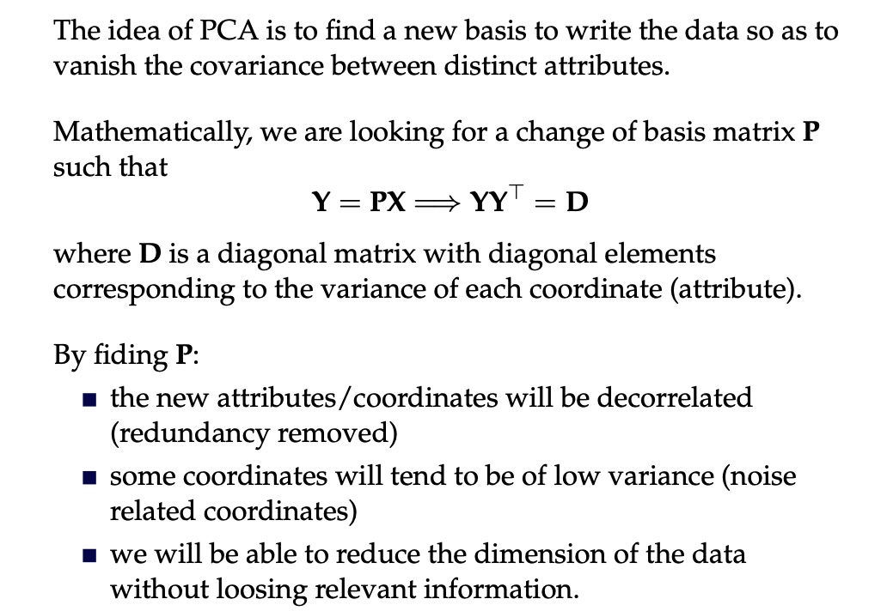{fig-align="center"}

::: {.notes}
The formal statement: find a change of basis P with Y = PX such that YYᵀ = D is diagonal.

Connect it to the spectral decomposition. Since XXᵀ = U D Uᵀ, choose P = Uᵀ. Then YYᵀ = Uᵀ XXᵀ U = Uᵀ U D Uᵀ U = D. The rows of P are the eigenvectors of the covariance matrix, which are the principal components, and the eigenvalues are the variances of the new coordinates.

The three bullets are what you get:

1. **Decorrelated coordinates:** redundancy removed.
2. **Some coordinates have low variance:** typically noise.
3. **You can drop those:** reducing dimension while keeping the relevant information.

Algorithm in practice:

1. Center X.
2. Compute the covariance, or go straight to SVD.
3. Get the eigenvectors and sort them by eigenvalue.
4. Keep the top k.
5. Project: Y_k = U_kᵀ X.

Caveat on bullet 2: "low variance = noise" is an assumption, not a theorem. A small-variance direction can be exactly the one that separates two classes. PCA is unsupervised and doesn't know.
:::

## Principal Component Analysis

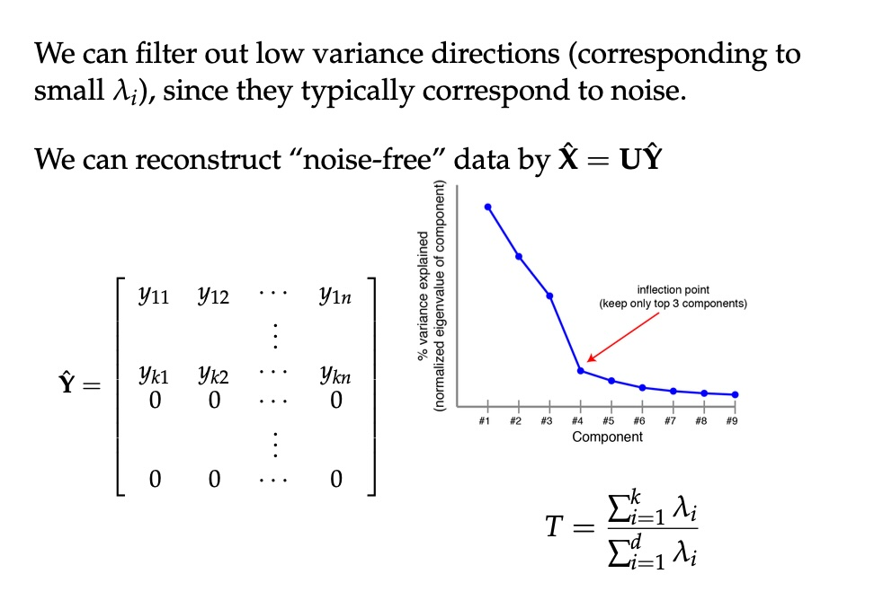{fig-align="center"}

::: {.notes}
How many components to keep? The plot is a scree plot: variance explained by each component, sorted. Look for the bend. Here it's at component 4, so keep the top 3; the rest form a flat tail of roughly equal, small eigenvalues, which is what noise looks like. (This is the same elbow logic as choosing k for k-means.)

The formula T = (sum of top-k eigenvalues) / (sum of all eigenvalues) is the fraction of variance retained. A common rule is "keep enough to reach 90 or 95%".

Real numbers for the digits dataset (computed for this lecture):

- 2 components keep only 28.5% of the variance.
- 10 keep about 74%, 20 keep about 89%, and about 30 reach 95%.

So the 2-D PCA plot coming up shows less than a third of the information. Be skeptical of any conclusion drawn from it.

Filtering: set the dropped coordinates of Ŷ to zero and map back with X̂ = UŶ. You get a denoised reconstruction. That works because noise spreads evenly over all directions while signal concentrates in a few. It's the same idea as JPEG keeping only the large coefficients.
:::

## PCA of digits

```{python}
#| echo: true
#| output-location: column
#| fig-width: 8
#| fig-height: 7
from sklearn.decomposition import PCA
pca = PCA(n_components=2)
data, labels = load_digits(return_X_y=True)
reduced_data=pca.fit_transform(data)
plt.scatter(reduced_data[:, 0], reduced_data[:, 1])
plt.show()
```

::: {.notes}
Three lines of scikit-learn. Note that this loads all ten digit classes (1,797 images), not the six used for t-SNE.

`fit_transform` centers the data, computes the top 2 components via SVD, and projects. Uncolored, as with Iris at the start: what do you see? A blob with some lobes, and a few dense fingers sticking out, but nothing as obvious as the t-SNE islands.

Reminder: these two axes keep 28.5% of the variance. You're looking at a shadow of 64-D data cast onto the plane that makes the shadow as spread out as possible.
:::

## PCA of digits

```{python}
#| echo: true
#| output-location: column
#| fig-width: 8
#| fig-height: 7
from sklearn.decomposition import PCA
pca = PCA(n_components=2)
data, labels = load_digits(return_X_y=True)
reduced_data=pca.fit_transform(data)
plt.scatter(reduced_data[:, 0], reduced_data[:, 1], c=labels, cmap="tab10", s=10)
plt.colorbar(ticks=range(10), label="digit")
plt.show()
```

::: {.notes}
Same projection, now colored by the true digit. (The only change from the 2025 version is the colormap and colorbar, so the colors can be decoded.)

What separates, using class centers I computed on this exact projection:

- **0** sits clearly at the bottom (PC2 around −21).
- **4** sits at the far right (PC1 around +22).
- **6** sits at the lower right.
- **3** and **9** lie on the left, overlapping each other.
- **1, 5 and 8** sit in the middle. 1 and 5 are among the most spread-out classes, smeared across the plot.

So "ones are easy" is not true here, despite the ink argument from earlier. Writers draw 1s with and without serifs and at different slants, which spreads them out.

Compare with the t-SNE slide: t-SNE separated every class, and PCA separates three. That's linear vs non-linear, and also 28.5% of the variance vs a method that only cares about neighbors. Both plots are "correct". They answer different questions.
:::

## Scaling Up

* Covariance matrix can be really big!
  - $\Sigma$ is $d$ by $d$
  - 10000 features are not uncommon
  - computing eigenvectors is slow...

* Solution: Singular Value Decomposition (SVD)
  - Finds the $k$ largest eigenvectors
  - Widely implemented robustly in major packages

::: {.notes}
Note: the slide previously said Σ is n by n. It's d by d, one row and column per feature, matching the notation on the covariance slides.

The cost problem: with 10,000 features, Σ has 10⁸ entries (about 800 MB in float64), and a full eigendecomposition is O(d³). We usually want only the top few components.

What SVD buys:

1. **No covariance matrix needed:** it works on the centered data matrix directly.
2. **More numerically stable:** forming XXᵀ squares the condition number, so small eigenvalues lose precision. SVD avoids that.
3. **Truncated and randomized variants:** they compute only the top k. scikit-learn's PCA picks a solver automatically and uses randomized SVD for large inputs when n_components is small. For truly huge or sparse data there's TruncatedSVD (which doesn't center) and IncrementalPCA (which streams batches).

In practice, nobody computes PCA by building the covariance matrix. The covariance view is for understanding; SVD is for computing.
:::

## Singular Value Decomposition (SVD)

**Any matrix, $M = U \Sigma V^{*}$ — rotate, scale, rotate** ([Wikipedia](https://en.wikipedia.org/wiki/Singular_value_decomposition))

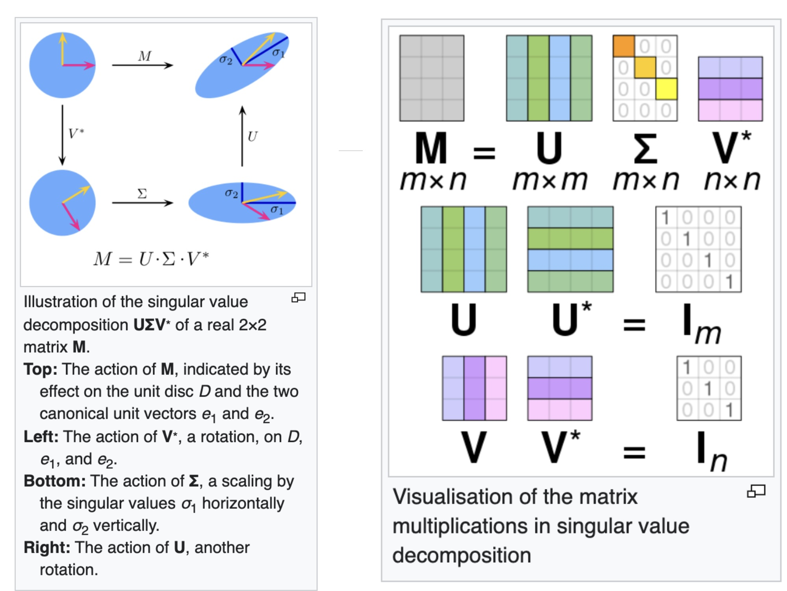{fig-align="center"}

::: {.notes}
SVD factors any m x n matrix, not just square symmetric ones, into rotation, scaling, rotation.

Left panel, the geometric picture for a 2x2 matrix M applied to the unit disk:

1. V* rotates the disk.
2. Σ stretches it along the axes by the singular values σ₁ and σ₂, making an ellipse.
3. U rotates the ellipse into place.

Every linear map does this. It's the spectral decomposition generalized: for a symmetric positive semi-definite matrix, U = V and the singular values are the eigenvalues.

Right panel, the shapes: U is m x m and V is n x n, both orthogonal (the identity checks below), and Σ is m x n with the singular values on its diagonal.

The connection to PCA, which is the one thing to remember: write the centered data with points as rows, X (n x d) = U Σ Vᵀ. Then XᵀX = V Σ² Vᵀ. So the right singular vectors V are the principal directions, the eigenvalues of the covariance are σ²/(n−1), and the projected coordinates are UΣ. One SVD gives you everything PCA needs.
:::

## Dimensionality Reduction Techniques

* https://en.wikipedia.org/wiki/Dimensionality_reduction
  - Principal component analysis (PCA)
  - Non-negative matrix factorization (NMF)
  - Linear discriminant analysis (LDA)
  - t-SNE
  - UMAP
  - **many others**

::: {.notes}
PCA is one point in a large family. Organize the list by what each method optimizes:

- **PCA:** linear, unsupervised, maximizes variance.
- **NMF:** linear, but factors and weights must be non-negative. For images or word counts this gives parts-based components (strokes, topics) that are easier to interpret than PCA's signed components.
- **LDA:** linear and supervised. It uses labels to find directions that separate classes, at most (classes − 1) of them. Use it when you have labels and want to see whether they're linearly separable. Not to be confused with Latent Dirichlet Allocation, the topic model.
- **t-SNE and UMAP:** non-linear, neighbor-preserving, and the standard tools for visualizing embeddings. Next week.
- **Many others:**
  - MDS and Isomap: preserve distances.
  - Autoencoders: learned non-linear PCA.
  - Kernel PCA: PCA in a feature space.

Rule of thumb for projects: always look at PCA first (fast, deterministic, honest about variance), then a neighbor-based method if you care about clusters. Report what each one preserves.
:::

## Local Linear Embedding

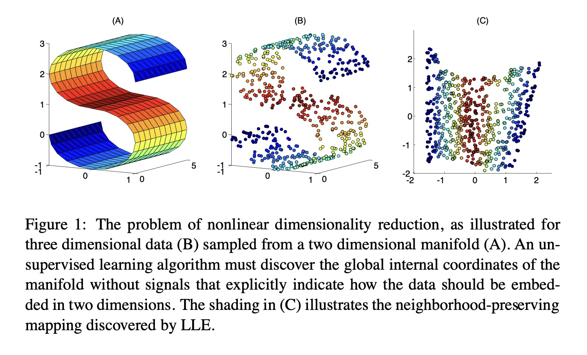{fig-align="center"}

:::: footer
Roweis, S. T. & Saul, L. K. (2000). [Nonlinear dimensionality reduction by locally linear embedding](https://doi.org/10.1126/science.290.5500.2323). *Science* 290(5500).
::::

::: {.notes}
Figure 1 of the LLE paper, Roweis and Saul, Science 2000. It was published in the same issue as Isomap, and the pair started the manifold-learning field.

The three panels:

- **(A)** A 2-D sheet bent into an S shape in 3-D (the "S-curve"). The color runs along the sheet, so it encodes position on the manifold.
- **(B)** 3-D points sampled from that sheet. This is all the algorithm gets.
- **(C)** LLE's 2-D output. The color gradient runs smoothly from one side to the other. LLE has flattened the S, putting points that were neighbors on the sheet next to each other.

Ask: what would PCA do with (B)? It can only rotate and drop an axis. Viewed from any direction, the S overlaps itself, so red points from the middle of the sheet would land on top of blue points from the ends. Distances measured straight through 3-D space are misleading: two points on adjacent layers of the S are close in 3-D but far apart along the sheet.
:::

## Preserving Local Manifold Neighborhoods

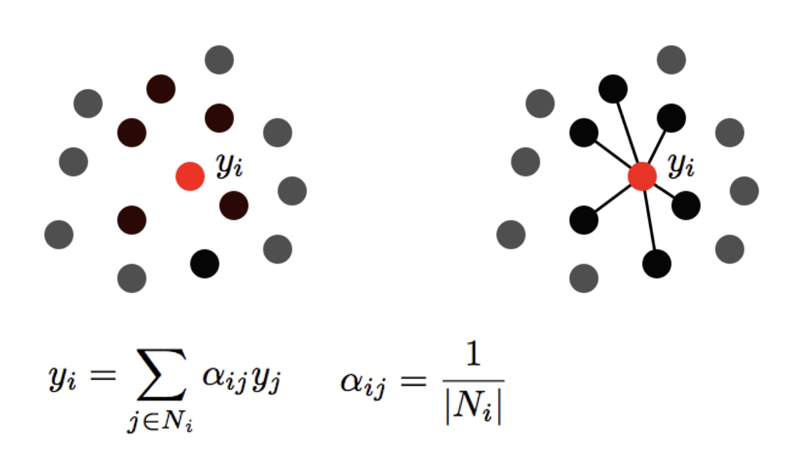{fig-align="center"}

::: {.notes}
The core idea of LLE: the manifold is curved globally but approximately flat locally. So describe each point yᵢ (red) by how it sits relative to its nearest neighbors Nᵢ (black). In the left panel, the neighbors are highlighted. In the right, the point is connected to them.

The formula writes yᵢ as a weighted combination of its neighbors. The weights in this figure are uniform (αᵢⱼ = 1/|Nᵢ|), meaning each point is the centroid of its neighbors. That's the simplest version, closer to Laplacian smoothing. LLE's refinement, on the next slide, is to solve for the best weights for each point instead of fixing them.

Why this is a good invariant: the reconstruction weights don't change if you rotate, scale or translate a neighborhood. So if the neighborhood is a flat patch, the same weights should still work after the patch is laid flat in 2-D. Stitching all the patches together under that constraint "unrolls" the manifold without tearing it.

Contrast with PCA: PCA preserves global variance and ignores who's next to whom. LLE preserves only who's next to whom, and in what proportions.
:::

## LLE

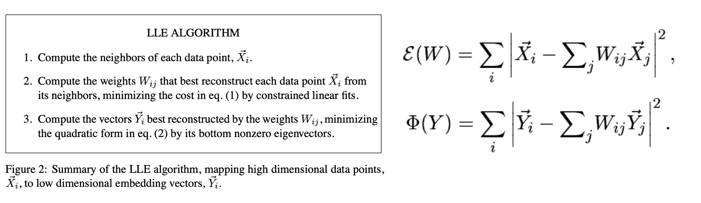{fig-align="center"}

:::: footer
Roweis, S. T. & Saul, L. K. (2000). [Nonlinear dimensionality reduction by locally linear embedding](https://doi.org/10.1126/science.290.5500.2323). *Science* 290(5500).
::::

::: {.notes}
Figure 2 of the paper, the whole algorithm in three steps:

1. **Find the neighbors of each point:** the K nearest, or all within a radius. K is the main parameter; we used 30 for digits.
2. **Solve for the weights W:** minimize the reconstruction error E(W) on the right, each point minus the weighted sum of its neighbors. W is constrained so each row sums to 1 and is zero for non-neighbors. This is a small least-squares problem per point.
3. **Fix W and solve for the low-dimensional points Y:** minimize Φ(Y), the same cost with Y in place of X. This is a sparse eigenvalue problem: the answer is given by the bottom eigenvectors of (I−W)ᵀ(I−W), discarding the constant one. That's the same move as PCA (eigenvectors), but of a different, local matrix.

Points to make:

- No iterative optimization and no local minima, unlike t-SNE. Two eigen-solves and done.
- It's sensitive to K: too small fragments the manifold, too large short-circuits across folds (the S's layers).
- When K exceeds the dimension, the weights are underdetermined and need regularization, which is why scikit-learn has the modified, Hessian and LTSA variants.
:::

## PCA vs LLE

:::: {.columns}
::: {.column width="45%"}
- Images of **one face** translated across a noisy background: intrinsically 2-D (x and y position)
- **PCA (top):** folds the sheet; nearby images are not neighbors
- **LLE (bottom):** recovers a flat grid; corner faces map to corners
:::
::: {.column width="55%"}
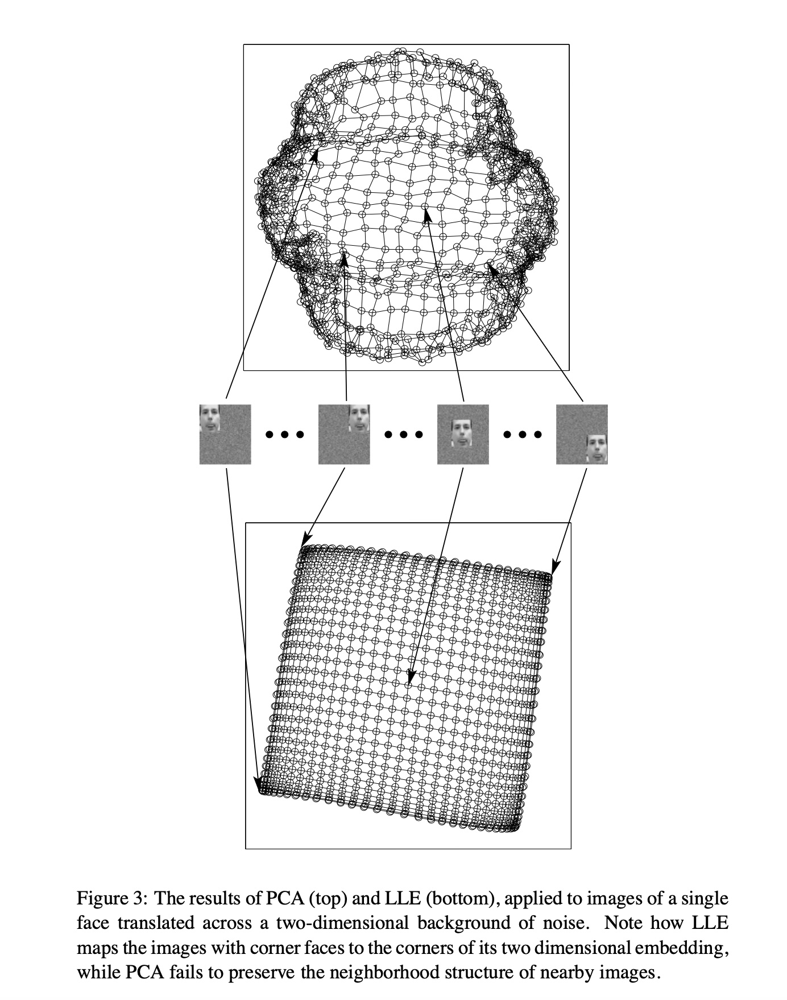{height="880" fig-align="center"}
:::
::::

:::: footer
Roweis, S. T. & Saul, L. K. (2000). [Nonlinear dimensionality reduction by locally linear embedding](https://doi.org/10.1126/science.290.5500.2323). *Science* 290(5500), Fig. 3.
::::

::: {.notes}
Figure 3 of the LLE paper, and the cleanest PCA vs LLE comparison there is. It's the Bishop idea from earlier made concrete.

The data: one face image pasted at different positions on a background of random noise. The true degrees of freedom are 2 (horizontal and vertical position), so the ideal embedding is a flat grid.

- **Top, PCA:** the embedding is a crumpled, folded surface. Follow the arrows: images with the face in different positions land near each other, and neighboring positions get torn apart. As with the shifted 3s, translating an image moves along a curved path in pixel space, and PCA's projection collapses that path onto itself.
- **Bottom, LLE:** a nearly perfect square grid. The four corner images (face top-left, top-right, and so on) map to the four corners, and neighbors stay neighbors.

This summarizes the second half: PCA preserves global variance, LLE preserves local neighborhoods, and when the data lives on a curved manifold, preserving neighborhoods is what recovers the true coordinates.

Fair caveat: on the six-projections slide, LLE on real digits mostly collapsed, with the 0s on one long arm and everything else in a pile. Clean, densely sampled manifolds like this synthetic one are the best case. Real data is rarely that kind.
:::

## Beyond PCA: Non-linear Methods

* **t-SNE** (t-Distributed Stochastic Neighbor Embedding)
  - Preserves local neighborhood structure
  - Great for visualization of clusters
  - Non-linear, adapts to different regions of data

* **UMAP** (Uniform Manifold Approximation and Projection)
  - Faster than t-SNE, scales better
  - Better preserves global structure
  - Based on topological data analysis

::: {.notes}
Bridge to next week. Both methods follow LLE's philosophy (preserve neighborhoods), but with probabilistic or fuzzy neighborhoods instead of linear weights.

- **t-SNE** (van der Maaten and Hinton, 2008):
  - Turns distances into neighbor probabilities in both high-D and 2-D, then moves the 2-D points to make the two distributions match (minimizing KL divergence).
  - The heavy-tailed Student-t in 2-D is what creates the well-separated islands we saw on the digits.
  - Key parameter: perplexity, roughly the effective number of neighbors.
- **UMAP** (McInnes et al., 2018):
  - Builds a weighted k-nearest-neighbor graph (the fuzzy simplicial set from the topology side) and lays it out in 2-D.
  - Much faster on large data, and usually keeps more of the large-scale arrangement, though "better global structure" is debated and depends heavily on initialization.

Both are stochastic (run twice, get different pictures), both have parameters that change the picture a lot, and in neither should you read cluster sizes or between-cluster distances literally. Those three caveats are next week's lecture.
:::

## Next Week: Advanced Dimensionality Reduction

* Deep dive into t-SNE
  - How it works (probability distributions, KL divergence)
  - Critical parameters (perplexity)
  - Common pitfalls and how to avoid them

* UMAP in detail
  - Comparison with t-SNE
  - Parameter tuning (n_neighbors, min_dist)

* Interactive dimensionality reduction

* Also: Topomap (topology-preserving layouts) and projection quality metrics

**Required reading:** Wattenberg, Viégas & Johnson, [*How to Use t-SNE Effectively*](https://distill.pub/2016/misread-tsne/) (Distill, 2016)

**Due Tue Oct 20:** project proposal (4 pages)

::: {.notes}
Next Tuesday, Oct 20: t-SNE, UMAP, Topomap, interactive DR and projection quality metrics. Lab: implementing projection views and comparing projections.

The required reading is the Distill article "How to Use t-SNE Effectively". It's interactive and quick: students should play with the perplexity sliders, not just read. Its lessons, that cluster sizes, distances between clusters, and apparent shapes in random data can all be artifacts, are what we'll test them on.

Repeat the deadline: the project proposal (4 pages) is due next Tuesday, Oct 20. Every group proposes its own project, and the project discussion deck comes next, so this is the transition.

Tonight's lab (7:10 PM, same room, Bhavya) is dimensionality reduction hands-on, a direct continuation of the second half of this lecture.
:::
