# Deep Learning Fundamentals

::: {.notes}
[Section opener, 30 seconds.] Remind everyone where we are in the course. For six weeks we have looked at models we can open up: linear models, trees, and the black-box methods LIME and SHAP, which probe a model from the outside. Last week we looked at dimensionality reduction as a way to look at high-dimensional data and learned representations. Today we open the box on the model that makes interpretation hard: the neural network. The plan is deliberately foundational. If you can not say what a layer, an activation, or a loss surface is, none of the deep learning visualization papers we read from here on will make sense.
:::

## Agenda

\

### Goal: Grasp foundational DL concepts essential for understanding network visualization techniques.

1. Deep Learning Terminology and Foundations

2. Linear Models and Loss Functions

3. Shallow Neural Networks and Activation Functions

4. Deep Neural Networks and Composition

5. Interactive Visualization Tools

**Acknowledgments:**

Materials adapted from:

- Prince, S. J. D. (2023). [*Understanding Deep Learning*](https://udlbook.github.io/udlbook/). MIT Press.

::: {.notes}
[~3 min.] State the goal in one sentence: by the end of tonight you should be able to look at a network diagram and say what each part computes, and explain in your own words why depth helps. We will go from the simplest possible model (a line with two parameters) to a deep network, and at each step I will point at the figure that makes the idea visible. That is the visualization angle: every concept tonight has a picture, and the pictures are the point.

Be honest about the shape of the evening. Today is foundations; the heavy visualization techniques (CNN filter visualization, saliency maps, activation maximization, attention) come later. But the foundations matter for them: saliency maps need gradients, feature visualization needs the idea of hierarchical features, and the forward and backward passes are what every one of those techniques hooks into.

Pacing guide for the evening (lecture is 120 minutes, the lab starts at 7:10): framing and terminology 12 min; linear models, loss and gradient descent 22 min; shallow networks 30 min; deep networks 25 min; interactive tools 12 min; summary and next week 5 min. That is about 105 minutes with a cushion for questions. If you are ahead of schedule, spend the time on the 'Ask the class' prompts in these notes, not on adding material.

Acknowledge the source: nearly all figures are from Simon Prince, Understanding Deep Learning (MIT Press, 2023), which is free online. I chose it because its figures are among the best explanatory visualizations in the field, and using one consistent source means the notation (Phi for parameters, theta and phi for first and second layer) stays the same all evening.
:::

## Understanding Deep Learning

:::: {.columns}
::: {.column width="50%"}
**Understanding Deep Learning**
by Simon J.D. Prince

Published by MIT Press, 2023

Available free online:
<https://udlbook.github.io/udlbook>

**Why this book?**

- Modern treatment (includes transformers, diffusion models)
- Excellent visual explanations
- Free and accessible
- Strong mathematical foundations with intuitive explanations
:::
::: {.column width="50%"}
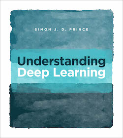{fig-align="center" width="70%"}
:::
::::

::: footer
Prince, S. J. D. (2023). [*Understanding Deep Learning*](https://udlbook.github.io/udlbook/). MIT Press.
:::

::: {.notes}
[~2 min.] Quick orientation to the book, no need to linger. Prince's book is free at udlbook.github.io, published by MIT Press in 2023. Three reasons it is the course's primary reference: it is modern (it covers transformers, diffusion models, and graph networks, not just CNNs and RNNs), it is unusually visual (every chapter is built around figures like the ones I am about to show), and it pairs the math with intuition rather than choosing one.

Tell students what to read: chapters 2 to 4 are tonight (supervised learning, shallow networks, deep networks), and they are short. The book also has Python notebooks that implement everything from scratch, which are a good way to check your understanding. If a student finds tonight's math fast, the notebooks are where they slow down.

One caution to give: the book's notation is slightly different from what you may have seen. Phi is the whole parameter vector; in the shallow network slides, theta indexes the first-layer parameters and phi the second-layer parameters. I will flag when it matters.
:::

## Deep Learning Terminology

**The Supervised Learning Framework:**

$$y = f[x, \Phi]$$

| Symbol | Meaning | Example |
|--------|---------|---------|
| $y$ | **Prediction** (model output) | House price: $450,000 |
| $x$ | **Input** (features) | Square footage: 2000 sq ft, Bedrooms: 3 |
| $\Phi$ | **Model parameters** (weights, biases) | Millions of numbers learned from data |
| $f[\cdot]$ | **Model function** (architecture) | Neural network with multiple layers |

**Key Insight:** Deep learning **learns** the parameters $\Phi$ from training data pairs $\{x_i, y_i\}$ to minimize prediction errors.

::: {.notes}
[~4 min.] This one table is the vocabulary for the whole evening, so go through it row by row and use the house-price example.

y is the prediction, the number the model outputs: 450,000 dollars. x is the input, the features: 2,000 square feet and 3 bedrooms. f is the model function, the architecture: it says how x gets turned into y. And Phi is the set of parameters, the numbers the model learns: in a linear model, a handful; in a large network, millions to billions.

Make the distinction that students most often blur: the architecture f and the parameters Phi are different things. Choosing the architecture (how many layers, which activation) is a human design decision made before training. Learning Phi is what training does. When we say a model has 175 billion parameters we mean the size of Phi, and the architecture determines how Phi is arranged.

The blue box is the key insight. Deep learning means learning Phi from training pairs (x_i, y_i) so that the predictions are close to the targets. The part that is new relative to classical ML is what we do not do: we do not hand-engineer features. In a classical pipeline a person decides that square footage per bedroom is a useful feature. In deep learning the first layers learn useful intermediate features, and the later layers use them. Hold that thought, because it is exactly what makes these models hard to interpret and exactly what the visualization techniques later in the course try to expose.

Ask the class: for an image classifier, what are x, y, f and Phi? (x is the pixels, y is the class scores or label, f is the CNN architecture, Phi is all the filter weights and biases.) Take one answer, then move on.
:::

## The Learning Process

:::: {.columns}
::: {.column width="50%"}
**Training Data:**

Pairs of inputs and outputs: $\{x_i, y_i\}$

**Loss Function:**

Quantifies prediction accuracy: $L[\Phi]$

- **Lower loss** = better fit to training data
- Guides parameter updates during training

**Goal:**

Find parameters $\Phi$ that minimize $L[\Phi]$

$$\Phi^* = \arg\min_{\Phi} L[\Phi]$$
:::
::: {.column width="50%"}
**Generalization:**

Test on **separate data** not seen during training

**The Challenge:**

We don't want to just memorize training data!

We want models that **generalize** to new, unseen examples.

→ This is why we split data into train/validation/test sets.

:::
::::

::: {.notes}
[~5 min.] Three ingredients, in order.

Training data: pairs of inputs and the correct outputs. For classification, images and labels; for regression, features and a target value. Everything the model will ever know about the task comes from these pairs.

Loss function: one number that says how bad the current parameters are. Lower is better. For regression the usual choice is mean squared error; for classification it is cross-entropy. Next slides make this concrete. The formula on the slide, Phi-star equals argmin of L of Phi, just says: out of all possible parameter settings, we want the one with the lowest loss.

Optimization: the procedure that searches for that Phi-star. For anything but the simplest models we cannot solve for it in closed form, so we do it iteratively with gradient descent, which we will see in a few slides. For networks, the gradient of the loss with respect to every parameter is computed by backpropagation, which is just the chain rule applied efficiently. I will not derive it tonight; what you need is that it costs roughly the same as one forward pass, which is why training large networks is feasible at all, and that frameworks like PyTorch do it for you automatically (autograd).

Right column: generalization. Doing well on the training data is not the goal; doing well on data the model has never seen is. A network with enough parameters can memorize the training set perfectly and still be useless. That is why we hold out validation and test data, and why regularization techniques like dropout and weight decay exist.

Visualization tie-in worth saying out loud: the training and validation loss curves are the single most common visualization in deep learning practice. A training loss that keeps falling while validation loss rises is overfitting, and you can see it at a glance. You will use exactly this plot in your projects, and we will see it live in the Playground in the lab.

Ask the class: why can't we just pick the parameters that give zero training loss? Expect: overfitting, memorization. Push on it: what would a model with zero training loss look like on a noisy dataset? (It would pass through every noisy point.)
:::

# Linear Models: Building Intuition

::: {.notes}
[Section opener, 30 seconds.] We start with a model so simple that we can draw every possible version of it. That is the trick of this section: with two parameters we can visualize the entire space of models and the loss for every one of them. Real networks have millions of parameters and we lose that luxury, but the intuition we build here (loss as a landscape, training as walking downhill) carries over directly.
:::

## 1-D Linear Regression Model

:::: {.columns}
::: {.column width="40%"}
**The simplest supervised learning model:**

$$y = f[x, \Phi] = \Phi_0 + \Phi_1 x$$

- $\Phi_0$: **Intercept** (bias term)
- $\Phi_1$: **Slope** (weight)
- Only **2 parameters** to learn
:::
::: {.column width="60%"}
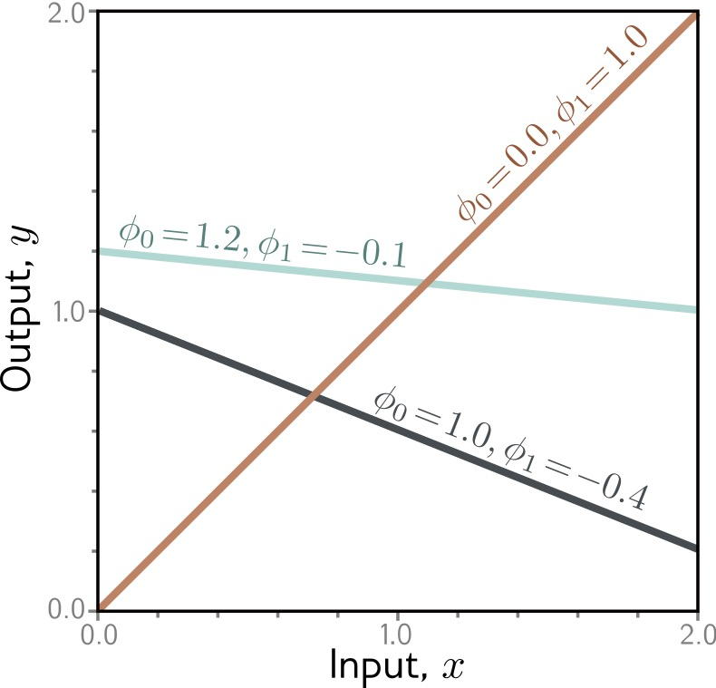{height="760" fig-align="center"}
:::
::::

::: footer
Prince, S. J. D. (2023). *Understanding Deep Learning*. Chapter 2: Supervised Learning.
:::

::: {.notes}
[~4 min.] The simplest supervised model there is: y equals Phi-0 plus Phi-1 times x. One input, one output, two parameters: an intercept Phi-0 and a slope Phi-1.

Read the figure. The three lines are three different members of the same model family; each is one choice of the two parameters. The orange line has intercept 0.0 and slope 1.0, so it passes through the origin at 45 degrees. The teal line has intercept 1.2 and slope minus 0.1, nearly flat and slightly decreasing. The dark line has intercept 1.0 and slope minus 0.4, decreasing more steeply. The point: the architecture (a straight line) fixes the family; the parameters pick one line out of it. Training means picking the best line.

This is a good moment to introduce a way of thinking that pays off all night: a model is a family of functions indexed by its parameters. Learning is a search through that family. For two parameters the family is a plane (each point in the plane is a line). For a network with a million parameters it is a million-dimensional space, which is why we will need clever visualization.

Remind them that this is the familiar y equals m x plus b. If it helps, note that this model is a neural network with no hidden layers and a single linear neuron, so everything we say about it applies at the bottom end of the spectrum.

Limitation to plant now: this family only contains straight lines. If the true relationship curves, no choice of Phi will fit well. We will fix that in the second section.

Ask the class: if I double the slope, what happens to the line? What if I change only the intercept? (Steeper; shifted up or down, same slope.) Quick, 30 seconds.
:::

## Linear Regression: Measuring Error

:::: {.columns}
::: {.column width="40%"}
**How do we quantify "good fit"?**

**Loss Function:** Sum of squared errors

$$L[\Phi] = \sum_{i=1}^{N} (y_i - f[x_i, \Phi])^2$$

Vertical distance from each data point to the line → squared → summed = **total error**

:::
::: {.column width="60%"}
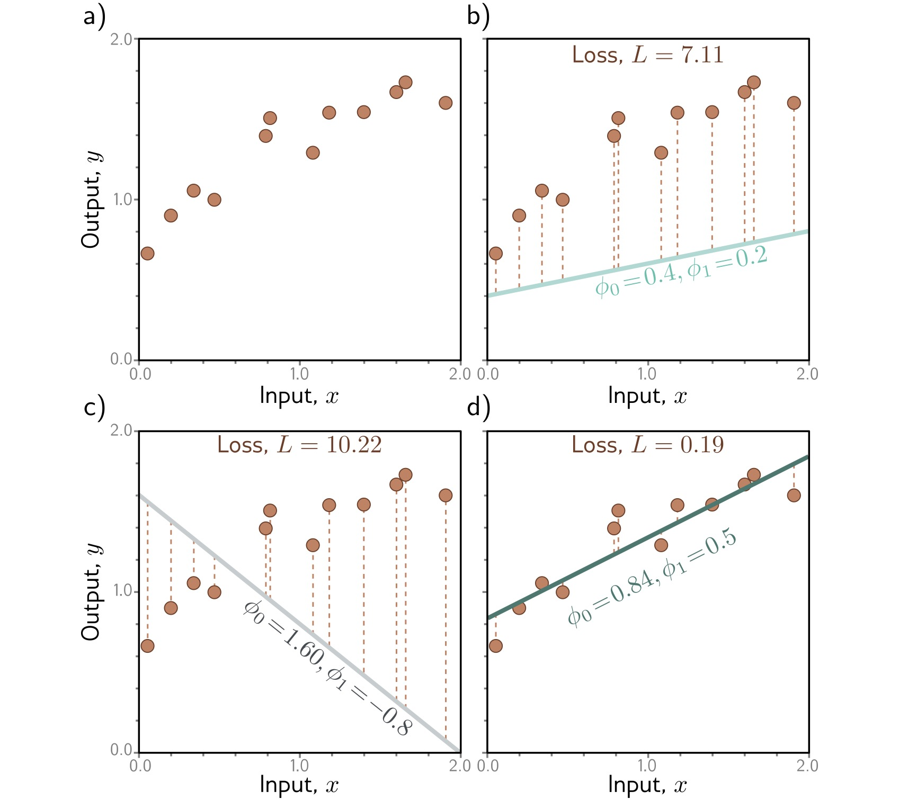{height="760" fig-align="center"}
:::
::::

::: footer
Prince, S. J. D. (2023). *Understanding Deep Learning*. Chapter 2: Supervised Learning.
:::

::: {.notes}
[~5 min.] Now we need to say what 'good' means. Walk through the four panels slowly; this figure is the whole idea of a loss function in one picture.

Panel a is just the training data: ten points that trend upward and flatten. Panel b overlays a line with intercept 0.4 and slope 0.2. The dashed vertical segments are the errors, the gap between each point and the line's prediction at that x. The loss printed above the panel is 7.11. Panel c is a bad line: intercept 1.6 and slope minus 0.8, sloping steeply down through data that goes up. The segments are huge and the loss is 10.22. Panel d is a good fit: intercept 0.84 and slope 0.5. The segments are short and the loss is 0.19.

So the loss is a number that turns 'how well does this line fit' into something a computer can minimize. The formula: take each point's vertical gap, square it, and sum over all points. Why square? Three reasons, and it is worth saying all three. It makes every error positive so over- and under-predictions cannot cancel. It punishes big misses much more than small ones. And it is smooth and differentiable everywhere, which is what gradient-based optimization needs.

Mention, so nobody leaves with a wrong idea, that squared error is a choice, not a law. Absolute error is more robust to outliers; cross-entropy is the standard for classification. The choice of loss encodes what you care about, and it is one of the places where a model can be quietly misaligned with the actual goal.

Set up the next slide: panels b, c and d are three points in parameter space, namely (0.4, 0.2), (1.6, minus 0.8) and (0.84, 0.5), with losses 7.11, 10.22 and 0.19. What if we computed the loss for every possible pair of parameters and plotted it? That is the next slide.

Ask the class: without calculating, which of the three lines has the smallest loss and how do you know? They can see it. Then say: the computer needs a number, not a visual judgement; that is what the formula supplies.
:::

## Loss Surface

**Every point on the surface is one choice of parameters; we want the lowest point.**

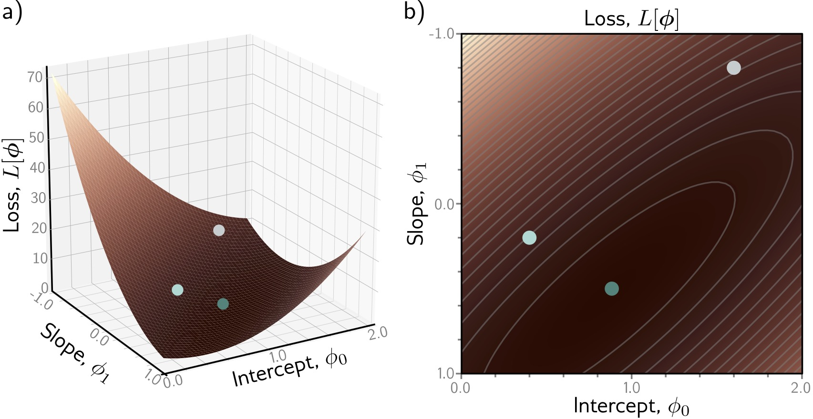{fig-align="center"}

::: footer
Prince, S. J. D. (2023). *Understanding Deep Learning*. Chapter 2: Supervised Learning.
:::

::: {.notes}
[~4 min.] This is, in my view, the single most important picture of the first half. Take the loss for every possible pair of parameters and plot it. Two parameters give a two-dimensional plane; the loss is the height above it. Panel a is the 3D surface; panel b is the same thing as a top-down heat map with contour lines.

Be careful reading the axes, because the figure and the book are not always intuitive. In panel b the horizontal axis is the intercept Phi-0 (0 to 2) and the vertical axis is the slope Phi-1 (note it runs from minus 1 at the top to plus 1 at the bottom). Darker is lower loss. The three colored dots are the three lines from the previous slide: the gray dot at the top right is the terrible line from panel c (intercept 1.6, slope minus 0.8), the light dot is panel b's line, and the dark teal dot near the dark center is the good fit from panel d. You can point at the dots and say: this is where each of those pictures lives on the landscape.

What to notice. There is one valley and it is bowl-shaped. The contours are nested ellipses. From any starting point, going downhill takes you to the same minimum. That is a property called convexity, and it is why linear regression is easy to optimize.

The elongated ellipse is also worth a sentence: the valley is long and narrow along a diagonal, which means some directions in parameter space change the loss quickly and others slowly. That is the origin of the difficulties with learning-rate choice that we will see in the Playground.

Now the contrast, which is the foreshadowing for the rest of the course. Neural network loss surfaces are not bowls. They have millions of dimensions, many local minima, saddle points, and flat plateaus. You cannot draw them. Researchers do draw 2D slices of them (the Li et al. 'visualizing the loss landscape of neural nets' paper is a classic), and we will talk about that. But the intuition from this slide, training as walking downhill on a landscape, is the right picture to keep.
:::

## Loss Surface: What to Look For

:::: {.columns .smaller}
::: {.column width="50%"}
- **X-axis:** Intercept $\Phi_0$
- **Y-axis:** Slope $\Phi_1$
- **Height / color:** Loss $L[\Phi]$

**Goal:** Find the lowest point (the darkest region in panel b)

:::
::: {.column width="50%"}
**Key Observations:**

1. **Single global minimum** - bowl-shaped surface
2. **Smooth** - we can use gradients to navigate
3. **Convex** - any path downhill leads to optimum

For linear models, optimization is easy! Deep networks have much more complex loss landscapes...
:::
::::

::: {.notes}
[~2 min.] Pure recap of the previous slide so students can photograph it; do not re-explain. Read the left column as a checklist for reading any loss-surface plot: what is on each axis, what does height or color encode, where is the goal. Axes here: intercept horizontally, slope vertically, and loss as height or color.

Then the right column: single global minimum, smooth, convex. Spend the saved time on the last line, which is the real message: for linear models optimization is easy; for deep networks it is not, and a lot of deep learning practice (initialization, learning-rate schedules, momentum, normalization layers) exists to cope with that.

If someone asks what convex means exactly: any line segment between two points on the surface stays above the surface, so there are no separate valleys to get trapped in.
:::

## Optimization: Gradient Descent

**Iteratively move downhill, opposite to the gradient.**

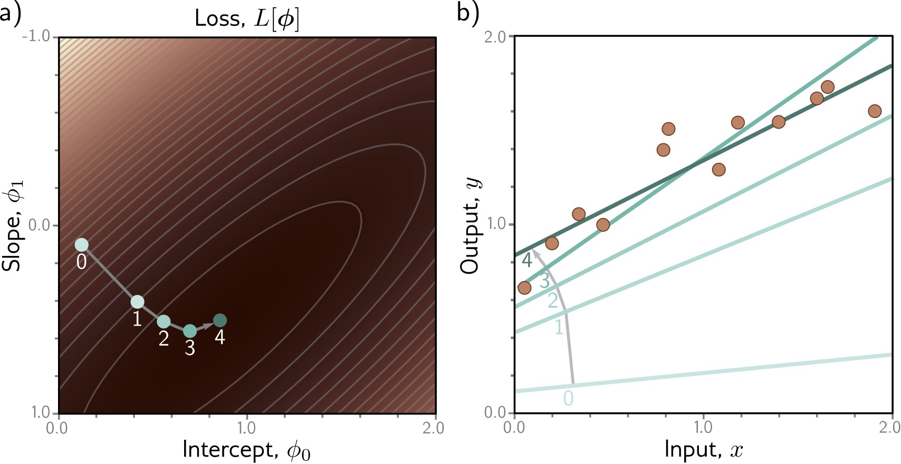{fig-align="center"}

::: footer
Prince, S. J. D. (2023). *Understanding Deep Learning*. Chapter 2: Supervised Learning.
:::

::: {.notes}
[~4 min.] How do we find the bottom of the bowl without evaluating every point? We start somewhere and walk downhill. Read the figure: panel a is the loss surface again with a path of numbered points 0 through 4; panel b shows the line corresponding to each point. At step 0 the line is nearly flat and well below the data (the faint line at the bottom). With each step it rotates and rises toward the data. By step 4 it is the dark line that passes through the cloud of points. So you can watch the model improve: in parameter space the point slides toward the dark center, and in data space the line snaps into place.

That two-panel pairing is a good template for any training visualization: one view of the parameters, one view of what they mean in data space.

The mechanics. At the current parameters, compute the gradient of the loss, the direction of steepest ascent. Step in the opposite direction by a small amount. Repeat. The update rule, which is on the next slide: new Phi equals old Phi minus alpha times the gradient. Alpha is the learning rate, the most important hyperparameter you will tune.

The steps in the figure are large at first and shrink as the path approaches the minimum. That is not a built-in feature: it happens because the gradient itself gets smaller as the surface flattens near the bottom.

Gradient descent is the steering; backpropagation is how we compute the gradient cheaply for a network with millions of parameters. In practice we use stochastic variants (minibatches) and adaptive optimizers like Adam, but they are all variations on this one idea.
:::

## Gradient Descent: The Algorithm

:::: {.columns .smaller}
::: {.column width="50%"}
**How do we find the minimum?**

1. Start at random position
2. Compute gradient (slope direction)
3. Take small step opposite to gradient
4. Repeat until convergence
:::
::: {.column width="50%"}
$$\Phi_{new} = \Phi_{old} - \alpha \nabla L[\Phi]$$

$\alpha$ = learning rate

- Too large → overshoot and diverge
- Too small → very slow convergence
:::
::::

::: {.notes}
[~3 min.] Spell out the loop. One: initialize the parameters randomly (small random values; the initialization actually matters a lot for deep networks). Two: compute the gradient of the loss at the current parameters. Three: take a small step opposite the gradient, scaled by the learning rate alpha. Four: repeat until the loss stops improving.

Then the learning-rate trade-off, which they will test themselves in the lab tonight: too large and the steps overshoot the valley, bouncing from side to side or even diverging; too small and training crawls, wasting compute and sometimes stalling on a plateau. A good picture is walking down a hillside in fog: huge strides overshoot the path, tiny shuffles take all night.

Mention in one breath what practice adds: minibatches instead of the full dataset (the stochastic in SGD), momentum to smooth the walk, and Adam to adapt the step size per parameter. Frameworks give you all of these; the loop is the same.

Check for understanding. Ask: if the gradient at a point is exactly zero, what happens? (The update does nothing, you stay put: at a minimum, a maximum, or a saddle point.) That sets up the later point that for networks, zero gradient does not mean you found the best solution.
:::

# Shallow Neural Networks

::: {.notes}
[Section opener, 30 seconds.] Everything so far was linear. Now we make the model flexible enough to fit curves. The only structural change is one extra ingredient, an activation function, and with it a hidden layer. Everything else (data, loss, gradient descent) stays the same.
:::

## From Linear to Non-linear

**Linear models are limited - they can only learn straight lines!**

**Solution:** Add non-linearity through **activation functions**

Transform linear combinations with a non-linear function → enables learning complex patterns

**Shallow Neural Network (1 hidden layer):**

$$y = f[x, \Phi] = \Phi_0 + \sum_{i=1}^{3} \Phi_i \cdot a[ \Theta_{i0} + \Theta_{i1} x]$$

| Component | Description | Count |
|-----------|-------------|-------|
| $\Theta_{ij}$ | First layer parameters | 6 parameters |
| $\Phi_i$ | Second layer parameters | 4 parameters |
| $a[\cdot]$ | **Activation function** | Non-linearity! |

**Total: 10 parameters** (vs 2 for linear model)

::: {.notes}
[~5 min.] Start with the limitation we planted earlier: a line is a line. If the data bends, a linear model cannot follow it, however well you train.

The fix: pass a linear combination through a non-linear function a. Walk through the formula slowly because every deep network is a stack of this one operation. Inside the formula: theta-i0 plus theta-i1 times x is a little linear function of the input (an intercept and a slope). Apply the activation a to it and you get the output of hidden unit i. Do that for three hidden units, multiply each by its own weight phi-i, add them up, and add a final bias phi-0. That is the model.

Count the parameters with the table, because it makes the model's size concrete. First layer: three hidden units, each with an intercept and a slope, so 6 parameters (the thetas). Second layer: three output weights plus one bias, so 4 (the phis). Total 10, compared to 2 for the line. For a network with a single input and a single output that is a tiny model, but the structure is exactly the one that scales up.

Emphasize the central claim: without the non-linear a, this would collapse back to a line. A linear function of linear functions is linear. So non-linearity is not decoration, it is the entire source of the model's added power. You will prove this to yourselves in the lab: set the Playground activation to linear, stack as many layers as you like, and the decision boundary stays a straight line.

Ask the class: what would happen if a were the identity function, a of z equals z? (We get a sum of linear functions of x, which is itself a line. We are back to two effective parameters, no matter how many hidden units.)
:::

## Activation Functions: ReLU

:::: {.columns}
::: {.column width="40%"}
**ReLU (Rectified Linear Unit): the most popular activation function**

$$a[z] = \max(0, z) = \begin{cases} z & \text{if } z > 0 \\ 0 & \text{if } z \leq 0 \end{cases}$$

**Why ReLU?**

- **Simple:** easy to compute and differentiate
- **Efficient:** avoids vanishing gradient problem
- **Sparse:** many activations are exactly zero
- **Biological:** neurons either fire or they don't
:::
::: {.column width="60%"}
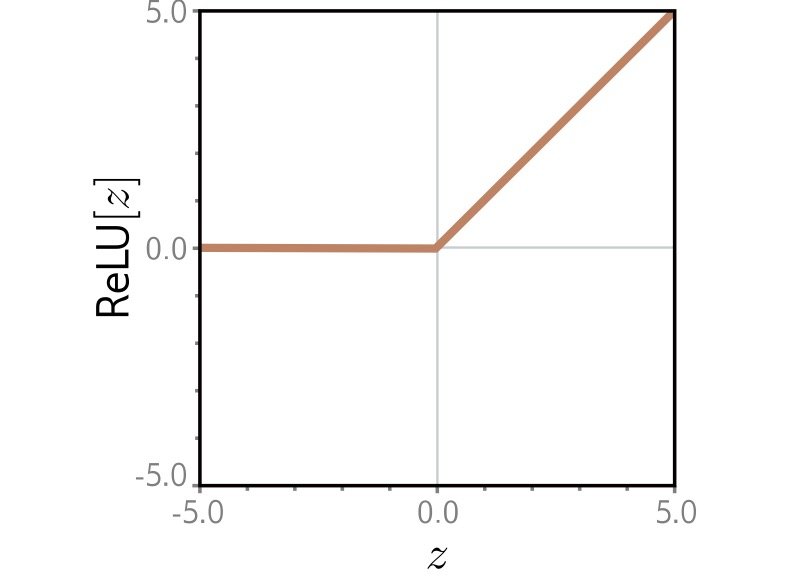{width="100%" fig-align="center"}
:::
::::

::: footer
Prince, S. J. D. (2023). *Understanding Deep Learning*. Chapter 3: Shallow Neural Networks.
:::

::: {.notes}
[~5 min.] The activation we will use all night is the rectified linear unit: ReLU of z equals the larger of 0 and z. In words: pass positive values through unchanged, replace negative ones with zero. The figure shows the shape: flat at zero until z reaches zero, then a straight line of slope 1. It is a bent line with one joint.

Why ReLU won. Simple: one comparison, trivial to compute and to differentiate (the derivative is 0 for negative inputs and 1 for positive). Efficient for training: older activations like sigmoid and tanh flatten out for large inputs, so their gradients shrink toward zero and the early layers of a deep network barely learn; this is the vanishing gradient problem. ReLU's gradient is exactly 1 on the positive side, so gradients pass through intact. Sparse: for any given input, roughly half the units are exactly zero, which saves computation and produces representations that are easier to interpret. Biological: the 'fire or do not fire' picture is loosely inspired by neurons, but do not push the analogy.

Give the honest caveat: ReLU is not perfect. A unit whose input is always negative outputs zero and gets zero gradient, so it can stop learning; people call these dead units. Variants exist (Leaky ReLU, GELU, which transformers use), but the idea of a bent line is the same.

Visualization tie-in: hidden-unit activations are one of the main things that interpretability tools plot. Because ReLU outputs are exactly zero or positive, an activation map is easy to read as 'this unit is on here and off there'. Keep that in mind for CNN Explainer later tonight.

Ask the class: which is the single most important property: the bend, or the flat part? (The bend. A straight line has no way to turn; a ReLU gives each unit one place where the slope changes.)
:::

## Building Intuition: Composing ReLUs

**The same 3-hidden-unit network, with different parameters, produces three different piecewise-linear functions.**

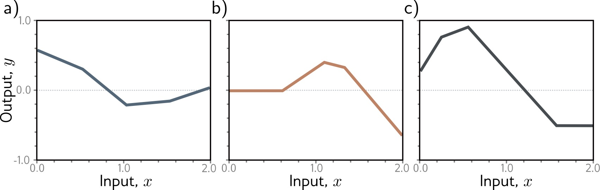{fig-align="center"}

::: footer
Prince, S. J. D. (2023). *Understanding Deep Learning*. Chapter 3: Shallow Neural Networks.
:::

::: {.notes}
[~4 min.] Here we see what a network with three hidden units can do. Careful about what the figure shows: these are not the individual units; each panel is the final output of the same 3-hidden-unit network under a different setting of its parameters. Panel a is a gentle curve with kinks near x of 0.5 and 1.0; panel b is flat at zero then rises and falls; panel c rises quickly then declines and plateaus. Same architecture, three different functions, because the parameters differ.

Count the kinks. Each is a joint with a clear straight segment between them. With three hidden units, each contributing one bend, you get up to three joints and four linear pieces. The family of functions this network can represent is the set of all 'piecewise linear with at most four pieces' curves (with some constraints).

Then explain how that happens: each hidden unit is a ReLU of a line, a bent line with its own bend location and slope. Multiplying by phi-i changes how steep and which direction it bends, and adding the three together stacks their bends. That is the whole mechanism. The next slide shows it computed step by step, so here keep the message qualitative: shapes are built by adding bent lines together.

Pose this question to the room: if I want a smoother curve, what do I add? (More hidden units: more bends, shorter straight pieces, closer to smooth.) That is the setup for the universal approximation slide.
:::

## Composing ReLUs: Step by Step

:::: {.columns .smaller}
::: {.column width="50%"}
**Each hidden unit:**

1. Computes linear function of input
2. Applies ReLU → bent line
3. Gets weighted and summed
:::
::: {.column width="50%"}
**Combining multiple units:**

- Different slopes and bends
- Sum creates complex shapes
- More units → more flexibility
:::
::::

::: {.notes}
[~2 min.] Text recap of the previous figure for students' notes. Left: what each hidden unit does (a linear function of the input, a ReLU to bend it, a weight, then a sum). Right: what combining units gives you (different slopes and bends, sums that create complex shapes, more flexibility with more units).

Do not read it aloud; ask students to restate it in their own words to a neighbor in 30 seconds. If they can say 'each unit is a bent line, and the output is a weighted sum of bent lines', they have it.
:::

## Neural Network Computation

:::: {.columns}
::: {.column width="40%"}
**Step-by-step: how a shallow network processes an input**

1. Input $x$ (left) enters the network

2. Each hidden unit computes: $h_i = a[\Theta_{i0} + \Theta_{i1} x]$

3. Weighted combination: $y = \Phi_0 + \sum_i \Phi_i h_i$

4. Final output $y$ (right)
:::
::: {.column width="60%"}
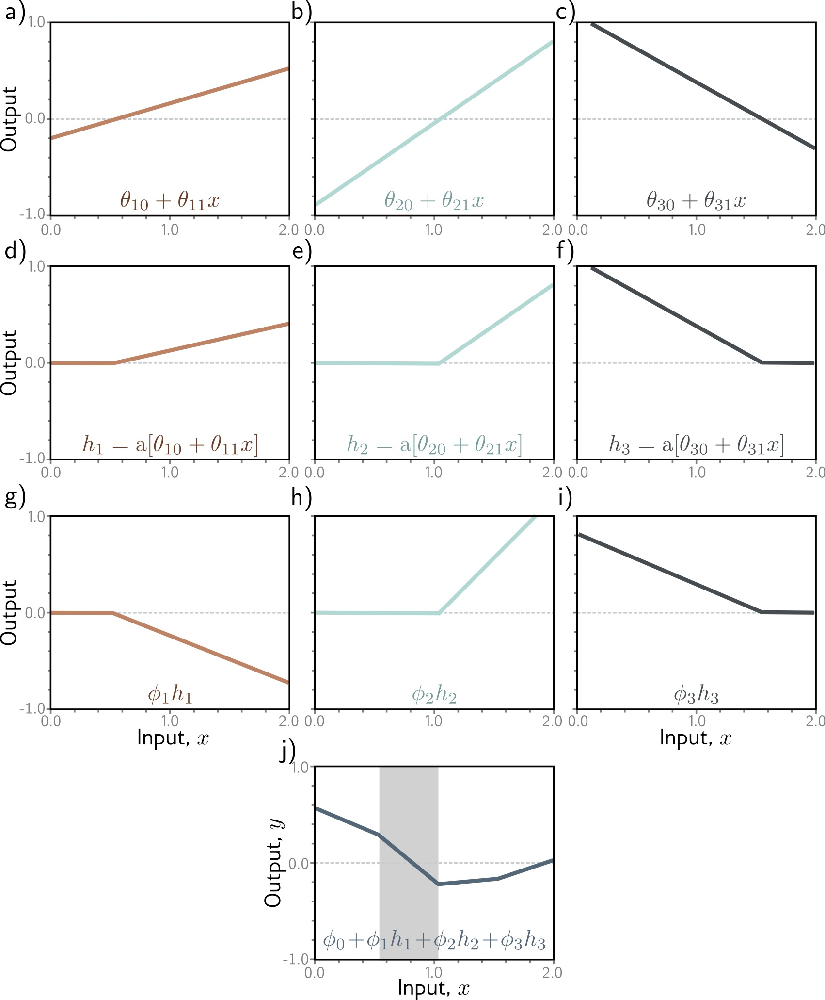{height="760" fig-align="center"}
:::
::::

::: footer
Prince, S. J. D. (2023). *Understanding Deep Learning*. Chapter 3: Shallow Neural Networks.
:::

::: {.notes}
[~6 min.] This is the most detailed figure of the evening, and it rewards a slow walk. Work it as a grid read left to right, top to bottom, and the whole forward pass will be visible.

Top row, panels a, b, c: the pre-activations. These are the three little linear functions of the input, theta-10 plus theta-11 times x and so on, one per hidden unit. Straight lines with different intercepts and slopes. (The first one rises gently, the second rises steeply, the third falls.)

Middle row, panels d, e, f: apply ReLU to each. Every negative part is clipped to zero, leaving the characteristic hinge: flat, then linear. These are the hidden unit activations h1, h2, h3.

Third row, panels g, h, i: multiply each activation by its second-layer weight phi. This rescales the hinge, and a negative phi flips it over. (Panel g is flipped upside-down, which is why it points downward.)

Panel j, at the bottom: sum the three weighted hinges and add the bias phi-0. The result is the final piecewise-linear output. The gray band marks one linear region; inside it, exactly one set of units is 'active', and the function is a straight line. When x crosses a joint, one unit switches on or off and the slope changes.

Say explicitly: that is the entire forward pass of a shallow network. Linear, clip, scale, sum. A deep network repeats the same trick with vectors instead of single numbers.

Link to visualization practice: this decomposition is what interpretability tools show. Every time you see a heat map of hidden-unit activations, you are looking at the middle row of this figure for a much bigger network.

Check for understanding: ask someone to explain what changes in panel j if phi-2 becomes zero. (The second hinge vanishes from the sum; the output loses one bend.)
:::

## Neural Network Diagram

**The standard picture: inputs feed hidden units, which feed the output.**

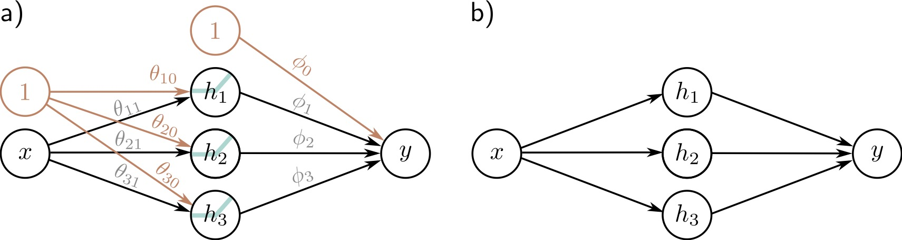{fig-align="center"}

::: footer
Prince, S. J. D. (2023). *Understanding Deep Learning*. Chapter 3: Shallow Neural Networks.
:::

::: {.notes}
[~3 min.] Now the same network drawn as a graph. Panel a is the full picture. Input x on the left. Three hidden units h1, h2, h3 in the middle, each with a little ReLU glyph in the circle to say that a non-linearity is applied. Output y on the right. Every arrow is a weight. The extra orange circles labeled 1 are the bias nodes: the arrows out of them carry the intercepts theta-10, theta-20, theta-30 and phi-0. Panel b is the same network with the parameters hidden, which is how most diagrams are drawn.

Take a moment to connect the diagram to the previous slide: the arrows from x to the hidden layer carry the first-layer parameters (6 of them: three weights theta-i1 and three biases theta-i0); the arrows from the hidden layer to y carry the second-layer parameters (4: three weights and one bias). 10 in total, matching our count.

The vocabulary on the next slide (hidden unit, pre-activation, activation, fully connected) is all present in this diagram.

Be critical for a moment, because this is a visualization course. The node-link diagram is the standard picture of a neural network and it is good for one thing: showing the connectivity pattern. It tells you nothing about what the units compute or what the weights are. A diagram of a network with 100 million weights is useless as a visualization of what the model does. That gap between how we draw networks and what they do is a theme for the rest of the course.

Ask the class: what information does this diagram leave out? (Weight values, activation function details, what each unit has learned, the data.)
:::

## Network Diagram: Components and Terminology

:::: {.columns .smaller}
::: {.column width="50%"}
**Components:**

- ⚫ **Input layer:** Raw features
- 🔵 **Hidden layer:** Learned representations
- ⚫ **Output layer:** Prediction
- → **Connections:** Weighted parameters
:::
::: {.column width="50%"}
**Terminology:**

- **Hidden units/neurons:** Computed values in middle
- **Pre-activations:** Before ReLU
- **Activations:** After ReLU
- **Fully connected:** Every unit connects to all units in next layer
:::
::::

::: {.notes}
[~3 min.] Glossary slide; go through it as a reference. Input layer: raw features. Hidden layer: the learned intermediate representation, hidden because it is neither input nor output. Output layer: the prediction. Connections: each carries a learned weight.

Terminology that trips people up: the pre-activation is a hidden unit's value before the ReLU is applied (the linear combination); the activation is the value after. Papers use 'activation' to mean the post-ReLU value, and also use it for the function itself, so listen for context. A layer is fully connected (also called dense) when every unit connects to every unit in the next layer, which is the only kind we have drawn so far. CNNs will relax that.

Common point of confusion: 'neurons' and 'hidden units' are the same thing. The biological analogy is loose; a hidden unit is just a weighted sum followed by a non-linearity.
:::

## Universal Approximation Theorem

**A shallow network with enough hidden units can approximate any continuous function.**

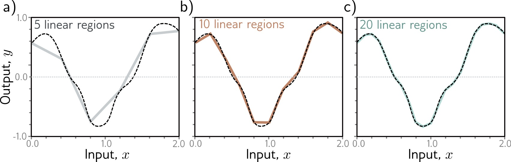{fig-align="center"}

::: footer
Cybenko, G. (1989). Approximation by superpositions of a sigmoidal function. *Mathematics of Control, Signals and Systems*, 2(4), 303-314.
:::

::: {.notes}
[~4 min.] A theoretical result with a very visual statement. In the figure the dashed black curve is the target function, a smooth wiggly curve. Gray panel a approximates it with a shallow network having 5 linear regions: the fit is rough, the straight segments clearly miss the curvature at the ends. Panel b, with 10 linear regions, follows it much more closely. Panel c, with 20 linear regions, is almost indistinguishable from the target.

So, in practice: add hidden units and the piecewise-linear approximation converges to the curve. This is the intuition behind the theorem. A shallow network with enough hidden units can approximate any continuous function on a bounded domain to any accuracy you like. The original proofs, by Cybenko in 1989 for sigmoid activations and Hornik in 1991 for more general ones, predate the deep learning era.

Be careful with what it does and does not say, which the next slide does in detail. It says a good set of parameters exists. It does not say gradient descent will find it, how many units you need, or that it will generalize.

Ask the class: if one hidden layer is enough to fit anything, why does anyone build deep networks? Collect two or three answers and hold them; the next section answers it.
:::

## Universal Approximation: The Theorem and Its Limits

**Theorem** (Cybenko 1989, Hornik 1991):

A shallow neural network with enough hidden units can approximate **any continuous function** to arbitrary accuracy on a compact domain.

**But...**

- May require **exponentially many** hidden units
- Doesn't tell us **how to find** the parameters
- **Deep networks** are often more efficient

::: footer
Cybenko, G. (1989). Approximation by superpositions of a sigmoidal function. *Mathematics of Control, Signals and Systems*, 2(4), 303-314.
:::

::: {.notes}
[~3 min.] State the theorem carefully: a shallow network with enough hidden units can approximate any continuous function to arbitrary accuracy on a compact (closed and bounded) domain. Then spend most of the time on the three caveats under 'But...'.

First, 'enough' can be astronomically many. For some function classes a shallow network needs a number of units that grows exponentially with the input dimension, whereas a deeper network represents them with far fewer; there are formal depth-separation results of this kind. Second, existence is not discoverability: the theorem says nothing about whether gradient descent will find the right parameters. Third, it says nothing about generalization: a network that fits the training points exactly can still be wrong everywhere else.

So the theorem is reassuring (the model class is not too weak) and not very practical. The practical answer to 'how do we get expressive models efficiently' is depth, which is the next section.

If a student asks whether this means neural networks can learn anything: they can represent anything continuous, which is different from learning it from finite, noisy data.
:::

# Deep Neural Networks

::: {.notes}
[Section opener, 30 seconds.] We just heard that one hidden layer is enough in principle. So why is nearly every model you read about deep? This section is the answer, and again it comes with figures: composing layers creates complexity much more cheaply than adding units to one layer.
:::

## Why Go Deep?

**Deep networks compose simple transformations to build complex representations**

:::: {.columns}
::: {.column width="50%"}
**Shallow network limitations:**

- Requires many hidden units
- Doesn't exploit structure
- Inefficient representation

**Deep network advantages:**

- **Hierarchical learning**
- **Compositional structure**
- **Parameter efficiency**
- **Feature reuse** across layers
:::
::: {.column width="50%"}

**Intuition from vision:**

**Layer 1:** Edges, colors

↓

**Layer 2:** Textures, simple shapes

↓

**Layer 3:** Object parts

↓

**Layer 4:** Object categories

Each layer builds on previous representations!

:::
::::

::: {.notes}
[~5 min.] Give the headline: deep networks compose simple transformations to build complex representations, and compositional structure is how the world, and most data, is organized.

Left column, the efficiency argument. A shallow network has to represent a complicated function using one wide layer: lots of units, and no way to reuse any intermediate result. A deep network can build something once (say, a detector for edges) and reuse it in everything built on top of it. That is parameter efficiency and feature reuse. The next two slides will show a concrete version: composing two small networks produces a function with many more linear regions than either has alone.

Right column, the representation argument, and this is where visualization becomes a central part of the story. In vision networks, the first layers respond to edges and colors, middle layers to textures and simple shapes, later layers to object parts, and the final layers to whole object categories. We know this because people visualized it: Zeiler and Fergus (2014) showed it with deconvolution-based visualizations, and Olah and colleagues at Distill showed it with feature visualization, which generates images that maximally activate a given unit. These are on the reading list. When CNN Explainer in the second half of tonight lets you click through layers, you will see the first-layer filters respond to simple oriented patterns.

Be accurate about the status of the hierarchy claim: it is an empirical finding for image CNNs, strong and repeatedly reproduced, but it is not a theorem, and in other models (transformers, for example) the picture is less clean. Visualization is how we check.

Ask the class: where else do you expect hierarchical structure? (Language: characters, words, phrases, sentences; speech: phonemes, words; and so on.) That is next week.
:::

## Composing Networks

:::: {.columns}
::: {.column width="40%"}
**Building deep networks: stack multiple hidden layers**

**Each layer:**

$$h^{(k)} = a[W^{(k)} h^{(k-1)} + b^{(k)}]$$

- $h^{(k)}$: Activations at layer $k$
- $W^{(k)}$, $b^{(k)}$: Parameters for layer $k$
- Composition: $f = f_K \circ f_{K-1} \circ \ldots \circ f_1$
:::
::: {.column width="60%"}
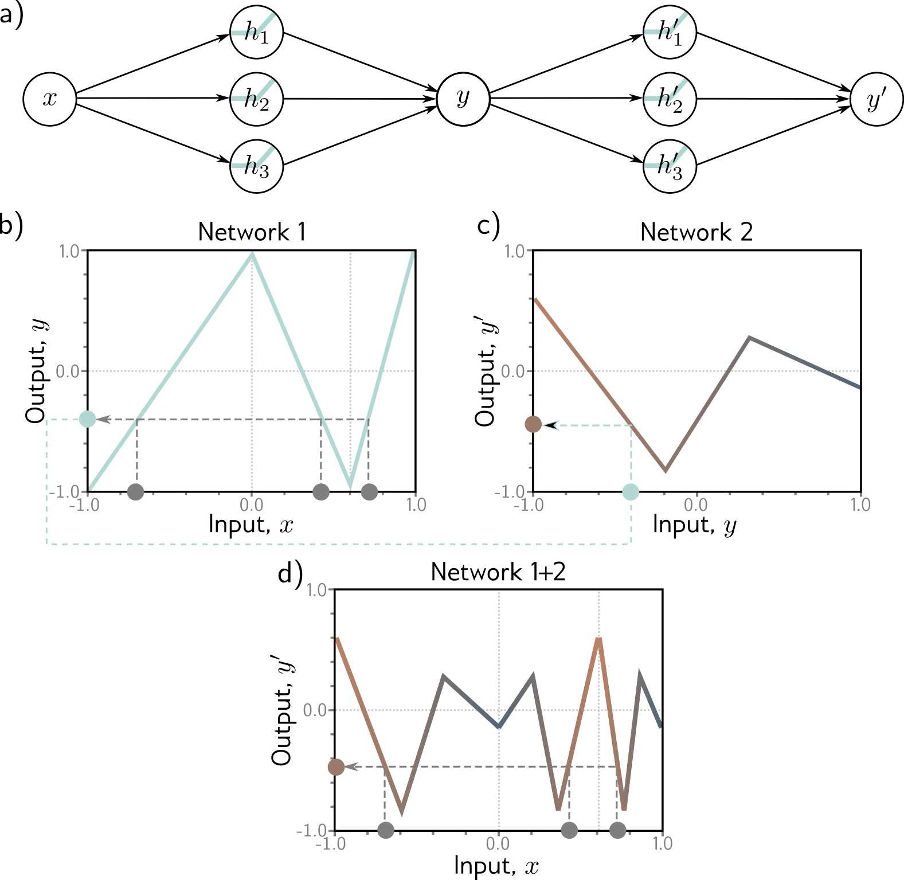{height="760" fig-align="center"}
:::
::::

::: footer
Prince, S. J. D. (2023). *Understanding Deep Learning*. Chapter 4: Deep Neural Networks.
:::

::: {.notes}
[~5 min.] Build a deep network the simplest possible way: take one shallow network and feed its output into another. Panel a is the diagram: x goes into the first network (three hidden units) and produces y; y is then the input to a second network (three more hidden units) that produces y-prime.

Now follow the plots, which are the real payoff. Panel b: network 1 on its own. As a function of x it is a zigzag with a few linear pieces: it goes up, down, up. Panel c: network 2 on its own, as a function of its input y. A different zigzag. Panel d: the composition, plotted against the original x. It has many more linear pieces, zigzagging up and down far more than either network alone, even though we only used six hidden units in total.

Why? Network 2 treats the output of network 1 as its input, so every time network 1's output sweeps over a bend of network 2, a new kink appears in the composite. Each hidden unit of the second network can be 'cut' multiple times by the first network's zigzag. The count of linear regions multiplies rather than adds. That multiplicative growth is the heart of the efficiency argument for depth.

The general formula, on the right: each layer takes the previous layer's activations h, applies a weight matrix W and a bias b, and then the activation a. The overall function f is the composition of the layer functions, f-K after f-(K-1), all the way down to f-1.

Practical note: the bias and weights per layer are matrices now, because each layer takes a vector in and produces a vector out. The equation is the same as in the shallow case, with vectors replacing numbers.
:::

## How Deep Networks Transform Space

**Each layer bends and folds the representation space, pulling intertwined classes apart.**

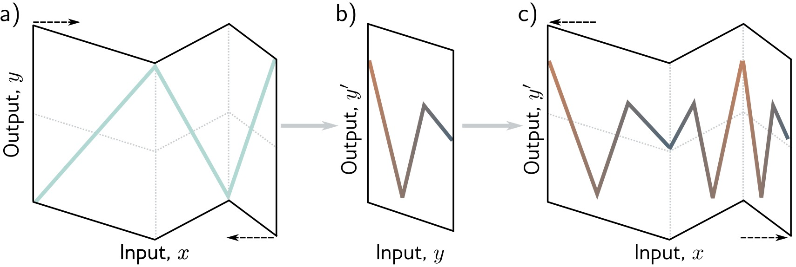{fig-align="center"}

::: footer
Prince, S. J. D. (2023). *Understanding Deep Learning*. Chapter 4: Deep Neural Networks.
:::

::: {.notes}
[~5 min.] A second way to see the same thing, which I find the most intuitive geometric picture of what a deep network does. Think of the input axis as a strip of paper. Panel a shows the first network as an act of folding that strip: the zigzag in the plot is the paper folded along three creases. The dashed arrows show the paper being folded in on itself.

Panel b: after the first fold, the folded strip becomes the new input axis for the next network. Panel c: the second network folds the already folded paper again. Each fold of a folded sheet creates more creases, so the number of layers of paper (the number of linear regions) multiplies.

That is what the slide title means by transforming space. Each layer bends, stretches, and folds the representation. After enough folds, points that started far apart can end up neighbors and points that started together can be separated. For classification, that is exactly what we want: classes that are intertwined in the raw input are pulled apart in the learned representation, and a simple final layer can separate them.

Make the connection to the visualization techniques we have seen. This is why dimensionality reduction of hidden-layer activations (the t-SNE and UMAP we did the past two weeks) is so informative: if you project the penultimate layer of a classifier you typically see the classes as well-separated clusters, but the raw pixels do not. The layers did the unfolding.

Honest caveat: the folding picture is exact for 1D inputs and ReLU networks in this tidy form. In high dimensions the geometry is far more complicated, but the intuition of repeated non-linear warping carries over.
:::

## Folding Space: Layer by Layer

:::: {.columns .smaller}
::: {.column width="50%"}
**Layer 1:**

Stretches, rotates, bends space with ReLU

**Layer 2:**

Further transforms the already-bent space
:::
::: {.column width="50%"}
**Result:**

Complex folding of input space

→ Can separate classes that were originally intertwined
:::
::::

::: {.notes}
[~2 min.] Recap of the folding figure as text. Layer 1 stretches, rotates, and bends the space with its ReLUs. Layer 2 transforms the already-bent space further. The result is a complicated folding of the input, which can separate classes that started intertwined.

A quick way to check understanding: ask students to say, without looking at the slide, why more layers give more folds. (Each layer folds the output of the previous one, so folds multiply.)
:::

## Two Hidden Layers

**The second layer operates on intermediate representations, not on raw inputs.**

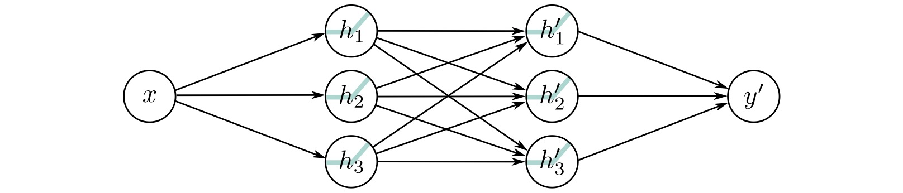{fig-align="center"}

::: footer
Prince, S. J. D. (2023). *Understanding Deep Learning*. Chapter 4: Deep Neural Networks.
:::

::: {.notes}
[~4 min.] Now the same two-network idea as a single network. The diagram: x feeds three units h1, h2, h3 in the first hidden layer; every one of those feeds every one of three units h1-prime, h2-prime, h3-prime in the second hidden layer; and those feed the output y-prime. That crisscross of arrows between the hidden layers is what 'fully connected' looks like, and it is where depth gets its power: each second-layer unit sees all the first-layer features, not the raw input.

Count the parameters to anchor the size. First layer: 3 weights and 3 biases, 6. Second layer: 9 weights (3 by 3) and 3 biases, 12. Output: 3 weights and 1 bias, 4. Total 22. Compare with the shallow network with 3 units: 10.

Explain the conceptual leap from the previous slide. Before, we composed two independent networks. Here the two layers are trained jointly as one function. Backpropagation sends the error signal all the way back through both layers, so the first layer learns features that are useful to the second.

The second layer works on the first layer's outputs rather than the raw input. That is what the slide below says and what 'hierarchical features' means: the first layer might detect edges, and the second combines edges into shapes.

Ask the class: how many parameters if the second hidden layer had 10 units? (First layer 6; second: 3 by 10 equals 30 weights plus 10 biases is 40; output 10 weights plus 1 bias is 11; total 57.) A quick demonstration that parameter counts grow quickly with width, and that most parameters sit in the layer-to-layer matrices.
:::

## Two Hidden Layers: Key Difference from Shallow Networks

- First layer creates **intermediate representations**
- Second layer operates on those representations, not raw inputs
- Can capture **compositional structure**

**Example:** First layer detects edges, second layer combines edges into shapes

::: {.notes}
[~2 min.] Reinforce the three bullets, then give the concrete example. The first layer creates intermediate representations; the second operates on those instead of raw inputs; together they capture compositional structure. For images: the first layer detects edges, the second combines edges into corners and curves, the third combines those into parts.

Be explicit about why this matters for interpretation: the intermediate representations are exactly what we want to visualize, because they are what the network has decided is useful. The raw inputs we already understand and the outputs we can read; the hidden layers are where the 'reasoning' is, and also where it is hidden.
:::

## K Hidden Layers: Deep Architecture

**Modern deep learning: many layers stacked, each building on the last.**

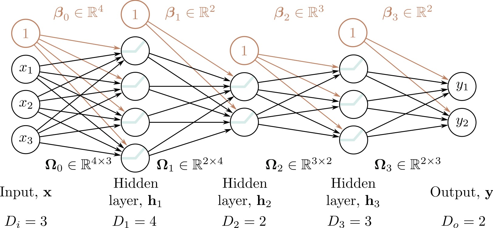{fig-align="center"}

::: footer
Prince, S. J. D. (2023). *Understanding Deep Learning*. Chapter 4: Deep Neural Networks.
:::

::: {.notes}
[~4 min.] The general case, with real dimensions on the figure. Read it left to right: the input has 3 dimensions (x1, x2, x3). Hidden layer 1 has 4 units, hidden layer 2 has 2 units, hidden layer 3 has 3 units, and the output has 2 dimensions. The labels along the bottom give D-i equals 3, D-1 equals 4, D-2 equals 2, D-3 equals 3, D-o equals 2.

Each layer has a weight matrix and a bias vector: the first matrix is 4 by 3 and its bias has 4 entries, the second is 2 by 4 with 2 biases, the third is 3 by 2 with 3 biases, and the last is 2 by 3 with 2 biases. The orange circles labeled 1 are the bias inputs. Totaling it up gives 43 parameters for this small network (16, 10, 9 and 8 per layer).

Point out that the layer widths do not need to be equal or monotonic: this network narrows to 2 units in the middle and then widens again. A narrow layer is a bottleneck, and it forces the network to compress its representation, which is the idea behind autoencoders.

The bottom of the slide: modern networks are far bigger. ResNet-152 has 152 layers; GPT-3 has 96 transformer layers and 175 billion parameters; vision transformers range from 12 to 24 or more layers. The same idea scales: matrices of weights, activations, and a stack of layers. What changes is the structure of the layers (convolution, attention) and the scale.

The bridge to the rest of the course: you can not understand a 175-billion-parameter model by looking at a node-link diagram. That is why the visualization methods we cover exist, and why we will learn to look at activations, gradients, and attention instead.
:::

## Deep Network Characteristics

- **Input layer:** Raw features (e.g., pixel values)
- **Hidden layer 1:** Low-level features (edges, textures)
- **Hidden layer 2:** Mid-level features (parts, patterns)
- **Hidden layer K:** High-level features (concepts, objects)
- **Output layer:** Final prediction

**Modern architectures:** ResNet (152 layers), GPT-3 (96 layers), Vision Transformers (24+ layers)

::: {.notes}
[~3 min.] Pair the architecture diagram with the typical role of each layer. Input: raw features such as pixel values. Early hidden layers: low-level features, edges and textures. Middle layers: parts and patterns. Last hidden layers: high-level concepts or objects. Output: the prediction.

Qualify it again as in the 'Why Go Deep' slide: this is the prototypical story from image CNNs, backed by visualization studies, and not a law for every network. The yellow box gives the scale of modern architectures; use it to underline why we need visualization.

Transition to the tools: you have now seen the building blocks as static pictures. The best way to build intuition is to manipulate them, and two excellent browser tools let you do that.
:::

# Interactive Visualization Tools

::: {.notes}
[Section opener, 30 seconds.] Two tools, both free and in the browser. I will show each for a couple of minutes now; in the lab right after the break you will use them hands-on, with specific experiments to run, so tonight's demos are previews rather than full explorations.
:::

## TensorFlow Playground

**Interactive tool for understanding neural networks** · <https://playground.tensorflow.org>

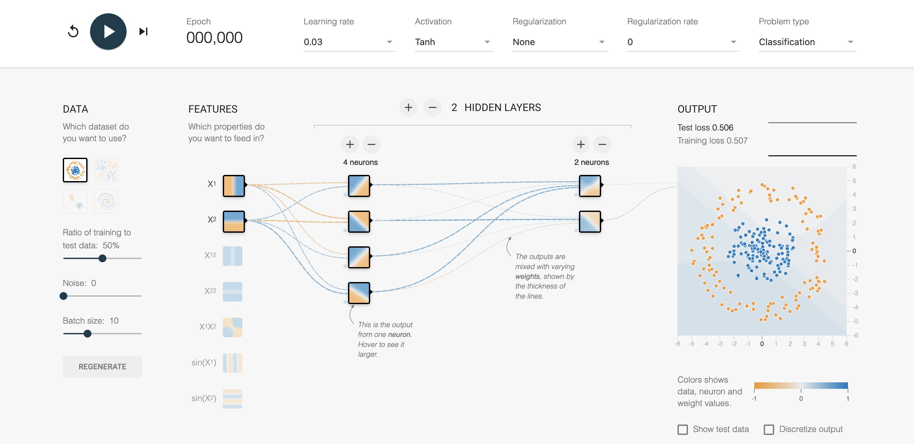{fig-align="center"}

::: footer
Smilkov, D., & Carter, S. (2016). [*TensorFlow Playground*](https://playground.tensorflow.org). Google Brain.
:::

::: {.notes}
[~5 min, live demo.] Open playground.tensorflow.org. Smilkov and Carter at Google built it in 2016, and it runs entirely in the browser: no install, no GPU.

Orient the class using the screenshot: on the left, the dataset choices and the input features (x1, x2 and derived features such as x1 squared or sine). In the middle, the network: you add layers and neurons with the plus and minus buttons, and the lines between neurons are colored and sized by the weight values (blue positive, orange negative). Each neuron shows a small picture of the function it computes over the input plane. On the right, the output: the decision boundary of the whole network, plus training and test loss. Above, the controls: learning rate, activation function, regularization, problem type.

Live demo script (3 minutes): choose the circle dataset with only x1 and x2 and no hidden layers, press play, and watch it fail: a straight line cannot enclose a circle. Add one hidden layer with four neurons and run again; watch the boundary curve into a blob around the center. Hover over individual neurons and notice each draws a simple, nearly linear boundary, and the output combines them. That is the 'sum of bent lines' idea from the earlier slides, now in 2D.

Then stop. Tell them the lab will have them run four experiments (hidden layers, activation functions, learning rate, the spiral), and that I want predictions before each run. Why is this tool good for a visualization course? It makes the internal state of a network visible and manipulable, and it connects slider changes to visual changes immediately. It is also a good example of design choices: each neuron's mini-picture is a small multiple, and the weight encoding as line thickness is a classic.

Limits to name: it only handles 2D toy problems and small networks. Nothing scales to real data, which is why other techniques exist.
:::

## CNN Explainer

**Interactive visualization of Convolutional Neural Networks** · <https://poloclub.github.io/cnn-explainer/>

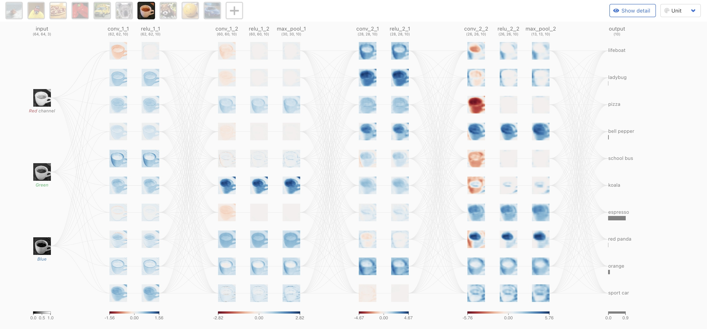{fig-align="center"}

::: footer
Wang, Z. J., et al. (2020). [*CNN Explainer: Learning Convolutional Neural Networks with Interactive Visualization*](https://arxiv.org/abs/2004.15004). IEEE VIS.
:::

::: {.notes}
[~5 min, live demo.] Open poloclub.github.io/cnn-explainer. This one is from the Polo Club at Georgia Tech (Wang et al., IEEE VIS 2020). It is an interactive visualization of a convolutional network, a 'Tiny VGG', running live in the browser with TensorFlow.js, trained to classify images into ten classes.

First, a very quick CNN primer since we have not formally covered them. A convolutional layer slides small filters (kernels) across an image; each filter produces an activation map showing where that pattern occurs. A ReLU follows, as in our fully connected networks. A pooling layer shrinks the maps by taking a local maximum, which makes the representation more compact and a little tolerant to shifts. After several stacks of these, a final classification layer produces class scores. The structure is the same compositional idea as tonight, with local weight-sharing connections instead of fully connected ones.

What to show. The whole pipeline is laid out left to right: input image, convolution layers, ReLU layers, pooling layers, output. Click a convolution layer and the tool expands into the actual arithmetic: the kernel, the sliding window over the input, and the output cell it produces. Hover over an output cell to see the patch of input that produced it. Compare the activation maps in the first layers (simple edge-like responses) with those in later layers (more abstract, harder to read). Change the input image and see the class probabilities change.

Design discussion: the tool uses progressive disclosure, overview first and details on demand, which is the Shneiderman mantra from week 1. It uses color consistently and animates the sliding window, so the operation is understandable without reading a formula.

Say that in the lab we will do a guided walkthrough with questions. Leave the details for then.
:::

## Further Exploration

**Recommended interactive visualizations and resources:**

:::: {.columns}
::: {.column width="50%"}
**Neural Network Visualization:**

- [**Distill.pub: The Building Blocks of Interpretability**](https://distill.pub/2020/grand-tour/)
  Comprehensive visual explanations

- [**TensorFlow Embedding Projector**](http://projector.tensorflow.org/)
  Explore high-dimensional embeddings

- [**ML4A: Looking Inside Neural Nets**](https://ml4a.github.io/ml4a/looking_inside_neural_nets/)
  Interactive tutorials and visualizations
:::
::: {.column width="50%"}
**Understanding Deep Learning:**

📖 [**udlbook.github.io/udlbook**](https://udlbook.github.io/udlbook/)

Free online textbook with:
- Interactive Python notebooks
- Video lectures
- Extensive visualizations
- Modern coverage (transformers, diffusion models)

:::
::::

::: {.notes}
[~2 min.] Do not read the list; point at three items. Distill's 'Building Blocks of Interpretability' and 'Grand Tour' articles are the gold standard for visual explanation, and the first is on this week's reading list. The TensorFlow Embedding Projector lets you explore high-dimensional embeddings with PCA, t-SNE, and UMAP, which connects directly to what we did on dimensionality reduction. The Prince book's companion notebooks implement everything from scratch.

Make a recommendation, not a requirement: an hour spent playing with these tools teaches more intuition than an hour reading equations. That is the whole spirit of the course.
:::

## Summary: Deep Learning Foundations

**Key Takeaways:**

1. **Supervised Learning:** Learn parameters $\Phi$ from data pairs $\{x_i, y_i\}$ to minimize loss $L[\Phi]$

2. **From Linear to Non-linear:** Activation functions (ReLU) enable learning complex patterns

3. **Shallow Networks:** Single hidden layer can approximate any function (Universal Approximation Theorem)

4. **Deep Networks:** Multiple layers learn hierarchical representations more efficiently

5. **Geometric View:** Networks transform input space through non-linear folding to separate classes

**Next lectures:** We'll explore specialized visualizations for CNNs, attention mechanisms, activation analysis, and network interpretability

::: {.notes}
[~4 min.] Recap in five sentences and try to get students to supply each one. Supervised learning: we learn the parameters Phi from pairs to minimize a loss. From linear to non-linear: an activation function such as ReLU lets a model bend, and without it layers collapse into a line. Shallow networks: one hidden layer can approximate any continuous function in principle (the 5, 10, 20 regions figure). Deep networks: stacking layers builds complexity by composition, with regions multiplying instead of adding, and learns hierarchical features efficiently. Geometric view: each layer folds the space so that intertwined classes can be separated.

Then the one idea I want them to carry into the rest of the course: every visualization technique we will see is a window into one of these pieces. The loss curve shows optimization; hidden-unit activations show the representations; gradients show how the output depends on the input; the embeddings of last-layer activations show the geometry. When someone presents a deep learning visualization, ask which of these they are showing and what is not shown.

Look ahead briefly. Next week: how these ideas extend to language models (RNNs and transformers) and how people visualize attention and token behavior. The week after that: Topological Data Analysis.

Reminders: readings for next week are on the schedule; the project update is due next Tuesday (Nov 3); and the lab tonight is the hands-on version of the Playground and CNN Explainer segments.

Open the floor for questions for a few minutes. If there are none, ask the class the one-line challenge: explain to the person next to you, in two sentences, why a network needs a non-linear activation.
:::

## Next Week: Visualization for NLP and LLMs

**Preview of upcoming topic:**

:::: {.columns}
::: {.column width="50%"}
**Language models are deep networks too**

- NLP basics and text representations
- General text visualization
- Visualizing RNNs and attention
- Visualizing large language models
:::
::: {.column width="50%"}

**Why it matters:**

Today's building blocks (layers, activations, learned representations) are what transformers are made of.

Next week we ask how to *see* what a language model is doing.

:::
::::

::: {.notes}
[~1 min.] Short preview. Next week, Nov 3, we turn to language. A language model is a deep network like the ones tonight, with architectures (recurrent networks and transformers) tuned to sequences. We will cover NLP basics and text representations, general text visualization, visualizations of RNN hidden states (LSTMVis), and visualizations of attention in transformers (BertViz and the Transformer Explainer from the reading list).

The connection to emphasize: tonight's building blocks (layers, activations, learned representations) are exactly what transformers are built from; next week's question is how to look inside a model with billions of parameters. The project update (1 page) is due the same day. Topological Data Analysis follows on Nov 10.
:::

