## Recap: Last Week

* Covered clustering (K-means, DBSCAN, hierarchical)
* Introduced dimensionality reduction motivation
* Deep dive into PCA (eigenvectors, covariance, SVD)
* Introduced non-linear methods (LLE)
* Brief mention of t-SNE and UMAP

::: {.notes}
Last week we covered the fundamentals of clustering and dimensionality reduction. We went deep on PCA, understanding the linear algebra behind it. We also introduced LLE as an example of a non-linear method that can unfold manifolds. Today we're going to do a deep dive into t-SNE and UMAP - the two most popular non-linear dimensionality reduction methods for visualization. These are incredibly powerful but also easy to misuse, so we'll focus on how to use them correctly.
:::

## Today

```{python}
#| include: false
import numpy as np
import matplotlib.pyplot as plt
from matplotlib.lines import Line2D
from sklearn.datasets import load_digits
from sklearn.decomposition import PCA
from sklearn.manifold import TSNE, LocallyLinearEmbedding, trustworthiness
from umap import UMAP

plt.rcParams.update({"font.size": 20, "axes.spines.top": False, "axes.spines.right": False})
X, y = load_digits(return_X_y=True)          # 1,797 images, 8x8 pixels = 64 features
COL = np.array(plt.get_cmap("tab10").colors)[y]

def scatter(ax, E, title=None, s=9):
    ax.scatter(E[:, 0], E[:, 1], c=COL, s=s, alpha=0.85, linewidths=0)
    ax.set_xticks([]); ax.set_yticks([])
    for sp in ax.spines.values():
        sp.set_visible(False)
    if title:
        ax.set_title(title, fontsize=24)

def digit_legend(fig, y0=0.0):
    hs = [Line2D([], [], marker="o", ls="", color=plt.get_cmap("tab10").colors[d], markersize=11, label=str(d)) for d in range(10)]
    fig.legend(handles=hs, loc="lower center", ncol=10, frameon=False, fontsize=20, handletextpad=0.2, columnspacing=1.2, bbox_to_anchor=(0.5, y0))

E = {
    "PCA": PCA(n_components=2).fit_transform(X),
    "LLE": LocallyLinearEmbedding(n_neighbors=30, n_components=2, random_state=0).fit_transform(X),
    "t-SNE": TSNE(perplexity=30, random_state=0).fit_transform(X),
    "UMAP": UMAP(n_neighbors=15, min_dist=0.1, random_state=0).fit_transform(X),
}
```

* **t-SNE**: what it optimizes, and the ways its pictures mislead
* **UMAP**: how it differs from t-SNE, and what its two parameters do
* **Topomap**: a projection that keeps connected components together
* **Quality**: how to score a projection (trustworthiness and continuity)
* **Steering**: letting the user shape the layout

**Required reading:** Wattenberg, Viégas & Johnson, [*How to Use t-SNE Effectively*](https://distill.pub/2016/misread-tsne/) (Distill, 2016)

**Due today (Oct 20):** project proposal, 4 pages

::: {.notes}
SKIPPABLE - if running long, jump to 'Graph Layout using force based approach'.

Roadmap. The first half is t-SNE (mechanics, then pitfalls from the required reading), then UMAP, then how to know whether a projection is any good, which is the part that matters for your projects.

Remind everyone that the proposal is due today. If your project involves embeddings or high-dimensional data, today's material is exactly what you will need.

Tonight's lab (7:10 PM, same room, Bhavya) is the hands-on version: PCA, LLE, t-SNE and UMAP on a digits dataset, with exercises on perplexity and noise.
:::

## Graph Layout using force based approach

[video link](https://www.youtube.com/watch?v=_Oidv5M-fuw)

::: {.notes}
Before diving into t-SNE, let's watch this video on force-directed graph layout. This is important because t-SNE and UMAP work on similar principles - they treat your data points as nodes in a graph and use attractive/repulsive forces to arrange them in 2D. Understanding force-directed layout gives you intuition for how these algorithms work. The key idea: similar points attract each other, dissimilar points repel, and we run a physics simulation until things settle into a stable configuration.
:::

## SNE and t-SNE

:::: {.columns}

::: {.column width="50%"}
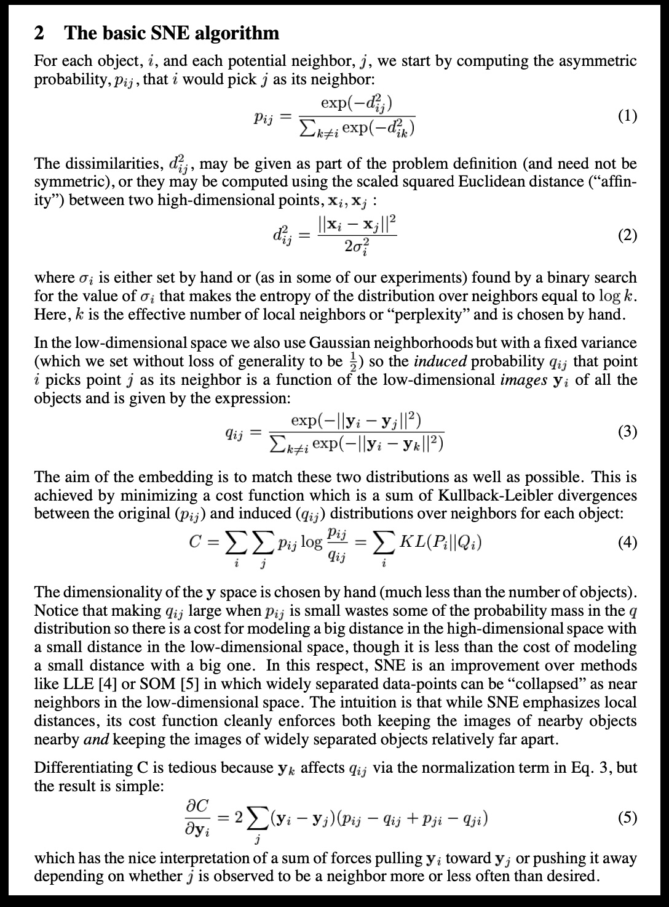{height="780"}
:::

::: {.column width="40%"}
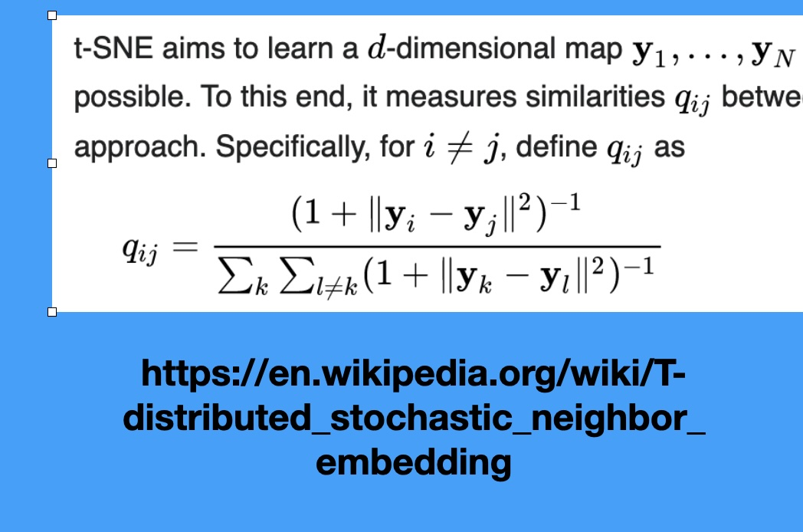
:::

::::

::: {.notes}
SNE (Stochastic Neighbor Embedding), the predecessor, defines probability distributions over the high-dimensional data, where neighbors have high probability. It then tries to replicate these probabilities in low-dimensional space. The key addition of t-SNE is using the Student's t-distribution in the low-dimensional space. This distribution has a 'heavy tail,' which means it allows points that are far apart in the low-dimensional space to still model moderately small distances in the high-dimensional space. This heavy-tail property is what creates the excellent separation between clusters compared to SNE. It prevents the "crowding problem" where all points try to squeeze into the center.
:::


<!-- ##

 -->

## A talk by t-SNE's creator

[Video: an excellent talk by one of the creators of t-SNE](https://www.youtube.com/watch?v=RJVL80Gg3lA&list=UUtXKDgv1AVoG88PLl8nGXmw)

::: {.notes}
SKIPPABLE - if running long, jump to 'Digression: Point Set Surfaces'.

Optional. The video is a link, not embedded, so it needs the internet; open it only if there is time and a connection. It was a loose line under the SNE and t-SNE slide, where the tall screenshot pushed it off the bottom of the slide.
:::

## Digression: Point Set Surfaces

:::: {.columns}

::: {.column width="50%"}
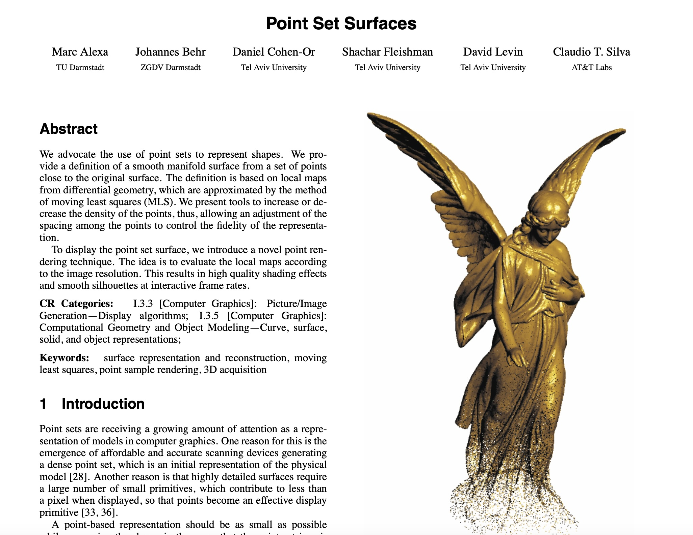
:::

::: {.column width="40%"}
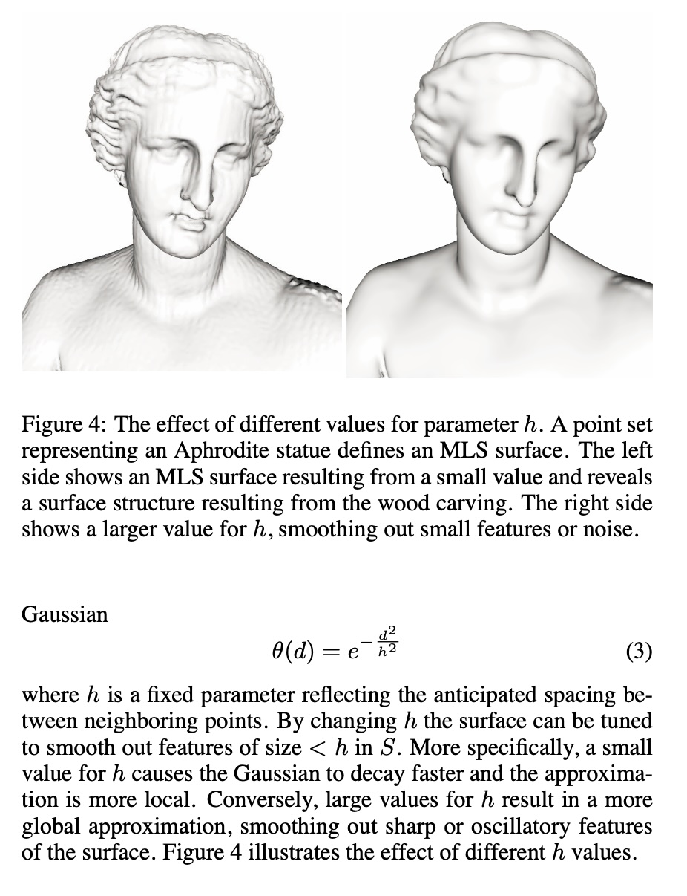
:::

::::

::: {.notes}
This digression relates back to the concept of the manifold hypothesis from last week. Manifold learning, which includes LLE, t-SNE, and UMAP, is essentially trying to reconstruct a lower-dimensional surface (like this Point Set Surface) from high-dimensional points. Understanding how local geometry (the neighborhood around a point) can define a surface helps build intuition for why these non-linear methods focus on preserving local connections, rather than global distances or overall shape. Just as we reconstruct surfaces from point clouds using local neighborhoods, these algorithms reconstruct low-dimensional manifolds using local neighborhood relationships.
:::

## t-SNE in three steps

```{python}
#| echo: false
#| fig-align: center
plt.rcParams["mathtext.fontset"] = "cm"
fig = plt.figure(figsize=(17, 8.2))
fig.add_axes([0, 0, 1, 1]).axis("off")
rows = [
    (0.95, 0.775, "1. Similarity in high-D (per point, Gaussian):",
           r"$p_{j|i}=\dfrac{\exp(-\Vert x_i-x_j\Vert^2/2\sigma_i^2)}{\sum_{k\neq i}\,\exp(-\Vert x_i-x_k\Vert^2/2\sigma_i^2)}\qquad\quad p_{ij}=\dfrac{p_{j|i}+p_{i|j}}{2N}$"),
    (0.62, 0.455, "2. Similarity in the map (heavy-tailed Student-t):",
           r"$q_{ij}=\dfrac{(1+\Vert y_i-y_j\Vert^2)^{-1}}{\sum_{k\neq l}\,(1+\Vert y_k-y_l\Vert^2)^{-1}}$"),
    (0.29, 0.13, "3. Move the map points $y_i$ until Q matches P:",
           r"$\mathrm{KL}(P\,\Vert\,Q)\;=\;\sum_{i\neq j}\,p_{ij}\,\log\dfrac{p_{ij}}{q_{ij}}$"),
]
for ly, ey, lab, eq in rows:
    fig.text(0.01, ly, lab, fontsize=26, color="#57068c", va="center", weight="bold")
    fig.text(0.05, ey, eq, fontsize=34, va="center")
```

::: {.notes}
SKIPPABLE - if running long, jump to 'Wattenberg, Viégas, and Johnson, 2016'.

These are the equations behind the two screenshots on the SNE and t-SNE slide. SNE used Gaussians in both spaces (the first screenshot); t-SNE replaces the Gaussian on the map side with a Student-t distribution with one degree of freedom (the second screenshot, the q_ij formula).

Step 1: for each point i, a Gaussian over its neighbors. The width sigma_i is found by binary search so that every point's neighborhood has the same perplexity, where perplexity is 2 to the power of the entropy of that distribution, the 'effective number of neighbors'. Dense regions therefore get small sigma and sparse regions large sigma, which is the root of the 'cluster sizes mean nothing' lesson. P is then symmetrized: p_ij = (p_j|i + p_i|j) / 2N.

Step 2: similarities between the map points y, with the heavy-tailed kernel (next slide).

Step 3: minimize the KL divergence by gradient descent on the y's. KL is asymmetric. Placing true neighbors far apart in the map (p large, q small) costs a lot; placing non-neighbors close together (p small, q large) costs little. So t-SNE is mostly about keeping neighbors together and says little about how far apart non-neighbors end up, which is why distances between clusters are not trustworthy. The gradient has the same shape as the force-directed layout in the video: each map point is pulled toward its neighbors and pushed away from the rest.
:::

## Why a heavy tail? The crowding problem

:::: {.columns}

::: {.column width="38%"}
* In high dimensions a point can have many neighbors that are all about equally far from it. In 2-D there is not room for them
* With a Gaussian in the map (SNE), moderately distant pairs look very dissimilar, so the optimizer pulls everything into one crowded blob
* The Student-t tail decays polynomially: pairs at moderate distance can sit far apart in the map at almost no cost, which opens gaps between clusters
:::

::: {.column width="62%"}
```{python}
#| echo: false
#| fig-align: center
d = np.linspace(0, 6, 400)
gauss, student = np.exp(-d**2), 1 / (1 + d**2)
fig, (a, b) = plt.subplots(1, 2, figsize=(11.5, 6.4))
for ax in (a, b):
    ax.plot(d, gauss, lw=4, color="#6d6d6d", label="Gaussian  exp(-d²)")
    ax.plot(d, student, lw=4, color="#8900e1", label="Student-t  1/(1+d²)")
    ax.set_xlabel("distance in the map, d")
a.set_ylabel("similarity (unnormalised)")
a.legend(frameon=False, fontsize=19)
a.set_title("linear scale", fontsize=22)
b.set_yscale("log"); b.set_ylim(1e-12, 2)
b.set_title("log scale: the tail", fontsize=22)
plt.tight_layout()
```

*Illustrative kernels: Gaussian vs Student-t (1 degree of freedom), both scaled to 1 at distance 0.*
:::

::::

::: {.notes}
SKIPPABLE - if running long, jump to 'Wattenberg, Viégas, and Johnson, 2016'.

Why does t-SNE use a Student-t kernel in the map? The crowding problem: in 10 or 50 dimensions a point can have many neighbors at about the same distance, but a 2-D map has far less room around a point. If we model map similarities with a Gaussian, any pair that ends up moderately far apart gets a vanishing similarity, which the cost punishes, so the optimizer squeezes everything together.

The right panel is the log-scale view of the two kernels: by distance 5 the Gaussian is more than ten orders of magnitude below the Student-t. Because the t-distribution's tail is so much heavier, moderately dissimilar points can be placed far apart for free. This is what produces the well-separated clusters, and also why gaps between clusters mean little.
:::

## Wattenberg, Viégas, and Johnson, 2016

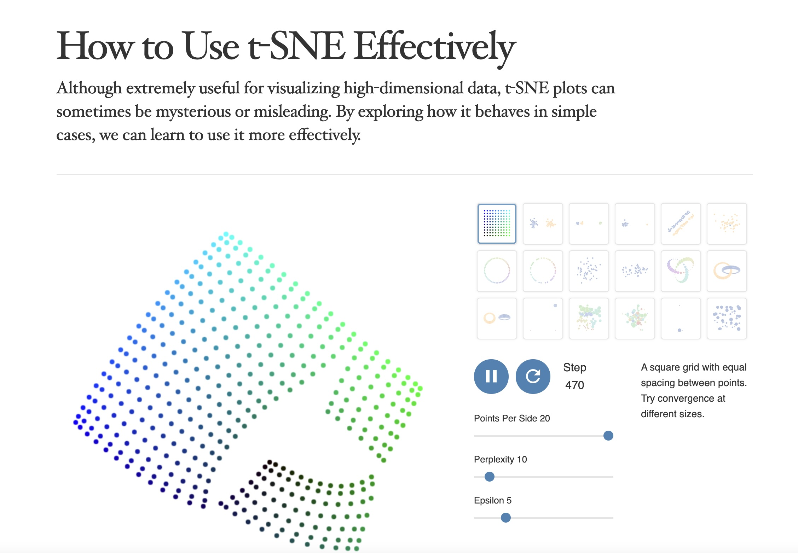

https://distill.pub/2016/misread-tsne/

::: {.notes}
This article, 'How to Use t-SNE Effectively,' is essential reading. It represents a pivot point in the visualization community, moving from simply celebrating t-SNE's results to critically analyzing its pitfalls. The authors demonstrate, using controlled experiments, which visual properties are meaningful and which are not. The main takeaway is that t-SNE is a visualization tool, not a clustering tool—its output must be treated as a suggestion of structure, not a definitive map of reality. This paper should be required reading for anyone using t-SNE in their work.
:::

## t-SNE

* Wattenberg et al writes "A popular method for exploring high-dimensional data is something called t-SNE... it has an almost magical ability to create compelling two-dimensonal “maps” from data with hundreds or even thousands of dimensions. Although impressive, these images can be tempting to misread."

* Wattenberg: "The algorithm is **non-linear** and adapts to the underlying data, performing **different transformations on different regions**. Those differences can be a major source of confusion."

* Watternberg: "A second feature of t-SNE is a tuneable parameter, **“perplexity,”** which says (loosely) how to balance attention between local and global aspects of your data. The parameter is, in a sense, a guess about the number of close neighbors each point has. The perplexity value has a complex effect on the resulting pictures."

::: {.notes}
This is THE critical article to read before using t-SNE. Wattenberg, Viégas, and Johnson from Google Brain systematically explore how t-SNE can be misread. Key point #1: t-SNE is non-linear and does different transformations in different regions - you can't directly compare distances. Key point #2: perplexity is crucial - it's roughly the number of close neighbors each point should have. Too low and you get disconnected clusters, too high and everything merges. We'll see concrete examples next.
:::

## t-SNE

* "Those hyperparameters really matter"

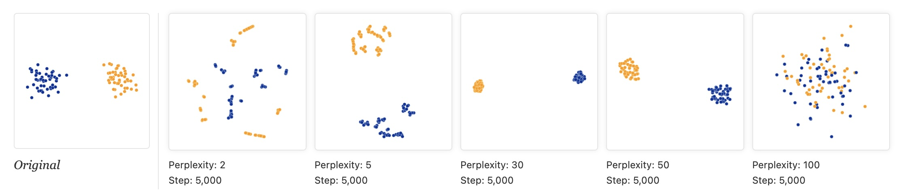

* "The image for perplexity 100, with merged clusters, illustrates a pitfall: for the algorithm to operate properly, the perplexity really should be smaller than the number of points."

::: {.notes}
The toy data in Wattenberg et al. is two Gaussian clusters of 50 points each, 100 points in all (the 'Original' panel on the left). The other five panels are t-SNE at perplexity 2, 5, 30, 50 and 100, each run for 5,000 steps.

At perplexity 2 and 5 each cluster shatters into small clumps and strings: with so few neighbors t-SNE only sees micro-structure, and it invents sub-clusters that are not in the data. At 30 and 50 we get two clean, compact clusters. At 100 the perplexity equals the number of points, and the two clusters dissolve into one mixed cloud, which is the pitfall quoted on the slide: perplexity must be smaller than the number of points.

Lesson: never trust a single t-SNE plot. Typical values are 5 to 50, and you should try several. The next slide runs the same experiment on a real dataset.
:::

## Try it: perplexity on 1,797 digits

```{python}
#| echo: false
#| fig-align: center
perps = [5, 30, 100, 500]
fig, axs = plt.subplots(1, 4, figsize=(17, 5.2))
for ax, p in zip(axs, perps):
    scatter(ax, TSNE(perplexity=p, random_state=0).fit_transform(X), f"perplexity {p}")
digit_legend(fig, -0.02)
plt.tight_layout(rect=[0, 0.07, 1, 1])
```

* Same data and seed; only the perplexity changes
* At 5 the groups are loose and fragmented; 30 and 100 give ten clear groups; at 500 (more than a quarter of the dataset) they press into each other
* *Which* groups end up next to each other changes from panel to panel

::: {.notes}
SKIPPABLE - if running long, jump to 'Wattenberg, Viégas, and Johnson, 2016'.

This is the perplexity experiment from the article on a real dataset: the 1,797 handwritten digits that ship with scikit-learn (8 by 8 pixel images, 64 features), colored by digit. The same lab dataset is used tonight.

Perplexity 5: ten groups, but loose, with small islands. 30 and 100: clean, compact groups. 500: the groups are still distinguishable but crowd each other and the middle of the map gets mixed. Ask the class: which of these would you show in a paper, and what would you want to say about how you chose it? Point out that the neighbors of each group differ between panels, so the layout of the groups is not a finding.
:::

## t-SNE

* "Each of the plots above was made with 5,000 iterations with a learning rate (often called “epsilon”) of 10, and had reached a point of stability by step 5,000. How much of a difference do those values make?"

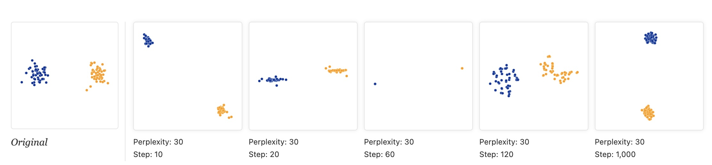

::: {.notes}
Same two-cluster data, perplexity fixed at 30 in every panel; only the number of optimization steps changes: 10, 20, 60, 120 and 1,000.

The intermediate pictures are not 'less converged versions of the answer', they are different-looking artifacts: at step 10 the clusters are separated; at 20 each is squashed into a line; at 60 each has collapsed to almost a single point; at 120 they have re-expanded into ragged shapes; only by step 1,000 do we get two compact clusters. Shapes at intermediate steps come from the optimizer, not the data.

Lesson: run until the picture stops changing. In scikit-learn the defaults are max_iter=1000 and learning_rate='auto'; the 5,000-step runs in the other figures are the article's choice, not a default.
:::

## t-SNE

* "Cluster sizes in a t-SNE plot mean nothing"

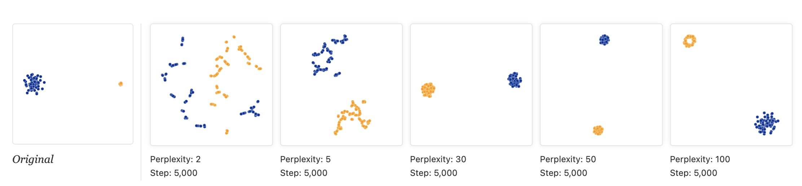

* "Size refers to spatial extent/area, not the number of points in the cluster."

* "The t-SNE algorithm adapts its notion of "distance" to regional density variations in the data set. As a result, it naturally expands dense clusters, and contracts sparse ones, evening out cluster sizes."

::: {.notes}
The reason t-SNE expands dense clusters and contracts sparse ones is due to its cost function, specifically the use of the heavy-tailed t-distribution, which is designed to resolve points within a cluster clearly. If a cluster is naturally dense, t-SNE must push points further apart in the low-dimensional embedding to satisfy the local probability distribution, effectively equalizing the density of the clusters in 2D space. Therefore, the area or size of a cluster in a t-SNE plot is not proportional to the cluster's density or variance in the original space. This is a feature, not a bug - it ensures all clusters are visible, but it means you can't compare cluster sizes visually.

Look at the 'Original' panel: the blue cluster is much more spread out than the tight orange one. At perplexity 30 and 50 t-SNE draws the two clusters at about the same size, which is the point of the slide: it expands dense regions and contracts sparse ones. At perplexity 100 the orange cluster is even drawn as a ring.
:::

## t-SNE

* "Distances between clusters might not mean anything"

* "The next diagrams show three Gaussians of 50 points each, one pair being 5 times as far apart as another pair."

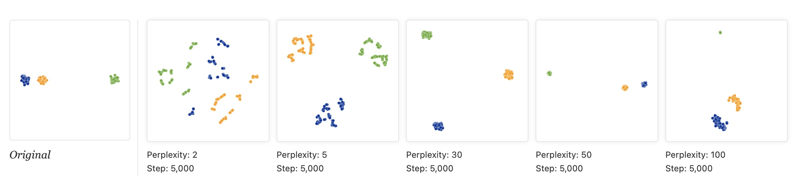

::: {.notes}
Original data: three clusters, where the blue and orange clusters are close together and the green one is far away. Then t-SNE at perplexity 2, 5, 30, 50 and 100 (5,000 steps each).

At 2 and 5 every cluster fragments. At perplexity 30 the three clusters end up at roughly the corners of a triangle: the near pair is no longer near, and the far cluster is no longer far. At 50 and 100 the original arrangement is roughly recovered (orange and blue close, green far), but at 50 the green cluster has shrunk to a speck.

So the gaps between clusters depend on the perplexity, and at the commonly used values they can be wrong. Do not read 'these two clusters are related because they are close'. The next-but-one slide repeats this with the same perplexity and different random starts.
:::

## Try it: same perplexity, different random start

```{python}
#| echo: false
#| fig-align: center
fig, axs = plt.subplots(1, 3, figsize=(17, 5.8))
for ax, seed in zip(axs, [0, 1, 2]):
    scatter(ax, TSNE(perplexity=30, init="random", random_state=seed).fit_transform(X), f"random_state = {seed}")
digit_legend(fig, -0.02)
plt.tight_layout(rect=[0, 0.07, 1, 1])
```

* Same data, same perplexity (30), random initialization; only the seed changes
* The same ten groups appear each time, but the arrangement changes
* Digit 0 (blue) sits at the bottom, the top left, and the far right

::: {.notes}
SKIPPABLE - if running long, jump to 'Topomap (Doraiswamy et al)'.

Same experiment as the 'distances between clusters' slide, but now we vary only the random seed. We use init='random' to make the effect visible; scikit-learn's default is PCA initialization, which makes runs much more repeatable. The ten groups are always found, but the position of each group relative to the others is not stable: in the three panels the blue 0s are at the bottom, top left and far right.

Ask: if you only had one of these three plots, which relationships would you be tempted to read into it? None of the between-group distances should be reported as a finding.
:::

## t-SNE

* "Random noise doesn’t always look random."

* "The next diagrams show genuinely random data, 500 points drawn from a unit Gaussian distribution in 100 dimensions. The left image is a projection onto the first two coordinates."

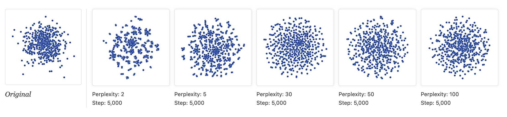

::: {.notes}
The data is 500 points from a unit Gaussian in 100 dimensions: pure noise, no clusters. The 'Original' panel is the projection onto the first two coordinates, a Gaussian cloud denser in the middle. Then t-SNE at perplexity 2, 5, 30, 50 and 100.

At perplexity 2 and 5 t-SNE produces clumps, gaps and filaments, i.e. apparent clusters, from noise. At 30 the output is close to a uniform disk (the dense center has been flattened: density information is lost). At 50 and 100 there is still some faint swirl structure.

Lesson: apparent clusters at low perplexity may be noise. Compare against a linear baseline and run several perplexities before believing structure.
:::

## t-SNE

* "For topology, you may need more than one plot"

* "The plots below show two groups of 75 points in 50 dimensional space. Both are sampled from symmetric Gaussian distributions centered at the origin, but one is 50 times more tightly dispersed than the other. The “small” distribution is in effect contained in the large one."

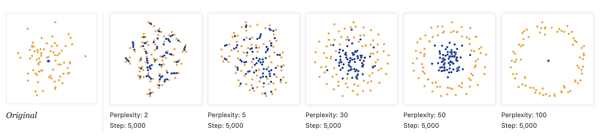

::: {.notes}
Two Gaussians of 75 points each in 50 dimensions. Both are centered at the origin, but the blue one is 50 times tighter, so it sits inside the orange one.

Perplexity 2 and 5: the two groups are mixed together, there is no containment. At 30 the blue points concentrate in the middle but are still intermingled with orange. At 50 we finally get the right picture: a blue core inside an orange ring. At 100 the blue cluster collapses to a single dot inside a circle of orange.

So the topology (one group inside another) shows up only for a middle range of perplexities, and even then the sizes are not to scale. One plot can mislead; you may need several. Topomap, next, tries to guarantee some of this.
:::

## Topomap (Doraiswamy et al)

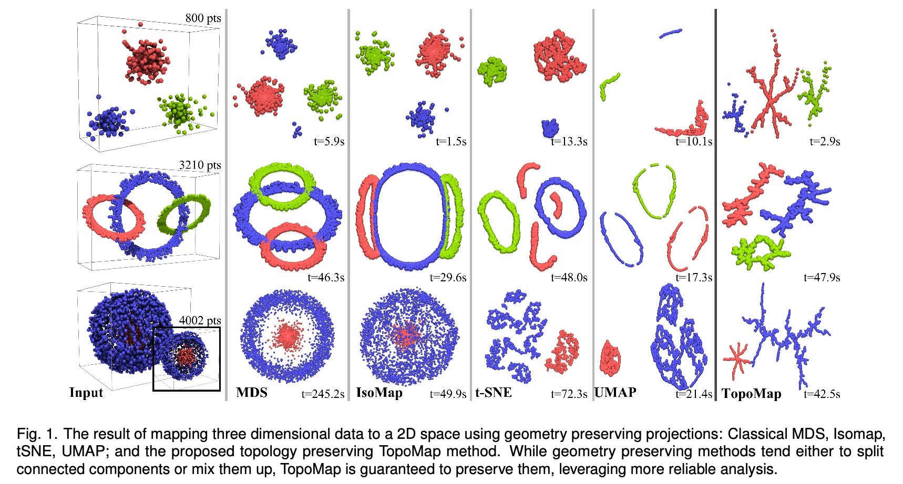

* Topomap preserves the 0-dimensional persistence diagram of the Rips filtration of the high-dimensional data.

::: {.notes}
The figure is Fig. 1 of the TopoMap paper. Three 3-D datasets, top to bottom: three separated clusters (800 points), three interlinked rings (3,210 points), and a small cluster nested inside a large spherical shell (4,002 points). Columns: the input, then MDS, Isomap, t-SNE, UMAP and TopoMap in 2-D, with run times.

The paper's point: geometry-preserving methods either split a connected component (t-SNE and UMAP break the rings into several pieces) or mix components up (MDS and Isomap stack the rings on top of each other). TopoMap is built from the 0-dimensional persistence of the Rips filtration, i.e. how connected components merge as the scale grows, and it preserves that exactly, so each component stays in one piece and components that are separate stay separate.

What you give up: it preserves components, not loops or holes (the rings come out as branching blobs), and the layouts look like trees. Run times in the figure are comparable to t-SNE and UMAP (for example 2.9 s vs 13.3 s for t-SNE on the first dataset, 47.9 s vs 48.0 s on the rings), so it is not obviously slower.
:::

## Understanding UMAP (Coenen & Pearce)

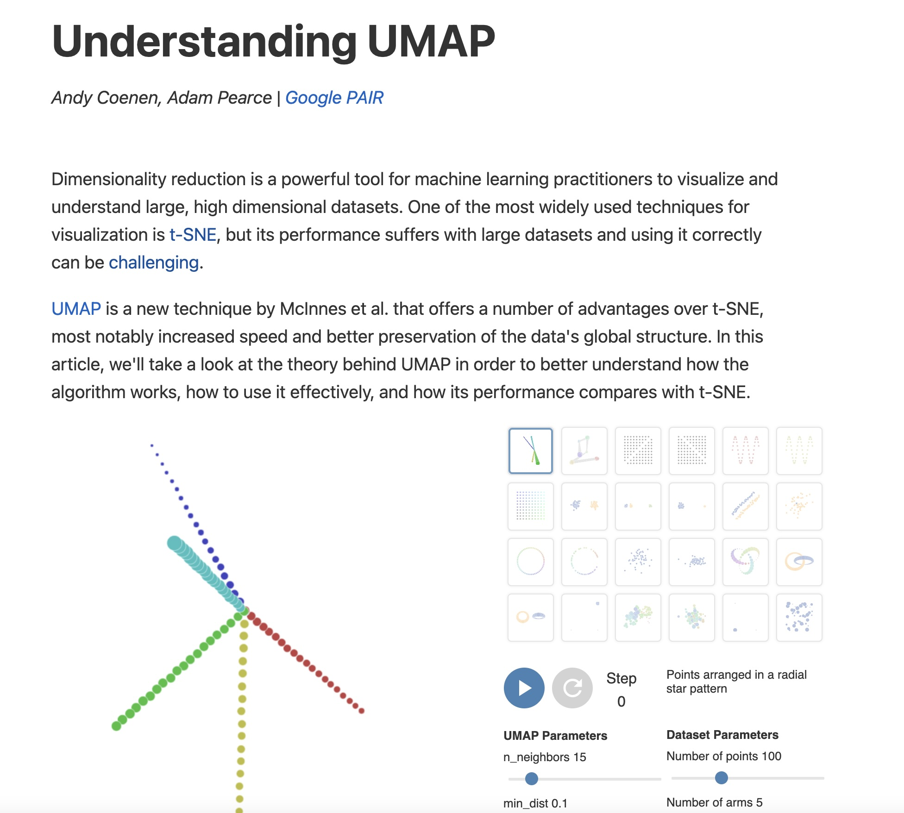

https://pair-code.github.io/understanding-umap/

::: {.notes}
We transition now to UMAP (Uniform Manifold Approximation and Projection). UMAP has rapidly replaced t-SNE as the go-to default for many visualization tasks. It shares the same philosophy as t-SNE—preserving local neighborhood structure—but it is built on a more rigorous theoretical foundation derived from Riemannian geometry and algebraic topology. This foundation is why UMAP is typically faster, scales better, and is often cited as better at preserving global data structure. This interactive article from Google's PAIR team is THE best resource for understanding UMAP, with interactive visualizations showing exactly how the algorithm works.
:::

## UMAP

* Coenen and Pearce: "UMAP is fast, scaling well in terms of both dataset size and dimensionality. ... UMAP can project the 784-dimensional, 70,000-point MNIST dataset in less than 3 minutes, compared to 45 minutes for scikit-learn's t-SNE implementation. Additionally, UMAP tends to better preserve the global structure of the data." 

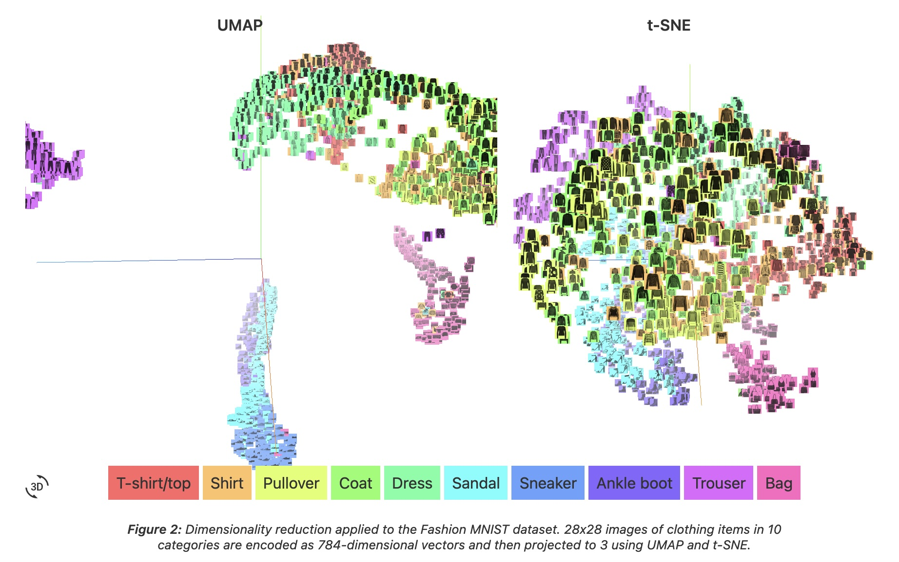

::: {.notes}
The figure is from Coenen and Pearce's 'Understanding UMAP'. It is Fashion-MNIST, not digits: 28 by 28 images of clothing in 10 categories, encoded as 784-dimensional vectors and projected to 3-D with UMAP (left) and t-SNE (right).

Both methods put footwear (sandal, sneaker, ankle boot) in one region away from the garments, and both separate trousers and bags. In the UMAP view the groups are separated by visible gaps; in the t-SNE view the upper-body garments (T-shirt, shirt, pullover, coat) form one continuous mass.

The speed numbers quoted on the slide (under 3 minutes vs 45 minutes for 70,000 MNIST points) are from the same article and are order-of-magnitude. At our scale the difference reverses: in the 1,797-point digits demos on the following slides, t-SNE takes about 2 s and UMAP about 5 s (including numba compilation). UMAP's speed advantage appears as the dataset grows.
:::

## UMAP

* "UMAP, at its core, works very similarly to t-SNE - both use graph layout algorithms to arrange data in low-dimensional space."

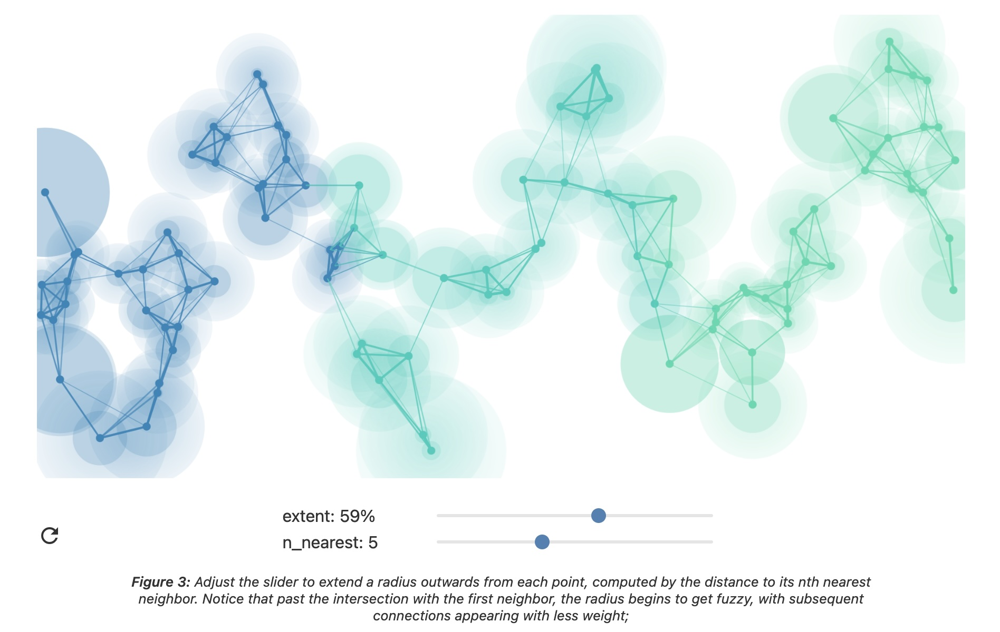

::: {.notes}
How UMAP works: it builds a "fuzzy topological representation" of the high-dimensional data. Essentially, it creates a weighted graph where edges represent neighborhood relationships, but the weights are "fuzzy" (probabilistic) rather than binary. Then it tries to find a similar graph structure in low dimensions. The theoretical foundation involves category theory and Riemannian geometry - much more sophisticated than t-SNE's probability distributions. But practically, you can think of it like force-directed graph layout with better math.
:::

## UMAP parameters

* **n_neighbors** - the number of approximate nearest neighbors used to construct the initial high-dimensional graph.

* **min_dist** - the minimum distance between points in low-dimensional space.

::: {.notes}
The two core UMAP parameters, n_neighbors and min_dist, allow precise control over the resulting visualization. n_neighbors dictates the local/global balance (high value = more global view, lower value = more local focus). min_dist acts as a repulsion force, ensuring a minimum separation between points. These two parameters are typically tuned together to find an embedding that maximizes the visualization of the data's inherent structure. Unlike t-SNE's perplexity which can dramatically change results, UMAP parameters tend to be more stable and intuitive.
:::

## UMAP parameters

* **n_neighbors** - the number of approximate nearest neighbors used to construct the initial high-dimensional graph. 

* **min_dist** - the minimum distance between points in low-dimensional space.

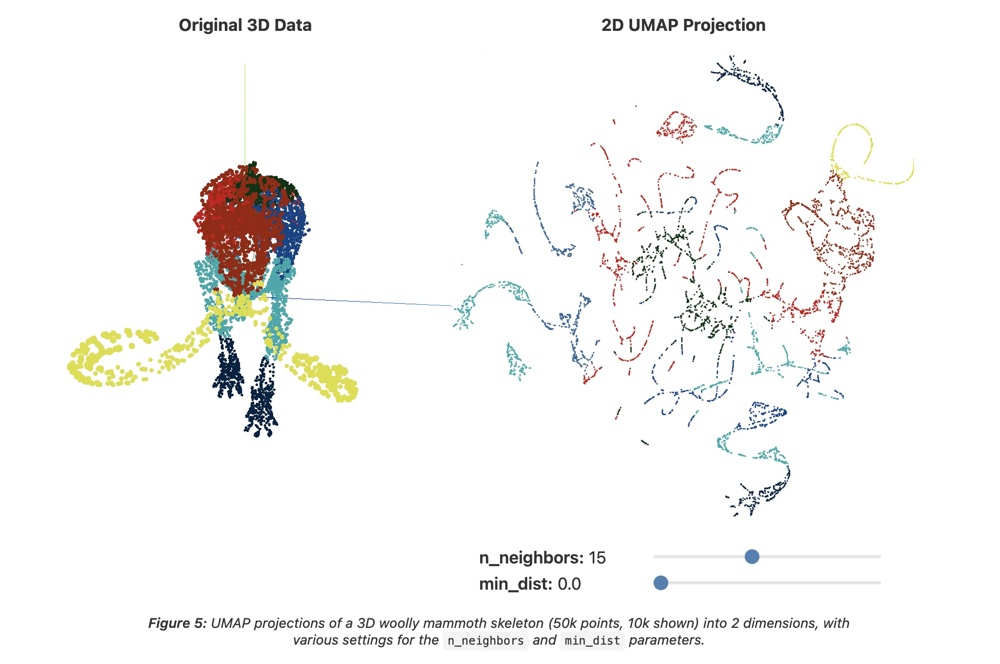

::: {.notes}
The data is a 3-D woolly mammoth skeleton (50,000 points, 10,000 shown), colored by body part on the left; the right panel is its 2-D UMAP projection with n_neighbors=15 and min_dist=0.0.

With min_dist=0 points may sit right on top of each other. The projection breaks into thin strands and small fragments: local connectivity is clearly drawn, but the global shape, the mammoth, is hard to recognize. This setting is good for tight clusters and bad for seeing individual points.
:::

## UMAP parameters

* **n_neighbors** - the number of approximate nearest neighbors used to construct the initial high-dimensional graph. 

* **min_dist** - the minimum distance between points in low-dimensional space.

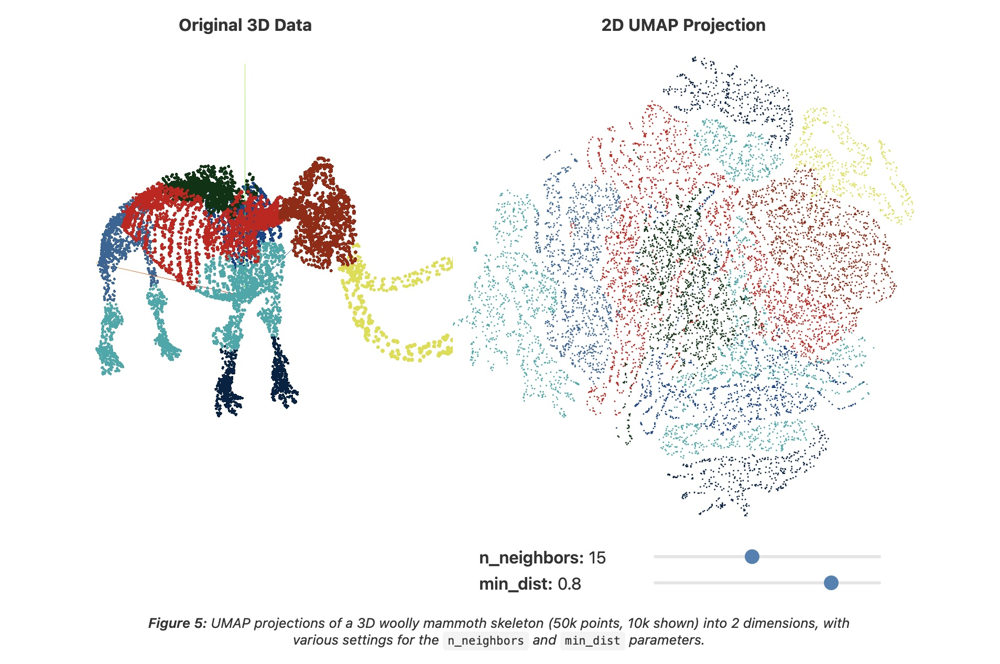

::: {.notes}
Same mammoth and the same n_neighbors=15, but now min_dist=0.8. Points are forced apart, and the picture becomes one filled blob in which the body-part colors form patches. It is easier to see individual points and there is less overplotting, but the fine strand structure from the previous slide is gone.

Neither setting recovers the mammoth's shape. Typical advice: smaller min_dist (0 to 0.1) when you care about clusters, larger (0.5 and up) when you want to see the points. UMAP is fast enough that trying several is practical.
:::

## Try it: UMAP n_neighbors × min_dist

```{python}
#| echo: false
#| fig-align: center
nn_vals, md_vals = [5, 15, 50], [0.0, 0.5]
fig, axs = plt.subplots(2, 3, figsize=(17, 8.0))
for i, md in enumerate(md_vals):
    for j, nn in enumerate(nn_vals):
        scatter(axs[i, j], UMAP(n_neighbors=nn, min_dist=md, random_state=0).fit_transform(X), f"n_neighbors={nn}, min_dist={md}", s=7)
digit_legend(fig, -0.01)
plt.tight_layout(rect=[0, 0.05, 1, 1])
```

* Rows: min_dist 0.0 vs 0.5. Columns: n_neighbors 5, 15, 50. min_dist changes how tightly points pack; n_neighbors changes how the groups are laid out relative to each other

::: {.notes}
SKIPPABLE - if running long, jump to 'UMAP (the 'However, it's important to note' slide)'.

The same digits, now with UMAP. Top row min_dist 0.0: tight, small blobs. Bottom row min_dist 0.5: the same groups, but spread out so individual points are visible. Columns are n_neighbors 5, 15 and 50: the groups are the same, but their placement relative to each other changes, for example where digit 0 (blue) lands. Compared with the perplexity sweep, the groups themselves look more stable across these settings, though the arrangement still moves.

UMAP took a few seconds per panel here (including numba compilation on the first call), which is why trying several settings is practical.
:::

## UMAP

* "However, it's important to note that, because UMAP and t-SNE both necessarily warp the high-dimensional shape of the data when projecting to lower dimensions, **any given axis or distance in lower dimensions still isn’t directly interpretable in the way of techniques such as PCA.**"

* Suggested reading: https://pair-code.github.io/understanding-umap/supplement.html
   - "Most dimensionality reduction algorithms fit into either one of two broad categories: Matrix factorization (such as PCA) or Graph layout (such as t-SNE)."
   - "At its core, UMAP is a graph layout algorithm, very similar to t-SNE, but with a number of key theoretical underpinnings that give the algorithm a more solid footing."

## UMAP

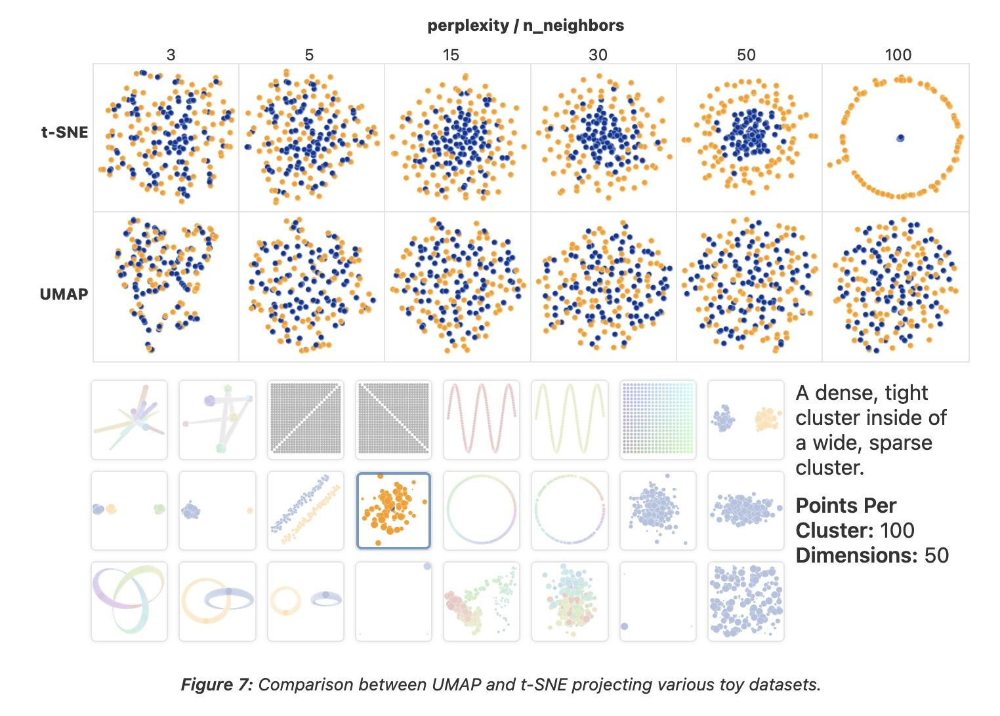

::: {.notes}
This figure from Coenen and Pearce uses one toy dataset, a dense, tight cluster inside a wide, sparse one (100 points per cluster, 50 dimensions), and varies t-SNE's perplexity (top row) and UMAP's n_neighbors (bottom row) over 3, 5, 15, 30, 50 and 100.

t-SNE: at 3 and 5 the two groups are mixed; at 15 and 30 the small one concentrates in the middle; at 50 there is a clear core inside a ring; at 100 the core collapses to a dot inside a circle. UMAP: whatever n_neighbors we choose, the two groups stay mixed; the containment that t-SNE finds at perplexity 50 never appears.

So UMAP's output is more stable across parameters here, but stable is not the same as right. The practical conclusion is not 'always use UMAP'. UMAP is a sensible first try on large data because it is fast, but run both when the structure matters.
:::

## PCA, t-SNE or UMAP: which one when?

| | PCA | t-SNE | UMAP |
|---|---|---|---|
| **Kind** | linear | non-linear, neighbor graph + KL divergence | non-linear, fuzzy neighbor graph |
| **Keeps** | global variance | local neighborhoods | local neighborhoods, some coarse layout |
| **Axes and distances mean something?** | yes: axes are directions in the data | no: sizes and gaps are artifacts | no: gaps are not reliable |
| **Knobs** | number of components | perplexity, steps, learning rate | n_neighbors, min_dist |
| **Repeatable?** | yes | depends on initialization and seed | depends on seed |
| **New points** | `transform` | refit | `transform` |
| **Reach for it to** | get a first look, denoise, preprocess | see local cluster structure on small and medium data | see structure on larger data, reuse the mapping |

::: {.notes}
SKIPPABLE - if running long, jump to 'Is this projection any good?'.

A summary, not a ranking. PCA is the only one whose axes you can interpret and the only one that is trivially repeatable, so it is the baseline you should always look at first.

Be careful with the claim that UMAP preserves global structure better than t-SNE. It is often repeated, but Kobak and Linderman (Nature Biotechnology, 2021) showed that most of the difference comes from initialization: with PCA initialization, t-SNE preserves global layout about as well. In scikit-learn, t-SNE already defaults to PCA initialization.

On new points: UMAP can embed new data with transform; scikit-learn's TSNE has no transform, so new points need a refit. On speed: PCA takes a hundredth of a second on the digits, t-SNE about 2 s and UMAP about 5 s (including compilation); UMAP's advantage shows up at larger N.
:::

## Is this projection any good?

* Score a projection by checking whether **neighborhoods survive**: for each point, compare its *k* nearest neighbors in the original space with its *k* nearest neighbors in the map
* **Trustworthiness**: are the neighbors in the map *real* neighbors? It penalizes **false neighbors**: points that look close in the map but were far apart in the data
* **Continuity**: were the real neighbors *kept*? It penalizes **tears**: points that were close in the data but ended up far apart in the map
* Both run from 0 to 1 (1 is perfect). In scikit-learn: `trustworthiness(X, X_map, n_neighbors=k)`; continuity is the same function with the two spaces swapped
* Both are **local**: they say nothing about the distances between clusters

T(k) = 1 − 2 / (N·k·(2N − 3k − 1)) · Σ<sub>i</sub> Σ<sub>j ∈ U<sub>i</sub></sub> (r(i,j) − k)

<span style="font-size:70%">U<sub>i</sub> = false neighbors of *i* (in its map neighborhood, not in its data neighborhood); r(i,j) = rank of *j* among *i*'s neighbors in the original space</span>

::: {.notes}
SKIPPABLE - if running long, jump to 'Before you trust a projection'.

So far we judged t-SNE and UMAP by eye. Here is a way to put a number on it. Both measures, due to Venna and Kaski, look at each point's k nearest neighbors.

Trustworthiness asks: of the points that are among this point's k nearest neighbors in the map, how many were really nearby in the original space? The ones that were not are false neighbors, and they are penalized by how far down the original ranking they were (the r(i,j) minus k term). Continuity is the mirror image: of the points that were among its k nearest neighbors in the data, how many did we keep in the map? Ones that got torn away are penalized.

Both are local, so they cannot detect a wrong picture of how clusters relate to each other. That limitation matters for t-SNE, and the next two slides show it.
:::

## Four projections of the digits, scored

```{python}
#| echo: false
#| fig-align: center
K = 15
trust = {n: trustworthiness(X, e, n_neighbors=K) for n, e in E.items()}
cont = {n: trustworthiness(e, X, n_neighbors=K) for n, e in E.items()}
fig = plt.figure(figsize=(17, 8.2))
gs = fig.add_gridspec(2, 4, height_ratios=[1.25, 1])
for j, (n, e) in enumerate(E.items()):
    scatter(fig.add_subplot(gs[0, j]), e, n, s=7)
ax = fig.add_subplot(gs[1, :])
w, xs = 0.36, np.arange(len(E))
b1 = ax.bar(xs - w/2, list(trust.values()), w, color="#57068c", label=f"trustworthiness (k={K})")
b2 = ax.bar(xs + w/2, list(cont.values()), w, color="#b9a3d1", label=f"continuity (k={K})")
for bars in (b1, b2):
    for r in bars:
        ax.text(r.get_x() + r.get_width()/2, r.get_height() + 0.01, f"{r.get_height():.2f}", ha="center", fontsize=18)
ax.set_xticks(xs); ax.set_xticklabels(list(E)); ax.set_ylim(0, 1.45); ax.set_yticks([0, 0.5, 1.0])
ax.legend(frameon=False, ncol=2, loc="upper center", fontsize=19)
plt.tight_layout()
```

::: {.notes}
SKIPPABLE - if running long, jump to 'Before you trust a projection'.

The same 1,797 digits, projected four ways, with trustworthiness and continuity at k=15 under each. PCA: trustworthiness 0.83, continuity 0.95. It keeps almost all true neighbors but also brings in many false ones (different digits overlap in the middle). LLE with n_neighbors=30: 0.68 and 0.83, the worst of the four; it collapses most points near one spot. t-SNE: 0.99 and 0.98. UMAP: 0.99 and 0.98.

Caveats to say out loud: these are single runs with one setting each (LLE in particular might do better with other neighbors), the metric is computed at one k, and both scores say the local neighborhoods are good, not that the picture is a faithful map. The numbers on the bars are computed when the deck is rendered.
:::

## But the score barely moves with perplexity

```{python}
#| echo: false
#| fig-align: center
perps = [5, 15, 30, 50, 100, 200, 500]
T, C = [], []
for p in perps:
    e = TSNE(perplexity=p, random_state=0).fit_transform(X)
    T.append(trustworthiness(X, e, n_neighbors=15)); C.append(trustworthiness(e, X, n_neighbors=15))
fig, ax = plt.subplots(figsize=(17, 6.6))
ax.plot(perps, T, "o-", lw=4, ms=12, color="#57068c", label="t-SNE trustworthiness (k=15)")
ax.plot(perps, C, "s-", lw=4, ms=12, color="#b9a3d1", label="t-SNE continuity (k=15)")
for name in ("PCA", "LLE"):
    v = trustworthiness(X, E[name], n_neighbors=15)
    ax.axhline(v, ls="--", lw=2.5, color="#6d6d6d")
    ax.text(500, v + 0.02, f"{name} trustworthiness = {v:.2f}", ha="right", va="bottom", fontsize=19, color="#4a4a4a")
ax.set_xscale("log"); ax.set_xticks(perps); ax.set_xticklabels(perps)
ax.set_ylim(0.0, 1.05); ax.set_xlabel("t-SNE perplexity"); ax.legend(frameon=False, loc="center right", bbox_to_anchor=(1.0, 0.42))
plt.tight_layout()
```

* Perplexity 5 to 500 stays between 0.98 and 0.99, although the maps on the earlier slides look quite different. The metric separates **methods** (dashed lines: PCA, LLE) but is too coarse to pick a **perplexity**, and it cannot see cluster sizes or the gaps between clusters

::: {.notes}
SKIPPABLE - if running long, jump to 'Before you trust a projection'.

A deliberately uncomfortable result. We ran t-SNE at seven perplexities, 5 to 500, on the digits, and scored each. The curves are almost flat: trustworthiness between 0.98 and 0.99 and continuity between 0.98 and 0.99 (the dashed lines show how much lower PCA and LLE are for comparison).

So the metric is useful for ruling out a bad method, such as LLE here, but it does not tell you which t-SNE picture to show. The earlier slides show that those pictures differ in what a viewer would read from them: fragments, cluster sizes, which groups are neighbors. Quality metrics complement looking at the picture and varying parameters; they do not replace either.
:::

## Before you trust a projection

1. **Vary the settings**: several perplexities (5 to 100) or n_neighbors (5 to 50), and at least two seeds. Keep only what is stable
2. **Do not read** cluster size, cluster density, or the distance between clusters
3. **Compare with a baseline**: PCA, and a noise dataset of the same size. Do the "clusters" appear there too?
4. **Score it**: trustworthiness and continuity; if you have labels, how well do they predict from the map (for example k-NN accuracy)?
5. **Report it**: method, parameters, seed and preprocessing, in the caption
6. **Use it to ask questions** of the original data, not as evidence on its own

::: {.notes}
SKIPPABLE - if running long, jump to 'What about user interaction?'.

A checklist to take away, and something you can apply directly in your projects. If your project includes any embedding plot (of images, text, or a model's hidden activations), expect to be asked in the final presentation which of these you did.
:::

## What about user interaction?

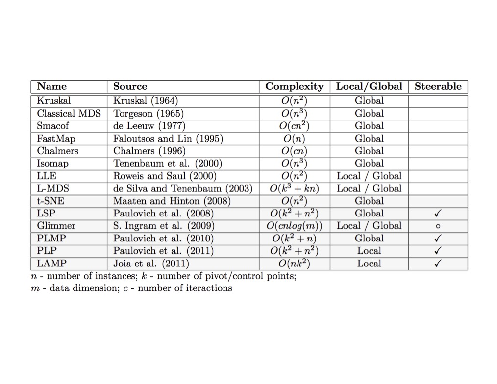

::: {.notes}
This slide is a table from the visualization literature, not a system. It lists projection algorithms from Kruskal (1964) to LAMP (2011) with their time complexity, whether they mainly preserve local or global structure, and whether they are 'steerable', meaning that a user can influence the layout, typically by placing control points. The check marks are LSP, PLMP, PLP and LAMP (Paulovich et al. and Joia et al.); Glimmer has a partial mark.

The table predates the popularity of t-SNE and UMAP in visualization work, and it labels t-SNE as 'Global'. After today's slides you should be cautious about that: what t-SNE preserves best is local neighborhoods. The next slide explains what steerable means.
:::

## Steering a projection

* **Steerable** methods (the check marks in the table: LSP, PLMP, PLP, LAMP) let the user influence the layout instead of accepting one static map
* A common recipe: pick a small set of **control points**, place them where you want them in 2-D, and position the remaining points relative to them
* Interactions follow from that: drag a point, group points, change a parameter and see the map update
* Questions to ask of any interactive projection in a project: **what can the user change, and what stays fixed?**

::: {.notes}
SKIPPABLE - if running long, jump to 'Next Week'.

What 'steerable' means in the table on the previous slide. In control-point methods such as LSP and LAMP the layout of a small subset is placed first, by the user or by a slower algorithm, and the rest of the points are positioned from the control points quickly, which is fast enough to be interactive. Interaction with t-SNE or UMAP usually means changing a parameter and recomputing the whole layout, which is slower.

For your projects: if your system shows a projection, be explicit about which parts the user can influence.
:::

## Next Week: Deep Learning Visualization Fundamentals

* **Tuesday, Oct 27**: terminology and foundations, linear models and loss functions, shallow and deep networks, activation functions

**Readings:**

* Prince, [*Understanding Deep Learning*](https://udlbook.github.io/udlbook/) (2023), Chapters 2-4
* [TensorFlow Playground](https://playground.tensorflow.org) and [CNN Explainer](https://poloclub.github.io/cnn-explainer/) (interactive, try them before class)

**Milestones:**

* **Today (Oct 20):** project proposal, 4 pages
* **Nov 3:** mid-term update, 1 page, with preliminary results

::: {.notes}
Next Tuesday we start the deep learning block. The readings are the book chapters and two interactive tools worth playing with before class; they make the visualization material much easier.

Repeat the project milestones: the proposal is due today and every group gets an approve, approve with changes or rescope reply. The mid-term update on Nov 3 is one page and should show preliminary results, not only plans.

Tonight's lab (7:10 PM, same room, Bhavya) is the hands-on version of today's lecture.
:::
