## Today

```{python}
#| include: false
import warnings
warnings.filterwarnings("ignore")
import numpy as np
import matplotlib.pyplot as plt
from sklearn.decomposition import MiniBatchDictionaryLearning

plt.rcParams.update({"font.size": 20, "axes.spines.top": False, "axes.spines.right": False,
                     "axes.titlesize": 22, "legend.frameon": False})
PURPLE, VIOLET, GRAY, ORANGE, TEAL, RED = "#57068c", "#8900e1", "#6d6d6d", "#e08214", "#1b9e77", "#c62828"
FCOL = [PURPLE, ORANGE, TEAL, RED, "#1f78b4"]      # one color per feature in the 5-feature model

# The toy model of Elhage et al. (2022), "ReLU output" variant:
#   h = W x            (n features squeezed into m < n hidden dimensions)
#   x' = ReLU(W^T h + b)
# trained to reconstruct x under an importance-weighted squared error. Each feature x_i is 0 with
# probability S (the sparsity) and uniform on [0, 1] otherwise. Plain numpy with Adam.
def sample(rng, size, n, S):
    return rng.uniform(0, 1, (size, n)) * (rng.uniform(0, 1, (size, n)) > S)

def train(n, m, S, imp, steps=4000, batch=1024, lr=1e-2, seed=0):
    rng = np.random.default_rng(seed)
    W = rng.normal(0, 0.3, (m, n)); b = np.zeros(n)
    mW = np.zeros_like(W); vW = np.zeros_like(W); mb = np.zeros(n); vb = np.zeros(n)
    for t in range(1, steps + 1):
        X = sample(rng, batch, n, S)
        H = X @ W.T; Z = H @ W + b; Y = np.maximum(Z, 0)
        G = -2 * imp * (X - Y) * (Z > 0) / batch
        gW = H.T @ G + (G @ W.T).T @ X; gb = G.sum(0)
        for p, g, mm, vv in ((W, gW, mW, vW), (b, gb, mb, vb)):
            mm *= 0.9; mm += 0.1 * g; vv *= 0.999; vv += 0.001 * g * g
            p -= lr * (mm / (1 - 0.9 ** t)) / (np.sqrt(vv / (1 - 0.999 ** t)) + 1e-8)
    X = sample(rng, 20000, n, S)
    loss = float((imp * (X - np.maximum(X @ W.T @ W + b, 0)) ** 2).sum(1).mean())
    return W, b, loss

def best_of(n, m, S, imp, seeds=4, **kw):
    return min((train(n, m, S, imp, seed=s, **kw) for s in range(seeds)), key=lambda r: r[2])

# Five features in two dimensions, at three sparsity levels (used on several slides).
IMP5 = 0.9 ** np.arange(5)
TOY5 = {S: best_of(5, 2, S, IMP5) for S in (0.0, 0.8, 0.9)}
N_REP = {S: int((np.linalg.norm(TOY5[S][0], axis=0) > 0.5).sum()) for S in TOY5}
```

1. **Why look inside?** From explaining an output to understanding a mechanism
2. **Superposition**: why single neurons are hard to read
3. **From neurons to features**: dictionary learning and the replacement model
4. **Are networks already clean?** A dissent: study the neurons directly (main reading)
5. **Attribution graphs**: drawing one prompt's computation as a graph
6. **Case studies**: reasoning, planning, hallucination, chain of thought
7. **Attention**: the part those graphs leave out, and filter heads
8. **Limits**: what these pictures can and cannot claim

*This is the last regular lecture. It replaces the session on fairness.*

::: {.notes}
ORIGINAL TIMING (before part 4 was added; parts 4-7 below are now 5-8): part 1 about 10 min, part 2 about 25, part 3 about 15, attribution graphs about 20, case studies about 25, attention about 15, limits about 10.

REVISED Nov 24: part 4 (Cammarata, Neural Networks Are Already Clean) is the main reading, about 45 min (first 10 on the six vocabulary slides). To make room: part 1 about 5, part 2 about 20, part 3 about 10, part 5 attribution graphs about 15, part 6 case studies about 15 (skip some), part 7 attention / filter heads SKIP, part 8 limits about 10.

Five sources carry the lecture. Toy Models of Superposition (Elhage et al., 2022) for part 2. Circuit Tracing (Ameisen et al., 2025) for parts 3 and 5. Neural Networks Are Already Clean (Cammarata, 2026) for part 4. On the Biology of a Large Language Model (Lindsey et al., 2025) for part 6. LLMs Process Lists With General Filter Heads (Sen Sharma et al., 2025) for part 7. Toy Models, Circuit Tracing and Biology are from Anthropic's interpretability team; Cammarata's essay is from Goodfire; filter heads is from David Bau's lab at Northeastern.

The charts in part 2 are computed in this deck from a model small enough to train in seconds. Everything in parts 4 to 6 is a figure from the papers.
:::

# Why Look Inside?

## Where we left off on November 3

:::: {.columns}
::: {.column width="50%"}
**What we had**

* **Embeddings**: words as points, neighbors as meaning
* **Attention maps**: which tokens a head looks at
* **LIME**: which input words move the output

**What the lab found**

* A classifier can be right for the wrong reason
* An attention map shows where a head looks. It does not show what was computed with what it found.
:::
::: {.column width="50%"}
**Three levels of explanation**

1. **Behavior**: what does the model output? (evaluation)
2. **Attribution**: which inputs mattered for this output? (LIME, SHAP, saliency)
3. **Mechanism**: what intermediate steps did the model compute? (today)

**Level 3 is what would let us say *how* an answer was produced, and check whether the model's own explanation is true.**
:::
::::

::: {.notes}
Three weeks ago we looked at an NLP model from the outside in: its embeddings, its attention, and input attributions with LIME.

The lab ended on a question, 'does attention explain the prediction?', and the honest answer was 'only partly'. Attention tells you which positions information was read from. It says nothing about what the information was or what happened to it next.

Today is about the third level. The goal is ambitious: take one prompt and one answer, and draw the intermediate steps the model actually went through. The field is called mechanistic interpretability.

It is also a visualization lecture. Every method today ends in a picture, and the papers say outright that the interface was one of the main contributions.
:::

## A transformer in one slide

:::: {.columns}
::: {.column width="55%"}
* Every token position carries a vector, the **residual stream**. Each layer reads it and adds to it.
* **Attention** moves information between positions.
* **MLP layers** compute new information at one position. Their hidden units are the **neurons**.
* At the last position, the final vector is turned into scores (**logits**) for the next token.

**So there are two things to explain: what is represented in those vectors, and how each layer transforms it.**
:::
::: {.column width="45%"}
```
 logits  ->  next token
    ^
 [ layer L ]   attention + MLP
    ^
   ...
    ^
 [ layer 2 ]   attention + MLP
    ^
 [ layer 1 ]   attention + MLP
    ^
 token embeddings
```
:::
::::

::: {.notes}
A reminder of the architecture, at the level of detail today needs. You saw the full version in the Transformer Explainer lab.

The picture to keep is a column of vectors per token, with each layer adding its contribution. Attention is the only component that moves information sideways, from one token to another. The MLP works on each position alone.

Most of today's work is about the MLPs: that is where the neurons are, and they hold most of the parameters. Attention comes back in part 7 as the thing the main method cannot explain.
:::

# Superposition

## The hope: one neuron, one concept

:::: {.columns}
::: {.column width="50%"}
**If it held**

* Read a neuron's top-activating examples, name it, done
* Some neurons really are like this: curve detectors in vision models, for example

**What people found in language models**

* Most neurons are **polysemantic**: one neuron responds to several unrelated things
* Top activations can look clean while weaker activations mean something else
:::
::: {.column width="50%"}
**Two questions from the paper**

* Why do neurons sometimes line up with concepts and sometimes not?
* Can a network represent **more features than it has neurons**?

**The answer to the second is yes, and it explains the first.**
:::
::::

:::footer
Elhage, N., et al. (2022). [*Toy Models of Superposition*](https://transformer-circuits.pub/2022/toy_model/index.html). Transformer Circuits Thread.
:::

::: {.notes}
The simplest plan for interpretability is to look at neurons one at a time. In early vision models this worked surprisingly often.

In language models it mostly fails. A typical neuron fires on, say, academic citations, Korean text and HTTP requests. That is what 'polysemantic' means. There is no single label for it.

Toy Models of Superposition asks why. Its move is to stop studying real networks, where nobody knows what the true features are, and build a tiny one where the features are known by construction.
:::

## Features are directions

* **Feature**: a property of the input the network represents (a curve, the word being in French, a mention of Texas)
* **Linear representation hypothesis**: each feature has a **direction** in activation space. Several active features add up:

$$\text{activation} \;=\; x_1 W_1 + x_2 W_2 + \dots$$

* The classic evidence: `king - man + woman ≈ queen` in word embeddings
* A **neuron** is one particular direction: a coordinate axis. Nothing forces features to lie along the axes.

**With m dimensions there are only m orthogonal directions. But there are far more than m features worth representing.**

::: {.notes}
Two definitions carry the rest of the lecture.

A feature is something the model represents about its input. The paper is careful that a clean definition is hard, and settles for a working one.

The hypothesis is that features are directions, and that a vector is a weighted sum of the directions of the features that are present. You have seen the evidence: the embedding arithmetic from the NLP lecture, and the custom-axis exercise in the Embedding Projector.

Now the tension. A language model plausibly wants to represent every person, place and concept it has read about. That is many more features than it has dimensions. If features must be orthogonal, most of them cannot be stored. So what happens?
:::

## How many directions fit in d dimensions?

```{python}
#| fig-align: center
rng = np.random.default_rng(0)
fig, axes = plt.subplots(1, 3, figsize=(17, 5.6), sharey=True)
for ax, d in zip(axes, (3, 100, 1000)):
    V = rng.normal(size=(2000, d)); V /= np.linalg.norm(V, axis=1, keepdims=True)
    C = (V @ V.T)[np.triu_indices(2000, 1)]
    ax.hist(C, bins=np.linspace(-1, 1, 81), color=PURPLE, alpha=0.85, weights=np.ones_like(C) / len(C))
    ax.set_title(f"d = {d}\n{100 * np.mean(np.abs(C) < 0.1):.0f}% of pairs within ±0.1")
    ax.set_xlabel("cosine similarity")
    ax.axvspan(-0.1, 0.1, color=ORANGE, alpha=0.15)
axes[0].set_ylabel("share of pairs")
plt.tight_layout(); plt.show()
```

**Exactly orthogonal directions: only d. Almost orthogonal directions: enormously many, once d is large.**

::: {.notes}
Computed here: 2,000 random directions in 3, 100 and 1,000 dimensions, and the cosine similarity of every pair. The shaded band is 'nearly orthogonal', within 0.1 of zero.

In 3 dimensions random directions point all over the place. In 100 dimensions most pairs are already close to orthogonal. In 1,000 dimensions essentially all of them are.

This is the geometric fact that makes superposition possible. A model's residual stream has thousands of dimensions. It has room for a huge number of directions that almost do not interfere. The price is the word 'almost': every feature leaks a little into the others.
:::

## A toy model with known features

:::: {.columns}
::: {.column width="52%"}
**Data: n synthetic features**

* Each feature $x_i$ is **0 with probability S** (the *sparsity*), otherwise uniform on [0, 1]
* Each has an **importance** $I_i$: how much its error counts

**Model: squeeze n features into m < n dimensions and get them back**

$$h = Wx \qquad x' = \mathrm{ReLU}(W^{\top}h + b)$$

$$L = \sum_i I_i\,(x_i - x'_i)^2$$
:::
::: {.column width="48%"}
**How to read the result**

* Column $W_i$ is the **direction** given to feature *i*
* Its **length** says whether the feature is represented at all
* The **angles** between columns say which features interfere

**We know the true features, so we can see exactly what the network did with them.**
:::
::::

:::footer
Elhage, N., et al. (2022). [*Toy Models of Superposition*](https://transformer-circuits.pub/2022/toy_model/index.html). Transformer Circuits Thread.
:::

::: {.notes}
The setup of the paper's first experiment. It is an autoencoder with a bottleneck, and one ReLU at the output.

The inputs stand for the features of an imagined, much larger network in which every feature has its own neuron. The question is what a small network does when it has to carry those features through fewer dimensions.

Two knobs. Sparsity S: how rarely each feature is active. Real features are sparse: most tokens are not about Texas. Importance: some features reduce the loss more than others.

The same matrix W is used to encode and to decode, so column i of W is unambiguously 'the direction of feature i'.

Without the ReLU this is a linear autoencoder and the answer is known: it keeps the top m features, like PCA, and drops the rest. The ReLU changes that.
:::

## Five features in two dimensions

```{python}
#| fig-align: center
fig, axes = plt.subplots(1, 3, figsize=(17, 6.2))
for ax, S in zip(axes, (0.0, 0.8, 0.9)):
    W = TOY5[S][0]
    for i in range(5):
        ax.plot([0, W[0, i]], [0, W[1, i]], lw=4, color=FCOL[i], solid_capstyle="round")
        ax.scatter(W[0, i], W[1, i], s=110, color=FCOL[i], zorder=3)
    ax.set_xlim(-1.35, 1.35); ax.set_ylim(-1.35, 1.35); ax.set_aspect("equal")
    ax.set_xticks([]); ax.set_yticks([])
    for sp in ax.spines.values(): sp.set_visible(True); sp.set_color("#cccccc")
    active = "always active" if S == 0 else f"active {100 * (1 - S):.0f}% of the time"
    ax.set_title(f"features {active}\n{N_REP[S]} of 5 represented")
plt.tight_layout(); plt.show()
```

**Dense features: the model keeps two, at right angles, and drops three. Sparse features: it keeps all five, as a pentagon.**

::: {.notes}
Computed in this deck: the same model trained three times, changing only how often the features are active. Each line is the direction the model assigned to one feature; a feature with no line was given length zero.

Left, features always on: two dimensions, two features, orthogonal. The three least important features are not represented. This is what PCA would do.

Middle, each feature on 20 percent of the time: four features, in two opposite pairs. A pair shares one dimension, pointing in opposite directions.

Right, 10 percent: all five, evenly spaced around a circle.

This is superposition: more features than dimensions. Nobody told the model to do it. It falls out of gradient descent once the features are sparse enough. The paper reports the same pentagon.
:::

## What the hidden activations look like

```{python}
#| fig-align: center
rng = np.random.default_rng(3)
fig, axes = plt.subplots(1, 2, figsize=(17, 6.6))
for ax, S in zip(axes, (0.0, 0.9)):
    W = TOY5[S][0]
    X = sample(rng, 6000 if S else 1500, 5, S); X = X[X.sum(1) > 0]
    Hh = X @ W.T
    one = (X > 0).sum(1) == 1
    ax.scatter(Hh[~one, 0], Hh[~one, 1], s=10, color=GRAY, alpha=0.35, label="several features active")
    for i in range(5):
        sel = one & (X[:, i] > 0)
        ax.scatter(Hh[sel, 0], Hh[sel, 1], s=14, color=FCOL[i])
    ax.set_aspect("equal"); ax.set_xticks([]); ax.set_yticks([])
    ax.set_title("dense features: a filled region" if S == 0 else "sparse features: five spokes")
axes[1].legend(loc="upper left", fontsize=16, markerscale=2)
plt.tight_layout(); plt.show()
```

**Each point is one input, plotted by its two hidden activations. With sparse features the directions are visible in the data itself.**

::: {.notes}
The previous slide showed the weights. This is what you would see if you could only record activations, which is the situation with a real model.

Left: dense features. Every input has several features on at once, so the points fill a region and no direction stands out. The two axes of that region are the two features the model kept.

Right: sparse features. Most inputs have exactly one feature active, and those points lie on five rays from the origin, colored by which feature it was. The gray points are inputs where two or more features were active at once: they are sums of rays.

Hold on to the right-hand picture. The idea of the next section is to recover those rays from the cloud of points, without knowing the features in advance.
:::

## The price: interference

```{python}
#| fig-align: center
W, b, _ = TOY5[0.9]
e = np.zeros(5); e[0] = 1.0
pre = W.T @ (W @ e) + b
fig, axes = plt.subplots(1, 2, figsize=(16, 5.6), sharey=True)
for ax, vals, title in ((axes[0], pre, "before the ReLU"), (axes[1], np.maximum(pre, 0), "after the ReLU")):
    ax.bar(range(5), vals, color=FCOL)
    ax.axhline(0, color="black", lw=1)
    ax.set_xticks(range(5)); ax.set_xticklabels([f"feature {i + 1}" for i in range(5)], fontsize=16)
    ax.set_title(title)
axes[0].set_ylabel("reconstructed value")
plt.tight_layout(); plt.show()
```

**Input: only feature 1 is on. Before the ReLU other features respond too. The ReLU deletes the negative part; a small positive leak remains.**

::: {.notes}
The pentagon model again. The input has feature 1 set to 1 and everything else at zero.

Left: the model's output before the ReLU. Feature 1 comes back near 1. The other four are not zero, because their directions are not orthogonal to feature 1's. The two features on the far side of the pentagon get a large negative value, and the two adjacent ones a small positive one.

Right: after the ReLU. Negative interference is erased for free. The small positive interference is still there, reduced by the negative bias the model learned: that leftover is the error the model accepts in exchange for storing five features.

That is why the ReLU matters and why a linear model cannot do this: the nonlinearity is a noise filter. And it is why sparsity matters: interference only does damage when two interfering features are active together, which is rare when features are sparse.
:::

## More features, more sparsity

```{python}
#| fig-align: center
IMP20 = 0.7 ** np.arange(20)
levels = (0.0, 0.7, 0.9, 0.97)
fig, axes = plt.subplots(1, 4, figsize=(18, 4.9), constrained_layout=True)
for ax, S in zip(axes, levels):
    Wb = best_of(20, 5, S, IMP20, seeds=2, steps=5000)[0]
    G = Wb.T @ Wb
    im = ax.imshow(G, cmap="RdBu_r", vmin=-1.3, vmax=1.3)
    k = int((np.linalg.norm(Wb, axis=0) > 0.5).sum())
    active = "always" if S == 0 else f"{100 * (1 - S):.0f}% of the time"
    ax.set_title(f"active {active}\n{k} of 20 represented", fontsize=19)
    ax.set_xticks([]); ax.set_yticks([])
    for sp in ax.spines.values(): sp.set_visible(True); sp.set_color("#cccccc")
axes[0].set_ylabel("feature (most important at top)")
fig.colorbar(im, ax=axes, shrink=0.8, pad=0.01, label=r"$W^{\top}W$")
plt.show()
```

**Twenty features, five dimensions. The diagonal is which features are represented; anything off the diagonal is interference.**

::: {.notes}
The same experiment, larger: 20 features of decreasing importance and 5 hidden dimensions. Each panel is the matrix W-transpose-W, feature by feature. Red on the diagonal means that feature is represented. Color off the diagonal means two features share a direction: blue is opposite directions, red is the same direction.

Leftmost, dense: five features, a clean diagonal, nothing else. One feature per dimension.

Moving right, as the features get sparser, more of the diagonal fills in and off-diagonal entries appear. The model packs in the less important features first, and prefers blue, opposite directions, because the ReLU removes negative interference.

This is a matrix view with a diverging color scale: the reordering and color lessons from earlier in the course are doing the work here.
:::

## What else the paper shows

:::: {.columns}
::: {.column width="50%"}
* **A phase change.** Each feature ends up in one of three states: not represented, in superposition, or with a dimension to itself. The switch between them is abrupt, and depends on sparsity and importance.
* **Geometry.** Features arrange themselves in regular shapes: opposite pairs, triangles, pentagons, tetrahedra.
* **Polysemantic neurons appear.** Put a ReLU on the hidden layer and some neurons carry one feature while others carry several, in the same model.
:::
::: {.column width="50%"}
* **Computation in superposition.** A small network can compute a function (absolute value) on more features than it has neurons.
* **The authors' caution.** These are tiny ReLU networks. They expect superposition itself to carry over to real models, and are much less sure about the geometry.

**For interpretability: a network may be simulating a much larger, sparser network. Its neurons are the wrong unit to read.**
:::
::::

:::footer
Elhage, N., et al. (2022). [*Toy Models of Superposition*](https://transformer-circuits.pub/2022/toy_model/index.html). Transformer Circuits Thread.
:::

::: {.notes}
The paper is long. These are the results beyond the two experiments we just reproduced.

The phase change is the most useful idea to remember: whether a feature gets its own dimension is not gradual. In the paper's phase diagrams the regions have sharp borders.

The geometry is the most surprising. With equally important features the model produces specific polytopes, and the paper connects this to the Thomson problem of spacing points on a sphere. The pentagon you saw is one of them.

The last bullet on the right is the honest framing: superposition is demonstrated in a toy setting and hypothesized for real models. What made it more than a hypothesis is the next section, where assuming superposition and undoing it turns out to work on real language models.
:::

# From Neurons to Features

## Three ways out

1. **Build models without superposition.** Possible in the toy model, by penalizing activations. Likely to cost performance in a real one.
2. **Find the feature directions after the fact.** Take a trained model, record activations, and solve for an *overcomplete* set of directions, more directions than dimensions, such that each activation is a **sparse** combination of them.
3. **Something in between.**

**Option 2 is dictionary learning. It leaves the model untouched, and it is what the field has built on since.**

* A **sparse autoencoder** learns a dictionary that reconstructs a layer's activations
* A **transcoder** learns one that reproduces what an MLP layer *computes*: it reads the layer's input and predicts its output

::: {.notes}
The superposition paper ends with these three strategies. The second one won, at least so far.

Dictionary learning is an old idea from signal processing and neuroscience: find a set of atoms such that every signal is a combination of a few of them. Here the signals are activation vectors and the atoms are candidate feature directions.

Two variants matter today. A sparse autoencoder explains what is stored at one point in the model. A transcoder replaces a computation: it takes what goes into an MLP and predicts what comes out, through a wide, sparse hidden layer. The units of that hidden layer are the 'features' in the rest of this lecture. A transcoder is what lets you connect features to one another, which is what a circuit needs.
:::

## Dictionary learning recovers the directions

```{python}
#| fig-align: center
W, b, _ = TOY5[0.9]
rng = np.random.default_rng(11)
X = sample(rng, 12000, 5, 0.9); X = X[X.sum(1) > 0]; Hh = X @ W.T
best = None
for seed in range(6):
    dl = MiniBatchDictionaryLearning(n_components=5, alpha=0.05, positive_code=True, fit_algorithm="cd",
                                     transform_algorithm="lasso_cd", random_state=seed, max_iter=300).fit(Hh)
    A = dl.components_ / np.linalg.norm(dl.components_, axis=1, keepdims=True)
    cos = (A @ (W / np.linalg.norm(W, axis=0))).max(0)
    if best is None or cos.min() > best[1].min(): best = (A, cos)
A, cos = best
N_REC = int((cos > 0.95).sum())
fig, axes = plt.subplots(1, 2, figsize=(17, 6.6))
axes[0].scatter(Hh[:, 0], Hh[:, 1], s=8, color=GRAY, alpha=0.5)
axes[0].set_title("what we observe: activations only")
axes[1].scatter(Hh[:, 0], Hh[:, 1], s=8, color=GRAY, alpha=0.25)
for i in range(5):
    axes[1].plot([0, W[0, i]], [0, W[1, i]], lw=9, color=FCOL[i], alpha=0.35, solid_capstyle="round")
for a in A:
    axes[1].plot([0, a[0]], [0, a[1]], lw=2.5, color="black")
axes[1].set_title(f"learned dictionary (black) on the true directions\n{N_REC} of 5 recovered")
for ax in axes: ax.set_aspect("equal"); ax.set_xticks([]); ax.set_yticks([])
plt.tight_layout(); plt.show()
```

**Left: the pentagon model's hidden activations, with no labels. Right: five directions found by sparse dictionary learning, drawn over the true ones.**

::: {.notes}
Computed here, on the pentagon model from part 2.

Left is all the method gets: a few thousand activation vectors. No feature labels, no weights.

Right: sparse dictionary learning asked for five directions such that every point is a non-negative combination of few of them. The black lines are what it found. The thick colored lines underneath are the true feature directions from the model's weights. The title says how many of the five it recovered to within a small angle.

Two things to say. First, it works because of sparsity: the spokes are in the data. Second, it is an optimization with its own failure modes. I ran several random starts and kept the best; some starts merge two features or split one. On a real model there is no ground truth to check against, and you have to choose the number of directions yourself. Both problems come back in part 7.
:::

## The replacement model

{fig-align="center"}

**Swap every MLP for a wide layer of sparse features (left). Then trace how features influence one another on a prompt (right).**

:::footer
Ameisen, E., et al. (2025). [*Circuit Tracing: Revealing Computational Graphs in Language Models*](https://transformer-circuits.pub/2025/attribution-graphs/methods.html). Transformer Circuits Thread.
:::

::: {.notes}
The overview figure of the Circuit Tracing paper.

Left: the original model has a residual stream going up the middle and an MLP at each layer, drawn as gray boxes of neurons. The replacement puts a set of features, the orange boxes, in place of each MLP. A feature reads from the residual stream at its layer.

The orange lines fan out upward: a feature writes to the output of its own layer and to every later layer. That is the 'cross-layer' in cross-layer transcoder. The reason is practical: a concept that persists through many layers is then one feature instead of a chain of copies, which keeps the graphs short.

Right: with features as the units, you can ask which features feed which, for a specific prompt. Columns are token positions, rows are layers. That picture is an attribution graph, and the next section is about building and reading it.
:::

## How good is the replacement?

:::: {.columns}
::: {.column width="50%"}
**Size**

* For Claude 3.5 Haiku: **30 million features** across all layers
* On average about **235 active** per token position (88 in the smaller 18-layer research model)

**Fidelity**

* The features miss part of each MLP's output: about **22% normalized error** on Haiku, about 11.5% on the 18-layer model
* Run on its own, the replacement gives the 18-layer model's top next token in about **50%** of cases
:::
::: {.column width="50%"}
**So the replacement is an approximation, and a rough one.**

The fix, for one prompt at a time:

* Add an **error node** at every layer and position holding exactly what the features missed
* **Freeze** the attention patterns to what the real model did on this prompt

**With both, the replacement reproduces the real model's output on that prompt exactly. What is unexplained is on the page, as error nodes.**
:::
::::

:::footer
Ameisen, E., et al. (2025). [*Circuit Tracing*](https://transformer-circuits.pub/2025/attribution-graphs/methods.html). Transformer Circuits Thread.
:::

::: {.notes}
Numbers from the methods paper, and they are worth saying plainly because the pictures later look very clean.

Thirty million features sounds like a lot, and it is still not enough to capture everything the MLPs do. A fifth of the signal is missing on the production model. If you let the replacement model run by itself, errors compound from layer to layer and half the time it does not even predict the same next token.

The authors' response is a good piece of design. They do not hide the gap. For the one prompt being studied, they compute the difference between the real MLP output and the features' reconstruction and add it back in as a named node. The arithmetic is then exact, and the cost is that some nodes in the graph are labeled 'error' and cannot be interpreted or traced further.

They call the result the local replacement model: local because it is only valid for this prompt.
:::

# Are Networks Already Clean?

## Vocabulary for the essay

::: {.smaller}
| Term | Meaning in this essay |
|---|---|
| Neuron | One unit of an MLP layer: one coordinate of the layer's output, a direction the architecture singles out |
| Activation, pole | How strongly a neuron fires on one input. The **positive pole** is its strongest positive firings, the **negative pole** its strongest negative ones |
| Monosemantic / polysemantic | A neuron whose strong firings share one meaning / seem to have several unrelated ones |
| Feature | A meaningful direction in activation space. It may line up with one neuron, or be a combination of several |
| Superposition (geometry) | More features than dimensions, stored as almost-orthogonal directions |
| Superposition (learning principle) | Packing **unrelated** things into one neuron *because* they rarely occur together |
| Recursive generalization | A neuron grows from one core meaning into nearby territory, then from there into further territory |
| Dictionary (SAE, transcoder) | A second model trained to rewrite activations as a sparse sum of many learned features |
| Circuit | A few neurons and the weights between them, read from the trained model (*Zoom In*, 2020) |
| Motif | A pattern that recurs across many neurons or circuits, such as summaries stored on commas |
| Enumerative / exploratory | Build a complete list of features to audit / start from questions and move between neurons, circuits and graphs |

: {tbl-colwidths="[24,76]"}
:::

::: {.notes}
The essay uses these terms constantly, and two of them, superposition and feature, are used in more than one sense in the literature. Ten minutes on vocabulary saves confusion later.

Neuron: in a transformer, the MLP in each layer has a hidden layer with a nonlinearity; each unit of that hidden layer is a neuron. The nonlinearity acts on each coordinate separately, which is why neurons are a 'privileged basis': the architecture treats those directions differently from arbitrary rotations of them. The residual stream has no such basis.

Pole: in modern gated MLPs (SwiGLU), activations can be strongly negative as well as strongly positive, and the two sides can mean different things. The essay audits them separately.

Feature is the slipperiest word. Toy Models defines features as the properties a network represents, with directions as their geometry. The essay prefers to talk about mechanisms (neurons, heads) and data, and avoids defining features at all.

The two senses of superposition are the most important distinction today. The next slides illustrate each term.
:::

## Neurons, activations and poles

```{python}
#| fig-align: center
rng = np.random.default_rng(3)
n_tok = 200_000
act = np.concatenate([rng.normal(0, 0.04, int(n_tok * 0.975)),
                      rng.exponential(0.25, int(n_tok * 0.018)) + 0.1,
                      -(rng.exponential(0.18, int(n_tok * 0.007)) + 0.1)])
amax = np.abs(act).max()
fig, ax = plt.subplots(figsize=(17, 7.2))
bins = np.linspace(act.min(), act.max(), 160)
cnt, edges = np.histogram(act, bins)
ctr = (edges[:-1] + edges[1:]) / 2
col = [ORANGE if c >= amax * 0.5 else (TEAL if c <= -amax * 0.3 else "#bbbbbb") for c in ctr]
ax.bar(ctr, cnt, width=edges[1] - edges[0], color=col)
ax.set_yscale("log"); ax.set_xlabel("activation of one neuron (illustrative)"); ax.set_ylabel("number of tokens (log)")
ax.annotate("weak activations\nalmost every token", xy=(0.02, cnt.max() / 3), xytext=(0.6, cnt.max() / 2), color=GRAY,
            arrowprops=dict(arrowstyle="->", color=GRAY))
ax.text(ctr[col.index(ORANGE)] + 0.05, 30, "positive pole:\nthe strong firings\nused to name the neuron", color=ORANGE)
ax.text(act.min() + 0.02, 30, "negative pole:\nwhat drives it\nstrongly negative", color=TEAL)
plt.tight_layout(); plt.show()
```

**Most tokens barely move a neuron. Its meaning is read from the tails: the strong positive firings, and the strong negative ones.**

::: {.notes}
Illustrative data, generated in this deck, shaped like the essay's histogram of 100 million tokens through one Qwen3-32B neuron, where almost all sit near zero and about 160 reach the strong half of the range.

Three regions. The gray middle is weak activations: nearly every token. The orange right tail is the positive pole: the examples people look at when they label a neuron. The teal left tail is the negative pole.

Two claims from the essay to flag now, and test later. First, the negative pole matters about as much as the positive: for the cat-and-car neuron the negative pole is round things, and in Qwen a Santa circuit lives on the negative poles of eight neurons. Second, the weak activations mostly do not matter: you can remove most of them with little effect.

The essay also argues against percentiles. The 99th percentile sounds rare, but 1 token in 100 is about four times a page of text, far too often for a neuron about a niche feeling. Thinking in pages helps: the 99.9th percentile is every two or three pages.
:::

## Monosemantic and polysemantic

```{python}
#| fig-align: center
rng = np.random.default_rng(5)
k = 24
vals = np.sort(rng.uniform(0.55, 1.0, k))[::-1]
mixed = np.array(["cat face" if v else "car front" for v in rng.uniform(0, 1, k) < 0.5])
panels = [("a monosemantic neuron", np.array(["ladybug"] * k)),
          ("labelled by noun: cats OR cars", mixed),
          ("labelled by shared pattern: pointed V", np.array(["pointed V shape"] * k))]
cmap = {"ladybug": RED, "cat face": ORANGE, "car front": "#1f78b4", "pointed V shape": PURPLE}
fig, axes = plt.subplots(1, 3, figsize=(17, 6.8), sharey=True)
for ax, (title, lab) in zip(axes, panels):
    ax.barh(np.arange(k), vals, color=[cmap[l] for l in lab])
    ax.invert_yaxis(); ax.set_title(title); ax.set_xlim(0, 1.55); ax.set_xticks([0, 0.5, 1]); ax.set_yticks([])
    ax.set_xlabel("activation / max")
    from matplotlib.patches import Patch
    ax.legend(handles=[Patch(color=cmap[n], label=n) for n in dict.fromkeys(lab)], loc="lower right", fontsize=17)
axes[0].set_ylabel("top 24 examples, strongest first")
plt.tight_layout(); plt.show()
```

**Left: every strong example has one meaning. Middle: two unrelated meanings, the textbook polysemantic neuron. Right: the same firings as the middle, described as one visual pattern.**

::: {.notes}
Illustrative, generated in this deck. Each bar is one of a neuron's top 24 examples, colored by the label a person gives it.

Left: monosemantic. All strong firings share one meaning, like the ConvNeXt ladybug neuron coming up later.

Middle: polysemantic. The strong firings fall into two groups that seem unrelated: cat faces and car fronts. This is how InceptionV1 neuron 4e:55 was described for years, in Feature Visualization (2017), Zoom In (2020) and Towards Monosemanticity (2023).

Right: the same firings, the same bars. Only the label changed: the essay argues they share a pointed, V-shaped pattern. The middle and right panels are the same neuron.

That is the essay's point about the word: 'polysemantic' is often a claim about the observer, meaning 'we have no single explanation yet', rather than about the neuron. The essay finds that people and automated labelers both tend to describe neurons as lists of nouns, and that a shared pattern is often the better description. It suggests asking: if I could not use nouns, how would I describe this neuron?
:::

## Superposition: two different claims

```{python}
#| fig-align: center
fig = plt.figure(figsize=(17, 7.4))
ax = fig.add_axes([0.0, 0.05, 0.3, 0.8])
W = TOY5[0.9][0]
for i in range(5):
    ax.plot([0, W[0, i]], [0, W[1, i]], lw=4, color=FCOL[i], solid_capstyle="round")
    ax.scatter(W[0, i], W[1, i], s=110, color=FCOL[i], zorder=3)
ax.set_xlim(-1.35, 1.35); ax.set_ylim(-1.35, 1.35); ax.set_aspect("equal"); ax.axis("off")
ax.set_title("1. Geometry: 5 features, 2 dimensions\n(the toy model from part 2)")
def neuron_boxes(x0, title, rows, colors):
    a = fig.add_axes([x0, 0.05, 0.33, 0.8]); a.axis("off"); a.set_xlim(0, 1); a.set_ylim(0, 1)
    a.set_title(title)
    for r, (items, cs) in enumerate(zip(rows, colors)):
        y = 0.82 - r * 0.3
        a.add_patch(plt.Rectangle((0.02, y - 0.11), 0.96, 0.22, fill=False, ec="#999999", lw=1.5))
        a.text(0.05, y + 0.06, f"neuron {r + 1}", fontsize=15, color=GRAY)
        for j, (it, c) in enumerate(zip(items, cs)):
            a.text(0.05 + (j % 2) * 0.47, y - 0.02 - (j // 2) * 0.075, it, fontsize=16, color=c)
neuron_boxes(0.33, "2. Packing (learning principle):\nunrelated things share a neuron",
             [["floppy dog ears", "Latin poetry", "tax forms", "jazz chords"],
              ["fox snouts", "spreadsheets", "Bengali verbs", "rain"],
              ["car fronts", "knitting", "chess openings", "kidney"]],
             [[RED, PURPLE, TEAL, ORANGE]] * 3)
neuron_boxes(0.67, "Generalization: similar things\nshare a neuron",
             [["floppy ears, front", "floppy ears, side", "spaniel ears", "basset ears"],
              ["fox snouts", "cat faces", "car fronts at an angle", "bullet train nose"],
              ["Latin poetry", "Greek epic", "Ovid", "dactylic verse"]],
             [[RED] * 4, [ORANGE] * 4, [PURPLE] * 4])
plt.show()
```

**Claim 1 is about storing more features than dimensions, and the essay accepts it. Claim 2, that the network packs unrelated things together, is the one it disputes.**

::: {.notes}
Left panel is computed: the pentagon from the toy model in part 2, five features in two dimensions. That is superposition in the geometric sense, 'more features than dimensions'. The essay does not dispute it. It points out that even a perfectly monosemantic network satisfies it, because neurons combine: window, wheel and body neurons together represent a car.

Middle and right are illustrative, using the essay's own example: generalization wants a floppy-ear-dog neuron; packing would want a floppy-ear-dog plus Latin poetry neuron. Colors in the middle mark that the items are unrelated; in the right panel each neuron's items are one family.

Why the second claim matters: if networks pack unrelated things because they rarely collide, then which things share a neuron tells you nothing, and you must decompose the network before studying it. That is the motivation for sparse autoencoders and transcoders, the dictionary methods from part 3. If things share a neuron because they are similar, the grouping is information about how the network thinks.

The two predict different things when a layer is squeezed: packing predicts mixtures, generalization predicts coarser neurons (one 'curves and loops' neuron instead of ten curve detectors). The essay runs that experiment later in this section.

Terminology note: the essay says 'superposition' is itself 'in superposition' between these uses, and uses the word only in sense 2.
:::

## Recursive generalization

```{python}
#| fig-align: center
ep = np.linspace(0, 12, 200)
def bump(t0, rate=1.2, top=1.0):
    return top / (1 + np.exp(-(ep - t0) * rate))
rg = {"rapeseed fields (core)": 3.0 - 1.6 * bump(5, 0.5),
      "green balls on grass": 0.9 * bump(1.3, 2.0),
      "green fruit": 0.8 * bump(2.0, 1.6),
      "dogs in fields": 0.9 * bump(2.5, 1.5),
      "dogs anywhere": 1.1 * bump(5.5, 1.0),
      "broccoli": 0.9 * bump(7.5, 1.0)}
pk = {"rapeseed fields (core)": 3.0 - 0.6 * bump(5, 0.5),
      "Latin text": 0.9 * bump(3.0, 3.0),
      "hard drives": 0.8 * bump(6.0, 3.0)}
def shares(d):
    tot = sum(d.values()); return [v / tot for v in d.values()]
fig, axes = plt.subplots(1, 2, figsize=(17, 6.8), sharey=True)
cols_rg = ["#e6c229", TEAL, "#7fbf3f", ORANGE, RED, "#2d6a4f"]
axes[0].stackplot(ep, shares(rg), colors=cols_rg, labels=list(rg))
axes[0].set_title("recursive generalization: each offshoot\nshares a facet with the one before")
axes[1].stackplot(ep, shares(pk), colors=["#e6c229", PURPLE, GRAY], labels=list(pk))
axes[1].set_title("packing: unrelated groups appear\nwith no bridge from the core")
for ax in axes:
    ax.set_xlim(0, 12); ax.set_ylim(0, 1); ax.set_xlabel("training epoch")
    ax.legend(loc="lower left", fontsize=15, frameon=True)
axes[0].set_ylabel("share of the neuron's\nstrongest examples")
plt.tight_layout(); plt.show()
```

**Illustrative. Left: a neuron that starts on fields grows, one shared facet at a time, into balls, fruit, dogs and broccoli. Right: what packing would predict instead.**

::: {.notes}
Illustrative curves, generated in this deck and modeled on the essay's real figure for InceptionV1 last-layer neuron 338, which we will see in a few slides.

Left: the neuron begins on rapeseed fields. Photos of fields sometimes contain green balls and dogs, so the neuron also responds to those; then to balls and fruit without fields; then to dogs anywhere; then to broccoli, which is green and textured like the fields. Every step is local, a branch off a branch. At the end, the strongest examples read as 'fields, balls, fruit, dogs, broccoli', which looks polysemantic.

Right: what packing predicts. Groups with no connection to the core, here Latin text and hard drives, appear without passing through anything related.

The language example in the essay: a neuron for the letter pair 'iy', as in Miyazaki, grows to 'diy', then to 'do it yourself', which contains no 'iy' at all.

The test is to watch training. With checkpoints you can see whether each new group arrived through a neighbor or out of nowhere. The essay says every neuron it followed grew like the left panel, and that modern architectures show the same pattern with less spread.

The essay credits an earlier name, 'conjoined features', from the 2021 Multimodal Neurons paper.
:::

## Tools and tests the essay uses

:::: {.columns}
::: {.column width="50%"}
**Looking**

* **Top examples**: the inputs that fire a neuron most. The usual way to name a neuron
* **Feature visualization**: optimize an image to maximize the neuron. Can be **reward-hacked**: the optimizer finds an easy path (in InceptionV1, often dogs)
* **Weak vs strong activations**: the tails versus the crowded middle
* **Checkpoints**: the same neuron at several points in training
:::
::: {.column width="50%"}
**Testing**

* **Ablation**: set a neuron or group to zero and see what the output does
* **Steering**: turn a neuron up and see what the model writes
* **Attribution graph** with neurons as nodes (part 5, there with features)
* **Blind maximum**: one agent writes an explanation; a second, who never sees the neuron, writes an input from it alone. Does it fire the neuron?
* **Squeeze a layer**: retrain with far fewer neurons and see what they become
:::
::::

**A neuron's explanation is strongest when it predicts something besides its top examples: its negative pole, its connections, an ablation.**

::: {.notes}
These are the methods behind every figure in the essay, so it helps to name them once.

Top examples and feature visualization are how most of the field's 'polysemantic' verdicts were reached. The essay argues both can mislead: top examples get described as lists of nouns, and feature visualization in deep layers falls into whatever path is easiest for the optimizer.

The testing column is where the essay's stronger evidence comes from. Ablation and steering are interventions on the real model, the same standard we set for attribution graphs. Blind maximum is a test designed so that a vague explanation cannot pass: if the explanation is 'multifunctional language neuron', the second agent cannot write an input that fires it.

Squeezing a layer is the essay's direct test of the packing hypothesis, coming up shortly.

Connect to the checklist at the end of the lecture: question 5, is it causal, and question 6, what would have counted against it.
:::

## A dissent from October 2026

:::: {.columns}
::: {.column width="50%"}
**The story so far today**

1. Neurons are polysemantic
2. Because of **superposition**: more features than neurons, packed in because they rarely collide
3. So **untangle first**: train a dictionary, study the replacement model

**Cammarata (Goodfire), *Neural Networks Are Already Clean***

* Polysemanticity was mostly **bad tools, bad architectures, and generalization we had not understood**
* Superposition, in the sense of packing unrelated things, has **little real-world evidence**
* So study the **network's own neurons and circuits directly**
:::
::: {.column width="50%"}
**Why take it seriously**

* The author co-wrote *Zoom In* (2020) and *Multimodal Neurons* (2021), which introduced the canonical examples. He is retracting his own evidence.
* It makes **testable** claims, with retrained models and ablations

**Why be careful**

* An informal essay, "a working hypothesis", not peer reviewed
* Numbers are preliminary, from small audits, many done by AI agents
* Goodfire is a company whose method is neuron-level study
:::
::::

:::footer
Cammarata, N. (2026). [*Neural Networks Are Already Clean*](https://already-clean.goodfire.com/). Goodfire. Revised Oct 30, 2026.
:::

::: {.notes}
This is the main reading for today, and it argues against the framework the first half of today built. That is on purpose. Superposition and dictionary learning are the dominant view; this essay is the strongest recent case against it, written by someone who helped build the dominant view.

The essay's own framing: there are two ways to do mechanistic interpretability. One is ordinary science on the network itself: look at neurons, circuits, data flowing through them, and test explanations. The other starts from a list of hypothesized features and tries to extract them with a decomposition such as a sparse autoencoder, mostly ignoring the original network. The field started with the first and moved to the second because networks looked like tangled knots. The essay says the knots were mostly misreadings.

The four-step argument, in his words: networks use one learning principle, not two; with modern models and tools, ordinary science goes much better than expected; understanding compounds, so it gets easier as the map fills in; and, flagged as highly speculative, this might be most of what we need. He calls it a possible bitter lesson for interpretability: scaling ordinary investigation beats engineering a clever new decomposition.

The right column is how I want you to read it. It is an essay, it says so, and its numbers come with caveats the author states himself. Hold it to the checklist at the end of the lecture, the same as the Anthropic papers.
:::

## The argument in four steps

1. **One learning principle, not two.** Networks generalize; they do not switch to packing unrelated things when they run out of room. So nothing blocks ordinary science on the network itself.
2. **That science goes better than expected** with modern models, modern tools, and AI agents running conjecture and test at scale.
3. **Understanding compounds.** Like a crossword: each neuron you explain constrains its neighbors, and the unexplained remainder points at broken tools. Nearly empty and mostly filled in are the natural places to be.
4. **Highly speculative:** this might be most of what interpretability needs, possibly in the near term.

**A "bitter lesson" for interpretability: scaling ordinary investigation may beat engineering a clever new decomposition.**

:::footer
Cammarata, N. (2026). [*Neural Networks Are Already Clean*](https://already-clean.goodfire.com/). Goodfire.
:::

::: {.notes}
The essay's own summary, in its own order. Steps 1 and 2 are what the evidence slides that follow try to establish. Step 3 is a claim about method. Step 4 is labeled speculative by the author, and I would present it that way.

Step 3, the crossword, is worth a minute because it explains why the essay's numbers moved so much. With 2 percent of a network explained, a hard neuron is a dead end: circuits explain it only in terms of other neurons you do not understand yet. With most of the map filled in, you can read what feeds a neuron and what it feeds, check its negative pole, run steering. His example is a neuron for 'a sense of righteousness when a bargain purchase turns out better than the expensive alternative'. Its strongest firings are on seemingly random commas. That only makes sense once you know the motif that many feeling and social-context neurons fire on punctuation, where the model summarizes a sentence.

It also works on the tools: when most of a network is explained, the unexplained part points at the tool. That is how they found the double-negative regime in SwiGLU neurons.

A further claim: understanding the whole network may be easier than understanding only the parts we care about, such as deception, the way one row of an empty crossword is hard to check without the crossings.

Bitter lesson: Rich Sutton's 2019 essay, that general methods plus scale beat clever hand-designed ones. The essay applies it to interpretability methods.
:::

## The evidence that convinced the field

:::: {.columns}
::: {.column width="50%"}
**Vision: InceptionV1 (2014), the field's first model organism**

* Neuron **4e:55** fires for **cat faces and fronts of cars**. *Zoom In* said it "isn't responding to some commonality of cars and cat faces"
* A **car feature spread into dog neurons**: the original example of superposition (found 2019)
* The **last layer**: "essentially no interpretable neurons", about 0-5%

**Language**

* *Towards Monosemanticity* (2023), one-layer model: median neuron scored **0 out of 14**
* OpenAI automated interpretability (2023), GPT-2 XL: about **1.7%** of neurons interpretable
:::
::: {.column width="50%"}
**The explanation offered: superposition as a learning principle**

When a network runs out of neurons, it stops grouping related things and starts **folding unrelated things together, because they rarely interfere**.

If that is true, which things share a neuron tells you nothing, and you must **unfold the knot before you can study anything**.

**The essay's move: go back to each of these examples and look again.**
:::
::::

:::footer
Cammarata, N. (2026). [*Neural Networks Are Already Clean*](https://already-clean.goodfire.com/). Goodfire.
:::

::: {.notes}
These are the specific pieces of evidence. Every one of them has been cited for years as the reason neurons are the wrong unit, including in the papers we read today.

The essay distinguishes two meanings of superposition. One is 'more features than dimensions', which the toy model shows and which even a perfectly monosemantic network satisfies, because neurons compose: a car is a combination of window, wheel and body neurons. The essay does not object to that. The other is a learning principle: when space runs out, the network packs unrelated things together. That second meaning is the one that would be bad news, because it would make the grouping meaningless. That is the one the essay attacks.

He also notes his joke that superposition is itself in superposition between several uses of the word.

The next slides take the examples on the left one at a time.
:::

## InceptionV1, the field's model organism

```{python}
#| fig-align: center
from matplotlib.patches import FancyBboxPatch
stages = [("input", 3, 224, "#bbbbbb"), ("stem", 192, 56, "#bbbbbb"),
          ("3a", 256, 28, "#9ecae1"), ("3b", 480, 28, "#9ecae1"),
          ("4a", 512, 14, "#6baed6"), ("4b", 512, 14, "#6baed6"), ("4c", 512, 14, "#6baed6"),
          ("4d", 528, 14, "#6baed6"), ("4e", 832, 14, "#6baed6"),
          ("5a", 832, 7, "#3182bd"), ("5b", 1024, 7, "#3182bd"),
          ("avg\npool", 1024, 1, "#dddddd"), ("1000\nlogits", 1000, 1, "#dddddd")]
fig = plt.figure(figsize=(17, 8.2))
ax = fig.add_axes([0.01, 0.42, 0.98, 0.56]); ax.axis("off")
ax.set_xlim(-0.5, len(stages) * 1.25); ax.set_ylim(-0.6, 1.25)
for i, (name, ch, sp, c) in enumerate(stages):
    x = i * 1.25; h = 0.08 + 0.9 * ch / 1024
    ec = {"3b": ORANGE, "4e": RED, "5b": PURPLE}.get(name, "#555555")
    lw = 4 if name in ("3b", "4e", "5b") else 1.2
    ax.add_patch(FancyBboxPatch((x, 0.5 - h / 2), 0.9, h, boxstyle="round,pad=0.02", fc=c, ec=ec, lw=lw))
    ax.text(x + 0.45, 0.5, name, ha="center", va="center", fontsize=20, fontweight="bold")
    ax.text(x + 0.45, 0.5 - h / 2 - 0.15, f"{ch}" if ch > 3 else "RGB", ha="center", fontsize=19, color=GRAY)
    ax.text(x + 0.45, 0.5 - h / 2 - 0.27, f"{sp}×{sp}" if sp > 1 else "", ha="center", fontsize=16, color=GRAY)
    if i: ax.annotate("", xy=(x - 0.02, 0.5), xytext=(x - 0.33, 0.5), arrowprops=dict(arrowstyle="->", color="#555555"))
ax.text(-0.45, -0.12, "channels\nspatial size", fontsize=16, color=GRAY, va="top")
ax.text(3 * 1.25 + 0.45, 1.13, "3b: 480 neurons\n(squeezed to 10 later)", ha="center", color=ORANGE, fontsize=19)
ax.text(8 * 1.25 + 0.45, 1.13, "4e:55\nthe cat/car neuron", ha="center", color=RED, fontsize=19)
ax.text(10 * 1.25 + 0.45, 1.13, "5b: the last layer\n1024 neurons", ha="center", color=PURPLE, fontsize=19)
# one inception module
bx = fig.add_axes([0.18, 0.0, 0.64, 0.4]); bx.axis("off"); bx.set_xlim(0, 10); bx.set_ylim(0, 4.2)
bx.text(5, 4.0, "One Inception module (5b): four parallel branches, stacked as channels",
        ha="center", fontsize=20)
br = [("1×1 conv", None, 384), ("1×1 conv", "3×3 conv", 384), ("1×1 conv", "5×5 conv", 128), ("3×3 max pool", "1×1 conv", 128)]
start = 0
for j, (a1, a2, n) in enumerate(br):
    x = 0.4 + j * 2.4
    bx.add_patch(FancyBboxPatch((x, 2.4), 1.8, 0.55, boxstyle="round,pad=0.03", fc="#eeeeee", ec="#777777"))
    bx.text(x + 0.9, 2.67, a1, ha="center", va="center", fontsize=18)
    if a2:
        bx.add_patch(FancyBboxPatch((x, 1.6), 1.8, 0.55, boxstyle="round,pad=0.03", fc="#eeeeee", ec="#777777"))
        bx.text(x + 0.9, 1.87, a2, ha="center", va="center", fontsize=18)
    bx.text(x + 0.9, 1.05, f"{n} ch.: neurons\n{start}–{start + n - 1}", ha="center", va="center", fontsize=16, color=PURPLE)
    start += n
bx.add_patch(FancyBboxPatch((0.4, 0.05), 9.0, 0.4, boxstyle="round,pad=0.03", fc="#d9c8ea", ec=PURPLE))
bx.text(4.9, 0.25, "concatenate → 1024 channels at 7×7, then ReLU", ha="center", va="center", fontsize=18)
plt.show()
```

**GoogLeNet (Szegedy et al., 2014), about 7M parameters, ImageNet winner in 2014. Nine Inception modules in sequence, with no residual connections. Box height shows the number of channels.**

:::footer
Szegedy, C., et al. (2015). [*Going Deeper with Convolutions*](https://arxiv.org/abs/1409.4842). CVPR. Layer names follow the Lucid / Distill *Circuits* convention.
:::

::: {.notes}
InceptionV1 is GoogLeNet, the network that won the ImageNet classification challenge in 2014. The Distill Circuits work (Olah, Cammarata and others, 2017-2021) studied it so closely that it became the field's model organism: the curve detectors, high-low frequency detectors, the cat/car neuron and the original superposition example all come from it.

Read the top row left to right. A 224 by 224 RGB image goes through a stem of ordinary convolutions that shrinks it to 56 by 56 with 192 channels. Then nine Inception modules, named by the Circuits papers mixed3a, mixed3b, mixed4a through mixed4e, mixed5a and mixed5b; I drop the 'mixed'. Max pooling between groups halves the spatial size: 28 by 28 for the 3s, 14 by 14 for the 4s, 7 by 7 for the 5s. Then a global average pool turns each of 5b's 1024 channels into one number, and a single linear layer maps those 1024 numbers to 1000 ImageNet class scores.

Bottom: what one module is. Four branches look at the same input at different scales: a 1x1 convolution, a 3x3, a 5x5, and a max pool. The 1x1 convolutions before the larger ones reduce channels to save compute. The four outputs are stacked as channels. For 5b that is 384 + 384 + 128 + 128 = 1024. So 5b's neuron numbers 0-383 are the 1x1 branch, 384-767 the 3x3 branch, and so on.

The three highlighted layers are the ones the essay uses. 3b, 480 channels, holds curve detectors; the essay retrains the network with it cut to 10. 4e is where neuron 55, the cat/car neuron, lives. 5b is 'the last layer'.

What matters for the essay's argument: there are no residual connections. Every module's output is the only path forward, so a late layer cannot pass information around itself. The original also predates batch normalization. ConvNeXt (2022), the essay's comparison, keeps the convolutional design but adds residual connections and LayerNorm, the changes that came after 2014.
:::

## What "one neuron in the last layer" means

```{python}
#| fig-align: center
rng = np.random.default_rng(7)
fig = plt.figure(figsize=(17, 7.6))
# 1) a channel as a filter slid over every position
a = fig.add_axes([0.0, 0.12, 0.25, 0.72]); a.set_title("1. one neuron = one channel:\nthe same filter at every position", fontsize=23)
amap = np.zeros((7, 7)); amap[2:5, 1:4] = [[0.3, 0.8, 0.4], [0.6, 1.0, 0.7], [0.2, 0.5, 0.3]]
amap += rng.uniform(0, 0.08, (7, 7))
a.imshow(amap, cmap="Purples", vmin=0, vmax=1)
for i in range(7):
    for j in range(7):
        a.text(j, i, f"{amap[i, j]:.1f}", ha="center", va="center", fontsize=15, color="white" if amap[i, j] > 0.55 else "#444444")
a.set_xticks([]); a.set_yticks([]); a.set_xlabel("5b channel k on one image: a 7×7 map\n(each cell covers a patch of the photo)", fontsize=19)
# 2) average pool to one number
b = fig.add_axes([0.29, 0.12, 0.17, 0.72]); b.axis("off"); b.set_xlim(0, 1); b.set_ylim(0, 1)
b.set_title("2. average over\npositions", fontsize=23)
b.annotate("", xy=(0.95, 0.5), xytext=(0.0, 0.5), arrowprops=dict(arrowstyle="-|>", lw=3, color=GRAY))
b.text(0.47, 0.58, "mean", ha="center", fontsize=22, color=GRAY)
b.text(0.47, 0.32, f"= {amap.mean():.2f}", ha="center", fontsize=30, color=PURPLE, fontweight="bold")
b.text(0.47, 0.18, "this image's activation\nof neuron k", ha="center", fontsize=18, color=GRAY)
# 3) linear readout to classes
c = fig.add_axes([0.53, 0.15, 0.2, 0.68]); c.set_title("3. its weights to the\n1000 class scores", fontsize=23)
cls = ["ladybug", "leaf beetle", "strawberry", "ant", "…", "tuxedo", "school bus"]
w = np.array([0.9, 0.55, 0.3, 0.2, 0, -0.15, -0.3])
c.barh(range(len(cls)), w, color=[ORANGE if v > 0 else TEAL for v in w]); c.invert_yaxis()
c.set_yticks(range(len(cls))); c.set_yticklabels(cls, fontsize=19); c.axvline(0, color="#999999", lw=1)
c.set_xticks([]); c.set_xlabel("weight (illustrative)", fontsize=19)
# 4) what is used to name it
d = fig.add_axes([0.78, 0.12, 0.21, 0.72]); d.axis("off"); d.set_xlim(0, 1); d.set_ylim(0, 1)
d.set_title("4. to name it, look at", fontsize=23)
for k, (t, s) in enumerate([("top examples", "the photos (or patches)\nwith the largest activation"),
                            ("feature visualization", "a synthetic image\noptimized to maximize it"),
                            ("its weights", "which earlier neurons feed it,\nwhich classes it supports")]):
    y = 0.85 - k * 0.32
    d.text(0.02, y, t, fontsize=23, color=PURPLE, fontweight="bold")
    d.text(0.02, y - 0.05, s, fontsize=19, color="#444444", va="top")
plt.show()
```

**A neuron in a conv net is a channel: one filter applied everywhere in the image. In 5b, each of the 1024 channels is averaged into one number, and the classifier is a weighted sum of those 1024 numbers.**

::: {.notes}
Illustrative numbers, generated in this deck; the structure is exact.

In a convolutional network the word neuron means a channel. A channel is one learned filter applied at every position of its input, so for one image it produces a map: in 5b, a 7 by 7 grid, each cell a response to an overlapping patch of the photo. Because the weights are shared across positions, the Circuits work treats the whole channel as one neuron, written layer:index, as in 4e:55.

Panel 2: the network itself averages each 5b channel over the 7 by 7 positions. So for one image, each last-layer neuron is a single number, and the image becomes a vector of 1024 numbers.

Panel 3: one linear layer turns those 1024 numbers into 1000 class scores. So each last-layer neuron has 1000 weights, one per class; the example shows a hypothetical neuron that votes for ladybug and leaf beetle and against school bus. This is why the last layer is so important for interpretability: it is the representation the classifier reads directly, with nothing in between.

Panel 4: how the essay and the Circuits papers name a neuron: its top examples among many images (the essay uses 20 strongest out of 50,000), feature visualization, and its connections in both directions.

Now the essay's claim about InceptionV1 reads precisely: of 5b's 1024 neurons, the Circuits-era estimate was that almost none had a clear single meaning when you looked at top examples and feature visualizations. The essay says about 5 percent with 2014-era tools, about 50 percent on the same network with better tools, about 70 percent retraining the architecture with modern regularization, and about 99 percent for a ConvNeXt of the same size.
:::

## Circuits: neurons connected by weights

{fig-align="center" height="420" .nostretch}

:::: {.columns}
::: {.column width="50%"}
**A circuit** is a small subgraph of the network: a few features (usually neurons) and **the weights between them**, read straight from the trained model.

Because the weights are fixed, a circuit is the same for every input: it shows **how** a neuron is computed, not just what it fires on.
:::
::: {.column width="50%"}
***Zoom In*'s three "speculative claims" (2020)**

1. **Features** are the fundamental unit; they are directions, often single neurons
2. **Circuits**: features connected by weights can be studied and understood
3. **Universality**: similar features and circuits form in different models
:::
::::

:::footer
Olah, C., Cammarata, N., Schubert, L., Goh, G., Petrov, M., & Carter, S. (2020). [*Zoom In: An Introduction to Circuits*](https://distill.pub/2020/circuits/zoom-in/). Distill. Figures CC-BY 4.0.
:::

::: {.notes}
Zoom In is the 2020 Distill article that started the Circuits thread, written by Olah, Cammarata (the essay's author) and colleagues. It is where 'circuit' gets its meaning in this field, and where the cat/car neuron and the first superposition example were published.

The figure: InceptionV1's curve detectors in layer 3b (middle) are built from early curve detectors and line detectors in the layers before (left), and feed more complex shape and curvature detectors after (right). The faded boxes are the parts of the circuit not shown in detail.

The definition, in their words: a circuit is a computational subgraph of a neural network, consisting of a set of features and the weighted edges between them in the original network. They usually study small ones, fewer than a dozen features.

The difference from an attribution graph, which comes later in the lecture: an attribution graph is computed for one prompt, from activations times weights. A circuit is read from the weights alone, so it holds for every input. The cost is that you need to understand the neurons at both ends of each edge before the weights mean anything; that is the crossword point from the essay.

The analogy they open with: Schwann's three claims about cells in 1839, that cells are the unit of structure, are building blocks, and form in a common way. Their three claims are modeled on that, and they call them speculative.

Claim 1 is where 'feature' as a direction comes from, which is the word the dictionary-learning work later builds on. Note it already says 'often single neurons'.
:::

## A circuit you can read: the car detector

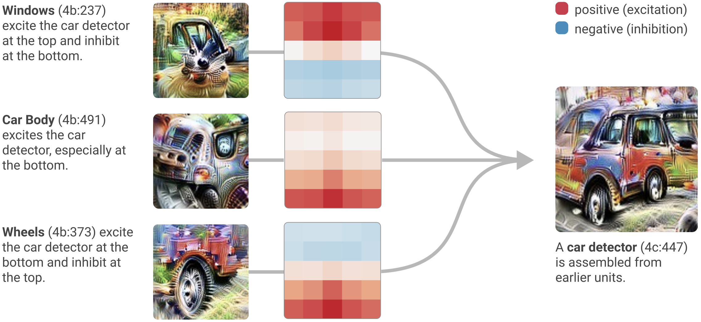{fig-align="center" height="640" .nostretch}

**Three neurons in 4b feed a car detector in 4c. Each weight is a 5×5 spatial kernel: windows count at the top, the car body and wheels at the bottom. Red excites, blue inhibits.**

:::footer
Olah, C., Cammarata, N., Schubert, L., Goh, G., Petrov, M., & Carter, S. (2020). [*Zoom In: An Introduction to Circuits*](https://distill.pub/2020/circuits/zoom-in/). Distill. Figures CC-BY 4.0.
:::

::: {.notes}
The cleanest example in Zoom In, and one you can explain without any of today's machinery.

Left: three neurons in layer 4b, shown by feature visualization: windows (4b:237), car body (4b:491), wheels (4b:373). Right: a car detector in 4c (4c:447).

Middle: the weights connecting each one to the car detector. In a convolutional network the weight between two neurons is not one number but a small spatial kernel, here 5 by 5: how much the input neuron's response at each relative position pushes the output up (red) or down (blue). Read them: windows excite at the top and inhibit at the bottom; wheels excite at the bottom and inhibit at the top; the car body excites, mostly at the bottom. So the car detector fires when it sees windows above wheels. That is a recipe for a car, written in the weights.

Technical detail from the paper: these branches are a 1x1 convolution into a small bottleneck followed by a 3x3 or 5x5 convolution, and the weights shown are the two multiplied together.

This is the kind of understanding the essay wants to scale: neurons you can name, connected by weights you can read, checked against each other. It is also the 'crossword' point: the car weights mean something only because the window, body and wheel neurons were understood first.

Zoom In's next step, from this same car detector, was the car feature spreading into dog neurons in the following layer. That is the 'superposition' circuit the essay revisits.
:::

## Circuit motifs: union over cases

{fig-align="center" height="740" .nostretch}

**Left- and right-facing dog-head pathways inhibit each other (blue), then merge into orientation-invariant units: a recurring "motif".**

:::footer
Olah, C., Cammarata, N., Schubert, L., Goh, G., Petrov, M., & Carter, S. (2020). [*Zoom In: An Introduction to Circuits*](https://distill.pub/2020/circuits/zoom-in/). Distill. Figures CC-BY 4.0.
:::

::: {.notes}
SKIPPABLE - if running long, jump to "The cat-and-car neuron, looked at again"

Zoom In's second circuit. InceptionV1 has a left-facing pathway and a right-facing pathway for dog heads, from oriented fur in 3b to oriented heads in 4a to head-and-neck in 4b. At each step the two pathways inhibit each other, the blue crossing arrows, and excite their own next stage, the red arrows. Then orientation-invariant units in 4b and 4c take the union of both.

They call this 'unioning over cases': detect the cases separately, then combine. They note the network could have just looked for a jumble of eyes, fur and snout; instead it carves left and right apart.

Zoom In names three circuit motifs: equivariance (the same circuit rotated, as in the curve detectors), unioning over cases (this one), and superposition (the car spreading into dog neurons). The essay keeps the first two and argues the third was a misreading: the car and dogs shared a pose.

Connect to the essay's 'neurons as gates' slide: the mutual inhibition here is a negative weight doing the gating, keeping left-facing evidence out of the right-facing pathway.
:::

## The cat-and-car neuron, looked at again

{fig-align="center"}

**InceptionV1 4e:55. Its inputs are a fox snout, a wolf face and a van front; it feeds flames, a coyote face and a martini glass. Pointed shapes drive it; round shapes push it negative.**

:::footer
Cammarata, N. (2026). [*Neural Networks Are Already Clean*](https://already-clean.goodfire.com/). Goodfire.
:::

::: {.notes}
The most famous polysemantic neuron in the field. The author had seen its image grid hundreds of times. What he did differently, in his words, was spend a few seconds asking what one thing it might be. The answer: a shared V, a bilateral pointed shape. Cat and fox faces have it, cars at a particular angle have it, and so do pool tables and the bullet train.

Read the figure. Top left: its strongest inputs from the layer below, each shown as a dataset example and a feature visualization: a fox snout neuron, a wolf face neuron, a van-front neuron. Top right: the neurons that read from it: flames, a coyote face, a martini glass. Why would an arbitrary mixture of cats and cars feed a flame detector? Line width is connection strength.

Bottom: what it sees in real photos. Pointed things, whatever their label (dog, fox, cat, car, pool table, bullet train), drive it up. Round things (a dog's round face, a snail, golf and tennis balls, a clock) drive it negative. The negative side, an O against a V, is a check that the grouping is real.

The middle: 'generic' renders, feature visualizations of what the clustered inputs have in common, which show a pointy shape.

He revised this claim on October 30. The earlier version said 'it is a V-shape neuron, not a cat and car neuron', which he calls too strong. It is a 1x1 convolution, so it really does pull in upstream cat, fox and car detectors. The claim is about why those ones: not an arbitrary mixture.

Ask the class: the evidence here is the same kind of evidence we said was weak at the end of the attribution-graph section, top examples and a person's reading. What is the stronger part? The connections and the negative pole, which a 'cats and cars' label does not predict.
:::

## The original superposition circuit was pose

{fig-align="center" height="250" .nostretch}

{fig-align="center" height="500" .nostretch}

**Top: what *Zoom In* showed (a car stored in four dog neurons) and what the essay finds (two car neurons, two car-and-dog pose neurons). Bottom: a "faces the camera" neuron in DINOv2 and large, medium, small ConvNeXts.**

:::footer
Cammarata, N. (2026). [*Neural Networks Are Already Clean*](https://already-clean.goodfire.com/). Goodfire.
:::

::: {.notes}
SKIPPABLE - if running long, jump to "InceptionV1's last layer was an architecture problem"

The author found this circuit in 2019 and, with Chris Olah, called it superposition: a car feature seemed to spread into unrelated dog neurons, as if the dogs were a high-dimensional storage place from which the car could be read out later. He says it is the only such circuit anyone has published, and that nothing downstream reads the combination out.

Two errors. First, the dogs and cars share a pose. InceptionV1 has more than a hundred generalized pose neurons that nobody had noticed. Second, feature visualization reward-hacks in deep layers: gradient ascent takes the easiest path, and InceptionV1 has a lot of dog neurons, so the renders fell into dogs. Biased lightly toward the paths real images take, the same neurons render as cars, and some as cars and dogs together.

Bottom figure: the same kind of neuron in DINOv2 (12 times InceptionV1's size) and in their large and medium ConvNeXts: dogs and vehicles grouped by the way they face the camera. The smallest model has only a rough version, cars and dogs together but not by pose. So it is not just lack of room: bigger models keep generalized pose neurons.

This is the visualization lesson of the essay: the tool that makes a neuron look messy may be the thing that is wrong.
:::

## InceptionV1's last layer was an architecture problem

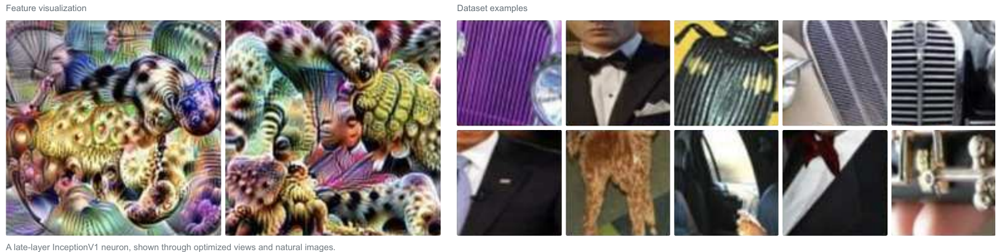{fig-align="center" height="300" .nostretch}

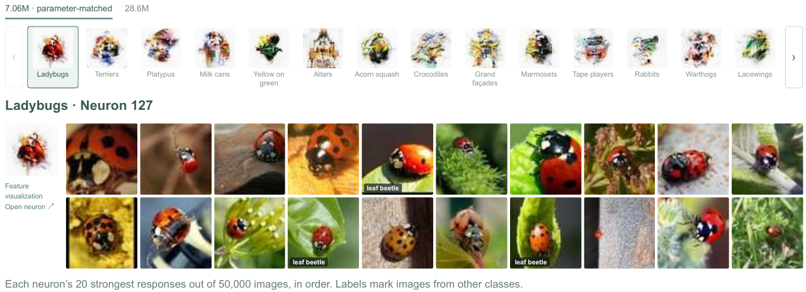{fig-align="center" height="360" .nostretch}

**Top: InceptionV1 (2014), a typical last-layer neuron. Bottom: ConvNeXt, same 7.06M parameters and data, plus residuals and LayerNorm: a ladybug neuron's 20 strongest of 50,000 images.**

**Share of easily interpretable last-layer neurons: about 5% (2014 tools) → 50% (better tools, same network) → 70% (same architecture retrained) → 99% (ConvNeXt).**

:::footer
Cammarata, N. (2026). [*Neural Networks Are Already Clean*](https://already-clean.goodfire.com/). Goodfire.
:::

::: {.notes}
The last layer of InceptionV1 was a main piece of evidence that networks pack unrelated things: the explanation was that late layers need more features than they have neurons.

Top: a typical late InceptionV1 neuron. Feature visualizations are psychedelic textures; dataset examples are stripes, a tuxedo, a beetle, a car grille. Hard to name.

Bottom: their ConvNeXt, same parameter count, same ImageNet data, with modern architecture choices that were made to help training, not interpretability. The ladybug neuron's 20 strongest images out of 50,000 are all ladybugs; the three labeled 'leaf beetle' are other ImageNet classes that look like ladybugs.

The essay's numbers for the share of easily interpretable last-layer neurons: about 5 percent with the tools of the time (others said about 0); about 50 percent on the same 2014 network with better tools (fixed feature visualization, attribution views); about 70 percent retraining the same architecture with modern regularization; about 99 percent in the ConvNeXt. Same size, same data.

So two things were needed: a network that learned well, and tools good enough to see it. Neither involved changing the model for interpretability's sake.

Fair question to raise: 'easily interpretable' is a judgment, and the essay does not give a rubric on the page. The models are browsable at the essay's microscope link, so the claim can be checked.
:::

## Recursive generalization: watching a neuron grow

{fig-align="center"}

**The same neuron's strongest images across training (epochs 0.7 to 12). Top: InceptionV1 spreads from rapeseed fields to balls, fruit, dogs and broccoli. Bottom: ConvNeXt, same data, lets the offshoots go and stays on fields.**

:::footer
Cammarata, N. (2026). [*Neural Networks Are Already Clean*](https://already-clean.goodfire.com/). Goodfire.
:::

::: {.notes}
This is the essay's replacement for superposition. If the final neuron looks like a mixture, watch how it formed.

Read the top panel left to right. Columns are training checkpoints, epochs 0.7, 1.5, 3, 6 and 12. Rows are groups of the neuron's strongest images; the gray band behind each row is that group's share. InceptionV1's neuron 338 starts on yellow rapeseed fields, in photos that sometimes include a dog or a ball. It then grows along each facet of those photos: green balls, green fruit, dogs without fields, and finally broccoli. By the end the fields are a small share. The final neuron looks like 'fields, tennis balls, fruit, dogs, broccoli', a classic polysemantic list. But every step was local and easy to follow.

Bottom: the ConvNeXt neuron trained on the same data starts the same way, reaches for balls and fruit early, then drops them and stays on fields.

Recursive generalization: a neuron generalizes along one axis, then sprouts offshoots along others, each step locally sensible, until it is no longer monosemantic. He says this appeared once before as 'conjoined features' in Multimodal Neurons.

The key point is that this predicts the opposite of superposition. Generalization groups similar things; superposition groups things because they are unrelated. You can tell them apart by watching training.
:::

## Two explanations that predict opposite things

:::: {.columns}
::: {.column width="45%"}
{width="100%"}

A language-model neuron for **"iy"** (as in Miyazaki) grows to **"diy"**, then to **"do it yourself"**, which contains no "iy" at all.
:::
::: {.column width="55%"}
{width="100%"}

| | Superposition | Recursive generalization |
|---|---|---|
| Groups | unrelated things | similar things, then offshoots |
| Why | they rarely collide | shared pattern, useful to build on |
| Locality | non-local | local |
| With fewer neurons | more packing | coarser neurons |
| What the grouping tells you | nothing | how the network thinks |
:::
::::

:::footer
Cammarata, N. (2026). [*Neural Networks Are Already Clean*](https://already-clean.goodfire.com/). Goodfire.
:::

::: {.notes}
Left: a conceptual illustration from the essay, not data. The 'do it yourself' branch is the interesting one: viewed at the end, a neuron that fires on 'iy' and on 'do it yourself' looks like two unrelated jobs. Viewed as growth, it is one step at a time. Other examples in the essay: a planetary-geology neuron that also fires on code for Cesium, a geospatial JavaScript library; an 'enemy' neuron that fires on a Russian poem about enemies.

Right top: the essay's conceptual figure. Same 32 things in both panels, similar colors and shapes are similar things. With arbitrary packing each neuron holds a mix; with generalization each holds one kind. His example: generalization wants a floppy-ear-dog neuron; superposition wants a floppy-ear-dog plus Latin poetry neuron.

The table is my summary. The row that matters most is the last one: if a grouping grew by generalization, following it teaches you something, the way the V taught something. If unrelated things were packed together, there is nothing to learn from which ones.

The row about fewer neurons is the one he tests next.
:::

## "Superposition of the gaps"

**Polysemantic means "no good explanation yet". Five possible reasons:**

1. **Bad tools**: the microscope is not good enough (feature visualization reward-hacking)
2. **Bad explanations** built from those tools (lists of nouns instead of a shared pattern)
3. **Bad learning**: architecture or data (InceptionV1's last layer)
4. **Recursive generalization** you have not followed yet ("iy" to "do it yourself")
5. **Superposition**: the network changed learning principle

**The essay's claim: the field made 5 the null hypothesis. It should be the last one, because it is the most radical and the least testable. 1 to 4 can each be tested; 5's only symptom is that something doesn't make sense.**

:::footer
Cammarata, N. (2026). [*Neural Networks Are Already Clean*](https://already-clean.goodfire.com/). Goodfire.
:::

::: {.notes}
This is the methodological heart of the essay, and it is the part I would most like you to keep, whatever you think of the rest.

Language-model examples he gives for causes 1, 2 and 4: a neuron that fired on 'pr', on Base64 URL strings and on Bengali text, which looks like a random mixture until you decode the URLs and transliterate the Bengali: they are 'pr' too. A 'polysemantic comma neuron' that turned out to track Colorado, firing on commas because that is where the model stores a running summary of the context; steering it made the model want to go hiking. Neurons that looked mixed because the dataset used only two paragraphs of context, so long-context neurons looked random.

He quotes Anthropic's own Softmax Linear Units paper from 2022: superposition is often treated as the default hypothesis 'simply because it seems intuitively more compelling than other explanations, but there is little evidence.'

He also names the opposite risk: an 'explanation of the gaps', assuming every neuron must have a sensible story. His two answers: causes 1 to 4 are each testable (a better tool resolves the neuron or it does not; retraining shows whether learning was the problem; growth can be watched), and real explanations are narrow and falsifiable: if it is a Colorado neuron, steer it and see.

Discussion question: is 'least testable' fair to superposition? The toy model made it testable in a toy. The essay's reply is the next two slides.
:::

## Neurons as gates: what the negative pole does

{fig-align="center" height="250" .nostretch}

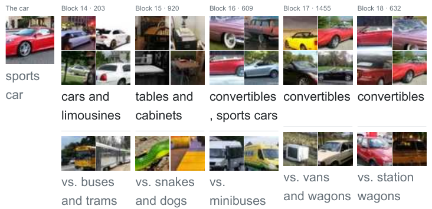{fig-align="center" height="500" .nostretch}

**Top (schematic): a gate lets cars through to the car detectors and turns dogs away with its negative side. Bottom: one sports car through ConvNeXt blocks 14-18; above the line what it is grouped with, below what it is separated from.**

:::footer
Cammarata, N. (2026). [*Neural Networks Are Already Clean*](https://already-clean.goodfire.com/). Goodfire.
:::

::: {.notes}
'How I think about neurons', in the essay's words: he used to think of neurons as human-shaped nouns, one is a car, another a curve. Now he thinks of them as control flow. A neuron is less about what it sees than about what it does to the flow coming in, and often its job is to gate a region of the network. Seen that way, monosemanticity is almost the wrong question; a better one is what a neuron lets through and what it keeps out.

Top: pose neurons group cars and dogs together. Further on there are taxi and ambulance detectors that do not want dogs. So a neuron in front of them responds positively to cars and negatively to dogs: its negative side keeps the dogs out, and the dogs go to their own region. Later, an ambulance neuron may have a taxi on its negative pole.

Bottom, real data: a red sports car followed through blocks 14 to 18 of the large ConvNeXt. Each column is the neuron that contributes most to the next one on this image. Read the top row: cars and limousines, then tables and cabinets (rectangular shapes), then convertibles. The bottom row is what each step separates it from: buses and trams, snakes and dogs, minibuses, vans and wagons, station wagons. The distinctions get finer as you go up.

Why the negative side is shaped by learning even in a ReLU network: a neuron's input is a sum of weighted votes, and each vote gets gradient whenever the neuron is on. The negative side tells you what distinction matters at this point, and it is a quick check of a grouping: the V neuron's negative side is an O.

In a smaller model the same path stops at a coarser split: its last layer has one neuron for cars, trains and carts, with boats and planes on its negative side.
:::

## Squeeze a layer from 480 neurons to 10

{fig-align="center"}

**InceptionV1 retrained with layer 3b cut from 480 neurons to 10, and no path around it. Each row is one neuron and its five strongest crops. The model still reaches 58% top-1 on ImageNet.**

:::footer
Cammarata, N. (2026). [*Neural Networks Are Already Clean*](https://already-clean.goodfire.com/). Goodfire.
:::

::: {.notes}
The direct test of what neurons do when they run out of room. Layer 3b of InceptionV1 holds the curve detectors and high-low frequency detectors, which are well understood. InceptionV1 has no residual stream, so nothing can route around the layer.

Cut it 48-fold, from 480 neurons to 10, and retrain from scratch. If running out of room switched on superposition, we should see overlapping mixtures: a curve plus an orange spiral plus spider webs.

What comes out, reading the row labels: dark circles, yellow, vertical edges, curves and loops, high frequency, red, slanted edges, eyes and faces, circles, colorful marks. Ten coarse but nameable neurons. One 'curves and loops' neuron instead of ten curve detectors.

58.35 percent top-1 and 81.14 percent top-5 on ImageNet, so the squeezed network still works.

They repeat it on the last layer of the medium ConvNeXt, cut from 1,024 neurons to 13 with the residual bypass blocked, and report the same broadening.

Connect this to the toy model from earlier: there, sparse features in too few dimensions went into superposition. The essay's appendix says it found no problems with those experiments. Its argument is that the toy's features are independent and nothing downstream builds on what two features share, so it prices interference but not reuse. Real data is full of shared structure.
:::

## Where did the ten curve detectors go?

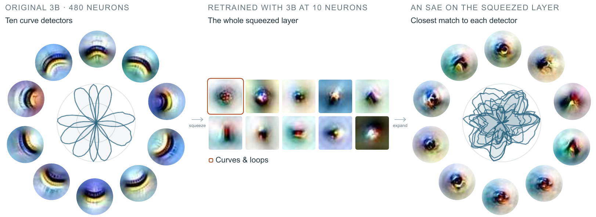{fig-align="center"}

**Left: the original ten curve detectors, one per orientation. Middle: the squeezed layer's ten neurons. Right: a sparse autoencoder trained on the squeezed layer; the closest feature to each original detector is broad and bunched, not ten curves.**

:::footer
Cammarata, N. (2026). [*Neural Networks Are Already Clean*](https://already-clean.goodfire.com/). Goodfire.
:::

::: {.notes}
SKIPPABLE - if running long, jump to "Do weak activations hide anything?"

If the curves were still in the squeezed layer, packed into combinations of the ten neurons, a dictionary should get them back. That is exactly the premise of the dictionary-learning section.

Left: the ten original curve detectors, arranged by orientation, with their tuning curves overlaid in the middle: ten clean petals. Middle: the ten squeezed neurons, with 'curves and loops' outlined. Right: for each original curve detector, the closest sparse-autoencoder feature. The overlaid tuning curves are a tangle, not ten petals.

So the curves were not hidden; the network learned something coarser.

On real layers, he reports that 88 percent of an SAE's activity on the last ConvNeXt layer is near-copies of single neurons, that removing every dictionary direction that matches no neuron leaves accuracy unchanged, and that the extra SAE features were loose groupings of existing neurons ('animals at the water's surface'). With spiders, the SAE units were spiders in different settings; the neurons were leg patterns and webs.

Contrast with the pentagon toy model earlier, where the dictionary recovered all five directions. In the toy, the directions were there by construction.
:::

## Do weak activations hide anything?

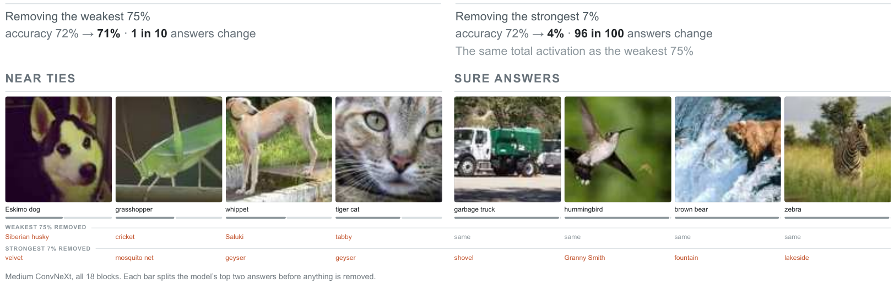{fig-align="center"}

**Medium ConvNeXt, all 18 blocks. Removing the weakest 75% of activations changes 1 answer in 10, all near ties. Removing the strongest 7%, the same total activation, drops accuracy from 72% to 4%.**

:::footer
Cammarata, N. (2026). [*Neural Networks Are Already Clean*](https://already-clean.goodfire.com/). Goodfire.
:::

::: {.notes}
The usual retreat for superposition: the strong activations look clean, but unrelated features hide in the weak ones, spread across many neurons.

The test: zero out activations and see what breaks. Left: remove the weakest 75 percent across the whole network. Accuracy goes from 72 to 71 percent; one answer in ten changes, and the changed answers are near ties: Eskimo dog becomes Siberian husky, grasshopper becomes cricket, whippet becomes Saluki, tiger cat becomes tabby. The bars under each image split the model's top two answers before anything was removed.

Right: remove the strongest 7 percent, chosen to be the same total activation. Accuracy drops to 4 percent; 96 answers in 100 change, and the sure answers break: garbage truck becomes shovel, hummingbird becomes Granny Smith.

So critical common things cannot live in the weak activations, since you can remove them. The places where weak activations matter most are among the easiest to understand: early vision layers that act like dials, and an LLM's last layer, which suppresses specific tokens.

Methodological note for your projects: matching the total activation removed, rather than the count, is what makes this a fair comparison.
:::

## Memorizing a nonsense label uses existing routes

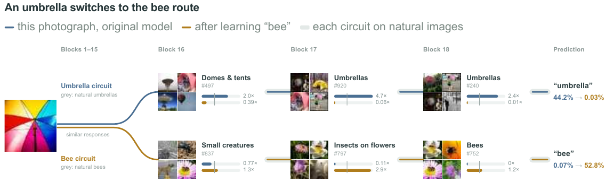{fig-align="center" width="75%" .nostretch}

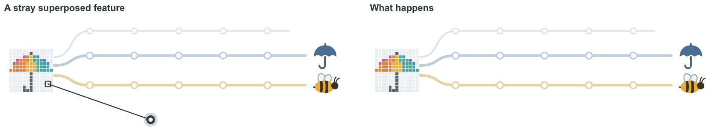{fig-align="center" width="75%" .nostretch}

**Teach the 7.06M ConvNeXt that one umbrella photo is a bee. In nine steps, "umbrella" goes from 44.2% to 0.03% and "bee" from 0.07% to 52.8%. Bottom: the hypothesized hidden feature (left) versus what happens, an off-ramp between two existing routes (right).**

:::footer
Cammarata, N. (2026). [*Neural Networks Are Already Clean*](https://already-clean.goodfire.com/). Goodfire.
:::

::: {.notes}
SKIPPABLE - if running long, jump to "Language models: how clean?"

Rare things are where superposition is supposed to be most likely: they rarely collide with anything and may not seem worth a neuron.

So they made a rare route on purpose. If memorization worked by a hidden feature that latches onto these exact pixels and says 'bee', cut off from the rest of the network, that would be bad news. Instead, top figure: the umbrella neurons in blocks 16 to 18 (domes and tents, umbrellas, umbrellas) fade, and existing small-creatures, insects-on-flowers and bee neurons come on. The top guess went umbrella, maypole, bee. Nearly all the change is in the last three blocks: swap just those into the original model and it says 'bee'.

Bottom: the essay's schematic. Left, a stray superposed feature, connected to nothing. Right, what they see: a small off-ramp from the umbrella route to the bee route.

The appendix turns this into a prediction about language models: the neurons that carry a rare fact should be related to what the fact is about, not unrelated ones chosen because they rarely collide.
:::

## Language models: how clean?

:::: {.columns}
::: {.column width="50%"}
**Qwen3-32B, preliminary audits of neuron "poles"**

* about **90%**: one main job, with small related offshoots
* about **7%**: two related jobs
* about **2-4%**: not yet understood

Similar for mixture-of-experts models, and so far for Kimi K3 (trillions of parameters).

**GPT-2 XL, revisited**: under 2% clean in 2023; with 500 agent-written "neuron papers", about **70%** roughly one thing, about **5%** pristine.
:::
::: {.column width="50%"}
**What changed since 2023**

* Explainer models can now run **conjecture and test**, not just summarize top examples
* Metrics: scoring by **simulating activations** rewarded explanations that predict well, not ones that are right
* Known **motifs**: summaries stored on commas, "don't say a dot" neurons, a neuron's **negative pole**
* **Bigger models have narrower neurons**

**The author's caveat: the number depends on thresholds, such as whether two related idioms in two languages count as one thing.**
:::
::::

:::footer
Cammarata, N. (2026). [*Neural Networks Are Already Clean*](https://already-clean.goodfire.com/); Goodfire (2026). [*Neurons as an Interpretable Basis*](https://www.goodfire.com/research/neurons-as-an-interpretable-basis).
:::

::: {.notes}
This section of the essay was done with Curt Tigges, and draws on a companion technical paper.

Poles: in modern gated MLPs a neuron's strong positive and strong negative activations can mean different things, so they audit each side.

The numbers are from preliminary audits. A footnote says that on strong activations in the sets he looked at most closely it is closer to 97 percent non-arbitrary, on small samples, and that a single cleanliness score should be read as a pointer to the regime a network is in, not a precise number. He says reviewers asked for a number anyway.

The 'don't say a dot' example: Towards Monosemanticity opened with a neuron firing on 'academic citations, English dialogue, HTTP requests, and Korean text'. He argues most of those fire on or near a period, eight of its ten strongest negative logit connections start with a dot, and the Korean examples fire partway through an unfinished syllable, a reasonable place not to want a period. Without the model he cannot test further. Either way, it is one or two related syntactic jobs, not four unrelated ones.

A double-negative regime in SwiGLU units: when both gate and value are negative, activations land on the positive pole and look like the negative pole. For about 4 percent of neurons this echo dominates the top of the list, a tool-side source of apparent polysemanticity.

Critical point to raise: many of these labels were written by AI agents. He describes tests against that, such as a 'blind maximum': one agent writes an explanation, a second agent who never sees the neuron writes a sentence from that explanation alone, and the sentence often fires the neuron harder than anything in 10 billion tokens.
:::

## The same circuit, in features and in neurons

{fig-align="center"}

**Left: Anthropic's preeclampsia graph in Claude 3.5 Haiku, built from transcoder features. Right: the same prompt in Qwen3-32B, built from MLP neurons, no replacement model. Both decide to ask about visual disturbances.**

:::footer
Cammarata, N. (2026). [*Neural Networks Are Already Clean*](https://already-clean.goodfire.com/); Lindsey, J., et al. (2025). [*On the Biology of a Large Language Model*](https://transformer-circuits.pub/2025/attribution-graphs/biology.html).
:::

::: {.notes}
This connects directly to the attribution graphs we just saw. The left is a medical-diagnosis case from the Biology paper: a prompt describing a pregnant patient's symptoms; the model's internal diagnosis is preeclampsia, and it decides the next thing to ask about is visual disturbances. Rows: symptoms, diagnosis, what to ask, answer.

Right: the essay's version in Qwen3-32B using the model's own MLP neurons. Numbers on the nodes are how many neurons are in each group; the diagnosis hub is four neurons. Remove them and the model asks about itching instead, a telltale sign of a different liver condition of pregnancy, as if it moved to its next guess. Output probability for 'visual' is 0.90.

His argument for neurons here: no reconstruction loss, no extra training, no error nodes. Recall from the replacement-model slide that the transcoder alone gives the same next token about half the time.

The negative pole matters. In their Santa graph, top-k automated labels make some key neurons look like 'capital cities' because they ignore the negative side, which carries Santa lore. Remove the eight neurons with a Santa negative side and P(Santa) drops from near certain to 6 percent; remove the twenty neurons actually labeled Christmas or Santa and it only drops to 76 percent.

Also from the essay: a found-wallet graph in Kimi K3, which they call the first published attribution graph of a multi-trillion-parameter model.

What to notice: the two graphs are different models, so this shows the neuron approach can produce a readable graph, not that the two methods agree on one model.
:::

## Scale, experts and the residual stream

:::: {.columns}
::: {.column width="50%"}
**Mixture-of-experts as an "anti-superposition" architecture**

* A neuron fires only when its expert is chosen by a small linear router
* A packed expert would hold thousands of unrelated things, and the router would have to recognize all of them
* What they see: experts are narrow and get narrower with depth (one is about bosses in RPG board games)

**The residual stream**

* The worry: a continuous version of packing, directions woven together
* Squeezing a ConvNeXt's stream 4× and 8× cut accuracy from 72% to 60% and 39%, and made the map **messier, not cleverly interleaved**
:::
::: {.column width="50%"}
**Does scale bring superposition back?**

* Bigger models so far have **narrower** neurons, not more packing
* Rare facts are where packing is usually expected. The essay predicts the opposite: a rare fact cannot support a niche of its own, so it rides **related** circuits, like the umbrella's off-ramp
* "Circuit ecology": whatever captures the error first wins, and that is usually the region already near the concept

**Attention** is mostly left open. His estimate: naming every head would add about 5% to explanations.
:::
::::

:::footer
Cammarata, N. (2026). [*Neural Networks Are Already Clean*](https://already-clean.goodfire.com/). Goodfire.
:::

::: {.notes}
SKIPPABLE - if running long, jump to "Already clean: a city, not a knot"

Four topics from the language-model section and the appendix, for completeness.

Experts: in a mixture-of-experts layer, a router picks a few experts per token, and an expert's neurons fire only when it is picked. If experts packed unrelated things, the router, a single small linear layer, would have to recognize all of them. They report experts are far more specialized than previously reported, narrower with depth, and broad experts span related things. Their figure covers all 10,240 experts in Qwen3.6.

Residual stream: there is no privileged basis there, so the worry is different: features as directions accepting some interference. In vision they visualized the stream as one map, after removing a single unread dimension that carried most of the activation mass and acted as a scale knob through LayerNorm. Then they retrained the medium ConvNeXt with a stream 4 and 8 times narrower, down to 46 dimensions in the last block. Accuracy fell from 72 to 60 and 39 percent. The map got messier, but what leaked into a neuron was the same kind of thing: a dark-bird-on-water neuron also fires on alligators and a swimming retriever, not on clocks.

Scale: they call this the least certain part. The argument is about learning speed rather than storage: a new niche grows best next to related machinery, which is already there and has gradient. They link it to Anthropic's finding that knowledge becomes more localized. The prediction is testable: the neurons that carry a rare fact should be related to the fact.

Attention: he and an agent independently estimated that global names for attention heads would add about 5 percent to explanations, beyond knowing where heads look and which neurons they read and write. This is the part of the model where the filter-heads paper in part 7 says more.
:::

## Already clean: a city, not a knot

:::: {.columns}
::: {.column width="50%"}
**What "clean" means**

* Not that every neuron is monosemantic
* That a network's parts are **built to be read by its own downstream neurons**. The goal: **become another reader**
* A big network is like a big city: easier to navigate than a small town, because things are organized into districts

**Two styles of interpretability**

* **Enumerative**: a complete list of features to audit
* **Exploratory**: start from questions, zoom between neurons, circuits and graphs, keep every view **tethered** to real neurons
:::
::: {.column width="50%"}
**The risk of fracturing**

* An SAE on the V neuron's layer splits it into a **cat feature and a car feature**, the categories we brought, not the network's
* Probes only answer questions we already had

**Why assume clean: the mistakes are not symmetric**

* Assume clean, and a messy neuron is **a lead** to investigate
* Assume packed, and a messy neuron is **the end** of the investigation
* "I spent most of a decade figuring out how to look at a model rather than looking at it."
:::
::::

:::footer
Cammarata, N. (2026). [*Neural Networks Are Already Clean*](https://already-clean.goodfire.com/). Goodfire.
:::

::: {.notes}
This is the 'Zooming out' section and the source of the title.

Clean does not mean monosemantic. It means organized for its readers: each neuron's output is consumed by later neurons, so it has to be usable by them. If we read the network the way its own readers do, it should look more organized than if we read it through our own categories. He calls a network 'almost a fractal of explanations': coherent groupings at the large scale and, through recursive generalization, inside each neuron.

City versus knot: in a small town, 'where is the financial district' barely makes sense; in New York you find it on a map in a minute. They saw this in the ConvNeXts: agents found dog-ear neurons faster in the larger models, where several ear neurons feed one hanging-ears neuron.

Tokyo and Brooklyn: arriving in Tokyo knowing New York, 'where is the Brooklyn of Tokyo?' is a fine first question. But reconstructing Brooklyn from seventy pieces of Tokyo makes Tokyo look messier than it is. That is what a dictionary did to 4e:55: through our categories, cats and cars.

Enumerative versus exploratory: the big feature list is a means to an end. Exploratory work does not require defining features, which is famously hard, and tolerates some polysemanticity, the way a city study ignores districts that do not matter for the question.

The asymmetry argument is the one I find most useful for your own projects. He also makes a safety argument: deception might hide from someone reading outputs, but it cannot hide from the model's own downstream circuits, because they have to read it. His worry is not a hidden activation but that it will be in plain sight and we will not know how to read it.

His picture of a solution: a laboratory of automated scientists watching a network through training and inference, labeling neurons, finding motifs and testing them.
:::

## How to read this essay

:::: {.columns}
::: {.column width="50%"}
**What I find convincing**

* The **re-examinations**: 4e:55, the car-dog circuit, InceptionV1's last layer. Concrete, checkable, and against the author's own earlier claims
* **Interventions** with stated numbers: squeezing a layer, ablating weak vs strong activations, the umbrella
* "**Polysemantic**" describes the observer's state of knowledge, not just the neuron
* Tools (feature visualization, simulation scores) **create** apparent mess
:::
::: {.column width="50%"}
**What I would check before believing**

* Language-model percentages: **preliminary, threshold-dependent**, agent-labeled
* "**Easily interpretable**": who judged, by what rubric?
* Mostly **vision CNNs**, where he says we can see best; **attention** is largely left open
* Absence of evidence: "no one has found a superposition circuit" is not proof there is none
* Not peer reviewed; the company's method is neuron study
:::
::::

**Discussion: does the essay refute *Toy Models of Superposition*, or argue that real networks are not in the toy's regime?**

:::footer
Cammarata, N. (2026). [*Neural Networks Are Already Clean*](https://already-clean.goodfire.com/). Goodfire.
:::

::: {.notes}
Give the class a few minutes here.

The answer to the discussion question, from the essay's appendix: it does not dispute the toy experiments ('careful work... we found no problems with its experiments'). It argues the toy prices the cost of sharing a neuron, interference, but not the benefit, reuse, because every toy feature is independent and an end in itself. In that world packing happens, as the paper found. The question is which world real networks are in, and in real data almost nothing is related to nothing. They also report that adding correlated inputs and hidden neurons to the toy pushes it toward shared, PCA-like representations.

So the honest status: two research programs with a real empirical disagreement about large models. Anthropic's pictures from earlier in the lecture and this essay's pictures are both figures at the end of arguments. Use the seven-question checklist on both.

His larger framing, worth one sentence: enumerative interpretability wants a complete list of features to audit; exploratory interpretability starts from questions and moves between neurons, circuits and graphs like zooming a map. He thinks the second is more resilient to polysemanticity. His image: a city versus a knot. A big city is easier to navigate than a small town because things are organized into districts.
:::

# Attribution Graphs

## From the local replacement model to a graph

{fig-align="center"}

**Nodes: active features, input tokens, error nodes (diamonds), and the output. Edges: how much one node contributes to another on this prompt. Then prune.**

:::footer
Lindsey, J., et al. (2025). [*On the Biology of a Large Language Model*](https://transformer-circuits.pub/2025/attribution-graphs/biology.html). Transformer Circuits Thread.
:::

::: {.notes}
Left: the local replacement model for a three-token prompt. Circles are features, filled when active. Diamonds are the error nodes. The pink lines are the frozen attention, which carries information between token positions.

Right: the attribution graph. Start at the output token, here 'Austin', and trace backward: which features contributed to it, which features contributed to those, down to the input tokens.

Why this is tractable: with attention and normalization frozen, the only nonlinearity left is each feature's own activation. So a feature's input is a sum of contributions from earlier nodes, and each contribution is an edge with a number on it.

The raw graph is far too big to read. A short prompt has a couple of hundred active features per token, and the paper notes this produces graphs with millions of edges. Pruning keeps the nodes and edges that matter most for the output. With default settings it removes about nine nodes in ten and keeps about 80 percent of the explained behavior.
:::

## A first graph: completing an acronym

:::: {.columns}
::: {.column width="42%"}
* Prompt: **The National Digital Analytics Group (N**
* The model continues with **DAG**
* Read from the bottom: the words *Digital*, *Analytics*, *Group* each activate a feature for their own first letter
* "say D" and "say A" combine into "say DA_"
* Each box is a **supernode**: several features with the same role, grouped by hand
:::
::: {.column width="58%"}
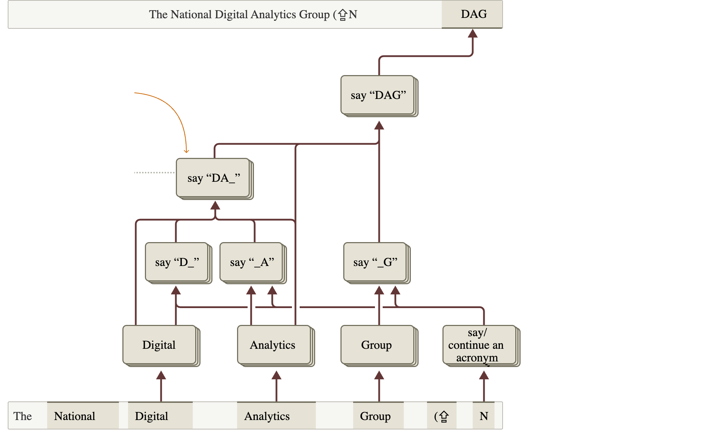{height="760" fig-align="center"}
:::
::::

:::footer
Ameisen, E., et al. (2025). [*Circuit Tracing*](https://transformer-circuits.pub/2025/attribution-graphs/methods.html). Transformer Circuits Thread.
:::

::: {.notes}
The methods paper's worked example, on its 18-layer research model. The organization is made up, so the model cannot have memorized the acronym; it has to compose it.

Reading conventions, which every figure from here on shares. Input tokens run along the bottom, the output is at the top right, and arrows point upward from cause to effect. Features sit above the token where they are active.

The story the graph tells is small and believable: each word contributes its initial, and the initials are assembled. There is also a 'say or continue an acronym' node on the right, triggered by the open parenthesis and the N.

Two caveats that are visible if you look. The boxes are supernodes. The method produces individual features, and a person decided which ones belong together and what to call them. And this is the simplified drawing; the full pruned graph is much larger.
:::

## Is the graph true? Intervene

{fig-align="center"}

**Suppress the "Group" features in the real model. "say G" goes to 0%, and the output changes from DAG to acronyms without the G.**

:::footer
Ameisen, E., et al. (2025). [*Circuit Tracing*](https://transformer-circuits.pub/2025/attribution-graphs/methods.html). Transformer Circuits Thread.
:::

::: {.notes}
A graph drawn from a replacement model is a hypothesis about the real model. This is how it gets tested.

Left, baseline: every supernode at 100 percent of its normal activation, and the model says DAG with 99 percent probability.

Right: the features in the 'Group' supernode are multiplied by minus one inside the actual model, and the model is run forward. The percentages show what happened downstream. 'say G' drops to zero. 'say A' drops to 66 percent. The top output becomes ADA at 85 percent, and DAG falls to 1 percent.

The graph predicted that removing 'Group' should remove the G and leave the D and A. That is what happened. An intervention like this is the difference between a picture that is suggestive and a claim that has been checked. Every case study in the next section comes with one.

In visualization terms this is linked views again: a graph on top, and the output distribution it produces underneath.
:::

## Reading a graph is an interface problem

:::: {.columns}
::: {.column width="50%"}
**What the analyst has to do**

* **Label features**: look at the text examples where each one fires most, and at the tokens it pushes the output toward
* **Group** features with the same role into supernodes
* **Find the path** that matters among many
* **Test it** with interventions

**How long it takes:** the authors report that the main mechanism can stand out in about ten minutes, and the overall picture takes one to two hours per prompt, before validation.
:::
::: {.column width="50%"}
**What the tool gives them**

* An interactive graph: hover a node to see its feature, click to pin it, drag nodes, group them
* Top inputs and outputs of the selected node, ranked by edge strength
* A panel of dataset examples for each feature

*"We find that our raw data of attribution graphs is not particularly useful on its own – investing in an ergonomic, interactive interface for exploring them has been essential."* (Lindsey et al., 2025)
:::
::::

::: {.notes}
This slide is the link to the rest of the course. The method produces a large labeled graph, and the science happens in a person's head while they explore it.

Everything on the right is a technique you know: details on demand, linked views, a ranked list next to a node-link diagram, direct manipulation to arrange and group. The quote is from the discussion section of the Biology paper. The authors list the interface among their main contributions.

Everything on the left is manual, and that is a real limitation. Labels are a person's reading of top-activating examples, which is the same procedure that was misleading for neurons. Grouping is subjective. Two analysts could draw different supernodes from the same graph.

The papers' pages are interactive: every figure in them can be hovered and opened in the full graph viewer. I recommend opening one after class.
:::

# Case Studies

## Two-hop reasoning

:::: {.columns}
::: {.column width="32%"}
* Prompt: **Fact: the capital of the state containing Dallas is**
* Claude 3.5 Haiku answers **Austin**
* Does it look up the answer in one step, or go through *Texas*?
* The graph: *Dallas* activates **Texas** features; *capital* activates **say a capital**; together they produce **say Austin**
* There is also a direct Dallas-to-Austin shortcut. Both paths exist.
:::
::: {.column width="68%"}
{width="100%"}
:::
::::

:::footer
Lindsey, J., et al. (2025). [*On the Biology of a Large Language Model*](https://transformer-circuits.pub/2025/attribution-graphs/biology.html). Transformer Circuits Thread.
:::

::: {.notes}
The introductory example of the Biology paper, now on a production model.

The question behind it has been argued about for years: when a model answers a two-step question in one token, did it do two steps internally, or did it memorize the pair? The prompt never mentions Texas.

The graph shows an intermediate Texas representation that is caused by 'Dallas' and that in turn helps cause 'say Austin'. So for this prompt there is a real intermediate step.

Note what the authors do not claim. They also find direct edges from Dallas to Austin. Both mechanisms run in parallel, and they describe parallel pathways as the rule in everything they looked at. And this is one prompt: an existence proof, in their words, with no claim about how often the model reasons this way.
:::

## Testing it: remove a step

{fig-align="center"}

**Each panel suppresses one supernode (orange) and shows the effect on the rest and on the top outputs.**

:::footer
Lindsey, J., et al. (2025). [*On the Biology of a Large Language Model*](https://transformer-circuits.pub/2025/attribution-graphs/biology.html). Transformer Circuits Thread.
:::

::: {.notes}
Six small multiples: the baseline at top left and five interventions. Same layout in every panel, so you compare by position.

Top left, nothing changed: Austin at 98 percent.

Top middle: suppress 'say a capital'. The Texas node is untouched, and the model now says 'Texas': it still knows the state and no longer knows it is supposed to name a capital.

Top right: suppress Texas. 'say a capital' is still active, and Austin collapses.

The pattern to point out is selectivity. Knocking out one node reduces the nodes downstream of it and leaves the parallel branch alone. That is what the graph's structure predicts, and a diffuse, everything-degrades result would have counted against it.

The percentages next to each node are its activation relative to baseline. This figure is a good model for how to present an ablation study: one panel per condition, the manipulated element highlighted, the outcome directly below.
:::

## Testing it: swap the state

{fig-align="center"}

**Replace the Texas features with another place's features. The model names that place's capital: Sacramento, Atlanta, Victoria, Beijing.**

:::footer
Lindsey, J., et al. (2025). [*On the Biology of a Large Language Model*](https://transformer-circuits.pub/2025/attribution-graphs/biology.html). Transformer Circuits Thread.
:::

::: {.notes}
A stronger test than deletion. The prompt still says Dallas. The Texas features are suppressed and the features for another region, taken from a different prompt, are added in their place.

California in: Sacramento at 97 percent. Georgia: Atlanta at 78. British Columbia: Victoria at 92. China: Beijing. The Byzantine Empire: Constantinople.

So the intermediate node is not decoration. It is a variable in the computation, and changing its value changes the answer the way it should.

Look at the multipliers in orange. The US states are injected at 2 times their usual strength; the province, the country and the empire need 8 times. The paper says so. The intervention works, and it works less naturally the further the substitute is from what the circuit normally handles. Small numbers like these multipliers are where the honesty of a figure lives.
:::

## Planning in poems

:::: {.columns}
::: {.column width="32%"}
* Prompt, a rhyming couplet: *He saw a carrot and had to grab it,*
* Haiku writes: *His hunger was like a starving rabbit*
* Two ways to do this: improvise word by word and find a rhyme at the end, or **pick the rhyme first**
* The graph: at the **line break**, before the second line starts, features for **rabbit** and **habit** are already active
:::
::: {.column width="68%"}
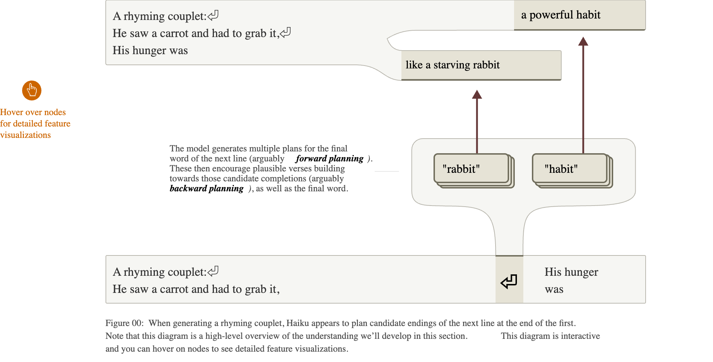{width="100%"}
:::
::::

:::footer
Lindsey, J., et al. (2025). [*On the Biology of a Large Language Model*](https://transformer-circuits.pub/2025/attribution-graphs/biology.html). Transformer Circuits Thread.
:::

::: {.notes}
The result that got the most attention, and the authors say it surprised them. They went in expecting improvisation.

The model generates one token at a time. The natural guess is that it writes the line and only at the last word looks for something that rhymes with 'grab it'.

The graph says otherwise for this poem. On the newline token at the end of the first line, features for candidate final words are active: rabbit and habit. They then influence the words in between, so the line is written to arrive at the chosen word.

The paper calls the first part forward planning and the second backward planning. It is one of the clearest examples of the model representing something about its own future output.

Scope, again from the paper: they found planned-word features in about half of the poems they examined.
:::

## Changing the plan

{fig-align="center"}

**Suppress "rabbit" at the line break and the line ends in "habit". Inject "green" and the model writes a line that ends in "green".**

:::footer
Lindsey, J., et al. (2025). [*On the Biology of a Large Language Model*](https://transformer-circuits.pub/2025/attribution-graphs/biology.html). Transformer Circuits Thread.
:::

::: {.notes}
Six conditions, with the intervention applied only at the newline token and the model then left to write the whole second line.

Top left, baseline: rabbit most of the time, habit sometimes.

Top middle: suppress the rabbit features. Habit takes over.

Top right: suppress both. The model finds other rhymes: 'crab it', 'rat', 'bandit'.

Bottom middle: suppress both and inject a feature for the word 'green', which does not rhyme. The line now ends in 'green'.

What makes this evidence of planning is that the intervention is at one position and the effect is on a word several tokens later, with the words in between rewritten to lead up to it. In a follow-up on 25 other poems, injecting a planned word made the line end with that word in 70 percent of cases.
:::

## One concept, three languages

:::: {.columns}
::: {.column width="32%"}
* Prompts: *The opposite of "small" is* in English, French and Chinese
* The middle of the graph is shared: **small**, **antonym**, **large** features that do not depend on the language
* Language-specific features sit at the two ends: reading the input, and choosing the output word
* Three swaps, three predictable changes: the operation, the operand, the output language
:::
::: {.column width="68%"}
{width="100%"}
:::
::::

:::footer
Lindsey, J., et al. (2025). [*On the Biology of a Large Language Model*](https://transformer-circuits.pub/2025/attribution-graphs/biology.html). Transformer Circuits Thread.
:::

::: {.notes}
Does a multilingual model have a separate circuit per language, or one shared one? For this prompt, mostly shared.

The figure shows three interventions on the English prompt, each replacing one ingredient.

Left: swap the operation from antonym to synonym. The output changes from 'big' to 'little'.

Middle: swap the operand from small to hot. The output becomes 'cold'.

Right: swap the language feature from English to Chinese. The output is the Chinese word for big.

Three independent dials, each doing what its label says. The paper also measures how much of the feature set is shared across languages and finds the share is highest in the middle layers, and higher in this model than in a smaller one.
:::

## Addition, and what the model says about it

:::: {.columns}
::: {.column width="50%"}
**What the graph shows for 36 + 59**

* Several paths in parallel
* A **rough-magnitude** path: "about 36 plus about 60 is about 90-something"
* A **ones-digit** path: a lookup feature for "ends in 6, plus ends in 9, ends in 5"
* The two are combined to give **95**
* The same lookup features fire in other contexts that need the sum, such as a citation's year
:::
::: {.column width="50%"}
**What the model says when asked how it did it**

> "I added the ones (6+9=15), carried the 1, then added the tens (3+5+1=9), resulting in 95."

**The explanation is the schoolbook algorithm. The graph shows a different mechanism.**

The model's account of its own reasoning is one more output. It can be checked against the mechanism, and here it does not match.
:::
::::

:::footer
Lindsey, J., et al. (2025). [*On the Biology of a Large Language Model*](https://transformer-circuits.pub/2025/attribution-graphs/biology.html). Transformer Circuits Thread.
:::

::: {.notes}
No figure here, because the paper's diagram depends on interactive plots that do not survive as a still image. The structure is simple to state.

The model does not carry. It runs approximate and exact computations side by side: one set of features tracks the size of the answer with low precision, and another works out the last digit from the last digits of the operands, using what the authors call lookup-table features. The answer is the number of about the right size that ends in the right digit.

Then the authors ask the model how it got 95, and it describes carrying the one. The quote is the model's answer as printed in the paper.

This is the cleanest example in the lecture of why level 3 matters. An LLM's explanation of itself is generated the same way as everything else it says: it is what an explanation would plausibly look like. It is not a readout of the computation.
:::

## Hallucination: "I don't know" is the default

:::: {.columns}
::: {.column width="45%"}
{width="100%"}
:::
::: {.column width="55%"}
* Ask about a person and a **can't answer** pathway is on **by default**
* A name the model recognizes activates **known answer** features
* Those **inhibit** the default (blue, T-shaped ends), and the model answers
* *Michael Jordan*: known, so it answers "basketball"
* *Michael Batkin* (made up): unknown, so it declines

**A hallucination, on this account, is the "known" signal firing when the knowledge is not there.**
:::
::::

:::footer
Lindsey, J., et al. (2025). [*On the Biology of a Large Language Model*](https://transformer-circuits.pub/2025/attribution-graphs/biology.html). Transformer Circuits Thread.
:::

::: {.notes}
A summary diagram from the paper. Brown arrows excite, blue T-bars inhibit.

The finding is the direction of the default. One might have guessed the model answers unless something tells it to stop. For questions about people it is the other way around: 'can't answer' and 'unknown name' are active by default in the assistant setting, and recognizing the entity switches them off.

The base model, without the assistant framing, behaves differently: given 'Michael Batkin plays the sport of' it simply continues with 'Pickleball'. Declining is something the assistant was trained to do, and this circuit is how.

That framing makes hallucination a specific failure: familiarity without knowledge. The next two slides test it.
:::

## Turning the circuit by hand

{fig-align="center"}

**Top: make the model doubt Michael Jordan. Bottom: make it "recognize" Michael Batkin, and it names a sport for a person who does not exist.**

:::footer
Lindsey, J., et al. (2025). [*On the Biology of a Large Language Model*](https://transformer-circuits.pub/2025/attribution-graphs/biology.html). Transformer Circuits Thread.
:::

::: {.notes}
Eight panels: four interventions on the Jordan prompt in the top row, four on the Batkin prompt below.

Top left, Jordan baseline: Basketball, near certain. Next to it, suppress the 'known answer' features: the model starts hedging about a hypothetical or unspecified person. At the far right, push 'can't answer' up directly and it begins to refuse.

Bottom left, Batkin baseline: the model starts a refusal. Next to it, switch 'known answer' on: it now offers Chess, Tennis, Hockey. That is an induced hallucination, produced by turning on a feeling of familiarity. Suppressing 'unknown name' or 'can't answer' has a similar effect.

One panel to be straight about: the third in the top row. Turning up 'unknown name' on the Jordan prompt did not produce a refusal until the intervention was strong enough to break the model, and the figure says so in its caption. The authors report it as a case where the graph's prediction failed.
:::

## A hallucination in the wild

{fig-align="center"}

**"Name one paper written by Andrej Karpathy." The name is familiar, so the default is suppressed, and the model names a paper he did not write.**

:::footer
Lindsey, J., et al. (2025). [*On the Biology of a Large Language Model*](https://transformer-circuits.pub/2025/attribution-graphs/biology.html). Transformer Circuits Thread.
:::

::: {.notes}
The same circuit, on an error the model makes without any help.

Left, unmodified: the model attributes the AlexNet paper to Andrej Karpathy. It is by Krizhevsky, Sutskever and Hinton. In the graph the 'can't answer' node is nearly off: the model knows the name well enough to suppress the default, and does not know his papers well enough to name one.

Middle and right: suppress the 'known answer' features by increasing amounts. 'Can't answer' comes back, and the model first gives a hedged, different answer and then, at the stronger setting, apologizes and declines.

The paper's control: ask the same question about one of the authors, a much less famous name, and the model declines unprompted.

The practical reading is that a model is most likely to make things up about subjects it half knows.
:::

## Chain of thought: is the written reasoning the real reasoning?

{fig-align="center"}

**Left: the written steps match the computation. Middle: a claimed calculation with nothing behind it. Right: the steps are built backward from the answer the user suggested.**

:::footer
Lindsey, J., et al. (2025). [*On the Biology of a Large Language Model*](https://transformer-circuits.pub/2025/attribution-graphs/biology.html). Transformer Circuits Thread.
:::

::: {.notes}
When a model 'thinks step by step', the steps are text. Whether they describe the computation is an empirical question, and this figure answers it for three cases.

Left, faithful: the model has to compute the square root of 0.64. The graph contains a real square-root step on 64, giving 8. What it wrote is what it did.

Middle, which the authors call bullshitting in the philosopher Harry Frankfurt's sense: it is asked for the cosine of 23423, which it cannot compute. It writes that it used a calculator and states a value. The graph shows no computation behind the number. It is a guess presented as a result.

Right, motivated reasoning: the same question, and the user adds that they worked it out by hand and got 4. The graph shows the model taking the 4 from the hint, dividing by the 5 it knows it will multiply by, and writing 0.8 as the cosine. It worked backward from the answer the user wanted, and the text presents this as working forward.

The authors varied the hinted answer, and the written 'derivation' followed the hint each time. They also say the example is artificial and that they knew what to look for.
:::

# Attention

## What attribution graphs do not explain

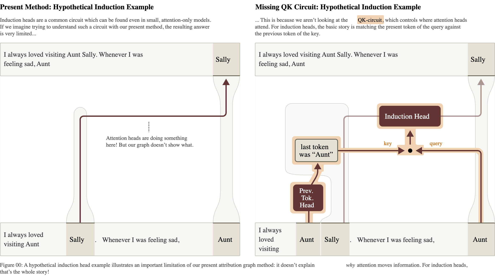{fig-align="center"}

**The attention patterns were frozen. The graph shows that information moved from one token to another (left), and cannot show why the model looked there (right).**

:::footer
Ameisen, E., et al. (2025). [*Circuit Tracing*](https://transformer-circuits.pub/2025/attribution-graphs/methods.html). Transformer Circuits Thread.
:::

::: {.notes}
SKIPPABLE (Nov 24) - if running long, jump to "What these pictures can and cannot claim"

The first item in the methods paper's limitations section, with the authors' own illustration.

The prompt is a repeated name: 'Aunt Sally' appears early, and later the text says 'Aunt' again. The model predicts 'Sally' by looking back at what followed 'Aunt' the first time. This is called induction, and it is one of the best understood attention circuits.

Left is what the attribution graph shows for it: an edge from the earlier 'Sally' to the output. True, and nearly empty.

Right is the actual mechanism, which is all in how the attention pattern is computed: one head notes that the token before 'Sally' was 'Aunt', and another matches the current 'Aunt' against that note.

Because the method takes attention patterns as given, any behavior whose interesting part is deciding where to look comes out as a single uninformative arrow. The paper's other example is a multiple-choice question: the graph shows the model attending to option B, and cannot say how it decided B was correct.
:::

## Filter heads

{fig-align="center"}

**A head that attends to the list item matching a condition. Move its query vector from a "find the fruit" prompt into a "find the vehicle" prompt, and it attends to the fruit.**

:::footer
Sen Sharma, A., Rogers, G., Shapira, N., & Bau, D. (2025). [*LLMs Process Lists With General Filter Heads*](https://filter.baulab.info/). arXiv:2510.26784.
:::

::: {.notes}
SKIPPABLE (Nov 24) - if running long, jump to "What these pictures can and cannot claim"

A different group, a different model (Llama with 70 billion parameters, 80 layers), and a method aimed at exactly the gap on the previous slide.

The task is filtering: here is a list, find the fruit. The authors find attention heads whose attention, from the final token, lands on the item that satisfies the condition. Panel b: the head looks at 'Cherry'.

The experiment is activation patching. An attention head compares a query vector, from the token doing the looking, with key vectors from the tokens being looked at. Take the query vector from the fruit prompt, panel a, and insert it into the same head while the model reads a different prompt that asks for a vehicle, panel c.

Panel e, unpatched: the head attends to 'Scooter' and the model answers Scooter. Panel f, patched: it attends to 'Peach' and the model answers Peach.

So the query vector carries the condition, 'is a fruit', in a form that is independent of the particular list. Panel g is a heat map of heads by layer: the ones with a strong effect are few, and sit in the middle layers.
:::

## The condition is portable

{fig-align="center"}

**Share of cases in which the patched model answers by the transplanted condition: about 0.8 to 0.95 across languages and list formats, and lower across different tasks.**

:::footer
Sen Sharma, A., Rogers, G., Shapira, N., & Bau, D. (2025). [*LLMs Process Lists With General Filter Heads*](https://filter.baulab.info/). arXiv:2510.26784.
:::

::: {.notes}
SKIPPABLE (Nov 24) - if running long, jump to "What these pictures can and cannot claim"

How general is that representation? The score in every cell is the fraction of patched runs in which the model gave the answer the transplanted condition implies.

Left table: take the condition from a prompt in one language and patch it into a prompt in another. English to Thai, 0.95. Hindi to French, 0.89. The lowest entries are still near 0.78. Whatever the head's query encodes, it is not tied to English words.

Middle top: single-line list versus bulleted list, about 0.84 to 0.86 in every direction.

Right: a heat map across six tasks that all involve filtering followed by a different final step: select one, select the first match, count, and so on. Transfer is strong between the selection tasks and near zero for yes/no questions. So the same sub-circuit is reused by some tasks and not others.

As a figure: three tables and a heat map carrying the same kind of number. The heat map on the right is the one you can read at a glance, and the red-green scale is a poor choice for color-blind readers (Week 2).
:::

## Two strategies: lazy and eager

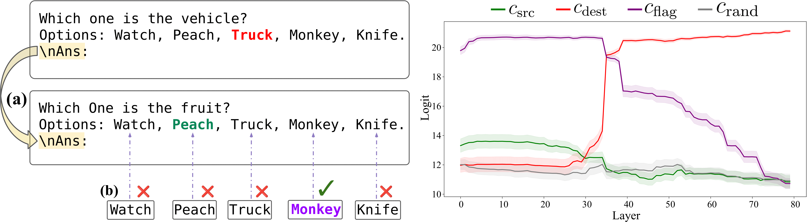{fig-align="center"}

**Put the question before the list and the filter heads stop mattering (0.02 on the previous slide). The model marks each item as it reads it.**

:::footer
Sen Sharma, A., Rogers, G., Shapira, N., & Bau, D. (2025). [*LLMs Process Lists With General Filter Heads*](https://filter.baulab.info/). arXiv:2510.26784.
:::

::: {.notes}
SKIPPABLE (Nov 24) - if running long, jump to "What these pictures can and cannot claim"

Go back to the small table on the previous slide, 'placement of the question'. Question after the list: 0.86. Question before the list, patched into question-before: 0.02. The same task, reordered, and the mechanism is gone.

The explanation: when the question comes last, the model cannot know what to look for while reading the items, so it filters at the end using the filter heads. The authors call that lazy evaluation. When the question comes first, the model can judge each item as it arrives and store a marker, a flag, on the ones that match. That is eager evaluation.

This figure tests the flag idea. Take the stored state from the item that matched in one prompt and move it onto an unrelated item, 'Monkey', in another. The plot shows, by layer, which answer the model then prefers. Patched at early and middle layers, the purple line is on top: the model picks the item carrying the flag, even though a monkey is neither a fruit nor a vehicle.

The lesson for interpretability generally: a mechanism found on one prompt format can fail to exist on a trivially different one. Both papers are careful to say that their findings are about specific prompts.
:::

# Limits

## What these pictures can and cannot claim

:::: {.columns}
::: {.column width="50%"}
**Stated by the authors**

* Graphs gave "satisfying insight" for **about a quarter** of the prompts they tried
* Each graph is about **one prompt and one output token**: an existence proof
* **Error nodes**: part of the computation is unexplained, and more so on long or unusual prompts
* **Attention** patterns are taken as given
* Features that are **inactive**, and why, do not appear
* The replacement may compute the right output by a **different mechanism** than the real MLP
:::
::: {.column width="50%"}
**Added by the way the figures are made**

* **Feature labels** are a person's reading of top examples
* **Supernodes** are grouped by hand
* The published cases are the ones that **worked**
* Diagrams are **simplified** from pruned graphs, which are pruned from the full graph

**What keeps it honest: interventions on the real model, including the ones that failed.**
:::
::::

:::footer
Lindsey, J., et al. (2025). [*On the Biology of a Large Language Model*](https://transformer-circuits.pub/2025/attribution-graphs/biology.html); Ameisen, E., et al. (2025). [*Circuit Tracing*](https://transformer-circuits.pub/2025/attribution-graphs/methods.html).
:::

::: {.notes}
The left column is from the limitations sections of the two papers, which are long and specific. The 'quarter of prompts' figure is from the Biology paper's introduction, with the remark that it is hard to quantify precisely.

The right column is what a visualization course should add. Between the model and the figure on the slide there are four reductions: features approximate the MLPs, pruning drops nine nodes in ten, a person groups and labels what is left, and an illustrator simplifies it. Each step makes the picture easier to read and adds a place where a judgment call entered.

None of this means the results are wrong. It means the figure is the end of an argument, and the argument's strength is in the interventions. When you read work like this, look for the experiment that could have come out the other way.

The authors' own summary of where this stands: a stepping stone, not yet a tool that could certify a model is safe, because a clean graph cannot rule out a mechanism the method failed to see.
:::

## A checklist for reading an interpretability figure

1. **What is the unit?** Neuron, attention head, learned feature, or a hand-made group of features?
2. **Who named it, and from what evidence?** Top-activating examples only, or also its effect on the output?
3. **What is the scope?** One prompt, a family of prompts, or the whole input distribution?
4. **How much is left out?** Reconstruction error, pruned nodes, frozen components.
5. **Is it causal?** Was something changed inside the model, and did the output change as predicted?
6. **What would have counted against it?** Are failed predictions reported?
7. **Does it survive rephrasing?** Remember the question placed before the list.

**The same seven questions apply to a saliency map, a SHAP plot or an attention map.**

::: {.notes}
A takeaway you can use on any paper in this area, and on your own project figures.

Run today's examples through it. The Dallas graph: unit is a hand-made group of learned features; named from top examples and output effects; scope is one prompt; error nodes and pruning acknowledged; causal, with ablations and swaps; the stronger multipliers for non-US regions are a visible weak spot; rephrasing not tested in what we saw.

The filter heads: unit is an attention head, which needs no naming; scope is a task family with a measured success rate; causal by construction; and question 7 is exactly where it breaks, which the authors report as a finding.

Then run the tools from earlier in the course through it. A SHAP plot does well on scope and poorly on question 5: it is an attribution, with no intervention inside the model.
:::

## What to take away

* **Neurons are the wrong unit.** Networks store more features than they have dimensions, as almost-orthogonal directions, when features are sparse.
* **Features can be recovered** by dictionary learning, approximately, and the approximation error should be shown.
* **An attribution graph** is one prompt's computation drawn in those features, pruned and grouped by a person.
* **Inside one production model**, for specific prompts: intermediate reasoning steps, plans made in advance, a default of "I don't know", and explanations that do not match the mechanism.
* **Attention needs its own tools**, and patching shows a reusable "filter" operation that depends on how the prompt is ordered.
* **A picture of a mechanism is a hypothesis.** The intervention is the evidence.

::: {.notes}
One line per part of the lecture.

If you remember one thing about method: an explanation of a model should come with an experiment in which the explanation could have failed.

If you remember one thing about visualization: the interface is part of the science here. The graphs are unreadable without pruning, grouping, hovering and linked examples, and the choices made in those steps shape what gets found.

For the final report: if your project explains a model's behavior, say which of the three levels your explanation is at, and what you did to test it.
:::

## A second take-away: the unit is still contested

* **Today's first half** says neurons are the wrong unit and features must be extracted. **Cammarata** says most apparent mess was tools, architecture and generalization we had not followed, and that neurons are a fine place to start.
* Both sides agree on **"more features than dimensions"**. They disagree on whether networks **pack unrelated things together**.
* The disagreement is **empirical** and testable: squeeze a layer, ablate weak activations, watch a neuron grow, check whether a dictionary finds anything the neurons lack.
* For your own work: when something looks **polysemantic**, treat it as "no explanation yet" and check the tool, the data and the architecture before concluding the model is a knot.

:::footer
Cammarata, N. (2026). [*Neural Networks Are Already Clean*](https://already-clean.goodfire.com/). Goodfire.
:::

::: {.notes}
Added with the Cammarata section. Note that the first bullet of the previous slide, "neurons are the wrong unit", is exactly the claim the essay disputes. I left it as written: say out loud that it is the field's standard view and that today's main reading argues against it.
:::

## References

::: {.smaller}
* Elhage, N., Hume, T., Olsson, C., Schiefer, N., et al. (2022). [*Toy Models of Superposition*](https://transformer-circuits.pub/2022/toy_model/index.html). Transformer Circuits Thread.
* Ameisen, E., Lindsey, J., Pearce, A., Gurnee, W., et al. (2025). [*Circuit Tracing: Revealing Computational Graphs in Language Models*](https://transformer-circuits.pub/2025/attribution-graphs/methods.html). Transformer Circuits Thread.
* Lindsey, J., Gurnee, W., Ameisen, E., Chen, B., et al. (2025). [*On the Biology of a Large Language Model*](https://transformer-circuits.pub/2025/attribution-graphs/biology.html). Transformer Circuits Thread.
* Sen Sharma, A., Rogers, G., Shapira, N., & Bau, D. (2025). [*LLMs Process Lists With General Filter Heads*](https://arxiv.org/abs/2510.26784). arXiv:2510.26784. Project page: <https://filter.baulab.info/>
* Olah, C., Cammarata, N., Schubert, L., Goh, G., Petrov, M., & Carter, S. (2020). [*Zoom In: An Introduction to Circuits*](https://distill.pub/2020/circuits/zoom-in/). Distill.
* Cammarata, N. (2026). [*Neural Networks Are Already Clean*](https://already-clean.goodfire.com/). Goodfire. Companion paper: [*Neurons as an Interpretable Basis*](https://www.goodfire.com/research/neurons-as-an-interpretable-basis)
:::

::: {.notes}
All four are free online. The three Transformer Circuits papers are interactive web pages: the figures respond to hovering and link to full graphs.

A reading order for someone new to this: the introduction and first two experiments of Toy Models of Superposition, then the Biology paper's introduction and whichever case studies interest you, then the methods paper for how it works. The filter heads project page is short and has interactive attention examples.
:::

## Next: project presentations

* **Tuesday, Dec 1 and Tuesday, Dec 8**: final project presentations
* **Dec 14**: final project report due (8 pages)

::: {.notes}
This was the last regular lecture. The next two Tuesdays are presentations, and the report is due December 14, the week after the last class.

Thanksgiving recess is Thursday and Friday of this week and does not affect our Tuesday meetings.
:::
