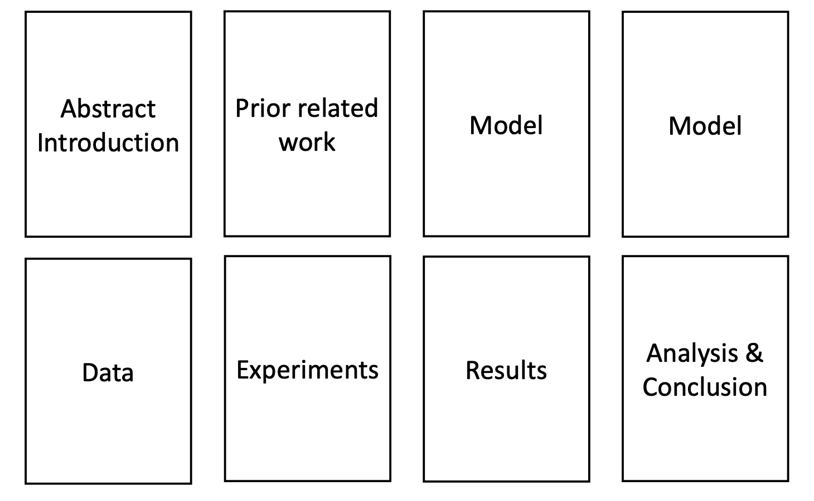
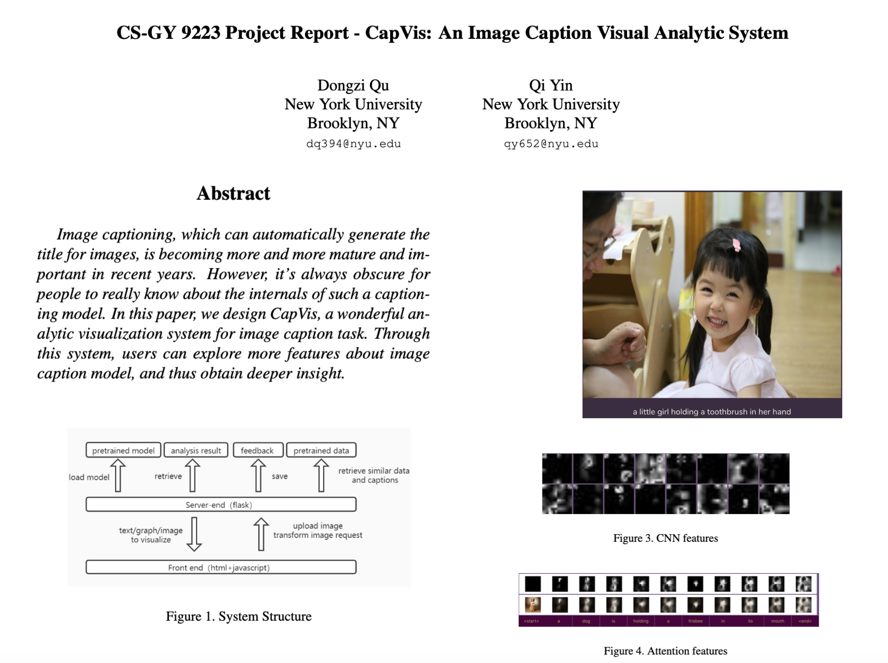
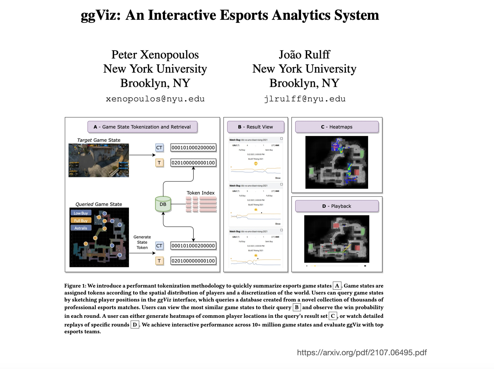
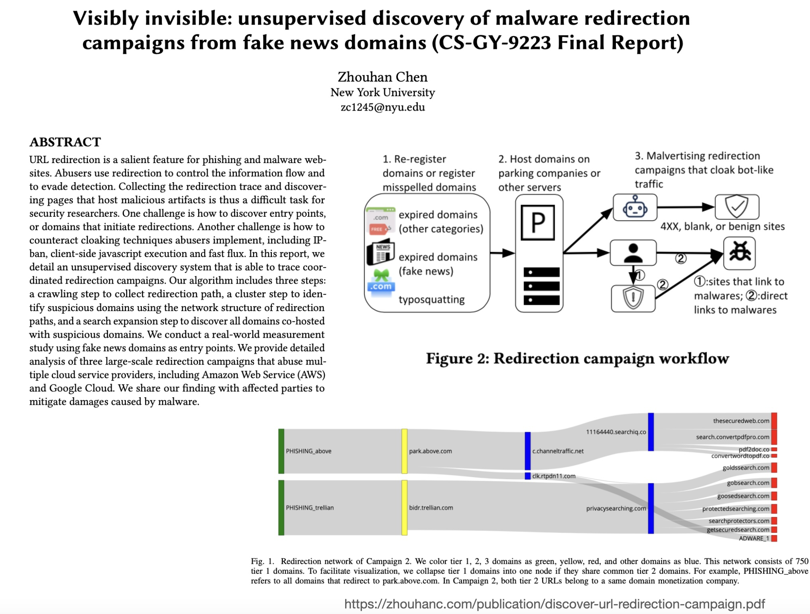
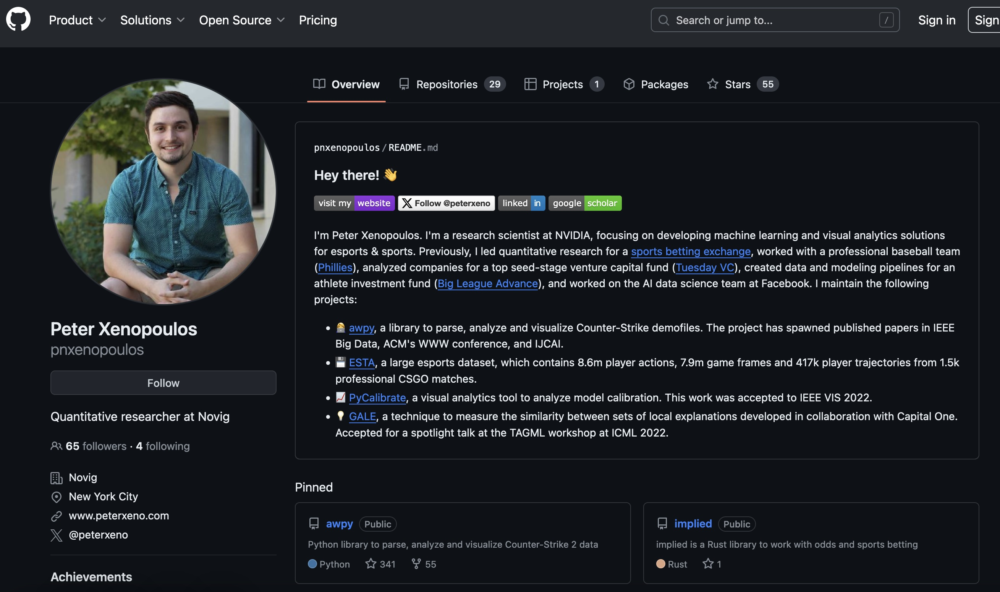

## Acknowledgement

This presentation is heavily influenced and borrows directly from Prof. Christopher Manning's Stanford cs224n project discussion.

## The Final Project

* **Every group proposes its own project.** There is no default project this year.

* The project must combine **visualization and machine learning**: use visualization to understand, debug, compare, or explain ML models or data

* Your proposal is how we approve the project. Talk to us about your idea **before** you write it

You can work in teams of 1-3 people. **Teams are encouraged.** Obviously, more is expected from a team than an individual.

::: {.notes}
The final project is 45% of the grade in total: proposal 10%, update 10%, final project 25%. Say the change clearly: earlier course material, and anything students heard from past students, mentions a default project. This year there isn't one. Every group chooses its own topic.

What makes a project in scope for this course: the contribution has to sit at the intersection. A pure ML project ("I trained a better classifier") is out of scope. So is a pure visualization project with no model ("a dashboard of taxi trips"). In scope means visualization serves an ML question: why does this model fail on these inputs, how do these two models differ, what structure is in this embedding space, is this model fair across groups, does this explanation method agree with that one.

Approval: the 4-page proposal due Oct 20 is the approval step. We'll reply with approve, approve with changes, or rescope. To avoid a rescope, talk to someone on the next slide this week, before writing it.

Teams of 1-3. Remind them that groups formed in Week 2 and the syllabus says groups can't change once finalized.
:::

## Talk to Us About Your Idea

* Before the proposal, run your idea by one of us:

  - **Claudio Silva** (Instructor)
  - **Bhavya Matam** (Session Leader)
  - **Parikshit (Pari) Solunke**

* **Reach out this week.** The proposal is due **Oct 20**.

::: {.notes}
These are the three people who can sanity-check a project idea: me (office hours Fridays 1:30-2:30 PM, 370 Jay St Room 1153), Bhavya, who runs the labs and is the easiest to reach on lab nights, and Pari. With only three of us, groups shouldn't wait for the last two days before Oct 20.

What a five-minute conversation catches:

- **Scope:** a semester project for 2-3 people is about 8 weeks of part-time work.
- **Data access:** you don't want to discover in November that the dataset needs an IRB or a data-use agreement.
- **Novelty:** whether the idea is already a well-known tool.

Ask students to come with one paragraph: the question, the thing being studied (a model, a dataset, a pipeline, an existing tool), the data, and what the visualization will show. Reaching out early matters more now that every group is choosing its own topic. There's no fallback project to switch to if an idea doesn't work out.
:::

## Choosing a Project

* Start from a **question you can answer with evidence**, not from a technique

  - Where and why does this model or pipeline fail?
  - How do two models, two training runs, or two datasets differ?
  - What structure is in this embedding, feature, or output space?
  - What does this dataset actually contain, and what does it hide?
  - Can someone do a real task better with a new view than with the current tool?

* Good starting points: your own research or work data, a paper from this course, a recent IEEE VIS / CHI / NeurIPS paper you can extend

* There are great projects and weak ones at every level of ambition. Scope matters more than size

* We will give a **Best Project Award** (assuming quantity and quality of entries)

::: {.notes}
This slide replaces the old "default vs custom" discussion. Now that everyone chooses, the most useful advice is how to choose well.

Lead with a question, not a technique. "I want to use UMAP" isn't a project. "Do the failure cases of this classifier form clusters in embedding space, and do those clusters correspond to something a person can name?" is a project, and it may use UMAP.

Say explicitly that the question does not have to be about a model, because that is how students read a course called Visualization for Machine Learning and it narrows them too early. The object of study can be a model, but it can equally be a dataset, a training process, a pipeline with several stages, a set of explanations, or an existing tool. Last bullet on the slide is the one students overlook: a project whose contribution is a better view for a real task, evaluated against how that task is done today, is a perfectly good VIS project and is often the most tractable.

A simple test for whether it is a question: could the answer come out the other way? "Visualize the embeddings of my dataset" has no answer that could surprise anyone. "Do the clusters in this embedding correspond to the labels, or to acquisition site?" does.

Three reliable sources of ideas:

1. **Your own research or job:** you already know the data and the stakes. This is the best option if you have one.
2. **A paper from this course:** Calibrate, the Neo confusion matrix, LIME/SHAP, t-SNE pitfalls. Reproduce it on new data, then extend it.
3. **A recent VIS, CHI or NeurIPS paper:** papers with released code are much easier to build on.

For students who had planned on a structured option: the safest kind of self-chosen project is reproduce-then-extend. Pick a paper with code, reproduce one figure on a new dataset, then add one well-evaluated improvement. The syllabus already describes the project as "reproduce prior work or implement a proposed research idea".

Gamesmanship point, kept from earlier years: a modest, well-executed, well-evaluated project beats an ambitious one that doesn't work.
:::

## Project Proposal (Due October 20)

* Find a relevant (key) research paper for your topic

* Write a summary of that research paper and what you took away from it as key ideas that you hope to use

* Write what you plan to work on, and how you can innovate in your final project

* Describe:

   - Project plan, relevant existing literature, data that you will use, how you will evaluate your work

::: {.notes}
The proposal is due October 20, one week from today. This gives you time to think about what you heard today and explore options. This is not just a formality - a good proposal sets you up for success. The proposal does two jobs: it shows you read the key paper critically, and it makes the case that your project is feasible and significant. Since every project is self-chosen, it's also the approval step. A vague plan gets sent back for rescoping, which costs you a week. Take this seriously - we provide feedback that will save you pain later.
:::

## Project Proposal: Critical Reading

* Skill: How to think critically about a research paper

  - What were the main novel contributions?
  - Is the work general and reusable or a special case?
  - Are there flaws or neat details in what they did?
  - How does it fit with other papers on similar topics?
  - Does it provoke good questions on further or different things to try?

::: {.notes}
Critical reading is a research skill you'll use throughout your career. Don't just summarize - analyze! Ask: What's actually new here? Could this work on other datasets? What assumptions did they make? What did they not try that would be interesting? Your proposal should demonstrate this critical thinking, showing you understand not just WHAT the paper did but WHY and WHAT'S NEXT.
:::

## Project Proposal: Planning Tips

* How to do a good job on your project plan?

   - You need to have an overall sensible idea

   - But most project plans are lacking in nuts-and-bolts:

      * Do you have your data? Can you collect it quickly?
      * Do you have a realistic evaluation plan? Is it convincing?
      * Do you have appropriate baselines?

::: {.notes}
The biggest mistake in proposals: vague plans. "I will improve the visualization" - how? "I will use a neural network" - which architecture? "I will evaluate on real data" - what data, what metrics? Be concrete. If you don't have data yet, explain exactly how you'll get it and when. If you're not sure about evaluation, propose 2-3 options and ask for feedback. Concrete beats aspirational.
:::

## Project Writeup

**Writeup quality is very important to your grade!**

::: {.notes}
Your final report should read like a research paper, not a homework assignment. Follow the standard structure: Introduction (motivation + contributions), Related Work, Methods, Experiments, Results, Discussion, Conclusion. Use figures effectively to communicate ideas. Write clearly and concisely. Proofread! We're grading both technical content and communication - a brilliant project with poor writeup will lose points.
:::

## Sample Project Example 1

::: {.notes}
This sample shows a typical project scope. Notice how it clearly states the problem, the approach, and the evaluation plan. The visualization makes the contribution immediately clear. Your project should have this level of clarity in both execution and presentation.
:::

## Sample Project Example 2

::: {.notes}
Another strong example showing how to present experimental results. Multiple visualizations, clear comparisons, quantitative metrics. This is what we expect in your final report - not just "I built something" but "I built something, here's how it performs, here's how it compares."
:::

## Sample Project Example 3

::: {.notes}
This sample demonstrates effective use of visualization to explain complex ML concepts. Notice the progression from simple to complex, the use of color and layout to guide the reader. Your project should leverage visualization not just as output but as a communication tool in your writeup.
:::

## Plan To Use It in Your Portfolio

::: {.notes}
Think beyond the grade! This project is a portfolio piece for job interviews, PhD applications, or future research. Make it public (with permission if using private data), put it on GitHub, write a blog post about it. Past students have turned projects into publications, open-source tools, and startup prototypes. Invest the effort to make it something you're proud to show off.
:::

## Plan To Use It in Your Portfolio

**Example: From Class Project to Research Impact**

* https://github.com/VIDA-NYU/pycalibrate

* https://arxiv.org/pdf/2207.13770.pdf

This project started as a class visualization project, became an open-source library, and resulted in a published paper. Your project could follow a similar trajectory!

::: {.notes}
The pycalibrate example shows what's possible. A student was interested in model calibration visualization, built tools for their project, cleaned up the code, released it open-source, and collaborated with faculty to publish. Your project could be the foundation for your thesis, a startup, or a research publication. Think big, start small, iterate based on feedback.
:::

## Project Timeline

| **Milestone** | **Due Date** | **Details** |
|---------------|--------------|-------------|
| **Proposal** | Oct 20 | 4 pages, includes paper summary + plan |
| **Mid-term Update** | Nov 3 | 1-page writeup, show progress |
| **Final Presentation** | Dec 1 & Dec 8 | 10-minute presentation + Q&A |
| **Final Report** | Dec 14 | 8 pages (conference paper format) |

::: {.notes}
Mark these dates. The proposal is due October 20, one week after today, so there is a week to act on anything said here. The mid-term update on November 3 is a single page and should show preliminary results, not just plans. Final presentations span two weeks and we split the class. The report is due December 14, a week after the last presentation, which leaves room to fold in feedback.
:::

## Evaluation Criteria

:::: {.columns .smaller}

::: {.column width="50%"}
**Technical Quality (60%)**

- Soundness of approach
- Appropriate evaluation
- Depth of analysis
- Innovation beyond baseline

**Presentation (15%)**

- Clarity of slides
- Quality of demo/visualizations
- Handling of Q&A
:::

::: {.column width="50%"}
**Writeup (20%)**

- Clear motivation and contributions
- Proper related work
- Effective visualizations
- Insightful discussion

**Teamwork (5%)**

- Equal contribution (for teams)
- Clear division of labor
- Collaboration evidence
:::

::::

::: {.notes}
Technical quality is the majority of your grade, but communication matters! A technically strong project with poor presentation/writeup will score lower than a slightly less ambitious project that's beautifully communicated. For teams, we may assign individual grades if contribution is unequal - document who did what in your report.
:::

## Example Project Themes

Not a list to pick from, just directions past projects have taken:

- Model interpretability visualization
- High-dimensional data exploration
- Interactive ML debugging tools
- Fairness and bias visualization
- Time-series model visualization
- Embedding space exploration

Whatever the theme, your proposal must name a key paper, a dataset you can actually get, and how you will evaluate the result.

::: {.notes}
These themes used to be the menu for default-project topics. Now they're only prompts. Map each to course material so students know where to look:

- **Interpretability:** the white-box and black-box weeks (PDP, LIME, SHAP).
- **High-dimensional data and embeddings:** tonight and next week (PCA, t-SNE, UMAP).
- **Debugging:** the model assessment week (confusion matrices, calibration).
- **Fairness:** the Interpretable ML & Fairness week later in the term.
- **Time series:** the Time Series week.

The yellow box is the minimum bar for approval: a key paper, data you already have or can get within a week, and an evaluation plan. The evaluation can be quantitative metrics, a comparison with a baseline tool, or a small user study with 3-5 people.
:::

## Getting Help

:::: {.columns}
::: {.column width="50%"}
**Office Hours**

- Instructor: Fridays 1:30-2:30 PM, Room 1153, 370 Jay Street
- Session leader: posted on Discord
:::
::: {.column width="50%"}
**Resources**

- Discord #project-discussion channel
- Weekly check-ins during lab sessions
- Feedback on the mid-term update
:::
::::

**Don't wait until the last minute!**

::: {.notes}
Use office hours strategically! Come with specific questions: "I'm stuck on this evaluation metric" beats "How's my project going?" We'll dedicate lab time throughout the semester for project check-ins. Use Discord for quick questions. The mid-term presentation is your chance to get feedback before it's too late to pivot. We want you to succeed - ask for help early and often.
:::

## Tips for Success

:::: {.columns .smaller}
::: {.column width="50%"}
1. **Start Early** - don't wait until after Thanksgiving

2. **Iterate** - build a simple version first, then improve

3. **Visualize Often** - make plots to understand your data and results

4. **Document** - keep notes and screenshots for your writeup
:::
::: {.column width="50%"}
5. **Test on Real Users** - get feedback on your visualizations

6. **Version Control** - use Git, commit frequently

7. **Communicate** - keep your team and mentors updated
:::
::::

::: {.notes}
These tips come from watching students succeed (and struggle) over the years. The most common failure mode: starting too late. The most common success factor: iterative development with frequent feedback. Visualization is your friend - if you can't visualize your intermediate results, you don't understand them yet. Document as you go - future you will thank present you when writing the report at 2am.
:::

## Questions?

**Discord:** #project-discussion

**Email:** Claudio Silva (csilva@nyu.edu)

**Office Hours:** Fridays 1:30-2:30 PM (Room 1153, 370 Jay St)

::: {.notes}
This is the time to ask clarifying questions about project scope, team formation, timeline, evaluation criteria, etc. After this lecture, each group should pick a direction and talk to one of us this week, in office hours, the lab, or on Discord. The proposal deadline is October 20, one week from today. Use this week wisely!
:::
