# Topological Data Analysis

::: {.notes}
Hi everyone. Today we will look at topological data analysis, TDA for short.

There is a lot of math behind topology but I largely want to focus more on conveying the conceptual ideas behind TDA instead of focusing on the mathematical specifics.
:::

## Today's Agenda

1. **Introduction to Topology**
   - Shape analysis beyond geometry
   - Topological equivalence and connectivity

2. **Persistence and Betti Numbers**
   - Counting holes and connected components
   - Persistence diagrams

3. **Simplicial Complexes**
   - Vietoris-Rips construction
   - From point clouds to topology

4. **The Mapper Algorithm**
   - Data skeleton construction
   - Practical applications

::: {.notes}
First, we'll see what topology is. 

Then Betti numbers and persistence, which is really the heart of TDA. 

After that, simplicial complexes, which are the basic data structures used to turn a bunch of points into complex structures and shapes.

And we finish with the Mapper algorithm, a strategy that lets you a construct a skeleton graph summarizing the shape of the data. 
:::

## What is topology?

- Topology studies the *shape* of mathematical objects

- Unlike Geometry, it is not concerned with sizes, angles, nor coordinates

- It is concerned with the *connectivity* (or lack of) between different "parts" of the object

- Two objects are topologically equivalent if we can transform one into another with continuous transformations (without tearing the object)

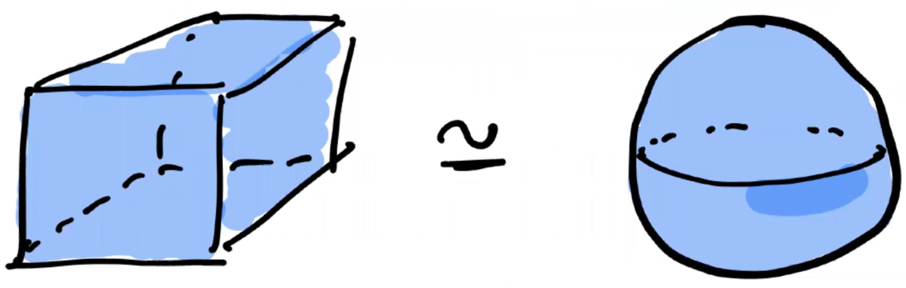{fig-align="center"}

::: {.notes}
Topology is a branch of mathematics that deals with studying shapes of objects and connectivity. 

Forget geometrical qualities like lengths, angles, and coordinates. The only thing that matters is what's connected to what. Topology cares about loops, connectivity, and holes. 

The rule is simple: if I can deform one object into another by stretching or bending, without tearing or gluing, they count as the same topologically speaking. 

Imagine that the cube and circle are made of perfectly elastic material, then you can transform one into another without tearing or gluing anything. That's why this cube and this sphere are topologically equivalent despite being geometrically different.
:::

## What is topology?

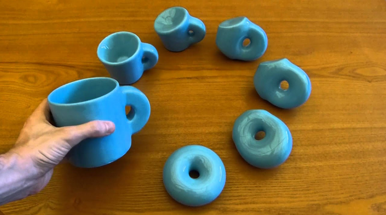{fig-align="center"}

::: footer
[Source](https://www.youtube.com/watch?v=9NlqYr6-TpA)
:::

::: {.notes}
There is a famous joke out there: a topologist can't tell the difference between a coffee mug from a donut.

Basically, you can mould a coffee mug shaped peice of clay into a donut without tearing it apart the object or gluing anything new. 

The cup part gets squished down, the handle turns into the ring, and at no point do we need to cut anything. 

What survives the whole transformation is the number of topological holes, or cavities: one in each. That's the kind of topological property we're going to learn to count.
:::

## Why topology?

- Since topology analyzes the shape while discarding possibly unnecessary information, it is frequently used for analyzing high-dimensional objects

- Topological data analysis (TDA) uses techniques from topology to analyze datasets

- To do this, it is necessary to construct topological representations of the dataset’s points

::: {.notes}
Naturally leads to the question Why would we want this for data? 

Real datasets are high dimensional and noisy, and exact distances are often not very meaningful. 

Topology throws away the exact geometry and keeps the coarse structure: how many pieces, how many loops, how many cavities. TDA applies that idea to datasets. 

There's one catch. A dataset is just a bunch of points, and a bunch of points has no surface on its own. So the first job is to build a shape out of the points, and most of today is about how we do that.
:::

## Why topology? - An example in chemistry

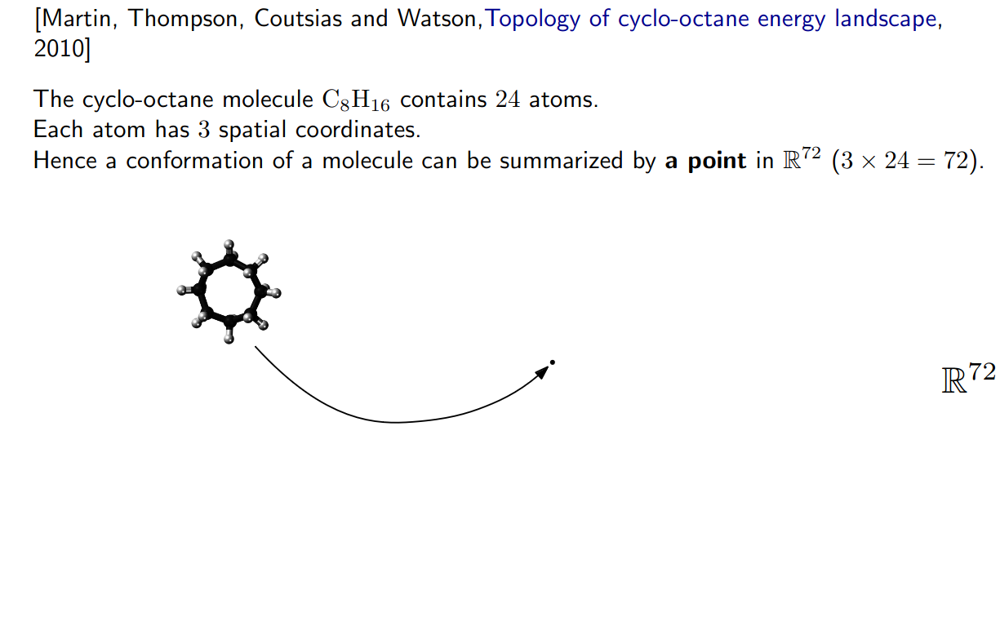{fig-align="center"}

:::footer
Slides based on Raphaël Tinarrage's [From Algebraic Topology to Data Analysis](https://raphaeltinarrage.github.io/files/Slides_SSDS_I.pdf)
:::

::: {.notes}
Here's a case from chemistry, a paper on the cyclo-octane molecule. It has 24 atoms, each with three spatial coordinates.

So, one possible configuration of the molecule is represented by a single point in 72 dimensions.
:::

## Why topology? - An example in chemistry

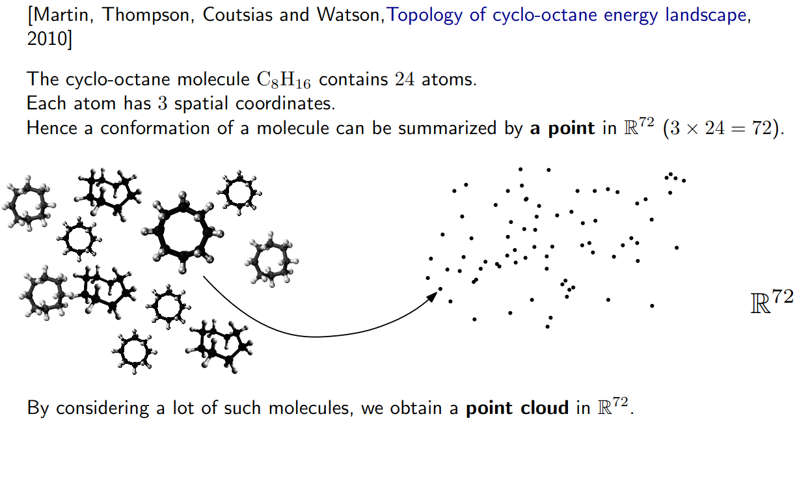{fig-align="center"}

:::footer
Slides based on Raphaël Tinarrage's [From Algebraic Topology to Data Analysis](https://raphaeltinarrage.github.io/files/Slides_SSDS_I.pdf)
:::

::: {.notes}
Now take lots of molecules, lots of configurations, and you get a point cloud in R^72. Obviously nobody can look at that directly, and a scatter plot of a few coordinates won't tell you much.
:::

## Why topology? - An example in chemistry

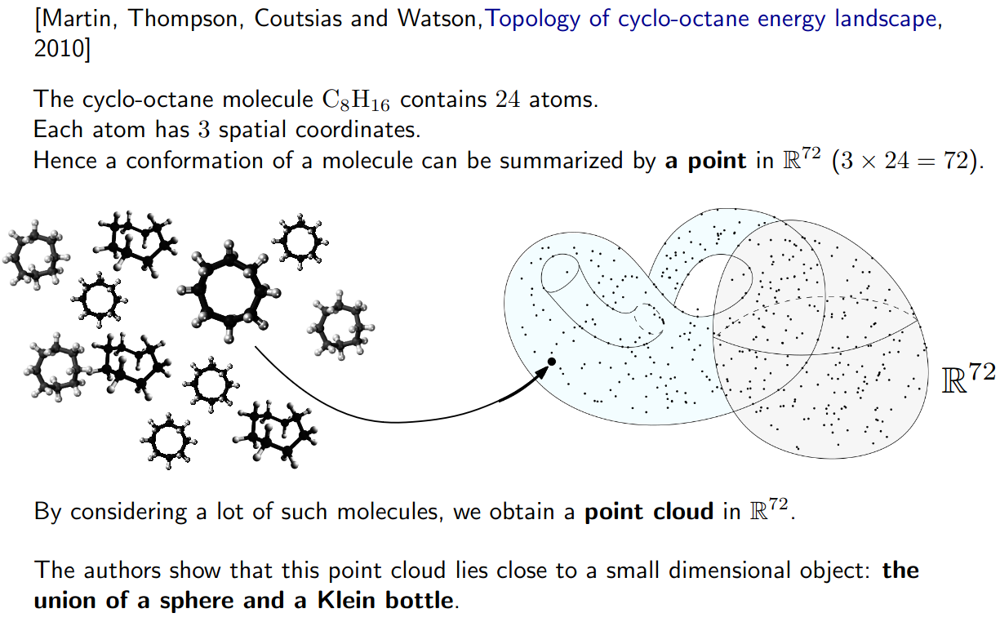{fig-align="center"}

:::footer
Slides based on Raphaël Tinarrage's [From Algebraic Topology to Data Analysis](https://raphaeltinarrage.github.io/files/Slides_SSDS_I.pdf)
:::

::: {.notes}
But when you treat this point cloud as a shape, and try to reconstruct a shape from the point cloud, this cloud sits close to a low-dimensional object, the union of a sphere and a Klein bottle. 

It's a very specific shape, hiding in 72 dimensions. This is the sort of thing topological tools can find. Essentially treating datasets as a shape and trying to study their topological properties.
:::

## Why topology? - An example in biology

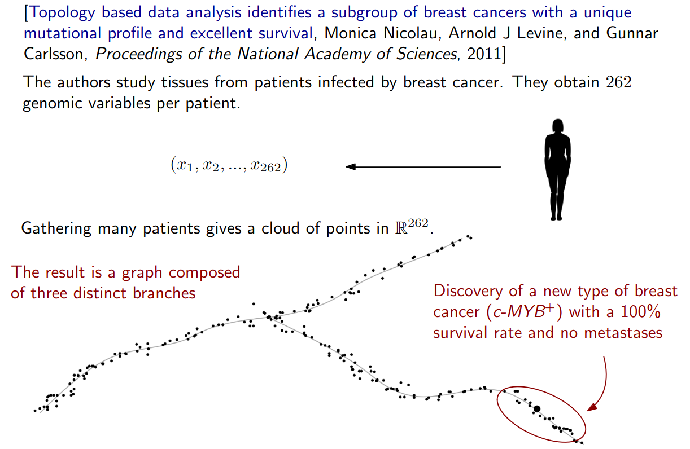{fig-align="center"}

:::footer
Slides based on Raphaël Tinarrage's [From Algebraic Topology to Data Analysis](https://raphaeltinarrage.github.io/files/Slides_SSDS_I.pdf)
:::

::: {.notes}
This paper tried to apply topological analysis to studying cancer genomes. 

Each patient is described by 262 genomic measurements, so a group of patients is a cloud of points in R^262. 

When they summarize that cloud with a topological method, they get a graph with three distinct branches, and one of those branches turned out to be a previously unknown subtype of cancer, with a 100 percent survival rate.

This shows that you can actually get really interesting insights into your datasets when you apply TDA.
:::

## Betti numbers

The $d^{th}$ Betti number counts the number of $d$-dimensional holes. It can be used to distinguish between spaces.

- $\beta_0(X)$ Connected components in X

- $\beta_1(X)$ Tunnels or holes in X

- $\beta_2(X)$ Voids in X

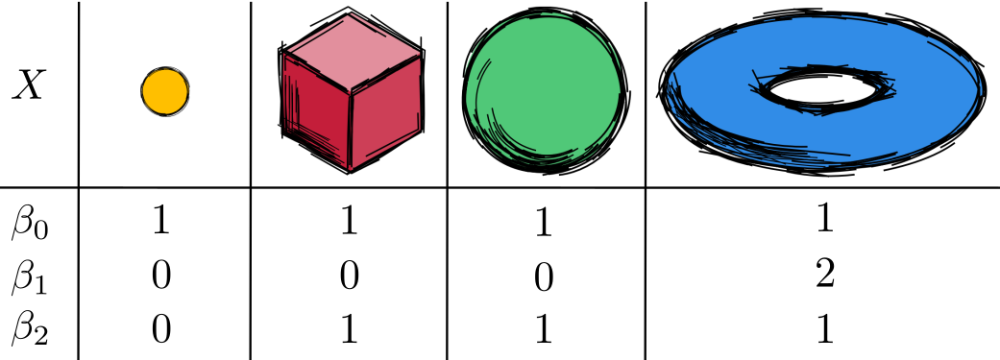{fig-align="center"}

:::footer
Slides based on Bastian Rieck's [Topological Data Analysis for Machine Learning](https://bastian.rieck.me/talks/ecml_pkdd_2020/)
:::

::: {.notes}
Betti numbers are how we count topoligcal holes or cavities. 

Beta zero counts connected components, which are the distinct separate pieces that make up an object. 

Beta one counts loops or tunnels, and beta two counts voids, the hollow, fully enclosed spaces inside a surface.

As an example a single point is one piece and nothing else. The cube, as a hollow surface, and the sphere both have one piece, no loops, and one void, which matches what we said about them being equivalent. The torus is different: one piece, two independent loops, one void. So these three numbers already separate the torus from the sphere.

And when we say loops in topology, we mean non-trivial non collapsing fundamental loops, because theoretically there are infinite number of trivial loops you can draw on an object.
:::

## First Example - Map

What is a peak?

\

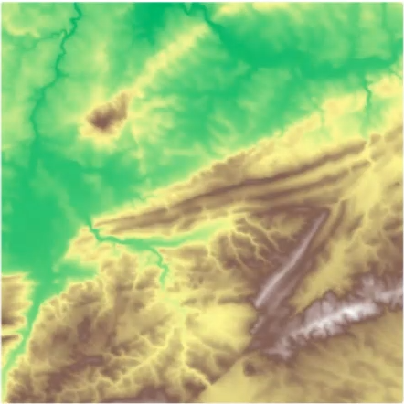{fig-align="center"}

:::footer
Slides based on Vincent Divol's [CDS Lunch Seminar](https://cds.nyu.edu/data-science-lunch-seminar-series/) presentation
:::

::: {.notes}
To get to the idea of persistence, let's start with something you can picture: this is an elevation map of a mountain, you can see the higher up regions in brown and lower elevation regions in green.

Now, our task is to find mountain peaks on here, So wee need to first define what counts as a peak on this map? It sounds easy, but let's see.
:::

## First Example - Map

What is a peak?

First idea: Using local maximum

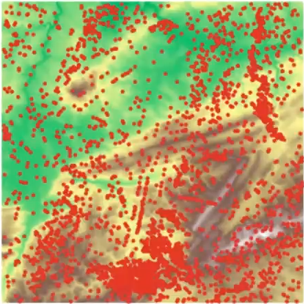{fig-align="center"}

:::footer
Slides based on Vincent Divol's [CDS Lunch Seminar](https://cds.nyu.edu/data-science-lunch-seminar-series/) presentation
:::

::: {.notes}
One idea is, you can define a peak as a local maximum. 

Here are all of the local maxima in this elevation map. There are thousands. 

Every tiny bump from noise or measurement error counts, and no hiker would call most of these a mountain peak. So this definition is too sensitive.
:::

## First Example - Map

What is a peak?

Second idea: flooding

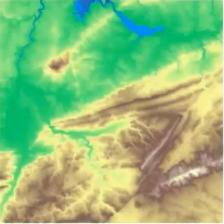{fig-align="center"}

:::footer
Slides based on Vincent Divol's [CDS Lunch Seminar](https://cds.nyu.edu/data-science-lunch-seminar-series/) presentation
:::

::: {.notes}
Another idea is: flood the map. Let the water level rise and watch what happens to the land. 

The water is starting to fill the lowest valleys.
:::

## First Example - Map

What is a peak?

Second idea: flooding

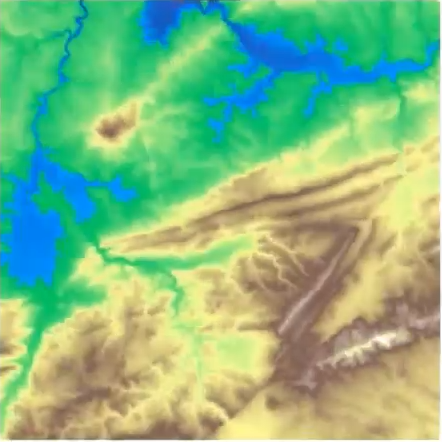{fig-align="center"}

:::footer
Slides based on Vincent Divol's [CDS Lunch Seminar](https://cds.nyu.edu/data-science-lunch-seminar-series/) presentation
:::

::: {.notes}
A bit higher, and the lakes grow. Still one big connected landmass.
:::

## First Example - Map

What is a peak?

Second idea: flooding

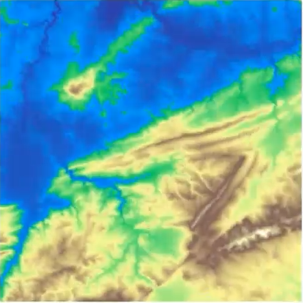{fig-align="center"}

:::footer
Slides based on Vincent Divol's [CDS Lunch Seminar](https://cds.nyu.edu/data-science-lunch-seminar-series/) presentation
:::

::: {.notes}
Now the plains are underwater and the land starts to break up. Look at the hill in the upper left. It's about to be fully cut off.
:::

## First Example - Map

What is a peak?

Second idea: flooding

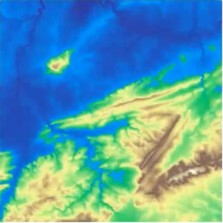{fig-align="center"}

:::footer
Slides based on Vincent Divol's [CDS Lunch Seminar](https://cds.nyu.edu/data-science-lunch-seminar-series/) presentation
:::

::: {.notes}
And there it is. That hill is now its own island, separate from everything else. Keep an eye on how long it survives.
:::

## First Example - Map

What is a peak?

Second idea: flooding

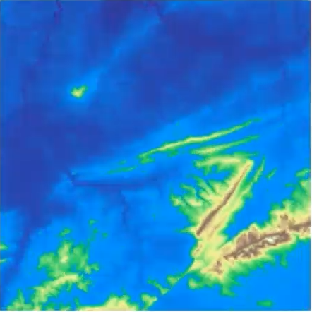{fig-align="center"}

:::footer
Slides based on Vincent Divol's [CDS Lunch Seminar](https://cds.nyu.edu/data-science-lunch-seminar-series/) presentation
:::

::: {.notes}
The water keeps rising. The island is shrinking, and the big ridges are getting thinner.
:::

## First Example - Map

What is a peak?

Second idea: flooding

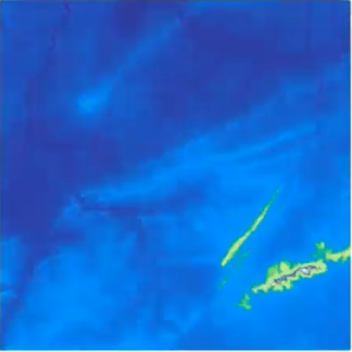{fig-align="center"}

:::footer
Slides based on Vincent Divol's [CDS Lunch Seminar](https://cds.nyu.edu/data-science-lunch-seminar-series/) presentation
:::

::: {.notes}
Our little island is gone. Only the highest ridges in the lower right are still above water. They had a much longer life.
:::

## First Example - Map

What is a peak?

Second idea: flooding

{fig-align="center"}

:::footer
Slides based on Vincent Divol's [CDS Lunch Seminar](https://cds.nyu.edu/data-science-lunch-seminar-series/) presentation
:::

::: {.notes}
And finally everything is underwater. So each island had a start and an end, and that's the information we want to keep.
:::

## First Example - Map

The island $I$ appears at sea level $b$ (its **birth time**)...

\

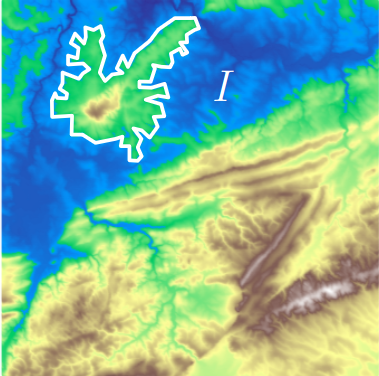{fig-align="center"}

:::footer
Slides based on Vincent Divol's [CDS Lunch Seminar](https://cds.nyu.edu/data-science-lunch-seminar-series/) presentation
:::

::: {.notes}
Let's give names to this. Here's our island I, outlined in white. It appears as its own island at some sea level b, the moment it gets cut off from the higher land around it. That's its birth time.
:::

## First Example - Map

The island $I$ appears at sea level $b$ (its **birth time**)...

and disapears at seas level $d$ (its **death time**) at local maximum $x$.

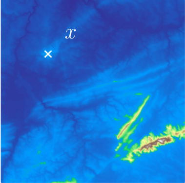{fig-align="center"}

The point $x$ is a peak if the **persistence**$:= d-b$ of the island $I$ is larger than $91$m (=$300$ft).

:::footer
Slides based on Vincent Divol's [CDS Lunch Seminar](https://cds.nyu.edu/data-science-lunch-seminar-series/) presentation
:::

::: {.notes}
It disappears at level d, when the water reaches its highest point, the local maximum x marked here. The difference d minus b is the persistence: how long the island lives, or in map terms, how much the peak sticks up above the plains. 

Now we can define a peak properly. x is a peak if its island's persistence is bigger than a threshold, here 91 meters, which is 300 feet. 

so naturally a tiny bump has tiny persistence, so it's filtered out automatically by the threshold.
:::

## First Example - Map

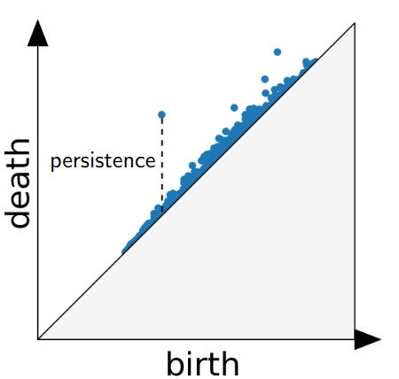{fig-align="center"}

The persistence diagram (PD) of the elevation function is the collection of the points $(b,d)$, where $(b,d)$ corresponds to the birth/death of an island.

:::footer
Slides based on Vincent Divol's [CDS Lunch Seminar](https://cds.nyu.edu/data-science-lunch-seminar-series/) presentation
:::

::: {.notes}
Now if you do this for every island on the map and plot each one as a point, birth on the x axis, death on the y axis, the scatter plot you get is the persistence diagram of the elevation function. 

Everything sits above the diagonal, because an island can only die after it's born, and the vertical distance to the diagonal is exactly the persistence. 

You can see one point way up, which is the long-lived island, and a big crowd around the diagonal, the small bumps.
:::

## First Example - Map

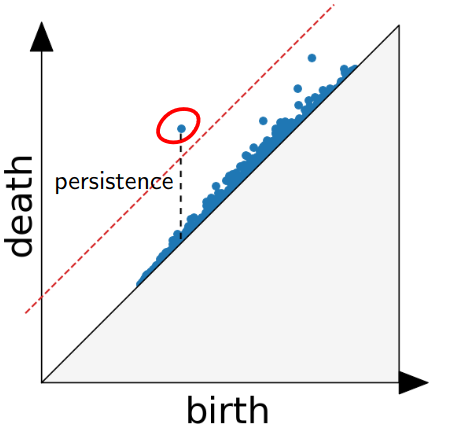{fig-align="center"}

The persistence diagram (PD) of the elevation function is the collection of the points $(b,d)$, where $(b,d)$ corresponds to the birth/death of an island.

:::footer
Slides based on Vincent Divol's [CDS Lunch Seminar](https://cds.nyu.edu/data-science-lunch-seminar-series/) presentation
:::

::: {.notes}
And then, our "larger than 300 feet" rule is just a line parallel to the diagonal. 

Anything above the red dashed line, like this circled point, is a peak. Everything below is noise. 

So we basically turned the question "what is a peak?" into a threshold you can see and adjust using persistence.
:::

## Second Example

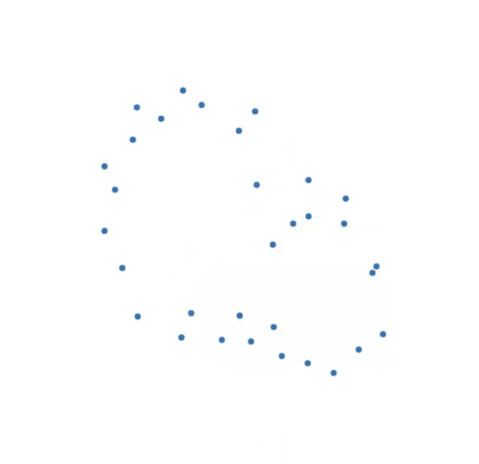{fig-align="center"}

:::footer
Slides based on Vincent Divol's [CDS Lunch Seminar](https://cds.nyu.edu/data-science-lunch-seminar-series/) presentation
:::

::: {.notes}
Now what if you apply the same idea on a point cloud, which is what we usually have in data science. 

Here are some points in a plane. Just by looking at them, it seems like there's a big loop and maybe a smaller one inside. Well, how do we make that precise?
:::

## Second Example

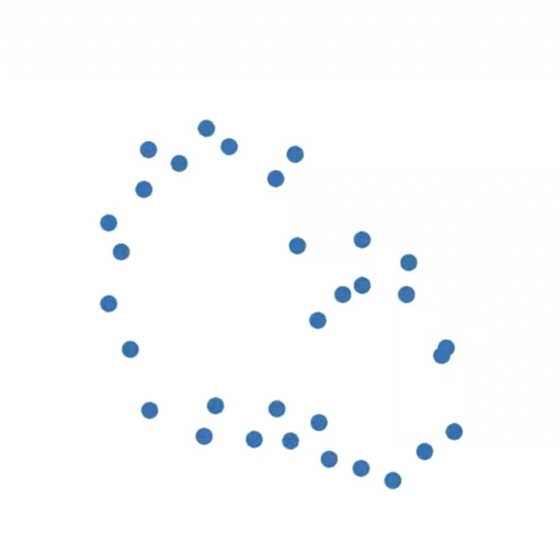{fig-align="center"}

:::footer
Slides based on Vincent Divol's [CDS Lunch Seminar](https://cds.nyu.edu/data-science-lunch-seminar-series/) presentation
:::

::: {.notes}
We'll use the same trick as the flooding. Draw a small disc around every point and grow the radius from zero. At radius zero it's just the points.
:::

## Second Example

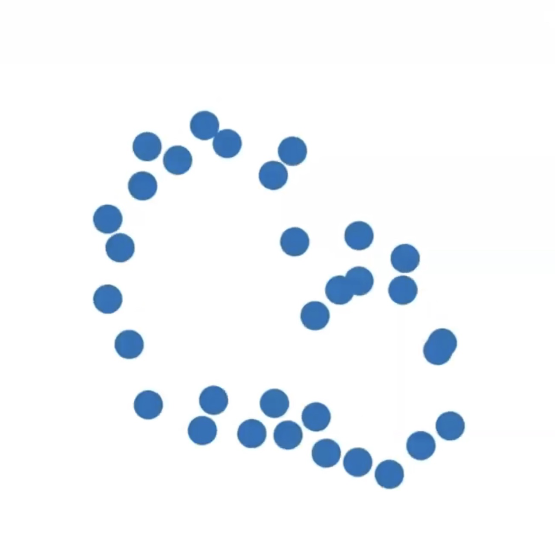{fig-align="center"}

:::footer
Slides based on Vincent Divol's [CDS Lunch Seminar](https://cds.nyu.edu/data-science-lunch-seminar-series/) presentation
:::

::: {.notes}
Then the discs start to grow, nothing is touching yet, so every point is still its own component.
:::

## Second Example

{fig-align="center"}

:::footer
Slides based on Vincent Divol's [CDS Lunch Seminar](https://cds.nyu.edu/data-science-lunch-seminar-series/) presentation
:::

::: {.notes}
Now neighbors begin to overlap and merge. The number of distinct connected begins to drop fast.
:::

## Second Example

{fig-align="center"}

:::footer
Slides based on Vincent Divol's [CDS Lunch Seminar](https://cds.nyu.edu/data-science-lunch-seminar-series/) presentation
:::

::: {.notes}
And now something new happens. The discs around the ring have joined up, and they enclose a cavity. 

A topological loop and a topological hole have just been born.
:::

## Second Example

{fig-align="center"}

:::footer
Slides based on Vincent Divol's [CDS Lunch Seminar](https://cds.nyu.edu/data-science-lunch-seminar-series/) presentation
:::

::: {.notes}
If you keep going, a second cavity shows up, smaller, down on the right. So now we're tracking two loops.
:::

## Second Example

{fig-align="center"}

:::footer
Slides based on Vincent Divol's [CDS Lunch Seminar](https://cds.nyu.edu/data-science-lunch-seminar-series/) presentation
:::

::: {.notes}
As the discs keep growing, both cavities get squeezed. The small one is now gone, the big one is shrinking but still clearly there.
:::

## Second Example

{fig-align="center"}

:::footer
Slides based on Vincent Divol's [CDS Lunch Seminar](https://cds.nyu.edu/data-science-lunch-seminar-series/) presentation
:::

::: {.notes}
Eventually everything is covered and it's one solid blob. All the loops have died. So that's the whole life story of the loops.

Let's replay it and keep track of them.
:::

## Second Example

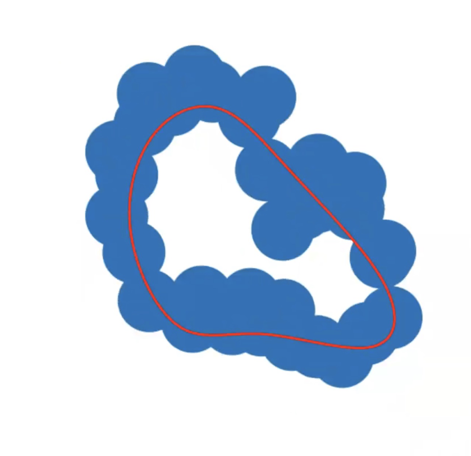{fig-align="center"}

:::footer
Slides based on Vincent Divol's [CDS Lunch Seminar](https://cds.nyu.edu/data-science-lunch-seminar-series/) presentation
:::

::: {.notes}
Replaying, and this time with the loop highlighted. This is the large loop, right after it's born.
:::

## Second Example

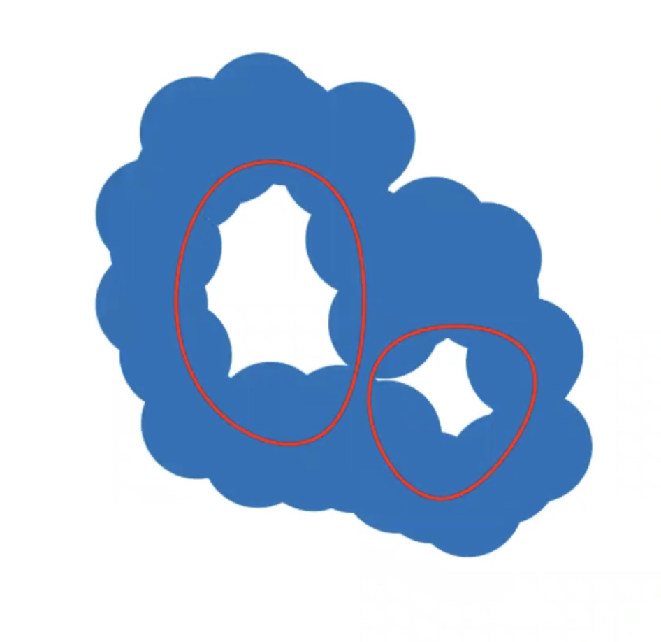{fig-align="center"}

:::footer
Slides based on Vincent Divol's [CDS Lunch Seminar](https://cds.nyu.edu/data-science-lunch-seminar-series/) presentation
:::

::: {.notes}
A little later the second, smaller loop appears.
:::

## Second Example

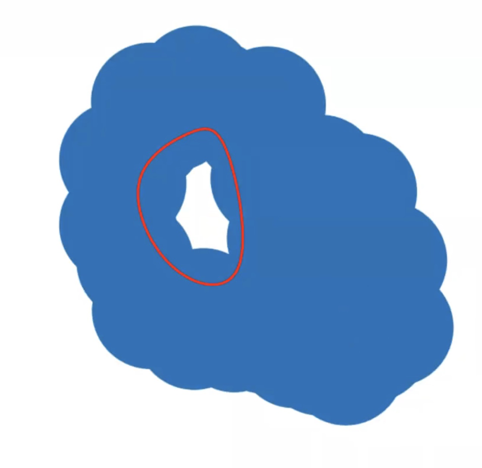{fig-align="center"}

:::footer
Slides based on Vincent Divol's [CDS Lunch Seminar](https://cds.nyu.edu/data-science-lunch-seminar-series/) presentation
:::

::: {.notes}
And soon the smaller one dies, leaving us with only the original big loop.
:::

## Second Example

{fig-align="center"}

:::footer
Slides based on Vincent Divol's [CDS Lunch Seminar](https://cds.nyu.edu/data-science-lunch-seminar-series/) presentation
:::

::: {.notes}
And then the big loop dies too. Each loop has now got a birth radius and a death radius.
:::

## Second Example

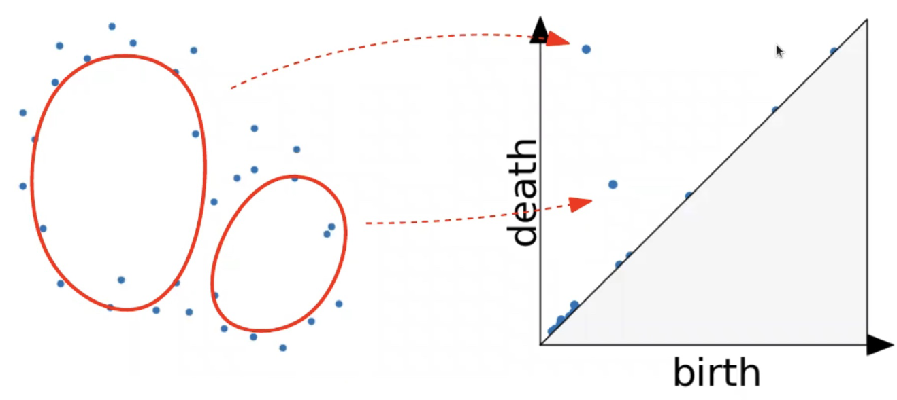{fig-align="center"}

:::footer
Slides based on Vincent Divol's [CDS Lunch Seminar](https://cds.nyu.edu/data-science-lunch-seminar-series/) presentation
:::

::: {.notes}
Now we can plot them. Each loop becomes one point in the diagram. 

The big loop lived a long time, so its point is far from the diagonal, up here. The small loop lived very briefly, so its point is much closer. 

Same reading as the elevation map: far from the diagonal means real structure.
:::

## Persistence diagram

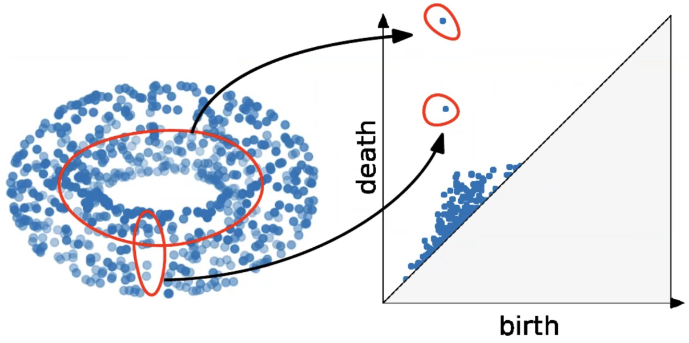{fig-align="center"}

:::footer
Slides based on Vincent Divol's [CDS Lunch Seminar](https://cds.nyu.edu/data-science-lunch-seminar-series/) presentation
:::

::: {.notes}
Here's the same thing on a bigger example, a noisy point cloud sampled from a torus. 

Remember a torus has two independent fundamental loops, one going around the central cavity and one going around the tube. 

And that's exactly what the persistence diagram shows: two points that stand clearly apart from everyone else. 

The rest, the cloud hugging the diagonal, is sampling noise. The nice part is that we never had to choose a scale. We looked at all of them at once and let the lifetimes tell us which topological features matter.
:::

## Distance between persistence diagrams

\

If we have more than one persistence diagram, how do we measure the distance between them?

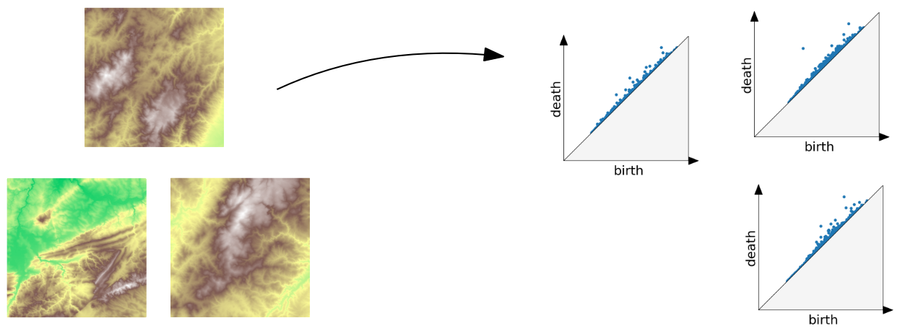{fig-align="center"}

:::footer
Slides based on Vincent Divol's [CDS Lunch Seminar](https://cds.nyu.edu/data-science-lunch-seminar-series/) presentation
:::

::: {.notes}
Say you have several datasets, here three terrain maps, and each gives its own persistence diagram. 

How do I say how similar two of them are? If we have a distance, we can cluster, classify, do nearest neighbors, all the usual things.
:::

## Distance between persistence diagrams

\

:::: {.columns}
::: {.column width="30%"}
We place both in the same diagram
:::
::: {.column width="70%"}
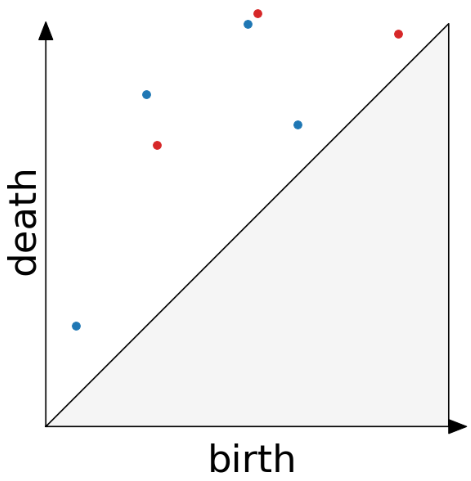{fig-align="center"}
:::
::::

:::footer
Slides based on Vincent Divol's [CDS Lunch Seminar](https://cds.nyu.edu/data-science-lunch-seminar-series/) presentation
:::

::: {.notes}
First step is easy. Draw both diagrams on the same axes, one in blue and one in red.
:::

## Distance between persistence diagrams

\

:::: {.columns}
::: {.column width="30%"}
We place both in the same diagram

Get the optimal pair matching between the points (including the diagonal)
:::
::: {.column width="70%"}
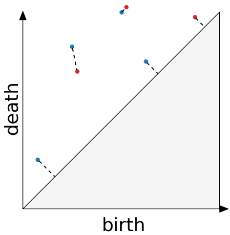{fig-align="center"}
:::
::::

:::footer
Slides based on Vincent Divol's [CDS Lunch Seminar](https://cds.nyu.edu/data-science-lunch-seminar-series/) presentation
:::

::: {.notes}
Then we match the points of one diagram to the points of the other, as best we can. 

The detail that makes this work is that a point is also allowed to match to the diagonal. See the dashed lines going straight to it. That means "this feature is basically noise, treat it as nothing." 

Without that option, diagrams with different numbers of points couldn't be compared.
:::

## Distance between persistence diagrams

\

:::: {.columns}
::: {.column width="30%"}
We place both in the same diagram

Get the optimal pair matching between the points (including the diagonal)

The **bottleneck distance** between them will be the largest pair distance
:::
::: {.column width="70%"}
{fig-align="center"}
:::
::::

:::footer
Slides based on Vincent Divol's [CDS Lunch Seminar](https://cds.nyu.edu/data-science-lunch-seminar-series/) presentation
:::

::: {.notes}
Among all the possible matchings we take the best one, and look at its worst pair, which is the longest dashed line. 

That length is called the bottleneck distance. So, two diagrams are close if you can pair everything up without moving anything very far. 

The good thing about bottleneck distance is it is stable, Small changes of the data only move the diagram a little.
:::

## Simplicial complexes

**Definition**

We call a non-empty family of sets $K$ with a collection of non-empty subsets $S$ an *abstract simplicial complex* if:

1. $\{v\} \in S$ for all $v \in K$
2. If $\sigma \in S$ and $\tau \subseteq \sigma$, then $\tau \in K$.

**Terminology**

The elements of a simplicial complex $K$ are called *simplices*. A $k$-simplex consists of $k+1$ verticies.

:::footer
Slides based on Bastian Rieck's [Topological Data Analysis for Machine Learning](https://bastian.rieck.me/talks/ecml_pkdd_2020/)
:::

::: {.notes}
So far we've been computing on images. To do this on a computer we need a data structure, and that's the simplicial complex. 

Think of it as generalizing a graph: vertices, edges, filled triangles, solid tetrahedra, and their higher-dimensional cousins. The formal definition is on the slide, but the idea is one rule: if a simplex is in the complex, so are all of its faces. If a triangle is in a tetrahedron, its three edges and three vertices are in it too. 

A k-simplex has k plus one vertices, so a point, an edge, a triangle, a tetrahedron are the 0-, 1-, 2- and 3-simplices.
:::

## Simplicial complexes

**Example**

Simplicial complexes can be decomposed into their skeletons, which only contain simplices of a certain dimension.

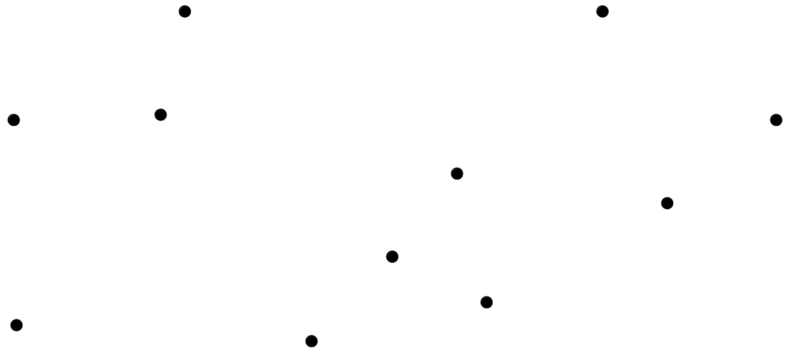{fig-align="center" width=50%}

:::footer
Slides based on Bastian Rieck's [Topological Data Analysis for Machine Learning](https://bastian.rieck.me/talks/ecml_pkdd_2020/)
:::

::: {.notes}
Let's look at one example, built up dimension by dimension. We can take a complex shape apart into skeletons, each one keeping only simplices up to a given dimension. 

So a zero-skeleton is the simplest: which is just the shape's vertices.
:::

## Simplicial complexes

**Example**

Simplicial complexes can be decomposed into their skeletons, which only contain simplices of a certain dimension.

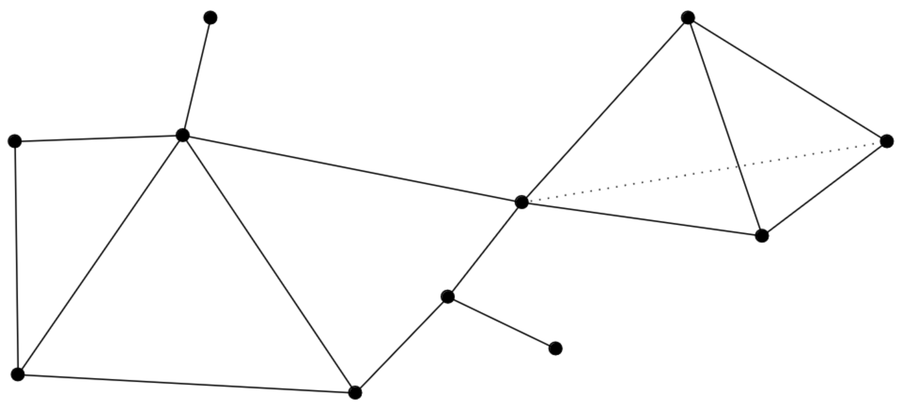{fig-align="center" width=50%}

:::footer
Slides based on Bastian Rieck's [Topological Data Analysis for Machine Learning](https://bastian.rieck.me/talks/ecml_pkdd_2020/)
:::

::: {.notes}
Add the edges, and we have the one-skeleton. That's just a graph, one you already know how to think about.
:::

## Simplicial complexes

**Example**

Simplicial complexes can be decomposed into their skeletons, which only contain simplices of a certain dimension.

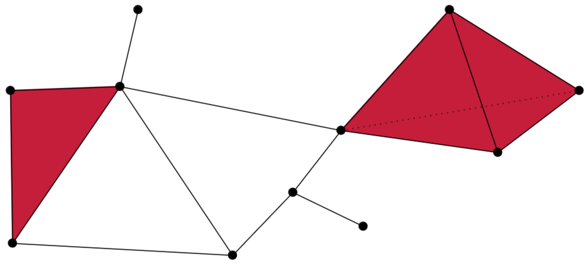{fig-align="center" width=50%}

:::footer
Slides based on Bastian Rieck's [Topological Data Analysis for Machine Learning](https://bastian.rieck.me/talks/ecml_pkdd_2020/)
:::

::: {.notes}
Now we fill in some of the triangles, in red. That's the two-skeleton. Not every triangle that you could draw is filled here, and that choice matters, because an empty triangle denotes a loop in the shape and a filled one is just its surface in a way. 

It's kinda hard to picture here because we are representing a 3d shape on a 2d surface now.
:::

## Simplicial complexes

**Example**

Simplicial complexes can be decomposed into their skeletons, which only contain simplices of a certain dimension.

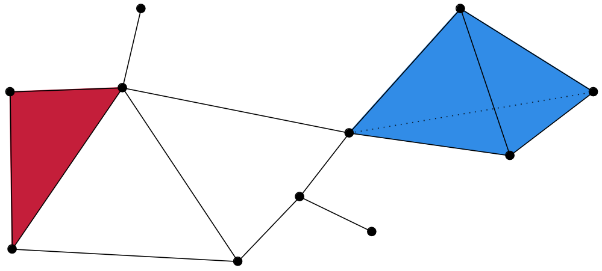{fig-align="center" width=50%}

:::footer
Slides based on Bastian Rieck's [Topological Data Analysis for Machine Learning](https://bastian.rieck.me/talks/ecml_pkdd_2020/)
:::

::: {.notes}
And finally the solid tetrahedron in blue, a 3-simplex. That's the whole complex. Points, edges, triangles and a tetrahedron, all glued along shared faces.
:::

## Simplicial complexes

**Non-example**

This is *not* a simplicial complex because some higher-dimensional simplices do not intersect in a lower dimensional one!

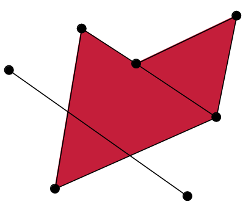{fig-align="center"}

:::footer
Slides based on Bastian Rieck's [Topological Data Analysis for Machine Learning](https://bastian.rieck.me/talks/ecml_pkdd_2020/)
:::

::: {.notes}
And here's what doesn't count. The long edge slices straight through the triangle, and the two triangles overlap, in places that aren't a shared vertex or edge. 

The rule is that any two simplices must either not touch, or meet exactly along a common face. This example breaks that rule, so it is not a simplical complex.
:::

# From points clouds to simplicial complexes

::: {.notes}
So how do we actually get from raw points to one of these complexes? Let me show you what we want first.
:::

## From points clouds to simplicial complexes

\

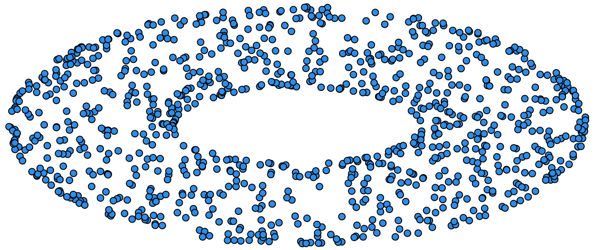{fig-align="center"}

::: {.notes}
We start with a point cloud. These points were sampled from a torus, but of course the data doesn't know that. All we have is a list of coordinates.
:::

## From points clouds to simplicial complexes

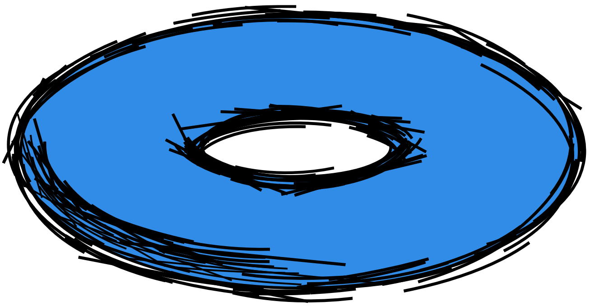{fig-align="center"}

::: {.notes}
What we'd like is to recover the surface they came from. Connect nearby points with edges, fill in triangles and so on, until we have a complex with the same topology as the torus: one piece, two loops, one void. The question is how to decide who gets connected to whom.
:::

# 

::: {style="font-size: 180%;"}
**Strategy 1: Triangulation**
:::
::: {style="font-size: 150%;"}
Constructing the data's simplicial complex
:::

::: {.notes}
Our first strategy is triangulation: construct a simplicial complex directly from the data, then read off its topology.
:::

## Vietoris-Rips construction

**Definition**

Given a set of points $\mathcal{X} = \{x_1,\dots,x_n\}$ and a metric $dist$ (such as the Euclidean distance), pick a threshold $\epsilon$ and build the Vietoris-Rips complex $\mathcal{V}_\epsilon$ defined as:

$$\mathcal{V}_\epsilon := \{\sigma \subseteq \mathcal{X} | \forall u,v \in \sigma : dist(u,v) \leq \epsilon\}$$

Equivalently, $\mathcal{V}_\epsilon$ contains all simplices whose *diameter* is less than or equal to $\epsilon$.

:::footer
Slides based on Bastian Rieck's [Topological Data Analysis for Machine Learning](https://bastian.rieck.me/talks/ecml_pkdd_2020/)
:::

::: {.notes}
The standard way to do this is using the Vietoris-Rips complex.

You pick a threshold epsilon, and a group of points forms a simplex if every pair in the group is within epsilon of each other. 

Two points close enough give you an edge. Three points that are all mutually close give you a triangle. Four give a tetrahedron, and so on. 
 
Another way to say it is that the diameter of the group, its largest pairwise distance, has to be at most epsilon.
:::

## Vietoris-Rips construction

**Example**

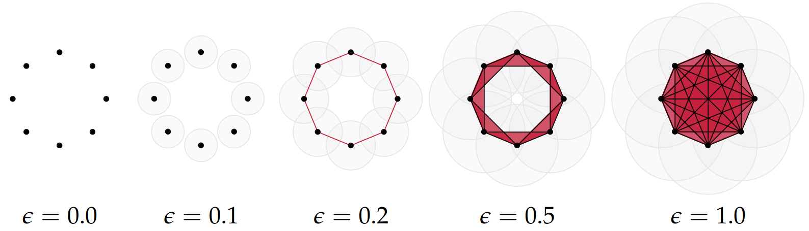{fig-align="center"}

Draw Euclidean circles of diameter $\epsilon$ and create a $k$-simplex $\sigma$ for each subset of $k+1$ points that intersect pairwise.

:::footer
Slides based on Bastian Rieck's [Topological Data Analysis for Machine Learning](https://bastian.rieck.me/talks/ecml_pkdd_2020/)
:::

::: {.notes}
Here's what it looks like on eight points arranged in a circle, as epsilon grows. 

At zero, its just the points. 

At 0.1 the discs are still apart. 

At 0.2 neighboring discs touch, we get edges, and the eight points form a cycle with an empty middle. 

At 0.5 there are lots of triangles and the cavity is almost filled. 

By 1.0 everything is connected to everything, a fully filled-in blob.
:::

## Some details about this construction

:::: {.columns}
::: {.column width="30%"}

:::
::: {.column width="70%"}
- This construction dates back to a 1927 article by Leopold Vietoris$^1$

- A 2010 paper by Afra Zomorodian$^2$ describes several construction algorithms

- The basic idea is to build higher-dimensional simplices inductively from lower-dimensional ones

- In the worst case, the Vietoris-Rips complex will contain all $2^n$ subsets of its underluing point clous $\mathcal{X}$!
:::
::::

:::footer
::: {style="font-size: 80%;"}
$^1$ Vietoris, Leopold. "Über den höheren Zusammenhang kompakter Räume und eine Klasse von zusammenhangstreuen Abbildungen." Mathematische Annalen 97.1 (1927): 454-472.

$^2$ Zomorodian, Afra. "Fast construction of the Vietoris-Rips complex." Computers & Graphics 34.3 (2010): 263-271.
:::

Slides based on Bastian Rieck's [Topological Data Analysis for Machine Learning](https://bastian.rieck.me/talks/ecml_pkdd_2020/)
:::

::: {.notes}
This idea of constructing the complex from the ground up goes back to 1927. 

A 2010 paper described efficient ways to build the complex, and the basic trick is to build it up inductively: first the edges, then triangles from the edges, then tetrahedra from the triangles. 

The catch here is that in the worst case, the complex contains all 2 to the n subsets of your points. 

So in practice you always cap the dimension.
:::

## The betti numbers of a Vietoris-Rips complex

**Example**

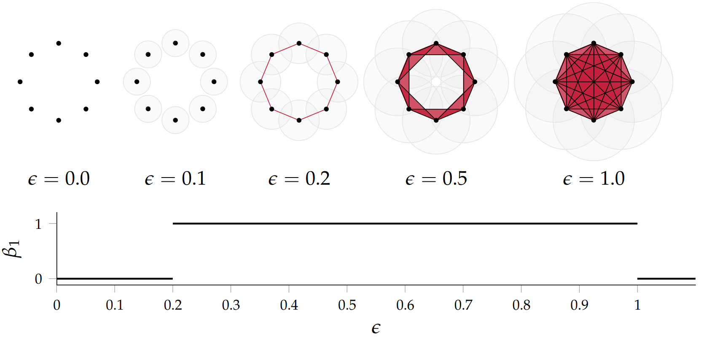{fig-align="center"}

:::footer
Slides based on Bastian Rieck's [Topological Data Analysis for Machine Learning](https://bastian.rieck.me/talks/ecml_pkdd_2020/)
:::

::: {.notes}
When we take a look at the betti numbers for this example, Beta 1 specifcailly. Remember that Beta1 counts the number of loops

You will see that for epsilon below 0.2 there's no loop, beta one is zero. 

At 0.2 the cycle closes and beta one jumps to one. It stays there until around 1.0, when the middle finally fills in and the loop dies. 

So the Betti numbers depend on epsilon, and for a wide range of epsilon this complex correctly says "this data is a circle."
:::

## Issues with this approach

\

::: {style="font-size: 120%;"}
- How to pick $\epsilon$?

- There might not be one 'correct' value for $\epsilon$.

- Computationally inefficient
:::

:::footer
Slides based on Bastian Rieck's [Topological Data Analysis for Machine Learning](https://bastian.rieck.me/talks/ecml_pkdd_2020/)
:::

::: {.notes}
The problem with this is -

The choice of epsilon, greatly affects the structure you get as we saw in the previous example, and a good value for epsilon is hard to define.

Another issue is that real data usaully has structure at several differnet scales, so there may be multiple good values for epsilon. 

This is made harder by the fact that constructing this in a high dimensional space with lots of points is computationally expensive.
:::

## Picking $\epsilon$ - Topological Persistence

**Intuition:** Go through all scales and track the topological features

:::: {.columns}
::: {.column width="50%"}
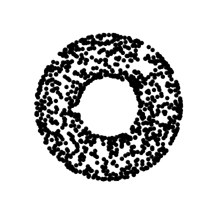
:::
::::

:::footer
Slides based on Bastian Rieck's [Topological Data Analysis for Machine Learning](https://bastian.rieck.me/talks/ecml_pkdd_2020/)
:::

::: {.notes}
One way we can narrow down to a good value for epsilon is to use persistence. Go through all scales and track topological features as they are born and die. 

So Here's our data at the start, a ring with a cavity in the middle, sampled with a fair amount of noise.
:::

## Picking $\epsilon$ - Topological Persistence

**Intuition:** Go through all scales and track the topological features

:::: {.columns}
::: {.column width="50%"}
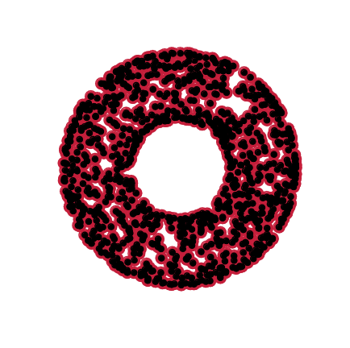
:::
::::

:::footer
Slides based on Bastian Rieck's [Topological Data Analysis for Machine Learning](https://bastian.rieck.me/talks/ecml_pkdd_2020/)
:::

::: {.notes}
Starting with a small epsilon first, because of the noise, lots of tiny cavities pop up all over the ring. But watch what happens to them.
:::

## Picking $\epsilon$ - Topological Persistence

**Intuition:** Go through all scales and track the topological features

:::: {.columns}
::: {.column width="50%"}
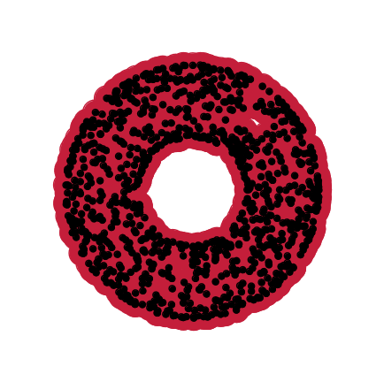
:::
::::

:::footer
Slides based on Bastian Rieck's [Topological Data Analysis for Machine Learning](https://bastian.rieck.me/talks/ecml_pkdd_2020/)
:::

::: {.notes}
They close almost immediately. Those little cavities lived only for a very short range of epsilon. The big cavity in the middle is still alive.
:::

## Picking $\epsilon$ - Topological Persistence

**Intuition:** Go through all scales and track the topological features

:::: {.columns}
::: {.column width="50%"}
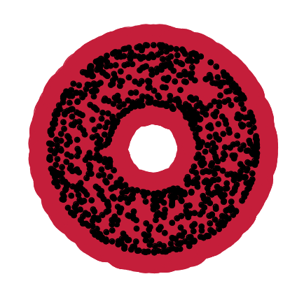
:::
::::

:::footer
Slides based on Bastian Rieck's [Topological Data Analysis for Machine Learning](https://bastian.rieck.me/talks/ecml_pkdd_2020/)
:::

::: {.notes}
Keep growing, and the central cavity is getting smaller, but it's survived a long time compared with the noise.
:::

## Picking $\epsilon$ - Topological Persistence

**Intuition:** Go through all scales and track the topological features

:::: {.columns}
::: {.column width="50%"}

:::
::: {.column width="50%"}
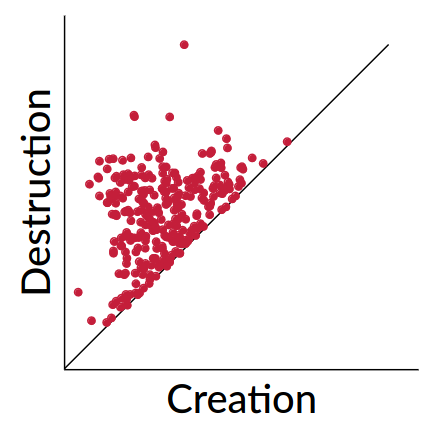
:::
::::

:::footer
Slides based on Bastian Rieck's [Topological Data Analysis for Machine Learning](https://bastian.rieck.me/talks/ecml_pkdd_2020/)
:::

::: {.notes}
Until finally it's filled in too. 

Now when you put every cavity's creation and destruction on one plot, that is the persistence diagram. 

You see there's a whole cloud of points hugging the diagonal, which is the short-lived noise, and one point sitting way above, which is the real cavity. 

So we answered the question about epsilon by not answering it. The topological features that matter are the ones that survive across a long range of scales.
:::

## Persistent homology

- A **filtration** is a growing sequence of complexes: $\mathcal{V}_{\epsilon_1} \subseteq \mathcal{V}_{\epsilon_2} \subseteq \cdots$ for $\epsilon_1 \leq \epsilon_2 \leq \cdots$

- **Homology** is the machinery that counts the holes (the Betti numbers) of each complex

- **Persistent homology** tracks every hole through the filtration: born at $b$, dead at $d$

- The output is a persistence diagram, one point $(b,d)$ per feature, with persistence $= d-b$

- Same recipe on the map: the filtration is the sea level instead of $\epsilon$

::: {.notes}
What we have did here is that we grow εpsilon, and got a nested sequence of complexes, each one containing the one before. That's called a filtration. 

For every complex in the sequence, homology is the tool that counts its cavities, and that's where the Betti numbers come from. 

Persistent homology refers to following each topological feature through the whole sequence, recording when it's born and when it dies, and the persistence diagram is the summary. 

The map example was the same thing with a different filtration. Instead of growing discs, we raised the sea level. 

So this process of  persistent homology consists of, choosing a filtration, then tracking the topological holes.
:::

# 

::: {style="font-size: 180%;"}
**Strategy 2: Data skeleton**
:::
::: {style="font-size: 150%;"}
The Mapper Algortihm
:::

::: {.notes}
The second strategy we can use is the Mapper algorithm. Instead of tracking topological holes across scales, Mapper builds a graph skeleton, that is an attempt at summarizing the shape of the data. 

:::

## Math World

\

We start in "Math World", where

- We draw the data as a smooth manifold
- Functions that appear are smooth or continuous

We will not need either of these assumptions once we are in the "Data World".

Even more importantly, data in the real world is **never** like this.

:::footer
Slides based on Anthony Bak's [Stanford Seminar - Topological Data Analysis](https://www.youtube.com/watch?v=x3Hl85OBuc0) presentation
:::

::: {.notes}
You can think of Mapper in two stages. 

First we're in what the Math World, where everything is nice and smooth: the data is a manifold and the functions on it are continuous. 

It makes the idea clean and tries to explain whats happening conceptually. 

Then we'll move to see how it actually works in the Data World, where those assumptions don't hold and you are working with high dimensional point clouds and not actual surfaces or shapes.
:::

## Math World

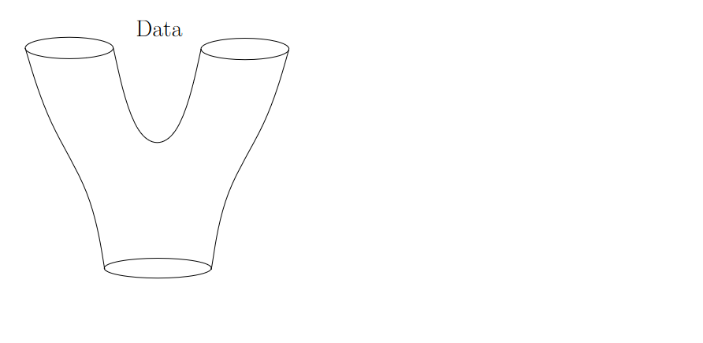{fig-align="center"}

:::footer
Slides based on Anthony Bak's [Stanford Seminar - Topological Data Analysis](https://www.youtube.com/watch?v=x3Hl85OBuc0) presentation
:::

::: {.notes}
Here's our data in the math world: a surface shaped like a Y. One tube at the bottom that splits into two at the top.

The goal here is to find the skeletal representation that best summarizes the shape of this object.
:::

## Math World

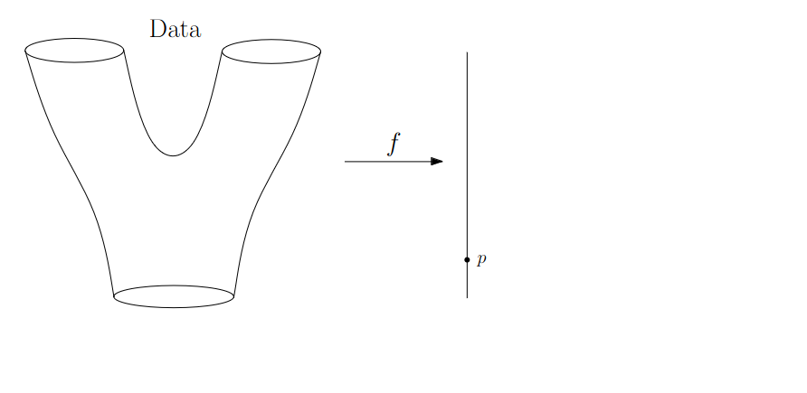{fig-align="center"}

:::footer
Slides based on Anthony Bak's [Stanford Seminar - Topological Data Analysis](https://www.youtube.com/watch?v=x3Hl85OBuc0) presentation
:::

::: {.notes}
The key is a function f from the data to a line. This is the lens we are using. 

In this example you can think of it as height along the y-axis. Each point of the object lands somewhere on this line, and p is one such value.
:::

## Math World

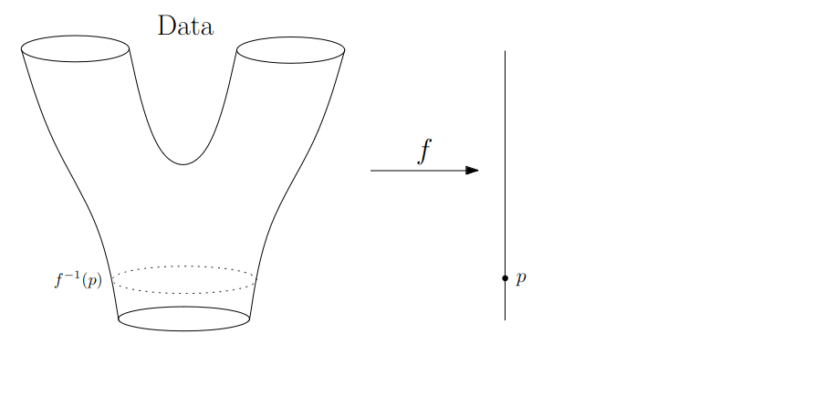{fig-align="center"}

:::footer
Slides based on Anthony Bak's [Stanford Seminar - Topological Data Analysis](https://www.youtube.com/watch?v=x3Hl85OBuc0) presentation
:::

::: {.notes}
Now look at which points of the object map to point p. That's the preimage, f inverse of p. 

For this p, near the bottom, it's a circle going around the tube.
:::

## Math World

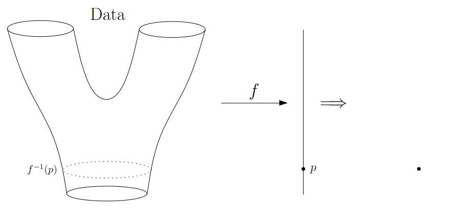{fig-align="center"}

:::footer
Slides based on Anthony Bak's [Stanford Seminar - Topological Data Analysis](https://www.youtube.com/watch?v=x3Hl85OBuc0) presentation
:::

::: {.notes}
And we represent that preimage by a single dot. One connected piece, one dot.
:::

## Math World

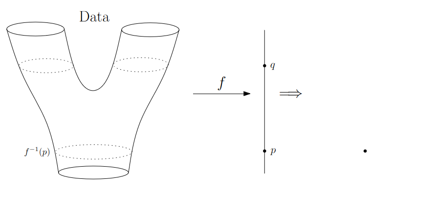{fig-align="center"}

:::footer
Slides based on Anthony Bak's [Stanford Seminar - Topological Data Analysis](https://www.youtube.com/watch?v=x3Hl85OBuc0) presentation
:::

::: {.notes}
Now pick another value, q, higher up where the tube has already split. Its preimage is two separate circles, one in each arm.
:::

## Math World

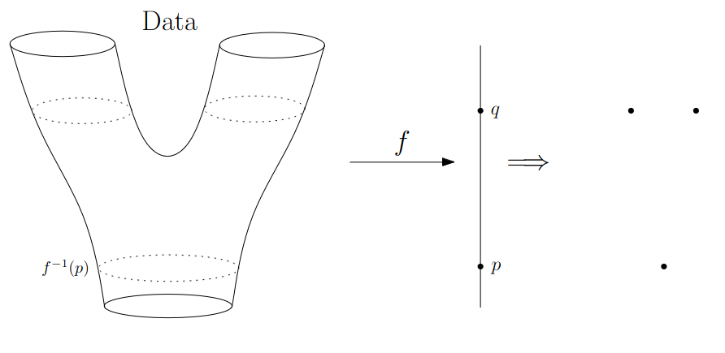{fig-align="center"}

:::footer
Slides based on Anthony Bak's [Stanford Seminar - Topological Data Analysis](https://www.youtube.com/watch?v=x3Hl85OBuc0) presentation
:::

::: {.notes}
So q gets two dots, one per connected component of its preimage. 

That's the whole recipe: basically for each value on the line, one dot for every distinct connected piece.
:::

## Math World

{fig-align="center"}

:::footer
Slides based on Anthony Bak's [Stanford Seminar - Topological Data Analysis](https://www.youtube.com/watch?v=x3Hl85OBuc0) presentation
:::

::: {.notes}
Do that for every value and connect the dots that belong together, and you get this graph which is in the shape of Y. We've recovered the branching structure of the surface from nothing but the lens function f, which in this case we defined along the y-axis.
:::

## Math World

{fig-align="center"}

:::footer
Slides based on Anthony Bak's [Stanford Seminar - Topological Data Analysis](https://www.youtube.com/watch?v=x3Hl85OBuc0) presentation
:::

::: {.notes}
Naturally, the picture you get depends on the lens function you use. Let's bring in a second function, g, that goes from the data to a different line. Say left to right instead of bottom to top.
:::

## Math World

{fig-align="center"}

:::footer
Slides based on Anthony Bak's [Stanford Seminar - Topological Data Analysis](https://www.youtube.com/watch?v=x3Hl85OBuc0) presentation
:::

::: {.notes}
We start at the extreme left end of the line, at the value p prime.
:::

## Math World

{fig-align="center"}

:::footer
Slides based on Anthony Bak's [Stanford Seminar - Topological Data Analysis](https://www.youtube.com/watch?v=x3Hl85OBuc0) presentation
:::

::: {.notes}
At the very left, the preimage is just a curve running down the side of the surface, which gives us a dot. And as we slide to the right, p prime to q prime, these stay separate curves.
:::

## Math World

{fig-align="center"}

:::footer
Slides based on Anthony Bak's [Stanford Seminar - Topological Data Analysis](https://www.youtube.com/watch?v=x3Hl85OBuc0) presentation
:::

::: {.notes}
Here those pieces close up into a loop, because the preimage of a vertical slice through one arm connects around the surface.
:::

## Math World

{fig-align="center"}

:::footer
Slides based on Anthony Bak's [Stanford Seminar - Topological Data Analysis](https://www.youtube.com/watch?v=x3Hl85OBuc0) presentation
:::

::: {.notes}
Now at the value r prime in the middle, the slice goes right through the dip between the arms, and the preimage is a single curve around the whole thing. One circle.
:::

## Math World

{fig-align="center"}

:::footer
Slides based on Anthony Bak's [Stanford Seminar - Topological Data Analysis](https://www.youtube.com/watch?v=x3Hl85OBuc0) presentation
:::

::: {.notes}
Past the middle, we get a loop on the right side too, and the two loops are joined together in the middle.
:::

## Math World

{fig-align="center"}

:::footer
Slides based on Anthony Bak's [Stanford Seminar - Topological Data Analysis](https://www.youtube.com/watch?v=x3Hl85OBuc0) presentation
:::

::: {.notes}
So with lens g, the graph comes out as two loops connected by an edge, a sort of a dumbbell. 

Both are correct pictures of the same surface, from different angles, one is from the front and the other is a top down picture.

Think of the lens function as you're defining a specific axis that you want to flatten your higher dimensional shape along.
:::

## Why is this useful?

We get "easy" understanding of the localizations of quantities of interest.

{fig-align="center"}

:::footer
Slides based on Anthony Bak's [Stanford Seminar - Topological Data Analysis](https://www.youtube.com/watch?v=x3Hl85OBuc0) presentation
:::

::: {.notes}
So how is this useful? Say there's some quantity of interest in the data, and we'd like to know where it lives.
:::

## Why is this useful?

We get "easy" understanding of the localizations of quantities of interest.

{fig-align="center"}

:::footer
Slides based on Anthony Bak's [Stanford Seminar - Topological Data Analysis](https://www.youtube.com/watch?v=x3Hl85OBuc0) presentation
:::

::: {.notes}
Suppose it's this red region, up in the right arm.
:::

## Why is this useful?

We get "easy" understanding of the localizations of quantities of interest.

{fig-align="center"}

:::footer
Slides based on Anthony Bak's [Stanford Seminar - Topological Data Analysis](https://www.youtube.com/watch?v=x3Hl85OBuc0) presentation
:::

::: {.notes}
In the Y graph it shows up exactly where you'd hope, as a small red spot on the right arm. You can see where it is without ever looking at the raw data.
:::

## Why is this useful?

We get "easy" understanding of the localizations of quantities of interest.

{fig-align="center"}

:::footer
Slides based on Anthony Bak's [Stanford Seminar - Topological Data Analysis](https://www.youtube.com/watch?v=x3Hl85OBuc0) presentation
:::

::: {.notes}
Now add a second region, in blue, right next to the red one. 

In the Y graph the two blur into one purple spot. 

Lens f can't tell them apart, since they have almost the same y value which is the lens being used in f.
:::

## Why is this useful?

We get "easy" understanding of the localizations of quantities of interest.

{fig-align="center"}

:::footer
Slides based on Anthony Bak's [Stanford Seminar - Topological Data Analysis](https://www.youtube.com/watch?v=x3Hl85OBuc0) presentation
:::

::: {.notes}
But lens g does separate them. In the dumbbell, red and blue show up as two distinct spots on the right loop. So a poor lens for one question can be a good lens for another.
:::

## Why is this useful?

We get "easy" understanding of the localizations of quantities of interest.

{fig-align="center"}

:::footer
Slides based on Anthony Bak's [Stanford Seminar - Topological Data Analysis](https://www.youtube.com/watch?v=x3Hl85OBuc0) presentation
:::

::: {.notes}
Another quantity of interest: this green strip running down the left side of the surface, all the way from the top to the bottom.
:::

## Why is this useful?

We get "easy" understanding of the localizations of quantities of interest.

{fig-align="center"}

:::footer
Slides based on Anthony Bak's [Stanford Seminar - Topological Data Analysis](https://www.youtube.com/watch?v=x3Hl85OBuc0) presentation
:::

::: {.notes}
Here the Y graph does the job nicely. The green lights up the left arm and the stem, so you immediately see that this feature follows one branch of the data from end to end.
:::

## Why is this useful?

We get "easy" understanding of the localizations of quantities of interest.

- Lenses inform us where in the space to look for phenomena.
- For easy localizations many different lenses will be informative.
- For hard (= geometrically distributed) localizations we have to be more careful. But even then, we frequently get incremental knowledge from a poorly chosen lens.

:::footer
Slides based on Anthony Bak's [Stanford Seminar - Topological Data Analysis](https://www.youtube.com/watch?v=x3Hl85OBuc0) presentation
:::

::: {.notes}

In essence the lens is the tool you use to define from which perspective you want to look at the data. 

If the thing you care about is easy to localize, almost any reasonable lens will reveal it. 

Also, even a poorly chosen lens usually teaches you something, and you can always try multiple lenses.
:::

## Data World - Mapper

We need to adjust the "Math World" view to bring the algorithm into the "Data World"

- We replace points with open sets in the range of the lens
- We replace "connected component of the inverse image" with "clusters in the inverse image"
- We connect clusters (nodes) with an edge if they share points in common.

:::footer
Slides based on Anthony Bak's [Stanford Seminar - Topological Data Analysis](https://www.youtube.com/watch?v=x3Hl85OBuc0) presentation
:::

::: {.notes}
When you move from the math world to the data world, a few things come up. 

First, we can't look at single values on the lens function, because a sample won't have many points at exactly one value of the lens, so we use overlapping intervals over the lens function instead. 

Second, "connected component" doesn't mean anything for a bunch of points the way it does for physical surfaces, so we cluster the points inside each interval. 

Third, we draw an edge between two clusters if they share data points, which is why the overlapping interval matter. 

So, In practice your choices are the lens, how many intervals over the lens functions values, how much they overlap, and which clustering algorithm to use.
:::

## Data World - Mapper

{fig-align="center"}

:::footer
Slides based on Anthony Bak's [Stanford Seminar - Topological Data Analysis](https://www.youtube.com/watch?v=x3Hl85OBuc0) presentation
:::

::: {.notes}
Going back to our Y-shaped example, with the lens f again. 

But this time, remember, we don't have the surface. We only get a point cloud sampled from the surface.
:::

## Data World - Mapper

{fig-align="center"}

:::footer
Slides based on Anthony Bak's [Stanford Seminar - Topological Data Analysis](https://www.youtube.com/watch?v=x3Hl85OBuc0) presentation
:::

::: {.notes}
Here are the sampled points. Again I want to stress that the outline of the shape here is now just for guidance and doesn't actually exist. All we have is the point cloud. 

So we take the first interval of the lens, U1, at the bottom, and grab all the points whose lens value falls in it. 

We cluster those points, and here we get two clusters, so we get two nodes - which is roughly analogous to connected components in the math world.
:::

## Data World - Mapper

{fig-align="center"}

:::footer
Slides based on Anthony Bak's [Stanford Seminar - Topological Data Analysis](https://www.youtube.com/watch?v=x3Hl85OBuc0) presentation
:::

::: {.notes}
Next interval, U2. Notice that it there is partial overlap beween U1 and U2, so there are some points belong to both U1 and U2.
:::

## Data World - Mapper

{fig-align="center"}

:::footer
Slides based on Anthony Bak's [Stanford Seminar - Topological Data Analysis](https://www.youtube.com/watch?v=x3Hl85OBuc0) presentation
:::

::: {.notes}
Then we cluster the points in U2 as well, and we get two more nodes. So four nodes so far.
:::

## Data World - Mapper

{fig-align="center"}

:::footer
Slides based on Anthony Bak's [Stanford Seminar - Topological Data Analysis](https://www.youtube.com/watch?v=x3Hl85OBuc0) presentation
:::

::: {.notes}
Now for the edges, Whenever a cluster from U1 and a cluster from U2 have points in common, we connect them. Those shared points come from the overlap region.
:::

## Data World - Mapper

{fig-align="center"}

:::footer
Slides based on Anthony Bak's [Stanford Seminar - Topological Data Analysis](https://www.youtube.com/watch?v=x3Hl85OBuc0) presentation
:::

::: {.notes}
Essentially nodes are clusters of data points, and edges represent shared points between clusters.
:::

## Data World - Mapper

{fig-align="center"}

:::footer
Slides based on Anthony Bak's [Stanford Seminar - Topological Data Analysis](https://www.youtube.com/watch?v=x3Hl85OBuc0) presentation
:::

::: {.notes}
Then we just repeat for the next interval up. A new set of clusters, new nodes, and new edges wherever they share points with the layer below.
:::

## Data World - Mapper

{fig-align="center"}

:::footer
Slides based on Anthony Bak's [Stanford Seminar - Topological Data Analysis](https://www.youtube.com/watch?v=x3Hl85OBuc0) presentation
:::

::: {.notes}
Same thing again. The graph grows one layer at a time.
:::

## Data World - Mapper

{fig-align="center"}

:::footer
Slides based on Anthony Bak's [Stanford Seminar - Topological Data Analysis](https://www.youtube.com/watch?v=x3Hl85OBuc0) presentation
:::

::: {.notes}
A new cluster appears at the top here. It hasn't connected to anything yet, and it will once we cover the next interval.

We're moving up through the part where the surface starts to split.
:::

## Data World - Mapper

{fig-align="center"}

:::footer
Slides based on Anthony Bak's [Stanford Seminar - Topological Data Analysis](https://www.youtube.com/watch?v=x3Hl85OBuc0) presentation
:::

::: {.notes}
Here the data is branched, so one intervals now contains several separate clusters. 

That's where the graph starts to fork, which is the whole point of clustering inside each interval.
:::

## Data World - Mapper

{fig-align="center"}

:::footer
Slides based on Anthony Bak's [Stanford Seminar - Topological Data Analysis](https://www.youtube.com/watch?v=x3Hl85OBuc0) presentation
:::

::: {.notes}
Two branches are now clearly visible, growing out of the stem.
:::

## Data World - Mapper

{fig-align="center"}

:::footer
Slides based on Anthony Bak's [Stanford Seminar - Topological Data Analysis](https://www.youtube.com/watch?v=x3Hl85OBuc0) presentation
:::

::: {.notes}
Both arms are filling in. Just a few intervals left at the top.
:::

## Data World - Mapper

{fig-align="center"}

:::footer
Slides based on Anthony Bak's [Stanford Seminar - Topological Data Analysis](https://www.youtube.com/watch?v=x3Hl85OBuc0) presentation
:::

::: {.notes}
Another interval, another handful of clusters, and the left arm is taking shape.
:::

## Data World - Mapper

{fig-align="center"}

:::footer
Slides based on Anthony Bak's [Stanford Seminar - Topological Data Analysis](https://www.youtube.com/watch?v=x3Hl85OBuc0) presentation
:::

::: {.notes}
And the right arm. Almost there.
:::

## Data World - Mapper

{fig-align="center"}

:::footer
Slides based on Anthony Bak's [Stanford Seminar - Topological Data Analysis](https://www.youtube.com/watch?v=x3Hl85OBuc0) presentation
:::

::: {.notes}
Finally we have the finished graph. Two branches at the top, one stem at the bottom. 

That's the Y shape we started with, rebuilt from nothing but points, a lens and a clustering step. 

Remember that each node is a cluster of data points, and nodes that have some datapoints in common get connected with each other.
:::

## Putting it together

| | Persistent homology | Mapper |
|---|---|---|
| **Idea** | Grow a complex across all scales | Cover the lens range, cluster, connect |
| **Output** | Persistence diagram | Graph (a skeleton of the data) |
| **Tells you** | How many pieces, loops, voids, and which are real | Branches, loops, where quantities concentrate |
| **You choose** | Metric, maximum dimension | Lens, intervals, overlap, clustering |
| **In ML** | Features and distances between diagrams | Exploring and visualizing complex data |

::: {.notes}
We saw two approaches to Topological Data Analysis today, and they answer slightly different questions. 

Persistent homology asks what the shape is: how many pieces, loops and voids, and which of them are real because they survive across scales. 

Mapper asks what the data looks like, and gives you a graph you can paint with any quantity you care about and visualize. 

Both need some choices from you, a metric in one case, a lens and cover in the other.
:::

## TDA vs. t-SNE and UMAP

| | t-SNE / UMAP | TDA (persistence, Mapper) |
|---|---|---|
| **Goal** | Low-dimensional picture that keeps local neighborhoods | Summary of global shape: pieces, loops, voids, branches |
| **Output** | Points in the plane | Diagram or graph |
| **Strength** | Quick look at clusters | Quantifies structure, stable to small noise |
| **Watch out** | Layout, distances and cluster sizes can mislead, and depend on hyperparameters | Choice of lens or metric, cost on large data |

**Together:** check whether an embedding kept the topology, or use an embedding coordinate as a Mapper lens.

::: {.notes}
So the natural question is why not just run UMAP? They're doing slightly different jobs. 

t-SNE and UMAP give you a 2D layout that tries to keep neighbors together. That's great for spotting clusters, but the global layout, the distances between blobs and the sizes of clusters can be misleading.

TDA gives you a summary of the global shape, like how many loops or branches there are. The sizes of clusters in TDA are more informative as well.

In practice TDA and projection methods complement each other well. 
 
You can compute persistence on an embedding to check whether it preserved the structure of the original data, or you can use a UMAP coordinate as the lens in Mapper. And actually, UMAP itself is built on topological ideas, so these approaches are cousins. 
:::

## Takeaways

- Topology keeps *connectivity* and throws away exact geometry
- In persistence, long-lived features are signal and short-lived ones are noise
- In Mapper, the **lens** decides what you see, so try more than one
- These summarize shape; they complement PCA, t-SNE and UMAP rather than replace them

Questions?

::: {.notes}
To summarize,  Topology is the mathematical field that cares about connectivity between objects. 

Topological data analysis applies topology to high dimensional data. By treating point clouds as shapes, you can investigate their global structure and visualize these graph skeletons of datasets. 

:::

# To look further

::: {.notes}
That's the tour. If you want to go further, here are some pointers.
:::

## References

- For more information about the persistence diagram, see Vincent Divol's [CDS Lunch Seminar](https://cds.nyu.edu/data-science-lunch-seminar-series/) presentation “Quantifying the topology of datasets using Topological Data Analysis”

- For more information about the mapper algorithm, see Anthony Bak's [Stanford Seminar - Topological Data Analysis](https://www.youtube.com/watch?v=x3Hl85OBuc0) presentation

- To learn more about TDA for Machine Learning, see Bastian Rieck's
 [Topological Data Analysis for Machine Learning](https://bastian.rieck.me/talks/ecml_pkdd_2020/) tutorial (around 4 hours total)

- For a course in TDA, see Raphaël Tinarrage's [Topological Data Analysis with Persistent Homology](https://raphaeltinarrage.github.io/EMAp.html) summer course

::: {.notes}
Most of today's slides were adapted from these four sources, so they're the best place to go for more detail. Divol for persistence diagrams, Bak for Mapper, Rieck if you want the machine learning angle, and Tinarrage if you'd like a full course.
:::

## References - Books

**Foundational Textbooks:**

- Edelsbrunner, H., & Harer, J. L. (2022). *Computational Topology: An Introduction*. American Mathematical Society. [DOI: 10.1090/mbk/069](https://doi.org/10.1090/mbk/069)

- Dey, T. K., & Wang, Y. (2022). *Computational Topology for Data Analysis*. Cambridge University Press. [DOI: 10.1017/9781009099950](https://doi.org/10.1017/9781009099950)

- Carlsson, G., & Vejdemo-Johansson, M. (2021). *Topological Data Analysis with Applications*. Cambridge University Press. [DOI: 10.1017/9781108975704](https://doi.org/10.1017/9781108975704)

**Introductory Paper:**

- Chazal, F., & Michel, B. (2021). [An Introduction to Topological Data Analysis: Fundamental and Practical Aspects for Data Scientists](https://doi.org/10.3389/frai.2021.667963). *Frontiers in Artificial Intelligence*, 4, 108.

::: {.notes}
For books, Edelsbrunner and Harer is the classic on the computational side. Dey and Wang is newer and aimed at data analysis, and Carlsson and Vejdemo-Johansson cover applications. If you only read one thing, make it the Chazal and Michel paper. It's written for data scientists and is a good overview.
:::

## References - Software & Applications

**TDA in Python:**

- [GUDHI](https://gudhi.inria.fr/) - Comprehensive TDA library (C++ and Python)
- [scikit-tda](https://docs.scikit-tda.org/en/latest/) - Scikit-learn compatible TDA tools
- [Ripser.py](https://ripser.scikit-tda.org/en/latest/) - Fast Vietoris-Rips implementation
- [KeplerMapper](https://kepler-mapper.scikit-tda.org/en/latest/) - Fast Mapper implementation

**Visualization Tools:**

- [Topology ToolKit](https://topology-tool-kit.github.io/) - Open-source TDA visualization library

**Applications & Examples:**

- [DONUT - Database of Original & Non-Theoretical Uses of Topology](https://donut.topology.rocks/)
- [Applied Algebraic Topology Research Network](https://www.aatrn.net/seminar) - Seminar series

::: {.notes}
And if you want to try this yourself, everything is available in Python. Ripser is the fast one for persistence on point clouds, GUDHI is the most complete, scikit-tda plays nicely with scikit-learn, and KeplerMapper does Mapper. The Topology ToolKit is great for visualization. And DONUT is a database of real applications, which is a good place to find examples close to your own data. Happy to take questions.
:::
