## Today

```{python}
#| include: false
import numpy as np
import pandas as pd
import matplotlib.pyplot as plt
from matplotlib.patches import Patch
from matplotlib.lines import Line2D
from scipy.stats import ks_2samp
from sklearn.linear_model import Ridge, LogisticRegression
from sklearn.ensemble import GradientBoostingRegressor
from sklearn.model_selection import KFold, TimeSeriesSplit, cross_val_score

plt.rcParams.update({"font.size": 20, "axes.spines.top": False, "axes.spines.right": False,
                     "axes.titlesize": 22, "legend.frameon": False})
PURPLE, VIOLET, GRAY, ORANGE, TEAL, RED = "#57068c", "#8900e1", "#6d6d6d", "#e08214", "#1b9e77", "#c62828"

# One synthetic daily series used on all the forecasting slides: three years of "daily demand"
# = level + upward trend + yearly cycle + weekly cycle + autocorrelated noise.
rng = np.random.default_rng(7)
N = 3 * 365
t = np.arange(N)
dates = pd.date_range("2023-01-01", periods=N, freq="D")
dow = dates.dayofweek.values                     # 0 = Monday
WEEK = np.array([40, 55, 60, 65, 90, -120, -190])  # Mon..Sun effect
ar = np.zeros(N)
for i in range(1, N):
    ar[i] = 0.8 * ar[i - 1] + rng.normal(0, 30)
y = 1000 + 0.45 * t + 140 * np.sin(2 * np.pi * (t - 100) / 365.25) + WEEK[dow] + ar

def calendar_features(tt, weekly=True):
    """Time index, yearly Fourier pair and (optionally) day-of-week dummies."""
    d = (tt + dates[0].dayofweek) % 7
    cols = [tt, np.sin(2 * np.pi * tt / 365.25), np.cos(2 * np.pi * tt / 365.25)]
    if weekly:
        cols += [(d == k).astype(float) for k in range(6)]
    return np.column_stack(cols)

def mae(a, b):
    return float(np.mean(np.abs(np.asarray(a) - np.asarray(b))))

SPLIT = N - 120                                   # last 120 days are "the future"
X_all = calendar_features(t)
lin = Ridge(alpha=1e-3).fit(X_all[:SPLIT], y[:SPLIT])
pred = lin.predict(X_all)
resid = y - pred
```

1. **Temporal data basics**: events and measurements, time structures, aggregation
2. **Charts for time**: line charts and aspect ratio, many series, heat maps, horizon charts
3. **Evaluating a forecast**: prediction intervals, time-ordered validation, residuals, horizon
4. **Drift and monitoring**: when a deployed model goes stale, and how to see it
5. **Anomaly detection**: showing anomalies in context, and the threshold trade-off

*Parts 1 and 2 are based on materials by Enrico Bertini (NYU Tandon).*

::: {.notes}
TIMING (120 min): parts 1 and 2 about 45 min, part 3 about 30, part 4 about 25, part 5 about 15. If part 2 runs long, skip the two 'Building a horizon chart' slides.

Last week Pari covered topological data analysis. Today is time: first how to draw temporal data well (parts 1 and 2, about 50 minutes), then three places where time changes how we evaluate and monitor a model (parts 3 to 5, about 60 minutes).

Parts 3 to 5 connect back to Week 3, model assessment. Everything there assumed the test set looks like the training set. With time in the data that assumption fails in specific, visible ways.

All the charts in parts 3 to 5 are computed in this deck from synthetic data, so that we know the ground truth (where the drift starts, which points are anomalies). Each one says so.
:::

# Temporal Data Basics {background-color="#57068c"}

## What is temporal data?

**Data in which values depend on time, and time is explicitly recorded.**

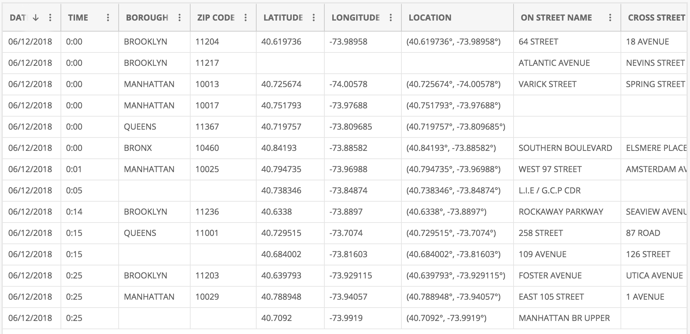{fig-align="center"}

::: {.notes}
The table is a list of incidents in New York City just after midnight on June 12, 2018. The DAT and TIME columns are what make it temporal: each row is one event with a timestamp, plus where it happened (borough, zip code, latitude and longitude, street names).

Ask: what datasets have you worked with that have time in them? How is time recorded, and at what granularity?

Ordered data is not automatically temporal. A ranking has an order but no timestamps.
:::

## Two kinds of temporal data

:::: {.columns}
::: {.column width="50%"}
### Event data

**Time + object (with attributes)**

"Something happened at time T"

* A tweet, an email, an alarm, a model prediction request
* Often irregular: events happen when they happen
* Question: when, how often, in what order?
:::
::: {.column width="50%"}
### Measurement data

**Time + measure(s)**

"This was the value at time T"

* Temperature, revenue, a stock price, daily model accuracy
* Usually sampled at regular intervals
* Question: how does the value change?
:::
::::

**Counting events per interval turns event data into measurement data.**

::: {.notes}
The table on the previous slide is event data: each row happened once, at its own time.

Measurement data is what most people mean by 'time series': a value recorded at each time step.

The line between them is aggregation. Count incidents per day and you have a measurement series. That is also how most ML monitoring works: individual predictions are events, weekly accuracy is a measurement. We come back to this in part 4.
:::

## Three time structures

1. **Sequential**: time as a line (Jan 1, ..., Dec 31). Shows trends and change.
2. **Cyclic**: time as a repeating cycle (Mon, Tue, ..., Sun). Shows rhythms.
3. **Hierarchical**: nested resolutions (year / month / week / day / hour). Allows drill-down.

**Most real series have all three at once. You choose which one a chart emphasizes.**

::: {.notes}
Website traffic is the standard example: it grows over years (sequential), it dips every weekend (cyclic), and you can look at it by hour, day or month (hierarchical).

For ML this is also a statement about features. A model that only sees a time index can learn the trend. To learn the weekly rhythm it needs day-of-week as an input. We will see what a model's errors look like when that feature is missing (part 3).
:::

## The same orders, two time structures

:::: {.columns}
::: {.column width="50%"}
**Sequential: sales by month, 2013 to 2016**

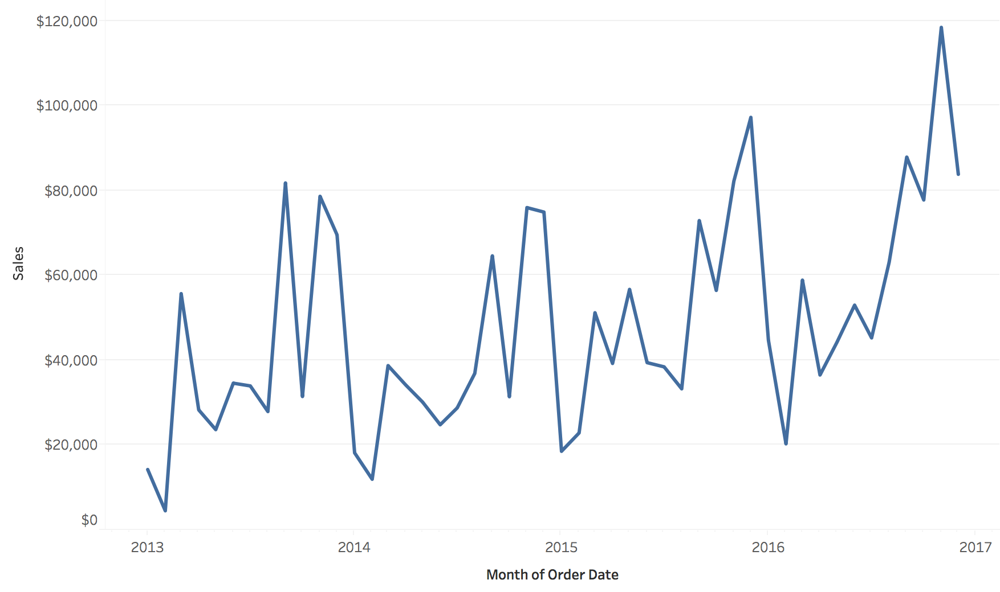{height="500" fig-align="center"}
:::
::: {.column width="50%"}
**Cyclic: number of orders by day of the week**

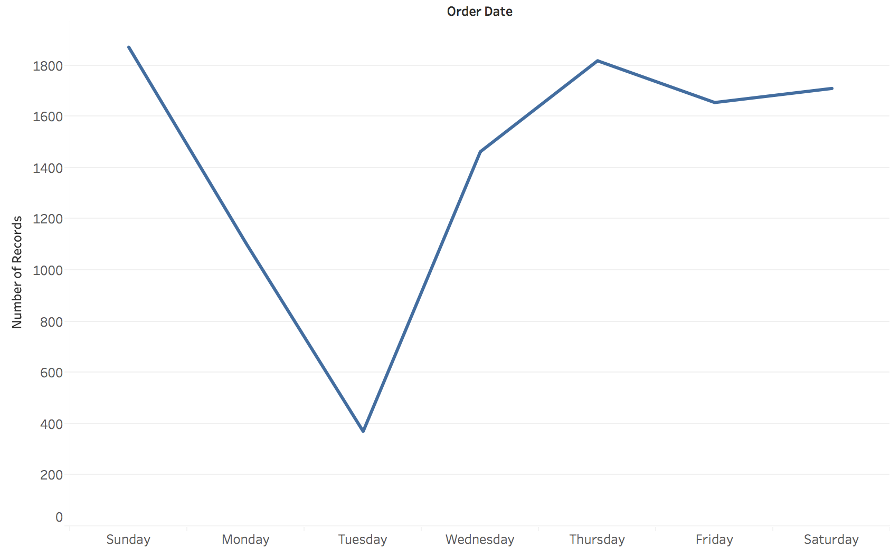{height="500" fig-align="center"}
:::
::::

**Neither chart can show what the other shows.**

* Left answers: is the business growing, and when are the peaks?
* Right answers: which day of the week is slow?
* Same order records both times. Choosing the bin (month or weekday) is choosing the question.

::: {.notes}
Left: monthly sales over four years. You can see growth and a spiky pattern that repeats toward the end of each year. You cannot see anything about weekdays.

Right: the same order records, counted by day of the week. Tuesday is the low point by a wide margin, under 400 orders against roughly 1,450 to 1,900 on the other days. You cannot see anything about growth.

Same data, two aggregations, two different stories.
:::

## Aggregation is a design decision

:::: {.columns}
::: {.column width="50%"}
**What aggregation buys**

* Less noise
* Visible long-term trends
* A manageable number of points

*Daily to monthly averages makes a seasonal pattern readable.*
:::
::: {.column width="50%"}
**What aggregation costs**

* Short events disappear
* Extreme values are averaged away
* The pattern can depend on the bin size

*A one-hour outage is invisible in a monthly average.*
:::
::::

**Choose the granularity from the question: trends want coarse bins, anomalies want fine ones.**

::: {.notes}
You cannot avoid aggregating: raw data at the finest granularity rarely fits on a screen. But every choice hides something.

For monitoring a model this is a real trade-off. Weekly accuracy is stable enough to read, and it will hide a failure that lasted an afternoon.

A common answer is interaction: let the reader change the bin size, or show an overview with a detail view beside it.
:::

# Charts for Time {background-color="#57068c"}

## Line charts: time on x, value on y

**Position encodes both time and value; the line's slope encodes the rate of change.**

{fig-align="center"}

::: {.notes}
The default chart for measurement data, here quarterly sales from 2013 to 2016.

Because the line connects consecutive points, the reader's eye goes to slopes: where it rises, where it falls, how steeply. That is exactly why the next slides matter. The slope you see depends on the shape of the chart.
:::

## The same data at three aspect ratios

**The aspect ratio (width / height) changes how steep every change looks.**

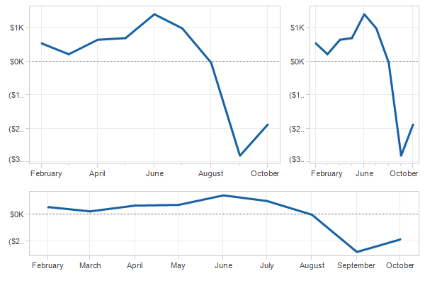{fig-align="center"}

::: {.notes}
Three panels, one series (February to October). In the tall narrow panel the drop after August looks like a cliff. In the wide flat panel at the bottom the same drop looks moderate.

Nothing about the data changed. Plotting libraries pick a default aspect ratio, and that default is making a claim about how dramatic your data is.
:::

## Banking to 45°

:::: {.columns}
::: {.column width="40%"}
* We compare the slopes of line segments most accurately when they are **near 45°**
* **Banking to 45°**: choose the aspect ratio so the typical segment has a 45° slope
* Right: Canadian lynx trappings, 1821 to 1934
* Wide and flat (bottom): each cycle **rises slowly and falls quickly**, which the tall version hides
:::
::: {.column width="60%"}
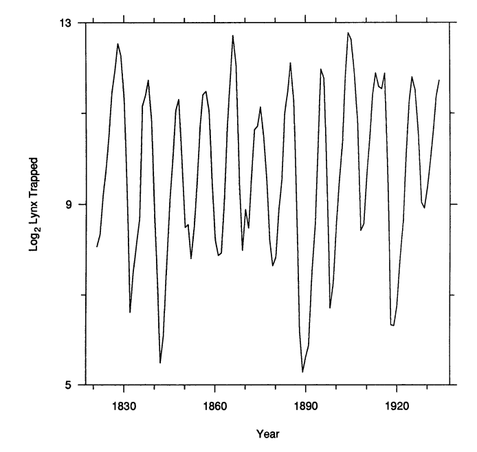{height="560" fig-align="center"}

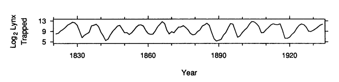{width="100%"}
:::
::::

:::footer
Cleveland, W. S., McGill, M. E., & McGill, R. (1988). [*The shape parameter of a two-variable graph*](https://doi.org/10.1080/01621459.1988.10478598). JASA.
:::

::: {.notes}
Both plots are from Cleveland, McGill and McGill (1988): the log of the number of lynx trapped each year.

In the tall plot the cycles are obvious, about ten years apart, but every segment is nearly vertical, so you cannot compare a rise with a fall.

In the banked plot the segments sit near 45 degrees and an asymmetry appears: the population climbs gradually and crashes fast. That is a real feature of the data that one aspect ratio shows and the other does not.

Practical rule: try more than one aspect ratio before you settle.
:::

## Several series: color by category

**Three categories on shared axes are easy to compare.**

{fig-align="center"}

::: {.notes}
Quarterly sales for three customer segments: Consumer, Corporate and Home Office. With three lines, color works: you can follow each one and see that they move together, with Consumer highest in almost every quarter.

The next slide is the same idea with seventeen lines.
:::

## The spaghetti plot

**Seventeen categories on shared axes: color runs out and lines hide each other.**

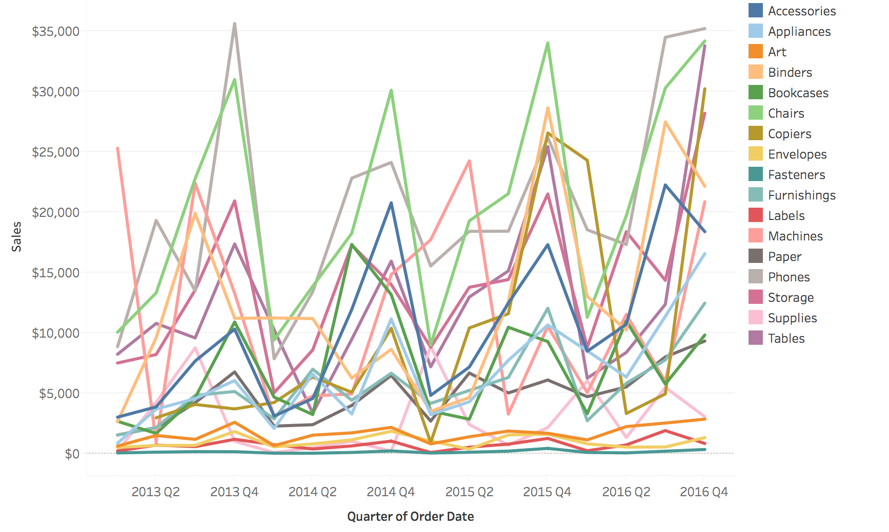{fig-align="center"}

::: {.notes}
Same sales data, now split into seventeen product sub-categories.

Ask: what can you still read here? The overall envelope, and maybe the top one or two series. What can't you read? Any individual series in the middle, or a comparison between two specific ones.

This is the chart you get if you plot per-class or per-segment model metrics over time with default settings.
:::

## Two fixes: filter, or highlight

:::: {.columns}
::: {.column width="50%"}
**Filter: show only the series you care about**

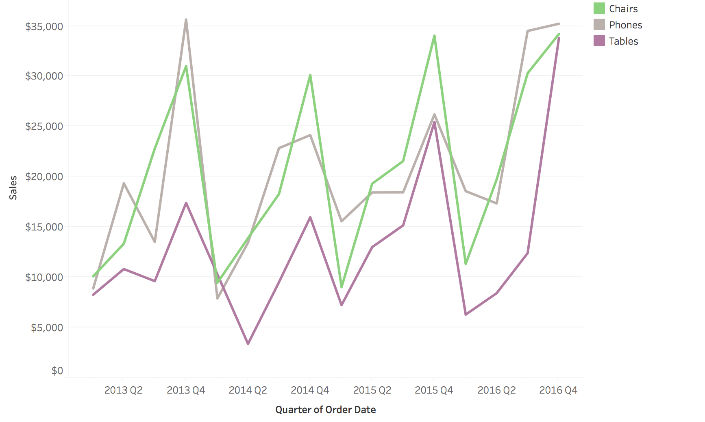{height="500" fig-align="center"}
:::
::: {.column width="50%"}
**Highlight: keep the rest as faded context**

{height="500" fig-align="center"}
:::
::::

* **Filtering** removes the context: are these three series typical?
* **Highlighting** keeps the context, at the cost of some clutter
* A third fix is **small multiples**: one small chart per series on shared axes. Nothing is hidden, but two series are harder to overlay.

::: {.notes}
Left: only Chairs, Phones and Tables are drawn. Clean, but you no longer know whether these three are typical.

Right: the same three are emphasized and the other fourteen stay as faint lines. You can read the three and still see where they sit relative to everything else. In an interactive tool this is what hovering or selecting does.

Small multiples give every series its own panel. You lose the ability to overlay two series precisely, and gain a view where nothing is hidden. Several of the charts in parts 3 to 5 are small multiples with a shared time axis.
:::

## Stacked areas are hard to read

:::: {.columns}
::: {.column width="50%"}
**Four regions as lines**

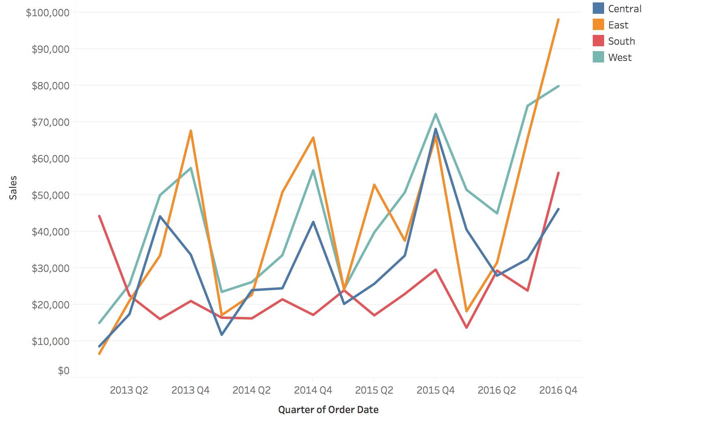{height="500" fig-align="center"}
:::
::: {.column width="50%"}
**The same four regions stacked**

{height="500" fig-align="center"}
:::
::::

**Only the bottom layer and the total have a flat baseline. Every other layer rides on the ones below it.**

* Left: comparing any two regions takes a glance, but the total is not drawn
* Right: the total is the top edge, but try to say whether South (red) rose or fell in a given quarter
* Stack when the total and the bottom layer are what matter

::: {.notes}
Both charts show quarterly sales for four regions: Central, East, South and West.

On the right, try to say whether South (the red layer) went up or down in a given quarter. It is hard, because its baseline is the top of West, which is moving. On the left the same question takes a second.

The stacked version does one thing the lines do not: it shows the total. Use it when the total and the bottom layer are what matter.
:::

## Heat maps: time on one axis, categories on the other

**Color replaces height, so many series fit in the space of one line chart.**

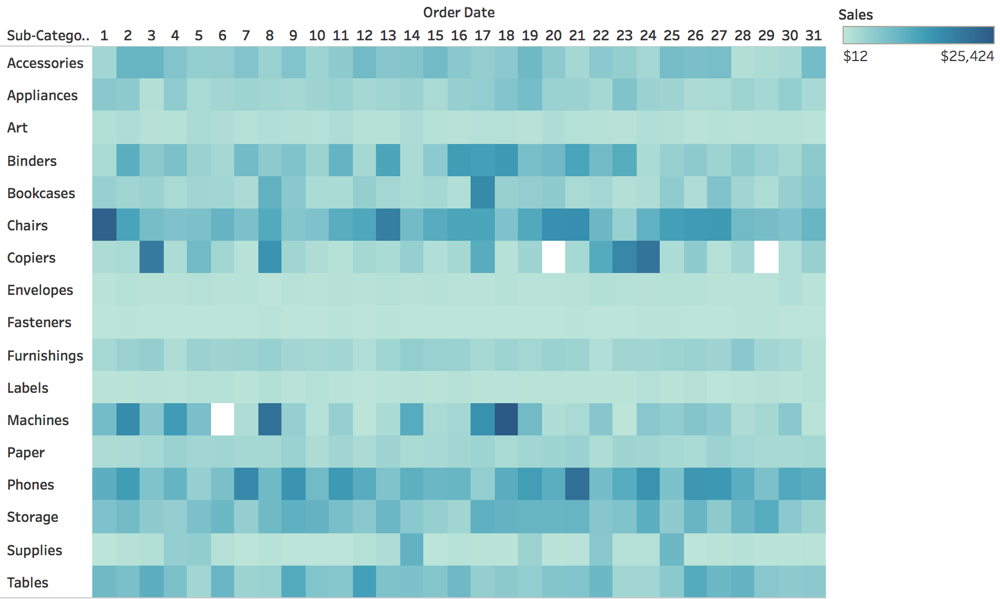{fig-align="center"}

::: {.notes}
Rows are the seventeen product sub-categories from the spaghetti plot. Columns are the day of the month, 1 to 31. Color is sales, light to dark.

Now all seventeen are readable at once: the Chairs and Phones rows are dark across the whole month, and Machines has a few very dark days. What you give up is precision, since color is a much weaker channel for magnitude than position (Week 2).

This layout, entities by time with color for a metric, is one of the most useful for model monitoring: features by week, classes by week, customer segments by day.
:::

## Measles in the United States, by state and year

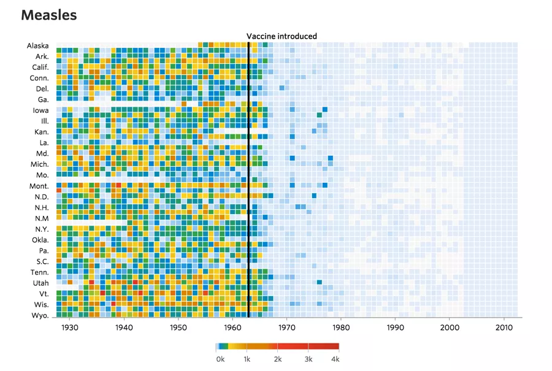{fig-align="center"}

:::footer
DeBold, T., & Friedman, D. (2015). [*Battling Infectious Diseases in the 20th Century: The Impact of Vaccines*](http://graphics.wsj.com/infectious-diseases-and-vaccines/). The Wall Street Journal.
:::

::: {.notes}
One row per US state, one column per year, color for measles cases (the scale runs from 0 to 4k). The black vertical line marks the introduction of the vaccine in 1963.

To the left of the line almost every cell is colored. Within a few years to the right the grid turns pale and stays that way.

This is the same visual signature as a change point in a monitored model: a before, an after, and an annotation that says what happened at the boundary. Annotating known events on the time axis is something every monitoring chart later in this lecture does.
:::

## Calendar heat maps

:::: {.columns}
::: {.column width="40%"}
* A heat map laid out by the calendar: **rows are weekdays, columns are weeks**
* Weekly rhythm reads down a column, seasonal rhythm across a row
* Here: daily bike-share rides, 2014 to mid-2017
* Summers are bright, winters dark, every year
:::
::: {.column width="60%"}
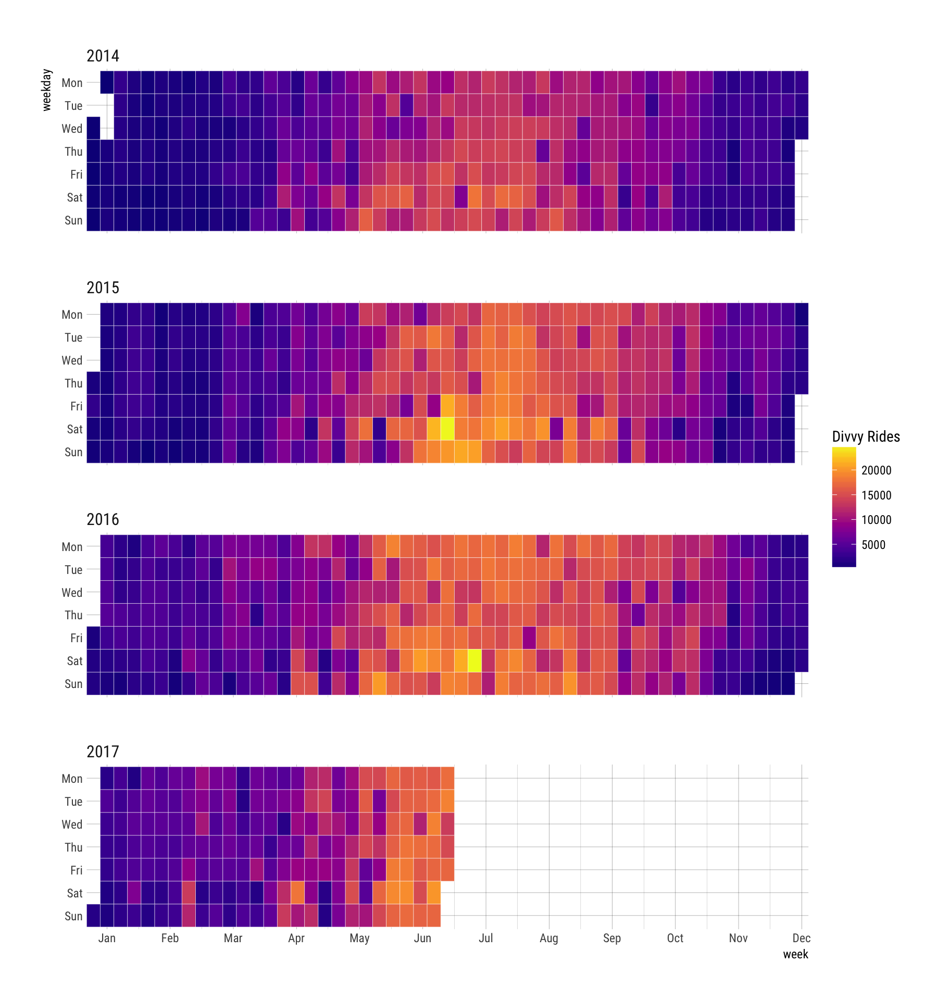{height="760" fig-align="center"}
:::
::::

::: {.notes}
Each block is one year of daily Divvy (Chicago bike-share) rides. Rows run Monday to Sunday and columns are weeks from January to December. The last block stops in June because the data ends there.

The seasonal pattern dominates: ridership peaks in the middle of each year. Within the summer months the brightest cells are in the weekend rows.

This is the cyclic and the sequential structure in one picture. The GitHub contribution graph is the same design.
:::

## Horizon charts: many series in little space

:::: {.columns}
::: {.column width="50%"}
**Line charts squeezed into thin rows**

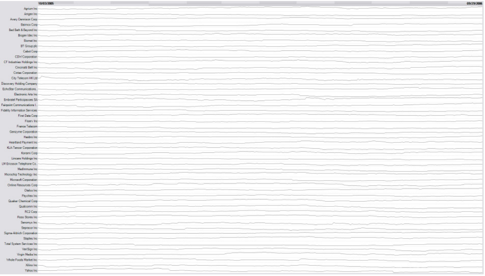{height="480" fig-align="center"}
:::
::: {.column width="50%"}
**The same rows as horizon charts**

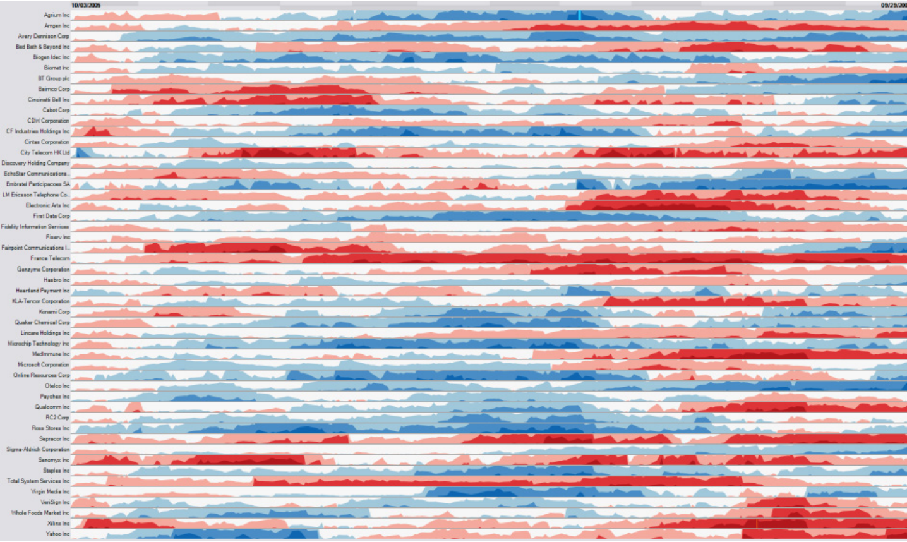{height="480" fig-align="center"}
:::
::::

**Same data, same space. The next two slides show how the right-hand version is built.**

* Left: about fifty line charts, each a few pixels tall. They all look flat.
* Right: blue is above the baseline, red below, and darker is further from it

:::footer
Heer, J., Kong, N., & Agrawala, M. (2009). [*Sizing the horizon: the effects of chart size and layering on the graphical perception of time series visualizations*](https://doi.org/10.1145/1518701.1518897). CHI.
:::

::: {.notes}
About fifty stocks, one per row. On the left each row is a line chart only a few pixels tall, and they all look flat.

On the right the same rows use color: blue for above the baseline, red for below, darker for further away. You can see at a glance which stocks fell and when, and that many of them fell together.

Heer, Kong and Agrawala studied how far charts like these can be compressed before reading accuracy suffers.

Note the name clash: later today 'horizon' also means how far ahead a forecast looks. The two are unrelated.
:::

## Building a horizon chart (1): cut into bands

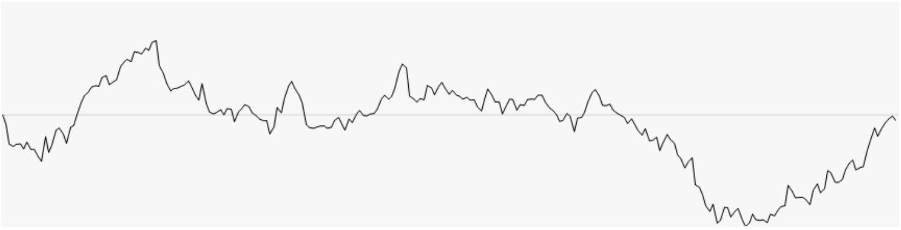{.nostretch width="74%" fig-align="center"}

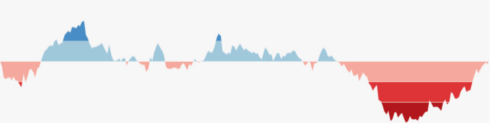{.nostretch width="74%" fig-align="center"}

**Fill the area between the line and the baseline, then slice it into bands of equal height. Darker means further from the baseline.**

::: {.notes}
SKIPPABLE - if running long, jump to 'Sparklines'.

Top: an ordinary line chart with a horizontal baseline.

Bottom: the area is filled, blue above the baseline and red below, and divided into bands. The first band is light, the next darker, the third darkest. So far nothing has been compressed. It is the same chart with a layered color scale.
:::

## Building a horizon chart (2): mirror and collapse

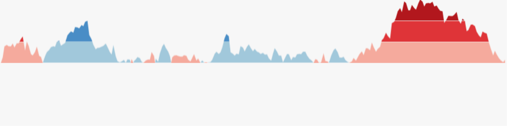{.nostretch width="74%" fig-align="center"}

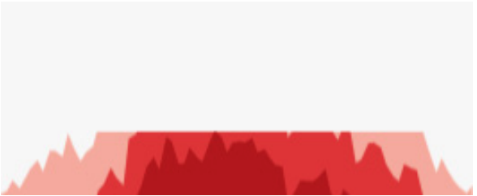{.nostretch width="46%" fig-align="center"}

**Mirror the negative values above the baseline, then slide every band down to the baseline. Height becomes color intensity.**

::: {.notes}
SKIPPABLE - if running long, jump to 'Sparklines'.

Top: the red (negative) part is flipped up, so everything sits above the baseline and the chart needs half the height. Color still tells you the sign.

Bottom: a close-up of one peak after the bands are slid down on top of each other. The chart is now one band tall. A dark patch means the value reached the third band there.

That is why the horizon chart two slides back reads as 'darker is more extreme'.
:::

## Sparklines

> "Small, intense, word-sized graphics with typographic resolution." (Edward Tufte, *Beautiful Evidence*, 2006)

{.nostretch width="92%" fig-align="center"}

**No axes and no labels: a sparkline sits beside a number and shows where it came from.**

::: {.notes}
A 28-day summary from a Twitter analytics page (October 2015). Each number has its change over the previous period and a tiny line of its recent history underneath.

The sparkline does not let you read values. It answers one question: is this number part of a trend, a spike, or business as usual?

Most monitoring dashboards are built from this pattern: one row per metric, the current value, and a sparkline.
:::

# Evaluating a Forecast {background-color="#57068c"}

## Time series tasks in ML

:::: {.columns}
::: {.column width="50%"}
**What we ask a model to do**

* **Forecast**: predict the next values
* **Classify**: label a whole series or a window
* **Detect anomalies**: flag what does not belong
* **Monitor**: watch a deployed model's inputs and outputs over time
:::
::: {.column width="50%"}
**What time changes**

* Observations are **not independent**: today looks like yesterday
* The **order matters**: you may only train on the past
* The **future differs from the past**: trends, new behavior, drift
:::
::::

**The evaluation tools from Week 3 assumed none of these three. Each one has a visual check.**

::: {.notes}
The first three are tasks on temporal data. The fourth applies to every model you deploy, including ones whose inputs are images or text: once a model runs for months, its accuracy is itself a time series.

The right column is the outline for the rest of the lecture. Dependence between observations is why random splits fail (next slides). Order is why we backtest. The future differing from the past is drift (part 4).

Running example for part 3: a synthetic series of daily demand over three years, with an upward trend, a yearly cycle, a strong weekly cycle (weekends are low) and autocorrelated noise.
:::

## A forecast is a line and a band

```{python}
#| fig-align: center
cal = np.abs(resid[SPLIT - 180:SPLIT])            # the last 180 training days set the band width
q = np.quantile(cal, 0.90)
fut = slice(SPLIT, N)
coverage = np.mean(np.abs(resid[fut]) <= q)
fig, ax = plt.subplots(figsize=(17, 7.4))
show = slice(SPLIT - 240, N)
ax.plot(dates[show], y[show], color=GRAY, lw=1.6, label="actual")
ax.plot(dates[fut], pred[fut], color=PURPLE, lw=2.6, label="forecast")
ax.fill_between(dates[fut], pred[fut] - q, pred[fut] + q, color=VIOLET, alpha=0.22, lw=0, label="90% interval")
ax.axvline(dates[SPLIT], color="black", ls="--", lw=1.5)
ax.text(dates[SPLIT - 4], ax.get_ylim()[1], "training data ends ", ha="right", va="top", fontsize=19)
ax.text(dates[SPLIT + 4], ax.get_ylim()[1], f"MAE {mae(y[fut], pred[fut]):.0f}; {coverage:.0%} of days inside the band", ha="left", va="top", fontsize=19, color=PURPLE)
ax.set_ylabel("daily demand")
ax.legend(loc="lower left", ncol=3)
plt.tight_layout()
```

*Synthetic daily demand. Linear model on a time index, a yearly cycle and day of week; band from the model's errors on its last 180 training days.*

::: {.notes}
Gray is what happened. To the right of the dashed line the model has seen nothing: purple is its forecast, the shaded band is its 90% prediction interval.

Three things to read. First, does the forecast have the right shape? Here it reproduces the weekly dips. Second, the size of the error, an MAE of about 51 on a series that runs between 1,100 and 1,700. Third, the band.

The band is nominally 90%, and the label says about 78% of the future days fell inside it. That gap is a calibration failure, the same idea as the reliability diagrams in Week 3: the band was sized from past errors, and the noise in this series is autocorrelated, so errors come in runs that last several days.

Always report the coverage of an interval next to the interval.
:::

## A random train/test split is too optimistic

```{python}
#| fig-align: center
Xg = np.column_stack([t, dow, dates.dayofyear.values])
gbr = lambda: GradientBoostingRegressor(n_estimators=300, max_depth=3, random_state=0)
tr = slice(0, SPLIT)
mae_random = -cross_val_score(gbr(), Xg[tr], y[tr], cv=KFold(5, shuffle=True, random_state=0), scoring="neg_mean_absolute_error").mean()
mae_ordered = -cross_val_score(gbr(), Xg[tr], y[tr], cv=TimeSeriesSplit(5, test_size=120), scoring="neg_mean_absolute_error").mean()
mae_future = mae(y[fut], gbr().fit(Xg[tr], y[tr]).predict(Xg[fut]))
fig, (a, b) = plt.subplots(1, 2, figsize=(17, 7.4), gridspec_kw={"width_ratios": [1.5, 1]})
r2 = np.random.default_rng(0)
is_test = r2.random(SPLIT) < 0.2
for row, (mask, name) in enumerate([(is_test, "random split"), (t[:SPLIT] >= SPLIT - int(0.2 * SPLIT), "time-ordered split")]):
    yy = 1 - row
    a.scatter(t[:SPLIT][~mask], np.full((~mask).sum(), yy), marker="|", s=900, color=GRAY, alpha=0.5, linewidths=1)
    a.scatter(t[:SPLIT][mask], np.full(mask.sum(), yy), marker="|", s=900, color=ORANGE, linewidths=1.4)
    a.text(0, yy + 0.3, name, fontsize=22, weight="bold")
a.set_ylim(-0.5, 1.6); a.set_yticks([]); a.spines["left"].set_visible(False)
a.set_xlabel("day"); a.set_title("Which days are held out?")
a.legend(handles=[Patch(color=GRAY, alpha=0.5, label="train"), Patch(color=ORANGE, label="test")], loc="lower center", ncol=2, bbox_to_anchor=(0.5, -0.02))
vals = [mae_random, mae_ordered, mae_future]
bars = b.bar(["random\n5-fold", "time-ordered\n5-fold", "the actual\nnext 120 days"], vals, color=[ORANGE, PURPLE, GRAY], width=0.62)
for r, v in zip(bars, vals):
    b.text(r.get_x() + r.get_width() / 2, v + 2, f"{v:.0f}", ha="center", fontsize=24, weight="bold")
b.set_ylim(0, max(vals) * 1.18); b.set_ylabel("mean absolute error"); b.set_title("Estimated vs. real error")
plt.tight_layout()
```

*Same synthetic series; gradient-boosted trees on time index, day of week and day of year.*

::: {.notes}
Left: which days are held out. With a random split (top) the test days are scattered among the training days. With a time-ordered split (bottom) the test days come after all the training days.

Right: the error each scheme reports, and the error the model really makes on the 120 days that follow.

Random 5-fold cross-validation reports an MAE of about 25. On the real future the model's error is about 95, almost four times worse. The time-ordered estimate, about 116, is in the right range, and errs on the pessimistic side.

Why: with a random split every test day has training days right next to it, so the model only has to interpolate. Forecasting is extrapolation. Tree models cannot extrapolate a trend, and the random split never asks them to.

This is the most common evaluation mistake with temporal data.
:::

## Backtesting: rolling-origin evaluation

```{python}
#| fig-align: center
tscv = TimeSeriesSplit(n_splits=6, test_size=120)
fold_mae = []
fig, (a, b) = plt.subplots(1, 2, figsize=(17, 7.4), gridspec_kw={"width_ratios": [1.5, 1]})
for k, (itr, ite) in enumerate(tscv.split(t)):
    a.barh(k, len(itr), left=itr[0], color=GRAY, alpha=0.55, height=0.62)
    a.barh(k, len(ite), left=ite[0], color=ORANGE, height=0.62)
    m = Ridge(alpha=1e-3).fit(X_all[itr], y[itr])
    fold_mae.append(mae(y[ite], m.predict(X_all[ite])))
a.invert_yaxis(); a.set_yticks(range(6)); a.set_yticklabels([f"fold {k + 1}" for k in range(6)])
a.set_xlabel("day"); a.set_title("Rolling origin: train on the past, test on what follows")
a.legend(handles=[Patch(color=GRAY, alpha=0.55, label="train"), Patch(color=ORANGE, label="test (120 days)")], loc="upper right")
b.plot(range(1, 7), fold_mae, "o-", color=PURPLE, lw=3, ms=12)
b.axhline(np.mean(fold_mae), color=GRAY, ls="--", lw=1.5)
b.text(1.0, 0.03, f"dashed line: mean {np.mean(fold_mae):.0f}", transform=b.transAxes, va="bottom", ha="right", color=GRAY, fontsize=19)
b.set_ylim(0, max(fold_mae) * 1.25); b.set_xlabel("fold"); b.set_ylabel("mean absolute error"); b.set_title("Error per fold")
plt.tight_layout()
```

*Same synthetic series and the linear model from two slides back; six folds, each tested on the next 120 days.*

::: {.notes}
The fix has a name: rolling-origin evaluation, or backtesting. Train on everything up to a date, test on the period that follows, move the date forward, repeat. In scikit-learn this is TimeSeriesSplit.

Left: the six folds. Gray is training data, orange is the 120-day test window. The training set grows each time.

Right: the error on each fold. It ranges from about 36 to about 59, with a mean of 48. The single split we used earlier is fold 6.

Show the per-fold errors, not only the mean. The spread is the honest answer to 'how good is this model': it depends on which four months you ask about.
:::

## Residuals show what the model missed

```{python}
#| fig-align: center
Xn = calendar_features(t, weekly=False)           # a model that was not told about weekdays
res_n = y - Ridge(alpha=1e-3).fit(Xn[:SPLIT], y[:SPLIT]).predict(Xn)
def acf(x, nlags):
    x = x - x.mean()
    return np.array([1.0] + [np.sum(x[k:] * x[:-k]) / np.sum(x * x) for k in range(1, nlags + 1)])
fig, (a, b, c) = plt.subplots(1, 3, figsize=(17, 7.4), gridspec_kw={"width_ratios": [1.5, 1, 1]})
a.plot(dates[:SPLIT], res_n[:SPLIT], color=GRAY, lw=0.9)
a.axhline(0, color="black", lw=1); a.set_title("Residuals over time"); a.set_ylabel("actual − predicted")
a.set_xticks(pd.to_datetime(["2023-01-01", "2024-01-01", "2025-01-01"])); a.set_xticklabels(["2023", "2024", "2025"])
b.boxplot([res_n[:SPLIT][dow[:SPLIT] == k] for k in range(7)], tick_labels=["M", "T", "W", "T", "F", "S", "S"],
          patch_artist=True, boxprops=dict(facecolor="#e6d5f0", color=PURPLE), medianprops=dict(color=PURPLE, lw=2.5),
          whiskerprops=dict(color=PURPLE), capprops=dict(color=PURPLE), flierprops=dict(markersize=3, markeredgecolor=GRAY))
b.axhline(0, color="black", lw=1); b.set_title("Residuals by weekday")
ac = acf(res_n[:SPLIT], 28)
c.bar(range(29), ac, color=[PURPLE if k % 7 == 0 else GRAY for k in range(29)], width=0.7)
c.set_xticks([0, 7, 14, 21, 28]); c.set_xlabel("lag (days)"); c.set_title("Residual autocorrelation")
plt.tight_layout()
```

*Same synthetic series; the linear model with the day-of-week inputs removed.*

::: {.notes}
Residual means actual minus predicted. If a model has captured the structure, the residuals look like noise. Here we deliberately removed day of week from the inputs.

Left: residuals over time. They form a band with regular downward spikes, but at this scale it is hard to say why.

Middle: the same residuals grouped by weekday. Monday to Friday are all above zero, Saturday and Sunday far below, around minus 120 and minus 190. The model is missing a weekly pattern.

Right: the autocorrelation of the residuals. The bars at lags 7, 14, 21 and 28 (purple) are near 0.8. Errors a week apart are almost the same error.

Same data, three views, and only the views that use the cyclic structure reveal the problem. This is part 1 of the lecture applied to a model's errors.
:::

## Error grows with the forecast horizon

```{python}
#| fig-align: center
LAGS = 14
H = [1, 2, 3, 5, 7, 10, 14, 21, 28]
# A forecast for day d at horizon h is issued on day d - h (its origin) and may only use what
# was known then. The models are fitted on targets up to the last training day, so we score
# only target days whose origin is on or after that day, for every horizon: the same days for
# all horizons, namely the ones a 28-day-ahead forecast can reach.
SCORE = SPLIT + max(H) - 1
h_mae = []
for h in H:
    idx = np.arange(LAGS + h - 1, N)
    Xh = np.column_stack([calendar_features(idx)] + [y[idx - h - k] for k in range(LAGS)])
    trn, tst = idx < SPLIT, idx >= SCORE
    h_mae.append(mae(y[idx][tst], Ridge(alpha=1e-3).fit(Xh[trn], y[idx][trn]).predict(Xh[tst])))
cal_only = mae(y[SCORE:], pred[SCORE:])
fig, ax = plt.subplots(figsize=(17, 7.4))
ax.plot(H, h_mae, "o-", color=PURPLE, lw=3, ms=12, label="model with the last 14 observed days as inputs")
ax.axhline(cal_only, color=GRAY, ls="--", lw=2, label="calendar-only model (no recent observations)")
ax.set_ylim(0, max(max(h_mae), cal_only) * 1.25); ax.set_xticks(H)
ax.set_xlabel("forecast horizon (days ahead)"); ax.set_ylabel(f"mean absolute error on the last {N - SCORE} days")
ax.legend(loc="lower right")
plt.tight_layout()
```

*Same synthetic series; a separate linear model per horizon, each given the 14 most recent days observed when the forecast is issued. All horizons are scored on the same 93 days, each forecast issued on or after the last training day.*

::: {.notes}
A model that can see recent observations does better, but only for a while.

One day ahead the MAE is about 27. It climbs to about 55 at seven days ahead and then stays between 55 and 60. The dashed line is the calendar-only model from the earlier slides, which uses no recent observations, at about 57 on these same days.

So past about a week, yesterday's value tells this model nothing beyond what the calendar already does. The noise in the series has a memory of only a few days. The small bumps above the dashed line at 10 to 21 days are noise from scoring 93 days, not a real disadvantage.

How this is scored matters. An h-day-ahead forecast for day d is issued on day d minus h, its forecast origin, and can only use what was known then. Every model here was fitted on days up to the end of training, so we only score forecasts whose origin is at or after that day. That leaves the last 93 of the 120 future days for a 28-day horizon, and we use those same 93 days for every horizon so the points are comparable. Splitting by the target's date alone is a common leak: the model for a long horizon would have been trained on outcomes that did not exist yet when its first forecasts were issued.

A single accuracy number for a forecaster hides this curve. Always ask: accurate at what horizon?
:::

# Drift and Monitoring {background-color="#57068c"}

## Why deployed models go stale

A model learns $P(y \mid x)$ from data drawn from $P(x)$. After deployment either can change.

* **Data drift** (covariate shift): the inputs change, $P(x)$. New customers, a new sensor, a season the model never saw.
* **Concept drift**: the relationship changes, $P(y \mid x)$. The same input now deserves a different answer.

**What we can watch**

* **Inputs and predictions**: available immediately, no labels needed
* **Accuracy**: needs the true labels, which often arrive days or months later

:::footer
Gama, J., Žliobaitė, I., Bifet, A., Pechenizkiy, M., & Bouchachia, A. (2014). [*A survey on concept drift adaptation*](https://doi.org/10.1145/2523813). ACM Computing Surveys.
:::

::: {.notes}
Every model in this course so far was evaluated once, on a held-out set, and then we stopped. In production the model keeps running while the world changes.

Two different things can change. The inputs can move to a region the model saw little of. Or the right answer for a given input can change: fraud patterns adapt, prices change, a policy changes what a label means.

The practical asymmetry is in the bottom half. You see the inputs the moment a request arrives. You see whether the prediction was right only when the label arrives: whether the loan defaulted, whether the patient was readmitted. So teams monitor inputs as an early proxy for accuracy. The next slides show when that proxy works and when it fails.
:::

## Four shapes of drift

```{python}
#| fig-align: center
r3 = np.random.default_rng(3)
n = 400
x = np.arange(n)
sudden = np.where(x < 200, 0.0, 1.0)
incremental = np.clip((x - 130) / 140, 0, 1)
gradual = np.zeros(n)                             # the stream alternates, with concept B taking a growing share
for lo, hi in [(110, 125), (170, 200), (235, 285), (305, 400)]:
    gradual[lo:hi] = 1.0
recurring = ((x // 100) % 2).astype(float)
fig, axes = plt.subplots(1, 4, figsize=(17, 5.6), sharey=True)
for ax, m, name in zip(axes, [sudden, incremental, gradual, recurring], ["Sudden", "Incremental", "Gradual", "Recurring"]):
    ax.plot(x, m, color=PURPLE, lw=2.6)
    ax.scatter(x[::4], (m + r3.normal(0, 0.09, n))[::4], s=10, color=GRAY, alpha=0.6, zorder=0)
    ax.set_title(name); ax.set_xticks([]); ax.set_xlabel("time")
    ax.set_yticks([0, 1]); ax.set_yticklabels(["concept A", "concept B"])
plt.tight_layout()
```

**The shape decides how to respond: a sudden change calls for retraining, a recurring one for keeping the old model around.**

*Schematic, after Gama et al. (2014).*

::: {.notes}
These are schematic pictures of how the data-generating process moves from one concept to another over time, following the taxonomy in Gama et al.

Sudden: one day it is different. A new product launch, a changed sensor.

Incremental: a slow slide through intermediate states. Wear on a machine, inflation.

Gradual: both concepts are active for a while and the new one takes over a growing share. Customers migrating from one behavior to another.

Recurring: the old concept comes back. Seasons, weekday versus weekend behavior.

A detector tuned for sudden jumps will miss the incremental case, and a team that throws away the old model will relearn it every winter in the recurring case.
:::

## Accuracy over time

```{python}
#| fig-align: center
# A weekly classification stream: 400 labeled points per week for 60 weeks, two features.
# Weeks 20-32: the inputs shift (x1 mean moves), the labeling rule does not.
# Week 44 on: the labeling rule changes, the inputs do not.
r4 = np.random.default_rng(11)
WEEKS, PER = 60, 400
def week_data(w):
    shift = 1.5 * np.clip((w - 20) / 12, 0, 1)
    X = r4.normal(0, 1, (PER, 2)) + [shift, 0.0]
    score = X[:, 1] if w < 44 else -X[:, 1] * 0.2 + (X[:, 0] - shift)   # rule ignores the shifted direction before week 44
    return X, (score + r4.normal(0, 0.35, PER) > 0).astype(int)
stream = [week_data(w) for w in range(WEEKS)]
Xref = np.vstack([stream[w][0] for w in range(8)]); yref = np.concatenate([stream[w][1] for w in range(8)])
frozen = LogisticRegression().fit(Xref, yref)
acc_frozen = [frozen.score(*stream[w]) for w in range(WEEKS)]
acc_retrain = [np.nan] * 8
for w in range(8, WEEKS):
    Xw = np.vstack([stream[k][0] for k in range(w - 8, w)]); yw = np.concatenate([stream[k][1] for k in range(w - 8, w)])
    acc_retrain.append(LogisticRegression().fit(Xw, yw).score(*stream[w]))
ks = [ks_2samp(Xref[:, 0], stream[w][0][:, 0]).statistic for w in range(WEEKS)]
KS_ALERT = 0.15

fig, ax = plt.subplots(figsize=(17, 7.4))
wk = np.arange(WEEKS)
ax.plot(wk, acc_frozen, "o-", color=PURPLE, lw=2.8, ms=7, label="model trained once on weeks 0-7")
ax.plot(wk, acc_retrain, "o-", color=TEAL, lw=2.2, ms=5, label="model retrained every week on the previous 8 weeks")
ax.axvspan(0, 7.5, color=GRAY, alpha=0.12, lw=0); ax.text(3.75, 0.70, "training\nwindow", ha="center", fontsize=18, color=GRAY)
ax.axvline(44, color=RED, ls="--", lw=2); ax.text(43.4, 0.62, "labeling rule\nchanges", color=RED, fontsize=19, ha="right")
ax.set_ylim(0.38, 1.0); ax.set_xlabel("week"); ax.set_ylabel("weekly accuracy"); ax.legend(loc="lower left", bbox_to_anchor=(0.14, 0.02))
plt.tight_layout()
```

*Synthetic stream: a two-feature classifier scored on 400 new labeled points each week. The labeling rule changes at week 44.*

::: {.notes}
The simplest monitoring chart: the metric from Week 3, computed per week, plotted as a line, with known events annotated.

Purple is a model trained once on weeks 0 to 7 (shaded) and never touched again. It holds at about 0.89 for 36 more weeks. At week 44 the labeling rule changes and it drops to about 0.45, worse than a coin flip, and stays there.

Green is the same kind of model retrained every week on the previous eight weeks. It falls just as far at week 44, because its training window contains only old data. It then recovers as new data fills the window, and is back near 0.9 by about week 52.

Two lessons. Retraining repairs drift but does not prevent the drop. And the recovery time is set by the length of the training window.
:::

## Two monitors, two different alarms

```{python}
#| fig-align: center
fig, (a, b, c) = plt.subplots(3, 1, figsize=(17, 8.2), sharex=True, gridspec_kw={"height_ratios": [1.25, 1, 1]})
bins = np.linspace(-3.5, 5, 46)
Hm = np.array([np.histogram(stream[w][0][:, 0], bins=bins, density=True)[0] for w in range(WEEKS)]).T
a.imshow(Hm, origin="lower", aspect="auto", cmap="Purples", extent=[-0.5, WEEKS - 0.5, bins[0], bins[-1]])
a.set_ylabel("feature $x_1$"); a.set_title("Input distribution per week (one histogram per column)", loc="left")
b.plot(wk, ks, "o-", color=ORANGE, lw=2.4, ms=6); b.axhline(KS_ALERT, color=GRAY, ls="--", lw=1.5)
b.text(0, KS_ALERT + 0.02, "alert threshold", color=GRAY, fontsize=17)
b.set_ylabel("KS statistic"); b.set_title("Input monitor: distance of this week's $x_1$ from the training weeks", loc="left")
c.plot(wk, acc_frozen, "o-", color=PURPLE, lw=2.4, ms=6); c.set_ylim(0.38, 1.0)
c.set_ylabel("accuracy"); c.set_xlabel("week"); c.set_title("Output monitor: accuracy of the deployed model (needs labels)", loc="left")
for ax in (a, b, c):
    ax.axvspan(20, 32, color=ORANGE, alpha=0.10, lw=0); ax.axvline(44, color=RED, ls="--", lw=2)
a.text(26, 4.6, "inputs shift", ha="center", va="top", color="#a85d00", fontsize=18)
a.text(44.6, 4.6, "labeling rule changes", va="top", color=RED, fontsize=18)
plt.tight_layout()
```

*Same synthetic stream. Weeks 20 to 32: the inputs shift and the labeling rule is unchanged. Week 44: the rule changes and the inputs do not.*

::: {.notes}
Three views of the same stream on a shared time axis. Small multiples again.

Top: the distribution of one input feature per week, one histogram per column. The band drifts upward between weeks 20 and 32 (shaded) and then stays at the new level.

Middle: a drift statistic, the Kolmogorov-Smirnov distance between this week's values and the training weeks. It crosses the alert threshold at week 23 and keeps climbing.

Bottom: the deployed model's accuracy. Nothing happens during the input shift. The model's decision does not depend on the direction that moved, so the shift is harmless. Then at week 44 accuracy collapses, and the input monitor shows no change at all at that point.

So the input monitor raised an alarm when the model was fine, and was silent when the model broke. Input drift and performance loss are different events. Monitor inputs because they are available early, and monitor accuracy as soon as labels allow.

The synthetic stream was constructed to separate the two cases. In real systems they usually overlap.
:::

## Designing a monitoring view

:::: {.columns .smaller}
::: {.column width="50%"}
* **Overview first**: one row per metric or feature, on a shared time axis (heat map, horizon chart, sparklines)
* **Show the reference**: the training period, a baseline value, an alert threshold
* **Annotate events**: deployments, retraining, data pipeline changes
* **Pick the bin size on purpose**: weekly hides a bad afternoon, hourly is mostly noise
:::
::: {.column width="50%"}
* **Link inputs to outcomes**: selecting a time range in one view filters the others
* **Slice**: overall accuracy can stay flat while one segment collapses
* **Say what is delayed**: mark the last week for which labels are complete
* **Read:** Yang et al., [*Diagnosing Concept Drift with Visual Analytics*](https://doi.org/10.1109/VAST50239.2020.00007) (DriftVis), IEEE VAST 2020
:::
::::

::: {.notes}
This slide joins the two halves of the lecture. The charts from part 2 are the building blocks, and the last two slides showed what they need to display.

Overview first: with hundreds of features nobody reads hundreds of line charts. A features-by-week heat map of a drift statistic shows which features moved and when.

Reference and annotation: a line going down means little without the training-period level and the date of the last deployment drawn on it.

Slicing: the per-group analysis from Week 3 applies over time too. A model can be stable overall and failing for one region or one device type.

Label delay: the right-hand end of any accuracy chart is built from incomplete labels. Draw that boundary so nobody reacts to a dip that is only missing data.

DriftVis is a visual analytics system built around these ideas, and a good model for a project.
:::

# Anomaly Detection {background-color="#57068c"}

## Three kinds of anomaly

```{python}
#| fig-align: center
r5 = np.random.default_rng(5)
m = 28 * 6
tt = np.arange(m)
base = 100 + 30 * np.sin(2 * np.pi * tt / 28) + r5.normal(0, 3, m)
pt = base.copy(); pt[95] += 55
ctx = base.copy(); ctx[108:111] = 128             # a value that is normal at a peak, not in a trough
col = base.copy(); col[70:98] = 100 + r5.normal(0, 3, 28)   # one whole cycle goes flat
fig, axes = plt.subplots(3, 1, figsize=(17, 7.8), sharex=True)
for ax, s, (lo, hi), name in zip(axes, [pt, ctx, col], [(94, 96), (107, 111), (70, 98)],
        ["Point anomaly: a value outside the range the series ever takes",
         "Contextual anomaly: a value that is ordinary at a peak, but here it is in a trough",
         "Collective anomaly: every value is in range, the pattern (a missing cycle) is not"]):
    ax.plot(tt, s, color=GRAY, lw=2)
    ax.plot(tt[lo:hi + 1], s[lo:hi + 1], color=RED, lw=3.2, marker="o" if hi - lo < 6 else None, ms=8)
    ax.axhline(base.max(), color=GRAY, ls=":", lw=1); ax.axhline(base.min(), color=GRAY, ls=":", lw=1)
    ax.set_title(name, loc="left", fontsize=21); ax.set_yticks([70, 100, 130])
axes[-1].set_xlabel("time")
plt.tight_layout()
```

*Schematic series. Dotted lines mark the highest and lowest values of the normal series.*

:::footer
Chandola, V., Banerjee, A., & Kumar, V. (2009). [*Anomaly detection: a survey*](https://doi.org/10.1145/1541880.1541882). ACM Computing Surveys.
:::

::: {.notes}
The taxonomy is from Chandola, Banerjee and Kumar. The dotted lines are the range the normal series covers.

Point anomaly: one value far outside that range. A fixed threshold catches it.

Contextual anomaly: the red values are around 128, which the series reaches at every peak. They are anomalous only because of when they occur, at the bottom of a cycle. A fixed threshold cannot catch this. You need a model of what is expected at that time.

Collective anomaly: one cycle is missing. Every single value is in range and close to the series average. Only the sequence is wrong.

Showing the context is what makes the second and third kind visible. A red dot on an otherwise empty chart explains nothing.
:::

## Flagging what the forecast did not expect

```{python}
#| fig-align: center
# Inject 12 anomalies into the last 240 days of the demand series, then flag days whose
# residual (actual minus forecast) is more than k robust standard deviations from zero.
r6 = np.random.default_rng(21)
win = np.arange(N - 240, N)
ya = y.copy()
truth = np.zeros(N, bool)
hits = r6.choice(win, 12, replace=False)
truth[hits] = True
ya[hits] += r6.choice([-1, 1], 12) * r6.uniform(90, 260, 12)
ra = ya - pred
sigma = 1.4826 * np.median(np.abs(resid[:SPLIT] - np.median(resid[:SPLIT])))   # robust scale from clean training residuals
def flags(k):
    return np.abs(ra) > k * sigma
def prec_rec(k):
    f = flags(k)[win]; tr_ = truth[win]
    tp = (f & tr_).sum()
    return (tp / f.sum() if f.sum() else np.nan), tp / tr_.sum(), f.sum()   # precision is undefined with no alarms
K = 3.0

f = flags(K)
fig, ax = plt.subplots(figsize=(17, 7.4))
ax.fill_between(dates[win], pred[win] - K * sigma, pred[win] + K * sigma, color=VIOLET, alpha=0.18, lw=0, label=f"forecast ± {K:.0f}σ")
ax.plot(dates[win], ya[win], color=GRAY, lw=1.4, label="observed")
tp, fp, fn = f & truth, f & ~truth, ~f & truth
for mask, colr, mk, lab in [(tp, RED, "o", "flagged, real anomaly"), (fp, ORANGE, "s", "flagged, normal day (false alarm)"), (fn, "black", "x", "missed anomaly")]:
    mask = mask & np.isin(t, win)
    ax.scatter(dates[mask], ya[mask], s=170, marker=mk, color=colr, zorder=3, label=f"{lab}: {mask.sum()}", linewidths=3 if mk == "x" else 1)
ax.set_ylim(820, None); ax.set_ylabel("daily demand"); ax.legend(loc="lower left", ncol=2, fontsize=18)
plt.tight_layout()
```

*Synthetic demand series, last 240 days, with 12 injected anomalies; σ is a robust estimate of the forecast's typical error on the training data. A retrospective demonstration: the first 120 of these days are days the forecast model was trained on.*

::: {.notes}
A common detector: forecast the series, then flag any day that falls outside the forecast plus or minus k times the typical error. Here k is 3. This handles contextual anomalies, because the band moves with the weekly cycle.

One caveat on the set-up: the window is 240 days, and the first 120 are inside the forecast model's training data (the anomalies were injected afterward, so the model never saw them). This is a retrospective demonstration of the mechanism. A live detector only ever scores days after its training data ends.

We injected 12 anomalies, so we can grade it. Red circles: 7 flagged correctly. Black crosses: 5 missed, all inside the band, so by this detector's logic they look ordinary. Orange squares: 3 false alarms, normal days that were flagged.

Look at where the false alarms are: all three sit together in late October. Forecast errors are autocorrelated, so false alarms arrive in clusters, which is what makes on-call staff stop trusting an alert.

Draw the band, not just the flagged points. With the band visible, a reader can judge each flag: how far outside was it?
:::

## The threshold is a trade-off

```{python}
#| fig-align: center
ks_ = np.linspace(1, 6, 51)
pr = np.array([prec_rec(k) for k in ks_])
fig, (a, b) = plt.subplots(1, 2, figsize=(17, 7.4))
a.plot(ks_, pr[:, 0], color=PURPLE, lw=3.2, label="precision: share of alarms that are real")
a.plot(ks_, pr[:, 1], color=TEAL, lw=3.2, label="recall: share of anomalies caught")
a.axvline(K, color=GRAY, ls="--", lw=1.5); a.set_ylim(0, 1.05)
a.set_xlabel("threshold k (band = forecast ± kσ)"); a.legend(loc="lower center", bbox_to_anchor=(0.5, 1.0), fontsize=18)
b.plot(ks_, pr[:, 2], color=ORANGE, lw=3.2); b.axhline(truth.sum(), color=GRAY, ls=":", lw=2)
b.text(6, truth.sum() + 1.5, f"{truth.sum()} real anomalies", ha="right", color=GRAY, fontsize=18)
b.axvline(K, color=GRAY, ls="--", lw=1.5); b.set_yscale("log")
b.set_xlabel("threshold k"); b.set_ylabel("days flagged out of 240 (log scale)")
plt.tight_layout()
```

*Same detector and data as the previous slide; the dashed line marks k = 3.*

::: {.notes}
The same trade-off as the ROC and precision-recall curves in Week 3, with the threshold k on the x axis.

Left: with a low threshold recall is high and precision is poor. At k = 2 the detector catches 11 of the 12 anomalies and flags 30 days, so about two alarms in three are false. At k = 3, 10 days are flagged: precision 0.7, recall about 0.58. Above k = 4 almost nothing is flagged. The precision line stops where there are no alarms left, since precision is undefined there.

The precision curve is jagged because there are only 12 anomalies. With rare events every estimate of detector quality is noisy, which is itself worth showing.

Right: the number of days flagged, on a log scale. This is the chart for whoever has to respond: how many alerts per month can the team actually look at? That budget often sets the threshold.
:::

## What to take away

* **Pick the time structure first**: sequential, cyclic or hierarchical. It decides the chart.
* **The aspect ratio and the bin size are choices**, and both change what the reader sees
* **Many series**: filter, highlight, small multiples, heat maps, horizon charts
* **Never evaluate a forecaster on a random split**; backtest, and show the error per fold and per horizon
* **Plot residuals against time, weekday and lag**; structure there is something the model missed
* **Input drift and accuracy loss are different events**; watch both, and annotate what changed
* **An anomaly needs its context**: show the expected band, and count false alarms as well as hits

::: {.notes}
One line per section of the lecture. The first three are about drawing temporal data. The last four are about using those drawings to evaluate and monitor a model.

For projects with any temporal component: the evaluation section of your final report should say how the data was split in time.
:::

## References

::: {.smaller}
* Aigner, W., Miksch, S., Schumann, H., & Tominski, C. (2023). [*Visualization of Time-Oriented Data*](https://doi.org/10.1007/978-1-4471-7527-8) (2nd ed.). Springer.
* Hyndman, R. J., & Athanasopoulos, G. (2021). [*Forecasting: Principles and Practice*](https://otexts.com/fpp3/) (3rd ed.). OTexts. Free online.
* Tashman, L. J. (2000). [*Out-of-sample tests of forecasting accuracy: an analysis and review*](https://doi.org/10.1016/S0169-2070(00)00065-0). International Journal of Forecasting.
* Bergmeir, C., & Benítez, J. M. (2012). [*On the use of cross-validation for time series predictor evaluation*](https://doi.org/10.1016/j.ins.2011.12.028). Information Sciences.
* Gama, J., et al. (2014). [*A survey on concept drift adaptation*](https://doi.org/10.1145/2523813). ACM Computing Surveys.
* Yang, W., et al. (2020). [*Diagnosing Concept Drift with Visual Analytics*](https://doi.org/10.1109/VAST50239.2020.00007). IEEE VAST.
* Chandola, V., Banerjee, A., & Kumar, V. (2009). [*Anomaly detection: a survey*](https://doi.org/10.1145/1541880.1541882). ACM Computing Surveys.
* Heer, J., Kong, N., & Agrawala, M. (2009). [*Sizing the horizon*](https://doi.org/10.1145/1518701.1518897). CHI.
* Cleveland, W. S., McGill, M. E., & McGill, R. (1988). [*The shape parameter of a two-variable graph*](https://doi.org/10.1080/01621459.1988.10478598). JASA.
:::

::: {.notes}
Hyndman and Athanasopoulos is the place to start for forecasting and is free online; chapter 5 covers residual diagnostics, prediction intervals and time series cross-validation. Aigner et al. is the reference for time-oriented visualization. Gama et al. and Chandola et al. are the standard surveys for drift and anomaly detection.
:::

## Next: the last lecture before presentations

* **Tuesday, Nov 24**: Interpretable ML and Fairness
* **Dec 1 and Dec 8**: final project presentations
* **Dec 14**: final project report due (8 pages)

::: {.notes}
Next Tuesday is the last regular lecture. The two sessions after that are project presentations, and the final report is due December 14, the week after the last class.

Thanksgiving recess is Thursday and Friday of next week and does not affect our Tuesday meeting.
:::
