## Why does time matter?

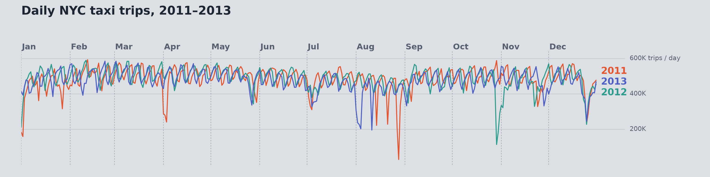{.nostretch width="90%" fig-align="center" fig-alt="Daily NYC taxi trips in 2011, 2012, and 2013 aligned by calendar date, showing recurring weekly fluctuations and occasional sharp drops."}

{.nostretch width="90%" fig-align="center" fig-alt="NYC taxi and for-hire trips from 2009 to 2025, showing changes in the mix of services and a steep drop in 2020 followed by a recovery."}

::: {.notes}
Ask what a single average of daily trips would hide. In the top chart, aligning three years by calendar date helps us see recurring patterns and unusual days. In the bottom chart, zooming out reveals a shift in the mix of services and the sharp drop in 2020. Ask which of these patterns students would want a forecast to learn.
:::

## Today

```{python}
#| include: false
import numpy as np
import pandas as pd
import matplotlib.pyplot as plt
from matplotlib.patches import Patch
from matplotlib.lines import Line2D
from scipy.stats import ks_2samp
from sklearn.linear_model import Ridge, LogisticRegression
from sklearn.ensemble import GradientBoostingRegressor
from sklearn.model_selection import KFold, TimeSeriesSplit, cross_val_score

plt.rcParams.update({"font.size": 20, "axes.spines.top": False, "axes.spines.right": False,
                     "axes.titlesize": 22, "legend.frameon": False})
PURPLE, VIOLET, GRAY, ORANGE, TEAL, RED = "#57068c", "#8900e1", "#6d6d6d", "#e08214", "#1b9e77", "#c62828"

# One synthetic daily series used on all the forecasting slides: three years of "daily demand"
# = level + upward trend + yearly cycle + weekly cycle + autocorrelated noise.
rng = np.random.default_rng(7)
N = 3 * 365
t = np.arange(N)
dates = pd.date_range("2023-01-01", periods=N, freq="D")
dow = dates.dayofweek.values                     # 0 = Monday
WEEK = np.array([40, 55, 60, 65, 90, -120, -190])  # Mon..Sun effect
ar = np.zeros(N)
for i in range(1, N):
    ar[i] = 0.8 * ar[i - 1] + rng.normal(0, 30)
y = 1000 + 0.45 * t + 140 * np.sin(2 * np.pi * (t - 100) / 365.25) + WEEK[dow] + ar

def calendar_features(tt, weekly=True):
    """Time index, yearly Fourier pair and (optionally) day-of-week dummies."""
    d = (tt + dates[0].dayofweek) % 7
    cols = [tt, np.sin(2 * np.pi * tt / 365.25), np.cos(2 * np.pi * tt / 365.25)]
    if weekly:
        cols += [(d == k).astype(float) for k in range(6)]
    return np.column_stack(cols)

def mae(a, b):
    return float(np.mean(np.abs(np.asarray(a) - np.asarray(b))))

SPLIT = N - 120                                   # last 120 days are "the future"
X_all = calendar_features(t)
lin = Ridge(alpha=1e-3).fit(X_all[:SPLIT], y[:SPLIT])
pred = lin.predict(X_all)
resid = y - pred
```

1. **Temporal data basics**: events and measurements, time structures, aggregation
2. **Charts for time**: line charts and aspect ratio, many series, heat maps, radial layouts, horizon charts, event data, interaction
3. **Evaluating a forecast**: prediction intervals, time-ordered validation, residuals, horizon
4. **Drift and monitoring**: when a deployed model goes stale, and how to see it
5. **Anomaly detection**: showing anomalies in context, and the threshold trade-off

*Parts 1 and 2 are based on materials by Enrico Bertini (NYU Tandon).*

::: {.notes}
**Purpose.** Frame the lecture around a question students can use in their projects: what changes when the order of the observations carries information?

**Opening.** "Last week Pari showed how topology helps us understand the shape of data. Today we look at another kind of structure: time. A model can have a convincing test score and still fail next month. A chart can show a reassuring average and hide an afternoon of failures. We need both an appropriate evaluation and a view that makes those failures visible."

**Road map.** Parts 1 and 2 establish the visual vocabulary. Parts 3 to 5 use that vocabulary to inspect forecasts and deployed models. Connect this to Week 3: the metrics still apply, but we must be explicit about which observations the test set represents and what information was available when each prediction was made. Credit Enrico Bertini for the temporal visualization material.

**Pacing.** Budget about 60 minutes for parts 1 and 2, 25 for forecasting, 20 for drift, and 15 for anomalies. There are 16 optional InfoVis examples marked SKIPPABLE, plus the two horizon-construction slides. Use those as the first cuts if discussion runs long. The later synthetic examples have known mechanisms so we can explain why a chart looks as it does.

**Transition.** "Before choosing a chart or a model, we need to know what a timestamp means in our data."
:::

# Temporal Data Basics

::: {.notes}
**Section bridge.** "We will begin with the meaning of the records. Before drawing a temporal chart, decide whether each row is an event or a measurement, what its timestamp refers to, and which temporal structure matters for the question."

**Rationale.** These decisions determine what information an aggregation preserves and what the later chart can legitimately show. Move directly to the incident table.
:::

## What is temporal data?

**Data in which values depend on time, and time is explicitly recorded.**

{fig-align="center"}

::: {.notes}
**Purpose.** Establish the unit of observation before introducing a time series. Students often start with a line chart without asking what one row represents.

**Talk through the table.** "Each row here records an incident in New York City. The date and time tell us when it occurred. Borough, street, and coordinates tell us where. Several incidents can share a timestamp, and the gaps between rows need not be equal." Point to the records just after midnight on June 12, 2018. The temporal structure comes from those timestamps, not from the table's current row order.

**Emphasize.** A timestamp makes temporal analysis possible. It does not by itself establish that the other attributes change systematically over time. Also distinguish event time from the time a system received or entered the record. A delay between the two can matter in monitoring.

**Ask.** "In a dataset you have used, what does one timestamp refer to: an event, a measurement, or a database update?" Take one example and identify its unit of observation. A ranking is ordered but has no temporal meaning unless time is recorded separately.

**Transition.** "Those answers usually lead to two different kinds of temporal data."
:::

## Two kinds of temporal data

:::: {.columns}
::: {.column width="50%"}
### Event data

**Time + object (with attributes)**

"Something happened at time T"

* A tweet, an email, an alarm, a model prediction request
* Often irregular: events happen when they happen
* Question: when, how often, in what order?
:::
::: {.column width="50%"}
### Measurement data

**Time + measure(s)**

"This was the value at time T"

* Temperature, revenue, a stock price, daily model accuracy
* Usually sampled at regular intervals
* Question: how does the value change?
:::
::::

**Counting events per interval turns event data into measurement data.**

::: {.notes}
**Purpose.** Explain why some temporal displays use individual marks and others use a connected series.

**Talk through.** An email is an event: it happened at a particular moment and has attributes such as sender and recipient. A temperature reading is a measurement: it gives a value at a particular moment. Measurements can be irregular too, so regular sampling is common rather than part of the definition.

Use the incident table as a concrete transformation. "If I count incidents in each hour, I have created a measurement series from event records. The count depends on my choice of interval." That transformation discards the order and spacing of events within each hour.

**ML connection.** Individual prediction requests are events. To produce a weekly accuracy series, join the requests to their eventual labels and compute correct predictions divided by labeled predictions in each week. Keep the denominator available: an accuracy based on ten cases carries different evidence from one based on ten thousand.

**Check understanding.** "Is a week with no recorded requests necessarily a week with zero requests?" No: missing logging and a true zero require different treatment.

**Transition.** "We also need to distinguish when something happened from how long it lasted and how precisely we recorded it."
:::

## Describing time: position, interval, granularity

* **Position**: when did it happen? A timestamp, absolute (Nov 17, 4:55 PM) or relative (three hours ago).
* **Interval**: for how long? A duration. Point events have none.
* **Granularity**: at what resolution was time recorded? Seconds, hours, days.

*A meeting starts at 2:00 PM (position), lasts 90 minutes (interval), and is recorded to the minute (granularity).*

**For a deployed model, the gap between a prediction and its true label is an interval. It sets how soon accuracy can be measured.**

::: {.notes}
SKIPPABLE - if running long, jump to 'Three time structures'.

**Purpose.** Give students vocabulary for checking a time column before plotting it or using it as a feature.

**Talk through.** Use the meeting example to keep the terms separate. Two o'clock locates the meeting. The interval runs from 2:00 to 3:30, with a duration of 90 minutes. Recording only whole minutes limits the precision of its endpoints. An instantaneous event has a position, even when no duration is meaningful.

**Why it matters.** Hourly measurements cannot reveal the detailed shape of a ten-minute fluctuation. Aggregating second-level records into hours is possible, but recovering the lost timing from hourly totals is not. Distinguish the original recording precision from a coarser bin chosen for display.

**ML example.** "A prediction is made today, but its outcome may become known next month. That interval sets the earliest time at which we can score it." A monitoring chart needs to account for that delay. Otherwise the latest dates can appear to have fewer successes simply because their outcomes are incomplete.

**Transition.** "Even with the same timestamps, there are several ways to organize time visually."
:::

## Three time structures

1. **Sequential**: time as a line (Jan 1, ..., Dec 31). Shows trends and change.
2. **Cyclic**: time as a repeating cycle (Mon, Tue, ..., Sun). Shows rhythms.
3. **Hierarchical**: nested resolutions (year / month / week / day / hour). Allows drill-down.

**Most real series have all three at once. You choose which one a chart emphasizes.**

::: {.notes}
**Purpose.** Make chart selection follow the question. These are different views of the same timestamps, not three mutually exclusive kinds of dataset.

**Talk through.** For website traffic, a chronological line answers whether usage is growing. Grouping all Mondays together answers whether Monday behaves differently from Sunday. Moving from years to months to hours lets us inspect a broad change and then locate it more precisely.

**Emphasize.** A cyclic view deliberately discards some chronological information. Once all Mondays are pooled, we cannot tell whether the Monday pattern changed last year. A hierarchical view also needs calendar care: months have different lengths, and weeks can cross month boundaries.

**ML connection.** A linear model given only a time index can fit a linear trend. A weekday feature lets it represent a weekly rhythm. Later we will remove that feature and use the errors to recover the missing cycle. This gives the visual vocabulary a modeling consequence.

**Ask.** "For staffing next Tuesday, which view helps? For estimating annual growth, which view helps?" Expect cyclic for the first and sequential for the second, possibly combined when both effects matter.

**Transition.** "Here is what that choice does to a real set of order records."
:::

## The same orders, two time structures

:::: {.columns}
::: {.column width="50%"}
**Sequential: sales by month, 2013 to 2016**

{height="500" fig-align="center"}
:::
::: {.column width="50%"}
**Cyclic: number of orders by day of the week**

{height="500" fig-align="center"}
:::
::::

**Neither chart can show what the other shows.**

* Left answers: is the business growing, and when are the peaks?
* Right answers: which day of the week is slow?
* Same order records both times. Choosing the bin (month or weekday) is choosing the question.

::: {.notes}
**Purpose.** Demonstrate that aggregation determines which question a chart can answer.

**Walk through.** On the left, read the horizontal axis as successive months from 2013 to 2016 and the vertical axis as sales. Point to the larger later peaks. On the right, read the horizontal axis as weekday and the vertical axis as the number of order records pooled across the period. Tuesday is conspicuously low.

**Important distinction.** The two views change both the time grouping and the measure: sales dollars on the left, order counts on the right. We can compare the questions they support, but cannot attribute every visual difference to the time structure alone. A strict comparison of structure would keep the measure fixed.

**Rationale.** "The monthly view helps us discuss growth. The weekday view helps us discuss scheduling. Neither tells us whether the weekday rhythm stayed stable as the business grew." Also avoid explaining the Tuesday dip as customer behavior without checking collection and processing practices.

**Ask.** "Could one unusually large purchase create a sales peak without creating a peak in order count?" Yes. This reinforces the need to name the measure.

**Transition.** "We can also keep the measure fixed and change only the temporal resolution."
:::

## The same sales at two resolutions

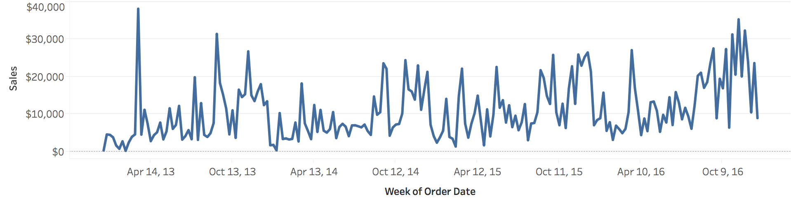{.nostretch width="72%" fig-align="center"}

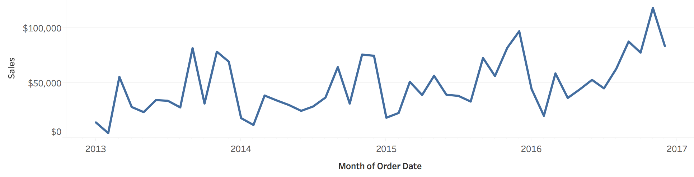{.nostretch width="72%" fig-align="center"}

**Weekly bins (top) show individual spikes. Monthly bins (bottom) show the yearly shape and the growth.**

::: {.notes}
SKIPPABLE - if running long, jump to 'Aggregation is a design decision'.

**Purpose.** Show the information lost when we combine observations into larger bins.

**Walk through.** Both charts show sales over the same four years. The upper chart groups orders by week, and the lower chart groups them by month. Point to an isolated weekly peak, then find the corresponding period in the monthly view. Its contribution remains in the monthly total, but its timing within that month is lost.

**Emphasize.** These are sales totals. The spike has been combined with other sales in its month, rather than averaged away. The scales also differ: the weekly axis reaches roughly $40,000 and the monthly axis roughly $120,000. Taller monthly values do not imply a higher rate of sales, because the exposure period is longer.

**Rationale.** The monthly view makes the broad progression easier to follow. The weekly view better supports questions about short promotions or disruptions. If the question concerns intensity, compare sales per day or per open day, accounting for unequal interval lengths.

**Transition.** "A second way to expose structure is to align repeated cycles and compare them directly."
:::

## A cycle nested in a sequence: one line per year

:::: {.columns}
::: {.column width="50%"}
**Orders by day of the week, one line per year**

{width="100%"}
:::
::: {.column width="50%"}
**Sales by month, one line per year**

{width="100%"}
:::
::::

**Overlaying the years asks: is the cycle the same every year?**

* Left: Tuesday is the slow day in 2014, 2015 and 2016. In 2013 the slow day is Wednesday.
* Right: every year is low in February and has peaks in September and near the end of the year

::: {.notes}
SKIPPABLE - if running long, jump to 'Aggregation is a design decision'.

**Purpose.** Recover information that disappeared when all years were pooled into one cycle.

**Walk through.** The horizontal axis now repeats the same weekdays or months for every year. Color identifies the year. In the weekday chart, point to the Tuesday lows in 2014, 2015, and 2016, then to the Wednesday low in the blue 2013 line. The earlier pooled weekday chart concealed that disagreement. In the monthly chart, compare the recurring February low and the later-year peaks. The 2016 line generally sits higher.

**Rationale.** Alignment separates a change in overall level from a change in the timing or shape of a cycle. A higher line with a similar shape suggests one kind of modeling adjustment. A peak moving to a different weekday suggests another.

**Caution.** Treat the weekday discrepancy as a question to investigate. Check date handling, coverage, and aggregation before declaring behavioral drift. A chart can identify a discrepancy without establishing its cause.

**Ask.** "Would a model trained on the pooled weekday pattern capture the 2013 minimum?" This prepares students to look for systematic residuals later.

**Transition.** "These examples make the costs and benefits of aggregation concrete."
:::

## Aggregation is a design decision

:::: {.columns}
::: {.column width="50%"}
**What aggregation buys**

* Less noise
* Visible long-term trends
* A manageable number of points

*Daily to monthly averages makes a seasonal pattern readable.*
:::
::: {.column width="50%"}
**What aggregation costs**

* Short events disappear
* Extreme values are averaged away
* The pattern can depend on the bin size

*A one-hour outage is invisible in a monthly average.*
:::
::::

**Choose the granularity from the question: trends want coarse bins, anomalies want fine ones.**

::: {.notes}
**Purpose.** Turn the preceding examples into a rule students can apply when building a visualization.

**Talk through.** "Start with the shortest event that would change a decision. If a one-hour outage matters, a monthly average cannot be the only view." Coarser bins can reduce distracting variation and make broad patterns easier to see. They also remove within-bin timing and can dilute short failures.

**Specify the operation.** A sum answers how much activity occurred. A mean answers the average level. A maximum preserves a peak but says little about its duration. For accuracy, combine counts of correct and total predictions rather than averaging percentages from differently sized groups without weights.

**ML example.** A model may be correct on 95% of requests in a week while failing for most requests during a particular afternoon. The weekly average can be accurate and still be inadequate for diagnosis. A coarse overview linked to a finer detail view supports both questions.

**Ask.** "For a monitoring dashboard, what interval would you show first, and what failure would that choice hide?" There is no single correct bin size without a task.

**Transition.** "Once we have chosen what each value means, we can choose how to draw it."
:::

# Charts for Time

::: {.notes}
**Section bridge.** "We have decided what one value means and how time is grouped. Now we choose the display. For each chart, ask which comparison it makes easy and what information becomes harder to recover."

**Rationale.** Organize the section as a progression of problems: reading change, comparing several series, fitting many series, and examining individual events. This gives the examples a purpose beyond learning chart names.
:::

## Line charts: time on x, value on y

**Position encodes both time and value; the line's slope encodes the rate of change.**

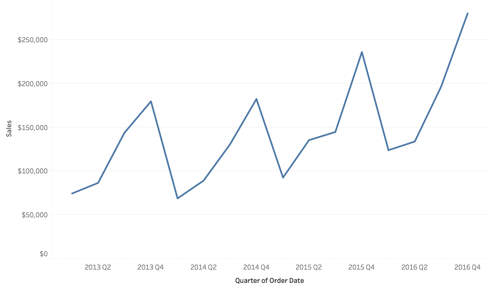{fig-align="center"}

::: {.notes}
**Purpose.** Explain why a line chart is a useful default for measurements and what assumptions its connecting segments introduce.

**Walk through.** The figure shows quarterly sales. Read one point as sales for a quarter, then trace successive rises and falls. Position supports comparisons of values, while the connected path makes changes and repeated peaks easy to follow.

**Emphasize.** The segment between two quarterly totals is a visual connection. It does not tell us that sales evolved linearly within the quarter. Missing periods should not silently become zero, and a long connecting line across a gap can suggest more continuity than the data supports.

**Rationale.** On linear axes, the numerical rate of change is change in value divided by elapsed time. The angle we see also depends on the displayed axis scales and the plot's dimensions. Students should distinguish the numerical rate from its visual steepness.

**Ask.** "If I stretch this chart vertically, did the business start growing faster?" The answer leads directly to the next comparison.
:::

## The same data at three aspect ratios

**The aspect ratio (width / height) changes how steep every change looks.**

{fig-align="center"}

::: {.notes}
**Purpose.** Make students notice a design choice that plotting software usually makes for them.

**Walk through.** Ask everyone to find the August-to-September drop in all three panels. The dates and values agree. In the tall, narrow panel it looks almost vertical. In the wide panel it occupies a gentler angle. Then compare the recovery after the trough to make clear that every segment changes appearance.

**Rationale.** Screen slope depends on vertical pixels per unit divided by horizontal pixels per unit. Changing width or height changes that ratio even when axis limits and data stay fixed. This is why perceived urgency or volatility can change with the shape of the plot.

**Emphasize.** A wide chart is not automatically more honest. A very flat chart can make important changes hard to distinguish. Choose dimensions that support the intended comparison and keep scales consistent when comparing panels.

**Transition.** "There is a classic perceptual guideline for choosing dimensions when the task is to compare slopes."
:::

## Banking to 45°

:::: {.columns}
::: {.column width="40%"}
* We compare the slopes of line segments most accurately when they are **near 45°**
* **Banking to 45°**: choose the aspect ratio so the typical segment has a 45° slope
* Right: Canadian lynx trappings, 1821 to 1934
* Wide and flat (bottom): each cycle **rises slowly and falls quickly**, which the tall version hides
:::
::: {.column width="60%"}
{height="560" fig-align="center"}

{width="100%"}
:::
::::

:::footer
Cleveland, W. S., McGill, M. E., & McGill, R. (1988). [*The shape parameter of a two-variable graph*](https://doi.org/10.1080/01621459.1988.10478598). JASA.
:::

::: {.notes}
**Purpose.** Explain the reasoning behind banking, rather than asking students to memorize 45 degrees as a universal rule.

**Walk through.** Both charts show the same annual lynx trapping series on a logarithmic vertical scale. First identify the repeated peaks in the tall plot. Then use the lower plot to compare the rising and falling sides of a cycle. The rises tend to extend over more years than the sharp declines. Nearly vertical segments in the tall chart make that asymmetry harder to judge.

**Explain.** Banking changes the aspect ratio so a representative absolute segment slope is near 45 degrees. Segments that all look nearly horizontal or nearly vertical offer little visible angular separation. The guideline gives their differences more room to be seen.

**Qualification.** It is a guideline for slope comparisons, not a requirement that every segment be at 45 degrees or a guarantee of the best layout for every task. The logarithmic scale also means we are comparing proportional changes in trapping counts. Trappings are the measured quantity, so avoid presenting the figure as a direct census of the animal population.

**Transition.** "So far we have drawn one series. What changes when several series share the same chart?"
:::

## Several series: color by category

**Three categories on shared axes are easy to compare.**

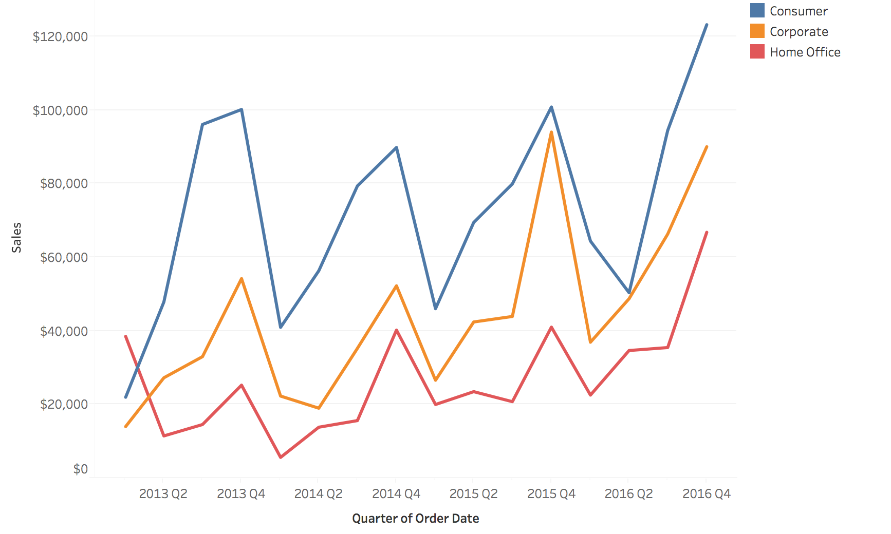{fig-align="center"}

::: {.notes}
**Purpose.** Establish what an overlay does well before showing where it breaks down.

**Walk through.** Identify Consumer, Corporate, and Home Office in the legend, then follow one line across time. Consumer is highest in most quarters. Because all three use the same axes, we can compare their levels at a date and see whether peaks occur together.

**Rationale.** With a small number of distinguishable lines, shared position makes comparisons economical. Color identifies a category while vertical position carries the quantity. Direct labels near the lines can reduce repeated trips to the legend.

**Emphasize.** Similar timing suggests a common pattern worth investigating, but does not establish that one category causes another to move. Also keep the units and aggregation interval consistent across the series.

**Ask.** "Can you follow the orange line without losing it at a crossing? What if we added fourteen more categories?"

**Transition.** "The next chart makes exactly that addition."
:::

## The spaghetti plot

**Seventeen categories on shared axes: color runs out and lines hide each other.**

{fig-align="center"}

::: {.notes}
**Purpose.** Let the audience experience why adding more categories can reduce useful information, even when every value remains on the screen.

**Activity.** Give students a few seconds to find one mid-range category and follow it through several crossings. Then ask what they can still judge confidently. The overall range and a few dominant peaks remain visible. Following an individual series through the center is much harder.

**Explain.** Seventeen product subcategories compete for the same position and color channels. Crossings interrupt visual tracing, similar colors become hard to distinguish, and the legend requires repeated searching. The failure depends on the task: an overview of the envelope may still be useful, while a comparison of two named categories becomes difficult.

**ML connection.** This is what can happen when a monitoring dashboard overlays every class, region, or device type on one metric chart. An important failure in a small group can become visually inaccessible.

**Transition.** "We can reduce what is visible, emphasize a selection, or give the series separate space. Each choice has a cost."
:::

## Two fixes: filter, or highlight

:::: {.columns}
::: {.column width="50%"}
**Filter: show only the series you care about**

{height="500" fig-align="center"}
:::
::: {.column width="50%"}
**Highlight: keep the rest as faded context**

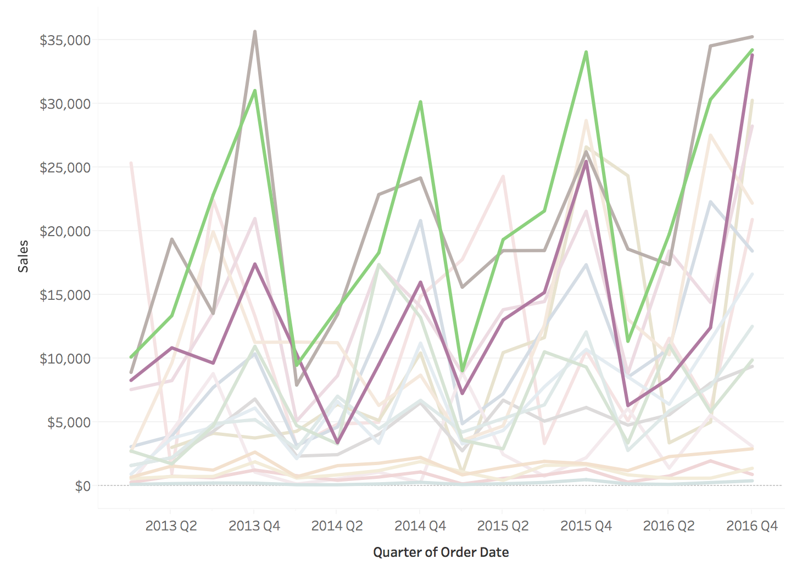{height="500" fig-align="center"}
:::
::::

* **Filtering** removes the context: are these three series typical?
* **Highlighting** keeps the context, at the cost of some clutter
* A third fix is **small multiples**: one small chart per series on shared axes. Nothing is hidden, but two series are harder to overlay.

::: {.notes}
**Purpose.** Explain the trade-off between focusing attention and preserving context.

**Walk through.** On the left, trace Chairs, Phones, and Tables. Filtering removes the other series, so the selected lines are easy to read. On the right, trace the same lines again, then inspect the faded background. Highlighting lets us see how the selection sits within the rest of the data.

**Rationale.** Filtering suits a question about a known subset. Highlighting helps when we also need to know whether that subset is typical. A filtered chart should make its selection clear so the reader does not mistake three selected categories for the whole dataset.

**ML example.** Select a failing region while retaining the other regions as faint context. If every region dips at the same time, a shared pipeline problem becomes a plausible hypothesis. If only the selected region dips, a local explanation becomes more plausible. Neither picture alone proves the cause.

**Transition.** "If every series deserves attention, small multiples allocate a separate panel to each one."
:::

## Small multiples: one panel per series

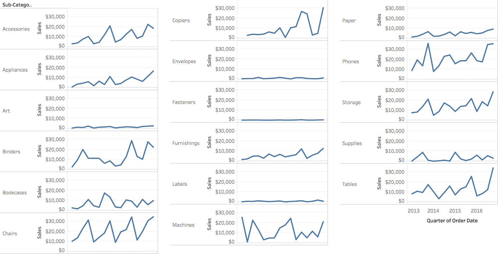{fig-align="center"}

**The seventeen series from the spaghetti plot, each in its own panel on the same axes. Nothing is hidden.**

::: {.notes}
SKIPPABLE - if running long, jump to 'Stacked areas are hard to read'.

**Purpose.** Show how spatial separation removes occlusion, and why scale choices remain part of the design.

**Walk through.** Locate the seventeen product subcategories from the spaghetti plot. Each panel uses the same time range and a common vertical scale. Chairs and Phones show large fluctuations. Art, Envelopes, Fasteners, and Labels appear close to the bottom because their magnitudes are small relative to that common range.

**Emphasize.** "Nearly flat on this scale does not mean unchanging." Separate vertical scales could expose the smaller series' shapes, but would make the same screen height represent different amounts in different panels. Choose common scales for magnitude comparison and clearly labeled separate scales when shape is the primary question.

**Rationale.** Occlusion disappears, but readers must move their eyes between panels to compare two series. A stable ordering, aligned dates, and consistent scales reduce that effort. Highlighting the same time range across panels can help further.

**ML connection.** Per-class recall or regional accuracy often benefits from this layout because a small group receives its own visible space.

**Transition.** "Another common way to combine categories is to stack them, which changes the comparison task."
:::

## Stacked areas are hard to read

:::: {.columns}
::: {.column width="50%"}
**Four regions as lines**

{height="500" fig-align="center"}
:::
::: {.column width="50%"}
**The same four regions stacked**

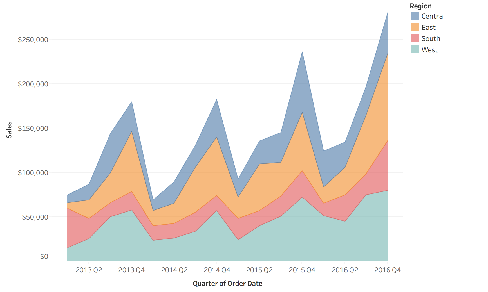{height="500" fig-align="center"}
:::
::::

**Only the bottom layer and the total have a flat baseline. Every other layer rides on the ones below it.**

* Left: comparing any two regions takes a glance, but the total is not drawn
* Right: the total is the top edge, but try to say whether South (red) rose or fell in a given quarter
* Stack when the total and the bottom layer are what matter

::: {.notes}
**Purpose.** Explain why the apparent movement of a stacked boundary can differ from the movement of the category it represents.

**Walk through.** Start with South, the red line on the left. Choose two adjacent quarters and compare their sales. Then ask the same question for the red layer on the right. Its value is the vertical thickness of the layer, the difference between its upper and lower boundaries. Both boundaries move as the categories beneath it change.

**Rationale.** The bottom layer has a fixed zero baseline, and the top boundary gives the total. Interior layers require comparing differences between moving positions, which is harder than comparing positions on a shared baseline. The layer order changes which category is easiest to inspect.

**Emphasize.** Stacking works for additive components of a meaningful total. Counts of requests by mutually exclusive category can be added. Accuracies or error rates for different groups generally cannot be stacked to produce overall accuracy.

**Ask.** "If the top edge of South rises, must South's own sales have risen?" No: an underlying region may have increased.

**Transition.** "Normalizing the stack changes the question again, from amounts to shares."
:::

## Normalized stacked areas: shares instead of totals

{fig-align="center"}

**Every quarter sums to 100%, so the chart shows composition. Whether total sales grew or fell is no longer visible.**

::: {.notes}
SKIPPABLE - if running long, jump to 'Heat maps: time on one axis, categories on the other'.

**Purpose.** Explain what a 100% stack preserves and what normalization removes.

**Walk through.** Every quarter fills the same height. Read the thickness of South's red band as its share of that quarter's total. It occupies roughly 60% in the first quarter of 2013 and much less in the next quarter. West has a fixed edge at 0%, and Central has a fixed edge at 100%. The middle layers still have moving baselines.

**Rationale.** Dividing each region's sales by the total isolates composition. If all regions doubled their sales together, this chart would look unchanged. Conversely, one region's share could fall while its sales increased, if the others grew faster.

**ML connection.** A changing mix of incoming classes or customer segments can affect an aggregate metric. Show volume alongside proportions when the operational question depends on both. A shift in the mix is a reason to inspect performance, not proof of performance loss.

**Transition.** "For more categories, a matrix can give each category its own row while keeping a compact overview."
:::

## Heat maps: time on one axis, categories on the other

**Color replaces height, so many series fit in the space of one line chart.**

{fig-align="center"}

::: {.notes}
**Purpose.** Explain the exchange of precise position judgments for a compact view of many series.

**Walk through.** Rows are product subcategories. Columns are days of the month, 1 through 31. Darker color indicates larger sales. Trace Chairs and Phones across the row, then compare their sustained darker values with the isolated dark cells for Machines or Copiers.

**Important context.** The columns are day-of-month groups, not a continuous sequence of dated observations. A column labeled 15 pools records for the fifteenth. It does not identify one particular month, and the 31st occurs in fewer months than the 15th. This matters if we want to compare activity rates rather than totals.

**Rationale.** Fixed cell positions prevent lines from hiding each other. Color reveals broad patterns but makes exact differences harder to judge. A legend and access to values are useful when a particular cell matters.

**ML connection.** A features-by-week matrix can show which features changed together. Keep the meaning of the color scale clear, especially when features have different units or require normalization.

**Transition.** "We can keep the matrix and change only the visual channel used for magnitude."
:::

## The same matrix with size instead of color

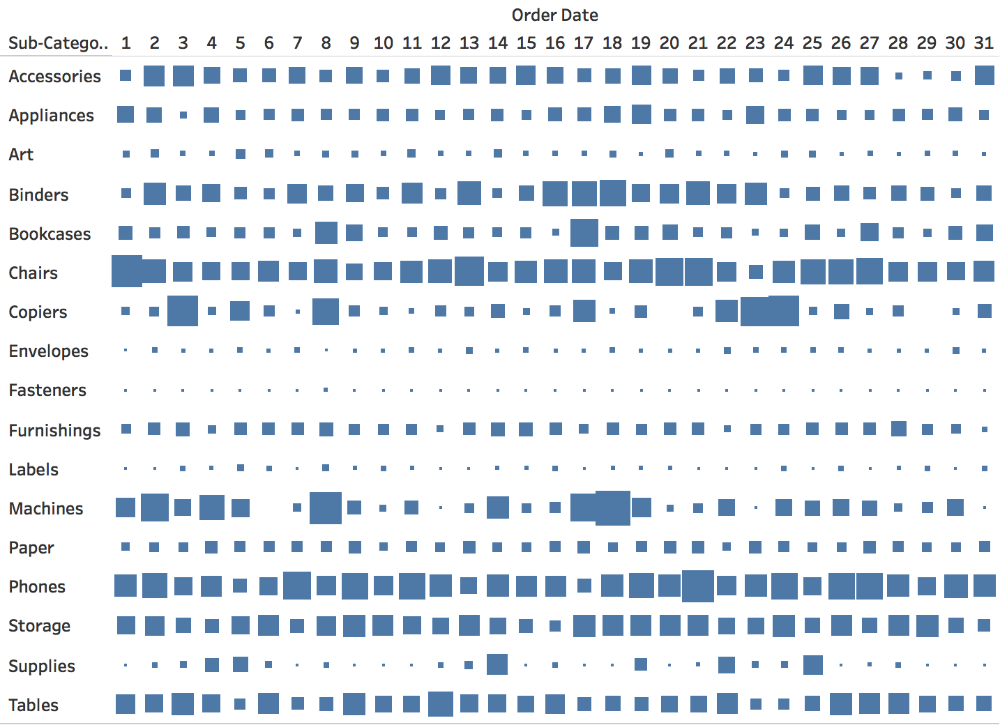{fig-align="center"}

**Same rows and columns as the heat map; the area of each square encodes sales. Small values almost disappear, and large squares touch.**

::: {.notes}
SKIPPABLE - if running long, jump to 'Measles in the United States, by state and year'.

**Purpose.** Isolate the effect of the encoding channel while preserving the row-and-column layout.

**Walk through.** The rows and day-of-month columns match the previous slide. Now square area carries sales. Locate Chairs and Phones, which remain prominent. Then find the tiny marks for Fasteners or Labels and the large adjacent marks in the Copiers row.

**Rationale.** A color heat map gives every cell the same footprint. With size, small values become difficult to inspect and large values can touch their neighbors. This can serve a task focused on locating large values, but it offers less support for differences among small values.

**Emphasize.** If constructing this chart, map the quantity to area. Mapping it directly to square side length would make the displayed area grow quadratically. Also distinguish a missing observation from a true zero, which may have no visible square.

**Ask.** "Which view would you use to find consistently low-activity categories? Which would draw attention to the largest cells?" Ask for the task behind the choice.

**Transition.** "The next heat map shows why aligned rows are particularly useful for seeing a change shared by many series."
:::

## Measles in the United States, by state and year

{fig-align="center"}

:::footer
DeBold, T., & Friedman, D. (2015). [*Battling Infectious Diseases in the 20th Century: The Impact of Vaccines*](http://graphics.wsj.com/infectious-diseases-and-vaccines/). The Wall Street Journal.
:::

::: {.notes}
**Purpose.** Show how a common time axis and an event annotation help readers recognize a broad temporal change.

**Walk through.** Each row is a state and each column a year. The original WSJ graphic reports cases per 100,000 people, so the color encodes a population-normalized rate. Point to the vertical marker for the vaccine's introduction in 1963, then compare the many colored cells before it with the much paler region afterward.

**Rationale.** A separate chart for every state would make this synchronized change harder to scan. Here, the transition forms a visible boundary across the rows. The annotation gives that boundary historical context.

**Emphasize.** The visual comparison shows timing and association. A before-and-after chart alone does not estimate a causal effect or account for every reporting difference. We can explain the design without treating the image as a complete causal analysis.

**ML connection.** Mark a model deployment or data-pipeline change on aligned monitoring plots. That gives a viewer a concrete event to investigate when several metrics move together.

**Source detail.** The rate denominator is specified in the [original WSJ graphic](https://graphics.wsj.com/infectious-diseases-and-vaccines/).
:::

## Measles today: new U.S. cases by week, 2025-2026

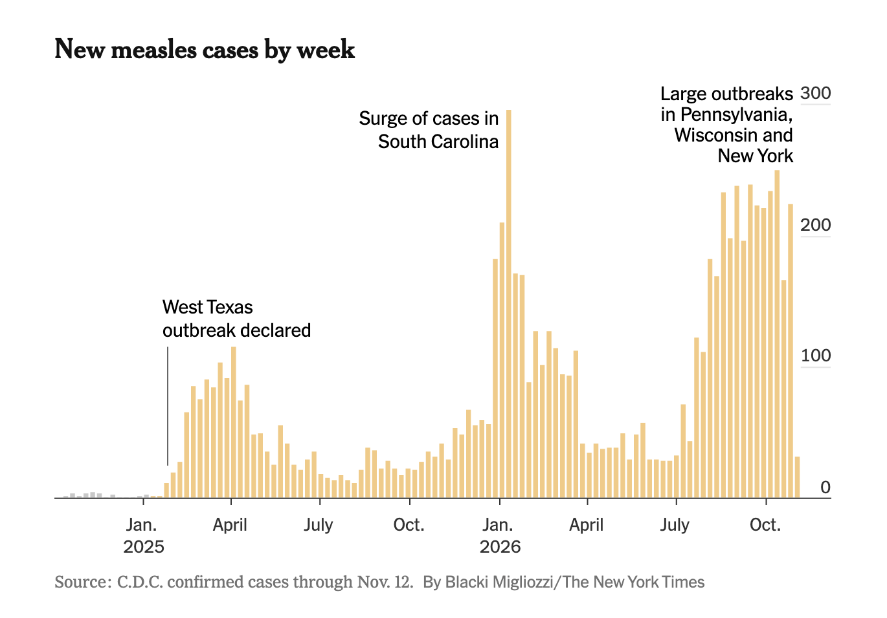{.nostretch height="820" fig-align="center"}

:::footer
Migliozzi, B. (2026). New measles cases by week. *The New York Times*. Data: CDC confirmed cases through Nov. 12, 2026.
:::

::: {.notes}
SKIPPABLE - if running long, jump to 'Careers as rows: goal-scoring rate by age'.

**Purpose.** Bring the previous slide's story up to the present, and contrast a single national series with the state-by-year heat map.

**Walk through.** Each bar is one week of confirmed U.S. cases, from late 2024 to mid-November 2026. Point to the three annotations: the West Texas outbreak declared in early 2025, the surge in South Carolina around January 2026 (the tallest week, near 300 cases), and the large outbreaks in Pennsylvania, Wisconsin and New York from late summer 2026 onward.

**Contrast with the heat map.** The WSJ chart aligns many states on a decades-long axis to show one shared change. This chart collapses the states into a single total at weekly resolution, so it shows the timing of individual outbreaks, but the annotations have to carry the geography the heat map showed with rows. It also reports counts, not rates per 100,000.

**Emphasize.** The last bar is much lower than the weeks before it. Ask whether that is a real drop or a week whose cases have not all been confirmed and reported yet. This is the same label-delay problem from the start of the lecture: the most recent points of a monitoring chart are often incomplete.

**ML connection.** Annotating outbreaks here plays the same role as marking a deployment or pipeline change on a monitoring plot: it gives the viewer a named event to check a spike against.

**Transition.** "Rows do not have to share a calendar. The next chart aligns them by age."
:::

## Careers as rows: goal-scoring rate by age

:::: {.columns}
::: {.column width="40%"}
* One row per player, **aligned by age**, not by calendar year
* **Color**: non-penalty goals per 90 minutes
* **Size**: share of the available minutes the player was on the field
* Rows are sorted by career scoring rate
* The time axis is relative: every career starts at the left, so careers can be compared
:::
::: {.column width="60%"}
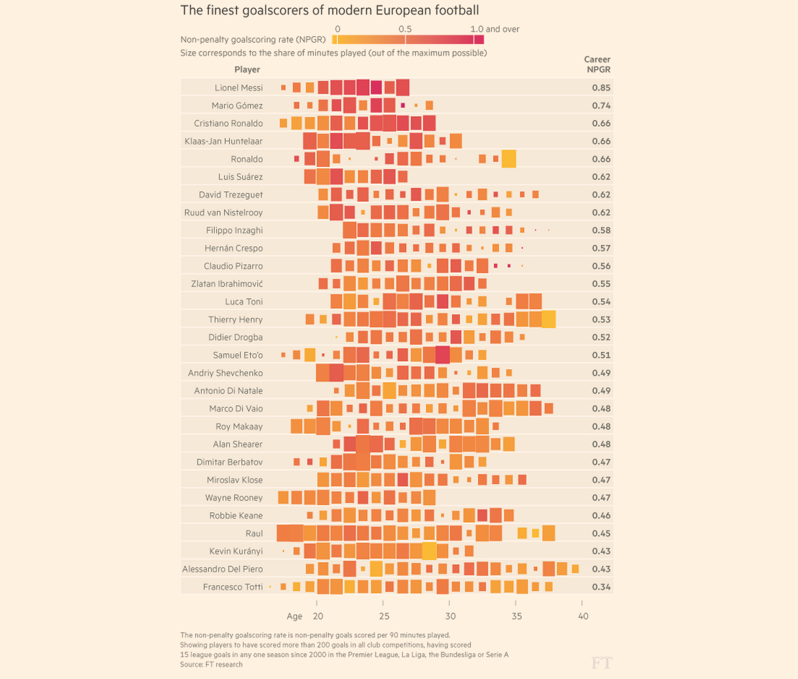{height="760" fig-align="center"}
:::
::::

:::footer
Source: Financial Times, *The finest goalscorers of modern European football* (FT research).
:::

::: {.notes}
SKIPPABLE - if running long, jump to 'Calendar heat maps'.

**Purpose.** Introduce alignment by a meaningful relative clock when calendar dates would obscure the comparison.

**Walk through.** Each row is a player and each mark represents a season positioned at the player's age. Color encodes non-penalty goals per 90 minutes. Size encodes the share of available playing minutes. Compare a small dark square with a large dark square: both show a high scoring rate, but the smaller square represents less playing time.

**Clarify the alignment.** The shared clock is age, not time since each player's first season. Players can therefore have different ages at their first visible mark. The chart aligns comparable stages of life while giving up the calendar context in which those seasons occurred.

**Rationale.** Rate and exposure answer different questions. Small exposure can make a rate less stable, although mark size is not a formal uncertainty interval. Sorting by career scoring rate helps organize the rows but does not explain why players differ.

**ML connection.** Align models by time since deployment to compare how performance evolves after launch. Use calendar dates instead when a common external event is the question.

**Transition.** "Calendar layouts retain another useful alignment: familiar days and weeks."
:::

## Calendar heat maps

:::: {.columns}
::: {.column width="40%"}
* A heat map laid out by the calendar: **rows are weekdays, columns are weeks**
* Weekly rhythm reads down a column, seasonal rhythm across a row
* Here: daily bike-share rides, 2014 to mid-2017
* Summers are bright, winters dark, every year
:::
::: {.column width="60%"}
{height="760" fig-align="center"}
:::
::::

::: {.notes}
**Purpose.** Explain how calendar geometry lets the reader compare weekly rhythm and seasonal progression in the same view.

**Walk through.** Each block is a year of daily Divvy rides. Rows run from Monday to Sunday, and columns advance through the weeks. Read down one column to compare days within a week, then across a row to follow that weekday through the year. The brighter summer region appears in each complete year, with many bright weekend cells.

**Rationale.** The layout uses the reader's familiarity with the calendar and aligns comparable weekdays. A single long line chart preserves chronology more directly, but makes it harder to compare corresponding days across many weeks.

**Emphasize.** The 2017 block ends in June because the records stop there. Blank future cells do not mean zero rides. Missing observations, zero values, and dates outside the dataset should have distinguishable appearances.

**Ask.** "Would this be a good view for reading the exact difference between two dates?" It is stronger for locating patterns than for precise value comparison.

**Transition.** "We can use the same alignment idea for hours within a day."
:::

## Hour of day by month: the daily cycle over the years

:::: {.columns}
::: {.column width="40%"}
* **Columns**: hour of the day, 0 to 23
* **Rows**: months, January 2015 (bottom) to April 2017 (top)
* **Color**: number of recorded events in that hour, summed over the month
* Quiet from 1 to 5 AM and a peak at 4 to 5 PM, in every month
* The pale top row is the last month in the data. Check that it is complete before reading it as a drop.
:::
::: {.column width="60%"}
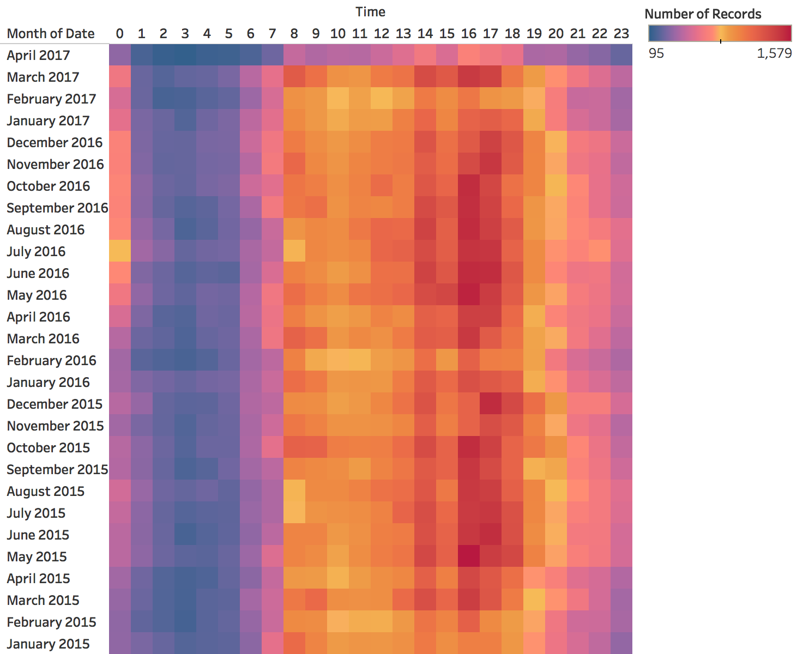{height="760" fig-align="center"}
:::
::::

::: {.notes}
SKIPPABLE - if running long, jump to 'Horizon charts: many series in little space'.

**Purpose.** Show how to inspect whether a daily rhythm persists, and how incomplete bins can mimic a change.

**Walk through.** Columns are hours from 0 to 23. Rows are months, with January 2015 at the bottom and April 2017 at the top. Each cell counts records in that hour across the month. Follow the dark afternoon columns vertically. Their persistence indicates a similar daily rhythm over many months. The early morning hours remain quieter.

**Rationale.** Repeated vertical bands make a stable daily pattern easier to recognize than a long sequence of hourly peaks. Comparing rows can reveal changes in the shape or timing of that pattern.

**Caution.** The pale top row could reflect a partial final month. The image alone does not establish that explanation, so check the date coverage before announcing a collapse. Counts also depend on month length. For intensity comparisons, consider events per observed day and account for missing hours.

**Color connection.** These are nonnegative counts with no meaningful midpoint. A sequential color scale is easier to justify than a diverging scale that suggests values on opposite sides of a reference.

**Transition.** "Another way to align repeated phases is to wrap time around a circle."
:::

## Spirals: the cycle on the angle, time on the radius

{fig-align="center"}

**Left: a periodic series on a straight time axis. Right: a spiral with one period per turn, so the peaks line up in one sector.**

:::footer
Weber, M., Alexa, M., & Müller, W. (2001). [*Visualizing time-series on spirals*](https://doi.org/10.1109/INFVIS.2001.963273). IEEE InfoVis.
:::

::: {.notes}
SKIPPABLE - if running long, jump to 'Horizon charts: many series in little space'.

**Purpose.** Explain the encoding before evaluating whether a spiral helps the task.

**Walk through.** On the left, time advances along a straight axis. On the right, it advances along a spiral. One complete turn represents a chosen period, so angle identifies phase within that period and successive turns represent successive cycles. Brightness carries the measured value. Point to the bright sector that repeats across turns.

**Rationale.** When the chosen period matches the data, peaks at the same phase align visually. The display combines repetition with chronological progression in a compact space.

**Emphasize.** The turn length is an analytical choice. If it is wrong, the peaks shift around the spiral from one turn to the next. That shift could reflect a mismatched period or a changing process. It needs investigation, rather than an immediate interpretation as noise.

**Ask.** "If the phenomenon repeats every seven days, what should one turn represent? What would happen if we chose six?" The peaks would gradually move around the circle.

**Transition.** "The climate spiral uses a related visual form, but assigns a different meaning to radius."
:::

## The climate spiral

:::: {.columns}
::: {.column width="42%"}
* **Angle**: month of the year
* **Radius**: global temperature change; the red rings mark 1.5 °C and 2.0 °C
* **One loop per year**, 1850 to 2016, colored from purple (early) to yellow (recent)
* What it shows well: the loops move outward, and the recent ones are the outermost
* What it shows poorly: the value in any particular year
:::
::: {.column width="58%"}
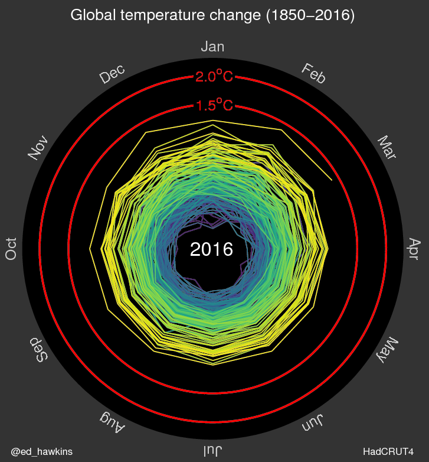{height="760" fig-align="center"}
:::
::::

:::footer
Hawkins, E. (2016). [*Climate spirals*](https://www.climate-lab-book.ac.uk/spirals/). Climate Lab Book. Data: HadCRUT4.
:::

::: {.notes}
SKIPPABLE - if running long, jump to 'Horizon charts: many series in little space'.

**Purpose.** Distinguish a graphic designed to communicate a broad change from one designed for detailed comparison.

**Walk through.** In this historical frame, angle identifies the month and color identifies the year. Radius represents the global temperature anomaly. Unlike the previous spiral, moving outward here means a larger measured value, rather than simply a later turn along the time axis. Trace a recent yellow loop and compare it with the earlier purple loops.

**Context.** Hawkins's original animation uses HadCRUT4 monthly values relative to the 1850–1900 mean. The red reference rings give the radial distance a temperature scale. Keep the discussion tied to the historical data shown, which end in 2016. A monthly value near a ring is a monthly comparison, not a statement about a sustained multi-year average.

**Rationale.** The outward movement of recent loops communicates warming clearly. Recovering an individual older year or comparing two exact values is harder because many paths overlap. An annual line chart would support those tasks more directly.

**Ask.** "What do you learn in two seconds? What question would require a different view?"

**Source.** [Hawkins's explanation of the original spiral](https://www.climate-lab-book.ac.uk/2016/spiralling-global-temperatures/).
:::

## Radial or linear: the same events both ways

:::: {.columns}
::: {.column width="50%"}
{height="620" fig-align="center"}
:::
::: {.column width="50%"}
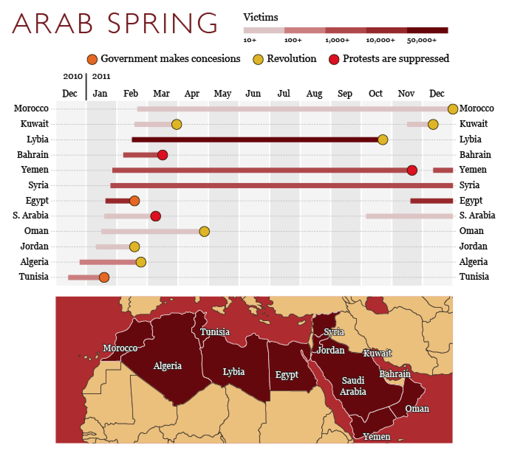{height="620" fig-align="center"}
:::
::::

**Which country's unrest lasted longest? Which ended first? Try each chart.**

* We read lengths on a common straight axis faster and more accurately than angles and arcs
* On the left, the same number of months is a longer arc on an outer ring than on an inner one
* Use a radial layout when the cycle itself is the message

::: {.notes}
SKIPPABLE - if running long, jump to 'Horizon charts: many series in little space'.

**Purpose.** Evaluate a visual layout with a concrete reading task.

**Activity.** Ask students to compare the duration and endpoints of two countries in the radial chart, then repeat in the linear chart. In the linear version, endpoints share a horizontal month axis. In the radial version, readers must map angles back to months and follow separate rings.

**Explain.** At radius r, an angular span has arc length r times the angle. Equal durations can therefore occupy different physical lengths on different rings. The encoding can be decoded through angle, but its visible arc lengths can mislead a quick comparison.

**Read the endpoint marks carefully.** Symbols indicate reported outcomes. A bar reaching the graphic's time boundary does not necessarily mean the unrest ended there. Restrict claims to the period and endpoint information shown. Color encodes reported victims, which is a separate variable from duration.

**Rationale.** These events unfold over a year without forming a repeating cycle. The straight axis supports the stated duration questions. A radial layout is easier to motivate when joining the end of a cycle to its beginning helps the reader.

**Transition.** "Space constraints can justify less familiar encodings. Horizon charts provide a different example."
:::

## Horizon charts: many series in little space

:::: {.columns}
::: {.column width="50%"}
**Line charts squeezed into thin rows**

{height="480" fig-align="center"}
:::
::: {.column width="50%"}
**The same rows as horizon charts**

{height="480" fig-align="center"}
:::
::::

**Same data, same space. The next two slides show how the right-hand version is built.**

* Left: about fifty line charts, each a few pixels tall. They all look flat.
* Right: blue is above the baseline, red below, and darker is further from it

:::footer
Heer, J., Kong, N., & Agrawala, M. (2009). [*Sizing the horizon: the effects of chart size and layering on the graphical perception of time series visualizations*](https://doi.org/10.1145/1518701.1518897). CHI.
:::

::: {.notes}
**Purpose.** Motivate a more complex encoding by showing the problem it addresses.

**Walk through.** Each row is a stock series. On the left, squeezing line charts into thin rows makes vertical variation difficult to see. On the right, hue indicates the sign of deviation from a baseline and darker bands indicate larger deviations. Ask students to find a time when several rows turn red together.

**Rationale.** Horizon charts exchange some position reading for color and layering to preserve useful patterns at small heights. They can help locate coordinated changes across many rows, but require learning the legend and the band construction.

**Emphasize.** Red and blue describe a relationship to a specified baseline. They do not automatically mean bad and good. The baseline and band widths must be stated, and comparable rows need compatible scales if magnitude comparisons matter. The study by Heer and colleagues examines the trade-off between compactness and reading accuracy, rather than establishing that more compression is always better.

**Transition.** "The next two slides unpack the transformation. Later, forecast horizon will mean how far ahead we predict, which is a different use of the word."
:::

## Building a horizon chart (1): cut into bands

{.nostretch width="74%" fig-align="center"}

{.nostretch width="74%" fig-align="center"}

**Fill the area between the line and the baseline, then slice it into bands of equal height. Darker means further from the baseline.**

::: {.notes}
SKIPPABLE - if running long, jump to 'Sparklines'.

**Purpose.** Make the compact encoding readable by building it from an ordinary signed series.

**Walk through.** Start with the line and horizontal baseline in the upper image. Fill the area above the baseline blue and below it red. Divide positive and negative deviations into equally sized magnitude bands, using darker shades for bands further from zero. At this stage the geometry retains its full height.

**Use a simple example.** "Suppose one band is ten units high. A value of +25 fills the first two positive bands and five units of the third. A value of −25 fills the corresponding negative bands." Sign selects the hue, and magnitude determines which bands are present.

**Rationale.** We are assigning color to information that will no longer be recoverable from full vertical displacement after compression. The reader needs to understand the band scale before looking at the final compact row.

**Transition.** "Now we can fold and layer the bands while retaining clues to their original values."
:::

## Building a horizon chart (2): mirror and collapse

{.nostretch width="74%" fig-align="center"}

{.nostretch width="46%" fig-align="center"}

**Mirror the negative values above the baseline, then slide every band down to the baseline. Height becomes color intensity.**

::: {.notes}
SKIPPABLE - if running long, jump to 'Sparklines'.

**Purpose.** Explain how the final height reduction preserves sign and approximate magnitude.

**Walk through.** In the upper image, the negative region has been reflected above the baseline. It remains red, so reflection does not change the meaning of the values. In the lower image, bands have been shifted down onto a shared baseline and layered. The entire row is now only one band high.

**Return to the example.** With ten-unit bands, +25 belongs to the third positive band and extends five units into it. Its blue shade identifies the band and its remaining height carries the within-band amount. For −25 the corresponding mark is red. Hue, shade, and height work together.

**Emphasize.** Compression has a reading cost. A dark region means a larger absolute deviation, but exact values require the band scale and some decoding. More layers increase density while making that task harder.

**Transition.** "Sparklines make a different compromise: they retain a familiar line and usually give up explicit axes."
:::

## Sparklines

> "Small, intense, word-sized graphics with typographic resolution." (Edward Tufte, *Beautiful Evidence*, 2006)

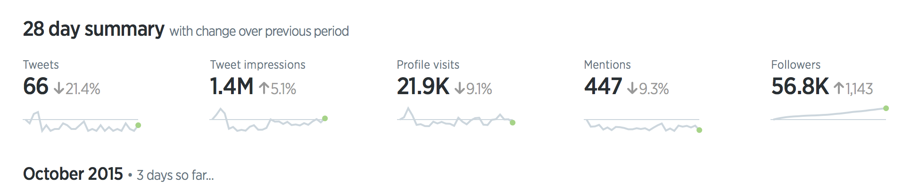{.nostretch width="92%" fig-align="center"}

**No axes and no labels: a sparkline sits beside a number and shows where it came from.**

::: {.notes}
**Purpose.** Explain how a tiny historical trace adds context to a summary number.

**Walk through.** The image is a 28-day Twitter analytics summary. Choose one metric, read the large number, then point to its small line below. The number summarizes the period. The line shows whether activity was steady, concentrated in a spike, or changed toward the end. Two periods can have the same total and very different histories.

**Rationale.** A sparkline is useful when the reader needs a quick temporal pattern beside a value. Omitting axes saves space, while the surrounding labels supply meaning. It provides less support for reading exact values or estimating a numerical slope.

**Emphasize.** Check whether different sparklines share a scale. If each has its own range, equally tall spikes do not imply equal magnitudes. A monitoring sparkline also needs a known time window and a way to inspect detail when something looks unusual.

**Transition.** "So far our compact views have mostly shown measurements. Event records need marks that preserve individual occurrences."
:::

## Event data: one mark per event

{fig-align="center"}

**Position is the date, row is the city, size is the quantity shipped, color is the shipping mode. No line connects the marks, because nothing is measured between events.**

::: {.notes}
SKIPPABLE - if running long, jump to 'Evaluating a Forecast'.

**Purpose.** Return to the event/measurement distinction and show what individual-event marks preserve.

**Walk through.** Position locates a shipment date, the row identifies a city, size represents quantity shipped, and color identifies shipping mode. Look first for dense rows and long gaps, then for unusually large marks. There is no measured value to interpolate between two separate shipments, so connecting all the marks with a line would suggest the wrong structure.

**Rationale.** This display preserves event timing and attributes that a line of daily totals would combine. Dense rows also reveal its limitation: overlapping marks make individual events and colors hard to distinguish. Transparency or interactive inspection can help, while binning trades detail for a readable count series.

**Caution.** If jitter is used to separate overlaps, keep the actual timestamp recoverable and explain any displacement. A logging gap can also look like an absence of events.

**ML connection.** Prediction requests, alerts, and deployments are event records. Deployment marks are especially useful as annotations alongside continuous performance metrics.

**Transition.** "For an event that lasts, show both endpoints."
:::

## Events with duration: one bar per interval

:::: {.columns}
::: {.column width="34%"}
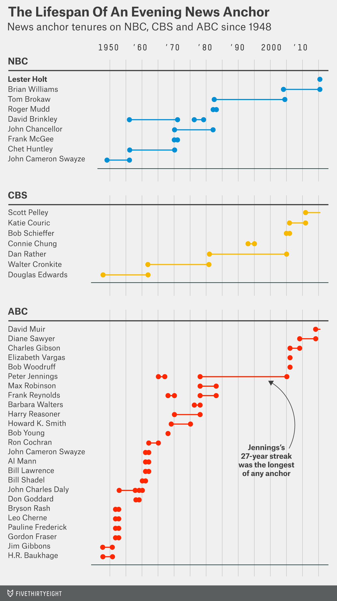{height="640" fig-align="center"}
:::
::: {.column width="66%"}
{height="640" fig-align="center"}
:::
::::

* **A bar runs from start to end on a shared time axis** (a Gantt chart). It shows overlaps, gaps, and what ran at the same time.
* Left: tenures of evening news anchors since 1948. Right: tape mounts on 24 drives over about two and a half days.

:::footer
Left: FiveThirtyEight, *The Lifespan Of An Evening News Anchor*.
:::

::: {.notes}
SKIPPABLE - if running long, jump to 'Evaluating a Forecast'.

**Purpose.** Explain why interval bars support questions about duration, overlap, and resource occupancy.

**Walk through.** On the left, the horizontal endpoints locate news-anchor tenures, grouped by network. Point to a succession of tenures and then an overlap. On the right, each row is a tape drive and each bar is a mount. Its endpoints locate the start and finish, while color distinguishes the requesting system. Compare a long occupancy with a burst of short mounts.

**Rationale.** A common horizontal axis makes duration a length comparison. Vertical alignment reveals simultaneous activity across resources. An event count alone would discard the difference between one long job and many short jobs.

**Emphasize.** Name what each row represents. A row per person, resource, or task supports a different comparison. If an interval is ongoing at the end of the data, mark that status rather than implying a known finish time.

**ML connection.** The same design can show training jobs on GPUs or pipeline stages within runs. Overlaps and idle periods become visible, providing concrete questions about bottlenecks or scheduling.

**Transition.** "For long histories, interaction helps us move between the overview and the events that need attention."
:::

## Interaction (1): zoom and pan

**A long series does not fit in one static view. Show the whole extent first, then let the reader move through it.**

:::: {.columns}
::: {.column width="50%"}
### Geometric zoom

* Magnifies the picture: the same points, drawn larger
* Use an **overview + detail** pair so the reader always knows where they are
:::
::: {.column width="50%"}
### Semantic zoom

* Changes the data: hourly, then daily, then monthly
* It is the aggregation trade-off from part 1, made interactive
:::
::::

**Demo:** [overview + detail in Vega-Lite](https://vega.github.io/vega-lite/examples/interactive_overview_detail.html). Drag a range in the lower chart; the upper chart shows only that range.

::: {.notes}
SKIPPABLE - if running long, jump to 'Evaluating a Forecast'.

**Purpose.** Distinguish changing the visible range from changing the representation at different scales.

**Demo script.** Open the linked Vega-Lite example. First point to the lower chart as the full history. Drag a short interval there and show how the upper chart displays the selection. Move the selection so students see both navigation and the persistent indication of where they are. If the demo is unavailable, describe the same two-view sequence verbally.

**Explain.** This example changes the visible domain without recomputing temporal bins. Geometric zoom enlarges a portion of the existing representation. Semantic zoom changes what is represented, such as showing monthly summaries at a broad scale and daily values at a fine scale.

**Rationale.** Overview plus detail reduces the risk of losing temporal context while investigating a local feature. Semantic zoom also manages the number of marks, but must update labels and units so a monthly total is not mistaken for a daily total.

**Ask.** "When a spike becomes taller after zooming, did we discover a larger value, change the vertical scale, or change the aggregation?" A usable interface makes the answer clear.

**Transition.** "Selecting a time interval becomes more powerful when the other views respond to the same selection."
:::

## Interaction (2): brushing and linking

* **Filtering**: show only a time range, a category, or values above a threshold
* **Brushing**: select marks in one view by dragging over them
* **Linking**: the selection is applied to every other view of the same data
* **Dynamic aggregation**: change the bin size with a control; click a month to see its days

**For ML: brush a bad stretch of the accuracy chart, and the linked views show those rows: their feature distributions, their classes, the individual errors.**

::: {.notes}
SKIPPABLE - if running long, jump to 'Evaluating a Forecast'.

**Purpose.** Show how interaction connects a symptom to records that may help explain it.

**Talk through a scenario.** "Suppose accuracy drops during two weeks. Brush that interval. A linked feature histogram now shows the inputs from those requests. A class view shows their composition, and a table lets us inspect the errors." Compare the selected period against a reference period rather than viewing its distribution in isolation.

**Clarify the terms.** Brushing defines a selection. Linking propagates that selection across views. A linked view may highlight selected records or filter to them, and those behaviors have different consequences for context. Dynamic aggregation changes the level of summary.

**Rationale.** An accuracy timeline can locate a problem in time. Linked views let us ask which groups or inputs changed during the same period. They generate hypotheses for diagnosis, while overlap in time alone does not establish causation.

**Emphasize.** Keep the selected interval and its sample size visible. Also decide whether time means prediction time or label-arrival time, especially when outcomes are delayed.

**Transition.** "We have assigned time a spatial axis throughout these examples. Sometimes that axis is already needed for something else."
:::

## When position is already taken

**Every chart so far put time on a spatial axis. On a map or a scatterplot, x and y are already in use.**

:::: {.columns}
::: {.column width="33%"}
### Animation

* Time is shown as time
* Good for one clear change
* Hard to compare two moments: you have to remember the earlier frame
:::
::: {.column width="33%"}
### Color

* Color each mark by its time
* Shows order and direction
* Imprecise, and it uses up the color channel
:::
::: {.column width="34%"}
### Trajectories

* Connect an object's positions in time order
* Shows the path
* Speed and timing need extra marks
:::
::::

**If you animate: add pause and scrub controls, keep it short, and show a few key frames side by side as small multiples.**

::: {.notes}
SKIPPABLE - if running long, jump to 'Evaluating a Forecast'.

**Purpose.** Explain the alternatives when x and y already encode location, features, or an embedding.

**Talk through one example.** Imagine the positions of moving objects on a map. Animation advances the displayed moment. Color can mark when positions occurred. A trajectory connects positions in temporal order. Each makes a different question easier.

**Explain the costs.** Animation shows motion directly but asks the viewer to remember earlier frames. Color leaves multiple moments visible, but offers limited temporal precision and occupies a channel that might otherwise show category. A trajectory preserves the path, but speed requires timestamps or a known sampling interval. A long segment may mean fast motion or a long gap between observations.

**Course connection.** Comparing embeddings at successive training iterations with small multiples puts several moments in view at once. A path through a projection of model parameters can show movement, while inheriting the projection's distortions.

**Rationale.** Match the display to the comparison the viewer must make. Pause and scrub controls, a stable scale, and selected frames alongside an animation can support inspection.

**Transition.** "We now have a set of temporal displays. The next step is to use them to evaluate predictions honestly."
:::

# Evaluating a Forecast

::: {.notes}
**Section bridge.** "We will now use those displays to evaluate a model. A forecast makes a claim about observations that were unavailable when it was issued. Our split, our features, and our error plots all have to respect that boundary."

**Rationale.** Remind students of Week 3's metrics, then distinguish the metric from the experiment used to estimate it. The synthetic demand series lets us connect each diagnostic pattern to a known ingredient of the data.
:::

## Time series tasks in ML

:::: {.columns}
::: {.column width="50%"}
**What we ask a model to do**

* **Forecast**: predict the next values
* **Classify**: label a whole series or a window
* **Detect anomalies**: flag what does not belong
* **Monitor**: watch a deployed model's inputs and outputs over time
:::
::: {.column width="50%"}
**What time changes**

* Observations are **not independent**: today looks like yesterday
* The **order matters**: you may only train on the past
* The **future differs from the past**: trends, new behavior, drift
:::
::::

**The evaluation tools from Week 3 assumed none of these three. Each one has a visual check.**

::: {.notes}
**Purpose.** Connect the visualization material to modeling decisions without turning the lecture into a catalog of forecasting algorithms.

**Talk through.** Forecasting predicts future demand. Classification might label a window of sensor readings as walking or running. Anomaly detection asks whether a value or sequence departs from expected behavior. Monitoring applies even to a model whose individual inputs are images or text: once deployed, its requests and errors form a temporal history.

**Explain the right column.** Nearby observations can share information. Prediction requires respecting when information becomes available. The process that generates future observations can also change. These are reasons to reconsider the evaluation design, not reasons to discard MAE, accuracy, or precision and recall from Week 3.

**Set up the example.** "Our daily demand series has three years of observations. We constructed it with an upward trend, annual seasonality, weekday effects, and noise that carries over from one day to the next. We know those ingredients, so we can deliberately omit one and inspect the resulting failure." The last 120 days serve as the initial future test period.

**Emphasize.** Temporal dependence and distribution change are common possibilities, not properties that every timestamped dataset must exhibit. The test design should match the use case.

**Transition.** "First, what should a forecast display tell us beyond its central prediction?"
:::

## A forecast is a line and a band

```{python}
#| fig-align: center
cal = np.abs(resid[SPLIT - 180:SPLIT])            # the last 180 training days set the band width
q = np.quantile(cal, 0.90)
fut = slice(SPLIT, N)
coverage = np.mean(np.abs(resid[fut]) <= q)
fig, ax = plt.subplots(figsize=(17, 7.4))
show = slice(SPLIT - 240, N)
ax.plot(dates[show], y[show], color=GRAY, lw=1.6, label="actual")
ax.plot(dates[fut], pred[fut], color=PURPLE, lw=2.6, label="forecast")
ax.fill_between(dates[fut], pred[fut] - q, pred[fut] + q, color=VIOLET, alpha=0.22, lw=0, label="90% interval")
ax.axvline(dates[SPLIT], color="black", ls="--", lw=1.5)
ax.text(dates[SPLIT - 4], ax.get_ylim()[1], "training data ends ", ha="right", va="top", fontsize=19)
ax.text(dates[SPLIT + 4], ax.get_ylim()[1], f"MAE {mae(y[fut], pred[fut]):.0f}; {coverage:.0%} of days inside the band", ha="left", va="top", fontsize=19, color=PURPLE)
ax.set_ylabel("daily demand")
ax.legend(loc="lower left", ncol=3)
plt.tight_layout()
```

*Synthetic daily demand. Linear model on a time index, a yearly cycle and day of week; band from the model's errors on its last 180 training days.*

::: {.notes}
**Purpose.** Separate point accuracy from the quality of an uncertainty statement.

**Walk through.** Start at the dashed boundary. Everything to its left is available for fitting. To its right, purple gives the linear model's predictions and gray shows what subsequently happened. The model uses a time index, annual sine/cosine features, and weekdays, all of which are known for future dates. Point to the repeated weekly dips before discussing the error.

**Explain the numbers.** MAE is the average absolute difference between actual and predicted demand, in demand units. Here it is about 51. The band extends about 85 units on either side, using the 90th percentile of absolute residuals from the last 180 training days. Only about 78% of the 120 future observations fall inside it.

**Explain the limitation.** The label "90%" is a nominal target based on those past residuals. Those days were also used to fit the model, so they are not an independent calibration set. The correlated noise produces runs of errors, and one future period need not match the past residual distribution. The observed coverage shows undercoverage in this test period, but the plot alone does not isolate one cause.

**Emphasize.** This is a simple constant-width band for individual observations, with no guarantee that the whole future path stays inside. A stronger evaluation would assess coverage and width on later data, including by forecast horizon. Widening a band can improve coverage while reducing its usefulness.

**Ask.** "Could a model have low MAE but an unreliable interval?" Yes. Point predictions and interval calibration need separate checks. See [Forecasting: Principles and Practice, Chapter 5](https://otexts.com/fpp3/toolbox.html) for the interval and residual concepts.

**Transition.** "Even the point-error estimate can be misleading if the train/test split asks the wrong question."
:::

## A random train/test split is too optimistic

```{python}
#| fig-align: center
Xg = np.column_stack([t, dow, dates.dayofyear.values])
gbr = lambda: GradientBoostingRegressor(n_estimators=300, max_depth=3, random_state=0)
tr = slice(0, SPLIT)
mae_random = -cross_val_score(gbr(), Xg[tr], y[tr], cv=KFold(5, shuffle=True, random_state=0), scoring="neg_mean_absolute_error").mean()
mae_ordered = -cross_val_score(gbr(), Xg[tr], y[tr], cv=TimeSeriesSplit(5, test_size=120), scoring="neg_mean_absolute_error").mean()
mae_future = mae(y[fut], gbr().fit(Xg[tr], y[tr]).predict(Xg[fut]))
fig, (a, b) = plt.subplots(1, 2, figsize=(17, 7.4), gridspec_kw={"width_ratios": [1.5, 1]})
r2 = np.random.default_rng(0)
is_test = r2.random(SPLIT) < 0.2
for row, (mask, name) in enumerate([(is_test, "random split"), (t[:SPLIT] >= SPLIT - int(0.2 * SPLIT), "time-ordered split")]):
    yy = 1 - row
    a.scatter(t[:SPLIT][~mask], np.full((~mask).sum(), yy), marker="|", s=900, color=GRAY, alpha=0.5, linewidths=1)
    a.scatter(t[:SPLIT][mask], np.full(mask.sum(), yy), marker="|", s=900, color=ORANGE, linewidths=1.4)
    a.text(0, yy + 0.3, name, fontsize=22, weight="bold")
a.set_ylim(-0.5, 1.6); a.set_yticks([]); a.spines["left"].set_visible(False)
a.set_xlabel("day"); a.set_title("Which days are held out?")
a.legend(handles=[Patch(color=GRAY, alpha=0.5, label="train"), Patch(color=ORANGE, label="test")], loc="lower center", ncol=2, bbox_to_anchor=(0.5, -0.02))
vals = [mae_random, mae_ordered, mae_future]
bars = b.bar(["random\n5-fold", "time-ordered\n5-fold", "the actual\nnext 120 days"], vals, color=[ORANGE, PURPLE, GRAY], width=0.62)
for r, v in zip(bars, vals):
    b.text(r.get_x() + r.get_width() / 2, v + 2, f"{v:.0f}", ha="center", fontsize=24, weight="bold")
b.set_ylim(0, max(vals) * 1.18); b.set_ylabel("mean absolute error"); b.set_title("Estimated vs. real error")
plt.tight_layout()
```

*Same synthetic series; gradient-boosted trees on time index, day of week and day of year.*

::: {.notes}
**Purpose.** Explain the mechanism of optimistic temporal evaluation and make the prediction task explicit.

**Walk through.** The left panel illustrates the split patterns. Randomly scattered test days have training observations on both sides. In a forward split, the test block follows the training block. These are illustrations of the placement of held-out days, rather than drawings of all five folds used in the right panel.

**Read the comparison.** Here the model is gradient-boosted trees, using time index, weekday, and day of year. Random five-fold evaluation reports MAE about 25. Time-ordered evaluation reports about 116. Training on the available history and testing on the actual next 120 days gives about 95. The forward estimate is pessimistic in this example, but much closer to the future task.

**Explain why.** The series has a trend and correlated neighboring values. Random folds let the model learn from later dates surrounding a held-out date. That makes the task closer to filling gaps within an observed history. Deployment instead asks it to predict beyond the available history. Ordinary regression trees have particular difficulty extending a trend beyond their training range.

**Emphasize.** The nearly fourfold gap is an outcome of this example, not a universal factor. Time-ordered folds also differ in training size and test period. If the real task were historical interpolation, a different split might be appropriate. For future forecasting, reproduce future information availability, including in preprocessing and feature construction.

**Transition.** "Backtesting repeats that deployment-like experiment at several points in history."
:::

## Backtesting: rolling-origin evaluation

```{python}
#| fig-align: center
tscv = TimeSeriesSplit(n_splits=6, test_size=120)
fold_mae = []
fig, (a, b) = plt.subplots(1, 2, figsize=(17, 7.4), gridspec_kw={"width_ratios": [1.5, 1]})
for k, (itr, ite) in enumerate(tscv.split(t)):
    a.barh(k, len(itr), left=itr[0], color=GRAY, alpha=0.55, height=0.62)
    a.barh(k, len(ite), left=ite[0], color=ORANGE, height=0.62)
    m = Ridge(alpha=1e-3).fit(X_all[itr], y[itr])
    fold_mae.append(mae(y[ite], m.predict(X_all[ite])))
a.invert_yaxis(); a.set_yticks(range(6)); a.set_yticklabels([f"fold {k + 1}" for k in range(6)])
a.set_xlabel("day"); a.set_title("Rolling origin: train on the past, test on what follows")
a.legend(handles=[Patch(color=GRAY, alpha=0.55, label="train"), Patch(color=ORANGE, label="test (120 days)")], loc="upper right")
b.plot(range(1, 7), fold_mae, "o-", color=PURPLE, lw=3, ms=12)
b.axhline(np.mean(fold_mae), color=GRAY, ls="--", lw=1.5)
b.text(1.0, 0.03, f"dashed line: mean {np.mean(fold_mae):.0f}", transform=b.transAxes, va="bottom", ha="right", color=GRAY, fontsize=19)
b.set_ylim(0, max(fold_mae) * 1.25); b.set_xlabel("fold"); b.set_ylabel("mean absolute error"); b.set_title("Error per fold")
plt.tight_layout()
```

*Same synthetic series and the linear model from two slides back; six folds, each tested on the next 120 days.*

::: {.notes}
**Purpose.** Show why one chronological holdout is useful but gives an incomplete account of performance across time.

**Walk through.** Pick the first row. Gray is the available past and orange is the following 120 days. Move down one row: the origin advances and the training set expands. Previously tested observations may now enter training because they would have become available by that later origin. Within each fold, future outcomes remain excluded.

**Read the results.** We have returned to the calendar-based linear model, so do not compare these errors to the previous slide as though only the split changed. Fold MAEs range from about 36 to 59, averaging about 48. The sixth fold uses the same last 120 days as the first forecast example.

**Rationale.** The per-fold curve tells us whether performance is consistent across deployment dates. A mean hides differences in season, training history, and the particular errors encountered. The folds share training data, so the six scores are not independent experimental replicates.

**Practical extension.** Choose the test window to match the decision horizon. An expanding window uses all available history. A fixed-length training window can prioritize recent behavior. Fit preprocessing inside each fold and account for labels or features that arrive late. A gap can exclude observations close to the boundary when the information timing requires one.

**Emphasize.** If these backtests guide model selection, reserve a later untouched period for final assessment. See the [TimeSeriesSplit documentation](https://scikit-learn.org/stable/modules/generated/sklearn.model_selection.TimeSeriesSplit.html) for expanding windows and the gap parameter.

**Transition.** "A large error tells us that something is wrong. Residual views help us work out what structure the model missed."
:::

## Residuals show what the model missed

```{python}
#| fig-align: center
Xn = calendar_features(t, weekly=False)           # a model that was not told about weekdays
res_n = y - Ridge(alpha=1e-3).fit(Xn[:SPLIT], y[:SPLIT]).predict(Xn)
def acf(x, nlags):
    x = x - x.mean()
    return np.array([1.0] + [np.sum(x[k:] * x[:-k]) / np.sum(x * x) for k in range(1, nlags + 1)])
fig, (a, b, c) = plt.subplots(1, 3, figsize=(17, 7.4), gridspec_kw={"width_ratios": [1.5, 1, 1]})
a.plot(dates[:SPLIT], res_n[:SPLIT], color=GRAY, lw=0.9)
a.axhline(0, color="black", lw=1); a.set_title("Residuals over time"); a.set_ylabel("actual − predicted")
a.set_xticks(pd.to_datetime(["2023-01-01", "2024-01-01", "2025-01-01"])); a.set_xticklabels(["2023", "2024", "2025"])
b.boxplot([res_n[:SPLIT][dow[:SPLIT] == k] for k in range(7)], tick_labels=["M", "T", "W", "T", "F", "S", "S"],
          patch_artist=True, boxprops=dict(facecolor="#e6d5f0", color=PURPLE), medianprops=dict(color=PURPLE, lw=2.5),
          whiskerprops=dict(color=PURPLE), capprops=dict(color=PURPLE), flierprops=dict(markersize=3, markeredgecolor=GRAY))
b.axhline(0, color="black", lw=1); b.set_title("Residuals by weekday")
ac = acf(res_n[:SPLIT], 28)
c.bar(range(29), ac, color=[PURPLE if k % 7 == 0 else GRAY for k in range(29)], width=0.7)
c.set_xticks([0, 7, 14, 21, 28]); c.set_xlabel("lag (days)"); c.set_title("Residual autocorrelation")
plt.tight_layout()
```

*Same synthetic series; the linear model with the day-of-week inputs removed.*

::: {.notes}
**Purpose.** Use complementary views to turn an aggregate error into a specific modeling hypothesis.

**Define the sign.** A residual is actual minus predicted. Positive means the model predicted too little, and negative means it predicted too much. Here we deliberately remove weekday inputs while retaining the trend and yearly cycle. These are residuals on the training period, used for diagnosis rather than as a final performance estimate.

**Walk through left to right.** The time plot shows repeated downward spikes but does not make their calendar alignment obvious. The weekday boxplots reveal the explanation: weekday errors are mostly positive, while Saturday and Sunday errors center near −120 and −186. The model fails to represent the weekend reduction in demand.

**Explain autocorrelation.** At lag seven, compare residuals with the residuals seven days earlier. A large positive correlation means similar errors recur a week apart. The peaks around 0.8 at lags 7, 14, 21, and 28 support the weekly explanation. The lag-zero bar is one by definition and provides no diagnostic evidence.

**Rationale.** We are applying the sequential and cyclic views from part 1 to the same errors. Adding weekday features is a well-motivated response, and subsequent backtesting checks whether it helps on future data. The synthetic noise is itself correlated, so adding weekdays will not make every residual dependency disappear.

**Ask.** "What would mostly positive residuals on every day suggest?" A general underprediction bias, rather than just a missing weekly effect.

**Transition.** "Recent observations can also help, but their value depends on how far ahead the prediction is made."
:::

## Error grows with the forecast horizon

```{python}
#| fig-align: center
LAGS = 14
H = [1, 2, 3, 5, 7, 10, 14, 21, 28]
# A forecast for day d at horizon h is issued on day d - h (its origin) and may only use what
# was known then. The models are fitted on targets up to the last training day, so we score
# only target days whose origin is on or after that day, for every horizon: the same days for
# all horizons, namely the ones a 28-day-ahead forecast can reach.
SCORE = SPLIT + max(H) - 1
h_mae = []
for h in H:
    idx = np.arange(LAGS + h - 1, N)
    Xh = np.column_stack([calendar_features(idx)] + [y[idx - h - k] for k in range(LAGS)])
    trn, tst = idx < SPLIT, idx >= SCORE
    h_mae.append(mae(y[idx][tst], Ridge(alpha=1e-3).fit(Xh[trn], y[idx][trn]).predict(Xh[tst])))
cal_only = mae(y[SCORE:], pred[SCORE:])
fig, ax = plt.subplots(figsize=(17, 7.4))
ax.plot(H, h_mae, "o-", color=PURPLE, lw=3, ms=12, label="model with the last 14 observed days as inputs")
ax.axhline(cal_only, color=GRAY, ls="--", lw=2, label="calendar-only model (no recent observations)")
ax.set_ylim(0, max(max(h_mae), cal_only) * 1.25); ax.set_xticks(H)
ax.set_xlabel("forecast horizon (days ahead)"); ax.set_ylabel(f"mean absolute error on the last {N - SCORE} days")
ax.legend(loc="lower right")
plt.tight_layout()
```

*Same synthetic series; a separate linear model per horizon, each given the 14 most recent days observed when the forecast is issued. All horizons are scored on the same 93 days, each forecast issued on or after the last training day.*

::: {.notes}
**Purpose.** Explain that forecasting accuracy is conditional on how far into the future we ask the model to predict.

**Define the setup.** An h-day-ahead forecast for day d is issued on day d minus h. Each purple point comes from a separate linear model using calendar features for the target day and the 14 most recent observations available at that forecast origin. These are direct forecasts for each horizon, not a recursive rollout that feeds predictions back into the model.

**Walk through.** One day ahead, MAE is about 27. At seven days it is about 55. At longer horizons it is mostly between 55 and 60, close to the calendar-only reference near 57. Recent values help track the correlated noise at short horizons. As the horizon increases, that information becomes less predictive, while the calendar remains available.

**Explain fair scoring.** Model coefficients are fitted using targets before the training cutoff. Every scored forecast must also have an origin at or after the last training day. The 28-day horizon leaves 93 eligible target days, and all horizons use those same days. Otherwise differences could come from evaluating different periods or using training outcomes that had not yet occurred at the forecast origin. As time advances, newly observed demand may enter the lag inputs, but the model coefficients stay fixed.

**Qualification.** Error need not increase monotonically in every finite sample. The small reversals and differences from the dashed line are not enough to establish a general advantage or disadvantage. This experiment shows a short useful memory for this particular process.

**Ask.** "If an operational decision must be made three weeks ahead, which point matters?" The three-week result, even if tomorrow's prediction is excellent.

**Transition.** "So far the underlying process has stayed the same. Next we let the world change after deployment."
:::

# Drift and Monitoring

::: {.notes}
**Section bridge.** "Backtesting asks how the model would have performed at earlier deployment dates. Monitoring asks what is happening after the deployment we actually made. The input population and the input-to-outcome relationship can both change."

**Rationale.** Shift from selecting a model to maintaining useful predictions over time. Keep the distinction between early evidence from inputs and delayed evidence from outcomes in view throughout this section.
:::

## Why deployed models go stale

A model learns $P(y \mid x)$ from data drawn from $P(x)$. After deployment either can change.

* **Data drift** (covariate shift): the inputs change, $P(x)$. New customers, a new sensor, a season the model never saw.
* **Concept drift**: the relationship changes, $P(y \mid x)$. The same input now deserves a different answer.

**What we can watch**

* **Inputs and predictions**: available immediately, no labels needed
* **Accuracy**: needs the true labels, which often arrive days or months later

:::footer
Gama, J., Žliobaitė, I., Bifet, A., Pechenizkiy, M., & Bouchachia, A. (2014). [*A survey on concept drift adaptation*](https://doi.org/10.1145/2523813). ACM Computing Surveys.
:::

::: {.notes}
**Purpose.** Separate a changing input population from a changing relationship between inputs and outcomes.

**Translate the notation.** P(x) describes which inputs arrive and how frequently. P(y given x) describes the outcome distribution for a particular input. A model estimates that relationship from the data it has seen. Incoming customers can change even if the relationship stays the same. Conversely, a policy or behavioral change can make the same input require a different prediction.

**Example.** If a service expands into a new region, the input mix may change. If the definition of a positive outcome changes, the label relationship may change. Neither situation guarantees a particular amount of accuracy loss. The effect depends on what changed and what the model relies on.

**Explain the monitoring asymmetry.** Inputs and predictions are available as requests arrive. Scoring requires the eventual outcomes. A loan-default label, for example, may arrive much later. Input monitoring therefore gives earlier evidence of change, while labeled performance tells us whether predictions remain useful.

**Rationale.** A training distribution is a reference, not a permanent promise about deployment. Monitoring asks whether that reference is still relevant.

**Transition.** "Changes also unfold at different speeds, which affects how quickly we can notice and respond to them."
:::

## Four shapes of drift

```{python}
#| fig-align: center
r3 = np.random.default_rng(3)
n = 400
x = np.arange(n)
sudden = np.where(x < 200, 0.0, 1.0)
incremental = np.clip((x - 130) / 140, 0, 1)
gradual = np.zeros(n)                             # the stream alternates, with concept B taking a growing share
for lo, hi in [(110, 125), (170, 200), (235, 285), (305, 400)]:
    gradual[lo:hi] = 1.0
recurring = ((x // 100) % 2).astype(float)
fig, axes = plt.subplots(1, 4, figsize=(17, 5.6), sharey=True)
for ax, m, name in zip(axes, [sudden, incremental, gradual, recurring], ["Sudden", "Incremental", "Gradual", "Recurring"]):
    ax.plot(x, m, color=PURPLE, lw=2.6)
    ax.scatter(x[::4], (m + r3.normal(0, 0.09, n))[::4], s=10, color=GRAY, alpha=0.6, zorder=0)
    ax.set_title(name); ax.set_xticks([]); ax.set_xlabel("time")
    ax.set_yticks([0, 1]); ax.set_yticklabels(["concept A", "concept B"])
plt.tight_layout()
```

**The shape decides how to respond: a sudden change calls for retraining, a recurring one for keeping the old model around.**

*Schematic, after Gama et al. (2014).*

::: {.notes}
**Purpose.** Explain why the temporal form of change matters for detection and adaptation.

**Walk through.** The vertical positions labeled A and B are schematic regimes, not measured accuracy. Sudden drift switches abruptly. Incremental drift moves through intermediate states. Gradual drift has periods of both regimes, with B becoming increasingly prevalent. Recurring drift returns to a regime seen before. The purple lines illustrate the mechanism and gray points suggest noisy observations.

**Resolve the confusing pair.** "Incremental means the relationship itself is changing step by step. Gradual means old and new relationships coexist during a transition." A worn sensor provides an intuition for incremental change. A staged migration between two user behaviors provides an intuition for gradual change.

**Rationale.** A short window can respond quickly but fluctuate with noise. A long window is more stable but can mix old and new regimes. Recurrence suggests retaining useful history rather than assuming all old behavior is irrelevant.

**Qualification.** The slide's response suggestions are possibilities, not automatic rules. A sudden change may be a broken pipeline that needs repair rather than retraining. A recurring seasonal pattern that the model already represents need not be a failure. Establish the cause and performance effect before choosing an intervention.

**Transition.** "The next example shows how a change in the labeling rule appears in accuracy, including what retraining can and cannot prevent."
:::

## Accuracy over time

```{python}
#| fig-align: center
# A weekly classification stream: 400 labeled points per week for 60 weeks, two features.
# Weeks 20-32: the inputs shift (x1 mean moves), the labeling rule does not.
# Week 44 on: the labeling rule changes, the inputs do not.
r4 = np.random.default_rng(11)
WEEKS, PER = 60, 400
def week_data(w):
    shift = 1.5 * np.clip((w - 20) / 12, 0, 1)
    X = r4.normal(0, 1, (PER, 2)) + [shift, 0.0]
    score = X[:, 1] if w < 44 else -X[:, 1] * 0.2 + (X[:, 0] - shift)   # rule ignores the shifted direction before week 44
    return X, (score + r4.normal(0, 0.35, PER) > 0).astype(int)
stream = [week_data(w) for w in range(WEEKS)]
Xref = np.vstack([stream[w][0] for w in range(8)]); yref = np.concatenate([stream[w][1] for w in range(8)])
frozen = LogisticRegression().fit(Xref, yref)
acc_frozen = [frozen.score(*stream[w]) for w in range(WEEKS)]
acc_retrain = [np.nan] * 8
for w in range(8, WEEKS):
    Xw = np.vstack([stream[k][0] for k in range(w - 8, w)]); yw = np.concatenate([stream[k][1] for k in range(w - 8, w)])
    acc_retrain.append(LogisticRegression().fit(Xw, yw).score(*stream[w]))
ks = [ks_2samp(Xref[:, 0], stream[w][0][:, 0]).statistic for w in range(WEEKS)]
KS_ALERT = 0.15

fig, ax = plt.subplots(figsize=(17, 7.4))
wk = np.arange(WEEKS)
ax.plot(wk, acc_frozen, "o-", color=PURPLE, lw=2.8, ms=7, label="model trained once on weeks 0-7")
ax.plot(wk, acc_retrain, "o-", color=TEAL, lw=2.2, ms=5, label="model retrained every week on the previous 8 weeks")
ax.axvspan(0, 7.5, color=GRAY, alpha=0.12, lw=0); ax.text(3.75, 0.70, "training\nwindow", ha="center", fontsize=18, color=GRAY)
ax.axvline(44, color=RED, ls="--", lw=2); ax.text(43.4, 0.62, "labeling rule\nchanges", color=RED, fontsize=19, ha="right")
ax.set_ylim(0.38, 1.0); ax.set_xlabel("week"); ax.set_ylabel("weekly accuracy"); ax.legend(loc="lower left", bbox_to_anchor=(0.14, 0.02))
plt.tight_layout()
```

*Synthetic stream: a two-feature classifier scored on 400 new labeled points each week. The labeling rule changes at week 44.*

::: {.notes}
**Purpose.** Make model aging and adaptation visible in an operationally familiar metric.

**Set up.** The synthetic stream contains 400 labeled examples per week with two features. Purple is a logistic regression trained on weeks 0 through 7 and then frozen. Green is the same model family retrained each week on the preceding eight weeks. The shaded initial period is training data, so the frozen model's scores there are not prospective test scores.

**Walk through.** After training, the frozen model stays near 0.89 accuracy until week 44. At the annotated rule change it falls to roughly 0.45 and remains there. The retrained model falls too, because at the moment of change its recent training data still reflects the old rule. It recovers as the eight-week window fills with examples from the new rule, reaching roughly its earlier performance by week 52.

**Explain the assumptions.** This simulation makes prior weeks' labels available for retraining. With delayed outcomes, adaptation would begin later. The recovery shown depends on the window length, the amount of new data, and the model's ability to represent the new rule. It is not a guarantee that weekly retraining repairs every change.

**Rationale.** A single accuracy averaged over all weeks hides both the failure date and the recovery. The shared time axis and event annotation make those operationally important details visible.

**Ask.** "Could scheduled retraining have prevented the first drop?" Not without information about the new regime before the change.

**Transition.** "Could an input monitor have warned us? We can test that because we know what changed in this stream."
:::

## Two monitors, two different alarms

```{python}
#| fig-align: center
fig, (a, b, c) = plt.subplots(3, 1, figsize=(17, 8.2), sharex=True, gridspec_kw={"height_ratios": [1.25, 1, 1]})
bins = np.linspace(-3.5, 5, 46)
Hm = np.array([np.histogram(stream[w][0][:, 0], bins=bins, density=True)[0] for w in range(WEEKS)]).T
a.imshow(Hm, origin="lower", aspect="auto", cmap="Purples", extent=[-0.5, WEEKS - 0.5, bins[0], bins[-1]])
a.set_ylabel("feature $x_1$"); a.set_title("Input distribution per week (one histogram per column)", loc="left")
b.plot(wk, ks, "o-", color=ORANGE, lw=2.4, ms=6); b.axhline(KS_ALERT, color=GRAY, ls="--", lw=1.5)
b.text(0, KS_ALERT + 0.02, "alert threshold", color=GRAY, fontsize=17)
b.set_ylabel("KS statistic"); b.set_title("Input monitor: distance of this week's $x_1$ from the training weeks", loc="left")
c.plot(wk, acc_frozen, "o-", color=PURPLE, lw=2.4, ms=6); c.set_ylim(0.38, 1.0)
c.set_ylabel("accuracy"); c.set_xlabel("week"); c.set_title("Output monitor: accuracy of the deployed model (needs labels)", loc="left")
for ax in (a, b, c):
    ax.axvspan(20, 32, color=ORANGE, alpha=0.10, lw=0); ax.axvline(44, color=RED, ls="--", lw=2)
a.text(26, 4.6, "inputs shift", ha="center", va="top", color="#a85d00", fontsize=18)
a.text(44.6, 4.6, "labeling rule changes", va="top", color=RED, fontsize=18)
plt.tight_layout()
```

*Same synthetic stream. Weeks 20 to 32: the inputs shift and the labeling rule is unchanged. Week 44: the rule changes and the inputs do not.*

::: {.notes}
**Purpose.** Demonstrate why input drift and performance loss need separate evidence.

**Read top to bottom.** Each top-panel column is a histogram of feature x1 for one week, drawn as color density. Between weeks 20 and 32, the band moves upward. The middle panel compares that week's x1 distribution with the original training reference. The KS statistic is the largest vertical difference between their cumulative distribution functions. It crosses the illustrative 0.15 threshold at week 23.

**First case.** Accuracy remains stable during that input shift. Before week 44 the synthetic labeling rule depends on x2, so moving x1 has little effect on the relevant relationship. The input alarm correctly detects a distribution change, but that change is not an accuracy failure in this example.

**Second case.** At week 44 the labeling rule changes while the input distributions stay at their new levels. Accuracy collapses. The input monitor remains elevated relative to its original reference, but shows no new change at week 44. It is therefore more precise to say it provides no new warning than to say it is silent.

**Rationale.** A distribution statistic measures a discrepancy, not its practical consequence. A monitor of one feature also cannot characterize every change in a joint distribution. The 0.15 threshold here is a teaching choice, not a universal significance cutoff.

**Ask.** "Would you retrain automatically whenever the orange line crossed its threshold?" Use the two cases to motivate investigation, performance monitoring, and awareness of label delay.

**Transition.** "Now we can specify what a useful monitoring interface should let us inspect."
:::

## Designing a monitoring view

:::: {.columns .smaller}
::: {.column width="50%"}
* **Overview first**: one row per metric or feature, on a shared time axis (heat map, horizon chart, sparklines)
* **Show the reference**: the training period, a baseline value, an alert threshold
* **Annotate events**: deployments, retraining, data pipeline changes
* **Pick the bin size on purpose**: weekly hides a bad afternoon, hourly is mostly noise
:::
::: {.column width="50%"}
* **Link inputs to outcomes**: selecting a time range in one view filters the others
* **Slice**: overall accuracy can stay flat while one segment collapses
* **Say what is delayed**: mark the last week for which labels are complete
* **Read:** Yang et al., [*Diagnosing Concept Drift with Visual Analytics*](https://doi.org/10.1109/VAST50239.2020.00007) (DriftVis), IEEE VAST 2020
:::
::::

::: {.notes}
**Purpose.** Bring the chart choices and modeling concerns together in a diagnostic workflow.

**Talk through a concrete incident.** "An alert says accuracy fell last week. First locate the interval in an overview. Compare it with the training reference and mark recent deployments. Select the bad interval, inspect which features or groups moved, and examine representative errors." This makes the bullets parts of an investigation rather than a dashboard checklist to memorize.

**Explain the display choices.** A features-by-week heat map can locate broad change. Aligned detail plots show selected inputs and outcomes on the same dates. Filtering or highlighting a segment can reveal failure hidden in the aggregate. Show counts alongside rates so the reader can distinguish a large failure from a noisy estimate based on few cases.

**Handle incomplete information.** Mark the latest prediction period whose labels are sufficiently complete. If only a subset of outcomes has arrived, the recent accuracy can be biased as well as uncertain. Offer finer bins to investigate a brief incident, while retaining the overview for context.

**Rationale.** The interface should support a decision about what to inspect or fix. A single drift score rarely supplies that decision by itself. The cited DriftVis paper provides a concrete visual analytics example for further reading.

**Transition.** "Sometimes the problem is a localized departure from expected behavior rather than a lasting new regime. That leads to anomaly detection."
:::

# Anomaly Detection

::: {.notes}
**Section bridge.** "A lasting change can make yesterday's model obsolete. A brief departure may instead need an individual investigation. To flag either usefully, we must say what behavior we expected at that time."

**Rationale.** An anomaly is relative to a context and a task. The opening examples show why a global threshold is insufficient, and the later detector connects the expected pattern to false alarms and missed events. A sustained run of anomalies may also be evidence of drift, so the two topics can overlap.
:::

## Three kinds of anomaly

```{python}
#| fig-align: center
r5 = np.random.default_rng(5)
m = 28 * 6
tt = np.arange(m)
base = 100 + 30 * np.sin(2 * np.pi * tt / 28) + r5.normal(0, 3, m)
pt = base.copy(); pt[95] += 55
ctx = base.copy(); ctx[108:111] = 128             # a value that is normal at a peak, not in a trough
col = base.copy(); col[70:98] = 100 + r5.normal(0, 3, 28)   # one whole cycle goes flat
fig, axes = plt.subplots(3, 1, figsize=(17, 7.8), sharex=True)
for ax, s, (lo, hi), name in zip(axes, [pt, ctx, col], [(94, 96), (107, 111), (70, 98)],
        ["Point anomaly: a value outside the range the series ever takes",
         "Contextual anomaly: a value that is ordinary at a peak, but here it is in a trough",
         "Collective anomaly: every value is in range, the pattern (a missing cycle) is not"]):
    ax.plot(tt, s, color=GRAY, lw=2)
    ax.plot(tt[lo:hi + 1], s[lo:hi + 1], color=RED, lw=3.2, marker="o" if hi - lo < 6 else None, ms=8)
    ax.axhline(base.max(), color=GRAY, ls=":", lw=1); ax.axhline(base.min(), color=GRAY, ls=":", lw=1)
    ax.set_title(name, loc="left", fontsize=21); ax.set_yticks([70, 100, 130])
axes[-1].set_xlabel("time")
plt.tight_layout()
```

*Schematic series. Dotted lines mark the highest and lowest values of the normal series.*

:::footer
Chandola, V., Banerjee, A., & Kumar, V. (2009). [*Anomaly detection: a survey*](https://doi.org/10.1145/1541880.1541882). ACM Computing Surveys.
:::

::: {.notes}
**Purpose.** Explain why unusual values and unusual temporal behavior require different notions of normality.

**Walk through.** The dotted lines mark the observed range of the normal synthetic series. In the top panel, the red spike exceeds that range. A threshold on the raw value could identify this particular point anomaly. In the middle, values around 128 occur normally at peaks, but these red values appear during a trough. Their timing makes them anomalous. In the bottom panel, a whole cycle has become nearly flat even though the individual values stay in the usual range.

**Rationale.** Context changes the expected value. Sequence structure changes what counts as a normal run. A detector that only checks whether every observation lies between a global minimum and maximum misses the second and third examples.

**Clarify the taxonomy.** These are illustrative cases. A point anomaly need not be the largest or smallest value ever observed, and the contextual and collective categories can overlap. The relevant question is which features of normal behavior the detector represents.

**Ask.** "Could a sensor stuck at its average value be faulty?" Yes. A flat sequence can be unusual for a process that normally cycles.

**Transition.** "A forecast gives us one way to define the expected value at each moment, which helps with contextual anomalies."
:::

## Flagging what the forecast did not expect

```{python}
#| fig-align: center
# Inject 12 anomalies into the last 240 days of the demand series, then flag days whose
# residual (actual minus forecast) is more than k robust standard deviations from zero.
r6 = np.random.default_rng(21)
win = np.arange(N - 240, N)
ya = y.copy()
truth = np.zeros(N, bool)
hits = r6.choice(win, 12, replace=False)
truth[hits] = True
ya[hits] += r6.choice([-1, 1], 12) * r6.uniform(90, 260, 12)
ra = ya - pred
sigma = 1.4826 * np.median(np.abs(resid[:SPLIT] - np.median(resid[:SPLIT])))   # robust scale from clean training residuals
def flags(k):
    return np.abs(ra) > k * sigma
def prec_rec(k):
    f = flags(k)[win]; tr_ = truth[win]
    tp = (f & tr_).sum()
    return (tp / f.sum() if f.sum() else np.nan), tp / tr_.sum(), f.sum()   # precision is undefined with no alarms
K = 3.0

f = flags(K)
fig, ax = plt.subplots(figsize=(17, 7.4))
ax.fill_between(dates[win], pred[win] - K * sigma, pred[win] + K * sigma, color=VIOLET, alpha=0.18, lw=0, label=f"forecast ± {K:.0f}σ")
ax.plot(dates[win], ya[win], color=GRAY, lw=1.4, label="observed")
tp, fp, fn = f & truth, f & ~truth, ~f & truth
for mask, colr, mk, lab in [(tp, RED, "o", "flagged, real anomaly"), (fp, ORANGE, "s", "flagged, normal day (false alarm)"), (fn, "black", "x", "missed anomaly")]:
    mask = mask & np.isin(t, win)
    ax.scatter(dates[mask], ya[mask], s=170, marker=mk, color=colr, zorder=3, label=f"{lab}: {mask.sum()}", linewidths=3 if mk == "x" else 1)
ax.set_ylim(820, None); ax.set_ylabel("daily demand"); ax.legend(loc="lower left", ncol=2, fontsize=18)
plt.tight_layout()
```

*Synthetic demand series, last 240 days, with 12 injected anomalies; σ is a robust estimate of the forecast's typical error on the training data. A retrospective demonstration: the first 120 of these days are days the forecast model was trained on.*

::: {.notes}
**Purpose.** Explain a residual-based detector and make both its decisions and its evaluation limits visible.

**Define the rule.** Compare observed demand with the calendar model's expected value for that day. Flag an absolute residual greater than k times a robust error scale. Here k is 3 and the estimated scale is about 51 demand units, so the band extends roughly 152 units on either side. The scale uses the median absolute deviation of the clean training residuals, multiplied by 1.4826. That conventional scaling is not a guarantee that these errors are independent or Gaussian.

**Walk through.** The band follows the expected weekly cycle, so the same raw value can be ordinary on one day and suspicious on another. Twelve perturbations were injected. Red circles mark seven correctly flagged anomalies. Black crosses mark five injected anomalies that stayed within the band. Orange squares mark three normal days that crossed it.

**Explain the limitations.** "Injected" is our ground-truth label, even if a perturbation remains within normal-looking variation. The detector sees the residual, not the injection process. The 240-day display also includes 120 days used to train the forecast model before anomalies were added. This is a retrospective demonstration, not a clean estimate of prospective detection performance.

**Rationale.** The three false alarms cluster because forecast errors are temporally correlated. A run of flags may represent one episode rather than several independent incidents. For deployment, score only information available at each time, estimate thresholds on a separate historical period, and evaluate on later data.

**Transition.** "The threshold decides how often we ask someone to investigate. The next slide makes that cost visible."
:::

## The threshold is a trade-off

```{python}
#| fig-align: center
ks_ = np.linspace(1, 6, 51)
pr = np.array([prec_rec(k) for k in ks_])
fig, (a, b) = plt.subplots(1, 2, figsize=(17, 7.4))
a.plot(ks_, pr[:, 0], color=PURPLE, lw=3.2, label="precision: share of alarms that are real")
a.plot(ks_, pr[:, 1], color=TEAL, lw=3.2, label="recall: share of anomalies caught")
a.axvline(K, color=GRAY, ls="--", lw=1.5); a.set_ylim(0, 1.05)
a.set_xlabel("threshold k (band = forecast ± kσ)"); a.legend(loc="lower center", bbox_to_anchor=(0.5, 1.0), fontsize=18)
b.plot(ks_, pr[:, 2], color=ORANGE, lw=3.2); b.axhline(truth.sum(), color=GRAY, ls=":", lw=2)
b.text(6, truth.sum() + 1.5, f"{truth.sum()} real anomalies", ha="right", color=GRAY, fontsize=18)
b.axvline(K, color=GRAY, ls="--", lw=1.5); b.set_yscale("log")
b.set_xlabel("threshold k"); b.set_ylabel("days flagged out of 240 (log scale)")
plt.tight_layout()
```

*Same detector and data as the previous slide; the dashed line marks k = 3.*

::: {.notes}
**Purpose.** Connect statistical detection quality to the practical workload created by alerts.

**Define the quantities.** Precision is true anomalies divided by flagged days. Recall is caught anomalies divided by all injected anomalies. Increasing k widens the expected band, so fewer days cross it. The dashed vertical line marks k = 3 from the previous slide.

**Walk through.** At k = 2, 30 days are flagged and 11 of the 12 anomalies are caught. Precision is about 0.37 and recall about 0.92. At k = 3, ten days are flagged, with seven correct detections: precision 0.70 and recall about 0.58. At k = 4, only two days are flagged, both true anomalies, but ten anomalies are missed. A high precision value can therefore accompany poor detection coverage.

**Emphasize.** Precision need not increase smoothly as the threshold rises. There are only twelve anomalies, so the curve changes in steps as individual flags disappear. When no days are flagged, precision is undefined, which explains the missing end of that curve. The right panel uses a logarithmic vertical scale and counts flagged days, not distinct incidents after grouping adjacent alarms.

**Rationale.** Choose a threshold using the cost of misses and the capacity to investigate false alarms. The same data used to choose a threshold cannot provide an independent final estimate of its quality. The synthetic anomaly frequency and magnitudes also affect these precision values.

**Ask.** "Would you choose the same threshold for an expensive manual investigation and a cheap automated follow-up? Why?"
:::

## What to take away

* **Pick the time structure first**: sequential, cyclic or hierarchical. It decides the chart.
* **The aspect ratio and the bin size are choices**, and both change what the reader sees
* **Many series**: filter, highlight, small multiples, heat maps, horizon charts
* **Never evaluate a forecaster on a random split**; backtest, and show the error per fold and per horizon
* **Plot residuals against time, weekday and lag**; structure there is something the model missed
* **Input drift and accuracy loss are different events**; watch both, and annotate what changed
* **An anomaly needs its context**: show the expected band, and count false alarms as well as hits

::: {.notes}
**Purpose.** Consolidate the lecture into decisions students can explain in their own projects.

**Closing synthesis.** "Start by stating what time means and what comparison matters. Choose a temporal view that exposes that structure. Evaluate using only information that would have been available at the prediction time. Then keep checking the model as new observations arrive."

Return to one connected example rather than reading every bullet. For daily demand, a weekday view exposes seasonality. A chronological split tests the future task. Residual plots reveal missing weekday effects. Horizon-specific errors show when recent observations help. After deployment, input and performance views distinguish changes in the stream from changes that hurt predictions. An expected band makes an anomaly flag interpretable.

**Project application.** Ask students to identify one temporal decision in their project: the bin size, the prediction horizon, the training cutoff, or the delay before an outcome becomes known. Their evaluation section should explain the split and what information the model could use.

**Exit question.** "A dashboard shows stable overall accuracy but a large input-drift alert. What would you inspect next?" Good answers include affected segments, feature relevance, label completeness, and sample sizes. Automatic retraining is not the only possible response.
:::

## References

::: {.smaller}
* Aigner, W., Miksch, S., Schumann, H., & Tominski, C. (2023). [*Visualization of Time-Oriented Data*](https://doi.org/10.1007/978-1-4471-7527-8) (2nd ed.). Springer.
* Hyndman, R. J., & Athanasopoulos, G. (2021). [*Forecasting: Principles and Practice*](https://otexts.com/fpp3/) (3rd ed.). OTexts. Free online.
* Tashman, L. J. (2000). [*Out-of-sample tests of forecasting accuracy: an analysis and review*](https://doi.org/10.1016/S0169-2070(00)00065-0). International Journal of Forecasting.
* Bergmeir, C., & Benítez, J. M. (2012). [*On the use of cross-validation for time series predictor evaluation*](https://doi.org/10.1016/j.ins.2011.12.028). Information Sciences.
* Gama, J., et al. (2014). [*A survey on concept drift adaptation*](https://doi.org/10.1145/2523813). ACM Computing Surveys.
* Yang, W., et al. (2020). [*Diagnosing Concept Drift with Visual Analytics*](https://doi.org/10.1109/VAST50239.2020.00007). IEEE VAST.
* Chandola, V., Banerjee, A., & Kumar, V. (2009). [*Anomaly detection: a survey*](https://doi.org/10.1145/1541880.1541882). ACM Computing Surveys.
* Heer, J., Kong, N., & Agrawala, M. (2009). [*Sizing the horizon*](https://doi.org/10.1145/1518701.1518897). CHI.
* Cleveland, W. S., McGill, M. E., & McGill, R. (1988). [*The shape parameter of a two-variable graph*](https://doi.org/10.1080/01621459.1988.10478598). JASA.
:::

::: {.notes}
**Purpose.** Give students a route from a practical question to a deeper source.

**Guide the reading.** For forecasting diagnostics and evaluation, point to Hyndman and Athanasopoulos's freely available book, especially Chapter 5. For time-oriented visualization beyond the examples shown, point to Aigner and colleagues. Students studying evaluation protocols can follow Tashman and Bergmeir and Benítez.

For monitoring projects, Gama and colleagues provide the drift framework, and the DriftVis paper shows a visual analytics system. For anomaly definitions and detection families, use Chandola and colleagues. The Heer and Cleveland papers connect chart-design choices to perceptual tasks and empirical evaluation.

**Rationale.** Students do not need to read every source before applying today's ideas. Start with the source closest to the decision they need to justify. Encourage them to distinguish an illustrative example in this lecture from evidence supporting a general claim.

**Transition.** "Next week we turn from watching a model's outputs over time to looking inside the model itself."
:::

## Next: the last lecture before presentations

* **Tuesday, Nov 24**: Looking Inside Large Language Models
* **Dec 1 and Dec 8**: final project presentations
* **Dec 14**: final project report due (8 pages)

::: {.notes}
**Purpose.** Close with the course schedule and a concrete way to carry today's material into the final projects.

**Say.** "Next Tuesday, November 24, we look inside large language models: superposition, features, and attribution graphs. December 1 and December 8 are project presentations. The final report is due December 14 and has an eight-page limit." Thanksgiving recess falls later in the week and does not remove the Tuesday meeting.

**Connect to today.** Today we judged a model from the outside, by its errors over time. Next week asks what computation produced a particular output. Both are ways of checking whether a model is doing what we think it is doing. For projects with temporal data, use the remaining preparation time to check whether the evaluation matches the intended prediction scenario and whether one temporal view would make the findings easier to explain.

**Close.** Invite final questions about the lecture or the temporal evaluation choices students need to make for their projects.
:::
